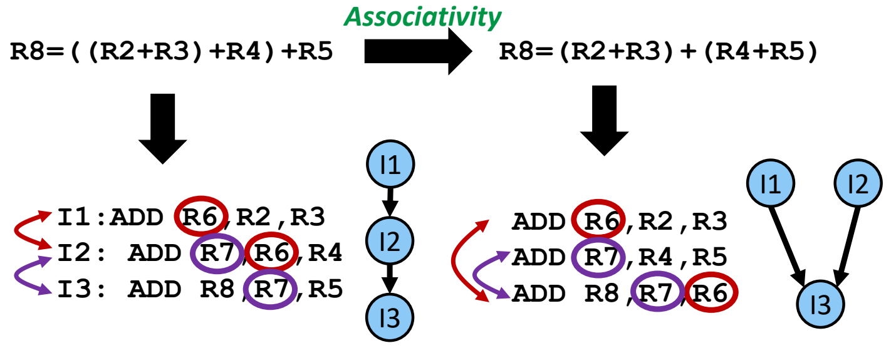
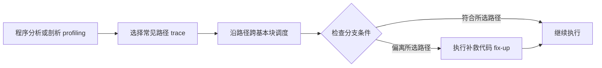
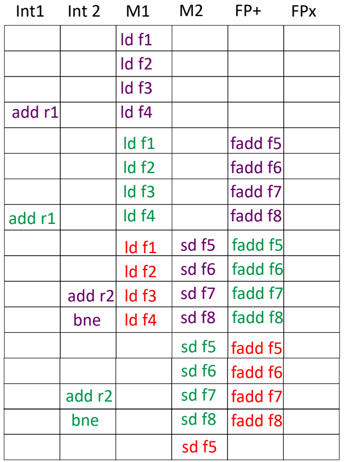

# 01 静态调度的扩展

[本讲目录](../index.md) · [课程目录](../../index.md) · [下一节：02 乱序执行与依赖](02-out-of-order-and-dependencies.md)

> [!abstract] 本节要点
> - 树高约简在运算语义允许重结合时缩短关键路径；四个数求和仍需三次加法，但依赖深度可由 $3$ 降为 $2$。
> - 踪迹调度把常见路径上的多个基本块合起来调度，并为偏离该路径的执行准备补救代码。
> - 总体加速比必须同时计入优化收益与补救代价：$S=1/[(1-P)q+P/s]$。
> - 软件流水交错不同迭代的指令，使较新迭代的加载、较早迭代的计算和更早迭代的存储重叠。
> - 循环展开与软件流水可以配合；软件流水通过延长稳态区间，减少反复启动和收尾带来的损失。

L04 已解释寄存器重命名、循环展开和函数内联；这里继续讨论如何缩短依赖链，以及如何跨基本块、跨迭代寻找并行机会。

## 树高约简

处理器有多个计算单元，也不代表一组指令能同时执行。如果后一条指令必须使用前一条的结果，增加单元仍不能跳过这条依赖链。**树高约简（Tree Height Reduction）**利用合法的结合律变换，改变表达式的计算树，缩短从输入到最终结果的最长依赖路径。[^s3p3]

> [!example] 例：把三层加法依赖压成两层
> 原表达式为
> $$
> R8=((R2+R3)+R4)+R5.
> $$
> 对应指令如下，目的寄存器写在第一个操作数位置：
>
> ```asm
> I1: ADD R6, R2, R3
> I2: ADD R7, R6, R4
> I3: ADD R8, R7, R5
> ```
>
> 1. `I1` 产生 `R6`，`I2` 必须等到这个结果才能计算。
> 2. `I2` 产生 `R7`，`I3` 又必须等待 `R7`。
> 3. 因而依赖链是 `I1 → I2 → I3`，共三个加法层次。
>
> 当运算允许这样重结合时，将表达式改为
> $$
> R8=(R2+R3)+(R4+R5),
> $$
> 得到：
>
> ```asm
> I1: ADD R6, R2, R3
> I2: ADD R7, R4, R5
> I3: ADD R8, R7, R6
> ```
>
> 此时 `I1` 和 `I2` 之间没有数据依赖，可以并行计算两部分；`I3` 等待二者完成后相加。指令仍是三条，最长依赖路径却只有两个加法层次。在加法延迟相同、发射和执行资源足够的条件下，这才提供了更短的完成时间。[^s3p3][^s5b1]



图：在允许按结合律重排的条件下，将 $((R2+R3)+R4)+R5$ 改为 $(R2+R3)+(R4+R5)$，三条加法的依赖深度由 $3$ 降为 $2$。

判断这类优化是否成立，要先检查运算的等价性，再检查新依赖图。数学运算不都满足结合律；即使数学表达式等价，也要符合程序采用的数据类型和运算语义。

> [!note] 补充解释
> C 表达式的“左结合”描述语法分组，例如连续加法通常按 `((a+b)+c)+d` 解析，不能据此断言所有操作数都按从左到右的顺序求值。浮点加法还涉及舍入，重结合可能改变结果；实际编译器只有在语言语义、输入条件或所采用的浮点优化规则允许时，才能做相应变换。因此，结合性与求值顺序必须分开判断。[^s3p3]

衡量调度效果时，仍使用执行时间关系：

$$
T=\mathrm{IC}\times\mathrm{CPI}\times\mathrm{CCT}.
$$

其中，$T$ 是执行时间，$\mathrm{IC}$ 是实际执行的指令数，$\mathrm{CPI}$ 是平均每条指令需要的周期数，$\mathrm{CCT}$ 是一个时钟周期的时间；三项单位相乘为“指令数 $\times$ 周期/指令 $\times$ 秒/周期”，得到秒。接下来的调度技术主要设法降低 $\mathrm{CPI}$，让等待期间也能执行其他有用指令。树高约简的例子尤其说明，减少完成时间不一定要减少指令条数。[^s3p4]

> [!note] 补充解释
> - [GCC 官方文档：-fassociative-math](https://gcc.gnu.org/onlinedocs/gcc/Optimize-Options.html)：浮点运算重新结合可能改变计算结果、零的符号以及上溢或下溢行为，因此树高约简必须满足相应的数值语义条件。

## 全局与踪迹调度

只在一个很小的基本块内调度，常常找不到足够多的独立指令。**基本块（Basic Block）**是除入口与末尾外没有控制流转入或转出的连续指令序列；对于这里讨论的非数值计算程序，一个基本块通常只有 $5$–$20$ 条指令。分支频繁切断调度范围，因此需要把多个基本块一起考虑。[^s3p6]

**全局调度（Global Scheduling）**跨基本块安排指令，面向包含条件分支的程序区域；其调度对象可以表示为有向无环图（DAG）。方法包括基于踪迹（trace-based）和基于 DAG（DAG-based）的调度。与之相比，软件流水专门围绕循环，安排不同迭代的重叠。这两者都属于编译器完成的静态指令级并行调度。[^s3p5][^s3p6]

**踪迹调度（Trace Scheduling）**是全局调度的一种方法：先选择一条常见执行路径，把沿途的基本块视为较大的调度区域，再处理实际执行偏离这条路径的情况。它适用于一般代码，不限于循环。[^s3p7]

1. **选出常见路径**：通过程序分析或运行剖析（profiling），判断哪些分支方向经常出现。
2. **合并调度范围**：沿选中的路径安排指令，尽量像处理一段无分支代码一样寻找优化机会。
3. **检查分支条件**：在合法的位置确认执行是否确实沿着该路径。
4. **执行补救代码**：若路径假设不成立，修正提前执行造成的结果，使程序继续保持原有语义。



### 完整例子：把常见路径放在一起

原程序先计算 $a=\log(x)$，根据 $b$ 的大小选择 $c$，最后计算 $y=\sin(c)$：

```c
a = log(x);
if (b > 0.01) {
    c = a / b;
} else {
    c = 0;
}
y = sin(c);
```

假设剖析表明，$b>0.01$ 在 $90\%$ 的执行中成立，就可以围绕这条常见路径组织调度。下面用完整的控制流写出教学示意；`goto done` 明确让正常路径跳过独立的补救块。[^s3p8]

```c
a = log(x);
c = a / b;
y = sin(c);
if (!(b > 0.01))
    goto fixit;
goto done;

fixit:
c = 0;
y = 0;              // sin(0)

done:
;                   // 后续代码
```

当 $b>0.01$ 时，连续的三条计算语句得到原程序所需结果，随后走正常继续路径。这样，原先被分支分开的计算被放入同一调度区域。三条语句本身仍有数据依赖；扩大调度区域意味着编译器有更多优化机会，并不意味着这三条语句可以任意同时执行。

当原判定 `b > 0.01` 不成立时，原程序应当得到 $c=0$、$y=\sin(0)=0$；`!(b > 0.01)` 保留了原判定的逻辑否定。提前计算的 $c$ 和 $y$ 都可能不对，因此补救块必须同时将二者重置；只改 $c$ 会留下错误的 $y$。正常路径通过 `goto done` 跳过 `fixit`，否则也会执行清零操作，破坏原意。[^s3p8][^s5b2]

> [!note] 补充解释
> 这段变换首先是控制流示意，实际代码移动还必须保证异常和副作用语义。例如，原程序在 $b=0$ 时不会执行除法，变换后却会先执行 `a / b`；如果该操作会产生程序可观察的异常或状态变化，仅把 $c$、$y$ 改回去并不足以恢复原语义。编译器必须证明提前执行是安全的，或使用允许该推测的机制；路径出现概率高不能代替正确性条件。

## 补救代价与总体收益

常见路径变快，不代表整个程序一定变快。踪迹调度可能让少见路径多做一段无用计算，再执行补救代码，因此必须按原执行时间的占比计算两部分的变化。

设原总时间为 $T_0$，被优化部分占原时间的比例为 $P$，其局部加速比为 $s$。该部分原来耗时 $PT_0$，优化后为 $PT_0/s$；其余部分不变时：

$$
T_1=(1-P)T_0+\frac{PT_0}{s},
$$

于是**阿姆达尔定律（Amdahl's Law）**给出总体加速比

$$
S=\frac{T_0}{T_1}
=\frac{1}{(1-P)+P/s}.
$$

$P$、$s$ 和 $S$ 都是无量纲量；其中 $P$ 必须来自优化前的时间分配，而非仅凭分支次数决定。[^s3p9]

> [!example] 例：常见路径加快 $15\%$，总体能加快多少
> 另作一个性能分析假设：可优化部分占原执行时间的 $80\%$，即 $P=0.8$；“快 $15\%$”在此表示局部速度变为 $1.15$ 倍，因此 $s=1.15$。
>
> 1. 把 $T_0$ 归一化为 $1$，未优化部分仍耗时 $0.2$。
> 2. 优化部分的新耗时是 $0.8/1.15\approx0.69565$。
> 3. 总耗时为 $0.2+0.69565\approx0.89565$。
> 4. 总体加速比为
> $$
> S=\frac{1}{0.2+0.8/1.15}\approx1.117.
> $$
> 即总体速度提高约 $11.7\%$。[^s3p9]

再设补救使剩余部分的耗时变为原来的 $q$ 倍，则

$$
T_1=q(1-P)T_0+\frac{PT_0}{s},
\qquad
S=\frac{1}{q(1-P)+P/s}.
$$

这里的 $q$ 是少见路径部分的**耗时倍率**，与表示速度倍率的 $s$ 不同。

> [!example] 例：剩余部分因补救而多耗时 $30\%$
> 保持 $P=0.8$、$s=1.15$，将“慢 $30\%$”按本例含义写为耗时倍率 $q=1.3$：
>
> 1. 原来占 $0.2$ 的部分，现耗时 $0.2\times1.3=0.26$。
> 2. 优化部分仍耗时 $0.8/1.15\approx0.69565$。
> 3. 总耗时为 $0.26+0.69565\approx0.95565$。
> 4. 因而
> $$
> S=\frac{1}{0.2\times1.3+0.8/1.15}\approx1.046.
> $$
> 总体速度只提高约 $4.6\%$，明显低于忽略补救代价时的 $11.7\%$。[^s3p9]

> [!warning] 易错点
> 前一例的 $90\%$ 是路径出现概率，这里使用的 $80\%$ 是另一项假设中的原时间占比，不能直接互换。局部速度提高 $15\%$ 应把时间除以 $1.15$，不是乘以 $0.85$；本例“慢 $30\%$”明确采用时间乘以 $1.3$，不能同时又按速度下降 $30\%$ 计算。

> [!tip] 课堂强调
> 评价静态优化时，要把加速部分的收益和补救部分的损失放进同一个时间模型；只看被选中路径的加速比，会高估整体收益。[^s5b2]

## 软件流水

即使循环已经展开，把同一批数据的加载、计算、存储集中执行，也可能让某一种功能单元很忙，而其他单元持续空闲。**软件流水（Software Pipelining）**通过在当前迭代结束前启动下一迭代，交错安排不同迭代的操作，利用它们处于不同计算阶段这一特点。[^s3p10]

例如，当前迭代的浮点加法正在执行时，可以加载下一迭代的数据；更早迭代的加法已经完成，则可以同时存回其结果。每个迭代内部的生产者—消费者关系仍须满足，但不同迭代的不同类型操作可以占用不同功能单元。

这种安排包含三个阶段：

| 阶段 | 同时存在的工作 | 并行度与作用 |
|---|---|---|
| **前序段**（prolog） | 先启动的迭代逐步进入计算，后续迭代陆续开始 | 正在填充流水，暂时只有部分指令槽可用 |
| **稳态循环核**（kernel） | 不同迭代分别处于加载、计算、存储等阶段 | 按重复排程持续重叠，是主要吞吐来源 |
| **尾声段**（epilog） | 停止启动新迭代，完成已经开始的迭代 | 正在排空流水，可并行的操作逐渐减少 |

在用四类指令表示迭代的 VLIW 示意中，只有稳态循环核能使用所示的完整指令宽度；前序段和尾声段都只包含部分操作。这说明“填满”发生在稳态，不能把整个循环从第一周期起都当作满宽执行。[^s3p10][^s5b3]

> [!info] 可视化资源
> - [TI：软件流水的 prolog、kernel 与 epilog](https://software-dl.ti.com/codegen/docs/c7000/optimization_guide/_static/C7000_Optimization_Guide.pdf)：对照图 5.3–5.4（PDF 第 35–36 页），看不同迭代怎样重叠，以及稳态循环如何启动和收尾。

### 四次展开后的代码与资源

下面的循环一次处理四个元素，先从以 `r1` 为基址的位置加载，把各元素与 `f0` 相加，再存入以 `r2` 为基址的位置。地址偏移依次为 $0$、$8$、$16$、$24$ 字节；每批结束时两个指针各推进 $32$ 字节。这里沿用讲义的两操作数简写，`add r1, 32` 表示更新 `r1` 为其原值加 $32$，`r2` 同理。[^s3p11]

```asm
loop:
    ld   f1,  0(r1)
    ld   f2,  8(r1)
    ld   f3, 16(r1)
    ld   f4, 24(r1)
    add  r1, 32

    fadd f5, f0, f1
    fadd f6, f0, f2
    fadd f7, f0, f3
    fadd f8, f0, f4

    sd   f5,  0(r2)
    sd   f6,  8(r2)
    sd   f7, 16(r2)
    sd   f8, 24(r2)
    add  r2, 32
    bne  r1, r3, loop
```

`fadd f5, f0, f1` 的含义是把 `f0 + f1` 写入 `f5`；`sd f5, 0(r2)` 则将 `f5` 存到对应地址。`bne` 在更新后的 `r1` 不等于边界寄存器 `r3` 时转回循环。因此，同一元素至少保留 `ld → fadd → sd` 这条依赖链。

排程表的六列表示六个可用执行槽：`Int1`、`Int2` 用于整数运算和分支，`M1`、`M2` 用于访存，`FP+` 用于浮点加法，`FPx` 用于浮点乘法。判断能否同周期放入多条指令，需要同时检查数据是否就绪，以及所需资源是否发生冲突。

单批展开的排程标注 `ld: 2 cycle`、`fadd: 3 cycle`。从具体位置读，第一条 `ld` 在第 $1$ 行，相应 `fadd` 在第 $4$ 行，中间隔着两行；该 `fadd` 对应的 `sd` 在第 $8$ 行，中间隔着三行。这里应把标注与图中生产者到消费者的等待间隔一起理解，不直接把数字当作包含发射、执行、写回在内的完整流水线总延迟。[^s3p11]

这张单批表也已经存在局部并行：第 $4$ 行同时有 `add r1`、第四条 `ld` 和第一条 `fadd`。但随后几行主要占用 `FP+`，再后几行主要占用访存槽，仍留有很多空位；一次只围绕这一批安排，难以持续利用不同类型的单元。

### 把相邻批次叠起来

软件流水示意先做同样的四次展开，再把连续的展开批次叠在一起。图中紫色、绿色、红色分别表示不同批次，纵向每一行表示一次并行安排：[^s3p12]

1. **第 $1$–$4$ 行**：第一批的四条加载依次进入 `M1`，第 $4$ 行还更新其输入指针。
2. **第 $5$–$8$ 行**：第二批的加载进入 `M1`，第一批的四条加法进入 `FP+`。加载与计算开始重叠。
3. **第 $9$–$12$ 行**：第三批在 `M1` 加载，第二批在 `FP+` 计算，第一批在 `M2` 存储；三批的不同工作同时推进。
4. **后续行**：第二批的存储与第三批的加法继续重叠。图中还显示第一批、第二批各自的输出指针更新和分支操作，表格末尾只画到第三批开始存储。



图：紫、绿、红三批迭代在第 $9$ 至 $12$ 行同时占用加载、存储和浮点加法资源，FPx 列仍为空。

> [!example] 例：读出第 $9$ 行的三条操作
> `M1` 中红色的 `ld f1` 为第三批加载输入；`FP+` 中绿色的 `fadd f5` 计算第二批结果；`M2` 中紫色的 `sd f5` 存回第一批结果。
>
> 它们能够重叠，是因为来自不同批次，而且分别占用加载、浮点加法和存储资源。第一批的存储仍使用第一批算出的值，第二批加法仍依赖第二批此前加载的数据；软件流水没有取消这些依赖。

软件流水图把第一条 `fadd` 放在第 $5$ 行，前面的单批排程则放在第 $4$ 行。两张示意的起步安排并不完全相同，不能直接用末行行号相除推导精确加速倍数。它们可靠地展示的是：跨批次重叠以后，访存与浮点加法可以连续并行；`FPx` 在这个只有加法的循环中仍然空闲，因此“利用率更高”也不等于每个功能单元每周期都在工作。[^s3p11][^s3p12]

> [!warning] 易错点
> 图中不同颜色反复使用 `f1`、`f5` 等名字，是在标明同类操作。落实成正确程序时，必须保护不同批次仍需使用的值，并妥善处理指针更新、分支和尾声。该表没有展开这些完整细节，不能直接把格子逐行拼成一段可执行汇编。

循环展开与软件流水可以共同使用，上面的例子正是先展开四次，再做跨批次排程。区别在于，仅按一个个展开批次完成工作，可能反复经历启动、进入较高并行度、收尾；软件流水让相邻批次重叠，将循环中间的稳态区间延长，使整个循环主要在开头和结尾各承担一次填充、排空代价。不能由此得出“循环展开无法并行”的结论。[^s3p13]

静态调度仍受动态信息限制：一个分支若前半段总是跳转、后半段总是不跳转，汇总剖析可能只显示各占一半；某次数据缓存缺失也会让实际加载延迟远超编译时预期。编译器生成的固定排程无法在该次执行中即时回应这些变化，[乱序执行与依赖](02-out-of-order-and-dependencies.md)将说明硬件如何根据当时的就绪状态继续寻找可执行指令。[^s3p14]

> [!question]- 自测：四个数求和由三层改成两层后，若机器每周期只能执行一次加法，是否一定从三个周期变为两个周期？
> 不一定。树高约简缩短的是依赖深度；要在第一层同时完成两次加法，还需要足够的发射和执行资源。若每周期只允许一次加法，三条加法仍至少需要三个执行机会，不能直接取得两周期结果。

> [!question]- 自测：仍有 $80\%$ 的原时间可加速到 $1.15$ 倍，但补救使剩余部分耗时增至 $1.6$ 倍，总体是否变快？
> 变慢。新时间比例为 $0.2\times1.6+0.8/1.15\approx1.01565$，总体加速比约为 $0.985<1$。常见路径节省的时间不足以抵消少见路径增加的时间。

> [!question]- 自测：若机器每周期只能执行一条访存指令，软件流水图第 $9$ 行还能保持同样的并行安排吗？
> 不能。该行的第三批加载和第一批存储需要在同周期启动两条访存指令，单访存资源会发生结构冲突，必须调整排程。第二批浮点加法占用另一类资源，是否能保留仍取决于它的输入是否就绪。

> [!info]- 来源
> - L04-MultiIssue.pdf：PDF p.90–101
> - L05-Dynamic-Scheduling.pdf：PDF p.3–14
> - L05.docx：DOCX body 1–114

[^s3p3]: L05-Dynamic-Scheduling.pdf-PDF p.3
[^s5b1]: L05.docx-DOCX body 1-40
[^s3p4]: L05-Dynamic-Scheduling.pdf-PDF p.4
[^s3p6]: L05-Dynamic-Scheduling.pdf-PDF p.6
[^s3p5]: L05-Dynamic-Scheduling.pdf-PDF p.5
[^s3p7]: L05-Dynamic-Scheduling.pdf-PDF p.7
[^s3p8]: L05-Dynamic-Scheduling.pdf-PDF p.8
[^s5b2]: L05.docx-DOCX body 41-81
[^s3p9]: L05-Dynamic-Scheduling.pdf-PDF p.9
[^s3p10]: L05-Dynamic-Scheduling.pdf-PDF p.10
[^s5b3]: L05.docx-DOCX body 82-114
[^s3p11]: L05-Dynamic-Scheduling.pdf-PDF p.11
[^s3p12]: L05-Dynamic-Scheduling.pdf-PDF p.12
[^s3p13]: L05-Dynamic-Scheduling.pdf-PDF p.13
[^s3p14]: L05-Dynamic-Scheduling.pdf-PDF p.14

[本讲目录](../index.md) · [课程目录](../../index.md) · [下一节：02 乱序执行与依赖](02-out-of-order-and-dependencies.md)
