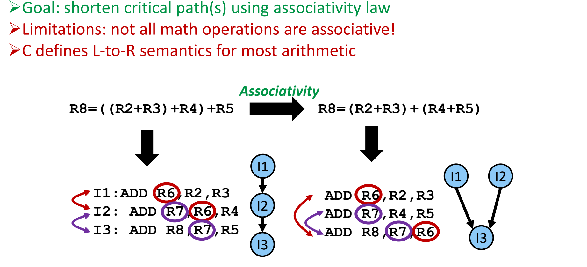
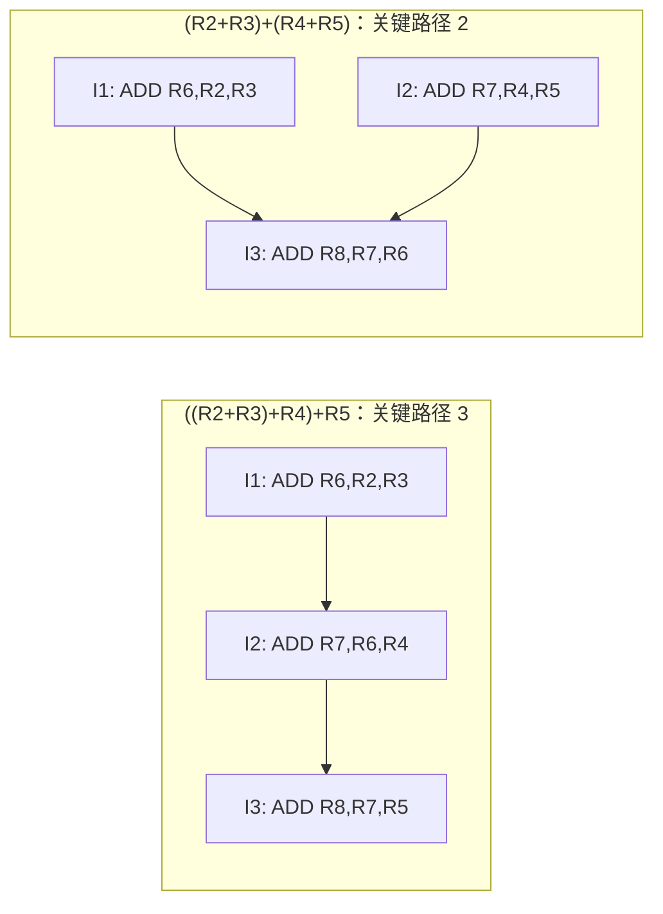
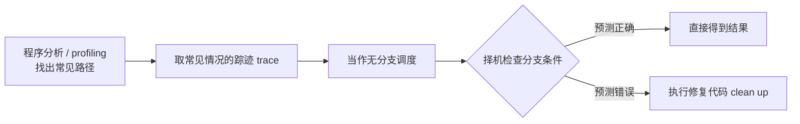
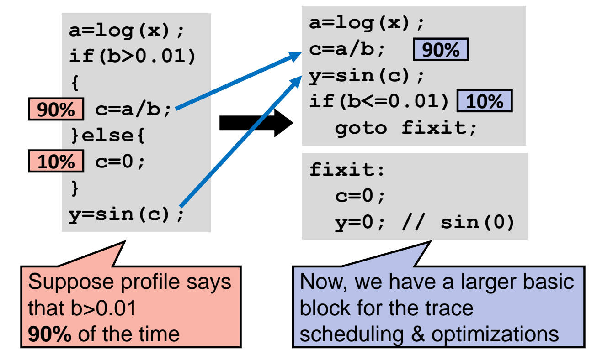

# 01 树高约简与踪迹调度

[本讲目录](../index.md) · [课程目录](../../index.md) · [下一节：02 软件流水与编译器局限](02-software-pipelining-and-compiler-limits.md)

> [!abstract] 本节要点
> - 树高约简利用结合律重排表达式：$((R2+R3)+R4)+R5$ 改写为 $(R2+R3)+(R4+R5)$ 后，3 条串行 ADD 的依赖链长度从 3 降为 2；前提是运算满足结合律，而 C 语言对多数算术规定从左到右求值，需要编译器来做这种改写。
> - 执行时间 $= IC \times CPI \times CCT$；树高约简、全局调度、软件流水这类 ILP 优化主要降低 $CPI$。
> - 静态 ILP 调度分两类：全局调度面向含大量条件分支的通用整数程序 DAG，软件流水面向循环。
> - 非数值程序的基本块通常只有 5~20 条指令，块内找不到足够多的独立指令，所以要跨基本块做全局调度；全局调度分踪迹调度和基于 DAG 的调度，本课只讲踪迹调度。
> - 踪迹调度按常见路径调度并用修复代码处理例外，收益要用 Amdahl 定律连同修复代价一起算：常见路径占 80% 时间、提速 15% 时加速比为 1.117；若其余 20% 因修复代码慢 30%，加速比只剩 1.046，约 2/3 的收益被抵消。

## 树高约简（Tree Height Reduction）

编译器把一个算式翻译成指令时，如果每一步都要用上一步的结果，这些指令只能一条接一条执行，硬件再多也没有可以同时执行的指令。树高约简就是从算式本身入手，把这种长依赖链拆短。它是静态调度优化技术中的第四种（Technique 4），前三种在上一讲 L04 中介绍。

**树高约简**（tree height reduction）的目标是：利用**结合律**（associativity law）重新组合运算，缩短计算的**关键路径**（critical path）。[^s3p3] 把计算看成一棵表达式树（或依赖图），叶子是操作数，内部结点是运算；树越高，串行步数越多。改写不减少运算次数，只降低树的高度。

### 例：四个数相加

C 代码 `R8 = R2 + R3 + R4 + R5` 按从左到右的语义是 $R8=((R2+R3)+R4)+R5$，直接翻译为：

```asm
I1: ADD R6, R2, R3    ; R6 = R2 + R3
I2: ADD R7, R6, R4    ; R7 = R6 + R4，读 I1 的结果 R6
I3: ADD R8, R7, R5    ; R8 = R7 + R5，读 I2 的结果 R7
```

I2 读 I1 写的 R6，I3 读 I2 写的 R7，两处都是写后读（RAW）真相关，依赖图是一条链 $I1 \to I2 \to I3$。三条指令中任意两条都不能同时执行，关键路径长度为 3。

利用结合律改写为 $R8=(R2+R3)+(R4+R5)$：

```asm
I1: ADD R6, R2, R3    ; R6 = R2 + R3
I2: ADD R7, R4, R5    ; R7 = R4 + R5，与 I1 无关
I3: ADD R8, R7, R6    ; 同时依赖 I1 和 I2
```

现在只有 I3 依赖 I1（读 R6）和 I2（读 R7），I1 与 I2 之间没有依赖，可以同时执行。依赖图从一条长度为 3 的链变成了两个叶子汇到一个根，关键路径长度从 3 降为 2。指令数仍然是 3 条。[^s3p3]



图：利用结合律把 $((R2+R3)+R4)+R5$ 改写为 $(R2+R3)+(R4+R5)$。左侧 $I1 \to I2 \to I3$ 是长度为 3 的串行链，右侧 I1、I2 相互独立、只有 I3 依赖二者，关键路径缩短为 2；圆圈标出了产生依赖的寄存器 R6 和 R7。



### 局限

1. **不是所有运算都满足结合律**：只有满足结合律的运算才能这样重新加括号，很多算式找不到这种改写。
2. **C 语言对多数算术规定从左到右（L-to-R）求值**：程序员不写括号时，源代码的语义天然就是左结合的串行链。要得到较矮的树，需要编译器分析能否安全地改写，以减少依赖关系。[^s3p3]

> [!note] 补充解释
> 整数加法（含溢出回绕）满足结合律；浮点加法因每一步都要舍入，严格说不满足结合律，$(a+b)+c$ 与 $a+(b+c)$ 的结果可能不同。因此编译器一般不会自动对浮点表达式做树高约简，除非用户放宽浮点语义（例如 GCC/Clang 的 `-ffast-math`）。

> [!info] 可视化资源
> [Georgia Tech CS6290 笔记：树高约简](https://one2bla.me/cs6290/lesson10/tree-height-reduction.html)：用四个操作数求和的汇编例子演示如何把串行加法链改写成并行求和，并说明只适用于满足结合律的运算。

> [!warning] 易错点
> 树高约简减少的是**关键路径长度**（串行步数），不是指令条数。上例前后都是 3 条 ADD，好处只在有足够硬件同时执行 I1、I2 时才能体现。

## 静态 ILP 调度的目标与分类

在讲具体调度技术前，先明确这些技术优化的是哪一项。程序执行时间可以分解为

$$
\text{Execution Time} = IC \times CPI \times CCT
$$

其中 $IC$（Instruction Count）是执行的指令条数，$CPI$（Cycles per Instruction）是平均每条指令的时钟周期数，$CCT$（Clock Cycle Time）是时钟周期长度。本部分讨论的指令级并行（ILP）优化主要降低 $CPI$：指令总数和时钟频率不变，让更多指令重叠执行，平均每条指令占用的周期就少了。[^s3p4] 上例树高约简就是这样：指令仍是 3 条，但完成它们所需的串行步数从 3 降到 2。

**指令级并行调度**（scheduling for instruction-level parallelism）的目标是安排指令顺序，使整个程序尽早完成。由编译器完成的**静态 ILP 调度**（static ILP scheduling）分为两类：[^s3p5]

| 类别 | 调度对象 | 典型程序 |
| --- | --- | --- |
| **全局调度**（global scheduling） | 通用整数程序的 DAG（有向无环图，Directed Acyclic Graph），其中有大量条件分支 | 分支多、循环少的非数值程序 |
| **软件流水**（software pipelining） | 任意代码中的循环 | 循环体反复执行的程序 |

两类目标不同：全局调度要把被许多分支隔开的代码放到一起调度，软件流水要把一个循环的多次迭代交错起来调度。本节讲全局调度，软件流水见[软件流水与编译器局限](02-software-pipelining-and-compiler-limits.md)。

## 基本块与全局调度（Global Scheduling）

**基本块**（basic block）是一段中间没有分支跳入、也没有分支跳出的指令序列：控制流只能从第一条指令进入，从最后一条指令离开。[^s3p6] 例如讲义中的控制流图里，`x:=a+b; y:=a*b` 是一个基本块，条件判断 `y>a` 单独构成一个基本块，循环体 `a:=a+1; x:=a+b` 又是一个基本块。

问题在于基本块太小。非数值计算程序的基本块一般只有 **5~20 条指令**。[^s3p6] 每隔几条到十几条指令就有一个分支，块内能够并行处理的独立指令数量不够。如果调度只在基本块内进行，编译器很难填满流水线或多发射槽位。而跨过分支调度又要面对分支预测：一旦预测错误，提前执行的指令就是错的。

**全局调度**就是为了解决这个问题：既然基本块太小、找不到足够的独立指令，就跨所有基本块（即"全局"地）调度指令，把多个基本块合在一起处理，就像它们能一起执行一样。[^s3p6]

全局调度有两种实现方式：

- **踪迹调度**（trace-based scheduling）：本课讲解的方法，见下一节。
- **基于 DAG 的调度**（DAG-based scheduling）：本课不讲。

## 踪迹调度（Trace-based Scheduling）

踪迹调度是全局调度的一种方法。它的思路比较直接：分支虽然多，但每个分支通常有一个方向更常见；只要把最常见的那条执行路径当作一个大基本块来调度，就能获得足够多的独立指令，偶尔走另一个方向时再补救。

**踪迹调度**的做法如下：[^s3p7]

1. **适用范围**：作用于所有代码，不只是循环。
2. **取常见路径**：选出常见情况（common case）的执行**踪迹**（trace），即程序最常走的一条执行路径。
3. **当作无分支调度**：把这条踪迹上的代码当作没有分支来调度，在更大的范围内重排指令。
4. **择机检查分支条件**：原来的分支条件并没有消失，在方便的位置检查它。
5. **预测错就清理**：如果检查发现这次没有走常见路径（预测错误），就执行修复代码来清理（clean up the mess），恢复正确的结果。

常见情况通过**程序分析**（program analysis，静态分析代码）或 **profiling**（先实际运行程序，统计各分支方向的频率）找出。[^s3p7]



### 例：把 if-else 并入一个大基本块

原始代码：

```c
a = log(x);
if (b > 0.01) {
    c = a / b;     // 90%
} else {
    c = 0;         // 10%
}
y = sin(c);
```

假设 profiling 表明 $b>0.01$ 的情况占 90%。这段代码被 `if` 切成多个很小的基本块：`a=log(x)` 一块、`c=a/b` 一块、`c=0` 一块、`y=sin(c)` 一块，每块只有一条语句，编译器没什么可调度的。

踪迹调度的改写：

1. 既然 90% 的情况都会执行 `c=a/b`，就默认它一定执行，把它直接接在 `a=log(x)` 后面。
2. `y=sin(c)` 也顺便提到前面，于是 `a=log(x); c=a/b; y=sin(c);` 成为一个包含三条语句的大基本块，可以统一调度和优化。
3. 剩下 10% 的情况仍需处理：在块后检查原条件的反面 `if (b <= 0.01) goto fixit;`。
4. 修复代码 `fixit` 把前面按常见路径算出的 `c` 和 `y` 改成正确值：`c=0`，`y=0`（因为 $\sin(0)=0$）。

```c
a = log(x);
c = a / b;               // 90%
y = sin(c);
if (b <= 0.01)           // 10%
    goto fixit;

fixit:
    c = 0;
    y = 0;               // sin(0)
```

改写后的代码为踪迹调度和其他优化提供了更大的基本块，在常见情况下比原始写法执行得更快。[^s3p8]



图：profile 显示 $b>0.01$ 占 90%。左侧原始 if/else 被改写为右侧的大基本块，箭头表示 `c=a/b` 与 `y=sin(c)` 被直接并入；只在 $b \le 0.01$（10%）时跳到 `fixit` 执行修复代码 `c=0; y=0`。

> [!info] 可视化资源
> [Wikipedia：踪迹调度（Trace scheduling）](https://en.wikipedia.org/wiki/Trace_scheduling)：补充踪迹调度的来历（Josh Fisher 为 VLIW 提出）与补偿代码（compensation code）思想，可对照本例的 `fixit` 修复代码及代码膨胀代价。

> [!warning] 易错点
> 踪迹调度并没有删除分支：`if (b <= 0.01)` 仍要检查，只是检查被移到了常见路径代码之后。修复代码也不能只写 `c=0`，所有在常见路径上依据错误假设算出的值（这里还有 `y`）都要被修正。

## 修复代码的代价分析

踪迹调度让常见路径变快，但修复代码会让不常见路径变慢：走 10% 那条路时，不仅要执行修复代码，还白算了 `c=a/b` 和 `y=sin(c)`。这种优化是否值得，要把加速和减速放进同一个公式里计算。

所用的工具是 **Amdahl 定律**（Amdahl's law）：系统中某一部分被加速时，整体加速比取决于这部分在原执行时间中所占的比例。[^s3p9]

$$
\text{Speedup} = \frac{1}{(1-P) + \frac{P}{S}}
$$

其中 $P$ 是被加速部分占原执行时间的比例，$S$ 是该部分自身的加速比。分母是优化后的执行时间（以原时间为 1），其倒数就是系统整体性能的提升倍数。（Amdahl 定律的完整介绍在课程第二讲。）

> [!example] 例：踪迹调度到底赚了多少
> 已知：$b>0.01$ 那部分代码占 80% 的执行**时间**；优化后的踪迹快 15%，即 $P=0.8$，$S=1.15$。
>
> 1. **只算收益**：其余 20% 时间不变，
>    $$\text{Speedup} = \frac{1}{(1-0.8)+\frac{0.8}{1.15}} = \frac{1}{0.2+0.6957} = \frac{1}{0.8957} \approx 1.117$$
>    整体提速 11.7%。[^s3p9]
> 2. **计入修复代价**：修复代码使其余 20% 的时间再慢 30%，这部分时间变为 $(1-0.8)\times1.3=0.26$，
>    $$\text{Speedup} = \frac{1}{(1-0.8)\times1.3+\frac{0.8}{1.15}} = \frac{1}{0.26+0.6957} = \frac{1}{0.9557} \approx 1.046$$
>    整体只提速 4.6%。[^s3p9]
> 3. **比较**：$4.6\%/11.7\% \approx 0.39$，约 $\frac{2}{3}$ 的收益被修复代码抵消。[^s3p9]

结论：评估一项编译优化时，要同时算两部分：被加速部分能加速多少，以及为保证正确性而加入的额外代码带来多少性能损失。两者合起来才能判断这项优化是否合理、有没有必要做。

> [!warning] 易错点
> 例题中的 80% 是**执行时间**占比，不是前面 profiling 给出的 90% 分支概率；Amdahl 定律中的 $P$ 必须用时间占比。另外，减速是乘在未加速的那部分 $(1-P)$ 上，写成 $(1-P)\times1.3$，而不是把 1.3 乘到整个分母上。

> [!question]- 自测：对 $R1+R2+\cdots+R8$ 这 8 个数求和，按 C 从左到右语义编译和用结合律改写成平衡树，关键路径各为几条 ADD？指令条数各为多少？
> 从左到右是一条 7 级的串行链，关键路径 7；平衡树是两两相加、逐层合并，层数为 $\log_2 8 = 3$，关键路径 3。两种写法都是 7 条 ADD：树高约简只缩短关键路径，不减少运算次数。

> [!question]- 自测：沿用"80% 时间、踪迹快 15%"的条件，修复代码让其余 20% 时间慢多少时，踪迹调度就完全没有收益了？
> 令 $\frac{1}{0.2k+0.8/1.15}=1$，得 $0.2k = 1-0.6957 = 0.3043$，$k\approx1.52$。也就是其余部分慢约 52% 时加速比降到 1，再慢就比不优化还差。

> [!question]- 自测：某程序 profiling 发现某个分支两个方向各占约 50%，用踪迹调度把其中一个方向并入大基本块，可能出现什么问题？
> 常见情况不明显时，约一半执行都会走修复路径：常见路径所占时间比例 $P$ 小，修复代码拖慢的那部分 $(1-P)$ 却很大，按 Amdahl 定律收益很可能被抵消甚至变成负的。踪迹调度依赖分支有明显偏向的常见路径。

> [!info]- 来源
> - L05-Dynamic-Scheduling.pdf：PDF p.3–9
> - L05.docx：DOCX body 1–50

[^s3p3]: L05-Dynamic-Scheduling.pdf-PDF p.3
[^s3p4]: L05-Dynamic-Scheduling.pdf-PDF p.4
[^s3p5]: L05-Dynamic-Scheduling.pdf-PDF p.5
[^s3p6]: L05-Dynamic-Scheduling.pdf-PDF p.6
[^s3p7]: L05-Dynamic-Scheduling.pdf-PDF p.7
[^s3p8]: L05-Dynamic-Scheduling.pdf-PDF p.8
[^s3p9]: L05-Dynamic-Scheduling.pdf-PDF p.9

[本讲目录](../index.md) · [课程目录](../../index.md) · [下一节：02 软件流水与编译器局限](02-software-pipelining-and-compiler-limits.md)
