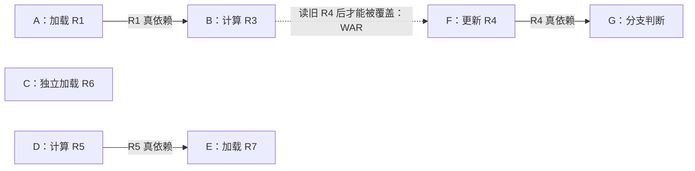
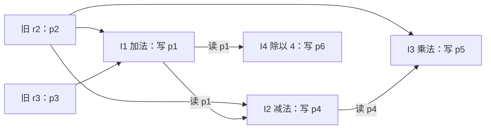
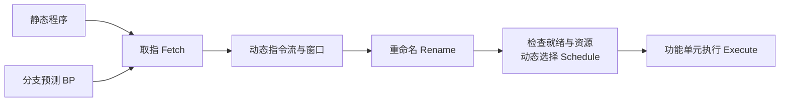

# 02 乱序执行与依赖

[本讲目录](../index.md) · [课程目录](../../index.md) · [上一节：01 静态调度的扩展](01-advanced-static-scheduling.md) · [下一节：03 记分板调度](03-scoreboard-scheduling.md)

> [!abstract] 本节要点
> - 乱序执行允许后面的就绪指令越过前面的等待指令；执行宽度与是否乱序是两个独立维度。
> - RAW 要求读到较早写者产生的值；WAR 要保住较早读者所需的旧值；WAW 要保住较晚写者的最终结果。
> - 硬件重命名用不同物理寄存器保存同名寄存器的不同版本，消除 WAR、WAW，保留 RAW。
> - 重命名时先确定源操作数的旧映射，再给目的分配新版本，尤其要检查源、目的同名的指令。
> - 指令窗口提供候选指令，分支预测扩大可见范围，就绪状态和功能单元资源决定实际执行顺序。

## 乱序执行的收益

缓存缺失会使一条 load 比预期执行得更久。如果处理器必须等它和紧随其后的消费者完成，后面本来可以计算的指令也会被堵住。[静态调度](01-advanced-static-scheduling.md)预先安排指令顺序；**动态调度（Dynamic Scheduling）**则由处理器在运行时根据依赖和资源状态选择指令。[^s3p16][^s5b3]

**乱序执行（Out-of-Order Execution，OoO 或 O3）**允许指令的执行顺序偏离程序顺序，前提是保持程序要求的数据关系和结果。这里的“乱序”指执行过程；不能据此推断取指、分配资源、提交等所有阶段都乱序。不同资料对 `issue`、`dispatch` 的命名差异，统一放在[重排序缓冲与提交](05-reorder-buffer-and-commit.md)中辨析。[^s3p17][^s5b5]

判断收益时，要分别回答两个问题：每周期最多安排几条指令，以及能否越过一条暂时不能执行的指令。单发射处理器可以乱序，双发射处理器也可以保持顺序。

### 七条指令的调度比较

考虑下列指令。`Load k[Rn]` 表示从地址“寄存器 `Rn` 的值加偏移量 `k`”取数；`BEQ R4, #0` 检查 `R4` 是否为零，分支目标在这个简化例中省略。[^s3p18]

```text
A: R1 = Load 16[R2]
B: R3 = R1 + R4
C: R6 = Load 8[R9]
D: R5 = R2 - 4
E: R7 = Load 20[R5]
F: R4 = R4 - 1
G: BEQ R4, #0
```

三条直接的生产者—消费者关系是：A 为 B 产生 `R1`，D 为 E 产生地址计算所需的 `R5`，F 为 G 产生用于判断的 `R4`。C 不在这三条数据链上，可以利用它填补等待时间。



实线表示必须传递的值，虚线表示原始寄存器名带来的额外顺序约束。B 要读旧 `R4`，F 要写新 `R4`，因此 F 若要越过 B，必须先用重命名或其他方式保住 B 所需的旧值。这条 WAR 关系虽然未画在原依赖图中，却能直接从指令操作数读出。[^s3p18]

> [!example] 例：用独立指令填补缓存缺失的等待
> 假设 A 发生缓存缺失，其余指令延迟与资源可用性采用本例时序，四种安排如下。括号表示同一周期安排的指令。
>
> | 执行方式 | 宽度 | 等待期间及后续安排 | 本例总周期 |
> | --- | --- | --- | --- |
> | 顺序 | 1 条/周期 | A 后等待，再依次执行 B、C、D、E、F、G | 10 |
> | 顺序 | 2 条/周期 | A 后仍须等 B 就绪，再安排 `(B,C)`、D、`(E,F)`、G | 8 |
> | 乱序 | 1 条/周期 | A 等待时先安排 C、D、E，再执行 B、F、G | 7 |
> | 乱序 | 2 条/周期 | 依次安排 `(A,C)`、`(D,F)`、`(E,G)`，B 等 A 的值到达后执行 | 5 |
>
> 单发射乱序把原来只能空等的时间交给 C、D、E。双发射顺序可以合并相邻的独立指令，但 B 被 A 阻塞时仍不能跳过 B；双发射乱序同时利用了执行宽度和跨越等待指令的能力。[^s3p18][^s5b4]

> [!warning] 易错点
> 这组 $10/8/7/5$ 周期取决于本例的缓存缺失、指令延迟和资源假设，不能作为所有程序的固定加速比。最后一种排程还隐含 B、F 间的名字冲突已被处理；若直接让 F 覆盖同一个 `R4`，B 就可能读到错误的值。

## 三类寄存器依赖

只检查功能单元是否空闲还不够。两条指令即使使用不同执行单元，也可能因读写同一寄存器而互相影响。对程序顺序中先出现的 A 和后出现的 B，可以按访问次序区分三类关系。[^s3p19]

| 关系 | 程序顺序中的访问 | 必须保持的约束 | 不加检查地重排会怎样 |
| --- | --- | --- | --- |
| **写后读（Read-After-Write，RAW）**，真数据依赖 | A 写，B 读同一寄存器 | B 必须读到 A 产生的值 | B 过早读取旧值 |
| **读后写（Write-After-Read，WAR）**，反依赖 | A 读，B 写同一寄存器 | A 必须保留对旧版本的读取 | B 提前覆盖，A 读到未来的值 |
| **写后写（Write-After-Write，WAW）**，输出依赖 | A 写，B 写同一寄存器 | 最终保留程序中较晚写者 B 的结果 | A 较晚写回，覆盖 B 的新结果 |

RAW 连接实际的数据生产者和消费者。WAR、WAW 则来自同一个存储名字被重复使用，称为**名字依赖（Name Dependence）**或假依赖。依赖是程序中的关系；当硬件执行次序可能违反这种关系时，就形成需要处理的冒险。

下面三个例子分别从同一组初始值开始，不能把上一个例子的结果带入下一个：

$$
R_1=5,\qquad R_2=-2,\qquad R_3=9,\qquad R_4=3.
$$

其中 $R_i$ 表示寄存器 `Ri` 中的数值。

> [!example] 例：RAW 读到了过时的输入
> ```text
> A: R1 = R2 + R3
> B: R4 = R1 * R4
> ```
> 按 A、B 执行：A 先得到 $R_1=-2+9=7$，B 再得到 $R_4=7\times3=21$。
>
> 如果 B 提前执行：它使用尚未更新的 $R_1=5$，得到 $R_4=5\times3=15$；A 随后把 $R_1$ 更新为 $7$，也无法自动修正已经算错的 B。这里必须保持 A 的结果到 B 的数据流。正确结果是 $21$，录音中的 $20$ 与给定操作数不符。[^s3p19][^s5b4]

> [!example] 例：WAR 把旧输入换成了未来的值
> ```text
> A: R1 = R3 / R4
> B: R3 = R2 * R4
> ```
> 按 A、B 执行：A 先读旧 $R_3=9$，得到 $R_1=9/3=3$；B 再把 $R_3$ 更新为 $-2\times3=-6$。
>
> 如果 B 提前覆盖 `R3`：A 随后读到 $-6$，得到 $R_1=-6/3=-2$。A 不需要 B 的乘法结果，只是两条指令恰好使用同一个名字 `R3`。[^s3p19]

> [!example] 例：WAW 让较早写者覆盖了最终结果
> ```text
> A: R1 = R2 + R3
> B: R1 = R3 * R4
> ```
> 按 A、B 写回：A 先写入 $-2+9=7$，B 再写入 $9\times3=27$，最终 $R_1=27$。
>
> 如果 B 先写回、A 后写回：`R1` 先变成 $27$，又被 A 的 $7$ 覆盖，最终 $R_1=7$。两个算术结果各自都算对了，但最终留下了错误版本。[^s3p19]

> [!warning] 易错点
> 判断 RAW、WAR、WAW 时，先按程序顺序列出“谁读、谁写”，再讨论实际执行先后。WAR 要保护先前的读，WAW 要保护最后的写；它们不能因为没有真正的数据传递就被直接忽略。

## 硬件寄存器重命名

WAR 和 WAW 的共同问题是：多个不同的值被迫共用一个寄存器名字。把这些值放在不同位置，旧读者就能继续读旧值，新写者也可以独立产生新值。

**寄存器重命名（Register Renaming）**将指令中的体系结构寄存器名映射到物理寄存器，并为新的写入分配新版本。这里由硬件在运行时完成。**映射表（MapTable）**记录每个体系结构寄存器当前对应的物理版本，**空闲列表（FreeList）**提供可分配的物理寄存器。[^s3p21][^s3p23]

一条指令的重命名按以下逻辑进行：

1. 按当前 MapTable 查找所有源寄存器，固定本条指令应读取的物理版本。
2. 从 FreeList 取一个空闲物理寄存器，作为本条指令的目的位置。
3. 将目的体系结构寄存器的映射改为新位置，使后续指令找到这个新生产者。
4. 已经重命名的早先指令保留自己的操作数版本，不随 MapTable 的后来更新而改变。

第二、三步改变的是“以后读取这个名字应找谁”，并不会把先前指令中的物理源寄存器名也改掉。

### 四条指令的映射演算

指令采用 `操作码 目的,源1,源2` 的顺序，`4` 是立即数。先从第一条已完成重命名的示意状态出发：`r2`、旧 `r3` 的值分别在 `p2`、`p3`，第一条 `add` 的结果命名为 `p1`，后续可用物理寄存器为 `p4`、`p5`、`p6`、`p7`。[^s3p21]

```text
I1: add r1,r2,r3
I2: sub r3,r2,r1
I3: mul r3,r2,r3
I4: div r1,r1,4
```

| 指令 | 使用的源版本 | 重命名后的指令 | 处理后映射 `(r1,r2,r3)` | 后续空闲位置 |
| --- | --- | --- | --- | --- |
| I1 | `r2→p2`，旧 `r3→p3` | `add p1,p2,p3` | `(p1,p2,p3)` | `p4,p5,p6,p7` |
| I2 | `r2→p2`，`r1→p1` | `sub p4,p2,p1` | `(p1,p2,p4)` | `p5,p6,p7` |
| I3 | `r2→p2`，`r3→p4` | `mul p5,p2,p4` | `(p1,p2,p5)` | `p6,p7` |
| I4 | `r1→p1`，立即数 `4` | `div p6,p1,4` | `(p6,p2,p5)` | `p7` |

这个表按照新值的产生顺序分配名字；表中先处理重命名，不表示相应计算已经完成。完整数据流如下。[^s3p21][^s3p22][^s3p23]



图中每条生产者到消费者的连线仍须满足。不同版本使不需要交换数据的写入不再互相覆盖。

> [!example] 例：逐条检查消失和保留的依赖
> - I1 读取旧 `r3`，I2 写入新 `r3`：原有 WAR。重命名后 I1 读 `p3`，I2 写 `p4`，新写入不会毁掉旧输入。
> - I2、I3 都写 `r3`：原有 WAW。重命名后分别写 `p4`、`p5`，结果位置分开；不过 I3 还要读取 I2 产生的 `p4`，这条 RAW 依然存在。
> - I2 读取 I1 产生的 `r1`，I4 又写 `r1`：I4 写 `p6`，不会覆盖 I2 正在等待或准备读取的 `p1`；I1、I4 对 `r1` 的 WAW 也被不同目的位置消除。
> - I4 的源仍是 `p1`，因为它计算的是“先前 `r1` 的值除以 $4$”；目的才是 `p6`。若先把映射更新为 `p6`，再从新映射读取源，就会错误地让 I4 等待自己的结果。

> [!warning] 易错点
> 重命名不能消除 RAW。I2 必须等 I1 的值，I3 必须等 I2 的值，I4 必须等 I1 的值；换一个物理名字不会提前产生数据。早期示意页中的 `sub p2,p4,p5` 等写法也不符合原指令的源、目的关系，应按上表的 `sub p4,p2,p1` 以及后续页完整数据流读取。[^s3p20][^s3p21][^s3p23]

## 指令窗口与动态选择

即使允许乱序，处理器一次只看见一条等待中的指令，也找不到可以替补的工作。**指令窗口（Instruction Window）**保存一批待调度的动态指令，使硬件能在其中寻找源操作数已就绪且资源允许执行的候选者。[^s3p24][^s3p29]

> [!note] 补充解释
> 这里的“动态指令”指程序运行时实际出现的指令实例。同一条循环指令可以多次进入动态指令流；处理器要判断的是这些实例之间的依赖。



这一概念流程包含三个关键动作，具体的缓冲位置和阶段划分取决于实现。[^s3p24][^s3p25][^s3p26]

1. **取入足够多的候选指令**：沿预测路径连续取指，让窗口覆盖多个基本块。示例以“100 多条”的调度窗口说明所需范围，这不是所有处理器的固定容量。若按课堂举例的“约每十条就遇到一次分支”估计，每遇到未解析分支都停止取指，很难持续提供这么多候选者。[^s3p24][^s5b5]
2. **记录正确的数据版本**：重命名去除 WAR、WAW，让依赖跟随具体生产者。一个物理源尚未就绪时，指令留在窗口等待，不能用该体系结构寄存器的其他版本替代它。
3. **按实际状态选择执行**：概念上，硬件不断检查就绪位；当所有源操作数已可用、相关访存依赖已满足、对应功能单元又可接受工作时，就可以选中该指令。资源数量限制同时执行的指令数，源值到达时间决定哪些候选者先有资格执行。[^s3p26][^s3p29]

例如，沿用上面的四条重命名指令，若最初 `p2`、`p3` 可用，I1 可以开始；I1 产生 `p1` 后，I2 和 I4 都获得所需输入，在资源允许时可以并行；I3 则还要等 I2 产生 `p4`。所以实际执行次序可以是 I1、随后 I2 与 I4、再到 I3，而不必把 I4 一直压在 I3 后面。[^s3p29]

> [!tip] 课堂强调
> 分支预测影响窗口能否持续获得足够多的指令，也影响这些工作是否有效。预测正确时，跨分支提前取入的指令提供更多并行机会；预测错误时，错误路径上的指令必须被清除，已经占用的窗口和执行资源就造成浪费。[^s5b5]

寄存器源就绪只是执行条件之一；load、store 的地址关系还要在运行时判断，具体机制见[精确异常与访存顺序](07-precise-exceptions-and-memory-order.md)。[记分板调度](03-scoreboard-scheduling.md)用状态表实现这些检查，可据此逐周期演算。

> [!question]- 自测：在七指令例中，A 仍未返回，C、D、E 已完成。能否直接执行 F 并让它覆盖 `R4`，等 A 返回后再执行 B？
> 不能直接覆盖。B 还需要 F 之前的旧 `R4`，两者存在 WAR。若 B 已绑定保存旧值的物理版本，F 写另一个物理版本，则可以让 F 提前；但 B 对 A 的 RAW 仍要求 B 等 A 返回。

> [!question]- 自测：在四指令重命名例中，I3 已完成重命名，I4 正在重命名。I4 应写成 `div p6,p1,4` 还是 `div p6,p6,4`？I4 的结果会不会成为 I2 的输入？
> 应写成 `div p6,p1,4`：先查源得到旧映射 `r1→p1`，再把目的 `r1` 更新为 `p6`。I2 已经绑定 `p1`，不会因映射后来变成 `p6` 而改读 I4 的结果。

> [!question]- 自测：若 `p1` 已就绪、`p4` 尚未就绪，且减法和除法单元都空闲，四指令例中的 I2、I3、I4 哪些能开始？假定 `p2` 已就绪，其他条件均满足。
> I2 和 I4 能开始，I3 不能。I2 读 `p2,p1`，I4 读 `p1` 和立即数；I3 需要 I2 尚未产生的 `p4`。即使 I3 与 I4 都已完成重命名，也不代表它们的输入已经就绪。

> [!info]- 来源
> - L05-Dynamic-Scheduling.pdf：PDF p.16–26, 29
> - L05.docx：DOCX body 82–191

[^s3p16]: L05-Dynamic-Scheduling.pdf-PDF p.16
[^s5b3]: L05.docx-DOCX body 82-114
[^s3p17]: L05-Dynamic-Scheduling.pdf-PDF p.17
[^s5b5]: L05.docx-DOCX body 154-191
[^s3p18]: L05-Dynamic-Scheduling.pdf-PDF p.18
[^s5b4]: L05.docx-DOCX body 115-153
[^s3p19]: L05-Dynamic-Scheduling.pdf-PDF p.19
[^s3p21]: L05-Dynamic-Scheduling.pdf-PDF p.21
[^s3p23]: L05-Dynamic-Scheduling.pdf-PDF p.23
[^s3p22]: L05-Dynamic-Scheduling.pdf-PDF p.22
[^s3p20]: L05-Dynamic-Scheduling.pdf-PDF p.20
[^s3p24]: L05-Dynamic-Scheduling.pdf-PDF p.24
[^s3p29]: L05-Dynamic-Scheduling.pdf-PDF p.29
[^s3p25]: L05-Dynamic-Scheduling.pdf-PDF p.25
[^s3p26]: L05-Dynamic-Scheduling.pdf-PDF p.26

[本讲目录](../index.md) · [课程目录](../../index.md) · [上一节：01 静态调度的扩展](01-advanced-static-scheduling.md) · [下一节：03 记分板调度](03-scoreboard-scheduling.md)
