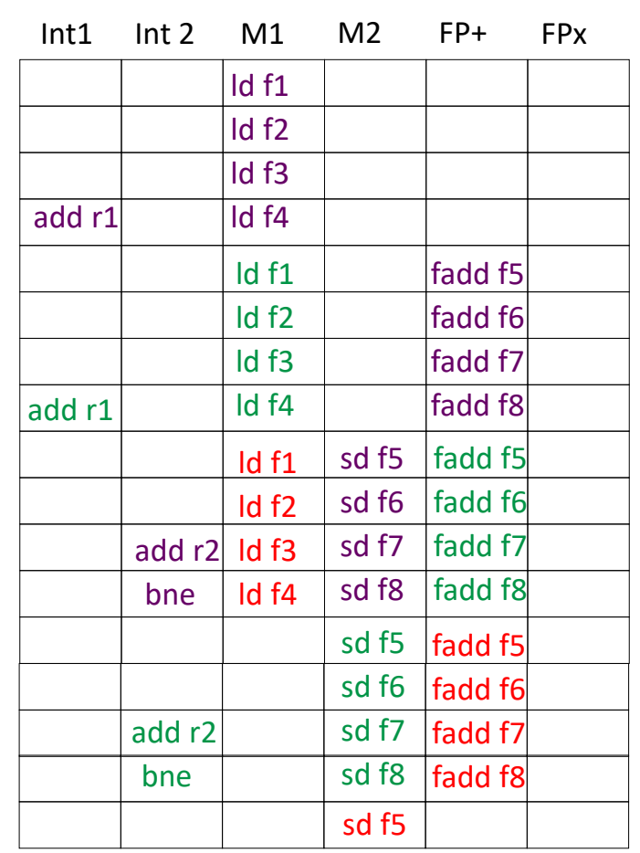
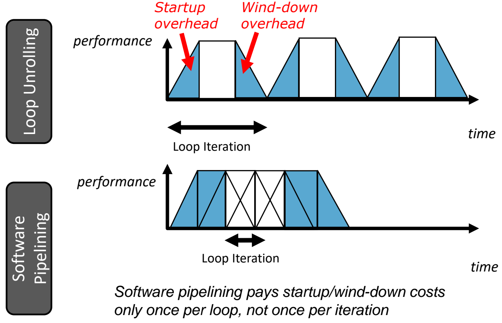
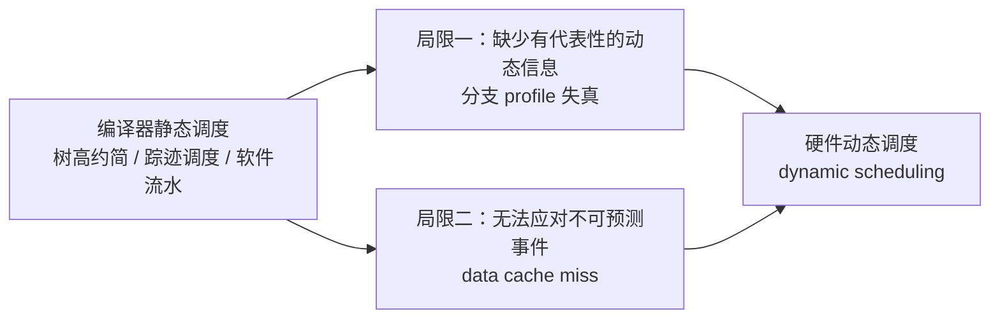

# 02 软件流水与编译器局限

[本讲目录](../index.md) · [课程目录](../../index.md) · [上一节：01 树高约简与踪迹调度](01-tree-height-reduction-and-trace-scheduling.md) · [下一节：03 乱序执行与寄存器重命名](03-out-of-order-execution-and-register-renaming.md)

> [!abstract] 本节要点
> - **软件流水**：当前迭代还没结束就启动下一次迭代，让不同迭代的不同指令在同一周期重叠执行；执行过程分为 prolog（爬升）、kernel（满宽度）、epilog（下降）三段。
> - 只有 kernel 段能填满 VLIW 长指令的全部槽位；prolog 和 epilog 只含部分指令，是并行度的 "ramp up" 与 "ramp down"。
> - 循环展开 4 份后直接调度（ld 2 周期、fadd 3 周期，6 个功能单元）：同类指令扎堆，4 个 ld 全挤在 M1、4 个 fadd 全挤在 FP+，11 个周期里大部分槽位空着，几乎是串行执行。
> - 软件流水让同一周期内来自不同迭代的 ld / fadd / sd / add / bne 并行；按调度表推算，稳态下每 4 个周期完成一组 4 个元素，而展开后直接调度每组要 11 个周期。开头的 load 段利用率仍低，是拆开迭代的代价。
> - 循环展开每次迭代都要付启动（startup）和收尾（wind-down）开销，软件流水每个循环只付一次。编译器静态调度有两个根本局限：拿不到有代表性的动态信息，也无法应对 data cache miss 这类不可预测事件，因此需要硬件动态调度。

## 软件流水（Software Pipelining）

循环展开（见 L04 循环展开与 VLIW 的相关章节）把几次迭代的**同一条指令**排在一起。这些指令类型相同，会去争同一个功能单元，其他类型的功能单元却闲着。软件流水的做法正好相反：把不同迭代拆开、错开排，让同一时刻执行的是**不同类型**的指令。[^s5b2]

**软件流水**（software pipelining）的做法是：循环的当前迭代结束之前，就开始执行下一次迭代，从而让不同迭代重叠执行（overlapping different iterations）。[^s3p10]

### 迭代重叠的图示

设循环体有 4 条指令 Inst1–Inst4，每次迭代依次执行它们，相邻两次迭代错开 1 个时间步启动。把 iteration1–iteration6 画成阶梯状并按时间对齐，同一行（同一时间步）里就同时有来自 4 个不同迭代的指令：

- iteration4 的 Inst1、iteration3 的 Inst2、iteration2 的 Inst3、iteration1 的 Inst4 在同一时间步执行；
- 下一行依次换成 iteration5 的 Inst1、iteration4 的 Inst2、iteration3 的 Inst3、iteration2 的 Inst4；
- 依此类推。

一个时间步里凑齐 Inst1–Inst4 全部 4 种指令的行，就是循环的稳态。

### Prolog、Kernel 与 Epilog

按"一行能否凑齐全部指令"可以把执行过程分成三段：[^s3p10]

1. **爬升段**（prolog）：前几次迭代刚启动，一行里只有 Inst1，或 Inst1+Inst2，等等，只是指令的一个子集，并行度逐步上升（ramp up）。
2. **核心段**（kernel）：图中阴影部分，每行都包含 Inst1–Inst4 全部指令，分属不同迭代。只有这一段能**填满 VLIW 长指令的全部宽度**（the full width of the VLIW instruction）。
3. **收尾段**（epilog）：最后几次迭代没有后继迭代来补位，一行里的指令又只剩子集，并行度逐步下降（ramp down）。


> [!tip] 课堂强调
> 软件流水与 VLIW 关系很紧密。VLIW 要把不同类型的指令打包进一条长指令，单靠循环展开几乎做不到，因为展开后相邻的是同类指令；软件流水把不同迭代的不同类型指令拼在一起，正好满足 VLIW 的需要。不过普通处理器的编译优化也会用到软件流水。prolog / epilog 与硬件流水线"逐步填满、逐步排空"是同一个意思，只是换了名字。[^s5b2] [^s5b3]

拆开迭代、错开执行的直接好处是：同类指令不再同时争同一个功能单元，各类功能单元都能派上用场，bubble（空槽）也就少了。[^s5b2]

> [!note] 补充解释
> 拆开迭代还有一层与依赖相关的好处：同一次迭代内的 $ld \to fadd \to sd$ 是一条 RAW 依赖链，后一条必须等前一条的延迟走完；拆开迭代后，这些等待的空档可以填入其他迭代的独立指令。

## 循环展开代码的直接调度

要看出软件流水好在哪里，先看只做循环展开、再直接做静态调度会得到什么。

### 例子设定

源循环把数组中每个元素加上 `f0`，再存到另一个数组。下面是展开 4 份（unroll 4 ways）后的代码：[^s3p11]

```asm
loop: ld   f1, 0(r1)
      ld   f2, 8(r1)
      ld   f3, 16(r1)
      ld   f4, 24(r1)
      add  r1, 32
      fadd f5, f0, f1
      fadd f6, f0, f2
      fadd f7, f0, f3
      fadd f8, f0, f4
      sd   f5, 0(r2)
      sd   f6, 8(r2)
      sd   f7, 16(r2)
      sd   f8, 24(r2)
      add  r2, 32
      bne  r1, r3, loop
```

- `r1` 指向源数组，`r2` 指向目标数组。每个元素 8 字节，所以 4 个元素一共推进 32 字节（`add r1, 32` / `add r2, 32`）。
- 依赖链：`ld f1` → `fadd f5, f0, f1`（读 `f1`）→ `sd f5, 0(r2)`（读 `f5`），其余 3 条链同理。
- 假设：**ld 延迟 2 个周期，fadd 延迟 3 个周期**。[^s3p11]
- 机器有 6 个功能单元，可在同一周期各发一条指令：整数单元 Int1、Int2，访存单元 M1、M2，浮点加法 FP+，浮点乘法 FPx。

### 调度结果

| 周期 | Int1 | Int2 | M1 | M2 | FP+ | FPx |
| --- | --- | --- | --- | --- | --- | --- |
| 1 |  |  | ld f1 |  |  |  |
| 2 |  |  | ld f2 |  |  |  |
| 3 |  |  | ld f3 |  |  |  |
| 4 | add r1 |  | ld f4 |  | fadd f5 |  |
| 5 |  |  |  |  | fadd f6 |  |
| 6 |  |  |  |  | fadd f7 |  |
| 7 |  |  |  |  | fadd f8 |  |
| 8 |  |  | sd f5 |  |  |  |
| 9 |  |  | sd f6 |  |  |  |
| 10 |  |  | sd f7 |  |  |  |
| 11 | add r2 | bne | sd f8 |  |  |  |

逐段来看：[^s3p11] [^s5b3]

1. **周期 1–4**：4 个 ld 都只能用 M1 这一个访存单元，挨个发射。`add r1` 不依赖它们，可以和 `ld f4` 一起放进周期 4 的 Int1。
2. **周期 4–7**：`fadd f5` 要等 `ld f1` 的 2 周期延迟（图中红色箭头），之后 4 个 fadd 依次占用 FP+。
3. **周期 8–11**：`sd f5` 要等 `fadd f5` 的 3 周期延迟，4 个 sd 又依次挤在 M1。最后一个周期里 `add r2`、`bne` 和 `sd f8` 并行。

整个循环体 15 条指令用了 11 个周期。按调度表统计，6 个功能单元一共有 $11\times 6=66$ 个发射槽，只用了 15 个；M2 和 FPx 自始至终没用过，大多数周期只有一个单元在工作。机器虽然是超标量 / 多发射的，并行能力却几乎没发挥出来，指令基本是**串行**执行，效率很低。

> [!warning] 易错点
> 循环展开消除了循环控制开销，也提供了更多独立指令，但这不等于功能单元利用率就高。展开后相邻的是**同一类**指令（4 个 ld、4 个 fadd、4 个 sd），它们争同一个功能单元，同时又要等上一类指令的延迟，所以调度结果仍是一类一类地排队。

## 软件流水的调度结果

先把循环展开 4 份（unroll 4 ways first），再对展开后的循环体做软件流水：一组（4 个元素）的 ld 还没做完，就开始下一组的 ld，同时执行上一组的 fadd 和更上一组的 sd。[^s3p12]

把相继的三组记为 A、B、C（图中分别用紫、绿、红色区分）。调度结果如下：

| 周期 | Int1 | Int2 | M1 | M2 | FP+ | FPx |
| --- | --- | --- | --- | --- | --- | --- |
| 1 |  |  | ld f1 (A) |  |  |  |
| 2 |  |  | ld f2 (A) |  |  |  |
| 3 |  |  | ld f3 (A) |  |  |  |
| 4 | add r1 (A) |  | ld f4 (A) |  |  |  |
| 5 |  |  | ld f1 (B) |  | fadd f5 (A) |  |
| 6 |  |  | ld f2 (B) |  | fadd f6 (A) |  |
| 7 |  |  | ld f3 (B) |  | fadd f7 (A) |  |
| 8 | add r1 (B) |  | ld f4 (B) |  | fadd f8 (A) |  |
| 9 |  |  | ld f1 (C) | sd f5 (A) | fadd f5 (B) |  |
| 10 |  |  | ld f2 (C) | sd f6 (A) | fadd f6 (B) |  |
| 11 |  | add r2 (A) | ld f3 (C) | sd f7 (A) | fadd f7 (B) |  |
| 12 |  | bne (A) | ld f4 (C) | sd f8 (A) | fadd f8 (B) |  |
| 13 |  |  |  | sd f5 (B) | fadd f5 (C) |  |
| 14 |  |  |  | sd f6 (B) | fadd f6 (C) |  |
| 15 |  | add r2 (B) |  | sd f7 (B) | fadd f7 (C) |  |
| 16 |  | bne (B) |  | sd f8 (B) | fadd f8 (C) |  |
| 17 |  |  |  | sd f5 (C) |  |  |



图：软件流水后的调度表（6 个功能单元 Int1/Int2/M1/M2/FP+/FPx）。紫、绿、红三种颜色代表相继三组迭代，同一行里出现不同迭代的 ld、fadd、sd 与 add/bne，体现迭代重叠执行。

对照前面的三段划分：[^s3p12] [^s5b3]

1. **周期 1–8 是 prolog**：周期 1–4 只有 A 组的 ld（加 `add r1`）；周期 5–8 加入 A 组的 fadd 和 B 组的 ld。每个周期最多有 2–3 个单元在工作。
2. **周期 9–12 是 kernel**：同一个周期里，M1 执行组 $i+2$ 的 ld，FP+ 执行组 $i+1$ 的 fadd，M2 执行组 $i$ 的 sd，Int2 执行组 $i$ 的 `add r2` / `bne`。ld、fadd、sd、add、bne 这些**不同类型、不同迭代**的指令在并行执行。由表可推算：稳态下每 4 个周期完成一组 4 个元素，而展开后直接调度每组要 11 个周期。
3. **周期 13 以后是 epilog**：后面没有新组的 ld 了，只剩 B、C 组的 fadd 和 sd，并行度降回去。表格画到 `sd f5 (C)` 为止，C 组其余的 sd 和 `add r2`、`bne` 未画出。

依赖延迟仍然满足：A 组 `ld f1` 在周期 1、`fadd f5` 在周期 5，ld→fadd 间隔 4 个周期，大于 ld 的 2 周期延迟；`fadd f5` 在周期 5、`sd f5` 在周期 9，间隔 4 个周期，大于 fadd 的 3 周期延迟。每组的指令依赖延迟被其他组的独立指令"填满"了，而不是空等。

> [!warning] 易错点
> 软件流水也不是每个周期都满载。开头的 load 段（周期 1–4 只有 M1 在工作）利用率仍然很低。这是拆开迭代的必然代价：第一组的 ld 前面没有更早的组可以并行，最后一组的 sd 后面也没有更晚的组来补位。只有 kernel 段能把功能单元用满。另外，图中 kernel 段只画了 C 组的 ld，没有画出 C 组对应的 `add r1`（A、B 组的 `add r1` 都和各自的 `ld f4` 同周期，位于 Int1）。

## 循环展开与软件流水的开销对比

两种技术都靠增加可并行的指令来提高性能，区别在于填满、排空的开销要付几次。[^s3p13]



图：横轴为时间，纵轴为性能（并行度）。上图循环展开每次迭代都有爬升（startup）和下降（wind-down）开销；下图软件流水只在整个循环开头和结尾各付一次，中间保持满性能。

- **循环展开**：每次（展开后的）循环迭代都要经历一个梯形：先是**启动开销**（startup overhead），性能从 0 爬升到峰值；然后在峰值维持一段；最后是**收尾开销**（wind-down overhead），性能降回 0。下一次迭代再重复一遍。所以每次迭代都要付一次启动和收尾开销。
- **软件流水**：只在整个循环开头爬升一次（prolog）、结尾下降一次（epilog），中间相邻迭代首尾重叠，性能一直保持在峰值（kernel）。图中软件流水的 "Loop Iteration" 区间比循环展开短得多，因为相邻迭代互相重叠。

结论：**软件流水每个循环只付一次启动 / 收尾开销，而不是每次迭代付一次**（pays startup/wind-down costs only once per loop, not once per iteration）。[^s3p13] 它把性能最饱满的区间尽量拉长，从原理上说静态调度的整体性能更好。[^s5b3]

| 对比维度 | 循环展开（Loop Unrolling） | 软件流水（Software Pipelining） |
| --- | --- | --- |
| 同一周期执行的指令 | 同一组迭代中的同类指令 | 不同迭代的不同类型指令 |
| 功能单元利用 | 同类指令争同一单元，其余单元闲置 | 各类单元同时工作（kernel 段） |
| 启动 / 收尾开销 | 每次迭代付一次 | 每个循环只付一次（prolog + epilog） |
| 与 VLIW 的配合 | 难以凑出满宽度长指令 | kernel 段填满 VLIW 全部宽度 |

> [!info] 可视化资源
> [Wikipedia：软件流水（Software pipelining）](https://en.wikipedia.org/wiki/Software_pipelining)：逐行列出 prologue、kernel、epilogue 中每个周期执行哪些迭代的哪条指令，并与循环展开、模调度（modulo scheduling）对比。

> [!question]- 自测：在上面的 6 功能单元机器上，循环要处理 $4n$ 个元素（$n$ 组，$n$ 较大）。只做 4 份展开再直接调度，和做软件流水，大约各需要多少个周期？
> 展开后直接调度每组 11 个周期，各组之间不重叠，共约 $11n$ 个周期。软件流水在 prolog（周期 1–8）之后每 4 个周期完成一组，再加上 epilog 的若干周期，共约 $4n$ 加上一个常数。$n$ 越大，常数项（只付一次的启动 / 收尾开销）占比越小，所以两者之比趋近 $11:4$。

## 编译器静态调度的局限（Why Compiler Might not Work）

树高约简、踪迹调度（见[树高约简与踪迹调度](01-tree-height-reduction-and-trace-scheduling.md)）和软件流水都是编译器在编译时完成的**静态调度**。它们有两个绕不开的局限，这正是引入硬件动态调度的原因。[^s3p14]

1. **不能总是绕着分支做调度**（can't always schedule around branches）：编译器能用的动态信息有限，基本只有 profile 信息。[^s3p14]
   - 可能根本没有 profile 信息；
   - 即使有，也可能**不具代表性**（not representative）。例如某个分支在程序前一半总是 taken（T），后一半总是 not taken（NT），profile 统计出来是 50-50，看上去完全无法预测。如果知道它"前半段跳、后半段不跳"这一动态规律，就可以前半段按 taken 调度、后半段按 not taken 调度。编译器只拿到汇总后的 50%，做不出这种调度。[^s5b3]
2. **不是所有停顿都能预知**（not all stalls are predictable）：编译器无法对运行时的动态事件做出反应，典型例子是 **data cache miss**。一旦发生 cache miss，load 的实际延迟会远高于编译器调度时假定的正常延迟（比如前面例子里假定的 2 个周期）。静态排好的指令序列对这种突发事件毫无应对能力，后面依赖这个 load 的指令只能一起等。[^s3p14] [^s5b3]



硬件在运行时能看到真实的分支走向和真实的访存延迟，所以后续各章转向 CPU 中的**动态调度**。它的定义、乱序执行的收益与代价，见[乱序执行与寄存器重命名](03-out-of-order-execution-and-register-renaming.md)。[^s5b3]

> [!warning] 易错点
> profile 给出的"分支 taken 概率 50%"不等于"这个分支无法预测"。profile 只统计整体比例，丢掉了**时间上的规律**（前一半 T、后一半 NT）。这类分支对静态调度来说像随机分支，运行时却很好预测。

> [!question]- 自测：编译器按 ld 延迟 2 周期排好了软件流水的 kernel。运行时 A 组的 `ld f1` 发生 data cache miss，延迟变成几十个周期。会发生什么？为什么编译器无能为力？
> 依赖 `f1` 的 `fadd f5 (A)` 无法在原定周期执行。在严格按静态顺序执行的机器上，后续所有指令都会被一起拖住，kernel 的满载状态被打断。cache miss 只有运行时才知道是否发生，编译器调度时只能按正常延迟假设，没办法针对它调整指令顺序。这正是静态调度的第二个局限，也是硬件动态调度（乱序执行）要解决的问题。

> [!question]- 自测：程序中某分支前 50% 的执行全部 taken，后 50% 全部 not taken。编译器做踪迹调度时应把哪个方向当作 common case？
> 它选不出好的方向。profile 统计结果是 50-50，任选一个方向，都有一半的执行要走修复代码。根本原因是编译器只拿到汇总的 profile 信息，看不到"前半段 T、后半段 NT"这一动态变化。

> [!info]- 来源
> - L05-Dynamic-Scheduling.pdf：PDF p.10–14
> - L05.docx：DOCX body 30–69

[^s5b2]: L05.docx-DOCX body 30-50
[^s3p10]: L05-Dynamic-Scheduling.pdf-PDF p.10
[^s5b3]: L05.docx-DOCX body 51-69
[^s3p11]: L05-Dynamic-Scheduling.pdf-PDF p.11
[^s3p12]: L05-Dynamic-Scheduling.pdf-PDF p.12
[^s3p13]: L05-Dynamic-Scheduling.pdf-PDF p.13
[^s3p14]: L05-Dynamic-Scheduling.pdf-PDF p.14

[本讲目录](../index.md) · [课程目录](../../index.md) · [上一节：01 树高约简与踪迹调度](01-tree-height-reduction-and-trace-scheduling.md) · [下一节：03 乱序执行与寄存器重命名](03-out-of-order-execution-and-register-renaming.md)
