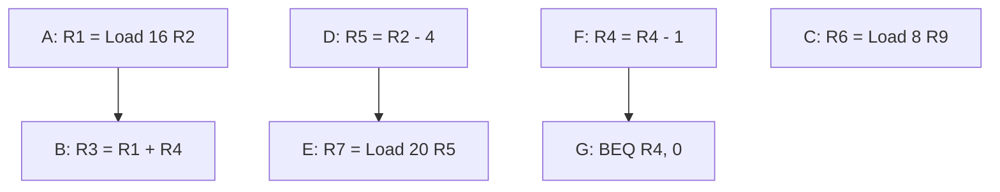
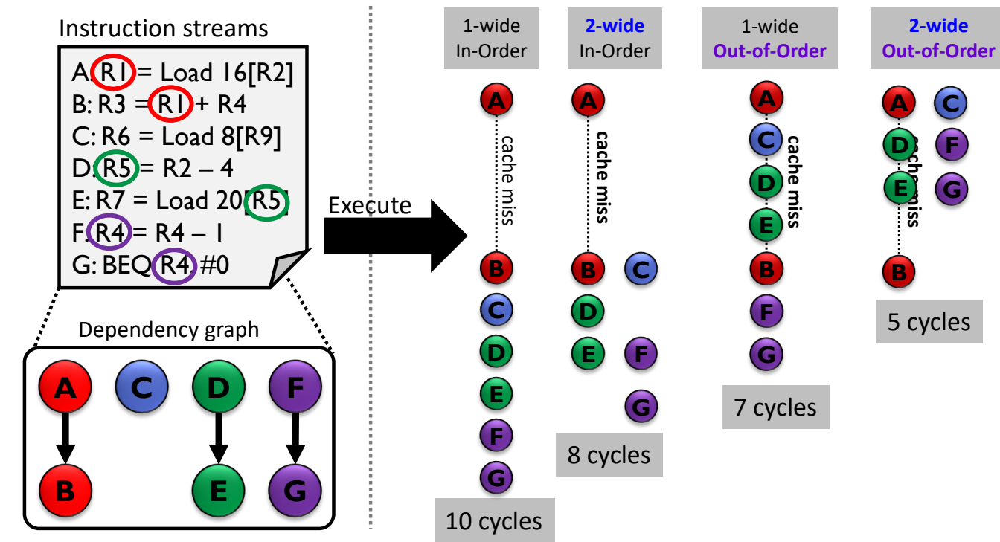
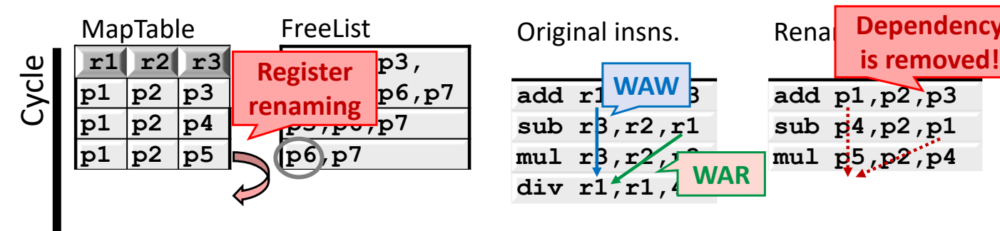
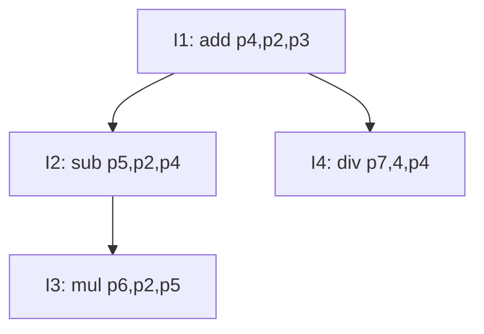

# 03 乱序执行与寄存器重命名

[本讲目录](../index.md) · [课程目录](../../index.md) · [上一节：02 软件流水与编译器局限](02-software-pipelining-and-compiler-limits.md) · [下一节：04 记分板算法](04-scoreboard-algorithm.md)

> [!abstract] 本节要点
> - 动态调度就是乱序执行（Out-of-Order execution，OoO / O3）：由硬件在运行时重排指令流以减少停顿；“乱序”只指执行（execution）阶段不按程序顺序，其他阶段不一定乱序。
> - O3 的收益来自用无依赖的指令填满停顿的空隙：A~G 七条指令中 A 发生 cache miss 时，1 路顺序 10 周期、2 路顺序 8 周期、1 路乱序 7 周期、2 路乱序 5 周期。
> - O3 会放大寄存器数据冒险：RAW 读到旧数据，WAR 读到“未来”数据，WAW 的新结果被旧数据覆盖。
> - WAR、WAW 是名字（存储位置）相关，可用硬件寄存器重命名消除：映射表（MapTable）记录架构寄存器到物理寄存器的映射，每个目的寄存器从空闲列表（FreeList）取一个新物理寄存器；RAW 是真相关，重命名后仍然保留，只能等待。
> - O3 的三步：取指把 100+ 条指令放进指令窗口（依靠分支预测越过分支）→ 重命名去除假相关 → 寄存器和内存依赖一满足就执行；每条指令在缓冲中检查 ready 位，发射顺序由依赖图决定。

## 动态调度与乱序执行（Out-of-Order Execution）

编译器做静态调度时拿不到运行时信息，遇到 cache miss 这类突发的长延迟也无法应对（见[编译器静态调度的局限](02-software-pipelining-and-compiler-limits.md)）。动态调度把调度工作交给 CPU 硬件，在程序运行时根据实际情况重排指令。

指令调度分为两类：

- **静态调度**：由编译器完成，包括循环展开等常规技术，以及全局调度、软件流水等面向 ILP 的高级技术。
- **动态调度**：由 CPU 硬件完成，本讲按历史顺序介绍三种实现：记分板（Scoreboard）、Tomasulo 算法、重排序缓冲（Reorder Buffer，ROB）。记分板出现最早、做法最朴素，Tomasulo 改进了不少，ROB 则是今天几乎所有处理器都在用的结构。[^s3p16]

**动态调度**（Dynamic Scheduling）指的就是**乱序执行**（Out-of-Order execution），简写为 OoO 或 O3：指令的执行顺序可以与原来的程序顺序不同。[^s3p17]

> [!tip] 课堂强调
> “execution”在这里是一个具体的流水线阶段，即 ALU 执行的那一级，不是笼统的“运行”。乱序只说明**执行阶段**不按程序顺序，流水线的其他阶段不一定乱序。[^s5b3]

例如后面的记分板里，issue 是顺序的，只有之后的读操作数、执行和完成是乱序的。

围绕 O3 有三个问题，下面三小节依次回答：

1. O3 怎样获得性能收益？
2. O3 会带来什么问题？
3. O3 具体怎样工作？

## 乱序执行的收益

只要指令之间没有依赖，硬件就可以把后面的指令提前，**重排指令流来减少停顿**（Hardware rearranges the instruction stream to reduce stalls）。[^s3p18]

例子使用下面七条指令：

```text
A: R1 = Load 16[R2]
B: R3 = R1 + R4
C: R6 = Load 8[R9]
D: R5 = R2 – 4
E: R7 = Load 20[R5]
F: R4 = R4 – 1
G: BEQ R4, #0
```

RAW 依赖只有三对：B 读 A 写的 R1，E 读 D 写的 R5，G 读 F 写的 R4；C 与其他指令都无关。



假设 A 发生 cache miss，B 要等到第 5 个周期才能执行。四种机器的执行情况如下：

| 机器 | 各周期执行的指令 | 总周期 |
| --- | --- | --- |
| 1 路顺序（1-wide In-Order） | 1:A，2–4:停顿（cache miss），5:B，6:C，7:D，8:E，9:F，10:G | 10 |
| 2 路顺序（2-wide In-Order） | 1:A，2–4:停顿，5:B C，6:D，7:E F，8:G | 8 |
| 1 路乱序（1-wide Out-of-Order） | 1:A，2:C，3:D，4:E，5:B，6:F，7:G | 7 |
| 2 路乱序（2-wide Out-of-Order） | 1:A C，2:D F，3:E G，5:B | 5 |

逐行分析：

1. **1 路顺序**：A 的 cache miss 结束后才能执行 B，后面的 C~G 也只能排在 B 之后，共 10 周期。
2. **2 路顺序**：A 的停顿仍然躲不掉，因为 B 依赖 A，而顺序机器不能越过 B。之后每周期最多发两条，但不能把有依赖的两条放在同一周期：B、C 无关，同一周期执行；D、E 有依赖，D 单独一个周期；E、F 同一周期；G 依赖 F，最后执行。共 8 周期。
3. **1 路乱序**：B 照样要等 A，但 C、D、E 与 A 无关，可以塞进 cache miss 的等待期，共 7 周期。
4. **2 路乱序**：A 与 C 同周期，D、F 同周期，E、G 同周期，等待期被充分填满，B 的数据一到就执行，只需 5 周期。

结论：**只要没有依赖关系，乱序执行就能把等待的空隙填满**，这是 O3 的主要收益。[^s3p18]



图：左侧是七条指令及其依赖图，右侧四列是各机器的执行时间线。A 发生 cache miss 时，1 路顺序需 10 周期、2 路顺序 8 周期、1 路乱序 7 周期、2 路乱序 5 周期，乱序把无关指令填进等待空隙。

> [!note] 补充解释
> 2 路乱序的时间线里 F 在第 2 周期就执行，早于第 5 周期的 B。B 读 R4、F 写 R4，两者之间还有一个 WAR 名字相关；若 F 直接改写 R4，B 会读到减 1 后的值。这正是下一小节要说的乱序冒险，需要靠寄存器重命名来消除，图中的 5 周期隐含了这一前提。

> [!warning] 易错点
> 增加发射宽度不能代替乱序。2 路顺序机器仍然要在 A 的 cache miss 上停顿 3 个周期，只从 10 降到 8 周期；1 路乱序机器即使每周期只执行一条，也能把等待期用起来，降到 7 周期。

## 乱序执行放大数据冒险

顺序执行的五级流水线中，数据冒险大多可以通过前递（forwarding）解决，一般不引起额外停顿。[^s5b4]乱序执行允许后面的指令先于前面的指令执行，寄存器依赖就可能被破坏，冒险问题更严重。[^s3p19]

下面三个例子的寄存器初值都是 $R1=5,\ R2=-2,\ R3=9,\ R4=3$，比较顺序执行（先 A 后 B）与不加检查的乱序执行（先 B 后 A）：

| 冒险类型 | 指令 | 顺序执行（A→B） | 乱序执行（B→A） | 后果 |
| --- | --- | --- | --- | --- |
| 写后读 RAW（Read-After-Write） | A: `R1 = R2 + R3`；B: `R4 = R1 * R4` | A 得 $R1=7$；B 得 $R4=7\times3=21$ | B 先执行得 $R4=5\times3=15$；A 再得 $R1=7$ | B **读到旧数据**（Read old data） |
| 读后写 WAR（Write-After-Read） | A: `R1 = R3 / R4`；B: `R3 = R2 * R4` | A 得 $R1=9/3=3$；B 得 $R3=-2\times3=-6$ | B 先执行得 $R3=-6$；A 再得 $R1=-6/3=-2$ | A **读到“未来”数据**（Read future data） |
| 写后写 WAW（Write-After-Write） | A: `R1 = R2 + R3`；B: `R1 = R3 * R4` | A 得 $R1=7$；B 得 $R1=9\times3=27$，最终 $R1=27$ | B 先得 $R1=27$；A 再写 $R1=7$，最终 $R1=7$ | 新结果**被旧数据覆盖**（Will be overwritten by legacy data） |

三种情况的错误各不相同：[^s3p19]

- **RAW**：B 需要 A 产生的新 R1，提前执行时 R1 还没更新，读到的是旧值 5。
- **WAR**：A 本该读 R3 的旧值 9，但 B 已提前把 R3 改为 $-6$，A 读到了程序顺序上“将来”才应出现的值。
- **WAW**：两条指令都写 R1，最终应保留程序顺序中较晚的 B 的结果 27，但较早的 A 后写，把它覆盖为 7。

所以乱序执行必须由硬件检查并维护这些依赖。

## 寄存器重命名（Register Renaming）

观察 WAR 和 WAW 的例子：A 与 B 之间并没有数据传递，冲突只是因为两条指令**碰巧用了同一个寄存器名字**。如果给后写的指令换一个存放位置，冲突就消失了。

**寄存器重命名**是由硬件完成的、消除 WAR 和 WAW 冒险的方法。它所依据的事实是：WAR 和 WAW 是对**名字/存储位置**的依赖（Dependency is on name/location），不是对数据本身的依赖，因此称为**假相关**（false dependence，也叫名字相关）。重命名能消除 WAR/WAW，但**保留 RAW**：RAW 是**真相关**（true dependence），后一条指令确实需要前一条的结果，只能等待（停顿），或通过其他优化让数据更快送达。[^s3p23]

### 映射表与空闲列表

重命名的做法是：分配一个新的存储位置，并把它记录在映射表里（Allocate new location by noting it in map-table）。[^s3p21] 需要区分两类寄存器：

- **架构寄存器**：指令中出现的名字，如 `r1`、`r2`、`r3`。
- **物理寄存器**：硬件中真正存放数据的寄存器，如 `p1`~`p7`。

硬件维护两个结构：

- **映射表**（MapTable）：记录每个架构寄存器当前对应哪个物理寄存器。
- **空闲列表**（FreeList）：记录尚未分配的物理寄存器。

对每一条指令按程序顺序做：

1. **改写源寄存器**：查映射表，把每个源架构寄存器替换为它**当前**映射的物理寄存器。这样就保留了 RAW：读者总能找到最近一次写它的那条指令的结果。
2. **分配目的寄存器**：从空闲列表取出一个新的物理寄存器，作为本指令的目的寄存器。
3. **更新映射表**：把目的架构寄存器的映射改为这个新物理寄存器，后续指令读该架构寄存器时就会读到新位置。

先改写源、后改目的的顺序很重要：像 `mul r3,r2,r3` 这样源和目的同名的指令，源 `r3` 必须用改写前的映射。

### 例：四条指令的重命名

原始指令：

```asm
add r1,r2,r3
sub r3,r2,r1
mul r3,r2,r3
div r1,r1,4
```

这段代码里的冒险：

- `add` 与 `sub`：`sub` 读 `r1`（RAW）；`add` 读 `r3` 而 `sub` 写 `r3`（WAR）。
- `sub` 与 `mul`：`mul` 读 `r3`（RAW）；两者都写 `r3`（WAW）。
- `add` 与 `div`：`div` 读 `r1`（RAW）；两者都写 `r1`（WAW）。
- `sub` 与 `div`：`sub` 读 `r1` 而 `div` 写 `r1`（WAR）。

开始时映射表为 `r1→p1, r2→p2, r3→p3`，空闲列表为 `p4, p5, p6, p7`，`add` 直接改写为 `add p1,p2,p3`。之后逐条处理：[^s3p21]

| 指令 | 源寄存器改写 | 目的寄存器分配 | 映射表（r1, r2, r3） | 空闲列表 | 重命名后 |
| --- | --- | --- | --- | --- | --- |
| `add r1,r2,r3` | r2→p2，r3→p3 | r1→p1 | (p1, p2, p3) | p4, p5, p6, p7 | `add p1,p2,p3` |
| `sub r3,r2,r1` | r2→p2，r1→p1 | r3→p4（取自空闲列表） | (p1, p2, p4) | p5, p6, p7 | `sub p4,p2,p1` |
| `mul r3,r2,r3` | r2→p2，r3→p4 | r3→p5 | (p1, p2, p5) | p6, p7 | `mul p5,p2,p4` |
| `div r1,r1,4` | r1→p1 | r1→p6 | (p6, p2, p5) | p7 | `div p6,p1,4` |

重命名后，各冒险的处理结果：

1. `add`–`sub` 的 WAR：`add` 读 `p3`，`sub` 写 `p4`，两者不再冲突，即使 `sub` 先执行也不会改坏 `add` 的源操作数。
2. `sub`–`mul` 的 WAW：`sub` 写 `p4`，`mul` 写 `p5`，两个结果各占一个位置，不会互相覆盖。[^s3p22]
3. `add`–`div` 的 WAW、`sub`–`div` 的 WAR：`div` 写的是新的 `p6`，`add` 的结果 `p1` 不会被覆盖，`sub` 读到的仍是 `p1`。
4. RAW 全部保留：`sub` 读 `p1`（来自 `add`），`mul` 读 `p4`（来自 `sub`），`div` 读 `p1`（来自 `add`）。这些指令仍须等待各自的生产者完成。



图：左侧是逐条变化的映射表（MapTable）和空闲列表（FreeList），中间标出原始指令中的 WAW 与 WAR，右侧是重命名结果 `add p1,p2,p3`、`sub p4,p2,p1`、`mul p5,p2,p4`。每重命名一条指令就从 FreeList 取一个新物理寄存器写入 MapTable，假相关被消除，RAW 依然存在。此帧尚未显示 `div` 一行。

> [!warning] 易错点
> 讲义中有一帧（第 20 页）是动画的中间帧，其“Renamed insns.”一列（如 `sub p2,p4,p5`、`mul p2,p5,p6`、`div p4,4,p7`）是错误的。正确结果以第 21~23 页为准：`add p1,p2,p3 / sub p4,p2,p1 / mul p5,p2,p4 / div p6,p1,4`。[^s3p20]

> [!warning] 易错点
> 不要以为重命名能消除所有相关。判断方法：后一条指令是否**真正需要**前一条的计算结果。需要（RAW）就是真相关，重命名后仍须等待；只是用了同一个名字（WAR、WAW），就是假相关，换一个物理寄存器即可消除。

> [!note] 补充解释
> 例子把 `add` 的目的寄存器直接记为 `p1`，相当于把 `add` 重命名后的映射当成起点，以便展示后三条指令的重命名。严格按规则执行时，`add` 也会从空闲列表取一个新的物理寄存器（下面“总体结构”中的例子就是这样，`add` 的目的被分配为 p4）。

记分板不做重命名；Tomasulo 用保留站完成硬件重命名，见[Tomasulo 算法](05-tomasulo-algorithm.md)。

> [!info] 可视化资源
> [Wikipedia：寄存器重命名（Register renaming）](https://en.wikipedia.org/wiki/Register_renaming)：解释 WAR/WAW 为何是假相关，以及物理寄存器堆、空闲标签队列、重映射表等结构，可对照本节的 MapTable/FreeList。

## 乱序执行的三个步骤

五级流水线每周期取一条指令，译码后就执行。动态调度不同，它要求硬件**同时看到很多条指令**，从中挑出可以执行的。O3 分三步完成：[^s3p26]

1. **取指进入指令窗口**：从静态程序（Static Program）中把大量指令取入**指令窗口**（instruction window），形成动态指令流（Dynamic Instruction Stream）。今天的处理器调度窗口有 100 条以上的指令；要越过分支继续取指，需要用分支预测做推测（speculate past branches）。[^s3p24]
2. **重命名**：对动态指令流做寄存器重命名，去除假相关（WAW 和 WAR），得到重命名后的指令流（Renamed Instruction Stream）。[^s3p25]
3. **调度执行**：寄存器和内存的依赖一旦满足，指令就执行（Execute instructions as soon as dependencies are known），通常按功能部件的数量把就绪的指令分配到各个功能部件。由此得到动态调度后的指令（Dynamically Scheduled Instructions）。所谓乱序，就是执行顺序偏离了原来的程序顺序（out of the original sequential order）。[^s3p26]


### 分支预测对 O3 的意义

分支预测（L04 补充材料）是动态调度的关键部件，原因如下：

- 程序中**大约每 10 条指令就有一个分支**。不做预测，每遇到一个分支就要停下来等它解析，窗口里最多只能攒下约 10 条指令，填不满 100 多条的窗口。
- 有了分支预测，取指单元可以提前沿预测路径取指，窗口才能装满，硬件才能从中找到足够多无依赖的指令。
- 代价是一旦**预测错误**，预测路径上取进来的指令都要冲刷掉，**整个指令窗口作废**。

> [!tip] 课堂强调
> 分支预测是乱序执行中非常关键的部件，在现代处理器中越来越重要：处理器有很多条流水线同时工作，为了找出足够多没有依赖的指令，需要一次取很多条指令，而分支预测正是让这件事成为可能的前提。[^s5b5]

预测错误后的恢复机制见[精确异常与推测执行](07-precise-exceptions-and-speculative-execution.md)。

> [!info] 可视化资源
> [Wikipedia：乱序执行（Out-of-order execution）](https://en.wikipedia.org/wiki/Out-of-order_execution)：对比顺序与乱序处理器的流水步骤（取指、译码、重命名、分派、发射、退休），并梳理从 CDC 6600、IBM 360/91 到现代处理器的历史。

## 动态调度的总体结构

把上面三步放到处理器结构里：[^s3p29]

1. **前端**：指令 cache（I\$）与分支预测器（BP）配合，每周期按（预测的）程序顺序取指。
2. **译码与重命名**：指令经过取指、译码、重命名后进入**指令缓冲**（insn buffer）。
3. **检查就绪**：每条指令（概念上）每个周期检查其源物理寄存器的 **ready 位**，ready 位记录在就绪表（Ready Table）中。
4. **发射执行**：源操作数全部就绪的指令发射到执行单元（ALU、D\$）；结果写回寄存器堆，并把对应物理寄存器标为 ready，唤醒等待它的指令。

讲义上的例子（已重命名）：

```asm
Inst1: add p4,p2,p3
Inst2: sub p5,p2,p4
Inst3: mul p6,p2,p5
Inst4: div p7,4,p4
```

依赖图为 I1→I2、I1→I4、I2→I3。随时间推移，就绪表与发射过程如下：

| 时刻 | 已就绪的物理寄存器 | 本时刻发射 |
| --- | --- | --- |
| 1 | P2, P3 | I1（只需 P2、P3） |
| 2 | P2, P3, P4 | I2、I4（都只等 P4） |
| 3 | P2, P3, P4, P5, P7 | I3（等 P5） |
| 4 | P2~P7 全部就绪 | — |

因此发射顺序是 I1 → {I2, I4} → I3，由**依赖图**决定，与程序顺序 I1, I2, I3, I4 不同：I4 越过了 I3。[^s3p29]



> [!warning] 易错点
> 讲义此例左侧的原始代码第一条写作 `add r4,r2,r3`，与右侧重命名结果不一致，应为 `add r1,r2,r3`。[^s3p29]右侧结果对应 `add r1,r2,r3 / sub r3,r2,r1 / mul r3,r2,r3 / div r1,4,r1`，初始映射为 `r2→p2, r3→p3`，`r1` 依次映射到 p4、p7，`r3` 依次映射到 p5、p6。按这个原始代码分析依赖图即可。

这里只说明了概念上的“每周期检查 ready 位”。硬件上的具体实现，以及把译码拆成 issue、读操作数等更细阶段，见[记分板算法](04-scoreboard-algorithm.md)。

> [!question]- 自测：在 1 路乱序机器上执行指令 A~G（A cache miss，B 最早在第 5 周期执行），若把 F 改为 `F: R4 = R7 – 1`（依赖 E），总周期数会变吗？
> 不变，仍为 7 周期。1:A，2:C，3:D，4:E，5:B，6:F，7:G。E 在第 4 周期执行，F 在第 6 周期执行时 E 已完成，新增的 E→F 依赖不引起额外停顿。原本就有的 G 依赖 F 也满足。

> [!question]- 自测：对代码 `add r1,r2,r3 / mul r2,r1,r3 / sub r1,r2,r2` 做重命名。初始映射 `r1→p1, r2→p2, r3→p3`，空闲列表 `p4,p5,p6`，每条指令的目的寄存器都从空闲列表新取。写出重命名结果，并指出哪些相关被消除。
> 结果：`add p4,p2,p3`（r1→p4）；`mul p5,p4,p3`（r2→p5）；`sub p6,p5,p5`（r1→p6）。最终映射为 (p6, p5, p3)，空闲列表为空。被消除的是 `add` 读 r2 而 `mul` 写 r2 的 WAR、`mul` 读 r1 而 `sub` 写 r1 的 WAR，以及 `add` 与 `sub` 同写 r1 的 WAW。保留的 RAW 是 `mul` 读 p4、`sub` 读 p5。

> [!question]- 自测：某乱序处理器的指令窗口有 120 项，但没有分支预测器，遇到分支就停止取指直到分支解析。若程序约每 10 条指令有一个分支，窗口实际能被利用多少？
> 平均只有约 10 条指令，远低于 120。分支未解析前无法继续取指，窗口里只能攒下当前分支之前的指令。有了分支预测才能越过分支推测取指，把窗口填满；代价是预测错误时整个窗口作废。

> [!info]- 来源
> - L05-Dynamic-Scheduling.pdf：PDF p.16–26, 29
> - L05.docx：DOCX body 51–116

[^s3p16]: L05-Dynamic-Scheduling.pdf-PDF p.16
[^s3p17]: L05-Dynamic-Scheduling.pdf-PDF p.17
[^s5b3]: L05.docx-DOCX body 51-69
[^s3p18]: L05-Dynamic-Scheduling.pdf-PDF p.18
[^s5b4]: L05.docx-DOCX body 70-96
[^s3p19]: L05-Dynamic-Scheduling.pdf-PDF p.19
[^s3p23]: L05-Dynamic-Scheduling.pdf-PDF p.23
[^s3p21]: L05-Dynamic-Scheduling.pdf-PDF p.21
[^s3p22]: L05-Dynamic-Scheduling.pdf-PDF p.22
[^s3p20]: L05-Dynamic-Scheduling.pdf-PDF p.20
[^s3p26]: L05-Dynamic-Scheduling.pdf-PDF p.26
[^s3p24]: L05-Dynamic-Scheduling.pdf-PDF p.24
[^s3p25]: L05-Dynamic-Scheduling.pdf-PDF p.25
[^s5b5]: L05.docx-DOCX body 97-116
[^s3p29]: L05-Dynamic-Scheduling.pdf-PDF p.29

[本讲目录](../index.md) · [课程目录](../../index.md) · [上一节：02 软件流水与编译器局限](02-software-pipelining-and-compiler-limits.md) · [下一节：04 记分板算法](04-scoreboard-algorithm.md)
