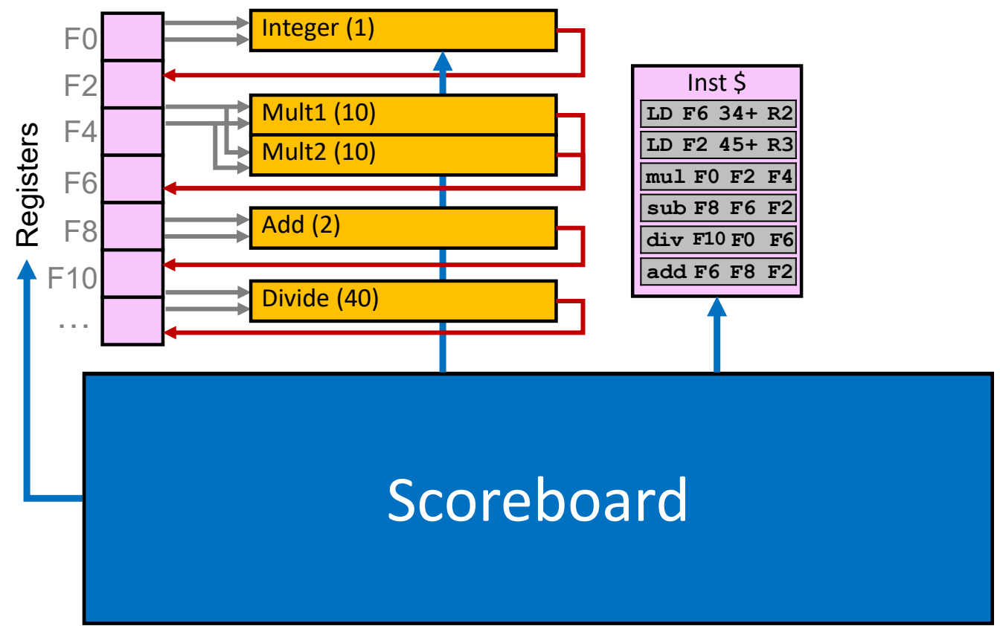
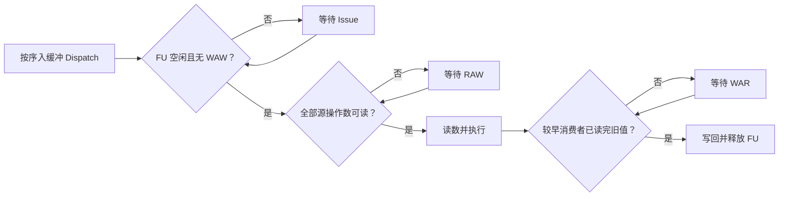
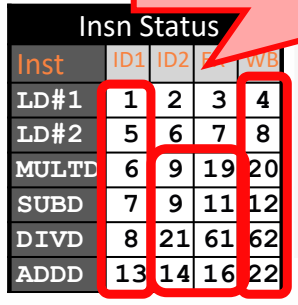

# 03 记分板调度

[本讲目录](../index.md) · [课程目录](../../index.md) · [上一节：02 乱序执行与依赖](02-out-of-order-and-dependencies.md) · [下一节：04 Tomasulo调度](04-tomasulo-scheduling.md)

> [!abstract] 本节要点
> - 记分板集中记录指令、功能单元与寄存器状态，以顺序发射、乱序读数和执行实现动态调度。
> - Issue 检查结构冒险与 WAW，Read operands 等待 RAW，Write result 等待较早指令读完旧值以避免 WAR。
> - 结果算完不等于能够写回；本例功能单元要等写回后才释放，下一周期才能重新分配。
> - 六指令例中，ADD 在第 16 周期算完，却要等 DIV 在第 21 周期读走旧 F6，才能在第 22 周期写回；全部指令在第 62 周期完成。

## 集中式状态跟踪

乱序执行需要随时回答三个问题：哪条指令已经走到哪一步，哪个运算部件还能接收任务，哪个寄存器的值尚未产生。**记分板（Scoreboard）**把这些信息集中记录，并根据状态决定各条指令何时可以继续。它并不预先排好固定时间表，而是在运行时检查资源与数据条件。[^s3p27]

1964 年的 CDC 6600 首次实现了记分板，具有 16 个独立、非流水化的功能单元，其中 7 个用于整数操作、4 个用于浮点操作、5 个用于存储操作。它没有寄存器旁路（register bypassing）：消费者必须等结果写入寄存器，再从寄存器读取，不能直接从生产者取走刚算出的值。[^s3p28]

下面使用的是简化架构：寄存器堆通过读写通路连接多个**功能单元（Functional Unit，FU）**，指令按程序顺序进入，记分板协调资源分配、读数和写回。图中每个功能单元后面的括号表示该单元的执行周期数；Integer 用于本例的 Load，加减共享 Add。[^s3p32]



图：记分板集中协调寄存器、指令队列和各功能单元，图中整数、乘法、加法、除法延迟分别为 $1$、$10$、$2$、$40$ 周期。

无旁路是这里分析的机器条件。记分板的核心是状态跟踪与冒险检查，是否增加旁路属于另一项实现选择。记分板也没有消除 [RAW、WAR 与 WAW 所代表的依赖约束](02-out-of-order-and-dependencies.md)，而是让可能破坏正确性的动作等待。

## 四阶段与冒险检查

如果一条指令只差一个操作数，把整个处理器都停住会浪费其他功能单元。记分板把“取得执行位置”和“读取操作数”分开：指令可以先占用功能单元，再等待源数据；与此同时，后续符合条件的指令继续推进。

译码后的指令先经过 **派送（Dispatch）**，按程序顺序放入指令缓冲。缓冲区容量有限，满时也会产生结构冒险。随后进入四个由记分板跟踪的阶段：[^s3p30][^s3p31]

| 阶段 | 允许继续的条件 | 动作与被阻塞的位置 |
| --- | --- | --- |
| 发射 Issue，记作 I | 所需 FU 空闲，且目的寄存器没有其他待写者 | 顺序分配 FU、登记依赖和目的寄存器；结构冒险或 WAW 会阻止发射 |
| 读操作数 Read operands，记作 R | 所有源操作数均可读 | 从寄存器读出本条指令所需的值；RAW 在这里等待 |
| 执行 Execute，完成时刻记作 X | 已经读到操作数 | FU 按自身延迟计算，算完后通知记分板 |
| 写结果 Write result，记作 W | 结果已算完，且没有较早指令仍需读取目的寄存器的旧值 | 写寄存器、更新依赖状态、释放 FU；WAR 会阻止写回 |

这里的 X 是**执行完成周期**，不是开始执行周期。例如某条乘法在第 9 周期读数、占用 10 个执行周期，则第 10–19 周期执行，X 填 19。原图也用 ID1、ID2、EX、WB 表示这四列。[^s3p44]



几个检查点各自保护不同的顺序关系：

1. **Issue 保护资源与目的写入次序**：即使源操作数还没有准备好，只要 FU 可用、目的寄存器没有待写者，就能发射。若发射队首被阻塞，较晚指令不能越过它。
2. **Read operands 保护数据来源**：等全部源数据可读后再一起取走。本例中的 DIV 即使已经有可用的 F6，也要等 F0 就绪后才读取二者。
3. **Write result 保护旧值**：年轻指令算出新值后，还要检查较早指令是否读过旧值。旧值一旦被读取并送入 FU，寄存器随后被覆盖就不影响那条指令的计算。[^s3p33][^s3p35][^s3p40][^s5b6]

> [!warning] 易错点
> “顺序发射”不等于“等待前一条执行完成后才发射下一条”。已发射指令可以分别处于读数、执行或等待写回阶段，多个 FU 也能同时工作。只有下一条待发射指令自身的 Issue 条件不满足时，才会挡住更晚指令的发射。

## 三张状态表

仅仅知道寄存器“忙”还不够：等待者还需要知道谁会提供结果，写入者也需要知道谁尚未读走旧值。记分板用三张相互关联的表完成这些检查。[^s3p42][^s3p43]

| 状态表 | 每行对应什么 | 记录内容 | 用途 |
| --- | --- | --- | --- |
| 指令状态 Instruction status | 一条指令 | I、R、X、W 的发生周期 | 跟踪进度，复现执行时间表 |
| 功能单元状态 FU status | 一个 FU | 是否占用、操作类型、源和目的寄存器、源的生产者与就绪状态 | 判断资源冲突、RAW 与尚未完成的读取 |
| 寄存器结果状态 Register result status | 一个寄存器 | 将来会写入它的 FU；没有待写者时为空 | 发射时检查 WAW，并为消费者找到生产者 |

FU 状态表有以下九个字段。左侧的 FU 名称只是行标识，不计入九个字段。[^s3p45]

| 字段 | 含义 | 怎样参与调度 |
| --- | --- | --- |
| B / Busy | FU 当前是否被占用 | 为 Yes 时，不能向该 FU 分配新指令 |
| Op | 操作类型，如 MUL、SUB | 决定要完成的运算 |
| dst | 目的寄存器 | 写回对象，也是 WAW、WAR 检查的依据 |
| src1、src2 | 两个源寄存器名 | 标识这条指令需要读取什么 |
| Q1、Q2 | 分别为两个源生产结果的 FU | 尚未就绪时，记录需要等待谁 |
| R1、R2 | 两个源的就绪标志 | 判断能否读数；还须结合读数是否已发生来判断 WAR |

这里的 R1、R2 是状态字段名，与指令中的通用寄存器 R2、R3 不同。对于只有一个寄存器源的 Load，第二组源字段不使用。寄存器结果状态表只记录待写 FU 的名字，不保存实际操作数值；寄存器值仍在寄存器堆中。[^s3p46]

“就绪”与“已读”尤其需要分清。一个操作数已经存在于寄存器中，却可能还没被较早指令读取，因为那条指令正在等另一个源。此时年轻指令仍不能覆盖它。判断 WAR 的条件因此是**较早消费者是否仍需要读取旧值**，不能只看某个源是否 ready。动画中的 R 字段主要展示就绪变化，部分读数之后仍保留 Yes；应结合指令状态中的 R 时刻判断是否已经读取，不把这些快照直接当作完整实现的状态更新规则。[^s3p45][^s3p110][^s3p111]

### 发射一条指令时怎样建表

以 `LD F6,34(R2)` 为例，初始没有未完成指令：

1. 检查 Integer 单元空闲，且寄存器结果表的 F6 项为空。
2. 在指令状态表的 I 列记下当前周期。
3. 将 Int 行置为 Busy，填写 `Op=LD`、`dst=F6`、`src1=R2`；R2 已可读，所以相应源标志为 Yes。
4. 在寄存器结果状态表的 F6 项填入 Int，表示后来的 F6 消费者应等待这个单元。[^s3p50][^s3p51][^s3p52][^s3p53]

之后若 `MUL F0,F2,F4` 发射，而 F2 尚由 Int 生产，则乘法 FU 记录 `Q1=Int`、第一个源未就绪、第二个源已就绪，并在寄存器结果表中登记 `F0→Mult1`。当 Int 写回 F2，所有等待 Int 的相应源状态都要更新。读数时记录读取完成；写回时清除本条指令的 FU 占用和目的寄存器待写记录。[^s3p67][^s3p80]

## 六指令周期演算

下面的程序同时包含等待数据、等待 FU 和等待旧值被读取三类情况。把它从头推一遍，就能看出为什么指令的执行与写回顺序会不同于程序顺序。

```asm
LD  F6,34(R2)       ; LD1
LD  F2,45(R3)       ; LD2
MUL F0,F2,F4
SUB F8,F6,F2
DIV F10,F0,F6
ADD F6,F8,F2
```

Load 地址分别由 R2 加偏移 34、R3 加偏移 45 得到，偏移并不表示被加载的数据值。其余指令的第一个寄存器是目的，后两个是源；例如 SUB 计算 F6 减 F2，DIV 计算 F0 除以 F6。这里关注时间与依赖，不需要假定内存内容。

### 资源与计时约定

本例每周期最多发射一条指令，使用以下 FU：一个 Int，执行 1 周期；两个乘法单元 Mult1、Mult2，各执行 10 周期；一个加减单元 Add，执行 2 周期；一个除法单元 Div，执行 40 周期。已占用 FU 要到写回后才释放，下一周期才能重新分配。没有旁路，生产者写回后的下一周期，消费者才能读取相应结果。[^s3p32][^s3p36][^s5b7]

这些是两种分别影响时间表的限制：**FU 释放时机**决定另一条指令何时可以发射到该单元；**数据可读时机**决定已发射的消费者何时可以读数。计算完成本身既不释放 FU，也不保证可以马上写回。

完整结果如下。所有表项的单位都是周期编号；I、R、X、W 分别是发射、读操作数、执行完成、写回。[^s3p119]

| 指令 | I：发射 | R：读数 | X：执行完成 | W：写回 |
| --- | ---: | ---: | ---: | ---: |
| LD1：`LD F6,34(R2)` | 1 | 2 | 3 | 4 |
| LD2：`LD F2,45(R3)` | 5 | 6 | 7 | 8 |
| `MUL F0,F2,F4` | 6 | 9 | 19 | 20 |
| `SUB F8,F6,F2` | 7 | 9 | 11 | 12 |
| `DIV F10,F0,F6` | 8 | 21 | 61 | 62 |
| `ADD F6,F8,F2` | 13 | 14 | 16 | 22 |



图：四列依次为发射 $I$、读操作数 $R$、执行完成 $X$ 与写回 $W$，其中末条加法等到第 $22$ 周期才写回。

### 第 1–5 周期：一个 Load 挡住发射队列

第 1 周期按前述步骤为 LD1 建表。第 2 周期，R2 可读，LD1 完成 R；第 3 周期在 Int 执行并完成 X；第 4 周期写 F6，同时清除 Int 占用和 F6 的待写记录。[^s3p51][^s3p55][^s3p59][^s3p62]

LD2 虽然与 LD1 写不同寄存器，却也需要 Int。因此第 2–4 周期都不能发射。由于 Issue 必须按程序顺序，后面的 MUL 即使有空闲乘法单元，也不能越过 LD2。直到第 5 周期，LD2 才能取得已经释放的 Int，登记 `F2→Int`。[^s3p57][^s3p63]

### 第 6–9 周期：先占用 FU，再等待数据

第 6 周期，LD2 读取 R3；同一周期，MUL 发射到 Mult1。MUL 所需的 F4 已有值，F2 则还要等 Int，所以 MUL 可以完成 I，却不能完成 R。

第 7 周期，LD2 执行完成。MUL 仍不能读 F2，因为 LD2 尚未写回。此时 SUB 发射到 Add，记录 F6 已就绪、F2 等待 Int，并登记 `F8→Add`。[^s3p67][^s3p71][^s3p73]

第 8 周期按图中的前、后半周期依次发生两件事：

1. 前半周期，DIV 发射到 Div；它的 F6 已有值，F0 等待 Mult1，所以登记 `Q1=Mult1`，并将 `F10→Div`。
2. 后半周期，LD2 写回 F2，释放 Int，并使 MUL 与 SUB 的 F2 源变为就绪。

这两条消费者都在第 9 周期读取各自的全部源值。DIV 继续等待 F0；最后的 ADD 则因 Add 仍被 SUB 占用而无法发射。[^s3p76][^s3p80][^s3p84][^s3p87]

> [!warning] 易错点
> 原动画把第 9 周期的 DIV 写成“因 RAW 不能 issued”，但同一张指令表已经记录它在第 8 周期发射。此时受阻的是 **Read operands**：DIV 已占用除法单元，只是还不能读取 F0。应以四阶段规则和 I=8 的时间表区分这两个动作。[^s3p86]

### 第 10–16 周期：年轻指令先算完

MUL 从第 10 周期开始执行 10 周期，在第 19 周期完成；SUB 从第 10 周期执行 2 周期，在第 11 周期完成。第 12 周期，SUB 写回 F8 并释放 Add。[^s3p88][^s3p90][^s3p93]

第 13 周期，最后的 ADD 终于可以发射。它写 F6，而最初写 F6 的 LD1 早已在第 4 周期结束，因此没有 WAW；DIV 尚未读取旧 F6 造成的 WAR 将在写回阶段检查，并不阻止此时发射。ADD 的两个源 F8、F2 都已可读，于是在第 14 周期读数，第 15–16 周期执行，第 16 周期完成。[^s3p96][^s3p98][^s3p101]

### 第 17–22 周期：算完的 ADD 为什么不能写

ADD 本来可以在第 17 周期尝试写 F6，但较早的 DIV 仍未读取旧 F6。DIV 一直在等 MUL 提供 F0，而本例要等全部源就绪后才一起读数。如果 ADD 先把新值写进 F6，DIV 以后读到的就不是程序要求的那一版。因此 ADD 必须保持结果、继续占用 Add，等待 WAR 解除。[^s3p103]

之后的关键链条是：

1. 第 19 周期，MUL 完成计算。
2. 第 20 周期，MUL 写回 F0，释放 Mult1，DIV 的 F0 源变为就绪。
3. 第 21 周期，DIV 同时读取 F0 和旧 F6。至此旧 F6 已经被取走，ADD 的写回不再破坏它。
4. 第 22 周期，ADD 写回新 F6 并释放 Add；DIV 同时进入执行阶段。[^s3p106][^s3p109][^s3p111][^s3p113]

按本例的下一周期生效约定，ADD 的最早写回周期可以写成

$$
W_{\mathrm{ADD}}
=\max\bigl(X_{\mathrm{ADD}}+1,\ R_{\mathrm{DIV}}+1\bigr)
=\max(17,22)=22.
$$

这里 $X_{\mathrm{ADD}}$ 是 ADD 的执行完成周期，$R_{\mathrm{DIV}}$ 是 DIV 读取旧 F6 的周期，$W_{\mathrm{ADD}}$ 是 ADD 的写回周期。该式已假定没有其他写回冲突，用来同时表达“自己算完”和“较早消费者读完”两个条件。

> [!tip] 课堂强调
> DIV 读过旧 F6，WAR 就已经解除，ADD 不必等 DIV 的 40 周期除法全部做完。第 21 周期的读数允许 ADD 在下一周期写回，这是本例后半段的关键状态变化。[^s5b8]

### 第 22–62 周期：长除法结束

DIV 在第 22–61 周期执行，共 $61-22+1=40$ 个周期，第 62 周期写回 F10。此时全部 FU 已释放，寄存器结果状态表也都清空。[^s3p117][^s3p118]

从表中可见，MUL 比 SUB 先发射，却比 SUB 晚写回；DIV 比 ADD 先发射，也比 ADD 晚写回。记分板保留的是顺序发射，读数、执行完成与写回都可以乱序。原图把这里的直接写回也称为 commit；本章统一称“写回”，后文的 [ROB 提交](05-reorder-buffer-and-commit.md)则是另一项按程序顺序生效的操作。[^s3p119][^s5b8]

## 收益与调度限制

记分板只增加集中状态表及检查、更新逻辑，就能让不同 FU 重叠工作。原实现的硬件开销较小，给出的面积估计是三张状态表合计约相当于一个浮点单元；对于所举的 FORTRAN 科学数组程序，性能提升约为 1.7 倍。这些数字对应特定实现与工作负载。[^s3p120]

六指令例也暴露了三种限制：

- **发射范围受阻**：结构冒险和 WAW 会挡住顺序发射队列；前面的 LD2 等 Int 时，空闲 Mult1 无法先接收更晚的 MUL。
- **真依赖等待较长**：无旁路使结果必须先回到寄存器，消费者才能在之后读数。
- **旧值保护拖住写回**：ADD 虽已算完，仍因 DIV 没读旧 F6 而占着 FU 等待，进一步减少可用资源。

[下一章的 Tomasulo 调度](04-tomasulo-scheduling.md)用临时版本区分同名寄存器，并用公共数据总线把结果送给等待者，分别针对名字依赖和结果传递增加硬件支持。

> [!question]- 自测：在原程序末尾增加 `MUL F12,F4,F8`，其他条件不变、没有额外写回冲突，它的 I、R、X、W 分别是多少？
> 分别为 14、15、25、26。原 ADD 在第 13 周期发射，新增 MUL 下一周期可以使用一直空闲的 Mult2；F4 已就绪，F8 已在第 12 周期写回，因此第 15 周期读数，第 16–25 周期执行 10 周期，第 26 周期写回。原来的 Mult1 仍被占用，并不妨碍使用另一个乘法单元。

> [!question]- 自测：某周期 Mult2 空闲，但寄存器结果状态表记着 `F0→Mult1`。待发射指令是 `MUL F0,F8,F10`，两个源都已可读。它能否发射，是否还允许更晚指令越过？
> 不能发射，也不能让更晚指令越过。问题在目的 F0 已有待写者，产生 WAW；Issue 要检查目的寄存器结果状态，FU 空闲和源数据就绪都不能替代这个检查。顺序发射会让后面的指令一并等待。

> [!question]- 自测：把原 DIV 改为 `DIV F10,F0,F4`，且 F4 始终可读，原 ADD 最早何时写回？整个程序能否更早完成？
> ADD 可在第 17 周期写回，因为 DIV 不再需要旧 F6，较早的 SUB 也已在第 9 周期读过 F6，WAR 不再阻止写入。但整个程序仍在第 62 周期结束：DIV 依然要等第 20 周期写回的 F0，第 21 周期读数，第 22–61 周期执行。消除一处等待不一定缩短决定总时间的长依赖链。

> [!info]- 来源
> - L05-Dynamic-Scheduling.pdf：PDF p.27–28, 30–120
> - L05.docx：DOCX body 154–367

[^s3p27]: L05-Dynamic-Scheduling.pdf-PDF p.27
[^s3p28]: L05-Dynamic-Scheduling.pdf-PDF p.28
[^s3p32]: L05-Dynamic-Scheduling.pdf-PDF p.32
[^s3p30]: L05-Dynamic-Scheduling.pdf-PDF p.30
[^s3p31]: L05-Dynamic-Scheduling.pdf-PDF p.31
[^s3p44]: L05-Dynamic-Scheduling.pdf-PDF p.44
[^s3p33]: L05-Dynamic-Scheduling.pdf-PDF p.33
[^s3p35]: L05-Dynamic-Scheduling.pdf-PDF p.35
[^s3p40]: L05-Dynamic-Scheduling.pdf-PDF p.40
[^s5b6]: L05.docx-DOCX body 192-242
[^s3p42]: L05-Dynamic-Scheduling.pdf-PDF p.42
[^s3p43]: L05-Dynamic-Scheduling.pdf-PDF p.43
[^s3p45]: L05-Dynamic-Scheduling.pdf-PDF p.45
[^s3p46]: L05-Dynamic-Scheduling.pdf-PDF p.46
[^s3p110]: L05-Dynamic-Scheduling.pdf-PDF p.110
[^s3p111]: L05-Dynamic-Scheduling.pdf-PDF p.111
[^s3p50]: L05-Dynamic-Scheduling.pdf-PDF p.50
[^s3p51]: L05-Dynamic-Scheduling.pdf-PDF p.51
[^s3p52]: L05-Dynamic-Scheduling.pdf-PDF p.52
[^s3p53]: L05-Dynamic-Scheduling.pdf-PDF p.53
[^s3p67]: L05-Dynamic-Scheduling.pdf-PDF p.67
[^s3p80]: L05-Dynamic-Scheduling.pdf-PDF p.80
[^s3p36]: L05-Dynamic-Scheduling.pdf-PDF p.36
[^s5b7]: L05.docx-DOCX body 243-284
[^s3p119]: L05-Dynamic-Scheduling.pdf-PDF p.119
[^s3p55]: L05-Dynamic-Scheduling.pdf-PDF p.55
[^s3p59]: L05-Dynamic-Scheduling.pdf-PDF p.59
[^s3p62]: L05-Dynamic-Scheduling.pdf-PDF p.62
[^s3p57]: L05-Dynamic-Scheduling.pdf-PDF p.57
[^s3p63]: L05-Dynamic-Scheduling.pdf-PDF p.63
[^s3p71]: L05-Dynamic-Scheduling.pdf-PDF p.71
[^s3p73]: L05-Dynamic-Scheduling.pdf-PDF p.73
[^s3p76]: L05-Dynamic-Scheduling.pdf-PDF p.76
[^s3p84]: L05-Dynamic-Scheduling.pdf-PDF p.84
[^s3p87]: L05-Dynamic-Scheduling.pdf-PDF p.87
[^s3p86]: L05-Dynamic-Scheduling.pdf-PDF p.86
[^s3p88]: L05-Dynamic-Scheduling.pdf-PDF p.88
[^s3p90]: L05-Dynamic-Scheduling.pdf-PDF p.90
[^s3p93]: L05-Dynamic-Scheduling.pdf-PDF p.93
[^s3p96]: L05-Dynamic-Scheduling.pdf-PDF p.96
[^s3p98]: L05-Dynamic-Scheduling.pdf-PDF p.98
[^s3p101]: L05-Dynamic-Scheduling.pdf-PDF p.101
[^s3p103]: L05-Dynamic-Scheduling.pdf-PDF p.103
[^s3p106]: L05-Dynamic-Scheduling.pdf-PDF p.106
[^s3p109]: L05-Dynamic-Scheduling.pdf-PDF p.109
[^s3p113]: L05-Dynamic-Scheduling.pdf-PDF p.113
[^s5b8]: L05.docx-DOCX body 285-322
[^s3p117]: L05-Dynamic-Scheduling.pdf-PDF p.117
[^s3p118]: L05-Dynamic-Scheduling.pdf-PDF p.118
[^s3p120]: L05-Dynamic-Scheduling.pdf-PDF p.120

[本讲目录](../index.md) · [课程目录](../../index.md) · [上一节：02 乱序执行与依赖](02-out-of-order-and-dependencies.md) · [下一节：04 Tomasulo调度](04-tomasulo-scheduling.md)
