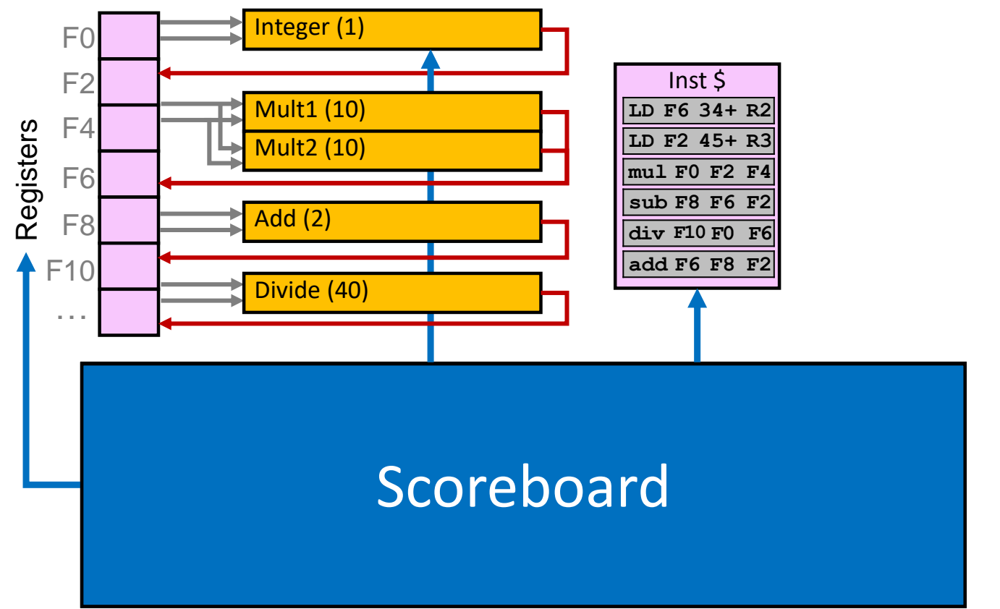
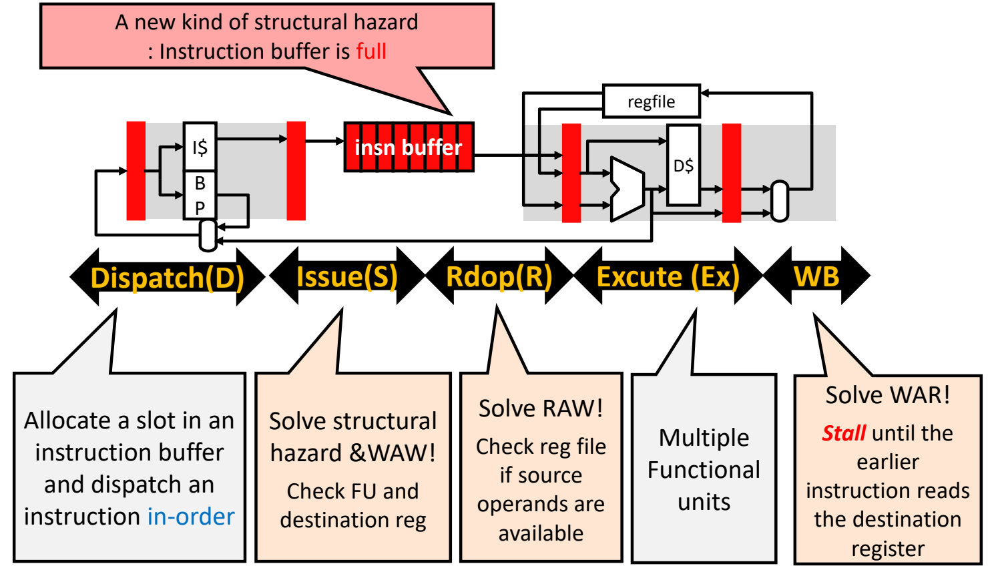
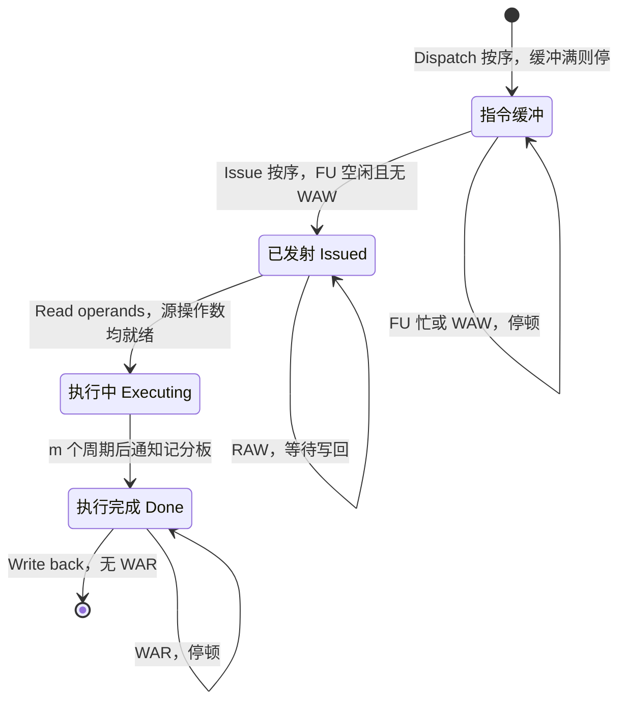

# 04 记分板算法

[本讲目录](../index.md) · [课程目录](../../index.md) · [上一节：03 乱序执行与寄存器重命名](03-out-of-order-execution-and-register-renaming.md) · [下一节：05 Tomasulo 算法](05-tomasulo-algorithm.md)

> [!abstract] 本节要点
> - 记分板（Scoreboard）是最早的动态调度实现（CDC 6600，1964）：用一张集中式"记账表"跟踪指令、功能单元和寄存器的状态，遇到任何冒险都靠**停顿**解决，没有旁路。
> - 记分板把译码拆成 Dispatch → Issue → Read operands：Issue 按序、检查结构冒险与 WAW；Read operands 检查 RAW；Write back 检查 WAR；Issue 之后的阶段乱序。
> - 三张表：Instruction status（各阶段完成的周期）、Functional unit status（每个 FU 9 个字段 B/Op/dst/src1/src2/Q1/Q2/R1/R2）、Register result status（哪个 FU 将写该寄存器）。
> - 6 条指令的例子（Integer 1、Mult 10、Add 2、Divide 40 周期）最终时序为 LD1 1/2/3/4、LD2 5/6/7/8、MULTD 6/9/19/20、SUBD 7/9/11/12、DIVD 8/21/61/62、ADDD 13/14/16/22：按序发射、乱序执行、乱序完成。
> - 优点是便宜（三张表约等于 1 个 FP 单元面积）、对 FORTRAN 科学计算约 1.7× 加速；缺点是无旁路、结构/WAW 冒险堵住发射、RAW 必须等写回、WAR 推迟写回，改进方向是硬件寄存器重命名。

## 记分板与 CDC 6600

[乱序执行](03-out-of-order-execution-and-register-renaming.md)要求硬件在运行时知道"哪条指令现在可以无冒险地执行"。最直接的办法是像球赛记分牌一样，把每条指令走到了哪一步、每个功能单元在干什么、每个寄存器正等着谁来写，全部记下来，再据此决定放行还是停顿。

**记分板**（Scoreboard）就是这样一种集中式的记账（bookkeeping）机制：它跟踪指令、寄存器和功能单元的流转状态，检查哪些数据通路部件正在被使用、哪些可以使用，从而找出能在没有冒险的情况下执行的指令。[^s3p27] 记分板实现运行时乱序执行的关键就是这套记账技术本身。[^s3p42]

记分板的第一个实现是 **CDC 6600**（1964 年）：[^s3p28]

- 有 16 个独立的、**非流水**的功能单元：7 个整数单元、4 个浮点单元、5 个访存单元；
- **没有寄存器旁路**（register bypassing，即 L03 中学过的 forwarding 的同义词）。结果必须先写回寄存器堆，后续指令才能从寄存器堆读到它，这一点会在后面的例子里反复造成停顿。

本节例子使用的简化记分板结构如下：左边是浮点寄存器 F0、F2、…、F10；中间是 5 个功能单元 Integer（1 周期）、Mult1（10 周期）、Mult2（10 周期）、Add（2 周期）、Divide（40 周期），括号内是执行所需周期数；右边是存放 6 条指令的指令缓存；下方的 Scoreboard 控制寄存器读写和各功能单元。[^s3p32] 在本例中，load 指令使用 Integer 单元，执行 1 个周期。



图：记分板集中控制寄存器堆与各功能单元：Integer（1 周期）、Mult1/Mult2（10）、Add（2）、Divide（40），右侧指令 cache 中是例题的 6 条指令。

## 记分板的流水线阶段

传统五级流水线 IFetch → Decode → Execute → Memory → Writeback 中，指令一旦在译码时遇到冒险就整体卡住，后面的指令也过不去。记分板的关键想法是**把 Decode 拆成三个子阶段**：分派 Dispatch（D）、发射 Issue（S）、读操作数 Read operands（R），并在中间加一个**指令缓冲**（instruction buffer）。[^s3p30]

- **Dispatch**：把译码后的指令**按序**累积到指令缓冲里；
- **Issue**：指令缓冲把指令送往流水线的其余部分。Issue 是**按序**的，其后的阶段都是**乱序**的。[^s3p30]

完整的记分板流水线及各阶段负责的冒险如下：

1. **分派 Dispatch（D）**：在指令缓冲中分配一个槽位，按序放入一条指令。这里出现一种**新的结构冒险**：指令缓冲满时无法继续分派。[^s3p31]
2. **发射 Issue（S，也记作 ID1）**：按程序顺序发射，检查两件事，有冒险就停顿、不发射：
   - **结构冒险**：该指令需要的功能单元（FU）是否正忙；
   - **WAW**：目的寄存器是否已被另一条在途指令（尚未写回）占用为目的寄存器。
3. **读操作数 Read operands（R，也记作 ID2）**：检查 **RAW**。查看寄存器堆中源操作数是否可用；若某个源操作数还要等前面的指令产生，就停在这里等待；可用时读出，功能单元随即开始执行。
4. **执行 Execute（EX）**：多个功能单元并行工作，每个 FU 执行 $m$ 个周期（$m$ 即图中括号里的数）。结果就绪时，FU 通知记分板"已完成执行"。[^s3p39]
5. **写回 Write back（WB）**：检查 **WAR**。若存在先发射、但**还没读取**本指令目的寄存器的指令，就停顿，直到那条更早的指令读完该寄存器；没有 WAR 时，FU 把结果写入寄存器。[^s3p40]



图：记分板把流水线分为 Dispatch、Issue、Rdop、Execute、WB：Issue 检查结构冒险与 WAW，Read operands 检查 RAW，WB 处理 WAR；指令缓冲满是新的结构冒险。

一条指令在记分板中的推进与停顿条件可以概括为：



三类数据冒险分别在三个不同阶段处理：WAW 在 Issue、RAW 在 Read operands、WAR 在 Write back；Execute 阶段不再需要检查任何冒险，因为它之前的依赖已经解决。[^s5b6]

> [!tip] 课堂强调
> 记分板对三种冒险的处理位置各不相同，但都"比较合理"；整个机制"比大家预期的要简单得多，所以不用纠结"。指令缓冲满引起的结构冒险只作提示，课程后面不再把它当作关键问题。

> [!info] 可视化资源
> [爱丁堡大学 HASE：CDC 6600 仿真模型](https://www.icsa.inf.ed.ac.uk/research/groups/hase/models/6600/index.html)：给出 CDC 6600 的处理器组织图和功能单元控制示意，说明记分板如何处理一、二、三阶冲突（对应 WAW/结构、RAW、WAR）；模型需下载到 HASE 桌面环境运行。

> [!warning] 易错点
> "乱序"只从 Issue 之后开始：Dispatch 和 Issue 都是按序的。因为 Issue 按序，一条指令因结构冒险或 WAW 卡在 Issue，它后面的所有指令也都发射不了，即使它们自己没有任何冒险。

## 记分板的三张表

要在每个周期判断上面各阶段的条件，记分板需要记录三类信息，对应三张表：[^s3p43]

**指令状态表**（Instruction status）：每条指令一行，记录它在 4 个步骤中各自完成的周期号：[^s3p44]

- ID1：Issue；
- ID2：Read operands；
- EX：Execute 阶段完成；
- WB：把结果写入寄存器。

**功能单元状态表**（Functional unit status）：每个 FU 一行，表示该功能单元的状态，共 9 个字段：[^s3p45]

| 字段 | 含义 |
| --- | --- |
| $B$ | Busy，该单元是否被占用 |
| Op | 单元中要执行的操作（如 + 或 −） |
| dst | 目的寄存器 |
| src1, src2 | 源寄存器编号 |
| $Q_1, Q_2$ | 将产生 src1、src2 的功能单元（空表示不必等待） |
| $R_1, R_2$ | 标志位，src1/src2 就绪时置位 |

**寄存器结果状态表**（Register result status）：每个寄存器一项，记录哪个功能单元将写这个寄存器；若没有在途指令要写它，该项为空。[^s3p46]

三张表分别支撑各阶段的检查：

- Issue 查 FU 状态表的 $B$ 判断结构冒险，查寄存器结果状态表中目的寄存器一项是否非空判断 WAW；发射时填写该 FU 的一行，并在寄存器结果状态表中登记目的寄存器。对每个源寄存器，若它在寄存器结果状态表中有登记，就把登记的 FU 填入 $Q$，并令 $R=$ No；否则 $R=$ Yes。
- Read operands 等待 $R_1=R_2=$ Yes。
- Write back 写回后清空该 FU 的一行和目的寄存器的登记，并把所有 $Q$ 等于该 FU 的源操作数的 $R$ 置为 Yes。

> [!info] 可视化资源
> [Wikipedia：记分板（Scoreboarding）](https://en.wikipedia.org/wiki/Scoreboarding)：给出四阶段与三张表（FU 状态的 9 个字段 Busy/Op/Fi/Fj/Fk/Qj/Qk/Rj/Rk）的定义和伪代码，字段与本节 B/Op/dst/src1/src2/Q1/Q2/R1/R2 一一对应。

> [!note] 补充解释
> 本例的表格在指令读操作数之后仍保留 $R=$ Yes（如第 17 周期 Mult1 行已读过操作数，$R_1=R_2=$ Yes）。按这种记法，判断 WAR 要同时看指令状态表：某条更早发射的指令源寄存器等于本指令的 dst，且它的 Read operands 一栏还是空的（如第 17 周期 DIVD 的 src2 为 F6、ID2 为空），本指令就不能写回。Hennessy & Patterson 教材的写法是读操作数后把 $R_1,R_2$ 清为 No，于是 WAR 条件可以只看 FU 状态表："存在其他 FU 的 src 等于本指令 dst 且对应 $R=$ Yes"。两种记法得到的时序完全相同。

## 逐周期例子：6 条指令

**已知**：指令序列与功能单元延迟如下（Integer 1、Mult 10、Add 2、Divide 40 周期）；每周期最多发射 1 条指令，但不同阶段的多条指令可以在同一周期同时推进。[^s3p48]

```asm
LD    F6, 34(R2)    ; LD#1  -> Integer
LD    F2, 45(R3)    ; LD#2  -> Integer
MULTD F0, F2, F4    ;       -> Mult1
SUBD  F8, F6, F2    ;       -> Add
DIVD  F10, F0, F6   ;       -> Divide
ADDD  F6, F8, F2    ;       -> Add
```

先找出依赖：MULTD、SUBD、ADDD 通过 F2 依赖 LD#2（RAW）；SUBD 通过 F6 依赖 LD#1（RAW）；DIVD 通过 F0 依赖 MULTD（RAW）；ADDD 通过 F8 依赖 SUBD（RAW）；ADDD 要写 F6，而更早的 DIVD 要读 F6（WAR）。两条 LD 共用一个 Integer 单元，SUBD 与 ADDD 共用一个 Add 单元（结构冒险）。

### 逐周期事件

| 周期 | 发生的事件 | 关键表项变化 / 停顿原因 |
| --- | --- | --- |
| 1 | Issue LD#1（Integer 空闲） | Int：Yes, LD, F6, R2, $R=$ Yes；F6 ← Int |
| 2 | LD#1 读操作数（R2 无 RAW） | LD#2 无法发射：Integer 被 LD#1 占用（结构冒险）[^s3p57] |
| 3 | LD#1 执行完成（1 周期） | LD#2 仍在等 Integer |
| 4 | LD#1 写回 F6，释放 Int 行与 F6 登记 | Integer 空闲，下一周期可发射 |
| 5 | Issue LD#2 | Int：Yes, LD, F2, R3；F2 ← Int |
| 6 | LD#2 读操作数；Issue MULTD 到 Mult1 | Mult1：MUL, F0, F2, F4, $Q_1=$ Int, $R_1=$ No, $R_2=$ Yes；F0 ← Mult1 |
| 7 | LD#2 执行完成；Issue SUBD 到 Add | MULTD 不能读操作数：F2 还没写回（RAW）[^s3p71]；Add：SUB, F8, F6, F2, $R_1=$ Yes, $Q_2=$ Int, $R_2=$ No；F8 ← Add |
| 8a（前半周期） | Issue DIVD 到 Divide | Div：DIV, F10, F0, F6, $Q_1=$ Mult1, $R_1=$ No, $R_2=$ Yes；F10 ← Div[^s3p75] |
| 8b（后半周期） | LD#2 写回 F2，释放 Int 行与 F2 登记 | MULTD 的 $R_1$、SUBD 的 $R_2$ 变为 Yes[^s3p78] |
| 9 | MULTD、SUBD 同时读操作数，开始执行 | DIVD 不能读：F0 等 Mult1（RAW）；ADDD 无法发射：Add 被 SUBD 占用（结构冒险）[^s3p87] |
| 10 | 计算中 | — |
| 11 | SUBD 执行完成（9 + 2） | — |
| 12 | SUBD 写回 F8，释放 Add | Add 空闲 |
| 13 | Issue ADDD 到 Add | Add：ADD, F6, F8, F2, $R_1=R_2=$ Yes；F6 ← Add |
| 14 | ADDD 读操作数 | — |
| 16 | ADDD 执行完成（14 + 2） | — |
| 17 | ADDD 不能写回 F6（停顿持续到 21） | DIVD 先发射但还没读 F6（WAR）[^s3p103] |
| 19 | MULTD 执行完成（9 + 10） | — |
| 20 | MULTD 写回 F0，释放 Mult1 | DIVD 的 $R_1$ 变为 Yes |
| 21 | DIVD 读操作数（F0、F6） | WAR 解除 |
| 22 | ADDD 写回 F6 | — |
| 61 | DIVD 执行完成（21 + 40） | — |
| 62 | DIVD 写回 F10 | 全部完成 |

第 8 周期被分成两半，是因为同一周期内既有发射（读取表项、登记新指令）又有写回（清除表项、更新就绪位）。课件让 DIVD 的发射发生在前半周期，LD#2 的写回发生在后半周期；写回释放的功能单元和更新的就绪位，要到下一周期才能被发射或读操作数使用（Integer 在第 4 周期释放、LD#2 在第 5 周期发射；Add 在第 12 周期释放、ADDD 在第 13 周期发射）。

### 最终指令状态表

例子结束时的指令状态表如下：[^s3p119]

| 指令 | Issue（ID1） | Read operands（ID2） | Execute complete（EX） | Write result（WB） |
| --- | --- | --- | --- | --- |
| LD F6, 34(R2) | 1 | 2 | 3 | 4 |
| LD F2, 45(R3) | 5 | 6 | 7 | 8 |
| MULTD F0, F2, F4 | 6 | 9 | 19 | 20 |
| SUBD F8, F6, F2 | 7 | 9 | 11 | 12 |
| DIVD F10, F0, F6 | 8 | 21 | 61 | 62 |
| ADDD F6, F8, F2 | 13 | 14 | 16 | 22 |

### 例子中的关键事件

1. **结构冒险推迟发射**：LD#2 要等 LD#1 在第 4 周期写回、释放 Integer 单元，第 5 周期才能发射；ADDD 要等 SUBD 在第 12 周期释放 Add 单元，第 13 周期才能发射。
2. **没有旁路，RAW 必须绕寄存器堆一圈**：LD#2 第 7 周期就算出 F2，但要第 8 周期写回寄存器后，MULTD 和 SUBD 第 9 周期才能读到；DIVD 同理，要等 MULTD 第 20 周期写回 F0，第 21 周期才能读。
3. **WAR 推迟写回**：ADDD 第 16 周期执行完，本可在第 17 周期写回 F6；但更早发射的 DIVD 要读的是**旧的** F6，若 ADDD 先写回就会覆盖它。因此 ADDD 一直停到 DIVD 第 21 周期读完 F6，第 22 周期才写回。
4. **整体顺序**：Issue 列 1、5、6、7、8、13 单调递增，即**按序发射**；Execute complete 列 3、7、19、11、61、16 和 Write result 列 4、8、20、12、62、22 都不按程序顺序，即**乱序执行、乱序完成**（in-order issue, out-of-order execution & out-of-order commit）。[^s3p119]

> [!note] 补充解释
> 从例子可以归纳出记分板的时序规则（设读操作数周期为 $R$，FU 延迟为 $m$）：执行完成周期 $X = R + m$；写回周期 $W \ge X + 1$，且必须晚于所有"更早发射、要读本指令目的寄存器"的指令的读操作数周期；读操作数周期 $R$ 必须晚于发射周期和所有源操作数生产者的写回周期；发射周期必须晚于前一条指令的发射周期和所需 FU 上一条指令的写回周期。例如 MULTD：$R = 9$（F2 在第 8 周期写回），$X = 9 + 10 = 19$，$W = 20$。

> [!tip] 课堂强调
> 记分板这里的写回（write back）也可以称为提交（commit），所以说记分板是"乱序 commit"。后面的 Tomasulo、ROB 对各阶段的定义会略有不同。

> [!warning] 易错点
> - 每周期只能**发射**一条指令，但读操作数、执行完成、写回可以与发射在同一周期发生，也可以多条同时发生（如第 9 周期 MULTD 和 SUBD 同时读操作数）。
> - 在有 forwarding 的五级流水线里，LD#2 的结果可以直接送给 MULTD；记分板没有旁路，必须"写回寄存器 → 下一周期再读"。
> - ADDD 的 WAR 停顿发生在 **Write back** 阶段，不在 Issue 阶段：ADDD 第 13 周期就正常发射并执行完毕，只有写回被推迟。

## 记分板的优缺点

**优点**：[^s3p120]

- **硬件便宜**：只需增加记分板，即 InsnStatus、FuStatus、RegStatus 三张表加上状态更新逻辑，面积约等于 1 个浮点单元；
- **性能不错**：对 FORTRAN（科学计算、数组）程序约有 $1.7\times$ 的加速（相对传统按序执行）。

**缺点**：[^s3p120]

1. **没有旁路**：结果必须先写回寄存器堆，再从寄存器堆读出，后续指令才能使用。
2. **调度范围有限**：结构冒险和 WAW 冒险都会推迟发射，而发射是按序的，所以一条指令卡住就会挡住后面所有指令，能被调度的窗口很小。
3. **真相关（RAW）指令发射慢**：RAW 只能停在读操作数阶段，等生产者写回后再读。
4. **WAR 冒险推迟写回**：如例中 ADDD 从第 17 周期停到第 22 周期。

本质上，记分板对一切冒险都只会"停顿"，没有用任何手段去消除冒险，所以效率很低。WAW 和 WAR 是假相关，可以用**硬件寄存器重命名**消除（原理见[寄存器重命名](03-out-of-order-execution-and-register-renaming.md)）；把重命名与转发结合起来就是下一代方案 Tomasulo 算法，见[Tomasulo 算法](05-tomasulo-algorithm.md)。

> [!question]- 自测：若把例子中的 Add 单元换成两个（Add1、Add2，各 2 周期），ADDD 的四个时间会变成多少？
> 变为 9/13/15/22。Add2 空闲，没有结构冒险，F6 也没有在途写者（无 WAW），但发射仍须按序且每周期一条，DIVD 第 8 周期发射，所以 ADDD 第 9 周期发射。源操作数 F8 要等 SUBD 第 12 周期写回、F2 已在第 8 周期写回，所以第 13 周期读操作数，第 15 周期执行完成。写回仍要等 DIVD 第 21 周期读 F6（WAR），所以第 22 周期写回。多一个加法器只消除了结构冒险，RAW 和 WAR 的停顿依然存在。

> [!question]- 自测：在例子末尾追加一条 `MULTD F10, F2, F4`，它能否在第 14 周期发射？
> 不能。第 14 周期 Mult1 仍被 MULTD 占用，但 Mult2 一直空闲，没有结构冒险；但目的寄存器 F10 在寄存器结果状态表中登记为 Div（DIVD 要到第 62 周期才写回），这是 WAW 冒险，记分板在 Issue 阶段停顿，直到 DIVD 第 62 周期写回、释放 F10 登记后，第 63 周期才能发射。

> [!question]- 自测：第 7 周期结束时，功能单元状态表中 Add 行的 $Q_1, Q_2, R_1, R_2$ 分别是什么？为什么？
> $Q_1$ 为空、$R_1=$ Yes，$Q_2=$ Int、$R_2=$ No。SUBD 的 src1 是 F6，LD#1 已在第 4 周期写回，寄存器结果状态表中 F6 无登记；src2 是 F2，此时登记为 Int（LD#2 尚未写回），所以 SUBD 要等 Integer 单元写回 F2。

> [!info]- 来源
> - L05-Dynamic-Scheduling.pdf：PDF p.27–28, 30–32, 39–40, 42–46, 48, 57, 71, 75, 78, 87, 103, 119–120
> - L05.docx：DOCX body 97–179

[^s3p27]: L05-Dynamic-Scheduling.pdf-PDF p.27
[^s3p42]: L05-Dynamic-Scheduling.pdf-PDF p.42
[^s3p28]: L05-Dynamic-Scheduling.pdf-PDF p.28
[^s3p32]: L05-Dynamic-Scheduling.pdf-PDF p.32
[^s3p30]: L05-Dynamic-Scheduling.pdf-PDF p.30
[^s3p31]: L05-Dynamic-Scheduling.pdf-PDF p.31
[^s3p39]: L05-Dynamic-Scheduling.pdf-PDF p.39
[^s3p40]: L05-Dynamic-Scheduling.pdf-PDF p.40
[^s5b6]: L05.docx-DOCX body 117-134
[^s3p43]: L05-Dynamic-Scheduling.pdf-PDF p.43
[^s3p44]: L05-Dynamic-Scheduling.pdf-PDF p.44
[^s3p45]: L05-Dynamic-Scheduling.pdf-PDF p.45
[^s3p46]: L05-Dynamic-Scheduling.pdf-PDF p.46
[^s3p48]: L05-Dynamic-Scheduling.pdf-PDF p.48
[^s3p57]: L05-Dynamic-Scheduling.pdf-PDF p.57
[^s3p71]: L05-Dynamic-Scheduling.pdf-PDF p.71
[^s3p75]: L05-Dynamic-Scheduling.pdf-PDF p.75
[^s3p78]: L05-Dynamic-Scheduling.pdf-PDF p.78
[^s3p87]: L05-Dynamic-Scheduling.pdf-PDF p.87
[^s3p103]: L05-Dynamic-Scheduling.pdf-PDF p.103
[^s3p119]: L05-Dynamic-Scheduling.pdf-PDF p.119
[^s3p120]: L05-Dynamic-Scheduling.pdf-PDF p.120

[本讲目录](../index.md) · [课程目录](../../index.md) · [上一节：03 乱序执行与寄存器重命名](03-out-of-order-execution-and-register-renaming.md) · [下一节：05 Tomasulo 算法](05-tomasulo-algorithm.md)
