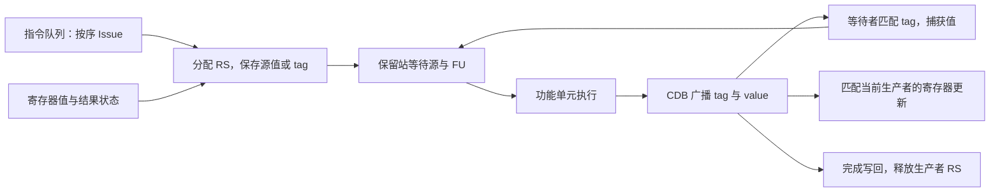
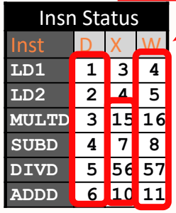

# 04 Tomasulo调度

[本讲目录](../index.md) · [课程目录](../../index.md) · [上一节：03 记分板调度](03-scoreboard-scheduling.md) · [下一节：05 重排序缓冲与提交](05-reorder-buffer-and-commit.md)

> [!abstract] 本节要点
> - 保留站保存已就绪的值或尚未完成的生产者标签，使同名寄存器的不同版本互不干扰。
> - 重命名消除 WAR、WAW 假依赖；RAW 真依赖仍须等待生产者提供结果。
> - 指令顺序进入保留站，操作数与功能单元就绪后执行，结果通过 CDB 向所有等待者广播。
> - 六指令例中，最后一条 ADD 在第 11 周期写回；DIV 在第 17–56 周期执行，第 57 周期写回。
> - 保留站条目数决定能容纳多少待执行指令，功能单元和端口决定实际执行与传输能力。

## 保留站与生产者标签

[记分板](03-scoreboard-scheduling.md)能够发现依赖，但遇到同名寄存器冲突时仍需停顿，消费者也要等结果写入寄存器后才能读取。**Tomasulo 调度（Tomasulo scheduling）**把动态重命名与结果转发结合起来：让等待中的指令直接追踪“哪个生产者会给我这个值”，并在结果出现时立即接收。它用于 1966 年的 IBM System/360 Model 91，其思路影响了后来的 Alpha 21264、MIPS 10000、Pentium II 和 PowerPC 604 等乱序处理器。[^s3p125][^s3p126][^s3p127]

IBM 与 CDC 的指令集条件也不同：

| 比较项 | IBM 360/91 | CDC 6600 |
| --- | --- | --- |
| 每条指令的寄存器指示字段数 | 2 | 3 |
| 浮点寄存器数 | 4 | 8 |

IBM 还支持内存与寄存器之间的运算。较少的寄存器名字更容易被重复使用，这也是动态区分值版本的动机；这里的“2 个寄存器指示字段”指指令编码，不是两套寄存器堆。[^s3p126][^s5b9]

**保留站（Reservation Station，RS）**是功能单元前保存指令、操作数与依赖状态的条目。每个在用条目都有可识别的名称，例如 `Load2`、`Add1`、`Mult1`；在这个教学实现中，这个名称也作为该指令结果的**生产者标签（producer tag）**。一条指令尚未算完时，消费者可以记住它的标签；算完后，消费者再把标签替换成实际的值。[^s3p132][^s3p142][^s3p153]

例如，`MUL F0,F2,F4` 发射时，若 `F2` 的最新值将由 `Load2` 产生，而 `F4` 已经等于 $0$，乘法保留站保存的是“等待 `Load2` 的值”和数值 $0$。它不必持续读取 `F2`、`F4` 这两个体系结构寄存器。以后即使较年轻的指令重新定义了 `F2`，这条乘法等待的仍然是 `Load2`。[^s3p176][^s3p177]

这与[物理寄存器重命名](02-out-of-order-and-dependencies.md)遵循同一个原则：区分值的版本。不过这里用保留站名称标识尚未产生的结果。**寄存器结果状态（Register Result Status）**记录每个体系结构寄存器当前最新的待写生产者；若没有待写者，该项为空，源操作数可以从寄存器读取。消费者取得值或标签后，就独立保存在自己的保留站中。[^s3p151]

算术保留站包含以下字段：

- `Busy`（图中简写为 `B`）：该条目是否已被一条指令占用。
- `Op`：要执行的操作，如 `ADD`、`SUB`、`MUL`、`DIV`。
- `V1`、`V2`：已经取得的两个源操作数值。
- `Tag1`、`Tag2`：尚未就绪的源操作数分别等待哪个生产者；对应标签为 $0$ 时，该操作数已经有值。两项标签都为 $0$，才表示两个源都就绪。[^s3p153]

每个源只需表达两种情况之一：**值已就绪，或者等待某个标签**。这里不再另设记分板式的源就绪标志。数值 $0$ 与标签 $0$ 的含义不同：`V2=0` 是一个可以参与运算的数，`Tag2=0` 是“无需等待生产者”的状态。

**加载缓冲（Load buffer）**至少记录占用状态与加载地址；**存储缓冲（Store buffer）**还需保存待写数据，或保存产生该数据的标签：`V` 存数据值，`Tagdst` 记录这个数据所等待的生产者，不表示 Store 的目的寄存器。指令队列按程序顺序把指令送入相应的缓冲或保留站，加减保留站连向加减单元，乘除保留站连向乘除单元。寄存器和这些条目通过**公共数据总线（Common Data Bus，CDB）**接收结果。调度信息分散在各条目中；为了演算而把它们画成几张表，不代表它们像记分板一样由一张集中式表承担全部控制。[^s3p131][^s3p134][^s3p152][^s5b10]

## 顺序发射与广播唤醒

指令还没拿齐操作数时，先占一个保留站继续等待，可以让后面的独立指令进入调度范围。Tomasulo 因而把“进入调度结构”与“开始运算”分开，并把操作数等待交给各保留站处理。其三个阶段是发射、执行、写结果。[^s3p135]

1. **发射（Issue）**：按程序顺序取下一条指令，检查对应类型是否有空闲 RS 或 buffer。没有空位就停顿；有空位则检查每个源：已经就绪就复制数值，否则复制寄存器结果状态中的生产者标签。随后把目的寄存器的最新生产者改为本条目的标签。源还没就绪不妨碍发射，只会使这条指令留在保留站等待。[^s3p137][^s3p140][^s3p142]
2. **执行（Execute）**：等待全部源操作数就绪，并取得相应功能单元。不同保留站的就绪先后由实际数据到达时间决定，因此执行可以乱序。开始后按该运算的延迟计算结果。若同类就绪指令竞争同一执行资源，课堂举出的简单仲裁方式是先进入者优先；这是示例策略，不是 Tomasulo 对所有实现规定的唯一选择规则。[^s3p143][^s5b12]
3. **写结果（Write result）**：把“生产者标签、结果值”一起送上 CDB。所有等待中的源并行比较自己的标签；匹配者取走数值、清除相应等待标签。寄存器结果状态仍指向此生产者时，寄存器也接收结果并清除待写标记。该生产者完成广播后释放保留站。[^s3p144][^s3p145][^s3p146][^s3p147]



一个广播可以同时满足多个消费者。消费者直接从 CDB 捕获结果，不必先等它写回寄存器，再单独读取；但消费者仍然必须等到正确的生产者算完。**转发缩短了取得结果的路径，没有消除 RAW 真依赖。**[^s3p23][^s5b9][^s5b10]

> [!note] 补充解释
> “只有当前映射匹配才更新寄存器”是版本管理必须满足的条件。假设较早指令的结果标签是 `Mult1`，较晚指令又把同一目的寄存器映射到 `Add2`，那么 `Mult1` 的广播仍应交给等待它的旧消费者，却不能覆盖或清除寄存器当前的 `Add2` 映射。否则较早的慢指令最后返回时，会把较新的寄存器版本冲掉，WAW 就没有真正解决。

WAR 的处理也依赖版本独立：较早消费者已经把旧值存入自己的保留站，或者已经锁定旧生产者标签，较晚写者就可以产生新版本。它不必等所有较早指令都开始运算后才写回。这里的判断依据是消费者持有什么值或标签，而不是“它是否已经执行完”。

> [!warning] 易错点
> 有空闲保留站，只说明指令能进入等待结构；不保证它立刻有可用的功能单元。三个加法 RS 不是三个加法器，三个 Load buffer 也不等于三个内存端口。缓冲容量、运算延迟、功能单元数量与每周期启动能力要分别读。CDB 的全称是 **Common Data Bus**；原图标题中的 “Command” 是拼写错误。[^s3p129][^s3p134][^s3p148]

## 六指令周期演算

用同一段程序对照两种调度方式，才能看出等待究竟发生在哪里。这里沿用[记分板的六指令例](03-scoreboard-scheduling.md)，指令中的第一个寄存器是目的，后面是源；`LD` 从括号内基址加偏移形成的内存地址读值。

```asm
LD   F6,34(R2)
LD   F2,45(R3)
MUL  F0,F2,F4
SUB  F8,F6,F2
DIV  F10,F0,F6
ADD  F6,F8,F2
```

原结构有 6 个 Load buffer，六指令演算将其简化为 3 个；程序没有 Store，因此省略 Store buffer。[^s3p149]

本例单发射，设 3 个 Load buffer、3 个加减 RS（`Add1–Add3`）、2 个乘除 RS（`Mult1–Mult2`）。Load 执行用 2 周期，加减用 2 周期，乘法用 10 周期，除法用 40 周期；Load 可以重叠进行。图中的浮点寄存器初值为 $0$，并另行给定两次加载得到的内存数据分别为 $34$、$45$。这两个值是例题条件，不能从地址偏移 `34`、`45` 推出一般内存内容。[^s3p143][^s3p148][^s3p149][^s3p155][^s3p170][^s3p181]

本例在广播当周期更新等待者，消费者下一周期开始执行；执行完成后下一周期写结果。以下用 $I$ 表示发射周期，$X$ 表示执行完成周期，$W$ 表示 CDB 广播写回周期。原图的发射列写作 `D`，与这里的 $I$ 是同一件事。

第 4 周期的演示先让 `Load1` 写回，再由当周期发射的 SUB 读取 $34$。这种同周期取源值的安排，与“已在等待的消费者收到广播后，下一周期开始运算”是两个不同动作。[^s3p181][^s3p188]

### 第 1–6 周期：所有指令进入保留站

| 周期 | 本周期发射的指令与条目 | 保存的源与目的映射 | 同时发生的关键事件 |
| --- | --- | --- | --- |
| 1 | 第一条 `LD` → `Load1` | 保存地址 `R2+34`；`F6` 的生产者为 `Load1` | 该 Load 从第 2 周期执行 |
| 2 | 第二条 `LD` → `Load2` | 保存地址 `R3+45`；`F2` 的生产者为 `Load2` | 第一条 Load 正在执行，不阻塞第二个空闲条目的分配 |
| 3 | `MUL` → `Mult1` | 第一源等 `Load2`，第二源保存 $0$；`F0` 映射到 `Mult1` | 第一条 Load 执行完成，第二条 Load 继续执行 |
| 4 | `SUB` → `Add1` | 第一源取得 $34$，第二源等 `Load2`；`F8` 映射到 `Add1` | `Load1` 广播 $34$ 并释放；第二条 Load 执行完成 |
| 5 | `DIV` → `Mult2` | 第一源等 `Mult1`，第二源保存旧 `F6` 的 $34$；`F10` 映射到 `Mult2` | `Load2` 广播 $45$，同时唤醒 `Mult1` 与 `Add1`，然后释放 |
| 6 | `ADD` → `Add2` | 第一源等 `Add1`，第二源保存 $45$；`F6` 的最新生产者改成 `Add2` | `MUL`、`SUB` 都开始执行，`DIV` 仍等乘法结果 |

第 3 周期的乘法缺少 `F2`，第 4 周期的减法也缺少 `F2`，但它们都能先发射。到第 5 周期，CDB 上出现 `(Load2,45)`，两个条目分别匹配到相同标签，便各自保存 $45$。一次广播同时使两条指令具备源操作数条件，第 6 周期即可在不同的运算通路上开始执行。[^s3p176][^s3p188][^s3p190][^s3p196][^s3p202][^s3p209]

第 6 周期末的四个算术 RS 可以写成下面的状态。表中的 $0$ 标签统一表示就绪；“—”表示还没有该源的数值，不能拿来运算。

| RS | Busy | Op | V1 | V2 | Tag1 | Tag2 |
| --- | --- | --- | --- | --- | --- | --- |
| `Add1` | Yes | SUB | $34$ | $45$ | $0$ | $0$ |
| `Add2` | Yes | ADD | — | $45$ | `Add1` | $0$ |
| `Mult1` | Yes | MUL | $45$ | $0$ | $0$ | $0$ |
| `Mult2` | Yes | DIV | — | $34$ | `Mult1` | $0$ |

此时寄存器的待写映射是 `F0→Mult1`、`F6→Add2`、`F8→Add1`、`F10→Mult2`；`F2` 已有 $45$，不再等待生产者。注意 `Mult2` 已经保存了旧 `F6` 的 $34$，后面 `F6` 的最新映射变成 `Add2`，不会改变它保存的这个源。[^s3p203][^s3p209][^s3p211]

### 第 7–11 周期：ADD 提前写回

`SUB` 在第 6、7 周期完成 $34-45=-11$，第 8 周期广播 `(Add1,-11)`。等待它的 `Add2` 捕获 $-11$，于是其两个源变成 $-11$ 和 $45$；同一次广播也更新 `F8`，随后释放 `Add1`。[^s3p213][^s3p217][^s3p221][^s3p222]

`ADD` 在第 9、10 周期计算 $-11+45=34$，第 11 周期广播 `(Add2,34)`，写回 `F6` 并释放 `Add2`。此时 `DIV` 仍未开始，因为 `F0` 的乘法结果尚未出现；但它已经保存旧 `F6`，所以 ADD 的写回不会破坏它的源操作数，无须像记分板那样等 DIV 读取寄存器。[^s3p225][^s3p229][^s3p232][^s3p233][^s5b11]

> [!warning] 易错点
> 本例旧 `F6` 与 ADD 产生的新 `F6` 恰好都等于 $34$，容易掩盖版本区别。正确性的原因是 DIV 保存了旧版本，而不是两次结果恰好相等。即使新值不同，DIV 也应继续使用它已经保存的旧值。

### 第 15–57 周期：等待真依赖

`MUL` 从第 6 周期开始，占用第 6–15 周期这 10 个周期，计算 $45\times0=0$，第 16 周期广播 `(Mult1,0)`。它同时更新 `F0`，并使 `Mult2` 的两个源都就绪。DIV 因而从第 17 周期开始执行 $0/34=0$。[^s3p238][^s3p239][^s3p240]

除法延迟为 40 周期，若开始周期为 $c_{\rm start}$，执行周期数为 $L$，则完成周期为

$$
c_{\rm end}=c_{\rm start}+L-1=17+40-1=56.
$$

因此第 56 周期执行完成，第 57 周期广播写回 `F10`，随后全部条目空闲。录音中“第 55 周期完成”的说法与 40 周期延迟、最终表不一致，应按第 56 周期完成计算。[^s3p243][^s3p244][^s3p247][^s5b12]

完整时间表如下，执行区间的首尾周期都计入运算延迟：

| 指令 | $I$：发射 | 执行区间 | $X$：执行完成 | $W$：广播写回 | 写回值 |
| --- | ---: | --- | ---: | ---: | ---: |
| `LD F6,34(R2)` | 1 | 2–3 | 3 | 4 | $34$ |
| `LD F2,45(R3)` | 2 | 3–4 | 4 | 5 | $45$ |
| `MUL F0,F2,F4` | 3 | 6–15 | 15 | 16 | $0$ |
| `SUB F8,F6,F2` | 4 | 6–7 | 7 | 8 | $-11$ |
| `DIV F10,F0,F6` | 5 | 17–56 | 56 | 57 | $0$ |
| `ADD F6,F8,F2` | 6 | 9–10 | 10 | 11 | $34$ |

发射列仍按程序顺序递增，但写回顺序是 Load1、Load2、SUB、ADD、MUL、DIV。原图中的 $D/X/W$ 分别对应这里的发射、执行完成与广播写回。[^s3p247]



图：表中 $D$ 对应本课的发射阶段，$X$ 为执行完成、$W$ 为写回，除法于第 $56$ 周期完成并在第 $57$ 周期广播结果。

> [!info] 可视化资源
> - [Virtual Labs：Tomasulo 交互模拟器](https://virtual-labs.github.io/exp-dynamic-scheduling-tomasulo-iiith/simulation/index.html)：逐周期查看保留站的值与标签、寄存器映射和 CDB 广播；使用前先核对模拟器的延迟与资源配置，不直接拿默认结果对比本课周期表。

## 与记分板的比较

比较调度机制时，既要看整段程序结束时间，也要看每条指令在哪一步等待。下面的“记分板”特指上一章的无旁路教学实现，“Tomasulo”特指本章的保留站与 CDB 实现。[^s3p124][^s3p248]

| 比较项 | 记分板 | Tomasulo |
| --- | --- | --- |
| 调度状态 | 集中跟踪指令、功能单元与寄存器状态 | 操作数与等待标签分布在 RS 中，寄存器另记最新生产者 |
| 结构冒险 | 所需功能单元被占用时阻塞发射 | 所需 RS 或 buffer 已满时阻塞发射；就绪后仍需等待执行资源 |
| WAR | 写结果前等待较早消费者读完旧寄存器 | 消费者保存旧值或旧生产者标签，较晚写者使用新版本 |
| WAW | 发射时等待较早的同名写者 | 不同写者使用不同标签，寄存器保留最新生产者映射 |
| RAW | 在 Read operands 阶段等待源就绪，然后从寄存器取值 | 在 RS 中等待正确标签，经 CDB 接收结果后执行 |
| 结果传递 | 先写寄存器，消费者再读 | CDB 广播，可同时送给寄存器和多个消费者 |

原结构比较还给出容纳在途指令的上限：Tomasulo 的 $14$ 项来自 $6$ 个 Load buffer、$3$ 个 Store buffer、$3$ 个加减 RS 和 $2$ 个乘除 RS；记分板的 $5$ 项来自 $1$ 个 Load/Store、$1$ 个加减、$2$ 个乘法和 $1$ 个除法功能单元。前者数的是缓冲与保留站容量，不能当作 $14$ 个独立执行单元；其中 $6$ 个 Load buffer 属于原结构，六指令演算另简化为 $3$ 个。[^s3p249]

重命名避免的是名字复用造成的 WAR、WAW；RAW 连接的仍是真正的生产者与消费者。原比较表把 Tomasulo 的 RAW 一栏写成 “Renaming avoids”，并把记分板的 RAW 等待写在 Issue 阶段，这两处都不准确：重命名页明确保留 RAW，记分板流水线也明确在 Read operands 等待 RAW；课后问答指出了比较表需要更正。[^s3p23][^s3p31][^s3p249][^s5b15]

在这两个给定例子中，最后写回从第 62 周期提前到第 57 周期；局部变化更明显：MUL 写回从第 20 周期提前到第 16 周期，最后的 ADD 从第 22 周期提前到第 11 周期。ADD 不再被 WAR 阻挡，但整段程序仍被长除法及其 RAW 链限制，因此局部提前量不会直接等于总周期减少量。[^s3p248][^s5b13]

这并非仅替换调度算法、其余硬件完全不变的实验。两例的缓冲容量、功能单元组织、读取操作数的阶段，以及 Load 延迟设定都有差异：本例的多个 Load buffer 允许加载重叠，CDB 又省去了结果先写寄存器、再读取的等待。可以据此解释两张表的差别，但不能把少掉的 5 周期全部归给重命名或某一个单独因素。

Load/Store buffer 让多条访存指令能够在途等待，而不同地址是否指向同一内存位置，还需要专门处理；[精确异常与访存顺序](07-precise-exceptions-and-memory-order.md)将用 LSQ 展开。另一方面，当前结果一旦广播便可能直接改写寄存器，遇到较早指令异常或分支误预测时，怎样撤回年轻指令的影响，是[重排序缓冲与提交](05-reorder-buffer-and-commit.md)要解决的问题。[^s5b13]

> [!question]- 自测：旧指令用标签 `Mult1` 写 `F0`，新指令已把 `F0` 的映射改为 `Add2`。现在 `Mult1` 广播 $12$，一个 RS 的源标签也恰好是 `Mult1`。哪些状态应改变？
> 这个 RS 接收 $12$，清除对应等待标签；`F0` 的当前映射仍是 `Add2`，不能被旧广播清除或改写。旧消费者需要 `Mult1` 的结果，未来消费者需要最新的 `Add2` 版本，两者应同时得到正确处理。

> [!question]- 自测：保持其他条件不变，把乘法执行延迟从 10 周期改为 12 周期。MUL 与 DIV 的 $X/W$ 分别变成多少？最后 ADD 的写回是否改变？
> MUL 仍从第 6 周期开始，完成于 $6+12-1=17$，第 18 周期广播；DIV 第 19 周期开始，完成于 $19+40-1=58$，第 59 周期广播。最后 ADD 仍在第 11 周期写回，因为它只等待 SUB 和第二条 Load，不依赖 MUL 或 DIV。

> [!question]- 自测：三个加法 RS 都有空位，但加法器正忙。下一条加法的一个源尚未就绪，它能否发射、能否立即执行？为什么“有三个 RS”不能回答吞吐问题？
> 它能发射到空闲 RS，并记录缺少的源标签；不能立即执行，必须同时等源就绪和加法器可用。三个 RS 说明能保存多个等待者，吞吐还取决于加法器数量、是否流水化、启动间隔及结果传输能力。

> [!info]- 来源
> - L05-Dynamic-Scheduling.pdf：PDF p.23, 31, 121–249
> - L05.docx：DOCX body 285–557, 601–644

[^s3p125]: L05-Dynamic-Scheduling.pdf-PDF p.125
[^s3p126]: L05-Dynamic-Scheduling.pdf-PDF p.126
[^s3p127]: L05-Dynamic-Scheduling.pdf-PDF p.127
[^s5b9]: L05.docx-DOCX body 323-367
[^s3p132]: L05-Dynamic-Scheduling.pdf-PDF p.132
[^s3p142]: L05-Dynamic-Scheduling.pdf-PDF p.142
[^s3p153]: L05-Dynamic-Scheduling.pdf-PDF p.153
[^s3p176]: L05-Dynamic-Scheduling.pdf-PDF p.176
[^s3p177]: L05-Dynamic-Scheduling.pdf-PDF p.177
[^s3p151]: L05-Dynamic-Scheduling.pdf-PDF p.151
[^s3p131]: L05-Dynamic-Scheduling.pdf-PDF p.131
[^s3p134]: L05-Dynamic-Scheduling.pdf-PDF p.134
[^s3p152]: L05-Dynamic-Scheduling.pdf-PDF p.152
[^s5b10]: L05.docx-DOCX body 368-412
[^s3p135]: L05-Dynamic-Scheduling.pdf-PDF p.135
[^s3p137]: L05-Dynamic-Scheduling.pdf-PDF p.137
[^s3p140]: L05-Dynamic-Scheduling.pdf-PDF p.140
[^s3p143]: L05-Dynamic-Scheduling.pdf-PDF p.143
[^s5b12]: L05.docx-DOCX body 450-514
[^s3p144]: L05-Dynamic-Scheduling.pdf-PDF p.144
[^s3p145]: L05-Dynamic-Scheduling.pdf-PDF p.145
[^s3p146]: L05-Dynamic-Scheduling.pdf-PDF p.146
[^s3p147]: L05-Dynamic-Scheduling.pdf-PDF p.147
[^s3p23]: L05-Dynamic-Scheduling.pdf-PDF p.23
[^s3p129]: L05-Dynamic-Scheduling.pdf-PDF p.129
[^s3p148]: L05-Dynamic-Scheduling.pdf-PDF p.148
[^s3p149]: L05-Dynamic-Scheduling.pdf-PDF p.149
[^s3p155]: L05-Dynamic-Scheduling.pdf-PDF p.155
[^s3p170]: L05-Dynamic-Scheduling.pdf-PDF p.170
[^s3p181]: L05-Dynamic-Scheduling.pdf-PDF p.181
[^s3p188]: L05-Dynamic-Scheduling.pdf-PDF p.188
[^s3p190]: L05-Dynamic-Scheduling.pdf-PDF p.190
[^s3p196]: L05-Dynamic-Scheduling.pdf-PDF p.196
[^s3p202]: L05-Dynamic-Scheduling.pdf-PDF p.202
[^s3p209]: L05-Dynamic-Scheduling.pdf-PDF p.209
[^s3p203]: L05-Dynamic-Scheduling.pdf-PDF p.203
[^s3p211]: L05-Dynamic-Scheduling.pdf-PDF p.211
[^s3p213]: L05-Dynamic-Scheduling.pdf-PDF p.213
[^s3p217]: L05-Dynamic-Scheduling.pdf-PDF p.217
[^s3p221]: L05-Dynamic-Scheduling.pdf-PDF p.221
[^s3p222]: L05-Dynamic-Scheduling.pdf-PDF p.222
[^s3p225]: L05-Dynamic-Scheduling.pdf-PDF p.225
[^s3p229]: L05-Dynamic-Scheduling.pdf-PDF p.229
[^s3p232]: L05-Dynamic-Scheduling.pdf-PDF p.232
[^s3p233]: L05-Dynamic-Scheduling.pdf-PDF p.233
[^s5b11]: L05.docx-DOCX body 413-449
[^s3p238]: L05-Dynamic-Scheduling.pdf-PDF p.238
[^s3p239]: L05-Dynamic-Scheduling.pdf-PDF p.239
[^s3p240]: L05-Dynamic-Scheduling.pdf-PDF p.240
[^s3p243]: L05-Dynamic-Scheduling.pdf-PDF p.243
[^s3p244]: L05-Dynamic-Scheduling.pdf-PDF p.244
[^s3p247]: L05-Dynamic-Scheduling.pdf-PDF p.247
[^s3p124]: L05-Dynamic-Scheduling.pdf-PDF p.124
[^s3p248]: L05-Dynamic-Scheduling.pdf-PDF p.248
[^s3p249]: L05-Dynamic-Scheduling.pdf-PDF p.249
[^s3p31]: L05-Dynamic-Scheduling.pdf-PDF p.31
[^s5b15]: L05.docx-DOCX body 601-644
[^s5b13]: L05.docx-DOCX body 515-557

[本讲目录](../index.md) · [课程目录](../../index.md) · [上一节：03 记分板调度](03-scoreboard-scheduling.md) · [下一节：05 重排序缓冲与提交](05-reorder-buffer-and-commit.md)
