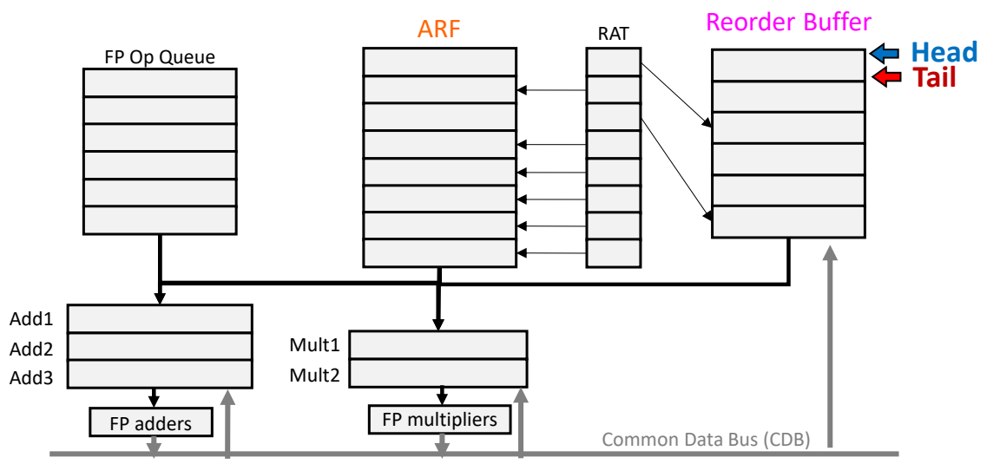
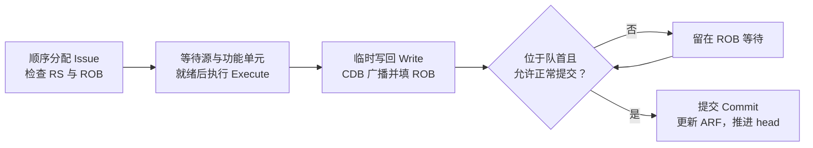

# 05 重排序缓冲与提交

[本讲目录](../index.md) · [课程目录](../../index.md) · [上一节：04 Tomasulo调度](04-tomasulo-scheduling.md) · [下一节：06 ROB演算与多发射](06-rob-example-and-superscalar.md)

> [!abstract] 本节要点
> - ROB 保存尚未提交的临时结果，ARF 保存已提交的寄存器状态，RAT 指出每个寄存器当前应读取的最新版本。
> - 指令按程序顺序分配 ROB 条目，可以乱序执行、乱序写回，但只有队首指令能够正常提交。
> - 写回让依赖指令获得结果；提交才使结果进入 ARF，二者可以相隔很多周期。
> - ROB 标签与保留站位置分离后，结果身份不再依赖保留站一直占用；保留站何时释放仍取决于具体实现。
> - 判断顺序性要看实际动作：前端分配有序，中间执行可乱序，最终提交有序。

## 乱序完成的代价

[Tomasulo 调度](04-tomasulo-scheduling.md)允许后面的短指令先完成，从而绕过前面长指令造成的等待。但执行结果如果立即改写程序可见的寄存器，一条较早指令后来发生异常时，就难以恢复到正确的程序状态。另一个问题来自保留站：它既保存待执行指令，又承担临时结果标签的身份，两种职责绑在一起，会延长条目的占用。[^s3p250]

### 异常发生时，后面的结果已经生效

考虑下面这个独立的四指令时序例。`I` 是顺序发射周期，`E` 是开始执行周期，`W` 是写回周期；除法一行的 `W=42` 表示正常完成时的预定写回时间。[^s3p254]

| 程序顺序与指令 | I | E | W | 改写的寄存器 |
| --- | ---: | ---: | ---: | --- |
| `DIV.D F10,F0,F6` | 1 | 2 | 42 | `F10` |
| `L.D F2,45(R3)` | 2 | 3 | 5 | `F2` |
| `MUL.D F0,F2,F4` | 3 | 6 | 16 | `F0` |
| `SUB.D F8,F2,F6` | 4 | 6 | 8 | `F8` |

假设第一条除法到第 41 周期才检测到除零异常。按程序顺序理解，处理这一异常时，后面三条指令的结果不应已经成为正式状态。可是直接乱序写寄存器的方案已经在第 5、16、8 周期分别覆盖了 `F2`、`F0`、`F8`；仅仅停止后续执行，无法找回这些寄存器原来的值。[^s3p254][^s5b14]

因此，需要把“已经算出结果”和“允许结果正式生效”拆开。错误分支上的指令也有相同需求：可以先计算，确认不应保留时则丢弃临时结果。异常与分支恢复的完整处理见[精确异常与访存顺序](07-precise-exceptions-and-memory-order.md)。

### 保留站标签为什么延长占用

保留站保存操作码、源值或源标签，并用匹配逻辑接收 CDB 上的结果。这些调度信息主要服务于指令开始执行之前；指令进入功能单元后，执行所需信息可以由功能单元继续保存。

但基础 Tomasulo 又用保留站名称作为生产者标签。如果生产者还没广播结果，就把原来的保留站分给另一条指令，同一个标签便可能指向不同结果。为了保持身份唯一，保留站要等到原指令完成并广播之后才能重用。把结果标签交给另一种结构管理，才有机会更早释放调度条目。[^s3p252]

## ROB、ARF 与 RAT

乱序产生的结果需要暂存，按序生效的结果需要保留，后续指令还需要找到最新版本。这三件事分别由 ROB、ARF 和 RAT 承担。

**重排序缓冲（Reorder Buffer，ROB）**按程序顺序为尚未提交的指令分配条目，保存其临时结果及完成状态；**体系结构寄存器堆（Architected Register File，ARF）**保存已经提交的寄存器值；**寄存器别名表（Register Alias Table，RAT）**记录寄存器的最新版本在哪里：已提交版本在 ARF，尚未提交的新版本由对应 ROB 标签标识。[^s3p255][^s3p260]

| 结构 | 保存什么 | 何时发生关键更新 | 后续指令怎样使用 |
| --- | --- | --- | --- |
| ROB | 尚未提交指令的目的寄存器、临时值、完成标志等 | 顺序分配，执行后可乱序填入结果，提交后释放条目 | 按标签读取就绪值，或等待该标签广播 |
| ARF | 已提交的正式寄存器值 | 指令按程序顺序提交时 | 当 RAT 指向已提交版本时读取 |
| RAT | 每个体系结构寄存器的最新版本位置 | 分配新目的版本时；提交或恢复时按条件维护 | 查明源操作数该读 ARF、读 ROB，还是等待 |

这里采用将临时值保存在 ROB 中的教学结构。不同处理器的重排序结构有不同名称与组织方式：例如 MIPS R10K、R12K 的 Active List 分别有 32、48 个条目，Alpha 21264 的 In-Flight Window 为 80 个条目，Pentium 4 的 Reorder Buffer 可容纳 126 条微操作；这些是对应历史实现的参数。[^s3p251]



图：本课教学结构用 ROB 暂存乱序结果，RAT 指向当前寄存器版本，ARF 保存已提交状态，Head 与 Tail 管理顺序提交和分配。

### head 与 tail 管理的是程序顺序

ROB 是一个循环队列。`head` 指向最早尚未提交的有效指令，`tail` 指向接下来分配新指令的位置；指针走到物理数组末端后回到开头。分配沿 `tail` 前进，提交沿 `head` 前进，因此程序顺序保存在条目之间的先后关系中。[^s3p259][^s5b14]

结果写入不必沿着这个顺序。例如按先后分配了 `ROB1`、`ROB2`、`ROB3`，`ROB3` 可以最先得到结果。此时它只是在自己的条目中变为就绪，不能越过尚未完成的 `ROB1` 提交。等 `ROB1` 提交后，队首先移到 `ROB2`；只有较早条目依次允许提交，后面的结果才能进入 ARF。

因此，“重排序”并不是把已经占用的条目按完成时间搬来搬去，而是利用先前记录的程序顺序，控制结果正式生效的次序。

## 分配、执行、写回与提交

在原来的三个阶段之后增加提交阶段，就能让中间计算保持乱序，同时让正式寄存器状态按程序顺序更新。以下四阶段沿用本课演算表的名称。[^s3p261]



### Issue：为指令确定输入版本和结果身份

指令从前端按程序顺序进入调度结构，按以下顺序处理。[^s3p263][^s3p268]

1. **检查资源**：对应类型的保留站必须有空位，ROB 也必须有可分配条目。任一资源不足，这条指令就停顿；不能只检查功能单元或保留站。
2. **先确定源版本**：查询源寄存器的 RAT。若指向 ARF，就读取已提交值；若指向已经就绪的 ROB 条目，就读取临时值；若该条目尚未产生结果，就在保留站记录它的标签，等待广播。
3. **再分配目的版本**：用 `tail` 所指的 ROB 条目作为本指令的结果标签，记录原来的体系结构目的寄存器，并将其 RAT 映射改为新标签。
4. **写入调度状态**：把操作码、源值或源标签、目的 ROB 标签写入保留站，初始化 ROB 条目的完成状态，再推进 `tail`。

“先查源，再更新目的”尤其适用于源、目的同名的指令，例如 `MUL R1,R1,R3`。其中源 `R1` 必须指向这条乘法之前的版本；若先更新目的映射再查源，就会错误地让乘法等待自己的结果。

源操作数尚未就绪并不阻止分配：先记录它所依赖的 ROB 标签，等到执行阶段再等待数据。这与资源已经耗尽、根本无法接纳新指令的停顿不同。

### Execute：等到输入与功能单元都可用

未就绪的指令留在保留站，等待所需标签的结果到达；全部源值已经获得、目标功能单元也可用时，才开始运算。不同指令的等待时间和执行延迟不同，因此开始执行和完成执行都可以乱序。[^s3p269][^s3p271]

> [!warning] 易错点
> 本课 ROB 演算中的 `E` 记录**开始执行**的周期；前面的记分板、Tomasulo 周期表中，$X$ 都表示**执行完成**周期。比较时先确认列的含义，不能把两个数直接相减当成调度收益。[^s5b14]

### Write：把结果交给消费者和 ROB

在本课时序约定中，执行完成后的下一周期进入写结果阶段。结果通过 CDB 广播，标签从原来的保留站名换成了目的 ROB 标签。[^s3p272][^s3p273]

1. 等待该标签的保留站捕获广播值，满足相应的源操作数。
2. 结果写入生产者自己的 ROB 条目。
3. 将该条目的 `ready/finished` 标志置位，表示结果已经可用。

**临时写回（Write Result）**改变的是 ROB 和消费者的就绪状态；ARF 此时保持原值。消费者可以在生产者提交之前使用这一临时结果继续计算。[^s3p274][^s3p275]

### Commit：只让队首结果正式生效

**提交（Commit）**是把允许生效的结果纳入体系结构状态的步骤。正常提交时，先检查 `head` 所指条目的完成标志，再把结果写入其记录的 ARF 目的寄存器，最后释放该 ROB 条目并推进 `head`。后面条目即使早已就绪，也不能绕过尚未完成的队首。[^s3p276][^s3p278]

这里的正常提交还要求指令没有需要处理的异常，并且属于应保留的执行路径；故障指令的处理留到[精确异常](07-precise-exceptions-and-memory-order.md)中展开。

> [!note] 补充解释
> RAT 表示“后续指令要读取的最新版本”，因此旧指令提交时不能无条件把目的寄存器的 RAT 改回 ARF。只有 RAT 仍指向正在提交的条目，才可以恢复为 ARF；若它已经指向更年轻的生产者，就必须保留新映射。这个条件直接来自 RAT 的版本含义。[^s3p260]
>
> 例如较早的 `ROB2` 和较晚的 `ROB6` 都写 `R1`，目前 `RAT[R1]=ROB6`。`ROB2` 提交时仍要把自己的结果写入 `ARF[R1]`，使正式状态按序前进，但后续指令仍应等待 `ROB6`，不能误读刚提交的旧版本。

ROB 标签把结果身份与保留站的位置分开，为保留站更早释放提供了条件。具体何时释放仍是设计选择：[下一章的完整演算](06-rob-example-and-superscalar.md)明确在 `W` 阶段广播、写 ROB 并释放保留站；ROB 条目则一直保留到 `C` 阶段提交。不能用“可以更早释放”的动机改写这个例子的周期表。[^s3p252][^s4p35]

## 一条除法的完整路径

跟踪同一个值经过哪些结构，可以避免把“读取最新值”“临时写回”“正式提交”混为一谈。设指令为：

```asm
DIV R2,R3,R4
```

设当前 `R3`、`R4`、`R2` 的已提交值分别为 $v_3$、$v_4$、$v_2$，RAT 均指向 ARF，且 $v_4\ne 0$；`tail` 将分配 `ROB1`。源中的 `val3`、`val4` 在这里简记为 $v_3$、$v_4$。[^s3p265]

> [!example] 例：除法结果从计算到生效
> 1. **取输入**：查询 `RAT[R3]` 与 `RAT[R4]`，从 ARF 取得 $v_3$、$v_4$。
> 2. **建立新版本**：给本指令分配 `ROB1`，在其中记录目的寄存器 `R2`，把 `RAT[R2]` 改为 `ROB1`。保留站保存的逻辑操作变为“`DIV` 产生 `ROB1`，输入为 $v_3$ 和 $v_4$”。此时 `ARF[R2]` 仍为 $v_2$。[^s3p267]
> 3. **执行除法**：得到临时结果 $v_3/v_4$。假如后面已有 `MUL R1,R2,R6`，它的 `R2` 源会记录 `ROB1` 标签，而不是读取 ARF 中的 $v_2$。[^s3p269]
> 4. **广播与写回**：在 CDB 上广播“`ROB1`，$v_3/v_4$”，等待它的乘法取得该值；同时将值写入 `ROB1` 并置完成标志。`ARF[R2]` 仍为 $v_2$。[^s3p273][^s3p275]
> 5. **正式提交**：当 `ROB1` 位于队首且允许提交时，才令 `ARF[R2]` 变为 $v_3/v_4$，随后推进 `head`。若 RAT 仍映射到 `ROB1`，就让它恢复指向 ARF 中的 `R2`；若已有更新的 `R2` 版本，则保留新映射。[^s3p278]

> [!warning] 易错点
> 源图在第 272–278 页把这条 `DIV` 的结果写成了 $v_3+v_4$。按指令语义，结果应是 $v_3/v_4$；CDB 广播、ROB 暂存和 ARF 提交的值都应随之改正。因此，四阶段传递的始终是同一个除法结果。[^s3p272][^s3p278]

## 阶段名与顺序边界

同一个词在不同教材或处理器资料中可能对应不同动作。若只看 `issue` 或 `dispatch`，就容易把“顺序接纳指令”和“从窗口挑选就绪指令”误认为同一步。源材料本身也混用了这些名称：第 280 页图中的 `issue` 位于保留站选择一侧，第 281 页又将 `issue` 放进有序前端。[^s3p280][^s3p281]

理解本课时，可以先固定下面的动作，再对应具体资料的名字：

| 实际动作 | 本课演算口径 | 顺序约束 |
| --- | --- | --- |
| 取指、译码，并为进入窗口的指令分配状态 | 前端；表中 `Issue` 指顺序分配 RS/ROB 等资源 | 按预测路径的程序顺序 |
| 从窗口选择源已就绪且有执行资源的指令 | `Execute` 的开始；其他资料可能叫 `issue` 或 `dispatch` | 可以乱序 |
| 运算并写回临时结果 | `Execute`、`Write` | 可以乱序 |
| 让结果正式进入体系结构状态 | `Commit`，也常称 `retire`、`graduate` | 按程序顺序 |

`Complete` 也需要结合语境判断：它可能表示计算完成，也可能被用于表示最终提交。阅读周期表时，先问“结果现在写进 ROB 还是 ARF”，比单看“完成”二字更可靠。[^s3p280]

> [!info] 可视化资源
> - [BOOM 官方文档：乱序流水线结构图](https://docs.boom-core.org/en/latest/sections/intro-overview/boom-pipeline.html)：沿图 2–3 对照 Rename、Dispatch、Issue、Writeback 和 Commit；BOOM 将结果写入物理寄存器堆，与本课由 ROB 暂存结果的教学结构有所不同。

> [!question]- 自测：依次分配的 ROB1、ROB2、ROB3 中，ROB2、ROB3 已就绪，ROB1 仍在等数据。下一周期最多能正常提交几条？后面的依赖指令是否也必须停止计算？
> 能提交 0 条，因为队首 ROB1 尚未完成。后面的依赖指令不必全部停止：只要已经取得所需临时结果且有执行资源，仍可继续执行；提交停顿约束的是正式生效顺序。

> [!question]- 自测：ROB2 和 ROB6 都写 R1，RAT[R1] 当前指向 ROB6。ROB2 提交后，新进入的指令要读 R1，而 ROB6 尚未就绪。它应读 ARF 还是等待？为什么？
> 应记录并等待 ROB6。ROB2 提交更新 ARF，但它不能清除较新的 RAT 映射；新指令按程序顺序需要的是 ROB6 将产生的版本，读取 ARF 会拿到旧版本。

> [!question]- 自测：DIV R2,R3,R4 的输入为 18 和 3，ARF 中 R2 的旧值是 7。除法已经写回 ROB，但前面一条指令仍未完成。此时跟在除法后的 R2 消费者与 ARF 各自看到什么？把结果写成 21 错在哪里？
> 消费者可从相应 ROB 条目或广播取得 $18/3=6$，ARF 中的 R2 仍是旧值 7，因为除法还不能越过前面的指令提交。21 是把除法误算成了加法；写回与提交的位置不同，不会改变指令本身的运算语义。

> [!info]- 来源
> - L05-Dynamic-Scheduling.pdf：PDF p.250–281
> - L05-Supplement-ReorderBuffer-Exception.pdf：PDF p.35
> - L05.docx：DOCX body 515–644

[^s3p250]: L05-Dynamic-Scheduling.pdf-PDF p.250
[^s3p254]: L05-Dynamic-Scheduling.pdf-PDF p.254
[^s5b14]: L05.docx-DOCX body 558-600
[^s3p252]: L05-Dynamic-Scheduling.pdf-PDF p.252
[^s3p255]: L05-Dynamic-Scheduling.pdf-PDF p.255
[^s3p260]: L05-Dynamic-Scheduling.pdf-PDF p.260
[^s3p251]: L05-Dynamic-Scheduling.pdf-PDF p.251
[^s3p259]: L05-Dynamic-Scheduling.pdf-PDF p.259
[^s3p261]: L05-Dynamic-Scheduling.pdf-PDF p.261
[^s3p263]: L05-Dynamic-Scheduling.pdf-PDF p.263
[^s3p268]: L05-Dynamic-Scheduling.pdf-PDF p.268
[^s3p269]: L05-Dynamic-Scheduling.pdf-PDF p.269
[^s3p271]: L05-Dynamic-Scheduling.pdf-PDF p.271
[^s3p272]: L05-Dynamic-Scheduling.pdf-PDF p.272
[^s3p273]: L05-Dynamic-Scheduling.pdf-PDF p.273
[^s3p274]: L05-Dynamic-Scheduling.pdf-PDF p.274
[^s3p275]: L05-Dynamic-Scheduling.pdf-PDF p.275
[^s3p276]: L05-Dynamic-Scheduling.pdf-PDF p.276
[^s3p278]: L05-Dynamic-Scheduling.pdf-PDF p.278
[^s4p35]: L05-Supplement-ReorderBuffer-Exception.pdf-PDF p.35
[^s3p265]: L05-Dynamic-Scheduling.pdf-PDF p.265
[^s3p267]: L05-Dynamic-Scheduling.pdf-PDF p.267
[^s3p280]: L05-Dynamic-Scheduling.pdf-PDF p.280
[^s3p281]: L05-Dynamic-Scheduling.pdf-PDF p.281

[本讲目录](../index.md) · [课程目录](../../index.md) · [上一节：04 Tomasulo调度](04-tomasulo-scheduling.md) · [下一节：06 ROB演算与多发射](06-rob-example-and-superscalar.md)
