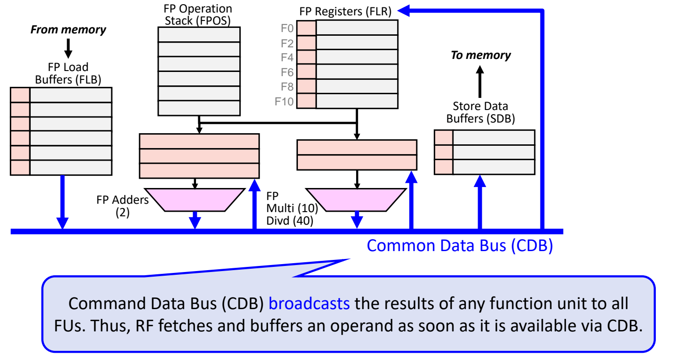
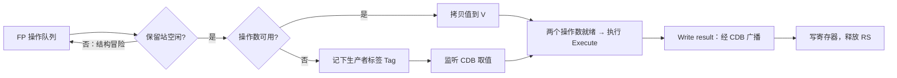
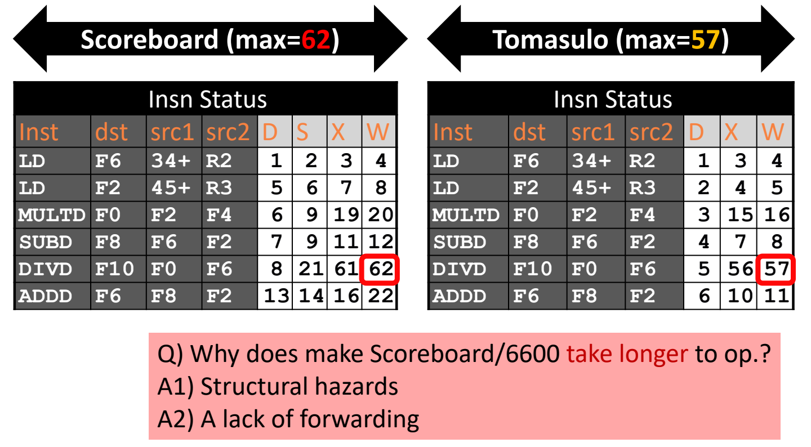

# 05 Tomasulo 算法

[本讲目录](../index.md) · [课程目录](../../index.md) · [上一节：04 记分板算法](04-scoreboard-algorithm.md) · [下一节：06 重排序缓冲与顺序提交](06-reorder-buffer-and-in-order-commit.md)

> [!abstract] 本节要点
> - Tomasulo 算法（IBM 360/91，1966）本质上是两项技术：**硬件寄存器重命名**消除 WAR/WAW 假相关，**数据转发**（CDB 广播）缩短 RAW 真相关的等待。
> - 保留站 RS 就是重命名映射表：源操作数就绪则直接存**值**（V），否则存产生它的保留站**标签**（Tag，Tag $=0$ 表示就绪）；RS 不保存寄存器名，所以后续指令改写该寄存器不再构成 WAR。
> - 三阶段：Issue（保留站空闲才发射，拷贝值或记标签，并在寄存器结果状态中登记“所有权”）→ Execute（两个操作数都就绪才执行）→ Write result（结果经 CDB 广播给所有 RS 和寄存器，然后释放 RS）。
> - 同一段 6 条指令：Tomasulo 在周期 6 就发射完全部指令（记分板的 ADDD 要到周期 13），总时长 57 个周期 vs 记分板 62 个周期；记分板慢在结构冒险（只有一个 LD 单元）和缺少转发。
> - Tomasulo 仍是按序发射、乱序执行、乱序完成；其 load/store 缓冲在真实处理器中合并为 Load Store Queue（LSQ）。

## 从记分板到 Tomasulo

记分板（见[记分板算法](04-scoreboard-algorithm.md)）对所有冒险只有一种手段：停顿。遇到 RAW 真相关，就停住指令直到冒险解除；遇到 WAW、WAR 这类名字相关，也把它们当作冒险来停顿。停顿太多，乱序执行的收益远没有发挥出来。[^s3p124]

**Tomasulo 算法**（Tomasulo's algorithm）的出发点是：用硬件**动态**地重命名寄存器，从而去掉假相关（WAW、WAR）。编译器也能静态重命名寄存器，但运行时才出现的相关（例如 cache miss 打乱的时序）编译器看不到，这正是硬件要做而编译器做不到的部分。实现上的关键是把记账信息**分布**到各个保留站中，而不是像记分板那样放在一张集中式的表里。[^s3p125] 寄存器重命名的一般原理见[寄存器重命名](03-out-of-order-execution-and-register-renaming.md)，本节只讲 Tomasulo 的具体做法。

> [!tip] 课堂强调
> 严格说，Tomasulo 就是两项技术的组合：一是加入转发（forwarding），二是加入寄存器重命名（register renaming）。目标都是避免相关带来的额外停顿。

### IBM 360/91

Tomasulo 算法最早用于 **IBM 360/91**（1966 年），比 CDC 6600 晚 3 年。两者的 ISA 差别是：[^s3p126]

| 对比项 | IBM 360/91 | CDC 6600 |
| --- | --- | --- |
| 每条指令的寄存器说明符 | 2 个 | 3 个 |
| 浮点寄存器 | 4 个 | 8 个 |
| 存储器-寄存器操作 | 有 | 无 |

从配置看，IBM 360/91 并不比 CDC 6600 强（两者出自不同公司），但靠架构上的优化，性能并不比 CDC 6600 差。它值得学习的原因是影响深远：Alpha 21264、MIPS R10000、Pentium II、PowerPC 604 等后续处理器都继承了 Tomasulo 的思想。

### 例子中的重命名

本节始终使用和记分板相同的 6 条指令：[^s3p127]

```asm
LD    F6, 34(R2)     ; Load#1
LD    F2, 45(R3)     ; Load#2
MULTD F0, F2, F4
SUBD  F8, F6, F2
DIVD  F10, F0, F6
ADDD  F6, F8, F2
```

其中既有 RAW 相关（例如 MULTD 读 Load#2 写的 F2），也有假相关：SUBD、DIVD 读 F6，而之后的 ADDD 要写 F6，构成 WAR。RAW 是真相关，无法消除；WAR 可以消除。

按一般的重命名思路，可以把 ADDD 的目的寄存器 F6 改名为一个新寄存器（例如 F11）。Tomasulo 的做法是从硬件视角改名：把 SUBD、DIVD 的源操作数 F6 改名为 **Load1**，即“产生这个值的那条指令（所在的缓冲项）的输出”，并在值产生后把它直接转发到需要的地方。这样 SUBD、DIVD 等的是 Load1 而不是寄存器 F6，ADDD 写 F6 就不再影响它们。[^s3p127] 这里的 Load1 正是后面要讲的保留站。

## Tomasulo 的结构：保留站与 CDB

Tomasulo 的整体结构与记分板相似，也有指令缓冲和寄存器堆，另外加了两种新机制。[^s3p128]

1. **FP 操作队列**（FP Operation Stack，FPOS）：存放待发射的指令，按序发出。
2. **FP 寄存器**（FP Registers，FLR）：F0、F2、…、F10。
3. **功能单元**：FP 加法器（FP Adders），执行 2 个周期；FP 乘/除单元（FP Mult/Div），乘法 10 个周期、除法 40 个周期。乘法和除法合用一个单元。[^s3p130]
4. **FP Load Buffers（FLB）**：来自存储器的数据，共 6 项；**Store Data Buffers（SDB）**：送往存储器的数据。Tomasulo 把 load 和 store 也当作一种功能单元。[^s3p131] 与记分板只有一个 LD/ST 功能单元不同，这里是一串缓冲项，多个 load 可以同时在途。

### 机制 1：保留站（Reservation Station）

**保留站**（Reservation Station，RS）是每个功能单元前面的缓冲，它本身就是寄存器重命名的映射表：指令发射后在保留站里等待操作数，操作数以“值”或“产生它的保留站名”的形式登记。[^s3p132] 不仅功能单元有保留站，FP 寄存器也有对应的状态，记录将要写该寄存器的是哪个保留站。[^s3p133]

保留站等表项的字段如下。

**寄存器结果状态**（Register Result Status）：对每个寄存器，记录哪个功能单元（保留站）将写它；若没有待完成的指令要写这个寄存器，则为空。它用来跟踪假相关（WAW 和 WAR）。[^s3p151]

**Load buffer**：[^s3p152]

- **Busy（B）**：该保留站项或功能单元是否被占用。
- **Addr**：load 指令的目标存储器地址。

**功能单元保留站**（FU buffer）：[^s3p153]

- **Busy（B）**：跟踪 RAW 和结构冒险。
- **Op**：在功能单元中执行的操作。
- **V1、V2**：源操作数的**值**。store buffer 也有 V 字段，存放待写入存储器的数据。
- **Tag1、Tag2**：将产生源操作数的保留站。Tag1、Tag2 $=0$ 即表示就绪，没有记分板那样单独的 ready 标志位。store buffer 只有 $\mathrm{Tag}_{\rm dst}$，指向产生待存结果的保留站。

对每个源操作数，V 和 Tag 二者必有其一有效：要么已经拿到值，要么记着正在等哪个保留站。

> [!tip] 课堂强调
> RS 不保存任何寄存器名，操作数就绪时直接把寄存器的**值**存进来。记分板在写回时要检查前面的指令是否还要读这个寄存器（WAR），否则就停顿；而 Tomasulo 的值已经拷进保留站，不再依赖寄存器堆里的那个位置，所以这个问题不存在。这一点需要回过头对照记分板的例子再看一遍。[^s5b11]

### 机制 2：公共数据总线（Common Data Bus）

**公共数据总线**（Common Data Bus，CDB）把任一功能单元的结果**广播**给所有功能单元（保留站）和寄存器堆。等待某个结果的保留站一直监听 CDB，结果一出现就立即取走并缓冲，不必等它先写进寄存器堆再读出来。[^s3p134]



图：Tomasulo 结构。FP Load Buffers、FP 操作栈、FP 寄存器、加法器与乘除法器前的保留站和 Store Data Buffers 都挂在公共数据总线 CDB 上：load 缓冲、加法器、乘除器的输出接到 CDB，CDB 再接回各保留站、store 缓冲和 FP 寄存器；寄存器和缓冲项左侧的小格是存放标签的状态位。

五级流水线的转发是在特定的两个阶段之间专门拉一条旁路；CDB 则把结果放到一条总线上，任何需要它的单元都能从总线取值，是一种更通用的转发。

> [!info] 可视化资源
> [Wikipedia：Tomasulo 算法](https://en.wikipedia.org/wiki/Tomasulo%27s_algorithm)：含 IBM 360/91 浮点单元结构图和算法执行过程的动画 GIF，可对照本节保留站字段（Wikipedia 记作 Op/Vj/Vk/Qj/Qk/A/Busy）与 CDB 广播。

> [!warning] 易错点
> 讲义在介绍机制 2 时把 CDB 写作 “Command Data Bus”，标准名称是 **Common Data Bus**（课上也这样称呼）。[^s3p134]

## 三个阶段

Tomasulo 把指令处理分为三个阶段：Issue、Execute（执行完成）、Write result。[^s3p135]



### 阶段 1：Issue

从操作队列按序取出指令，发射前依次检查：[^s3p137]

1. **保留站是否空闲**：这是结构冒险检查。注意检查对象是保留站，而记分板检查的是功能单元本身是否空闲。保留站已满则不能发射。
2. **操作数是否可用**：[^s3p138]
   - 可用：把操作数的值拷进 V 字段，不需要重命名，直接发射。[^s3p139]
   - 有操作数正被尚未完成的指令占用：仍然发射，但做硬件寄存器重命名，即把该操作数的 Tag 设为将产生它的保留站，例如 `mul F0, LD2, F4` 中 F2 被改成 LD2，该操作数处于 pending 状态。[^s3p142]
3. **更新寄存器结果状态**：把目的寄存器的状态改为本指令所在的保留站，表示这个寄存器现在归它所有（ownership）。[^s3p140]

### 阶段 2：Execute

只有两个操作数都就绪（Tag1、Tag2 都为 0）时，指令才进入功能单元开始执行。[^s3p143] 在执行完成的那个周期记下“执行完成”时间。

### 阶段 3：Write result

写结果分两步：[^s3p144]

1. 功能单元的结果经 CDB 广播。[^s3p145]
2. 寄存器收到结果后写入，寄存器结果状态清除，该保留站被释放（clean up RS）。[^s3p146]

与此同时，所有处于 pending 的保留站一直在侦听 CDB，发现自己等的标签出现在 CDB 上，就直接把值存入本地 V 字段，Tag 清零，操作数就绪。[^s3p147]

> [!note] 补充解释
> 寄存器结果状态只记录**最新**的那个生产者。若较早指令的结果广播时，寄存器状态已被后发射的指令改写成别的标签，寄存器就不该接收这个旧结果，这正是 Tomasulo 用重命名消除 WAW 的方式；等这个旧结果的保留站照样能从 CDB 取到值。本例中 LD1 在 ADDD 发射前就写回了 F6，没有出现这种情况。

## 逐周期例子

为简洁起见，例子把 load buffer 从 6 项减为 3 项（Load1–Load3），并省略 store data buffer（它与 load buffer 相同）。[^s3p149] 加法器有 3 个保留站 Add1–Add3，乘除器有 2 个保留站 Mult1–Mult2。所有寄存器初值为 0，并假设 $\mathrm{Mem}[R2+34]=34$、$\mathrm{Mem}[R3+45]=45$。[^s3p155] load 需要 2 个周期，加减 2 个周期，乘 10 个周期，除 40 个周期；流水化的结构允许同一周期处理多条指令（一条在写结果，另一条在发射等）。[^s3p154]

表中各列记录：发射周期 D（Issue）、执行完成周期 X、写结果周期 W。保留站、寄存器状态在物理上分散在各个单元旁边，例子只是为了便于观察把它们集中画在下方；记分板才真有一张集中的表。

### 周期事件表

本例中，同一周期内先处理写结果再处理发射，所以发射时能直接读到本周期刚写回的值（见周期 4 的 SUBD）。

| 周期 | 事件 | 关键状态变化 |
| --- | --- | --- |
| 1 | 发射 LD1：Load1 空闲，R2 可用 | Load1：Busy=Yes，Addr=$34+R2$；F6 → Load1 |
| 2 | LD1 开始执行（2 周期）；发射 LD2：还有空闲 load 项 | Load2：Addr=$45+R3$；F2 → Load2。记分板只有一个 LD 单元，这里可以有多个 load 同时在途 [^s3p168] |
| 3 | LD1 执行完成；LD2 开始执行；发射 MULTD：Mult1 空闲，F2 未就绪 | Mult1：Op=MUL，V2=0（F4），Tag1=Load2；F0 → Mult1 [^s3p176] |
| 4 | LD1 写结果：CDB 广播 34，F6=34，释放 Load1；LD2 执行完成；发射 SUBD：F6=34 可用，F2 未就绪 | Add1：Op=SUB，V1=34，Tag2=Load2；F8 → Add1 |
| 5 | LD2 写结果：CDB 广播 45，Add1、Mult1 同时取走 45，F2=45，释放 Load2；发射 DIVD：F0 未就绪，F6=34 可用 | Add1：V2=45；Mult1：V1=45；Mult2：Op=DIV，V2=34，Tag1=Mult1；F10 → Mult2 |
| 6 | SUBD、MULTD 开始执行；发射 ADDD：F8 未就绪，F2=45 可用 | Add2：Op=ADD，V2=45，Tag1=Add1；F6 → Add2。全部 6 条指令已发射 [^s3p210] |
| 7 | SUBD 执行完成，结果 $34-45=-11$ | — |
| 8 | SUBD 写结果：CDB 广播 $-11$，Add2 取走，F8=$-11$，释放 Add1 | Add2：V1=$-11$，两个 Tag 均为 0 |
| 9 | ADDD 开始执行 | — |
| 10 | ADDD 执行完成，结果 $-11+45=34$ | — |
| 11 | ADDD 写结果：F6=34，释放 Add2 | — |
| 15 | MULTD 执行完成（周期 6–15 共 10 个周期），结果 $45\times0=0$ | — |
| 16 | MULTD 写结果：CDB 广播 0，Mult2 取走，F0=0，释放 Mult1 | Mult2：V1=0，V2=34，就绪 |
| 56 | DIVD 执行完成（周期 17–56 共 40 个周期），结果 $0/34=0$ | — |
| 57 | DIVD 写结果：F10=0，释放 Mult2 | 全部完成 |

周期 5 体现了 CDB 广播的价值：一次广播同时满足了 SUBD 和 MULTD 两个等待者，它们下一个周期就能开始执行。周期 6 发射 ADDD 时，DIVD 早已把 F6 的值 34 拷进了 Mult2 的 V2，所以 ADDD 把 F6 的所有权改为 Add2、随后在周期 11 写 F6，都不影响 DIVD，WAR 被消除。

### 最终状态

| 指令 | dst | src1 | src2 | D（发射） | X（执行完成） | W（写结果） |
| --- | --- | --- | --- | --- | --- | --- |
| LD | F6 | 34+ | R2 | 1 | 3 | 4 |
| LD | F2 | 45+ | R3 | 2 | 4 | 5 |
| MULTD | F0 | F2 | F4 | 3 | 15 | 16 |
| SUBD | F8 | F6 | F2 | 4 | 7 | 8 |
| DIVD | F10 | F0 | F6 | 5 | 56 | 57 |
| ADDD | F6 | F8 | F2 | 6 | 10 | 11 |

最终寄存器值：F0=0，F2=45，F6=34，F8=$-11$，F10=0。[^s3p247]

从 D 列看，发射是**按序**的；从 X、W 列看，执行和完成（写结果）都是**乱序**的，例如 ADDD 在周期 11 写结果，早于周期 16 的 MULTD。和记分板一样，Tomasulo 是按序发射、乱序执行、乱序完成。[^s3p247] 完成顺序乱序带来的问题见[重排序缓冲与顺序提交](06-reorder-buffer-and-in-order-commit.md)。

关于本例约定的两个细节：[^s5b12]

- **多个保留站同时就绪**：同一功能单元前若有多个保留站都已就绪，早期设计没有复杂的选择策略，直接挑先进入的那一条执行。
- **发射时截取 CDB**：本例中发射只从寄存器堆或已有标签取操作数，不会在发射的同一周期直接截取 CDB 上正在广播的结果；那是一种可能的优化，1966 年的设计没有采用。

## Tomasulo 与记分板的比较

### 完成时间

同一段代码，记分板在周期 62 完成，Tomasulo 在周期 57 完成。[^s3p248]



图：同一 6 条指令的状态表对比。左表为记分板（D/S/X/W = 发射 / 读操作数 / 执行完成 / 写回），DIVD 在周期 62 写回；右表为 Tomasulo（D/X/W = 发射 / 执行完成 / 写结果），DIVD 在周期 57 写结果；下方框注给出记分板更慢的两个原因：结构冒险和缺少转发。

| 指令 | 记分板 D/S/X/W | Tomasulo D/X/W |
| --- | --- | --- |
| LD F6 | 1 / 2 / 3 / 4 | 1 / 3 / 4 |
| LD F2 | 5 / 6 / 7 / 8 | 2 / 4 / 5 |
| MULTD | 6 / 9 / 19 / 20 | 3 / 15 / 16 |
| SUBD | 7 / 9 / 11 / 12 | 4 / 7 / 8 |
| DIVD | 8 / 21 / 61 / 62 | 5 / 56 / 57 |
| ADDD | 13 / 14 / 16 / 22 | 6 / 10 / 11 |

总时长只少了 5 个周期，是因为 40 个周期的 DIVD 占了大头；逐条看，MULTD 的写回从 20 提前到 16，ADDD 从 22 提前到 11，许多指令的完成时间提前了接近一半。

记分板更慢有两个原因：[^s3p248]

1. **结构冒险**：记分板只有一个 LD 单元，LD2 要等 LD1 写回后才能在周期 5 发射；只有一个加法单元，ADDD 要等 SUBD 在周期 12 释放后才能在周期 13 发射。Tomasulo 有多项 load buffer 和多个保留站，周期 6 就发射完所有指令。
2. **缺少转发**：记分板的结果要先写回寄存器堆，消费者再从寄存器堆读操作数，多花一个周期。例如 LD2 在周期 8 写回，MULTD 周期 9 才读操作数、周期 10 才开始执行；Tomasulo 中 LD2 在周期 5 经 CDB 广播，MULTD 周期 6 就开始执行。此外记分板的 ADDD 在周期 16 就执行完，却因 DIVD 还没读 F6（WAR）要拖到周期 22 才能写回；Tomasulo 的 DIVD 早已拷走 F6 的值，ADDD 在周期 11 就写结果。

### 机制对比

| 对比项 | Tomasulo（IBM 360/91） | 记分板（CDC 6600） |
| --- | --- | --- |
| 功能单元 | 流水化功能单元（6 Load、3 Store、3 +、2 ×/÷） | 多个功能单元（1 LD/ST、1 +、2 ×、1 ÷） |
| 窗口大小 | $\le 14$ 条指令 | $\le 5$ 条指令 |
| 结构冒险 | 无空闲保留站则不发射 | 无空闲功能单元则不发射 |
| WAR | 重命名消除 | 推迟完成（写回） |
| WAW | 重命名消除 | 推迟发射 |
| RAW | 在 RS 中等待（Tag $\ne 0$），从 CDB 转发取值 | 在读操作数阶段停顿，直到生产者写回寄存器堆 |
| 功能单元结果 | 从 FU 广播 | 写寄存器、再读寄存器 |
| 控制 | 保留站（分布式） | 集中式记分板 |

窗口大小正好等于可同时容纳的指令数：Tomasulo $6+3+3+2=14$，记分板 $1+1+2+1=5$。[^s3p249]

> [!warning] 易错点
> 讲义的 Tomasulo vs. Scoreboard 对比表有误，课后有同学指出，老师确认需要修改：原表把 RAW 写成 “Renaming avoids / Stall issue”，把 WAW 写成 “Renaming&Forward avoids”。RAW 是真相关，重命名消除不了：Tomasulo 让指令在保留站里等待并通过 CDB 转发拿到值，记分板则在读操作数阶段（而不是 Issue）停顿；“转发”对应的是 RAW 而不是 WAW。上表已按课程机制改正。[^s3p249] [^s5b15]
>
> 原表结构冒险一行两栏都写 “No issue”，意思是“不发射”：Tomasulo 没有空闲保留站、记分板没有空闲功能单元时，指令停在发射阶段。

### Load Store Queue 的提法

Tomasulo 把记分板唯一的 LD/ST 功能单元改成了 load buffer 和 store buffer，从而能同时支持多条 load 和多条 store 指令。但分开的两个缓冲并不是最优解：真实处理器把它们合并成一个 **Load Store Queue**（LSQ）。[^s5b13] LSQ 与访存消歧的细节见[精确异常与推测执行](07-precise-exceptions-and-speculative-execution.md)。

> [!question]- 自测：若把例子里的加法器保留站从 3 个减为 1 个，ADDD 最早在哪个周期发射？
> 周期 9。SUBD 在周期 4 占用唯一的加法保留站，直到周期 8 写结果后才释放；ADDD 必须等保留站空闲（结构冒险）；按与记分板例子相同的约定（写结果的周期释放，下一周期才能重新分配，如记分板中 SUBD 周期 12 写回、ADDD 周期 13 发射），ADDD 周期 9 才能发射。此时 F8 已经写回（$-11$），ADDD 发射时直接拷贝值，不需要标签。

> [!question]- 自测：周期 5 发射 DIVD 时，其保留站 Mult2 的 V1、V2、Tag1、Tag2 各是什么？为什么 ADDD 之后改写 F6 不会让 DIVD 读错值？
> V1 空、Tag1=Mult1（F0 由 MULTD 产生，尚未完成）；V2=34、Tag2=0（F6 已在周期 4 由 LD1 写回）。DIVD 保存的是 F6 的值 34 而不是寄存器名 F6，ADDD 在周期 11 写 F6 改的是寄存器堆，与 Mult2 中的拷贝无关，所以 WAR 不会造成错误或停顿。

> [!question]- 自测：记分板中 MULTD 在周期 19 执行完成，Tomasulo 中是周期 15。这 4 个周期的差距各来自哪里？
> 记分板只有一个 LD 单元，LD2 推迟到周期 5 发射、周期 8 才写回（结构冒险，多出 3 个周期：Tomasulo 的 LD2 在周期 5 广播）；之后记分板还要在周期 9 读寄存器堆，周期 10 才开始执行，而 Tomasulo 从 CDB 取值后下一周期即可执行（缺少转发，多 1 个周期）。两者乘法都执行 10 个周期，故相差 $3+1=4$。

> [!info]- 来源
> - L05-Dynamic-Scheduling.pdf：PDF p.124–128, 130–135, 137–140, 142–147, 149, 151–155, 168, 176–177, 210, 247–249
> - L05.docx：DOCX body 157–314, 338–367

[^s3p124]: L05-Dynamic-Scheduling.pdf-PDF p.124
[^s3p125]: L05-Dynamic-Scheduling.pdf-PDF p.125
[^s3p126]: L05-Dynamic-Scheduling.pdf-PDF p.126
[^s3p127]: L05-Dynamic-Scheduling.pdf-PDF p.127
[^s3p128]: L05-Dynamic-Scheduling.pdf-PDF p.128
[^s3p130]: L05-Dynamic-Scheduling.pdf-PDF p.130
[^s3p131]: L05-Dynamic-Scheduling.pdf-PDF p.131
[^s3p132]: L05-Dynamic-Scheduling.pdf-PDF p.132
[^s3p133]: L05-Dynamic-Scheduling.pdf-PDF p.133
[^s3p151]: L05-Dynamic-Scheduling.pdf-PDF p.151
[^s3p152]: L05-Dynamic-Scheduling.pdf-PDF p.152
[^s3p153]: L05-Dynamic-Scheduling.pdf-PDF p.153
[^s5b11]: L05.docx-DOCX body 216-239
[^s3p134]: L05-Dynamic-Scheduling.pdf-PDF p.134
[^s3p135]: L05-Dynamic-Scheduling.pdf-PDF p.135
[^s3p137]: L05-Dynamic-Scheduling.pdf-PDF p.137
[^s3p138]: L05-Dynamic-Scheduling.pdf-PDF p.138
[^s3p139]: L05-Dynamic-Scheduling.pdf-PDF p.139
[^s3p142]: L05-Dynamic-Scheduling.pdf-PDF p.142
[^s3p140]: L05-Dynamic-Scheduling.pdf-PDF p.140
[^s3p143]: L05-Dynamic-Scheduling.pdf-PDF p.143
[^s3p144]: L05-Dynamic-Scheduling.pdf-PDF p.144
[^s3p145]: L05-Dynamic-Scheduling.pdf-PDF p.145
[^s3p146]: L05-Dynamic-Scheduling.pdf-PDF p.146
[^s3p147]: L05-Dynamic-Scheduling.pdf-PDF p.147
[^s3p149]: L05-Dynamic-Scheduling.pdf-PDF p.149
[^s3p155]: L05-Dynamic-Scheduling.pdf-PDF p.155
[^s3p154]: L05-Dynamic-Scheduling.pdf-PDF p.154
[^s3p168]: L05-Dynamic-Scheduling.pdf-PDF p.168
[^s3p176]: L05-Dynamic-Scheduling.pdf-PDF p.176
[^s3p210]: L05-Dynamic-Scheduling.pdf-PDF p.210
[^s3p247]: L05-Dynamic-Scheduling.pdf-PDF p.247
[^s5b12]: L05.docx-DOCX body 240-291
[^s3p248]: L05-Dynamic-Scheduling.pdf-PDF p.248
[^s3p249]: L05-Dynamic-Scheduling.pdf-PDF p.249
[^s5b15]: L05.docx-DOCX body 338-367
[^s5b13]: L05.docx-DOCX body 292-314

[本讲目录](../index.md) · [课程目录](../../index.md) · [上一节：04 记分板算法](04-scoreboard-algorithm.md) · [下一节：06 重排序缓冲与顺序提交](06-reorder-buffer-and-in-order-commit.md)
