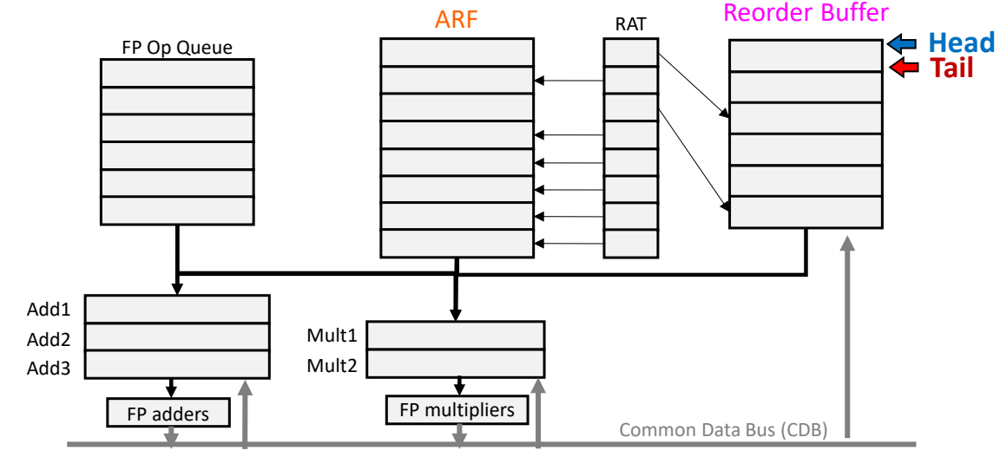
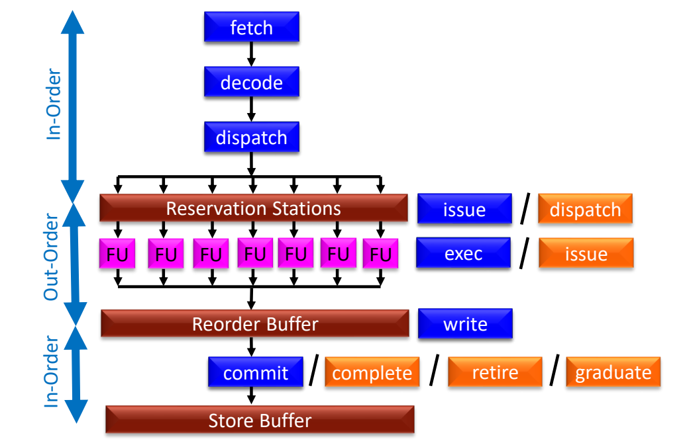
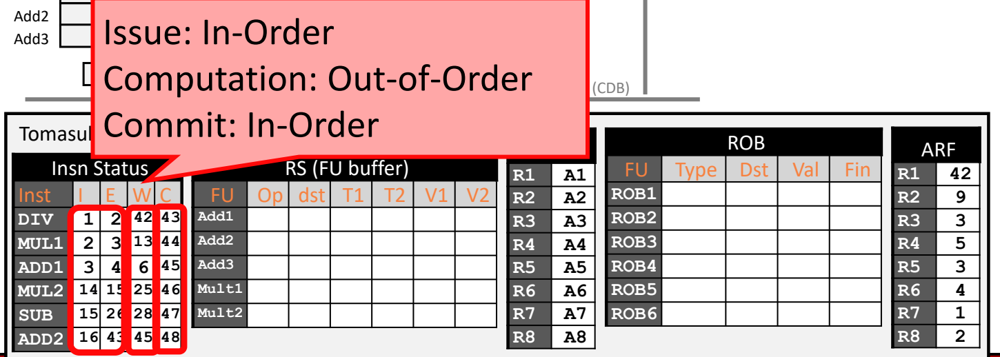

# 06 重排序缓冲与顺序提交

[本讲目录](../index.md) · [课程目录](../../index.md) · [上一节：05 Tomasulo 算法](05-tomasulo-algorithm.md) · [下一节：07 精确异常与推测执行](07-precise-exceptions-and-speculative-execution.md)

> [!abstract] 本节要点
> - Tomasulo 有两个遗留问题：保留站同时充当重命名标签，必须等指令完成才能释放；指令乱序完成，使异常和分支预测错误很难处理。
> - ROB 的思想是乱序执行、顺序提交：ROB 暂存乱序产生的结果，ARF 只按程序顺序更新，外界因此“相信”指令是顺序执行的。
> - Tomasulo w/ ROB 在原结构上做三处改动：FP 寄存器改称 ARF；新增由 head/tail 指针管理的循环队列 ROB；新增 RAT，记录每个架构寄存器的最新值在 ARF 还是在某个 ROB 项。
> - 四个阶段依次是 Issue（检查 RS 和 ROB、读 RAT、分配 tail 项）、Execution begin（操作数齐了才开始）、Write result（CDB 广播并写入自己的 ROB 项，ARF 不动）、Commit（head 项完成后写 ARF，head 前进）。
> - 按 Intel 命名，乱序处理器的 fetch/decode/issue 和 commit 按序进行，只有 exec/write 乱序；commit 绝不能乱序。

## Tomasulo 的两个问题

Tomasulo 用保留站和 CDB 解决了结构冒险和数据冒险，具体见[Tomasulo 算法](05-tomasulo-algorithm.md)。但它还留下两个问题，ROB 就是为解决这两个问题而引入的。[^s3p250]

### 问题 1：保留站释放太晚

先看保留站（RS）在调度中要承担什么：[^s3p252]

1. RS 要有**关联逻辑**，侦听 CDB 上广播的结果，并更新自己等待的操作数；
2. RS 要保存指令的全部信息，包括 opcode、操作数值和依赖标签等；
3. 这些信息**只在指令开始执行之前**有用，指令一旦送进功能单元，功能单元会自己保存运算所需的数据。

照理说，指令开始执行时 RS 就可以释放了。但在 Tomasulo 中，RS 要到**指令完成**、结果写回之后才能释放。原因是 Tomasulo 的寄存器重命名把 RS 编号用作临时名字（标签），结果广播时要用这个名字通知等待者，所以 RS 不能提前让出。由此产生的思路是**把寄存器重命名从 RS 中分离出去**，让 RS 不再兼任名字，就有可能更早释放。[^s3p252]

### 问题 2：乱序完成使异常和控制冒险难以处理

此前讲流水线冒险时，把流水线冒险分为结构冒险、数据冒险、控制冒险和异常四类。记分板和 Tomasulo 都只处理前两类，没有处理异常（例如整数溢出、除零）和控制冒险（分支预测错误）。[^s3p253]

在 Tomasulo 中指令是**乱序完成**的，带来两个后果：一是异常很难正确处理，二是分支预测错误后很难恢复。[^s3p254] 下面的时序例子说明了这一点：

| 指令 | Is | Ex | Wr |
| --- | --- | --- | --- |
| 1. `DIV.D F10,F0,F6` | 1 | 2 | 42 |
| 2. `L.D F2,45(R3)` | 2 | 3 | 5 |
| 3. `MUL.D F0,F2,F4` | 3 | 6 | 16 |
| 4. `SUB.D F8,F2,F6` | 4 | 6 | 8 |

假设除法在周期 41 检测到除零。按程序员看到的顺序语义，第 1 条指令出现异常时，第 2 到 4 条都还不应执行，F2、F0、F8 应保持旧值。可是 `L.D` 在周期 5、`SUB.D` 在周期 8、`MUL.D` 在周期 16 已经写回，三个寄存器的旧值都已丢失，程序状态与顺序执行时的状态对不上。[^s3p254]

由此得出结论：指令可以乱序执行，但必须**按程序顺序完成**，这样乱序执行后的最终结果才和顺序执行一致，程序才是正确的。

> [!question]- 自测：在上表中，如果异常出在第 3 条 `MUL.D`（假设它在周期 15 被检测到），哪些寄存器的状态已经违背了顺序语义？
> F8 已经违背。按顺序语义，第 3 条出现异常时，第 1、2 条应已完成，第 4 条不应执行；但 `SUB.D` 在周期 8 已把结果写入 F8。反过来，F10 也不对：`DIV.D` 要到周期 42 才写回，此时它本应已经完成。可见乱序完成既可能让后面的指令“多做”，也可能让前面的指令“没做完”。

## 重排序缓冲的关键思想（Re-Order Buffer）

ROB 要解决的是：既保留乱序执行带来的性能，又让程序表现得和顺序执行一样。

- **目标**：让指令按程序顺序完成。
- **关键思想**：指令乱序执行，但让外界“相信”它是按顺序执行的。[^s3p255]
- **方案**：重排序缓冲加架构寄存器文件。
  - **重排序缓冲**（Re-Order Buffer, ROB）保存乱序执行产生的临时结果；
  - **架构寄存器文件**（Architected Register File, ARF）保存最终结果，向外界提供“顺序执行”的假象。

要把结果留在 ROB 里，就把目的寄存器**重命名为一个 ROB 项**。这样临时名字由 ROB 提供，不再由 RS 提供，正好对应问题 1 提出的“把重命名从 RS 中分离”。

讲义用 ROB 中的 A 到 K 十项来说明这一点：ROB 按程序顺序存放 A、B、C……，各项可以以任意顺序执行完成；但结果只能从队首开始、按顺序写回 ARF。例如 C、F 先完成时只能留在 ROB 中；A 完成后立即写入 ARF，B 完成后再依次写 B、C；只要排在前面的某一项还没完成，后面已完成的项就只能等待。到某一时刻 A 到 E 都已写回 ARF，外界“看到”的就是 A、B、C、D、E 依次执行完毕。[^s3p255] [^s5b14]

ROB 是现代乱序处理器普遍采用的结构，各家叫法和容量不同：[^s3p251]

| 处理器 | 结构名称 | 容量 |
| --- | --- | --- |
| MIPS R10K（1996） | Active list | 32 |
| MIPS R12K | Active list | 48 |
| Alpha 21264 | In-Flight Window | 80 |
| Intel P4 | Reorder Buffer | 126 μops |

## Tomasulo w/ ROB 的结构：ARF、ROB 与 RAT

ROB 一般不单独使用，而是在 Tomasulo 的基础上增加，合称 Tomasulo w/ ROB。相对原来的 Tomasulo（FP Op Queue、Add1–3 与 Mult1–2 保留站、FP 加法器和乘法器、CDB、FP 寄存器），改动有以下几处：[^s3p260]

1. **FP 寄存器改称 ARF**：它和普通处理器的寄存器文件一样，区别是只能在新增的 commit 阶段被更新，保存的是“官方”的寄存器状态。[^s4p38]
2. **新增 ROB**，存放乱序产生的结果。ROB 是**循环队列**，用两个指针管理——**head** 指向最老、下一个要提交的项，**tail** 指向下一个可分配的空项。
3. **新增 RAT**（Register Alias Table，寄存器别名表），保存重命名信息。每个架构寄存器在 RAT 中有一项，指出该寄存器的最新值位于 ARF 还是某个 ROB 项。查一次 RAT 就能知道操作数最新的数据在哪里。[^s4p36]



图：在 Tomasulo 基础上把 FP 寄存器改称 ARF，新增由 Head（蓝）/Tail（红）指针管理的 Reorder Buffer，RAT 中的箭头指向 ARF 或某个 ROB 项，表示该架构寄存器的最新值所在位置；CDB 把结果送回保留站和 ROB。

在课程的逐周期例子中，各表的字段如下：[^s4p37][^s4p39]

| 结构 | 字段 | 含义 |
| --- | --- | --- |
| ROB 项 | Type | 将更新这一项的指令类型（DIV、MUL 等） |
| | Dst | 重命名之前的原目的架构寄存器（例如 R2） |
| | Val | 指令的结果 |
| | Fin | ready/finished 位 |
| RS（FU buffer） | Op | 功能单元要执行的操作 |
| | dst | 目的的标签，即分配到的 ROB 项 |
| | T1、T2 | 源操作数的标签（ROB 项） |
| | V1、V2 | 源操作数的值（来自 ARF，或来自已完成的 ROB 项） |
| RAT | 每个 $R_i$ 一项 | 用 $A_i$ 表示值在 ARF，用 $B_j$ 表示值在 ROBj |

每个源操作数的 T 和 V **只能有一个有效**：要么已经拿到值（V），要么记下要等的 ROB 标签（T）。例如 RAT 中 R3 指向 ROB2、R4 指向 ARF 时，`div R2,R3,R4` 进入 RS 后变成 `DIV ROB1 ROB2 val4`：目的分配为 ROB1，第一个源等 ROB2，第二个源直接拿到值 $val4$。[^s4p39]

> [!warning] 易错点
> RAT 中的项不是数据，而是一个指向数据位置的指针（ARF 或某个 ROB 项）。issue 时把目的寄存器在 RAT 中指向的是 **tail 指针当前所指的那一项**，即新分配给这条指令的 ROB 项，而不是 ROB 里任意一个空位。

## ROB 的四个阶段

加入 ROB 后，Tomasulo 原来的三个阶段变为四个，多出来的是 **提交**（Commit）：把数据从 ROB 写到 ARF。[^s3p261]


### Stage 1：发射（Issue）

从 FP Op Queue 中按程序顺序取出队首指令，然后做以下几步：[^s3p268]

1. **检查 RS**：对应类型的保留站是否有空项（例如 `div` 需要一个空的 Mult 保留站）；
2. **检查 ROB**：tail 指针所指的项是否可用，即 ROB 是否已满；
3. **读 RAT，重命名源寄存器**：对每个源寄存器查 RAT。若指向 ARF，就把 ARF 中的值复制进 RS 的 V 字段；若指向某个 ROB 项，就把该 ROB 编号记入 T 字段等待（该项若已完成，可直接取它的值）；
4. **写 RS 和 ROB**：把操作和操作数写入 RS，并在 ROB 的 tail 项登记指令类型和原目的寄存器；再把目的寄存器在 RAT 中改为指向这个新 ROB 项。例如 `div R2,R3,R4` 的目的寄存器 R2 原来指向 ARF，发射后 RAT 中 R2 指向 ROB1，RS 中的指令写作 `div ROB1 val3 val4`；
5. **更新 tail**：tail 加 1，指向下一个空项。

只要 RS 或 ROB 中有一个不可用，就是结构冒险，**发射停顿**（stall）；后面的指令也不能越过它发射，因为发射是按序的。[^s3p268]

### Stage 2：开始执行（Execution begin）

这一阶段的行为取决于指令的状态：[^s3p271]

- **操作数未就绪**：在 RS 中等待，直到所有操作数从 CDB 上到达；
- **操作数全部就绪**：立即送入功能单元执行。

> [!tip] 课堂强调
> Stage 2 记录的是**开始执行**（execution begin）的周期，不是执行完成的周期。做状态表时，E 列填的是开始执行的周期。

### Stage 3：写结果（Write result）

在**执行完成后的下一个周期**写结果，分三步：[^s3p275]

1. **在 CDB 上广播结果**：等待这个 ROB 标签的 RS 都把值取走。例如 ROB1 的结果广播后，`mul ROB2 ROB1 val6` 变为 `mul ROB2 (ROB1 的值) val6`；
2. **把结果写回自己的 ROB 项**（Val 字段）；
3. **置 ROB 项的 ready/finished 位**。在逐周期例子里，这一步同时释放该指令占用的 RS。[^s4p35]

这一阶段**不写 ARF**。ARF 保存的是“官方”寄存器状态，只能按程序顺序更新。

> [!warning] 易错点
> 讲义讲写结果阶段的动画把 `div R2,R3,R4` 的结果写成 `ROB1=val3+val4`（以及 `v3+v4`）。这是笔误，除法的结果应为 $val3/val4$；在下面的拓展例子中就是 $45/5=9$。[^s3p272]

### Stage 4：提交（Commit）

只有当 **head 指针所指的 ROB 项**的 ready/finished 位已置位时，才执行提交：[^s3p278]

1. **写结果**：把该项的值写入它的 Dst 所对应的 ARF 寄存器。这就是外界看到的结果，即“顺序完成”的假象；
2. **head 前进**：head 移向下一条指令，释放这一项。

如果 head 项还没完成，后面已经完成的项也只能等待，提交因此严格按程序顺序进行。

> [!question]- 自测：某时刻 ROB 中 head 指向 ROB3（`Fin` 为空），ROB4、ROB5 的 `Fin` 都是 Y。本周期能提交哪些项？
> 一项也不能提交。提交只看 head 所指的项，ROB3 还没完成，ROB4 和 ROB5 即使已经完成，也必须等 ROB3 提交、head 前进之后才能依次提交。

## 流水线术语与顺序 / 乱序阶段

### 术语不统一

不同公司和学术圈对流水线各阶段的叫法并不统一。下图中蓝色是 Intel 的命名，橙色是部分学术圈的命名：[^s3p280]

| 阶段（结构位置） | Intel 命名（蓝） | 部分学术圈（橙） |
| --- | --- | --- |
| 取指 | fetch | fetch |
| 译码 | decode | decode |
| 放入保留站之前 | dispatch | — |
| 从保留站发往功能单元 | issue | dispatch |
| 功能单元执行 | exec | issue |
| 结果写入 ROB | write | — |
| 从 ROB 按序写回 | commit | complete / retire / graduate |



图：fetch、decode、dispatch 按序，经保留站与功能单元乱序执行，到 ROB 后 commit 又按序；蓝色是课程采用的 Intel 命名，橙色是部分学术界叫法（issue/dispatch 互换，commit 也叫 complete/retire/graduate）。

两个容易混淆的地方：

- 学术圈有时把 Intel 的 issue 叫 dispatch，把 Intel 的 exec 叫 issue，两者恰好错开一位；
- 很多人说的“乱序发射”，意思其实就是乱序执行。

> [!tip] 课堂强调
> 本课程讲解和考试都**采用 Intel 命名**。按 Intel 命名，issue 应当按序，不是乱序。看到 commit、retire、graduate 等不同说法时，要结合具体语境判断它们指的是哪个阶段。

### 顺序处理器与乱序处理器

| 阶段（Intel 命名） | fetch | decode | issue | exec | write | commit |
| --- | --- | --- | --- | --- | --- | --- |
| 顺序处理器 | 按序 | 按序 | 按序 | 按序 | 按序 | 按序 |
| 乱序处理器 | 按序 | 按序 | 按序 | **乱序** | **乱序** | 按序 |

- **顺序处理器**（In-Order processor）：所有流水级都按序。
- **乱序处理器**（Out-of-Order processor）：只有执行和临时写回（写入 ROB）两级乱序，issue 和 commit 都必须按序。[^s3p281]

> [!tip] 课堂强调
> 目前大部分乱序处理器都是这种结构。commit 不可能乱序，否则就会出现前面除零例子中的错误。

> [!info] 可视化资源
> [推测式 Tomasulo+ROB 网页模拟器（中山大学课程项目）](https://7eph-yr.github.io/Speculative-Tomasulo-Simulator/)：可在浏览器中载入 LD/SD/ADDD/MULTD 等指令逐周期运行，观察 6 项 ROB、保留站与寄存器状态如何变化及顺序提交（作者注明部分功能可能有 bug）。另见 [Wikipedia：重排序缓冲（Re-order buffer）](https://en.wikipedia.org/wiki/Re-order_buffer) 对 ROB 循环队列与表项字段的简述。

ROB 本身也不是完美的方案。熔断（Meltdown）和幽灵（Spectre）攻击都与乱序执行和推测执行有关，ROB 还必须进一步处理分支预测错误和异常，这些内容见[精确异常与推测执行](07-precise-exceptions-and-speculative-execution.md)。[^s5b15]

> [!question]- 自测：一位同学说“这款处理器支持乱序发射”。按本课程采用的 Intel 命名，应该怎样理解这句话？
> 应理解为乱序执行：指令按序 issue 进保留站，从保留站进入功能单元执行的顺序是乱的。按 Intel 命名，issue 本身是按序的；在部分学术圈的叫法里，进入功能单元这一步恰好叫 issue，所以才有“乱序发射”的说法。

## 例：Simple ROB 逐周期执行

> [!info] 拓展内容
> 本例来自补充材料，课上留作自学，用同一套四阶段规则把 6 条指令从发射推演到全部提交。

### 初始状态与假设

**指令序列**（FP Op Queue，按程序顺序）：[^s4p40]

```asm
div R2, R3, R4    ; DIV
mul R1, R5, R6    ; MUL#1
add R3, R7, R8    ; ADD#1
mul R1, R1, R3    ; MUL#2
sub R4, R1, R5    ; SUB
add R1, R4, R2    ; ADD#2
```

**延迟假设**：ADD（含 SUB）2 个周期，MUL 10 个周期，DIV 40 个周期。保留站有 Add1–3 和 Mult1–2，DIV 与 MUL 共用 Mult 保留站；ROB 共 6 项（ROB1–ROB6）。

**初始 ARF**：

| R1 | R2 | R3 | R4 | R5 | R6 | R7 | R8 |
| --- | --- | --- | --- | --- | --- | --- | --- |
| $-23$ | 16 | 45 | 5 | 3 | 4 | 1 | 2 |

**初始 RAT**：$R_i \to A_i$，即所有寄存器的最新值都在 ARF 中（A 表示 ARF，B 表示 ROB）。

### 逐周期事件

| 周期 | 事件 | RS / ROB / RAT 变化 |
| --- | --- | --- |
| 1 | 发射 DIV：Mult 保留站和 ROB 都有空项；读 RAT 得 R3、R4 在 ARF | Mult1 = `DIV ROB1 45 5`；ROB1 = (DIV, R2)；RAT R2→B1；tail→ROB2 |
| 2 | DIV 开始执行（剩余 40 周期）；发射 MUL#1，R5、R6 在 ARF | Mult2 = `MUL ROB2 3 4`；ROB2 = (MUL, R1)；RAT R1→B2 |
| 3 | MUL#1 开始执行（10 周期）；发射 ADD#1，R7、R8 在 ARF | Add1 = `ADD ROB3 1 2`；ROB3 = (ADD, R3)；RAT R3→B3 |
| 4 | ADD#1 开始执行（2 周期）；尝试发射 MUL#2：Mult1、Mult2 被 DIV 和 MUL#1 占用，**结构冒险，停顿** | 不变；后续指令都不能发射 |
| 5 | DIV、MUL#1、ADD#1 继续计算，ADD#1 本周期算完 | — |
| 6 | ADD#1 写结果：CDB 广播，ROB3 = 3（$1+2$），Fin = Y，释放 Add1 | 此时没有指令在等 ROB3 |
| 7–12 | DIV 和 MUL#1 继续计算，MUL#2 仍停顿 | — |
| 13 | MUL#1 写结果：ROB2 = 12（$3\times4$），Fin = Y，释放 Mult2 | — |
| 14 | 发射 MUL#2（Mult2 已空）：读 RAT 得 R1→B2、R3→B3，两项都已完成，直接取值 12 和 3 | Mult2 = `MUL ROB4 12 3`；ROB4 = (MUL, R1)；RAT R1→B4 |
| 15 | MUL#2 开始执行（10 周期）；发射 SUB：R1→B4 未就绪，记标签等待；R5 在 ARF | Add1 = `SUB ROB5 ROB4 3`；ROB5 = (SUB, R4)；RAT R4→B5 |
| 16 | 发射 ADD#2：R4→B5、R2→B1，都未就绪；SUB 等待 ROB4 | Add2 = `ADD ROB6 ROB5 ROB1`；ROB6 = (ADD, R1)；RAT R1→B6 |
| 17–24 | DIV、MUL#2 继续计算 | ROB 6 项已满 |
| 25 | MUL#2 写结果：ROB4 = 36（$12\times3$），Fin = Y；SUB 从 CDB 抓到 36，变为就绪；释放 Mult2 | Add1 = `SUB ROB5 36 3` |
| 26 | SUB 开始执行（2 周期） | — |
| 28 | SUB 写结果：ROB5 = 33（$36-3$），Fin = Y；ADD#2 抓到 33；释放 Add1 | Add2 = `ADD ROB6 ROB1 33`（仍等 ROB1） |
| 29–41 | DIV 继续计算（周期 2 到 41 共 40 周期） | — |
| 42 | DIV 写结果：ROB1 = 9（$45/5$），Fin = Y；ADD#2 抓到 9，变为就绪；释放 Mult1 | Add2 = `ADD ROB6 33 9` |
| 43 | head = ROB1 已完成，**提交 DIV**：ARF R2 = 9，清除 ROB1，head 前进；RAT 中 R2 仍指向 B1，恢复为 A2。同周期 ADD#2 开始执行 | — |
| 44 | **提交 MUL#1**：ARF R1 = 12，清除 ROB2；RAT 中 R1 已指向 B6，保持不变 | — |
| 45 | **提交 ADD#1**：ARF R3 = 3，清除 ROB3，RAT R3 恢复为 A3。同周期 ADD#2 写结果：ROB6 = 42（$33+9$），Fin = Y，释放 Add2 | — |
| 46 | **提交 MUL#2**：ARF R1 = 36，清除 ROB4；RAT R1 仍为 B6 | — |
| 47 | **提交 SUB**：ARF R4 = 33，清除 ROB5，RAT R4 恢复为 A4 | — |
| 48 | **提交 ADD#2**：ARF R1 = 42，清除 ROB6，RAT R1 恢复为 A1 | ROB 清空，RAT 全部为 $A_i$ |

> [!note] 补充解释
> 提交时更新 RAT 的规则讲义没有单独写出，可从本例各周期的 RAT 变化归纳：只有当 RAT 中该寄存器**仍指向正在提交的 ROB 项**时，才把它恢复为指向 ARF（周期 43、45、47、48 的 “Update RAT”）；如果 RAT 已被更晚的指令改指（例如周期 44 提交 MUL#1、周期 46 提交 MUL#2 时 R1 已指向 B6），就保持不变，因为更新的值还在 ROB 中。[^s4p62] [^s4p63]

### 最终状态



图：ROB 例子结束时的指令状态表（I/E/W/C 四列）、RAT（全部指回 ARF）与 ARF；注意发射列与提交列单调递增、写结果列乱序。讲义此页 ARF 中 R4 仍显示 5，按 SUB 在第 47 周期提交应为 33。

| 指令 | I | E | W | C |
| --- | --- | --- | --- | --- |
| DIV | 1 | 2 | 42 | 43 |
| MUL#1 | 2 | 3 | 13 | 44 |
| ADD#1 | 3 | 4 | 6 | 45 |
| MUL#2 | 14 | 15 | 25 | 46 |
| SUB | 15 | 26 | 28 | 47 |
| ADD#2 | 16 | 43 | 45 | 48 |

最终 ARF：R1 = 42，R2 = 9，R3 = 3，R4 = 33，R5 到 R8 保持 3、4、1、2。[^s4p68]

从表中可以直接看出三种顺序：**I 列递增，发射按序；E、W 列不单调，执行乱序**（ADD#1 在周期 6 就写了结果，DIV 要到 42）；**C 列为连续的 43 到 48，提交按序**。

> [!warning] 易错点
> 讲义周期 48 页和最终状态页的 ARF 中，R4 仍显示 5，但 SUB 在周期 47 已把 33 提交到 R4，所以正确的终值是 R4 = 33。周期 47、48 的说明文字写的是 “clean ROB4”，按上下文应分别为 ROB5 和 ROB6。[^s4p66] [^s4p67]

> [!warning] 易错点
> 本例 MUL#2 的停顿发生在 **issue** 阶段，原因是结构冒险（没有空的 Mult 保留站）；而 SUB、ADD#2 的等待发生在 RS 内，原因是 RAW（等 ROB 标签），两者不要混淆。[^s4p44]

> [!question]- 自测：如果 DIV 在周期 41 检测到除零，在这个 ROB 例子中 ARF 会处于什么状态？与 Tomasulo 的情况有何不同？
> ARF 仍为初始值（R1 = $-23$，R2 = 16，R3 = 45，R4 = 5，……）。最早的提交发生在周期 43，在此之前所有结果都只存在 ROB 中，所以 DIV 之后的指令都没有改动架构状态，丢弃这些 ROB 项就能恢复。Tomasulo 没有 ROB，结果直接写进寄存器，F2、F0、F8 的旧值已经丢失。异常的具体处理方式见[精确异常与推测执行](07-precise-exceptions-and-speculative-execution.md)。

> [!info]- 来源
> - L05-Dynamic-Scheduling.pdf：PDF p.250–255, 260–261, 268, 271–272, 275, 278, 280–281
> - L05-Supplement-ReorderBuffer-Exception.pdf：PDF p.35–40, 44, 62–63, 66–68
> - L05.docx：DOCX body 292–367

[^s3p250]: L05-Dynamic-Scheduling.pdf-PDF p.250
[^s3p252]: L05-Dynamic-Scheduling.pdf-PDF p.252
[^s3p253]: L05-Dynamic-Scheduling.pdf-PDF p.253
[^s3p254]: L05-Dynamic-Scheduling.pdf-PDF p.254
[^s3p255]: L05-Dynamic-Scheduling.pdf-PDF p.255
[^s5b14]: L05.docx-DOCX body 315-337
[^s3p251]: L05-Dynamic-Scheduling.pdf-PDF p.251
[^s3p260]: L05-Dynamic-Scheduling.pdf-PDF p.260
[^s4p38]: L05-Supplement-ReorderBuffer-Exception.pdf-PDF p.38
[^s4p36]: L05-Supplement-ReorderBuffer-Exception.pdf-PDF p.36
[^s4p37]: L05-Supplement-ReorderBuffer-Exception.pdf-PDF p.37
[^s4p39]: L05-Supplement-ReorderBuffer-Exception.pdf-PDF p.39
[^s3p261]: L05-Dynamic-Scheduling.pdf-PDF p.261
[^s3p268]: L05-Dynamic-Scheduling.pdf-PDF p.268
[^s3p271]: L05-Dynamic-Scheduling.pdf-PDF p.271
[^s3p275]: L05-Dynamic-Scheduling.pdf-PDF p.275
[^s4p35]: L05-Supplement-ReorderBuffer-Exception.pdf-PDF p.35
[^s3p272]: L05-Dynamic-Scheduling.pdf-PDF p.272
[^s3p278]: L05-Dynamic-Scheduling.pdf-PDF p.278
[^s3p280]: L05-Dynamic-Scheduling.pdf-PDF p.280
[^s3p281]: L05-Dynamic-Scheduling.pdf-PDF p.281
[^s5b15]: L05.docx-DOCX body 338-367
[^s4p40]: L05-Supplement-ReorderBuffer-Exception.pdf-PDF p.40
[^s4p62]: L05-Supplement-ReorderBuffer-Exception.pdf-PDF p.62
[^s4p63]: L05-Supplement-ReorderBuffer-Exception.pdf-PDF p.63
[^s4p68]: L05-Supplement-ReorderBuffer-Exception.pdf-PDF p.68
[^s4p66]: L05-Supplement-ReorderBuffer-Exception.pdf-PDF p.66
[^s4p67]: L05-Supplement-ReorderBuffer-Exception.pdf-PDF p.67
[^s4p44]: L05-Supplement-ReorderBuffer-Exception.pdf-PDF p.44

[本讲目录](../index.md) · [课程目录](../../index.md) · [上一节：05 Tomasulo 算法](05-tomasulo-algorithm.md) · [下一节：07 精确异常与推测执行](07-precise-exceptions-and-speculative-execution.md)
