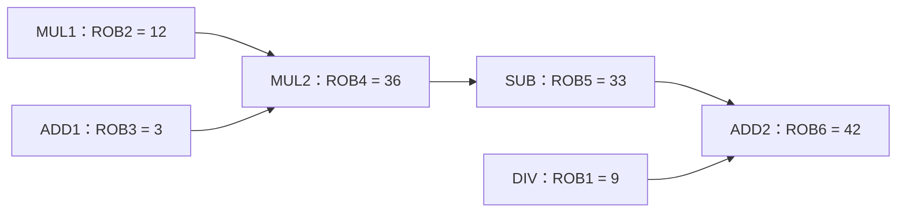
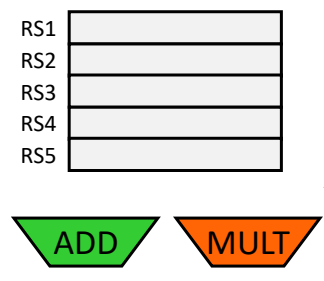

# 06 ROB演算与多发射

[本讲目录](../index.md) · [课程目录](../../index.md) · [上一节：05 重排序缓冲与提交](05-reorder-buffer-and-commit.md) · [下一节：07 精确异常与访存顺序](07-precise-exceptions-and-memory-order.md)

> [!abstract] 本节要点
> - 本例按程序顺序分配 ROB，执行和写回可乱序，最终仍在第 43–48 周期依次提交六条指令。
> - 同一寄存器的多个写者占用不同 ROB 项；较早版本提交时，必须保留 RAT 中较新版本的映射。
> - 统一保留站让不同类型指令共享容量，按功能单元类型仲裁就绪指令。
> - 持续实现 $\mathrm{IPC}>1$，需要同时扩大前端、写回和提交带宽；双重命名还须处理同组 RAW。
> - 多条提交只能取 ROB 队首连续、允许提交的指令，不能跳过未完成项。

> [!info] 拓展内容
> 本章依据补充材料整理，供兴趣自学，不纳入本课考试范围。[^s5b12][^s5b15]

## 六指令演算

只看“乱序执行、顺序提交”这句话，很难判断一条指令究竟在等操作数、等保留站，还是等队首。下面用同一组数值追踪这些等待；ROB、ARF、RAT 的职责与四阶段规则见[重排序缓冲与提交](05-reorder-buffer-and-commit.md)。

### 初始状态与依赖

按程序顺序执行以下六条指令。为区分两个乘法和两个加法，分别称为 MUL1、MUL2、ADD1、ADD2：

```asm
DIV R2, R3, R4    ; DIV
MUL R1, R5, R6    ; MUL1
ADD R3, R7, R8    ; ADD1
MUL R1, R1, R3    ; MUL2
SUB R4, R1, R5    ; SUB
ADD R1, R4, R2    ; ADD2
```

初始 ARF 内容为 $R1=-23$、$R2=16$、$R3=45$、$R4=5$、$R5=3$、$R6=4$、$R7=1$、$R8=2$，RAT 都指向 ARF。加减运算耗时 2 周期、乘法 10 周期、除法 40 周期；有 3 个加减类 RS、2 个乘除类 RS 和 6 个 ROB 项，每周期最多发射、写回、提交各一条。[^s4p40]

这里的保留站数表示能容纳多少条待处理指令，不能直接当成功能单元数。**本例的资源释放条件**是：写回 W 时释放 RS，提交 C 时释放 ROB；空出的 RS 在下一周期才能用于发射，广播到达的操作数也在下一周期用于开始执行。[^s4p35][^s4p49][^s4p50][^s4p55][^s4p56]

演算表中的 I 是发射周期，E 是**开始执行周期**，W 是广播并写 ROB 的周期，C 是提交到 ARF 的周期。RS 的 `dst` 记录目的 ROB 标签，`T1/T2` 记录尚未就绪的源标签，`V1/V2` 保存已经取得的源值；ROB 的 `Type/Dst/Val/Fin` 分别记录运算类型、体系结构目的寄存器、结果、完成位。一个源操作数要么已有值，要么等待标签对应的值。[^s4p35][^s4p37][^s4p39]

六条指令依次分配 ROB1–ROB6。先按程序语义算出各自结果，就能确定真正的数据流：

| 指令 | 目的版本 | 使用的源值或版本 | 结果 |
| --- | --- | --- | --- |
| DIV | ROB1，对应 R2 | 初始 R3、R4 | $45/5=9$ |
| MUL1 | ROB2，对应 R1 | 初始 R5、R6 | $3\times4=12$ |
| ADD1 | ROB3，对应 R3 | 初始 R7、R8 | $1+2=3$ |
| MUL2 | ROB4，对应 R1 | ROB2、ROB3 | $12\times3=36$ |
| SUB | ROB5，对应 R4 | ROB4、初始 R5 | $36-3=33$ |
| ADD2 | ROB6，对应 R1 | ROB5、ROB1 | $33+9=42$ |



图中箭头是真实的数据依赖。DIV 在发射时已取得初始的 R3 和 R4，后面的 ADD1、SUB 即使产生这两个寄存器的新版本，也不会改变除法所用的 $45$ 和 $5$。[^s4p41][^s4p51]

### 从发射到写回

1. **第 1–3 周期：建立前三个版本。** 第 1 周期发射 DIV，保留站保存 `DIV ROB1, 45, 5`，RAT 的 R2 改指 ROB1。第 2 周期 DIV 开始计算，同时发射 MUL1，保存 `MUL ROB2, 3, 4`，R1 改指 ROB2。第 3 周期 MUL1 开始计算，ADD1 发射，保存 `ADD ROB3, 1, 2`，R3 改指 ROB3。[^s4p41][^s4p42][^s4p43]
2. **第 4–6 周期：年轻加法先完成，前端仍被乘法挡住。** ADD1 在第 4–5 周期执行，第 6 周期广播并写入 $\mathrm{ROB3}=3$，置完成位并释放加法 RS。第四条 MUL2 从第 4 周期起尝试发射，但两个乘除类 RS 已分别被 DIV 和 MUL1 占用，必须等待。由于发射按程序顺序进行，后面的 SUB、ADD2 也不能越过 MUL2。原图的“Try to Issue MULT#1”应按指令顺序读作尝试发射 MUL2。[^s4p44][^s4p46]
3. **第 13–16 周期：释放一个 RS 后，后半段进入窗口。** MUL1 在第 3–12 周期完成 10 周期运算，第 13 周期广播 $\mathrm{ROB2}=12$ 并释放 RS。MUL2 到第 14 周期才能发射：先沿旧 RAT 读到 ROB2 的 $12$、ROB3 的 $3$，再为自己的目的 R1 分配 ROB4，把 R1 映射改为 ROB4。第 15 周期 MUL2 开始执行，同时 SUB 发射，保存 `SUB ROB5, ROB4, 3`。第 16 周期 ADD2 发射，保存 `ADD ROB6, ROB5, ROB1`；此时 R1 的最新映射已是 ROB6。[^s4p49][^s4p50][^s4p51][^s4p52]
4. **第 25–28 周期：沿 RAW 链传值。** MUL2 在第 15–24 周期计算，第 25 周期广播 $\mathrm{ROB4}=36$，SUB 捕获该值，于第 26–27 周期计算，第 28 周期广播 $\mathrm{ROB5}=33$。ADD2 收到了第一个源值 $33$，但仍等 ROB1 的除法结果。[^s4p55][^s4p56][^s4p58]
5. **第 42–45 周期：最后一条依赖到齐。** DIV 在第 2–41 周期执行 40 周期，第 42 周期广播 $\mathrm{ROB1}=9$。ADD2 此时才获得全部操作数，于第 43–44 周期计算 $33+9$，第 45 周期把 $42$ 写入 ROB6。[^s4p60][^s4p61][^s4p62][^s4p64]

这里两类等待很不一样：MUL2 起初等的是空闲 RS，SUB 等的是 ROB4 的结果，ADD2 最后等的是 ROB1 的结果。已经算完的 ADD1 则在等提交机会。

### 顺序提交与 RAT 更新

ADD1 第 6 周期就写好了结果，却不能越过队首的 DIV。DIV 到第 42 周期才写回，第 43 周期开始提交，之后队首每周期推进一项。完整时序如下，其中 E 始终表示开始执行：[^s4p68]

| 指令 | I：发射 | E：开始执行 | W：写 ROB | C：提交 |
| --- | ---: | ---: | ---: | ---: |
| DIV | 1 | 2 | 42 | 43 |
| MUL1 | 2 | 3 | 13 | 44 |
| ADD1 | 3 | 4 | 6 | 45 |
| MUL2 | 14 | 15 | 25 | 46 |
| SUB | 15 | 26 | 28 | 47 |
| ADD2 | 16 | 43 | 45 | 48 |

**队首阻塞（Head-of-Line Blocking）**在这里表现为：较年轻指令的结果已经就绪，但最早的未提交指令尚未完成，使整个提交端停住。它没有阻止其他独立指令计算，也没有阻止消费者读取就绪 ROB 值；阻止的是结果按体系结构顺序生效。[^s4p47][^s4p61][^s4p62]

提交时，ARF 和 RAT 的更新必须分别判断：

| 周期 | 提交项及 ARF 更新 | 对 RAT 的处理 |
| --- | --- | --- |
| 43 | ROB1：$R2\leftarrow9$ | R2 仍映射 ROB1，改指 ARF |
| 44 | ROB2：$R1\leftarrow12$ | R1 已映射 ROB6，保留 ROB6 |
| 45 | ROB3：$R3\leftarrow3$ | R3 仍映射 ROB3，改指 ARF |
| 46 | ROB4：$R1\leftarrow36$ | R1 仍映射 ROB6，保留 ROB6 |
| 47 | ROB5：$R4\leftarrow33$ | R4 仍映射 ROB5，改指 ARF |
| 48 | ROB6：$R1\leftarrow42$ | R1 仍映射 ROB6，改指 ARF |

每次都释放刚提交的队首项。较早的 R1 写者提交时仍要更新 ARF，因为 ARF 代表当前已提交的程序前缀；但只有 RAT 仍指向这个提交项时，才能把映射改回 ARF。否则，后续指令会误把较早值当成最新版本。[^s4p62][^s4p63][^s4p64][^s4p65][^s4p66][^s4p67]

> [!warning] 易错点
> 最终应为 $R1=42$、$R2=9$、$R3=3$、$R4=33$，R5–R8 保持初值。末页 ARF 表把 R4 留在初值 $5$，与 SUB 的 $36-3=33$ 及第 47 周期提交过程矛盾，应更正为 $33$。提交 SUB、ADD2 后释放的也分别是 ROB5、ROB6；对应步骤框沿用的“clean ROB4”是笔误。[^s4p66][^s4p67][^s4p68]

## 统一保留站

上例停在第四条乘法时，加法类 RS 还有空位，乘除类 RS 却已占满。固定划分容量会遇到程序类型分布不匹配：乘法密集程序需要更多乘法条目，加法密集程序则正好相反。增加第三个乘除类 RS 可以让上例六条指令在前六个周期全部发射，但这只缩短进入窗口的等待，并不表示六周期完成计算。[^s4p70][^s4p71]

**统一保留站（Unified Reservation Station）**把调度条目汇成一个共享池，各种运算都能占用空闲条目，再按运算类型送到相应功能单元。下面的概念图把原先 3 个加法类、2 个乘法类条目合为 5 个共享条目；共享容量减少了分区造成的闲置。[^s4p73][^s4p74]



图：统一保留站让 ADD 与 MULT 类指令共享调度条目，图中五个条目仍须分别等待相应功能单元。

共享条目之后，还需要决定每周期选谁执行。另一个实现示例使用 **8 个 RS 条目、1 个加法 FU、1 个乘法 FU、2 个 RS 读端口**，其选择过程是：[^s4p75]

1. 加法仲裁器收集所有操作数已就绪的加减类指令，乘法仲裁器收集就绪的乘法类指令。
2. 各仲裁器在本类候选中选出一条，并确认相应 FU 可接收。
3. 通过两个读端口读出获选条目的操作数，分别送到加法、乘法 FU。

示例中 RS1、RS4、RS8 的 ADD 和 RS5 的 MUL 已就绪；RS2、RS6 的 MUL 与 RS3、RS7 的 ADD 尚未就绪。选出 RS1 和 RS5 后，两类运算可同时启动。其余就绪 ADD 仍须等待加法 FU 的下一次接收机会。这里 `ready` 表示操作数齐备，不意味着已经获得执行资源。

在该设计中，若要同时向 $N$ 个功能单元各送一条指令，RS 需要 $N$ 个条目读端口。统一结构的代价是仲裁和执行通路更复杂；它能改善容量利用，却不会增加原有 FU 的计算能力。[^s4p75]

## 双发射与双重命名

乱序调度能从窗口中找到可执行指令，但窗口每周期只进一条、结果每周期只出一条，持续吞吐仍会被单条宽度限制。**每周期指令数（Instructions Per Cycle，IPC）**衡量单位周期完成的指令数；要持续达到 $\mathrm{IPC}>1$，取指、译码、发射与重命名、结果写回、提交都需要相应带宽。[^s4p76][^s4p77]

**双发射（Dual Issue）**允许每个时钟周期向窗口发射至多两条指令。多发射的组织方式包括超标量（Superscalar）和超长指令字（VLIW）等；这里沿用动态调度处理器，重点是同周期两条指令怎样正确重命名。[^s4p79]

**双重命名（Dual Rename）**须在同周期为两条指令解析源版本，并依程序顺序分配两个连续 ROB 项：`ROB_tail` 与 `ROB_tail+1`。难点是第二条指令可能读取第一条刚刚产生的新版本，而周期开始时的 RAT 还只记录旧版本。[^s4p80][^s4p81]

先看无同组 RAW 的第一组。设组前映射为 R1→ARF1、R2→ROB17、R3→ARF3、R4→ROB6，分配 ROB21、ROB22：

```text
原指令                     重命名后
ADD R1, R2, R3             ADD ROB21, ROB17, ARF3
SUB R4, R2, R4             SUB ROB22, ROB17, ROB6
```

第二条读取的是旧 R4，再给目的 R4 分配 ROB22。组结束后，R1 映射 ROB21，R4 映射 ROB22。[^s4p80]

接着处理第二组，分配 ROB23、ROB24：

```text
原指令                     重命名后
ADD R1, R2, R3             ADD ROB23, ROB17, ARF3
SUB R4, R1, R4             SUB ROB24, ROB23, ROB22
```

第二条的源 R1 必须取本组第一条的 ROB23，不能取旧 RAT 中的 ROB21。具体检查是：

1. 把第一条的目的寄存器 R1，分别与第二条的两个源寄存器 R1、R4 比较。
2. 对匹配的源 R1，选择第一条新分配的 ROB23 标签。
3. 对不匹配的源 R4，保留组前 RAT 查到的 ROB22。
4. 更新本组目的映射为 R1→ROB23、R4→ROB24。[^s4p81]

这只是建立正确的 RAW 连接。SUB 可以在同周期完成重命名并进入 RS，但开始执行仍要等 ROB23 的值。原图 RS 表把 SUB 标成 ADD；重命名只改变操作数表示，不改变运算，因此两组第二条都应保留 SUB。[^s4p80][^s4p81]

## 多总线写回

多条指令同时算完，如果只能使用一条 CDB，每周期仍只能把一条结果广播给消费者并写入 ROB。**多公共数据总线（Multiple Common Data Buses）**增加并行广播通路，让多个标签与结果在同一周期传送。[^s4p83]

以下六条指令已用 ROB 标签表示各自的结果和依赖：

```text
DIV ROB1, 8, 2
ADD ROB2, 1, 2
MUL ROB3, ROB1, 3
SUB ROB4, ROB2, 7
DIV ROB5, 9, 3
SUB ROB6, ROB1, 1
```

前两条分别产生 $8/2=4$、$1+2=3$；第五条的两个源已经就绪，其余三条等待相应标签。若前两条在同周期写回，CDB1 广播 $\mathrm{ROB1}=4$，CDB2 广播 $\mathrm{ROB2}=3$：

| 等待的指令 | 匹配的总线 | 捕获后的操作数 |
| --- | --- | --- |
| `MUL ROB3, ROB1, 3` | CDB1 | $4$、$3$ |
| `SUB ROB4, ROB2, 7` | CDB2 | $3$、$7$ |
| `SUB ROB6, ROB1, 1` | CDB1 | $4$、$1$ |

一次广播可以同时被多个消费者捕获；增加总线则允许不同生产者同时广播。为此，每个 RS 条目的每个待等源标签，都要与每条 CDB 的标签比较。总线越多，比较逻辑、连线、面积和功耗也越大。操作数到达后仍须经过就绪选择，并获得相应 FU，才能执行。[^s4p83]

## 连续顺序多提交

写回带宽扩大后，如果仍每周期只提交一条，ROB 释放和体系结构结果生效的速度依然受限。**多条提交（Multiple Commit）**在同周期提交 ROB 队首的连续指令前缀，同时保持程序顺序；它不能在整个 ROB 中任意挑几条已完成指令。[^s4p85][^s4p86][^s4p87]

对于宽度为 2 的提交端，假定指令均正常且满足其他提交条件：

| 队首 head | 下一项 next | 本周期提交数 | 处理 |
| --- | --- | ---: | --- |
| 未完成 | 任意 | 0 | head 不前移 |
| 已完成 | 未完成 | 1 | 只提交 head |
| 已完成 | 已完成 | 2 | 按先后提交两项，head 前移两项 |

因此，若队首未好，即使后面十条都已完成也不能提交。若队首和第三项已好、第二项未好，也只能提交第一项。这里“连续”指程序顺序连续，与 ROB 项在环形存储中的物理编号是否跨界无关。

每周期提交两条还要求数据通路跟上：ROB 要能同时读出相应结果，ARF 要有足够写端口；若提交的是 store，也须使其按提交规则更新存储状态。更多端口会增加存储结构的实现成本。原图以 TSMC $0.18\,\mu\mathrm{m}$ 工艺下的 16 端口和 32 端口 SRAM 位单元作对比，说明端口增多会扩大电路与布线开销；该图没有给出可直接用于一般实现的固定面积倍率。遇到异常或错误分支时，还需按[精确异常与访存顺序](07-precise-exceptions-and-memory-order.md)处理，而不能只看完成位。[^s4p88]

> [!question]- 自测：上面的六指令程序在第 30 周期末，ARF 的 R1、R3 是多少？ROB 中对应的已就绪版本又有哪些？
> ARF 仍为 $R1=-23$、$R3=45$，因为队首 DIV 尚未完成，任何指令都未提交。R1 的 ROB2 已保存 $12$、ROB4 已保存 $36$，最新 ROB6 尚未就绪；R3 的 ROB3 已保存 $3$。就绪临时结果可供依赖者使用，但不会提前改写 ARF。

> [!question]- 自测：同组依次发射 `ADD R4,R2,R3`、`SUB R1,R4,R1`，分配 ROB30、ROB31。组前 R1→ROB6、R2→ARF2、R3→ROB8、R4→ROB9，应怎样重命名？
> 第一条是 `ADD ROB30,ARF2,ROB8`，第二条是 `SUB ROB31,ROB30,ROB6`。第二条的源 R4 匹配第一条的目的，必须取新标签 ROB30；源 R1 则读取旧版本 ROB6，再把目的 R1 映射到 ROB31。组后 R4→ROB30、R1→ROB31。

> [!question]- 自测：双提交机器的队首开始四项完成位依次为“是、否、是、是”。下一周期第二项也完成，其余状态不变，两个周期分别最多提交几条？
> 第一个周期最多 1 条，第二个周期最多 2 条。第一个周期提交后，原第二项成为新队首；下一周期它与原第三项构成连续就绪前缀，因宽度为 2，原第四项仍须等后续周期。

> [!info]- 来源
> - L05-Supplement-ReorderBuffer-Exception.pdf：PDF p.33–88
> - L05.docx：DOCX body 450–514, 601–644

[^s5b12]: L05.docx-DOCX body 450-514
[^s5b15]: L05.docx-DOCX body 601-644
[^s4p40]: L05-Supplement-ReorderBuffer-Exception.pdf-PDF p.40
[^s4p35]: L05-Supplement-ReorderBuffer-Exception.pdf-PDF p.35
[^s4p49]: L05-Supplement-ReorderBuffer-Exception.pdf-PDF p.49
[^s4p50]: L05-Supplement-ReorderBuffer-Exception.pdf-PDF p.50
[^s4p55]: L05-Supplement-ReorderBuffer-Exception.pdf-PDF p.55
[^s4p56]: L05-Supplement-ReorderBuffer-Exception.pdf-PDF p.56
[^s4p37]: L05-Supplement-ReorderBuffer-Exception.pdf-PDF p.37
[^s4p39]: L05-Supplement-ReorderBuffer-Exception.pdf-PDF p.39
[^s4p41]: L05-Supplement-ReorderBuffer-Exception.pdf-PDF p.41
[^s4p51]: L05-Supplement-ReorderBuffer-Exception.pdf-PDF p.51
[^s4p42]: L05-Supplement-ReorderBuffer-Exception.pdf-PDF p.42
[^s4p43]: L05-Supplement-ReorderBuffer-Exception.pdf-PDF p.43
[^s4p44]: L05-Supplement-ReorderBuffer-Exception.pdf-PDF p.44
[^s4p46]: L05-Supplement-ReorderBuffer-Exception.pdf-PDF p.46
[^s4p52]: L05-Supplement-ReorderBuffer-Exception.pdf-PDF p.52
[^s4p58]: L05-Supplement-ReorderBuffer-Exception.pdf-PDF p.58
[^s4p60]: L05-Supplement-ReorderBuffer-Exception.pdf-PDF p.60
[^s4p61]: L05-Supplement-ReorderBuffer-Exception.pdf-PDF p.61
[^s4p62]: L05-Supplement-ReorderBuffer-Exception.pdf-PDF p.62
[^s4p64]: L05-Supplement-ReorderBuffer-Exception.pdf-PDF p.64
[^s4p68]: L05-Supplement-ReorderBuffer-Exception.pdf-PDF p.68
[^s4p47]: L05-Supplement-ReorderBuffer-Exception.pdf-PDF p.47
[^s4p63]: L05-Supplement-ReorderBuffer-Exception.pdf-PDF p.63
[^s4p65]: L05-Supplement-ReorderBuffer-Exception.pdf-PDF p.65
[^s4p66]: L05-Supplement-ReorderBuffer-Exception.pdf-PDF p.66
[^s4p67]: L05-Supplement-ReorderBuffer-Exception.pdf-PDF p.67
[^s4p70]: L05-Supplement-ReorderBuffer-Exception.pdf-PDF p.70
[^s4p71]: L05-Supplement-ReorderBuffer-Exception.pdf-PDF p.71
[^s4p73]: L05-Supplement-ReorderBuffer-Exception.pdf-PDF p.73
[^s4p74]: L05-Supplement-ReorderBuffer-Exception.pdf-PDF p.74
[^s4p75]: L05-Supplement-ReorderBuffer-Exception.pdf-PDF p.75
[^s4p76]: L05-Supplement-ReorderBuffer-Exception.pdf-PDF p.76
[^s4p77]: L05-Supplement-ReorderBuffer-Exception.pdf-PDF p.77
[^s4p79]: L05-Supplement-ReorderBuffer-Exception.pdf-PDF p.79
[^s4p80]: L05-Supplement-ReorderBuffer-Exception.pdf-PDF p.80
[^s4p81]: L05-Supplement-ReorderBuffer-Exception.pdf-PDF p.81
[^s4p83]: L05-Supplement-ReorderBuffer-Exception.pdf-PDF p.83
[^s4p85]: L05-Supplement-ReorderBuffer-Exception.pdf-PDF p.85
[^s4p86]: L05-Supplement-ReorderBuffer-Exception.pdf-PDF p.86
[^s4p87]: L05-Supplement-ReorderBuffer-Exception.pdf-PDF p.87
[^s4p88]: L05-Supplement-ReorderBuffer-Exception.pdf-PDF p.88

[本讲目录](../index.md) · [课程目录](../../index.md) · [上一节：05 重排序缓冲与提交](05-reorder-buffer-and-commit.md) · [下一节：07 精确异常与访存顺序](07-precise-exceptions-and-memory-order.md)
