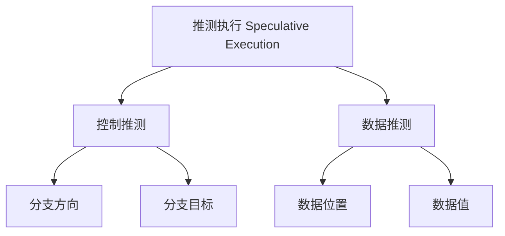
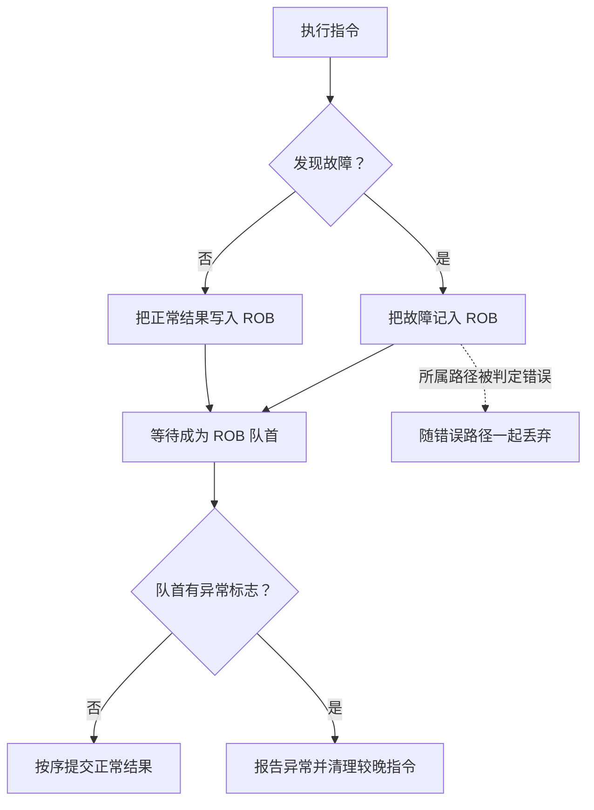
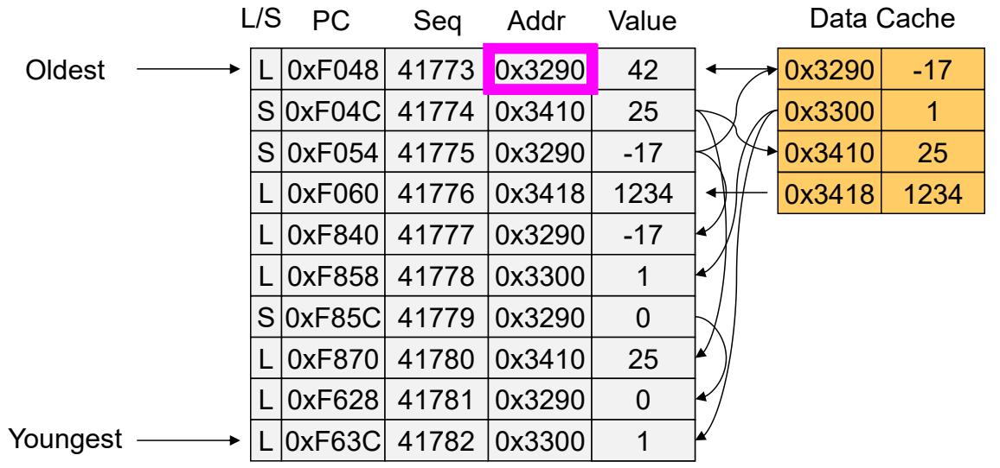

# 07 精确异常与访存顺序

[本讲目录](../index.md) · [课程目录](../../index.md) · [上一节：06 ROB演算与多发射](06-rob-example-and-superscalar.md) · [下一节：08 推测执行的安全边界](08-speculation-and-side-channels.md)

> [!abstract] 本节要点
> - 精确异常要求较早指令已按序生效，较晚指令尚未改变体系结构状态；异常按程序顺序暴露。
> - 执行时发现的故障先记入 ROB，故障指令到达队首后才交给异常处理程序。
> - 分支预测失败后，既要清除错误路径指令，也要恢复 RAT；可采用停顿排空或映射检查点。
> - Load 的地址即使已算出，也可能与尚未算出地址的较早 Store 冲突。
> - 本章的保守 LSQ 规则是先确认所有较早 Store 的地址，再从最近的较早同址 Store 转发，或读取缓存。

> [!info] 拓展内容
> 本章依据 ROB 与异常补充材料整理，供感兴趣的同学自学，不纳入考试范围。[^s5b12]

## 推测执行与异常

一条指令尚未确定是否应当执行，或者尚未确定应从哪里获得数据，处理器仍可能提前做一部分工作。这样能缩短等待，但也需要在推测错误时撤销不应生效的结果。**推测执行（Speculative Execution）**按推测对象分为控制推测和数据推测：前者涉及分支方向与目标，后者涉及数据位置与数据值。[^s4p94]



分支预测使处理器能够在分支尚未解析时继续执行预测路径，但这些工作是否有效仍由真实分支结果决定。寄存器重命名解决的假依赖则是 WAR 和 WAW，RAW 仍须满足；其规则见[乱序执行与依赖](02-out-of-order-and-dependencies.md)。补充材料第 115 页把假依赖写成“RAW & WAW”，应改为“WAR & WAW”；把控制依赖表述为已被“消除”也容易误导，预测只是让执行暂时越过这项等待。[^s4p93][^s4p115]

**异常（Exception）**是处理器响应某类事件，将控制权从正常程序转交给系统处理程序的机制。系统处理后，可按事件性质和体系结构规定返回程序或采取其他动作。这里使用广义的异常，既包括外部中断，也包括指令执行触发的内部事件。[^s4p96]

| 类别 | 与指令执行的关系 | 材料中的例子 |
| --- | --- | --- |
| 异步异常（Asynchronous Exception） | 由处理器外部事件触发，不由某条正在执行的指令直接引起 | I/O 中断，如网络包、磁盘数据到达；定时器中断；键盘 Ctrl-C；复位按钮触发的硬复位与 Ctrl-Alt-Delete 所示的软件复位 |
| 同步异常（Synchronous Exception） | 由某条指令的执行触发 | Trap：系统调用、断点、特殊指令；Fault：缺页、保护错误、浮点异常；Abort：校验错误、机器检查 |

在该教学模型中，外部事件通过中断引脚通知处理器。这些分类与例子的具体命名、处理路径取决于体系结构与系统；例如键盘组合键可能先触发设备中断，再由系统解释。[^s4p97]

异常也不只在算术单元产生。在五级流水线教学模型中，IF 可能遇到取指缺页、地址不对齐或保护错误；ID 可能发现非法操作码；EX 可能发现算术异常；MEM 可能遇到与取指相似的地址、权限问题以及存储器错误。WB 在这张图中不产生新的异常。任何指令都要经过 IF，因此不能只给 Load、Store 或除法准备异常处理。具体哪些操作触发何种异常仍须按 ISA 判断。[^s4p98]

## 精确异常与延迟报告

乱序执行使“最先发现故障的指令”与“程序中最早的故障指令”可能不同。如果一发现故障就跳去处理，较早但较慢的指令可能尚未完成，程序状态便缺少它们的结果。另一个问题来自错误预测路径：本来根本不应执行的指令也可能缺页或除零，这类故障不应向程序暴露。[^s4p99]

**精确异常（Precise Exception）**要求异常处理程序看到的状态，等价于按程序顺序执行到该异常位置：

1. 所有较早指令的效果都已按序生效。
2. 所有较晚指令都没有改变体系结构状态。
3. 故障指令自身是否完成、留下什么效果，由 ISA 和异常原因规定。[^s4p100]

第二条约束的是对程序可见的状态。较晚指令可以已经计算出临时结果，甚至在 ROB 中占有条目；它们的结果不能越过故障指令提交。

### 把故障作为一种临时结果

[ROB 的写回与提交机制](05-reorder-buffer-and-commit.md)已经把“算完”与“对外生效”分开。异常处理沿用这条界线：在 ROB 条目中增加异常标志，并记录处理异常所需的信息。执行单元发现故障时先登记它；直到该指令成为队首、且不再属于可撤销的推测路径，才报告异常。[^s4p101]



图中的等待至关重要：某条 Load 虽已检测出缺页，只要它前面的分支后来被证明预测错误，这个 Load 的 ROB 条目及其故障记录就一起作废。

### 两个故障谁先报告

下面五条指令按程序顺序占据 ROB1 至 ROB5。记号 `0[R2]` 表示以 `R2` 的值为地址、偏移量为零的内存位置。[^s4p102]

```text
ROB1: LOAD R1 = 0[R2]
ROB2: ADD  R3 = R2 + R4
ROB3: SUB  R1 = R5 - R6
ROB4: DIV  R4 = R7 / R5
ROB5: LOAD R6 = 0[R8]
```

| ROB 条目 | 执行情况 | 提交阶段应做的事 |
| --- | --- | --- |
| ROB1 | Load 缓存未命中，后来取得结果 $200$ | 等待结果后，首先提交 `R1 = 200` |
| ROB2 | 已算出 $100$ | 在 ROB1 之后提交 `R3 = 100` |
| ROB3 | 已算出 $50$ | 在 ROB2 之后提交 `R1 = 50` |
| ROB4 | 后来发现除零故障 | 到达队首后报告异常，不把无效除法结果写入 `R4` |
| ROB5 | 比 ROB4 更早发现缺页 | 暂存故障，不能越过 ROB4 报告 |

演算分为四步：

1. ROB5 先遇到缺页，只将其异常标志置位。ROB1 仍在等缓存未命中处理，队首不能前进。
2. ROB4 随后发现除零，也记录异常。两个故障都已被检测出来，但仍没有哪个能够直接打断提交顺序。
3. ROB1 得到 $200$ 后，ROB1、ROB2、ROB3 依次提交。此时 `R1` 最后为 $50$，`R3` 为 $100$。
4. ROB4 成为队首，处理器报告除零异常，并清理后续推测工作。ROB5 此次执行发现的缺页随之丢弃；它不能因为更早被检测到就优先报告。[^s4p102][^s4p103][^s4p104][^s4p106]

> [!warning] 易错点
> 第 105 页的“4 commits”把故障 DIV 也画进正常提交范围，与下一页“在正确的体系结构位置报告异常”矛盾。这里应当正常提交前三条，再在第四条处理故障；`Ready/Finished = 1` 可以表示故障已被确定，不代表有可正常写入寄存器的有效结果。[^s4p105][^s4p106]

## 分支恢复与映射检查点

清除错误路径指令之后，处理器还不能立即沿正确路径重命名。RAT 指向的是最新重命名的寄存器版本，其中可能残留刚被删除的错误路径 ROB 标签；而 ARF 只包含已提交的状态，两者代表不同的时间位置。[^s4p108][^s4p110]

例如，分支之前的两条指令分别写 `R1`、`R2`，RAT 对应 `ROB1`、`ROB2`。预测路径上的两个乘法又写这两个寄存器，使 RAT 改为 `ROB3`、`ROB4`。分支一旦预测失败，删除两个乘法还不够，后续指令不能继续把 `ROB3`、`ROB4` 当成来源。[^s4p109][^s4p110]

### 停顿并排空

**停顿并排空（Stall and Drain）**先让仍然有效的较早工作提交，使 ARF 追上即将重新开始执行的位置，再用 ARF 重建一个干净的映射。[^s4p111][^s4p112]

1. 清理错误路径指令，暂停正确路径上的新重命名。
2. 让尚未提交、仍然有效的较早指令继续执行并按序提交。这里的“排空”不包括让错误路径指令提交。
3. 当这些工作完成，ARF 已保存正确恢复点的状态；清空、复位 ROB，并将 RAT 的映射重置为对应的 ARF 寄存器。
4. 恢复正确路径上的重命名与执行。

例中有效的旧 `ADD R1` 和 `SUB R2` 提交后，ARF 得到 `R1 = 10`、`R2 = 9`；随后 RAT 恢复到 `R1 → ARF1`、`R2 → ARF2`，正确路径上的新指令才可重新分配 ROB。较早指令若执行很慢，正确路径就要多等一段时间。[^s4p112]

### 保存分支时刻的映射

等待旧指令全部提交会浪费恢复时间。**检查点（Checkpoint）**在每个分支处保存一份当时的 RAT，使恢复不必从“当前最新映射”推回过去。[^s4p113]

若第一个分支保存了 `RAT-v1`，之后预测路径上的第二个分支又保存 `RAT-v2`，一旦第一个分支预测错误，恢复步骤为：

1. 清除第一个分支之后的错误路径指令。
2. 丢弃错误路径上较年轻的检查点，包括 `RAT-v2`。
3. 从第一个分支的检查点恢复映射，如 `R1 → ROB1`、`R2 → ROB2`。
4. 从正确目标继续重命名；较早指令仍可在后台完成并提交。[^s4p114]

| 恢复方案 | 恢复映射的依据 | 时间与硬件代价 |
| --- | --- | --- |
| 停顿并排空 | 有效旧指令提交后的 ARF | 实现简单，但恢复要等待排空 |
| RAT 检查点 | 对应分支时保存的寄存器映射 | 可以更快恢复重命名，但要保存、管理多份映射 |

检查点应恢复到发生误预测的那个分支，不能随意选择最新检查点；最新检查点本身可能就在错误路径上。

## 动态地址与访存依赖

寄存器依赖可以从指令字段中识别：`ADD R7,R1,R2` 的 `R1` 明确指定一个寄存器。访存指令却不同，`LOAD R2,0(R1)` 的实际地址由 `R1` 的运行时值决定。两个指令使用不同的基址寄存器，仍可能访问同一位置。**访存消歧（Memory Disambiguation）**要判断这种动态地址是否重合，以及由此产生的先后约束。[^s4p118][^s4p120]

### 较年轻的 Load 为什么会读到旧值

考虑以下程序，初始 $R1=3$、$R2=1$、$R3=0$、$R4=5$、$R5=3$、$R6=0$、$R7=0$、$R8=0$、$R9=1$，内存地址 $0$ 的值为 $1$，地址 $2$ 的旧值为 $100$。[^s4p117]

```text
LOAD  R3 = 0[R6]
ADD   R7 = R3 + R9
STORE R4 → 0[R7]
SUB   R1 = R1 - R2
LOAD  R8 = 0[R1]
```

前一条 Load 若缓存未命中，`ADD R7` 和 Store 的地址计算都要等待；独立的 `SUB R1` 却可以先完成。忽略访存依赖时，会发生：

1. `SUB` 算出 `R1 = 3 - 1 = 2`。
2. 最后一条 Load 提前访问地址 $2$，缓存命中，读到旧值 $100$。
3. 第一条 Load 终于取得 `R3 = 1`，因此 `ADD` 算出 `R7 = 1 + 1 = 2`。
4. 较早的 Store 这时才明确：它也要访问地址 $2$，写入 `R4` 中的 $5$。

程序顺序要求先存入 $5$、再读取该地址，因此最后的 `R8` 应得到 $5$。提前读取 $100$ 的结果错误；仅让 ROB 按序提交，不能自动修正这次已经读错的 Load。关键冲突在内存地址上：运行结束时 `R1` 与 `R7` 恰好相等。若它们不同，这两次访存才不存在本例的同址依赖。[^s4p117]

完全禁止 Load 乱序可以避开这种问题，却会让彼此独立的访存也相互等待。八条指令的排程图以 A、B、E、H 表示访存操作，C、D、F、G 表示整数或乘法运算；依赖边为 A→C、B→C、B→D、E→F、D→G、F→G。图中按这些依赖与给定资源作如下安排：[^s4p119]

| 周期 | 不考虑访存依赖的理想乱序排程 | 图中的顺序排程 |
| --- | --- | --- |
| 1 | A、B、E、H | A |
| 2 | C、D、F | B |
| 3 | G | C、D |
| 4 | — | E |
| 5 | — | F |
| 6 | — | G |
| 7 | — | H |

两种排程分别用 $3$、$7$ 个周期，对应

$$
\mathrm{ILP}_{\rm OoO}=\frac{8}{3}\approx 2.67,
\qquad
\mathrm{ILP}_{\rm in\ order}=\frac{8}{7}\approx 1.14.
$$

这里 ILP 按“指令数除以排程周期数”计，单位为条/周期。这只是图中依赖与资源假设下的比较；第一种排程若未经地址检查，并不能保证正确。目标是在确认依赖后保留允许的并行。[^s4p119]

## 访存队列与数据转发

先要判断“是否存在尚未执行的较早同址 Store”，这是访存消歧的问题；只得到“有或没有”还不够，Load 必须进一步确定实际供数者，才能取得正确版本。若多个较早 Store 依次改写同一地址，它应当看到距离自己最近的一次写入，而不是任意一个匹配项。

**访存队列（Load Store Queue，LSQ）**按程序顺序记录在途 Load、Store，保存其类型、顺序、地址和数据等信息，用来维护访存顺序并寻找转发来源。**存储到加载转发（Store-to-Load Forwarding）**允许 Load 直接取得较早同址 Store 的待写数据，不必等它先写入缓存、再从缓存读回来。[^s4p120][^s4p121]

### 本章采用的保守执行规则

1. **顺序分配**：Load、Store 按程序顺序进入 LSQ。序号用于比较新旧，PC 用于标识指令，两者不是同一件事。
2. **等待地址**：Load 要读取数据前，先等所有较早 Store 的地址确定。只要还有一个地址未知，就不能断定自己与它无关。
3. **寻找最近写者**：在较早的 Store 中匹配 Load 地址；若有多个匹配项，选择程序顺序上最近的一个。
4. **取得数据**：若所选 Store 的数据已就绪，直接转发；若其数据尚未就绪，Load 继续等待，不能改用更旧的数据。没有较早同址 Store 时，才从缓存取得数据。[^s4p121]

搜索范围必须同时受地址和年龄约束。较年轻 Store 即使数据早已算好，也不能向较早 Load 提供未来的值。本节采用上述保守地址检查方案。

### 同一地址的多个版本

下表保持原例的 LSQ 顺序，序号越小越老。L 表示 Load，S 表示 Store；Value 对 Store 是待写数据，对 Load 是应读取的结果。[^s4p121]

| L/S | PC | Seq | Addr | Value |
| --- | --- | --- | --- | --- |
| L | `0xF048` | 41773 | `0x3290` | $42$ |
| S | `0xF04C` | 41774 | `0x3410` | $25$ |
| S | `0xF054` | 41775 | `0x3290` | $-17$ |
| L | `0xF060` | 41776 | `0x3418` | $1234$ |
| L | `0xF840` | 41777 | `0x3290` | $-17$ |
| L | `0xF858` | 41778 | `0x3300` | $1$ |
| S | `0xF85C` | 41779 | `0x3290` | $0$ |
| L | `0xF870` | 41780 | `0x3410` | $25$ |
| L | `0xF628` | 41781 | `0x3290` | $0$ |
| L | `0xF63C` | 41782 | `0x3300` | $1$ |

逐个比较几个关键 Load：

- **41777** 访问 `0x3290`，最近的较早同址 Store 是 41775，得到 $-17$；41779 虽也写这个地址，却比它年轻，不能选。
- **41781** 也访问 `0x3290`，但它前面已有更近的 Store 41779，因此应得到 $0$，不再取 41775 的 $-17$。
- **41780** 访问 `0x3410`，从 Store 41774 取得 $25$。
- **41773** 位于这几条 Store 之前，读取当时的 $42$；后续写入不能反过来改变这次读取。41776、41778、41782 在所示队列中没有较早同址 Store，可读取缓存中的 $1234$ 或 $1$。[^s4p121]



图：沿 Oldest 到 Youngest 检查同址访问，每条 load 应取得最近一条较早 store 的值，右侧缓存是动画更新后的快照。

初始缓存中 `0x3290` 为 $42$，`0x3410` 为 $38$。图右侧显示的是动画更新后的快照：`0x3290` 已为 $-17$，`0x3410` 已为 $25$。不能把这个快照当作全部指令开始前的缓存状态，再据此否定较早 Load 41773 读到的 $42$。

> [!info] 可视化资源
> - [BOOM 官方文档：Load/Store Unit](https://docs.boom-core.org/en/latest/sections/load-store-unit.html)：对照图 24 追踪访存队列、地址比较与 store-to-load forwarding；BOOM 还支持乐观发出 load 及失败后恢复，与本课先等待较早 store 地址的保守规则不同。

### LSQ 与 ROB 如何配合

对下面这对访存指令，Load 需要产生一个寄存器版本，Store 则需要保存一个将来对内存生效的写操作。[^s4p122]

```text
LD R1 = 0[R2]
ST R3 → 0[R4]
```

1. **发射与分配**：每条 LD/ST 都要分配 ROB 条目和 LSQ 条目。Load 的目的寄存器 `R1` 可映射到自己的 ROB 标签；Store 读取 `R3` 作为待写数据、读取 `R4` 作为地址来源。
2. **执行**：地址单元计算有效地址并更新 LSQ；Load 按消歧规则查询、转发或访问缓存，得到结果后写入 ROB。Store 等地址与数据就绪后，记录其准备好的写操作。
3. **提交**：只有轮到程序顺序中的合法提交位置，Store 才让写入成为体系结构状态的一部分。本章模型在此时把数据送往存储器，并推进相应的 LSQ、ROB 队首。这样，预测失败或较早异常取消 Store 时，它还没有污染程序可见的内存。[^s4p123][^s4p124][^s4p125]

> [!warning] 易错点
> Store 的 `R3` 是源寄存器，不是它新产生的寄存器结果。第 123 页把 `ST R3 → 0[R4]` 示意成 `ST ROB2 → 0[R4]` 并标出 `ROB2 → R3`，不能据此把 Store 当成对 `R3` 的重命名写者。它的 ROB 条目用于跟踪提交，数据仍来自原先的 `R3` 版本。[^s4p123]

这些结构分别解决不同问题：RAT 选择寄存器版本，RS 等待并选择可执行指令，ROB 保持提交与异常的程序顺序，ARF 保存已提交的寄存器状态，LSQ 检查访存的地址及先后关系。它们共同保证推测执行的结果按正确顺序生效。[^s4p126] 至于被取消的执行是否还会留下缓存等微架构痕迹，见[推测执行的安全边界](08-speculation-and-side-channels.md)。

> [!question]- 自测：ROB1 的普通加法尚未完成，ROB2 的除法已记录故障，ROB3 的 Load 先前已记录缺页。处理器此时能否报告缺页？若 ROB1 后来正常完成，应先处理什么？
> 不能立即报告缺页，也不能跳过 ROB1。应先正常提交 ROB1，再在 ROB2 成为队首时处理除法故障；ROB3 此次执行的缺页记录随较晚工作清理。选择依据是程序顺序，检测时间不决定异常优先级。

> [!question]- 自测：分支检查点保存了 `R1 → ROB2`，ROB2 尚未提交；错误路径把映射改为 `R1 → ROB7`。预测失败后，能否直接把 `R1` 改回 ARF？
> 使用检查点恢复时应回到 `ROB2`。ARF 尚无这个较早写者的结果，直接改回 ARF 会让正确路径读到旧版本。只有采用停顿排空、等 ROB2 等有效旧指令都提交后，才可把映射统一重置为 ARF。

> [!question]- 自测：按程序顺序有 Store A、Store B、Load C，三者地址都为 `0x1000`。A 的数据是 $7$，B 的地址已知但数据未就绪；缓存仍为 $3$。C 现在能读取 $7$ 吗？若 B 后来得到 $9$ 呢？
> 不能。B 是 C 最近的较早同址 Store，C 必须等 B 的数据，不能退而选择 A 或缓存。B 得到 $9$ 后应向 C 转发 $9$；若 B 连地址都未确定，本章保守方案同样要求 C 等待。

> [!info]- 来源
> - L05-Supplement-ReorderBuffer-Exception.pdf：PDF p.92–126
> - L05.docx：DOCX body 450–514, 601–644

[^s5b12]: L05.docx-DOCX body 450-514
[^s4p94]: L05-Supplement-ReorderBuffer-Exception.pdf-PDF p.94
[^s4p93]: L05-Supplement-ReorderBuffer-Exception.pdf-PDF p.93
[^s4p115]: L05-Supplement-ReorderBuffer-Exception.pdf-PDF p.115
[^s4p96]: L05-Supplement-ReorderBuffer-Exception.pdf-PDF p.96
[^s4p97]: L05-Supplement-ReorderBuffer-Exception.pdf-PDF p.97
[^s4p98]: L05-Supplement-ReorderBuffer-Exception.pdf-PDF p.98
[^s4p99]: L05-Supplement-ReorderBuffer-Exception.pdf-PDF p.99
[^s4p100]: L05-Supplement-ReorderBuffer-Exception.pdf-PDF p.100
[^s4p101]: L05-Supplement-ReorderBuffer-Exception.pdf-PDF p.101
[^s4p102]: L05-Supplement-ReorderBuffer-Exception.pdf-PDF p.102
[^s4p103]: L05-Supplement-ReorderBuffer-Exception.pdf-PDF p.103
[^s4p104]: L05-Supplement-ReorderBuffer-Exception.pdf-PDF p.104
[^s4p106]: L05-Supplement-ReorderBuffer-Exception.pdf-PDF p.106
[^s4p105]: L05-Supplement-ReorderBuffer-Exception.pdf-PDF p.105
[^s4p108]: L05-Supplement-ReorderBuffer-Exception.pdf-PDF p.108
[^s4p110]: L05-Supplement-ReorderBuffer-Exception.pdf-PDF p.110
[^s4p109]: L05-Supplement-ReorderBuffer-Exception.pdf-PDF p.109
[^s4p111]: L05-Supplement-ReorderBuffer-Exception.pdf-PDF p.111
[^s4p112]: L05-Supplement-ReorderBuffer-Exception.pdf-PDF p.112
[^s4p113]: L05-Supplement-ReorderBuffer-Exception.pdf-PDF p.113
[^s4p114]: L05-Supplement-ReorderBuffer-Exception.pdf-PDF p.114
[^s4p118]: L05-Supplement-ReorderBuffer-Exception.pdf-PDF p.118
[^s4p120]: L05-Supplement-ReorderBuffer-Exception.pdf-PDF p.120
[^s4p117]: L05-Supplement-ReorderBuffer-Exception.pdf-PDF p.117
[^s4p119]: L05-Supplement-ReorderBuffer-Exception.pdf-PDF p.119
[^s4p121]: L05-Supplement-ReorderBuffer-Exception.pdf-PDF p.121
[^s4p122]: L05-Supplement-ReorderBuffer-Exception.pdf-PDF p.122
[^s4p123]: L05-Supplement-ReorderBuffer-Exception.pdf-PDF p.123
[^s4p124]: L05-Supplement-ReorderBuffer-Exception.pdf-PDF p.124
[^s4p125]: L05-Supplement-ReorderBuffer-Exception.pdf-PDF p.125
[^s4p126]: L05-Supplement-ReorderBuffer-Exception.pdf-PDF p.126

[本讲目录](../index.md) · [课程目录](../../index.md) · [上一节：06 ROB演算与多发射](06-rob-example-and-superscalar.md) · [下一节：08 推测执行的安全边界](08-speculation-and-side-channels.md)
