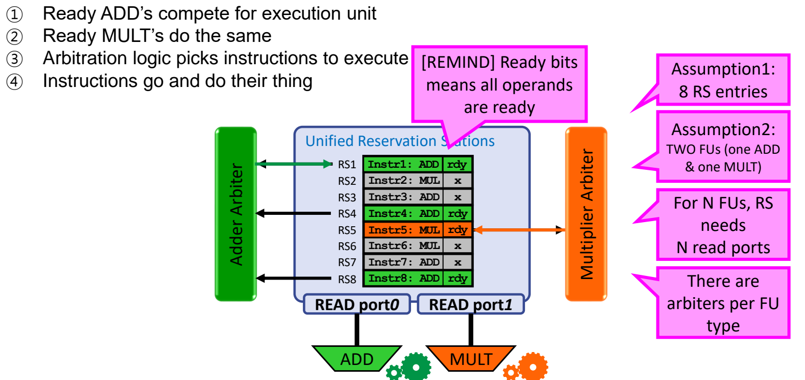
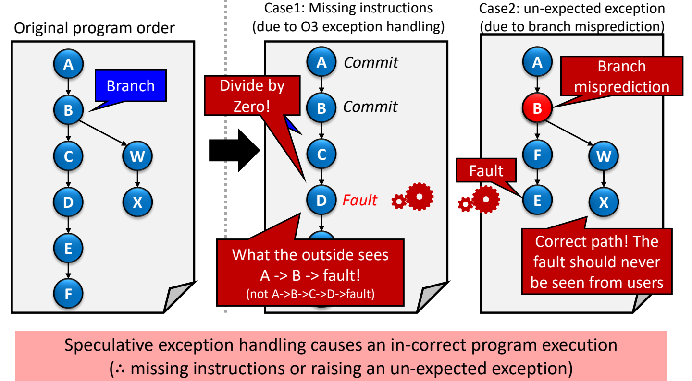
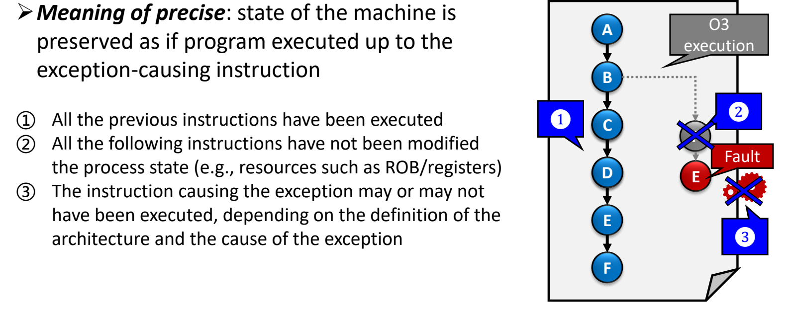
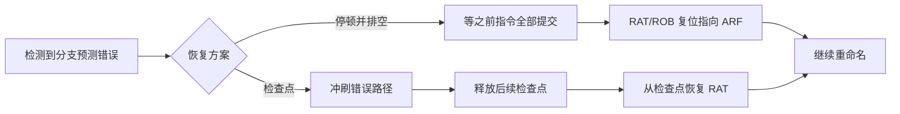
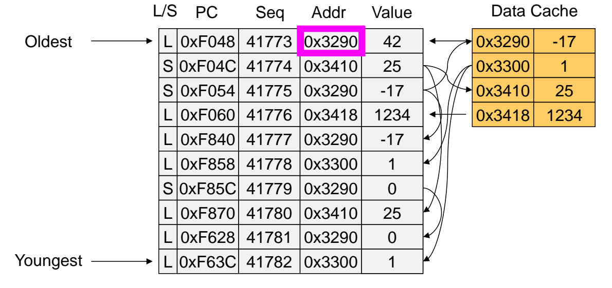
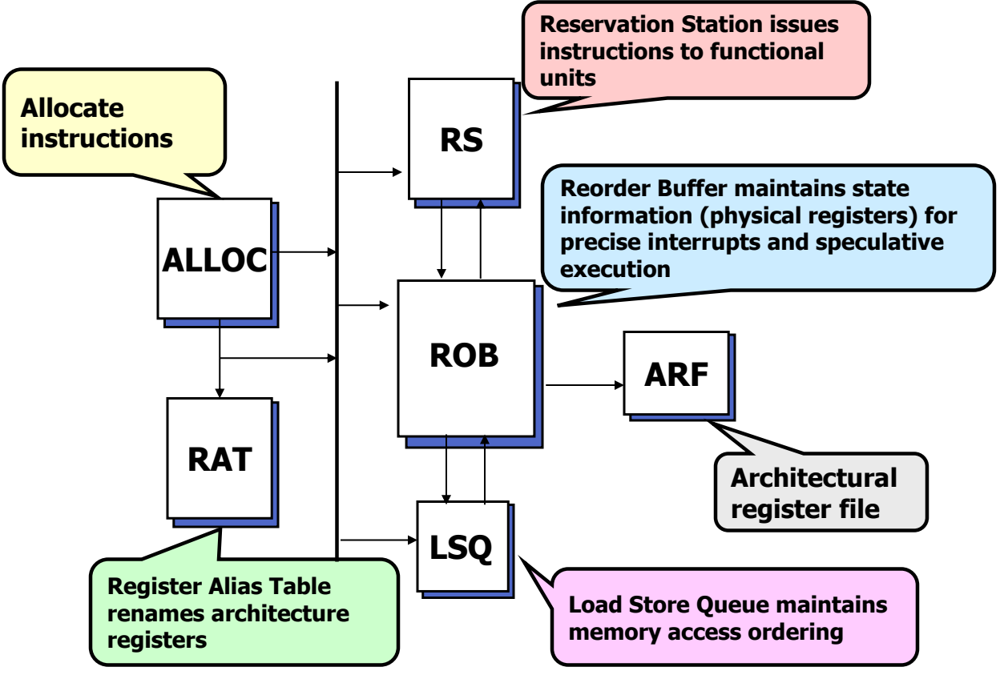

# 07 精确异常与推测执行

[本讲目录](../index.md) · [课程目录](../../index.md) · [上一节：06 重排序缓冲与顺序提交](06-reorder-buffer-and-in-order-commit.md)

> [!abstract] 本节要点
> - **统一保留站**让所有类型的指令共享同一组 RS 项，由每类 FU 各自的仲裁器挑选就绪指令；$N$ 个 FU 需要 RS 有 $N$ 个读端口。它消除了“RS 配比与程序指令分布不匹配”造成的结构冒险。
> - 单发射、单 CDB、单提交的 Tomasulo（+ROB）最多维持 1 IPC；要超过 1 IPC，取指/译码、发射（双重命名）、写回（多条 CDB）、提交（ROB 额外读口、ARF 额外写口）每一级都必须 $>1$ IPC。
> - **精确异常**：机器状态如同程序恰好执行到引发异常的指令为止；实现方法是在 ROB 中加异常标志，执行时只记录 fault，指令到达提交点时才真正触发异常并冲刷其余 ROB 项。
> - 分支预测错误后 RAT 留有错误路径的映射：“停顿并排空”简单但慢；“检查点”在每个分支复制 RAT，预测错误时直接从副本恢复。
> - 访存地址由寄存器值决定（操作数说明符是模糊的），因此需要访存消歧与 store-to-load 转发，由按序分配的 LSQ 解决；store 只在提交时写内存。被冲刷的推测指令留下的 cache 痕迹可被计时侧信道读出，这就是 Spectre / Meltdown 的根源。

> [!info] 拓展内容
> 本节全部内容来自课程补充材料（ROB 与异常的进阶讨论），供有兴趣的同学自学，**不纳入考试范围**。补充材料的出发点是：ROB 并不是完美的方案，它还要处理分支预测错误和异常，熔断（Meltdown）、幽灵（Spectre）攻击也与它有关。[^s5b12]

本节以 [ROB 与顺序提交](06-reorder-buffer-and-in-order-commit.md) 中的 Tomasulo+ROB 结构为起点（ARF、RAT、ROB 的 head/tail 指针等概念都在那里定义），讨论这一结构在资源利用、吞吐率、异常、分支恢复、访存相关和安全性方面面临的挑战与对应设计。

## 统一保留站（Unified Reservation Stations）

在分离式保留站里，加法器和乘法器各自拥有固定数量的 RS 项（如 Add1–Add3、Mult1–Mult2）。每个 ALU 配多少个 RS 应当与程序的指令分布相匹配，但不同程序的分布不同，固定配比总会在某些程序上造成结构冒险。[^s4p70]

**回顾 ROB 例子的第 4 周期**：在 [ROB 逐周期例子](06-reorder-buffer-and-in-order-commit.md) 中，DIV 和第一条 MUL 已经占满 Mult1、Mult2，第二条 MUL（`mul R1,R1,R3`）找不到空闲的乘法 RS，只能停顿发射直到第 14 周期，后面的 SUB、ADD 也被顺序发射堵住。如果再多一个 Mult3，全部 6 条指令在第 6 周期就都能发射出去。[^s4p70]

再看两个极端程序：

- **程序 1（乘法密集）**：DIV、MUL、MUL、MUL、ADD。只有 2 个乘法 RS，第 3 条乘除类指令就遇到结构冒险，而 3 个加法 RS 闲置。
- **程序 2（加法密集）**：ADD、ADD、SUB、SUB、MUL。3 个加法 RS 不够用，第 4 条加减类指令遇到结构冒险，而乘法 RS 闲置。

**统一保留站**（unified reservation stations）把所有 RS 项合并成一个池（如 RS1–RS5），任何类型的指令都可以占用任意空项。这样无论程序的指令分布如何，都能尽可能消除这类结构冒险。[^s4p74]

### 实现：每类 FU 一个仲裁器

代价是仲裁和执行通路稍复杂一些（但不算太糟）。设统一 RS 有 8 项，有两个 FU（一个 ADD、一个 MULT），每周期的选择过程是：[^s4p75]

1. **ADD 竞争**：所有就绪（ready，即全部操作数都已到齐）的 ADD 指令竞争加法器。
2. **MULT 竞争**：所有就绪的 MUL 指令同样竞争乘法器。
3. **仲裁**：每类 FU 有一个仲裁器（Adder Arbiter、Multiplier Arbiter），各自从候选中挑出一条去执行。
4. **执行**：被选中的指令经 RS 的读端口送入对应的 FU 执行。



图：8 项统一保留站由 ADD 与 MULT 共享。RS1、RS4、RS8 中就绪（rdy）的 ADD 都请求加法器，加法仲裁器选中 Instr1；RS5 是唯一就绪的 MUL，被乘法仲裁器选中。两条指令同一周期分别经 READ port0、READ port1 送出，所以 **$N$ 个 FU 需要 RS 有 $N$ 个读端口**。

## 突破 1 IPC：多发射的 Tomasulo+ROB

前面描述的 Tomasulo（+ROB）CPU 虽然是乱序执行，但不是完整的超标量，只能维持 **1 IPC** 的持续吞吐率。流水线中顺序的前端（fetch、decode、dispatch）、乱序的 RS 与 FU、顺序的 ROB 与提交，任何一级只要每周期只能处理一条指令，整体就被限制在 1 IPC。[^s4p76] 具体有三处限制：

1. **前端**：需要超标量的取指、译码等。
2. **写回**：只有一条 CDB，每周期只有一条指令能把结果写回 ROB。
3. **提交**：提交也必须 $>1$ IPC。

结论是**所有流水线阶段都必须 $>1$ IPC**，各级对应的方案如下：[^s4p77]

| 阶段 | 目标 | 方案 |
| --- | --- | --- |
| 发射（issue 到 RS） | $>1$ IPC | 双发射（Dual Issue）+ 双重命名（Dual Rename） |
| 送 FU 执行 | $>1$ IPC | Tomasulo 已经做到：指令就绪且 FU 空闲就去执行 |
| 写回 ROB | $>1$ IPC | 多条 CDB（Multiple CDBs） |
| 提交到 ARF | $>1$ IPC | ROB、ARF 增加端口（Extra Ports） |

### 双发射与双重命名

**多发射**的目标是一个时钟周期发射多条指令，有两种基本形式：超标量（superscalar）与 VLIW（也称 EPIC），见 L04 的多发射内容。[^s4p79] 双发射的难点在重命名。[寄存器重命名](03-out-of-order-execution-and-register-renaming.md) 的步骤是：① 读出所有源操作数的当前映射；② 为目的寄存器分配新名字。在 Tomasulo+ROB 中新名字就是 ROB 项，所以一组两条指令的目的分别分配 $\text{ROB\_tail}$ 和 $\text{ROB\_tail}+1$。[^s4p80]

关键问题是**同一发射组内的 RAW 相关**：第二条指令的源可能正是第一条的目的，而此时 RAT 里还是旧映射。所以每个源操作数都要和组内更早指令的目的寄存器比较，命中则用新分配的 ROB 号，否则用 RAT 的读数。[^s4p81]

> [!example] 例：双重命名
> 当前 RAT：R1→ROB21，R2→ROB17，R3→ARF3，R4→ROB22；ROB tail 指向 ROB23。本组两条指令为 `add R1,R2,R3` 与 `sub R4,R1,R4`。
>
> 1. **分配目的**：inst1 的目的 R1 → ROB23，inst2 的目的 R4 → ROB24。
> 2. **inst1 的源**：R2、R3 查 RAT，得 ROB17、ARF3，写入 RS：`add ROB23, ROB17, ARF3`。
> 3. **inst2 的 src1（R1）**：与 inst1 的目的 R1 比较，相等，所以不能用 RAT 中的 ROB21，而要用新分配的 ROB23。
> 4. **inst2 的 src2（R4）**：与 inst1 的目的 R1 比较，不等，用 RAT 中的 ROB22。RS 项为 `sub ROB24, ROB23, ROB22`。
> 5. **更新 RAT**：R1→ROB23，R4→ROB24。
>
> 每个比较器（“=?”）后面接一个二选一多路选择器，在“来自 RAT”和“新 ROB 号”之间选择。若漏掉组内比较，inst2 会错误地读 ROB21，即 R1 的上一个版本。

### 多条 CDB

用多条 CDB 每周期广播多个结果是可行的，当今 CPU 正是这么做的。代价是**每个 RS 项的每个源操作数都必须与每条 CDB 比较**，面积、逻辑和功耗都增加。[^s4p83]

> [!example] 例：两条 CDB 同周期广播
> 统一 RS 中有：`div ROB1, 8, 2`、`add ROB2, 1, 2`、`mul ROB3, ROB1, 3`、`sub ROB4, ROB2, 7`、`div ROB5, 9, 3`、`sub ROB6, ROB1, 1`。
>
> 1. DIV 和 ADD 同一周期完成，ROB1 = $8/2=4$ 走 CDB1，ROB2 = $1+2=3$ 走 CDB2。
> 2. 每个 RS 项的源标签同时与两条 CDB 比较：RS3 的 ROB1 → 4，RS4 的 ROB2 → 3，RS6 的 ROB1 → 4。
> 3. 若只有一条 CDB，这两个结果要分两个周期广播。

### 每周期提交多条

提交逻辑必须判断哪些指令可以提交，规则保持顺序提交：[^s4p87]

1. **head 未完成**：什么都不提交（即使后面的项已经完成）。
2. **head 完成、下一条未完成**：只提交 head。
3. **head 与下一条都完成**：两条都提交。

> [!example] 例：沿用 ROB 例子的结果
> ROB 中 ROB3（R3 = 3）、ROB4（R1 = 36）、ROB5（R4 = 33）都已完成。
>
> 1. 此时 head ROB1（DIV）未完成 → 不提交。
> 2. ROB1 = 9 完成，但 ROB2（MUL）未完成 → 只提交 ROB1。
> 3. 若 ROB1 = 9 与 ROB2 = 12 都已完成 → 二者同周期提交。

一周期提交多条，意味着要同时从 ROB 向 ARF（store 则是向内存）写回多个结果：**ROB 需要额外的读端口，ARF 需要额外的写端口**。[^s4p88] 端口数直接决定 SRAM 位单元面积，讲义以 0.18 μm TSMC 工艺下 16 端口与 32 端口 SRAM 位单元的版图对比说明端口越多面积越大。

## 推测执行中的异常与精确异常

回顾 O3 已有的三项技术：用 ROB 寄存器重命名和操作数比较消除 WAW、WAR 假相关；用 RS 中的标签和 CDB 广播把结果转发给等待的指令；用 ROB 部分地实现推测执行以提高 ILP。[^s4p93] 推测执行还有更多问题要处理。

**推测执行**（speculative execution）分为两类：[^s4p94]

- **控制推测**（control speculation）：推测分支方向（branch direction）和分支目标（branch target）。
- **数据推测**（data speculation）：推测数据位置（data location）和数据值（data value）。

下面先讨论控制推测下的异常处理和分支恢复，再讨论与数据位置有关的访存相关。

### 异常的定义与分类

**异常**（exception）是为响应某些事件而把执行控制转移给操作系统/系统：系统执行异常处理程序（exception handler）处理该事件，然后把控制交还用户程序。正常控制流只包括顺序执行、跳转、分支、调用和返回。[^s4p96] 异常按起因分为两类：[^s4p97]

| 类型 | 起因 | 例子 |
| --- | --- | --- |
| **异步异常**（asynchronous exception），即中断（interrupt） | 处理器外部事件，通过置位处理器的中断引脚通知 | I/O 中断；键盘按 Ctrl-C；网络包到达；磁盘数据到达；定时器中断；硬复位中断（按复位键）；软复位中断（如 PC 上的 Ctrl-Alt-Delete） |
| **同步异常**（synchronous exception） | 某条指令执行的结果 | trap：系统调用、断点、特殊指令；fault：缺页、保护错误、浮点异常；abort：奇偶校验错、machine check |

在 MIPS 五级流水线中，各级可能产生的异常为：[^s4p98]

- **IF**：取指缺页、访存未对齐、内存保护违例。程序中的任何一条指令都可能在 IF 级产生异常。
- **ID**：未定义或非法的操作码。
- **EX**：算术异常（如除零 divByZero）。
- **MEM**：与 IF 相同的几类，以及内存错误。
- **WB**：无。

### 推测执行遇到 fault 的两类错误

推测执行的指令遇到 fault 时，如果立刻处理，会导致程序执行结果错误：[^s4p99]

1. **漏掉指令（missing instructions）**：程序顺序为 A→B→C→D→E→F。乱序执行时 D 先执行并发生除零，若立即处理，此时只有 A、B 已提交。外部看到的是“A → B → fault”，而不是正确的“A → B → C → D → fault”，C 被漏掉了。
2. **意外的异常（un-expected exception）**：B 是分支且被错误预测，处理器沿错误路径执行了 F、E，E 发生 fault。正确路径其实是 W→X，这个 fault 根本不应该被用户看到。



图：左为原程序顺序（B 为分支）；中为乱序时 D 除零被立即处理，外界只看到 $A \to B \to$ fault、漏掉了 C；右为 B 预测错误时错误路径上的 E 触发 fault，而正确路径 $W \to X$ 本不应看到该异常。

### 精确异常（Precise Exceptions）

**精确异常**指机器状态保持得如同程序恰好执行到引发异常的那条指令为止，具体要求三条：[^s4p100]

1. 之前的所有指令都已执行完毕。
2. 之后的所有指令都没有修改进程状态（如 ROB、寄存器等资源）。
3. 引发异常的指令本身是否执行，取决于体系结构的定义和异常原因。



图：精确异常。引发异常的 E 之前的指令全部完成（①），之后被乱序提前执行的指令不能修改状态（②），E 本身是否执行取决于体系结构定义（③）。

### 方案：把 fault 当作结果

ROB 处理普通寄存器结果的方式是：结果先写入 ROB，直到该指令成为最老的指令（可以按序更新状态），并且已知是非推测的，才写入体系结构状态。对 fault 采取同样的做法，在 ROB 中增加一列**异常标志**（exception flag）：[^s4p101]

1. **执行时**：记录发生的 fault，但不向外部暴露。
2. **提交时**：只有当该指令到达提交点，才真正暴露（触发）这个 fault。

于是 ROB 每项包含：FU、目的寄存器、结果值、Ready/Finished、Exceptions。

> [!example] 例：ROB 中的异常标志
> 程序顺序与 ROB 分配：
>
> ```text
> ROB1  LOAD R1 = 0[R2]
> ROB2  ADD  R3 = R2 + R4
> ROB3  SUB  R1 = R5 - R6
> ROB4  DIV  R4 = R7 / R5
> ROB5  LOAD R6 = 0[R8]
> ```
>
> 1. ROB1 的 LOAD cache miss，迟迟未完成；ROB2 = 100、ROB3 = 50 已完成（Ready = 1）。
> 2. 第 5 条指令（ROB5 的 LOAD）发生缺页：结果值为“-”，Ready = 1，Exceptions = 1。不触发异常，只记录。[^s4p102]
> 3. 第 4 条指令（ROB4 的 DIV）因 R5 = 0 发生除零：结果值为 NULL，Ready = 1，Exceptions = 1，同样只记录。[^s4p103]
> 4. ROB1 的 miss 被处理完，结果 200，Ready = 1。[^s4p104]
> 5. ROB1–ROB3 依次正常提交；head 到达 ROB4（第 4 条指令）。[^s4p105]
> 6. ROB4 的异常标志为 1，此时才触发异常：冲刷 ROB 其余项（包括 ROB5），转入异常处理程序。[^s4p106]
>
> fault 被推迟到体系结构上正确的位置才处理；ROB5 的缺页被冲刷，如同“从未发生”。最终状态满足精确异常的三条要求：DIV 之前的指令全部完成，之后的指令没有修改状态。

> [!warning] 易错点
> 异常标志只“记录”，不“触发”。按完成顺序看，ROB5 的缺页比 ROB4 的除零更早被检测到，但处理器报告的是程序顺序中更早的 DIV 除零；ROB5 的缺页根本不会被报告。决定报告哪个异常的是提交顺序，而不是检测顺序。

## 分支预测错误的恢复

ROB 的提交和异常标志保证了错误路径指令不会改写 ARF，但还有一个状态没有恢复：RAT。回忆两条性质：ARF 对应最老的未提交指令之前的状态；RAT 对应最近一条被重命名的指令之后的映射。[^s4p108]

**问题示例**：ARF 初值 R1–R8 = $-23$、16、45、5、3、4、1、2，RAT 全部指向 ARF。指令 Instr1 `ADD R1`、Instr2 `SUB R2`、Instr3 `BEQ`，BEQ 预测为 taken，于是错误路径上的 Instr4 `MUL R1`、Instr5 `MUL R2`、Instr6 `BEQ` 也进入了流水线：[^s4p110]

1. 重命名 Instr1、Instr2：R1→ROB1，R2→ROB2。
2. 重命名错误路径 Instr4、Instr5：R1→ROB3，R2→ROB4。
3. BEQ 结果表明预测错误：错误路径指令从机器中冲刷。
4. 但 RAT 仍是 R1→ROB3、R2→ROB4，即错误路径留下的无效映射。正确路径的新指令若按此重命名，会读到不存在的值。

### 方案 1：停顿并排空（Stall and Drain）

1. **排空**：让所有（正确路径上的）已有指令执行并提交，ARF 对应最后一条已提交的指令。例中 Instr1、Instr2 提交后 ARF 的 R1 = 10、R2 = 9。期间从取指送来的正确路径指令不能重命名，形成分支气泡（bubbles）。
2. **ARF 即正确状态**：此时 ARF 恰好对应下一条待重命名指令之前的状态。
3. **复位**：复位 RAT 和 ROB，使所有映射都指向 ARF。
4. **继续**：恢复对新的正确路径指令的重命名，例如 Instr4 `ADD R3` → ROB1，Instr5 `ADD R4` → ROB2。

优点是实现很简单；缺点是停顿造成性能损失。[^s4p112]

### 方案 2：检查点（Checkpointing）

**关键思想**：在每个分支处复制一份 RAT（该分支时刻的寄存器映射）作为检查点。[^s4p113] 预测错误时：[^s4p114]

1. **冲刷**错误路径指令。
2. **释放**该分支之后的 RAT 检查点。
3. **从检查点恢复** RAT。
4. **继续重命名**。

> [!example] 例：两个分支的检查点
> 指令序列 Instr1 `ADD R1`、Instr2 `SUB R2`、Instr3 `BEQ`、Instr4 `MUL R1`、Instr5 `MUL R2`、Instr6 `BEQ`、Instr7 `ADD R3`，两条 BEQ 都预测 taken。
>
> 1. 到 Instr3 时 RAT 为 R1→ROB1、R2→ROB2，其余指向 ARF，保存为 RAT-v1。
> 2. 到 Instr6 时 RAT 为 R1→ROB3、R2→ROB4，保存为 RAT-v2；Instr7 再把 R3 映射到 ROB5。
> 3. Instr3 被判定预测错误：冲刷 Instr4 之后的指令，释放 RAT-v2，用 RAT-v1 恢复 RAT。
> 4. 立即重命名正确路径的 Instr4 `ADD R3`、Instr5 `ADD R4` 等，无需等待 Instr1、Instr2 提交。



到这里，分支预测消除了控制相关，寄存器重命名消除了寄存器假相关，带异常标志和检查点的 ROB 处理了异常和分支预测错误。[^s4p115]

> [!warning] 易错点
> 讲义总结页写“寄存器重命名消除了假相关（RAW & WAW）”，这里的 RAW 是笔误。重命名消除的假相关是 WAR 与 WAW，RAW 是真相关，无法消除，见[寄存器重命名](03-out-of-order-execution-and-register-renaming.md)。[^s4p115]

## 访存相关与 Load Store Queue

寄存器相关处理完了，还剩访存相关。基本约束是：**store 只在提交时写内存**，否则 store 被取消（例如处于错误路径）时内存已经被改写，无法恢复。由此产生的问题是：一条在 store 之后的 load，比如 `SW R1, 0(R2)` 之后的 `LW R1, 0(R3)`，它的数据该从哪里来？[^s4p116]

### 不考虑访存相关会怎样

> [!example] 例：load 越过 store 读到旧值
> 初值：ARF 中 R1 = 3，R2 = 1，R3 = 0，R4 = 5，R5 = 3，R6 = 0，R7 = 0，R8 = 0，R9 = 1；内存 Mem[0] = 1，Mem[2] = 100。程序顺序：
>
> ```text
> LOAD  R3 = 0[R6]
> ADD   R7 = R3 + R9
> STORE R4 → 0[R7]
> SUB   R1 = R1 - R2
> LOAD  R8 = 0[R1]
> ```
>
> 乱序执行的实际顺序：
>
> 1. ❶ 第一条 LOAD 发射，cache miss；SUB 发射，R1 = $3-1=2$。
> 2. ❷ 第二条 LOAD 发射，地址 R1 = 2，cache hit，R8 = Mem[2] = 100。
> 3. ❸ 第一条 LOAD 的 miss 处理完，R3 = Mem[0] = 1。
> 4. ❹ ADD 发射，R7 = $1+1=2$。
> 5. ❺ STORE 发射，Mem[2] = R4 = 5。
>
> 若 $R1 \ne R7$，第二条 LOAD 从内存取到的就是正确数据；但这里 R1 = R7 = 2，LOAD R8 本应得到 STORE 写入的 5，却拿到了旧值 100。[^s4p117]

### 访存消歧问题（Memory Disambiguation）

非访存指令不会出这种问题，因为它们的**操作数说明符是绝对的**：`ADD R7 = R1 + R2` 中的“R1”就指那一个寄存器。访存指令的**操作数说明符是模糊的**：`LOAD R2 = 0[R1]` 中的“R1”指的是由 R1 的值确定的内存位置，指针改变，位置也随之改变。在地址算出来之前，硬件无法判断一条 load 与之前的 store 是否访问同一地址。[^s4p118]

**朴素方案**是完全不允许 load 乱序执行。讲义用 8 条指令 A–H 的依赖图对比（A、B、E、H 为访存指令，C、D、F、G 为整数或乘法指令；依赖为 A→C、B→C、B→D、D→G、E→F、F→G）：[^s4p119]

- **load 乱序执行**（不考虑访存相关）：关键路径只有 3 步，$\mathrm{ILP}=8/3=2.67$。
- **load 按序执行**：访存指令被串起来，关键路径拉长到 7 步，$\mathrm{ILP}=8/7=1.14$。

所以让 load 按序执行并不是好办法，需要专门的硬件在乱序的同时保证正确。

> [!info] 可视化资源
> [Wikipedia：访存消歧（Memory disambiguation）](https://en.wikipedia.org/wiki/Memory_disambiguation)：解释 store 队列如何避免 WAR/WAW、store-to-load 转发的 CAM 搜索、RAW 违例检测及 LSQ，可对照本节的 LSQ 机制。

### 两个问题与 LSQ

O3 访存指令面临两个问题：[^s4p120]

1. **访存消歧**（memory disambiguation）：（我是一条 load）是否有更早的、尚未执行的 store 写同一个地址？这是二元问题，答案是“是”或“否”。讲义给出的对应方案是 store-to-load 转发。
2. **store-to-load 转发问题**（store-to-load forwarding）：（我是 load）我该从哪一条更早的 store 取值？（我是 store）我该把值转发给哪些更晚的 load？这不是二元问题，答案是一个或多个指令标识。对应方案是 Load Store Queue。

讲义这样配对的逻辑是：消歧问题的答案若为“是”，就要靠 store-to-load 转发拿到正确的值；而要回答“从哪条 store 转发”，就需要一个按程序顺序记录所有 load/store 地址的结构，即 LSQ。实际上 LSQ 同时完成了两件事，如下所述。

**Load Store Queue**（LSQ）管理访存的顺序。每项记录 L/S、PC、序号 Seq、地址 Addr 和值 Value，最老的在上、最年轻的在下：[^s4p121]

- **消歧**：指令按程序顺序分配进 LSQ；一条 load 必须等所有更早 store 的地址都算出来后才能执行。
- **转发**：load 广播并搜索整个 LSQ，寻找地址匹配的 store。

图中的转发关系：41777 号 load（0x3290）从更早的 41775 号 store（0x3290，$-17$）得到 $-17$；41780 号 load（0x3410）从 41774 号 store 得到 25；41781 号 load（0x3290）从更近的 41779 号 store（0x3290，0）得到 0，而不是 41775 号的 $-17$，即应取**程序顺序上最近的那条更早的同地址 store**；没有匹配 store 的 load（如 41776 号 0x3418）则从 Data Cache 读取 1234。



图：LSQ 按程序顺序从 Oldest 到 Youngest 排列 load/store 的 PC、序号、地址与值；箭头表示 load 在队列中搜索地址相同的更早 store 取得转发值，否则从数据 cache 读取。

### LD/ST 在 ROB 流水线中的处理

在 Tomasulo+ROB 结构中，访存单元配有 LD/ST1–LD/ST5 队列项和地址计算单元（address unit）。以 `LD R1=0[R2]` 与 `ST R3→0[R4]` 为例：[^s4p122]

1. **发射**：除了分配 ROB 项，还要为新的 LD/ST 分配一个 LSQ 项。例中 `LD ROB1=0[R2]`（ROB1→R1）、`ST ROB2→0[R4]`（ROB2→R3）。[^s4p123]
2. **执行**：① 生成地址（更新或查找 LSQ），得到 `LD ROB1=Addr1`、`ST ROB2→Addr2`；② 产生结果（更新 ROB，标记完成）。[^s4p124]
3. **提交**：如果是 store，此时才把值送往内存；然后移动 LSQ head 和 ROB head。[^s4p125]

### 现代乱序处理器的组成

把本讲的部件放在一起，就是现代乱序微处理器的骨架：[^s4p126]

| 部件 | 职责 |
| --- | --- |
| ALLOC | 分配指令（ROB、RS、LSQ 项） |
| RAT（Register Alias Table） | 重命名体系结构寄存器 |
| RS（Reservation Station） | 把指令发往功能部件 |
| ROB（Reorder Buffer） | 保存状态信息（物理寄存器），支持精确中断和推测执行 |
| ARF（Architectural Register File） | 体系结构寄存器文件 |
| LSQ（Load Store Queue） | 维护访存顺序 |



图：现代乱序处理器的分工：ALLOC 分配指令，RAT 重命名架构寄存器，RS 向功能单元发射，ROB 为精确中断与推测执行保存状态，ARF 保存架构状态，LSQ 维护访存顺序。

## Spectre 与 Meltdown

乱序执行和推测执行会提前执行后面的指令或分支后的代码段。一个自然的想法是：只要推测指令不提交，用户就看不到它的结果。这在体系结构状态（寄存器、内存）层面是对的，但攻击者可以使用**侧信道攻击**（side channel attack），即利用从计算机系统获得的其他信息（如 cache、时间、功耗监测、电磁等）发动攻击。[^s4p128]

### cache 计时侧信道

**计时攻击**（timing attack）是侧信道攻击的一种，关键在于能判断某个数据是否在 cache 中：命中约 80 CLK，缺失约 200 CLK。[^s4p129]

> [!example] 例：猜出 SECRET_VALUE
> 受害者程序：
>
> ```c
> q = SECRET_VALUE;
> x = array[q];      // 把 array[q] 所在 cache 行带入 cache
> ```
>
> 攻击者程序逐个计时访问：
>
> ```c
> for (i = 1; i < 11; i++) {
>     start_timer();
>     array[i];
>     stop_timer();
> }
> ```
>
> 测得的访问时间中只有第 7 个 cache 行明显更快（命中），所以 SECRET_VALUE = 7。

O3 与推测执行攻击主要有三种变体：Variant1 边界检查绕过（Bounds Check Bypass）、Variant2 分支目标注入（Branch Target Injection），二者称为 **Spectre** 攻击；Variant3 恶意数据缓存加载（Rogue Data Cache Load），称为 **Meltdown** 攻击。Variant2 属于分支预测的内容，这里不展开。[^s4p131]

### Variant1：边界检查绕过（Spectre）

目标是推测执行。推测执行错误时，相应指令会被丢弃，但被推测指令带入 cache 的数据仍留在 cache 中，攻击者可以把它“偷”出来。[^s4p132] 攻击针对如下代码模式：

```c
if (x < array1_size)
    y = array2[array1[x] * 256];
```

需要同时满足三个攻击条件：[^s4p136]

1. `x` 的值可以由用户设置（如 API 输入）。
2. `x` 被用作数组（`array1`）的下标。
3. 用户可以访问数组 `array2`。

攻击过程：[^s4p139]

1. **训练**：多次使用落在 `array1_size` 范围内的 `x`，使分支预测器预测第 2 行会被执行。
2. **越界**：使用超出 `array1_size` 的 `x`。虽然越界，但分支预测为执行，第 2 行被推测执行：读出越界的秘密字节 `array1[x]`，并访问 `array2[array1[x] * 256]`。
3. **探测**：分支判定后推测结果被冲刷，但 `array2` 中由秘密值索引的那一行已在 cache 中。攻击者用 cache 侧信道依次计时访问 `array2` 中与各个可能秘密值对应的位置（讲义图示 `array2` 有 256 个页），找到命中的那一个，即可得出秘密值（讲义例中 `array1[x] = 75`）。

> [!warning] 易错点
> 讲义第 ❸ 步写“array1[x] is cached”，容易误读为攻击者探测的是 `array1`。实际上被探测的是 `array2[array1[x] * 256]` 所在的 cache 行：秘密值决定了哪一行被带入 cache，乘以 256 是为了让不同的秘密值落在不同的 cache 行上。

### Variant3：恶意数据缓存加载（Meltdown）

目标是乱序执行。访问内核内存的权限由处理器的 supervisor 位判定，异常要到指令提交时才触发；思路是把攻击代码放在触发异常的访问之后，让它在异常生效前被乱序执行。[^s4p140] 攻击过程：[^s4p145]

```c
clflush(M0); clflush(M1);   // 1. 把 M0、M1 逐出 cache
Load(Target);               // 2. 读取内核区的秘密到 R0：权限不足，将触发异常
if (R0 的某一位 == 0)       // 3. 由于 O3，在异常生效前就已执行
    M2 = M0;
else
    M2 = M1;
```

1. **清空**：`clflush` 把 M0、M1 从 cache 中清除。
2. **越权读**：`Load(Target)` 读内核区的秘密，会触发异常；但在异常生效之前，秘密值已被乱序执行读入 R0。
3. **依赖秘密的访存**：第 3 段代码依赖 R0 的某一位，同样被乱序执行：若该位为 0，就访问 M0，把 val0 带入 cache。
4. **探测**：异常发生后寄存器结果被丢弃，但 cache 状态保留。攻击者计时读 M0 和 M1：M0 因 cache 命中更快，于是推断该位为 “0”。逐位重复即可读出秘密。

讲义的代码判断的是 R0 的 “first bit”，结论处却写 “last bit”；两处指的是同一个被测试的比特，只是措辞不一致。[^s4p145]

> [!info] 可视化资源
> [Meltdown and Spectre 官方网站（TU Graz）](https://meltdownattack.com/)：说明两种攻击的区别，提供论文链接、受影响处理器列表及演示视频，可对照本节的推测执行与 cache 侧信道。

两类攻击的共同根源是本节的核心机制：ROB 保证被冲刷的推测指令不改变**体系结构状态**，但它们对 cache 等**微体系结构状态**的影响不会被撤销。

> [!question]- 自测：统一 RS 有 6 项，配 2 个加法器和 1 个乘法器。RS 至少需要几个读端口？若某周期有 3 条就绪 ADD、2 条就绪 MUL，最多几条开始执行？
> 至少 3 个读端口（$N$ 个 FU 需要 $N$ 个读端口）。加法仲裁器从 3 条就绪 ADD 中选 2 条，乘法仲裁器从 2 条就绪 MUL 中选 1 条，所以最多 3 条同时开始执行。

> [!question]- 自测：双发射一组 `mul R2,R1,R3` 与 `add R5,R2,R2`，RAT 中 R1→ARF1、R2→ROB9、R3→ROB4，ROB tail = ROB12。写出两条指令重命名后的形式和更新后的 RAT。
> mul 的目的分配 ROB12，源为 ARF1、ROB4：`mul ROB12, ARF1, ROB4`。add 的目的分配 ROB13；两个源 R2 都与 mul 的目的 R2 相等，组内存在 RAW，所以都用 ROB12 而不是 RAT 里的 ROB9：`add ROB13, ROB12, ROB12`。RAT 更新为 R2→ROB12、R5→ROB13。

> [!question]- 自测：ROB 中 ROB2（ADD）已完成，ROB3（LOAD）标记了缺页，ROB1（MUL）因操作数溢出也标记了异常，ROB4 尚未完成。处理器报告哪个异常？ROB2 的结果会写入 ARF 吗？
> 报告 ROB1 的异常。head ROB1 到达提交点时检查到异常标志，立即冲刷 ROB2–ROB4 并转入异常处理程序，所以 ROB2 虽已完成也不会提交，ROB3 的缺页如同从未发生。这满足精确异常：之前的指令全部完成（ROB1 之前没有指令），之后的指令没有修改状态。

> [!info]- 来源
> - L05-Supplement-ReorderBuffer-Exception.pdf：PDF p.70, 74–77, 79–81, 83, 87–88, 93–94, 96–106, 108, 110, 112–126, 128–129, 131–132, 136, 139–140, 145
> - L05.docx：DOCX body 240–291, 338–367

[^s5b12]: L05.docx-DOCX body 240-291
[^s4p70]: L05-Supplement-ReorderBuffer-Exception.pdf-PDF p.70
[^s4p74]: L05-Supplement-ReorderBuffer-Exception.pdf-PDF p.74
[^s4p75]: L05-Supplement-ReorderBuffer-Exception.pdf-PDF p.75
[^s4p76]: L05-Supplement-ReorderBuffer-Exception.pdf-PDF p.76
[^s4p77]: L05-Supplement-ReorderBuffer-Exception.pdf-PDF p.77
[^s4p79]: L05-Supplement-ReorderBuffer-Exception.pdf-PDF p.79
[^s4p80]: L05-Supplement-ReorderBuffer-Exception.pdf-PDF p.80
[^s4p81]: L05-Supplement-ReorderBuffer-Exception.pdf-PDF p.81
[^s4p83]: L05-Supplement-ReorderBuffer-Exception.pdf-PDF p.83
[^s4p87]: L05-Supplement-ReorderBuffer-Exception.pdf-PDF p.87
[^s4p88]: L05-Supplement-ReorderBuffer-Exception.pdf-PDF p.88
[^s4p93]: L05-Supplement-ReorderBuffer-Exception.pdf-PDF p.93
[^s4p94]: L05-Supplement-ReorderBuffer-Exception.pdf-PDF p.94
[^s4p96]: L05-Supplement-ReorderBuffer-Exception.pdf-PDF p.96
[^s4p97]: L05-Supplement-ReorderBuffer-Exception.pdf-PDF p.97
[^s4p98]: L05-Supplement-ReorderBuffer-Exception.pdf-PDF p.98
[^s4p99]: L05-Supplement-ReorderBuffer-Exception.pdf-PDF p.99
[^s4p100]: L05-Supplement-ReorderBuffer-Exception.pdf-PDF p.100
[^s4p101]: L05-Supplement-ReorderBuffer-Exception.pdf-PDF p.101
[^s4p102]: L05-Supplement-ReorderBuffer-Exception.pdf-PDF p.102
[^s4p103]: L05-Supplement-ReorderBuffer-Exception.pdf-PDF p.103
[^s4p104]: L05-Supplement-ReorderBuffer-Exception.pdf-PDF p.104
[^s4p105]: L05-Supplement-ReorderBuffer-Exception.pdf-PDF p.105
[^s4p106]: L05-Supplement-ReorderBuffer-Exception.pdf-PDF p.106
[^s4p108]: L05-Supplement-ReorderBuffer-Exception.pdf-PDF p.108
[^s4p110]: L05-Supplement-ReorderBuffer-Exception.pdf-PDF p.110
[^s4p112]: L05-Supplement-ReorderBuffer-Exception.pdf-PDF p.112
[^s4p113]: L05-Supplement-ReorderBuffer-Exception.pdf-PDF p.113
[^s4p114]: L05-Supplement-ReorderBuffer-Exception.pdf-PDF p.114
[^s4p115]: L05-Supplement-ReorderBuffer-Exception.pdf-PDF p.115
[^s4p116]: L05-Supplement-ReorderBuffer-Exception.pdf-PDF p.116
[^s4p117]: L05-Supplement-ReorderBuffer-Exception.pdf-PDF p.117
[^s4p118]: L05-Supplement-ReorderBuffer-Exception.pdf-PDF p.118
[^s4p119]: L05-Supplement-ReorderBuffer-Exception.pdf-PDF p.119
[^s4p120]: L05-Supplement-ReorderBuffer-Exception.pdf-PDF p.120
[^s4p121]: L05-Supplement-ReorderBuffer-Exception.pdf-PDF p.121
[^s4p122]: L05-Supplement-ReorderBuffer-Exception.pdf-PDF p.122
[^s4p123]: L05-Supplement-ReorderBuffer-Exception.pdf-PDF p.123
[^s4p124]: L05-Supplement-ReorderBuffer-Exception.pdf-PDF p.124
[^s4p125]: L05-Supplement-ReorderBuffer-Exception.pdf-PDF p.125
[^s4p126]: L05-Supplement-ReorderBuffer-Exception.pdf-PDF p.126
[^s4p128]: L05-Supplement-ReorderBuffer-Exception.pdf-PDF p.128
[^s4p129]: L05-Supplement-ReorderBuffer-Exception.pdf-PDF p.129
[^s4p131]: L05-Supplement-ReorderBuffer-Exception.pdf-PDF p.131
[^s4p132]: L05-Supplement-ReorderBuffer-Exception.pdf-PDF p.132
[^s4p136]: L05-Supplement-ReorderBuffer-Exception.pdf-PDF p.136
[^s4p139]: L05-Supplement-ReorderBuffer-Exception.pdf-PDF p.139
[^s4p140]: L05-Supplement-ReorderBuffer-Exception.pdf-PDF p.140
[^s4p145]: L05-Supplement-ReorderBuffer-Exception.pdf-PDF p.145

[本讲目录](../index.md) · [课程目录](../../index.md) · [上一节：06 重排序缓冲与顺序提交](06-reorder-buffer-and-in-order-commit.md)
