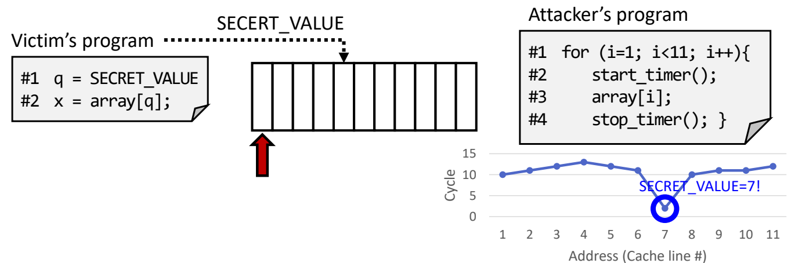

# 08 推测执行的安全边界

[本讲目录](../index.md) · [课程目录](../../index.md) · [上一节：07 精确异常与访存顺序](07-precise-exceptions-and-memory-order.md)

> [!abstract] 本节要点
> - 推测结果未提交或被丢弃后，缓存等微架构状态仍可能留下可观察的变化。
> - 缓存时间侧信道利用访问延迟判断某条缓存行是否被访问过，再由访问位置推断秘密。
> - Spectre V1 利用分支误预测短暂绕过边界检查，并把秘密编码为 `array2` 的访问位置。
> - Meltdown 在易受影响的实现中利用权限异常处理前的瞬态窗口；精确异常本身不保证清除缓存残迹。

> [!info] 拓展内容
> 本章依据补充材料整理，供感兴趣的同学自学，不纳入本课考试范围。[^s5b12]

## 状态回滚的边界

[精确异常与分支恢复](07-precise-exceptions-and-memory-order.md)保证错误路径的结果不会按正常指令提交。不过，处理器为了执行这些指令，可能已经访问了缓存。理解这一差别，才能解释“计算结果没有留下，秘密却仍可能被推断”的现象。

**体系结构状态（architectural state）**包括程序按指令集规则可见的寄存器、内存等状态；**微架构状态（microarchitectural state）**是处理器实现这些规则时维护的内部状态，例如哪些数据已经进入缓存。推测指令可以被清除，其寄存器结果不生效，而它曾经加载的缓存行仍然保留。[^s4p128][^s4p132]

这会形成两条不同的观察途径：直接读取寄存器得不到已撤销的结果，但随后访问某个地址时，访问速度可能比此前更快。若这个地址由秘密决定，时间差就可能携带秘密的信息。


这个机制涉及推测执行、秘密相关的访存，以及可被外部观察的缓存状态。ROB 负责隔离临时结果并控制提交，但“ROB 没有提交错误结果”只能说明体系结构恢复正常，不能独自证明所有观察途径都已恢复；也不能把漏洞简单归因于 ROB 一个结构。[^s4p128][^s4p132]

## 缓存计时侧信道

程序即使没有通过返回值输出秘密，也可能通过运行时间、功耗或电磁信号泄露信息。**侧信道（side channel）**就是利用系统执行时产生的这类间接信息；其中，**时间侧信道（timing side channel）**通过耗时差异推断内部行为。[^s4p128][^s4p129]

缓存计时例子的核心条件是：不同秘密会访问不同的、可区分的缓存行，而观察者能测量这些位置的访问时间。其过程为：

1. 程序把秘密读入 `q`，再执行 `x = array[q]`。
2. 对应地址的数据被带入缓存。秘密虽然没有作为输出返回，却决定了哪一条缓存行发生变化。
3. 观察者依次测量候选位置的读取时间。命中的位置通常更快，于是可以反推 `q` 的候选值。[^s4p129]

> [!example] 例：由快慢差异判断秘密
> 设各候选位置原先均未被缓存，程序只进行了与秘密有关的那次读取。随后测得第 7 个候选位置明显更快，其他位置仍较慢，就可在这些假设下推断 `SECRET_VALUE = 7`。这里推断的是“哪一个位置被访问过”，进而利用已知的地址与秘密对应关系还原秘密。[^s4p129]



图：秘密值决定先访问的位置，随后逐项计时在第 $7$ 个位置观察到低谷，从而推测本例的秘密值为 $7$；曲线数值仅作示意。

材料用 80 与 200 个时钟周期说明缓存命中和未命中的速度差异；它们是教学示例，不能当作所有处理器的固定延迟。图中折线表达“第 7 个位置明显更快”，其纵轴数值也不应与 80/200 周期拼成同一组测量。[^s4p129]

> [!warning] 易错点
> 缓存按缓存行区分访问。若两个候选地址落在同一条缓存行，仅凭这条缓存行的命中情况，就不能区分到底访问了哪一个地址。秘密与可观察位置之间必须存在足够明确的对应关系，才能从快慢差异作出判断。

## Spectre 的越界检查绕过

边界检查可以保证正常执行路径只访问合法数组元素，但分支预测会在检查结果尚未确定时猜测下一条路径。**边界检查绕过（Bounds Check Bypass，Spectre Variant 1）**利用错误预测期间的执行窗口，让本应被条件挡住的秘密相关访问暂时发生，再从缓存痕迹中观察它。[^s4p132][^s4p133]

教学例子为：

```c
if (x < array1_size)
    y = array2[array1[x] * 256];
```

按程序语义，只有 `x < array1_size` 时才应执行第二行。第二行又包含一条地址依赖链：先读出 `array1[x]`，再用这个值决定 `array2` 中要访问的位置。

这个例子假定输入 `x` 可被控制，`x` 能影响第一次数组读取，而且第二个数组 `array2` 的访问时间可以被观察。这三点解释了代码中哪些部分参与信息泄漏；实际能否产生可观察结果，还取决于处理器实现、推测窗口与缓存状态等条件。[^s4p133][^s4p134][^s4p135][^s4p136]

### 从错误预测到缓存编码

1. **形成预测倾向**：此前多次使用合法的 `x`，边界检查经常通过，预测器因而倾向于继续执行第二行。
2. **出现越界输入**：当 `x` 超出边界时，如果条件尚未完成而预测仍认为可以进入，第二行就可能在短暂的错误路径上开始执行。
3. **把秘密变成访问位置**：若这次越界读取暂时取得秘密值 `array1[x]`，该值随后决定 `array2[array1[x] * 256]` 的地址，使相应缓存行被访问。
4. **恢复体系结构执行**：检查结果确认越界后，错误路径被清除，`y` 不会以这次错误执行的结果正常提交。
5. **观察残留的快慢差异**：若第三步的缓存变化仍然存在，就可能通过 `array2` 中各候选位置的读取耗时，推断此前秘密相关的访问。[^s4p137][^s4p138][^s4p139]

> [!example] 例：秘密值如何对应到可观察位置
> 当瞬态读出的 `array1[x]` 为 75 时，第二次读取选择的数组下标是 $75\times256=19200$，即 `array2[19200]`。若这个位置对应的缓存行出现较快访问，观察者就可利用“秘密值乘以 256”的对应关系推断候选值 75。[^s4p139]

其中 256 是这段代码用来间隔候选位置的下标步长；实际字节距离还取决于数组元素大小。它不能直接解释为普遍适用的页面大小。

> [!warning] 易错点
> 这里用于编码秘密的是 `array2[array1[x] * 256]` 的访问位置。原材料把过程简写为“`array1[x]` 被缓存”，但仅知道秘密本身所在的地址被缓存，并不能由此读出它的数值；需要第二次访问把“秘密值”转换成“可观察的地址”。代码与图中的 `array2` 计时结果共同支持这一解释。[^s4p139]

> [!info] 可视化资源
> - [Spectre 原作者论文：条件分支示例](https://arxiv.org/pdf/1801.01203)：阅读第 4 节与 Listing 1（PDF 第 5–6 页），核对秘密值如何通过 array2 的缓存位置留下可测痕迹。

## Meltdown 的权限检查窗口

有些地址虽然可以被计算出来，当前程序却没有读取权限。内核区域的读取受特权状态约束，示意图以 `supervisor bit` 表示这一检查。**非法数据缓存加载（Rogue Data Cache Load，Meltdown Variant 3）**针对的是易受影响的处理器实现：一次无权限读取在异常正式处理之前，可能暂时把数据送给后续指令，使秘密有机会影响缓存访问。[^s4p140][^s4p143][^s4p144]

这一机制的适用条件是实现存在相应的瞬态权限漏洞。乱序执行和延迟处理异常提供了需要分析的执行环境，但不能据此认定所有乱序处理器都会把无权限读取的数据提供给后续指令。

> [!example] 例：异常之后的访问为何仍可能留下痕迹
>
> ```c
> raise_exception();
> // the line below is never reached
> access(probe_array[data * 4096]);
> ```
>
> 注释描述的是正常的体系结构控制流：异常之后这行不会成为正常执行的结果。在易受影响的实现中，异常处理前的瞬态窗口仍可能执行依赖 `data` 的探测数组访问，并留下缓存变化。这里的 $4096$ 是该示例选取的索引步长，与前面 Spectre 示例的 $256$ 属于不同设定，都不是所有处理器通用的参数。[^s4p140]

### 用一个秘密位选择缓存位置

示例中，`Target` 位于无权读取的内核区域，`M0`、`M1` 是两个可观察的内存位置。其伪代码语义可写为：

```text
从缓存中移除 M0、M1 对应的缓存行
R0 = 读取 Target 处的数据       // 无权限访问，产生异常
若 R0 中被测试的那一位为 0：
    M2 = 读取 M0 处的数据
否则：
    M2 = 读取 M1 处的数据
```

第一步对应原例中的 `clflush(M0); clflush(M1);`；最后两条赋值表达从所选内存位置取值，关键效果是读取 `M0` 或 `M1`，从而改变其缓存状态。[^s4p142][^s4p144]

沿执行过程观察，可以把异常正确性与信息泄漏分开：

1. **先消除原有缓存命中差异**：把 `M0`、`M1` 对应的行从缓存移除，令随后出现的差异能与例中的秘密相关访问对应。
2. **发生无权限读取**：读取 `Target` 会产生权限异常。在易受影响的实现中，异常尚未正式处理时，秘密可能暂时进入后续指令的数据依赖链。
3. **按秘密位选择读取位置**：被测试的位为 0 时读取 `M0`，为 1 时读取 `M1`。这把一个秘密位编码为两个缓存位置中的一个。
4. **按序处理异常**：错误执行的寄存器及内存结果不会作为正常程序结果提交，但此前读取带来的缓存变化可能仍保留。
5. **从缓存差异推断该位**：在例中的假设下，若 `M0` 比 `M1` 读取更快，就说明 `M0` 对应的缓存行更可能已被加载，从而推断被编码的位为 0。[^s4p143][^s4p144][^s4p145]

原例先写“first bit”，结论处又写“last bit”，没有一致指定具体位序。因此这里统一称“被测试的那一位”，保留“0 选择 `M0`，1 选择 `M1`”这一判断规则。[^s4p145]

> [!info] 可视化资源
> - [Meltdown 原作者演示：瞬态执行与缓存痕迹](https://www.usenix.org/sites/default/files/conference/protected-files/security18_slides_lipp.pdf)：看 PDF 第 61 页的机制图和第 70–71 页的访问时间图，连接瞬态指令、微架构状态变化与缓存计时。

## 变种与机制对照

同样表现为缓存计时差异，前面产生瞬态执行的原因可以不同。历史分类将 Variant 1、Variant 2 归为 Spectre，Variant 3 归为 Meltdown；其中 **分支目标注入（Branch Target Injection，Variant 2）**在本材料中只列出名称。[^s4p130][^s4p131]

| 历史变种 | 类别 | 涉及的检查或预测 | 本章中的信息编码 |
|---|---|---|---|
| Variant 1：Bounds Check Bypass | Spectre | 边界检查分支被错误预测，暂时进入不该执行的路径 | 秘密值选择 `array2` 的访问位置 |
| Variant 2：Branch Target Injection | Spectre | 分支目标预测 | 材料未展开机制，仅保留分类 |
| Variant 3：Rogue Data Cache Load | Meltdown | 易受影响实现中的权限检查与异常处理窗口 | 秘密位选择 `M0` 或 `M1` |

对两个已展开的例子，都可以沿“秘密如何影响地址 → 地址如何改变缓存 → 缓存如何改变可观察时间”追踪信息。精确异常约束提交后的程序状态；这里还要检查未提交执行是否留下可观察的微架构变化。[^s4p128][^s4p139][^s4p145]

> [!question]- 自测：某次越界推测结束后，寄存器值与内存内容均恢复正确，但 `array2[19200]` 明显比其他候选位置更快。可以据此说异常恢复失败吗？在例中还能推断什么？
> 不能仅凭缓存变快就认定体系结构恢复失败；寄存器和内存内容仍可能完全符合程序语义。但缓存状态说明仍存在可观察残迹。在本例步长为 256、候选位置可区分且没有其他干扰的假设下，$19200/256=75$，对应秘密候选值 75。

> [!question]- 自测：如果两个候选秘密值最终选择了同一条缓存行，观察者测得该行命中，能唯一确定是哪一个秘密值吗？
> 不能。两种秘密产生了相同的缓存行观察结果，时间差只能说明这条行被访问过；若要区分两者，还需要能把它们映射到不同观察结果的条件。

> [!question]- 自测：在 Meltdown 教学例中，`M1` 读取明显较快，`M0` 较慢。能否得出“秘密的最高位为 1，并且所有乱序 CPU 都存在该漏洞”？
> 只能在该例的缓存与执行假设下推断被编码的那一位为 1。材料没有一致指定最高位或最低位；漏洞也要求处理器实现允许相应的瞬态权限越过，不能由乱序执行这一特征直接推出。

> [!info]- 来源
> - L05-Supplement-ReorderBuffer-Exception.pdf：PDF p.127–146
> - L05.docx：DOCX body 450–514, 601–644

[^s5b12]: L05.docx-DOCX body 450-514
[^s4p128]: L05-Supplement-ReorderBuffer-Exception.pdf-PDF p.128
[^s4p132]: L05-Supplement-ReorderBuffer-Exception.pdf-PDF p.132
[^s4p129]: L05-Supplement-ReorderBuffer-Exception.pdf-PDF p.129
[^s4p133]: L05-Supplement-ReorderBuffer-Exception.pdf-PDF p.133
[^s4p134]: L05-Supplement-ReorderBuffer-Exception.pdf-PDF p.134
[^s4p135]: L05-Supplement-ReorderBuffer-Exception.pdf-PDF p.135
[^s4p136]: L05-Supplement-ReorderBuffer-Exception.pdf-PDF p.136
[^s4p137]: L05-Supplement-ReorderBuffer-Exception.pdf-PDF p.137
[^s4p138]: L05-Supplement-ReorderBuffer-Exception.pdf-PDF p.138
[^s4p139]: L05-Supplement-ReorderBuffer-Exception.pdf-PDF p.139
[^s4p140]: L05-Supplement-ReorderBuffer-Exception.pdf-PDF p.140
[^s4p143]: L05-Supplement-ReorderBuffer-Exception.pdf-PDF p.143
[^s4p144]: L05-Supplement-ReorderBuffer-Exception.pdf-PDF p.144
[^s4p142]: L05-Supplement-ReorderBuffer-Exception.pdf-PDF p.142
[^s4p145]: L05-Supplement-ReorderBuffer-Exception.pdf-PDF p.145
[^s4p130]: L05-Supplement-ReorderBuffer-Exception.pdf-PDF p.130
[^s4p131]: L05-Supplement-ReorderBuffer-Exception.pdf-PDF p.131

[本讲目录](../index.md) · [课程目录](../../index.md) · [上一节：07 精确异常与访存顺序](07-precise-exceptions-and-memory-order.md)
