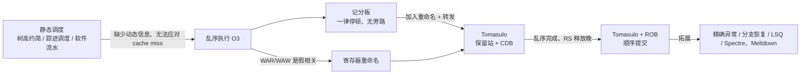

# L05 动态调度

[课程目录](../index.md)

编译器的静态调度看不到运行时的分支走向和 cache miss，本讲在补完树高约简、踪迹调度和软件流水之后，转向由硬件在运行时重排指令的动态调度（乱序执行）。主线是：先说明乱序执行的收益、它放大的 RAW/WAR/WAW 冒险以及寄存器重命名，再按历史顺序剖析记分板（集中记账、一律停顿）、Tomasulo（保留站重命名加 CDB 转发）和重排序缓冲 ROB（乱序执行、顺序提交），最后统一流水线术语，并以拓展章节介绍精确异常、分支恢复、访存消歧与 Spectre/Meltdown。阅读前需要熟悉五级流水线、数据冒险与前递（forwarding）、Amdahl 定律，以及 L04 的循环展开、多发射与分支预测。

## 章节导航

- [01 树高约简与踪迹调度](chapters/01-tree-height-reduction-and-trace-scheduling.md)：树高约简压缩依赖链，踪迹调度连同修复代价评估
- [02 软件流水与编译器局限](chapters/02-software-pipelining-and-compiler-limits.md)：软件流水重叠迭代；静态调度局限引出动态调度
- [03 乱序执行与寄存器重命名](chapters/03-out-of-order-execution-and-register-renaming.md)：乱序执行的收益与冒险，寄存器重命名与 O3 三步
- [04 记分板算法](chapters/04-scoreboard-algorithm.md)：记分板四阶段、三张表与 6 条指令逐周期推演
- [05 Tomasulo 算法](chapters/05-tomasulo-algorithm.md)：保留站重命名、CDB 转发，57 vs 62 周期对比
- [06 重排序缓冲与顺序提交](chapters/06-reorder-buffer-and-in-order-commit.md)：ROB 乱序执行、顺序提交：结构、四阶段与术语
- [07 精确异常与推测执行](chapters/07-precise-exceptions-and-speculative-execution.md)：拓展：多发射、精确异常、分支恢复、LSQ 与攻击

## 本讲小结

### 三种动态调度方案对比

| 对比项 | 记分板（CDC 6600） | Tomasulo（IBM 360/91） | Tomasulo + ROB |
| --- | --- | --- | --- |
| 控制方式 | 集中式三张表 | 分布在各保留站 | 保留站 + ROB + RAT |
| 结构冒险 | 无空闲 FU 则停在 Issue | 无空闲 RS 则停在 Issue | 无空闲 RS 或 ROB 项则停在 Issue |
| RAW | 在 Read operands 停顿，等生产者写回寄存器堆 | 在 RS 中等标签，经 CDB 转发取值 | 在 RS 中等 ROB 标签，经 CDB 转发取值 |
| WAR | 推迟写回 | 重命名消除（RS 存值） | 重命名到 ROB 项消除 |
| WAW | 推迟发射 | 重命名消除 | 重命名到 ROB 项消除 |
| 各阶段顺序 | 按序发射、乱序执行、乱序完成 | 按序发射、乱序执行、乱序完成 | 按序发射、乱序执行与写结果、按序提交 |
| 异常 / 分支错误 | 不处理 | 难以处理（旧值已被覆盖） | 提交前只写 ROB，可精确恢复 |

### 核心数字与公式

| 内容 | 结果 |
| --- | --- |
| 执行时间分解 | $\text{Execution Time} = IC \times CPI \times CCT$，ILP 优化瞄准 $CPI$ |
| Amdahl 定律 | $\text{Speedup} = \frac{1}{(1-P)+P/S}$；踪迹调度例 $1.117 \to 1.046$ |
| 乱序收益例 | 1 路顺序 10、2 路顺序 8、1 路乱序 7、2 路乱序 5 周期 |
| 同一 6 条指令 | 记分板 62 周期完成，Tomasulo 57 周期完成 |
| 窗口大小 | 记分板 $1+1+2+1=5$ 条，Tomasulo $6+3+3+2=14$ 条 |

## 不确定事项

- s3p249 结构冒险行两栏均为 “No issue”，按“不发射”解释（与 Patterson 原表一致），讲义未明确说明。
- section-5 自测 1（加法保留站减为 1 个时 ADDD 周期 9 发射）沿用“写结果周期释放、下一周期才能再分配”的约定，Tomasulo 例子中没有直接出现保留站被复用的帧。
- s3p262 的 FP Op Queue 中第二条指令显示为 mul R1 R2 R6，而 s4 例子为 mul R1,R5,R6；章节按 s4p40–68 的完整例子书写。

> [!info]- 来源
> - L05-Dynamic-Scheduling.pdf：PDF p.3–14, 16–32, 39–40, 42–46, 48, 57, 71, 75, 78, 87, 103, 119–120, 124–128, 130–135, 137–140, 142–147, 149, 151–155, 168, 176–177, 210, 247–255, 260–261, 268, 271–272, 275, 278, 280–281
> - L05.docx：DOCX body 1–367
> - L05-Supplement-ReorderBuffer-Exception.pdf：PDF p.35–40, 44, 62–63, 66–68, 70, 74–77, 79–81, 83, 87–88, 93–94, 96–106, 108, 110, 112–126, 128–129, 131–132, 136, 139–140, 145
