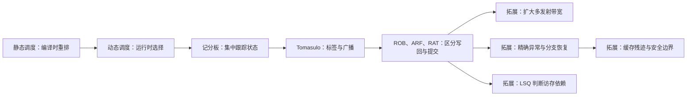

# L05 静态调度与动态调度

[课程目录](../index.md)

本讲讨论怎样让多条指令尽量重叠执行，同时保持程序要求的数据关系和可见结果。先承接 L04 的静态调度，分析树高约简、踪迹调度和软件流水，再由寄存器依赖进入记分板、Tomasulo 与 ROB，区分发射、运算、写回和提交。阅读前应熟悉基本流水线、数据与控制冒险，以及寄存器和内存的读写语义。第 6–8 章是老师指定的自学拓展，不纳入考试，分别讨论多发射、异常与访存顺序，以及推测执行的安全边界。

## 章节导航

- [01 静态调度的扩展](chapters/01-advanced-static-scheduling.md)：缩短依赖链，计算踪迹收益并重叠迭代
- [02 乱序执行与依赖](chapters/02-out-of-order-and-dependencies.md)：用依赖与版本判断乱序执行的边界
- [03 记分板调度](chapters/03-scoreboard-scheduling.md)：用三张表复现四阶段调度与 WAR 停顿
- [04 Tomasulo调度](chapters/04-tomasulo-scheduling.md)：用标签与广播重现六指令乱序演算
- [05 重排序缓冲与提交](chapters/05-reorder-buffer-and-commit.md)：用临时写回与顺序提交维护正确状态
- [06 ROB演算与多发射](chapters/06-rob-example-and-superscalar.md)：演算 ROB 版本与周期，扩展多发射吞吐
- [07 精确异常与访存顺序](chapters/07-precise-exceptions-and-memory-order.md)：按序处理异常，用 LSQ 判断访存依赖
- [08 推测执行的安全边界](chapters/08-speculation-and-side-channels.md)：区分状态回滚与缓存侧信道

## 本讲小结

静态调度在编译时重排依赖图，动态调度在运行时根据数据与资源的实际状态选择指令。两者都必须保留真正的数据流：重命名去除寄存器名字复用造成的 WAR、WAW，RAW 仍要等待正确生产者；内存依赖还须等有效地址明确后判断。ROB 进一步把“结果可供消费者使用”与“结果正式改变程序状态”分开，让乱序计算与顺序提交并存。

演算一条指令时，依次确定它读取哪个版本、源值何时就绪、执行与传输资源何时可用、是否已经轮到提交。同周期读写及资源释放条件以各例约定为准；记分板和 Tomasulo 表的 $X$ 是执行完成周期，ROB 表的 $E$ 是开始执行周期，比较前必须统一口径。

### 核心公式

| 公式 | 符号、单位与使用条件 |
| --- | --- |
| $T=IC\times CPI\times CCT$ | $T$ 为执行时间（秒），$IC$ 为指令数（条），$CPI$ 为每条指令的平均周期数（周期/条），$CCT$ 为时钟周期（秒/周期）；调度对总时间的影响须放回这三个因素判断。 |
| $S=1/[(1-P)q+P/s]$ | $P$ 为优化部分占原执行时间的比例，$s$ 为该部分的局部加速比，$q$ 为其余部分的时间倍率；三者及总加速比 $S$ 均无量纲。$q=1$ 时还原为通常的阿姆达尔形式。 |
| $c_{\rm end}=c_{\rm start}+L-1$ | $c_{\rm start}$、$c_{\rm end}$ 是起止周期编号，$L$ 是执行延迟（周期），首尾均计入。例如 $17+40-1=56$；若下一周期写回，则 $W=57$。 |

顺序提交维护体系结构状态，却不意味着推测过程没有留下痕迹。访存队列保证 Load 取得正确的内存版本；缓存侧信道进一步追问：即使临时结果被丢弃，先前的访问是否仍能被后续计时观察到。

## 不确定事项

- s3p11 与 s3p12 的首条 fadd 分别位于第 4、5 行；材料未给出完整值版本、指针处理、分支和尾声代码，不能重建唯一可执行排程或精确加速比。正文保留可见布局差异与适用条件。
- s4p144/s4p145 对被编码位先称 first bit、后称 last bit，材料无法确定具体位序；正文统一称被测试位，保留 0→M0、1→M1 的机制。

> [!info]- 来源
> - L04-MultiIssue.pdf：PDF p.90–101
> - L05-Dynamic-Scheduling.pdf：PDF p.3–14, 16–281
> - L05.docx：DOCX body 1–644
> - L05-Supplement-ReorderBuffer-Exception.pdf：PDF p.33–88, 92–146
