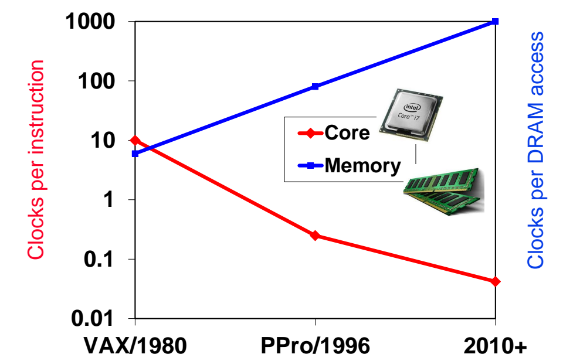
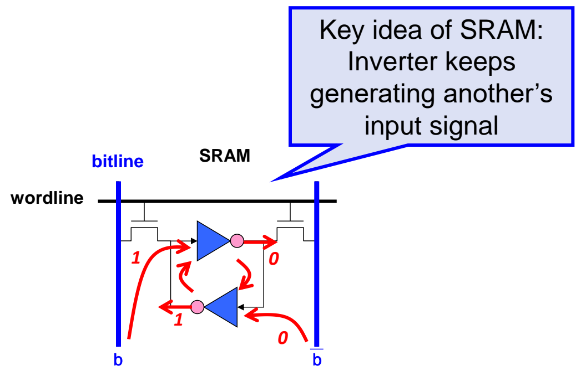
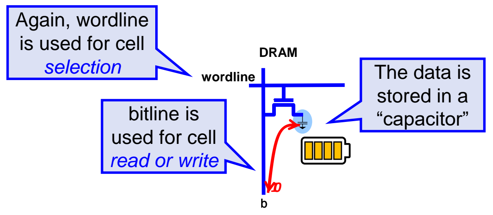
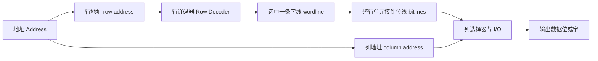
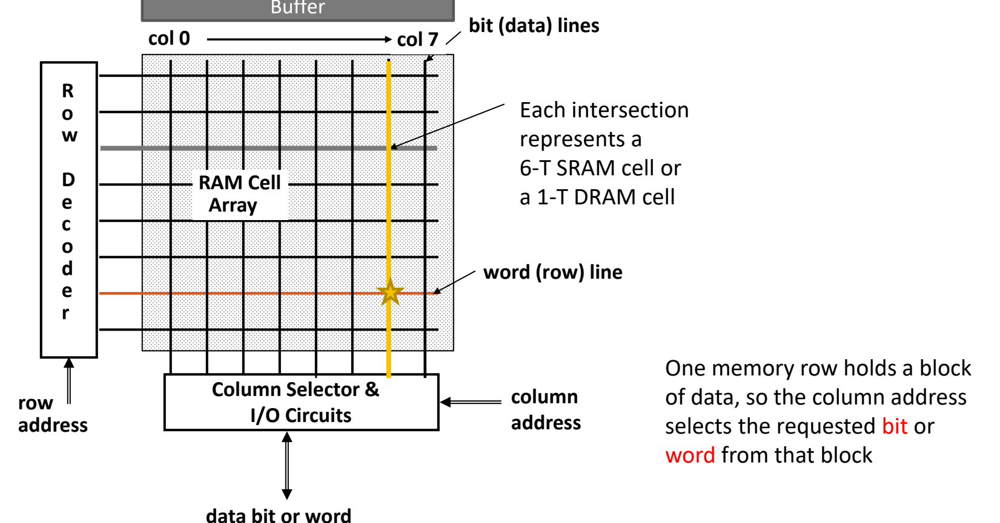

# 01 内存墙与存储技术

[本讲目录](../index.md) · [课程目录](../../index.md) · [下一节：02 局部性与存储层次](02-locality-and-memory-hierarchy.md)

> [!abstract] 本节要点
> - 内存墙：DRAM 一次访问的延迟几十年来一直约 80–100 ns，而处理器频率和并行度不断提高，所以一次 DRAM 访问折合的时钟周期数越来越多，缓存就是为了缓解这个问题。
> - "随机访问"的意思是访问任意地址所需时间相同（SRAM、DRAM）；磁带、磁盘、CD-ROM、SSD 属于非随机访问存储，访问时间随操作、位置和时间变化，读带宽通常远高于写带宽。
> - SRAM 单元为 6T，靠两个交叉耦合的反相器保持状态，不需要刷新，快，但密度低、功耗高、价格贵，用来做缓存。DRAM 单元为 1T1C，数据以电荷形式存在电容里，约每 64 ms 必须刷新一次，刷新占 1%–2% 的活跃周期；DRAM 密度高、便宜，但慢，用来做主存。两者断电后都会丢失数据（易失性）。
> - RAM 阵列的访问分两步：行地址经行译码器选中一条字线（wordline），整行单元接到位线（bitline）上，再由列地址在列选择器中选出需要的位或字。
> - SRAM 芯片一次送入全部地址（如 $2\mathrm{M}\times16$ 芯片有 21 位地址）。DRAM 容量大，把地址分成行（RAS）和列（CAS）两次送入，以节省引脚。同样用 SRAM 做的 L1/L2/L3，延迟分别约 1、5–10、10–20 个周期，因为阵列越大，选中一个单元的代价越高。

**L02 勘误回顾**：分支目标地址在 MIPS 中是 $PC+4+\text{sext}(imm)\times4$，在 RISC-V 中是 $PC+\text{sext}(imm)\times2$，两种架构本来就设计得不同。[^s1p1] LR/SC 方面，一个 hart 同一时刻只能持有一个保留（reservation），SC 只能与程序顺序上最近的一条 LR 配对，所以 L02 中 Case 3 的 t2、t3 都是失败。[^s1p2] 完整规则见 L02《07 分支过程调用与栈》和 L02《08 同步与寻址方式》。

## 内存墙（Memory Wall）

计算机由处理器（控制器 + 数据通路）、存储器和 I/O 设备组成。前几讲讨论的流水线、乱序调度和执行单元只是处理器的一部分。真正决定程序能跑多快的，往往是"数据能否及时送到"。

> [!tip] 课堂强调
> 在 Intel Sandy Bridge 的芯片照片中，乱序调度、退休和执行单元大约只占核心面积的 $1/3$。大部分面积给了 L1D\$、L1I\$、L2\$ 以及访存管理与执行部件，L3 还在核心之外另占面积。[^s1p6] 从芯片面积看，存储系统才是处理器的大头，这也是本课要花大量时间讲存储的原因。

**内存墙**（memory wall）指逻辑电路（处理器）与 DRAM 之间的速度差距持续扩大。[^s1p8] 这一差距可以从两个方向看：

1. **处理器一侧**：衡量指标是每条指令的时钟周期数（clocks per instruction，即 CPI）。1980 年前后的 VAX 是多周期处理器，执行一条指令约需 10 个周期。后来引入流水线（PPro/1996 约 0.25 周期/指令），再加上超标量等并行技术，到 2010 年以后每个周期能完成几十条指令（图中约 0.04 周期/指令）。
2. **存储器一侧**：衡量指标是每次 DRAM 访问的时钟周期数（clocks per DRAM access）。同一时期它从个位数涨到了约 100，再到约 1000。

图：对数纵轴上，从 VAX/1980 到 PPro/1996 再到 2010+，Core 的每条指令时钟数从约 10 降到约 0.04，而 Memory 的每次 DRAM 访问时钟数从约 6 升到约 1000，两条曲线的剪刀差就是内存墙。 红线 Core 对应左轴、蓝线 Memory 对应右轴，两线在 1980 年附近相交，此后差距持续扩大。

DRAM 访问的周期数在增加，并不是因为 DRAM 变慢了。原因如下：

- DRAM 的**访问延迟本身基本不变**，二十年前和现在都约为 80–100 ns。[^s2b2]
- 处理器时钟频率从约 100 MHz 提高到 5–6 GHz，时钟周期从 10 ns 缩短到约 0.2 ns。
- 固定的纳秒延迟除以越来越短的周期，得到的周期数自然越来越多：

$$
N_{\rm DRAM} = \frac{t_{\rm DRAM}}{T_{\rm clk}} = t_{\rm DRAM}\times f_{\rm clk}
$$

其中 $t_{\rm DRAM}$ 是一次 DRAM 访问的延迟（ns），$T_{\rm clk}$ 是时钟周期（ns），$f_{\rm clk}$ 是时钟频率（GHz），$N_{\rm DRAM}$ 是一次访问折合的周期数。

> [!example] 例：同一块 DRAM 在不同处理器上"有多慢"
> 取 $t_{\rm DRAM}=100\ \text{ns}$。
>
> 1. $f_{\rm clk}=100\ \text{MHz}$：$T_{\rm clk}=10\ \text{ns}$，$N_{\rm DRAM}=100/10=10$ 个周期。
> 2. $f_{\rm clk}=5\ \text{GHz}$：$T_{\rm clk}=0.2\ \text{ns}$，$N_{\rm DRAM}=100\times5=500$ 个周期。
> 3. 再考虑到每个周期能发射多条指令，一次 DRAM 访问期间损失的是上千条指令的执行机会。

处理器越快、并发度越高，DRAM 就越成为瓶颈。解决思路是在处理器和 DRAM 之间插入又小又快的存储，也就是缓存（cache），并依靠程序的局部性让大部分访问在缓存中完成。局部性和存储层次见[局部性与存储层次](02-locality-and-memory-hierarchy.md)。缓存对 CPU 时间的具体影响见[缓存性能度量](03-cache-performance-metrics.md)。

> [!info] 可视化资源
> [交互图：Latency Numbers Every Programmer Should Know](https://colin-scott.github.io/personal_website/research/interactive_latency.html)：拖动 1990–2020 年份滑块，对比 L1/L2 引用（几个周期）与主存引用（约 100 ns，2000 年后基本不变）的延迟，直观体会内存墙。

## 随机访问与非随机访问存储

要设计存储层次，首先要了解各种存储介质的特性。按访问时间是否与地址有关，可以把存储介质分成两大类。[^s1p9]

**随机访问存储**（random access memory，RAM）是指访问任意一个地址所需的时间都相同（或非常接近）的存储器。"随机"在这里是优点：不管访问哪个位置，代价都一样。DRAM 和 SRAM 都属于这一类。

**非随机访问存储**（"not-so-random" access technology）是指访问时间因操作、位置和时间不同而变化，且差别可能很大的存储器，例如磁带、磁盘、CD-ROM、SSD。它的特点有：

- **随操作变化**：读和写的延迟完全不同。这类存储的读带宽通常远高于写带宽，可以高出很多倍。在笔记本或手机上测一下存储的读写速度，会发现读快、写慢。
- **随位置变化**：磁盘要先把磁头移到对应磁道，再等盘片转到目标扇区才能开始读；磁带要把带子卷到目标位置。目标位置离当前位置越远，等待越久。
- **随时间变化**：访问从什么时刻开始、设备当时处于什么状态，都会影响延迟。SSD 的情况比前几种更复杂，后续课程再讲。

除了上面这些，Optane 以及 PRAM 等新型存储也是**非易失性存储**（non-volatile memory），都具有"不那么随机"的特点。

> [!warning] 易错点
> - "随机访问"不是"支持按任意地址访问"的意思。磁盘也能按任意地址读写，但访问时间随位置变化，所以不算随机访问。判断标准是：访问时间与地址无关。
> - "动态（dynamic）"和"静态（static）"说的是**是否需要刷新**，与是否断电保存无关。SRAM 和 DRAM 都是**易失性存储**（volatile memory），断电后数据都会丢失。

## SRAM 单元（6T SRAM Cell）

缓存要求快，所以它需要一种只要通电就能稳定保存数据、读写只需改变电压的存储单元。这种单元就是 SRAM。

**SRAM**（静态随机访问存储器，Static Random Access Memory）的每个单元由 6 个晶体管（6T）组成：中间 4 个晶体管构成两个**交叉耦合的反相器**，两侧各有 1 个晶体管作为访问开关。只要不断电，数据就会一直保持（"forever"），不需要刷新，所以叫"静态"。[^s1p12] SRAM 的逻辑简单、速度快，但价格贵，通常用在存储层次的上层，也就是缓存。[^s1p14]

### 前置知识：MOS 管与 CMOS 反相器

反相器是理解 SRAM 单元的基础，下面先介绍它的构成。

**MOSFET**（金属-氧化物-半导体场效应晶体管，Metal-Oxide-Semiconductor Field-Effect Transistor），也叫 MOS 管或晶体管。"金属-氧化物-半导体"是指它由这三种材料叠加构成。它有两种用途：一是做**开关**，CPU 中的晶体管基本都用作开关；二是做**放大器**，例如蓝牙耳机收到的微弱信号要先放大到能听见的强度。[^s1p11]

MOS 管有三个端子：栅极（Gate）、源极（Source）和漏极（Drain）。它分为两种，合在一起使用就叫 **CMOS**（Complementary MOS）：

- **NMOS**（N 表示 negative）：栅极加高电平（正电压）时，源极和漏极导通。
- **PMOS**（P 表示 positive）：符号中栅极处多一个小圆圈。栅极加低电平（0 V 或负电压）时，源极和漏极导通，与 NMOS 正好相反。

**CMOS 反相器**（inverter）由一个 PMOS 管 $M_p$ 和一个 NMOS 管 $M_n$ 串联而成：$M_p$ 的一端接电源 $V_{DD}$，$M_n$ 的一端接地，两管的栅极连在一起作为输入 $V_{in}$，两管的连接点作为输出 $V_{out}$。

1. **输入高电平**：$M_p$ 截止，$M_n$ 导通，$V_{out}$ 经 $M_n$ 接地，输出 0 V（低电平）。
2. **输入低电平**：$M_p$ 导通，$M_n$ 截止，$V_{out}$ 经 $M_p$ 接到 $V_{DD}$，输出高电平。$M_n$ 断开，不影响输出。

所以输出总是输入取反，这就是反相器的功能。

### 单元结构与读写

SRAM 单元的结构如下：

- **字线**（wordline，WL）：每个单元连一条字线，这条字线同时接到两侧两个访问晶体管的栅极。字线为高时两个开关导通，为低时断开。字线的作用是**选中单元**。
- **位线**（bitline，BL）：每个单元连**两条**位线 $b$ 和 $\bar b$。$\bar b$ 上的横线表示取反：一条为高电平时另一条为低电平。位线的作用是**读写单元**。[^s1p13]
- **交叉耦合反相器**：反相器 A 的输出接反相器 B 的输入，B 的输出又接回 A 的输入。

保持数据的原理是**每个反相器不断产生另一个反相器的输入**。如果一侧节点为 1，经反相得到另一侧为 0，再反相又得到 1，这个状态会自我维持下去。[^s1p14]

图：两个交叉耦合的反相器互相驱动对方输入以保持 1/0 状态，wordline 打开两侧访问管后，通过互补位线 $b$ 与 $\bar{b}$ 读写单元。 图中 $b$ 一侧节点为 1，经一个反相器得到 0，0 再经另一个反相器回到 1，两个反相器互相提供输入，形成稳定状态。

读写过程如下：

1. **选中**：拉高字线，两个访问晶体管导通，单元的两个内部节点分别接到 $b$ 和 $\bar b$。
2. **读**：先把两条位线预置为 $\frac{1}{2}V_{DD}$，再由单元内部两个反相器的状态把两条位线分别拉高、拉低。比较 $b$ 和 $\bar b$ 哪条高，就能读出存的是 0 还是 1。
3. **写**：外部电路强制驱动位线。例如写 1 时，把 $b$ 接高电平，把 $\bar b$ 接 0 V，迫使反相器翻转到新状态。字线关闭后，反相器继续互相维持这个状态，新数据就保存下来了。

**为什么 SRAM 密度低、功耗高**：

- 每个单元有 6 个晶体管，而 DRAM 单元只有 1 个。
- 每个单元要接两条位线，布线复杂，外围电路要求也高，所以面积更大。
- 两个反相器都接在电源和地之间，保持数据期间内部始终有电流流动，所以即使不访问也在耗电。

6T 不是唯一的 SRAM 实现，也有用更少晶体管（例如 3 个）做成的 SRAM 单元。这类设计省了晶体管，但会带来其他代价，属于特殊设计。传统 SRAM 单元指的就是 6T 结构。

> [!info] 可视化资源
> [Wikimedia Commons：6T SRAM 单元电路图](https://commons.wikimedia.org/wiki/File:SRAM_Cell_(6_Transistors).svg)：标出交叉耦合反相器、访问管、字线与互补位线，可对照上图理解 SRAM 的保持与读写。

## DRAM 单元与刷新（1T1C DRAM Cell）

主存需要大容量、低成本，所以每一位必须用尽量少的器件。DRAM 用一个电容存一位，是这种取舍的结果。

**DRAM**（动态随机访问存储器，Dynamic Random Access Memory）的每个单元由 1 个晶体管和 1 个电容（1T1C）组成。数据以电荷形式存放在电容中，晶体管只起开关作用。电容会漏电，所以单元必须**定期刷新**（refresh），约每 64 ms 一次，因此叫"动态"。[^s1p15] DRAM 便宜，但逻辑复杂，比 SRAM 慢得多，通常用作主存。

DRAM 的读写过程：

1. **选中**：和 SRAM 一样，字线控制访问晶体管，决定电容是否接到位线上。
2. **写**：写 1 就是给电容充电，写 0 就是让电容放电。
3. **读**：根据电容中的电荷量对位线电压的影响，判断存的是 0 还是 1。

图：DRAM 单元只有一个晶体管和一个电容，wordline 选通单元，bitline 负责读写，数据以电容中的电荷存储。

**为什么需要刷新**：实际的电容都会漏电，不可能永远保存电荷。DRAM 单元的电容非常小，电荷很快就会流失。大约 64 ms 后，就可能分辨不出存的是 0 还是 1。所以必须定期把每个单元的数据读出来再写回去。[^s2b4]

**刷新的代价**：刷新大约占 DRAM 活跃周期的 1%–2%。[^s1p19] 如果一次访问恰好赶上刷新，就要等待，延迟会明显增加。因此有研究专门探讨如何把刷新和正常访问错开，以减少刷新的影响。

**为什么 DRAM 慢**：

- SRAM 单元用两条互补位线同时工作，而 DRAM 单元只有一条位线。
- SRAM 读写只需改变两个节点的电压（一高一低），而 DRAM 读写要对电容充放电，这本身就比较慢。

**为什么 DRAM 密度高、功耗低**：

- 每个单元只有 1 个晶体管和 1 个电容，只连 1 条字线和 1 条位线，外围电路要求也比 SRAM 简单，所以面积小。
- 开关断开后，电容上理论上没有电流流过，所以保持数据时几乎不耗电。

SRAM 与 DRAM 的对比如下：

| 维度 | SRAM | DRAM |
| --- | --- | --- |
| 单元结构 | 6T，两个交叉耦合反相器 | 1T1C，电容存电荷 |
| 每单元连线 | 1 条字线 + 2 条互补位线 | 1 条字线 + 1 条位线 |
| 是否刷新 | 不需要（static） | 约每 64 ms 刷新（dynamic），占 1%–2% 活跃周期 |
| 密度 / 成本 | 低密度、贵 | 高密度、便宜 |
| 功耗 | 高（反相器持续有电流） | 低（电容断开后几乎无电流） |
| 速度 | 快 | 慢（单位线、电容充放电） |
| 断电后 | 丢失（易失性） | 丢失（易失性） |
| 典型用途 | 缓存 | 主存 |

两者的比例关系有两个典型值：同样存一位，SRAM 的面积是 DRAM 的 $4$–$16$ 倍（Size: SRAM/DRAM 4 to 16）；DRAM 的周期时间是 SRAM 的 $8$–$16$ 倍（Cycle time: DRAM/SRAM 8 to 16）。[^s1p9] DRAM 延迟约 80–100 ns，SRAM 则可能在 1 ns 到 10 ns 之间。

> [!tip] 课堂强调
> 4–16 倍和 8–16 倍都只是**典型值**，不是固定比例。SRAM 能做多大、多快，取决于晶体管的尺寸（晶体管越大，能承载的功率越高，切换越快）和外围电路设计，所以实际比例变化很大。

## RAM 阵列组织与芯片接口

单个单元只能存一位，要存下大量数据，就得把单元排成阵列，并用地址选出其中一部分。

**经典 RAM 组织**（classical RAM organization）把存储单元排成二维阵列：横线是**字线**（word/row line），竖线是**位线**（bit/data line），每个交叉点是一个单元，可以是 6T SRAM 单元，也可以是 1T DRAM 单元。[^s1p16] 一次访问分以下几步：

1. **地址拆分**：输入地址被拆成**行地址**（row address）和**列地址**（column address）。
2. **行选择**：行地址送入**行译码器**（row decoder），选中一条字线，打开这一行所有单元的开关，整行单元都接到各自的位线上。
3. **列选择**：一整行存放的是一块数据，但通常只需要其中一位或一个字。所有位线都接到**列选择器与 I/O 电路**（column selector & I/O circuits），由列地址选出需要的位或字。
4. **输出**：选出的数据位或字送到数据总线上。DRAM 阵列上方通常还有一个**行缓冲**（buffer），SRAM 一般没有。行缓冲的细节在 DRAM 的课程中讲。

图：行地址经行译码器选中一条字线，整行数据进入缓冲，再由列地址通过列选择与 I/O 电路选出所需的位或字，阵列每个交点是一个 6T SRAM 或 1T DRAM 单元。

图中橙色的是被行译码器选中的字线，黄色的是被列地址选中的位线，五角星处就是本次访问的单元。

### 为什么同为 SRAM，L1/L2/L3 延迟不同

L1、L2、L3 缓存都用 SRAM 做，但访问延迟差别很大：L1 约 $1$ 个周期，L2 约 $5$–$10$ 个周期，L3 约 $10$–$20$ 个周期。[^s2b2] 原因不在介质本身，而在**阵列规模**：

- 阵列越大，行译码器要选的字线越多，字线和位线越长，负载越重。要导通并读写其中某个单元，付出的代价就越大，耗时也越长。
- 大缓存离处理器核心更远，信号走线距离更长，这也增加了延迟。

阵列大小对访问时间的具体影响会在后续课程中展开。

### SRAM 芯片：一次送入全部地址

SRAM 用于缓存，是因为它速度快，而且制造工艺与逻辑电路兼容（technology compatibility）。[^s1p19] 以一块 $2\mathrm{M}\times16$ 的 SRAM 芯片为例，它共有 $2\mathrm{M}=2^{21}$ 个存储单元，每个单元 16 位：

- **地址**（Address）：$\log_2(2^{21})=21$ 位，一次全部送入。
- **数据输入 / 输出**（Din[15-0] / Dout[15-0]）：各 16 位，由芯片的设计宽度决定。
- **片选**（Chip select）：系统中有多块芯片时，用它决定当前是否使用这块芯片，不用时可以关闭。
- **输出使能**（Output enable）和**写使能**（Write enable）：分别控制读出和写入。

### DRAM：行列地址复用（RAS / CAS）

DRAM 用于主存，是为了容量（密度）。它的芯片与 SRAM 有一个明显区别：**地址分两半送入**。[^s1p19]

- **RAS**（行访问选通，Row Access Strobe）：送入行地址，触发行译码器。
- **CAS**（列访问选通，Column Access Strobe）：送入列地址，触发列选择器。

分两次送的原因是 **DRAM 容量太大**，一次送全部地址需要的引脚太多。按字节编址时，$1\ \text{TB}=2^{40}\ \text{B}$，需要 40 位地址，32 位地址不够。如果一次全部送入，光地址就要 40 个引脚。阵列内部本来就分成行和列，所以把地址按行、列拆开，复用同一组引脚分两次送入，地址引脚大约可以减半。[^s2b5] SRAM 容量小，地址位数少，可以一次全部送入。

> [!warning] 易错点
> 分行列送地址的直接原因是**节省引脚**，不是"DRAM 必须先读出一行"。SRAM 阵列内部同样是先选行、再选列，但它容量小，不需要把地址拆开传。

非易失性内存（NVM）的容量比 DRAM 还大，地址更长，有的接口协议会把地址拆成三部分分别送入。[^s2b6]

> [!question]- 自测：处理器主频 4 GHz，DRAM 访问延迟 80 ns，一次 DRAM 访问折合多少个时钟周期？若主频降到 1 GHz 呢？
> 4 GHz 时 $T_{\rm clk}=0.25\ \text{ns}$，$N=80/0.25=320$ 个周期；1 GHz 时 $N=80\times1=80$ 个周期。DRAM 的纳秒延迟没有变，周期数随频率成正比增长，这正是内存墙的成因。

> [!question]- 自测：某 DRAM 芯片按字节编址，有 $2^{34}$ 个可寻址单元，行列地址位数相等。采用 RAS/CAS 复用时至少需要几根地址引脚？不复用时需要几根？
> 不复用需要 $34$ 根。复用时行、列各 $17$ 位，经同一组引脚分两次送入，只需要 $17$ 根。代价是每次访问要分两步送地址。

> [!question]- 自测：有人说"SRAM 叫静态，所以断电后数据还在；DRAM 叫动态，所以会丢"。这句话错在哪里？
> "静态/动态"说的是是否需要刷新：SRAM 靠反相器互相维持状态，不需要刷新；DRAM 靠电容存电荷，会漏电，约 64 ms 就要刷新一次。断电后两者都会丢失数据，都是易失性存储。

> [!info]- 来源
> - L06-Cache.pdf：PDF p.1–2, 6–16, 19
> - L06.docx：DOCX body 1–194

[^s1p1]: L06-Cache.pdf-PDF p.1
[^s1p2]: L06-Cache.pdf-PDF p.2
[^s1p6]: L06-Cache.pdf-PDF p.6
[^s1p8]: L06-Cache.pdf-PDF p.8
[^s2b2]: L06.docx-DOCX body 46-76
[^s1p9]: L06-Cache.pdf-PDF p.9
[^s1p12]: L06-Cache.pdf-PDF p.12
[^s1p14]: L06-Cache.pdf-PDF p.14
[^s1p11]: L06-Cache.pdf-PDF p.11
[^s1p13]: L06-Cache.pdf-PDF p.13
[^s1p15]: L06-Cache.pdf-PDF p.15
[^s2b4]: L06.docx-DOCX body 120-143
[^s1p19]: L06-Cache.pdf-PDF p.19
[^s1p16]: L06-Cache.pdf-PDF p.16
[^s2b5]: L06.docx-DOCX body 144-170
[^s2b6]: L06.docx-DOCX body 171-194

[本讲目录](../index.md) · [课程目录](../../index.md) · [下一节：02 局部性与存储层次](02-locality-and-memory-hierarchy.md)
