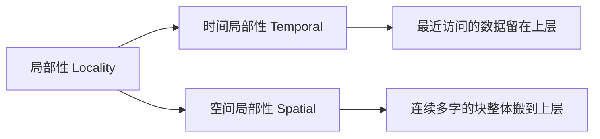
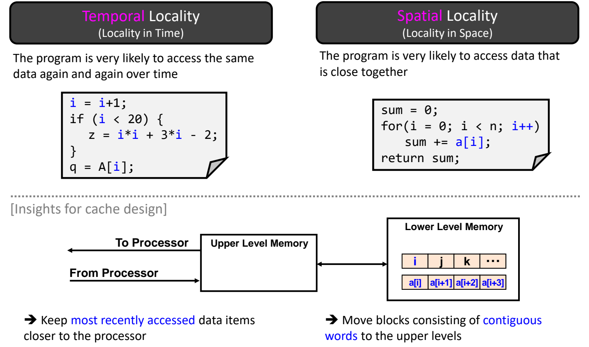
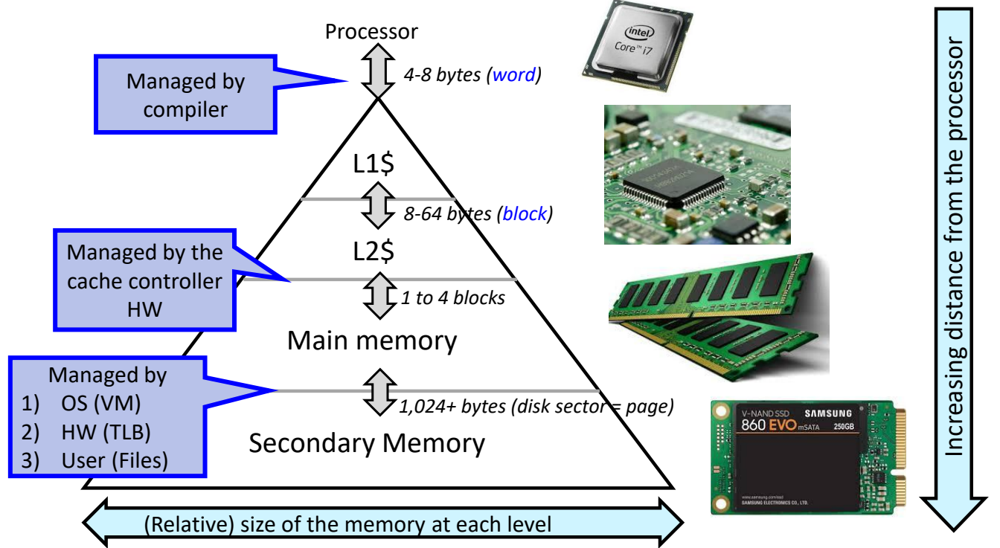

# 02 局部性与存储层次

[本讲目录](../index.md) · [课程目录](../../index.md) · [上一节：01 内存墙与存储技术](01-memory-wall-and-memory-technologies.md) · [下一节：03 缓存性能度量](03-cache-performance-metrics.md)

> [!abstract] 本节要点
> - 没有一种存储器同时又大、又快、又便宜：大存储器慢，快存储器小。存储层次把多种存储器组合起来，借助局部性在大多数时间里制造出“又大、又便宜、又快”的效果。
> - 局部性是存储层次设计的第一性原理。程序在任一时刻只集中访问地址空间中相对很小的一部分。
> - 时间局部性指刚访问过的数据很快会再被访问，对策是把最近访问的数据留在靠近处理器的上层。空间局部性指相邻的数据会被一并访问，对策是以“连续多字组成的块”为单位搬到上层。
> - 典型层次依次为寄存器 → L1 I\$/D\$（配 ITLB/DTLB）→ L2（SRAM）→ 主存（DRAM）→ 二级存储。访问延迟分别在 $\frac{1}{2}$、1、10、100、10,000 个周期量级，容量逐级增大，单位成本逐级降低。
> - 越往下层，传输粒度越大（字 4–8 B → 块 8–64 B → 页 1,024+ B），管理也越偏软件：寄存器由编译器管理，缓存由缓存控制器硬件管理，主存与外存之间由 OS、TLB 和用户共同管理。

## 存储层次的目标（Memory Hierarchy Goals）

处理器希望存储器容量无限大、访问零延迟、价格低廉，但现实中的每种存储器都只能满足其中一部分。要速度快，容量就小；要容量大，速度通常就慢。各种存储技术的速度、密度与成本差异（SRAM、DRAM 等）见[内存墙与存储技术](01-memory-wall-and-memory-technologies.md)。

基本事实是：**大存储器慢，快存储器小**（Large memories are slow, fast memories are small）。[^s1p17]

**存储层次**（memory hierarchy）把不同类型的存储器按“越靠近处理器越快越小、越远越慢越大”的顺序叠成多级。它发挥各级的长处、掩盖各级的短处，让用户在**大多数时间**里感觉自己拥有一个容量很大、价格便宜、速度很快的存储器。[^s1p17] 换个说法，它要让用户以**最便宜技术**所能提供的容量，享受到**最快技术**所能提供的速度。[^s1p20]

这个效果之所以能成立，靠的是程序访存行为的统计规律，也就是局部性。“most of the time”这个限定很重要：只有当访问大多落在上层时，这种“又大又快”的效果才成立。上层命中的比例怎样度量、未命中要付出多大代价，见[缓存性能度量](03-cache-performance-metrics.md)。

> [!tip] 课堂强调
> 学术界和工业界设计存储层次时都有一个共识，即一切设计都围绕**局部性**展开。局部性是存储层次的**第一性原理**，今天的缓存和存储层次之所以是现在这个样子，正是因为局部性。[^s2b5]

## 局部性原理（Principle of Locality）

如果程序访问的地址在整个地址空间上均匀随机分布，那么一个小而快的上层存储器几乎总找不到要用的数据，分层也就失去了意义。分层有效的前提是访问高度集中。

**局部性原理**（principle of locality）是指：程序在任一时刻只访问地址空间中**相对很小的一部分**。[^s1p17]

在 $0$ 到 $2^n-1$ 的整个地址空间上画出“被访问的概率”（probability of reference），可以看到：在某一段时间内，概率集中在一小片地址上，形成一个高峰，其余地址的访问概率接近零或很小。随着程序推进，这个高峰的位置会移动，但在任一时刻它都只覆盖很小的一片。

局部性细分为两类，每类各自给出一条缓存设计原则：

| | **时间局部性**（temporal locality） | **空间局部性**（spatial locality） |
|---|---|---|
| 含义 | 同一数据在一段时间内被反复访问 | 访问某个数据后，很可能接着访问与它相邻的数据 |
| 典型代码 | 反复读写循环变量、计数器 | 顺序遍历数组 |
| 缓存设计启示 | 把**最近访问过**的数据留在靠近处理器的上层 | 以**连续多个字组成的块**为单位搬到上层 |



### 时间局部性（Temporal Locality）

**时间局部性**（temporal locality，locality in time）是指：程序很可能在一段时间内**反复访问同一个数据**。[^s1p18]

**例子**：在下面的代码中，`i` 被连续读写了很多次：`i+1`、`i < 20`、`i*i`、`3*i`、`A[i]`。

```c
i = i+1;
if (i < 20) {
    z = i*i + 3*i - 2;
}
q = A[i];
```

这段代码自始至终都在访问变量 `i`，因此 `i` 是一个被频繁重复访问的数据，具有时间局部性。

**设计对策**：数据被访问后，就把它从下层存储器（lower level memory）复制到上层存储器（upper level memory）。上层离处理器更近、访问更快，所以 `i` 后续的访问都能在上层快速完成。对应的缓存设计原则是——**把最近访问过的数据保留在靠近处理器的地方**（keep most recently accessed data items closer to the processor）。[^s1p18] 上层容量有限、必须淘汰数据时，“最近被访问的更值得保留”这条原则会再次出现，见[替换策略](06-cache-replacement-policies.md)。

### 空间局部性（Spatial Locality）

**空间局部性**（spatial locality，locality in space）是指：程序很可能访问**彼此相邻**的数据。访问某个数据时，它周边或与它相连的数据往往也会被访问。[^s1p18]

**例子**：数组求和循环会依次访问 `a[0]`、`a[1]`、……、`a[n-1]`。

```c
sum = 0;
for (i = 0; i < n; i++)
    sum += a[i];
return sum;
```

数组元素在内存中连续存放，按下标顺序访问就是按地址顺序访问，自然满足空间局部性。（循环变量 `i` 和 `sum` 在这里同时具有时间局部性。）

**设计对策**：访问了 `a[i]` 之后，几乎一定还会访问 `a[i+1]`、`a[i+2]`、`a[i+3]`。因此不必只搬一个元素，而是把这一串连续的数据一次性复制到上层。对应的缓存设计原则是——**把由连续多个字组成的块搬到上层**（move blocks consisting of contiguous words to the upper levels）。[^s1p18] 这里的“块”是缓存与下层之间交换数据的基本单位，块的组织方式和块大小的权衡见[直接映射缓存](04-direct-mapped-cache.md)。



图：左侧代码反复使用变量 i 体现时间局部性，右侧顺序遍历 a[i] 体现空间局部性，下方对应缓存设计启示：保留最近访问的数据，并以连续字组成的块搬到上层存储。

> [!warning] 易错点
> 两种局部性的区别在于“重复的是什么”。时间局部性是**同一个地址**在时间上重复出现。空间局部性是**相邻的不同地址**先后出现。顺序遍历数组时，每个元素只访问一次，没有时间局部性，但空间局部性很强。反复访问同一个标量变量则主要体现时间局部性。

## 典型存储层次（A Typical Memory Hierarchy）

局部性解释了分层为什么有效，下面看实际计算机里有哪几层。各层按离处理器从近到远排列：

1. **寄存器文件**（RegFile）：位于数据通路（datapath）内部，是最高的一级。
2. **L1 缓存**：分为**指令缓存**（Instr Cache，I\$）和**数据缓存**（Data Cache，D\$）。拆分的原因在流水线设计中已经说明：取指和访存要在同一周期分别访问存储器（即此前流水线设计中为避免结构冒险而拆分指令与数据存储器）。与 L1 并列的还有 **ITLB / DTLB**，它们供虚拟内存的地址转换使用（TLB 属于操作系统虚拟内存的内容）。
3. **L2 缓存**（Second Level Cache），用 SRAM 实现。图中由于版面所限没有画出 L3，实际处理器通常还有 L3。
4. **主存**（Main Memory），用 DRAM 实现。
5. **二级存储**（Secondary Memory / Storage），即磁盘、SSD。

以上 1–3 级都在处理器芯片上，称为**片上部件**（on-chip components）。DRAM 主存在芯片之外，插在或集成在主板上。二级存储甚至可以不插在主板上，而是用线缆外接。整体规律是——**越快的部件离处理器越近，越慢、容量越大的部件离处理器越远**。[^s2b6]

各级的速度、容量与成本如下。“速度”一栏指访问所需的处理器周期数的数量级：[^s1p20]

| 层级 | 实现 | 访问时间（周期） | 容量量级 | 当前典型值 | 单位成本 |
|---|---|---|---|---|---|
| 寄存器文件 | 触发器/寄存器 | $\frac{1}{2}$ 量级（不到 1 个周期） | 100 B 量级 | 约 1000 B 左右 | 最高 |
| L1 I\$/D\$ | SRAM | 1 量级 | 10 KB 量级 | L1 通常 32 KB 或 64 KB | ↓ |
| L2 | SRAM | 10 量级 | 100 KB 量级 | 几百 KB 到 1 MB 左右 | ↓ |
| 主存 | DRAM | 100 量级 | MB 到 GB | 服务器约 1–2 TB | ↓ |
| 二级存储 | 磁盘 / SSD | 10,000 量级（甚至可达 100,000） | GB 到 TB | 单块 SSD 可达 512 TB，接近 PB 级 | 最低 |

关于上表有几点说明：

- 讲义上二级存储的速度写作“1,0000's”，属于排版笔误，应读作 10,000's，即一万个周期量级。[^s1p20]
- 服务器主存约 1–2 TB 这个数字不适用于笔记本。它来自服务器可以插 32 根内存条、每根 64 GB：$32 \times 64\ \text{GB} = 2048\ \text{GB} = 2\ \text{TB}$。[^s2b6]
- 外存的单位容量价格大约比 DRAM 便宜 100 倍。[^s2b6]
- 本节的周期数只是量级。各级缓存与 DRAM 的具体延迟（L1 约 1 周期、L2 约 5–10 周期、L3 约 10–20 周期、DRAM 约 80–100 ns）见[内存墙与存储技术](01-memory-wall-and-memory-technologies.md)。

> [!info] 可视化资源
> [Wikipedia：Memory hierarchy](https://en.wikipedia.org/wiki/Memory_hierarchy)：含存储层次示意图及 AMD Zen 4 各级（寄存器、L1、L2、L3、DDR5、SSD、HDD、磁带）的容量、带宽与延迟表，可用真实数据对照上表的周期量级。

### DRAM 与外存之间的鸿沟

从上表可以看出，相邻两级之间大多相差约 10 倍，而 DRAM（100 周期量级）与二级存储（10,000 周期量级甚至更多）之间相差约 **100 到 1000 倍**，差距明显过大。[^s2b6]

因此近年有大量研究尝试在 DRAM 与二级存储之间再加一个**中间层**，用新的介质来弥补这段速度差。代表方案有：

- **高速 SSD**：比普通 SSD 快得多的高速版固态盘；
- **Intel Optane（傲腾）**；
- **CXL 内存**（CXL memory）。

这些中间层在多级层次中如何组织（例如 eDRAM、存储级内存，以及上下层容量接近时采用排他式层次），见[降低缺失代价](08-reducing-miss-penalty.md)。

> [!note] 补充解释
> CXL（Compute Express Link）是建立在 PCIe 物理层之上的互连标准，允许处理器以缓存一致的 load/store 方式访问挂在 CXL 设备上的内存，从而在本地 DRAM 之外扩展容量。这类内存的延迟一般高于本地 DRAM，但远低于 SSD，正好落在两者之间。参见 [CXL Consortium](https://www.computeexpresslink.org/)。

## 传输粒度与管理者（Transfer Granularity and Management）

层次中相邻两级之间按什么单位交换数据、由谁决定数据放在哪一级，都随层级而变。决定因素是各级的速度和容量。

下图把存储层次画成一个**金字塔**。越往下，各级存储器的（相对）容量越大，离处理器也越远。最上面紧挨处理器的一层就是寄存器文件。[^s1p21]



图：从处理器经 L1$、L2$、主存到辅存，越往下离处理器越远、容量越大，层间传输单位从字（4–8 字节）到块（8–64 字节）再到页（1024+ 字节），并分别由编译器、缓存控制器硬件和 OS/TLB/用户管理。

### 传输粒度逐级变大

越往下层，一次传输的数据量越大：[^s1p21]

| 相邻两级 | 传输单位 | 大小 | 当前典型值 |
|---|---|---|---|
| 处理器 ↔ L1\$ | **字**（word） | 4–8 B | 取决于处理器位宽：32 位为 4 B，64 位为 8 B |
| L1\$ ↔ L2\$ | **块**（block） | 8–64 B | 缓存块常见为 64 B |
| L2\$ ↔ 主存 | 块 | 1 到 4 个块 | 访问主存一般以 64 B 为单位 |
| 主存 ↔ 二级存储 | **页**（page，对应磁盘扇区） | 1,024+ B | 一页通常约 4 KB；早期机械硬盘（HDD）一个扇区为 512 B |

粒度逐级变大与空间局部性一致。下层访问一次的固定开销越大，就越值得一次多搬一些相邻数据，把开销分摊到随后会用到的那些数据上。

### 管理者逐级从软件变为硬件

各级之间“哪些数据放在上层”由不同的主体管理：[^s1p21]

1. **寄存器 ↔ 存储器：编译器管理**（managed by compiler）。寄存器访问不到一个周期就要完成，根本来不及经过任何运行时控制逻辑去判断，连硬件管理都来不及。因此由编译器在编译时决定把哪些变量放进哪个寄存器（寄存器分配），运行时直接执行。
2. **缓存 ↔ 主存：缓存控制器硬件管理**（managed by the cache controller HW）。缓存访问只有几个到几十个周期，交给操作系统等软件来管理太慢，必须由专门的硬件负责数据的调度、取放和替换，而且对程序员透明。
3. **主存 ↔ 二级存储：软件为主、硬件辅助**，具体包括：
   1. **操作系统**通过虚拟内存（VM）管理页的换入换出；
   2. **硬件 TLB** 加速虚拟地址到物理地址的转换；
   3. **用户**通过文件显式读写外存。

**规律**：越往上层，对速度要求越高，管理必须越“硬”（编译器静态决定，或者由硬件实时决定）。越往下层，单次访问本身就很慢，软件管理的开销相对可以忽略，因此适合用 OS 乃至用户这类较慢但更灵活的方式管理。[^s2b6] 本讲接下来讨论的都是第 2 类，也就是由硬件管理的缓存。

> [!warning] 易错点
> 不要把“主存由 OS 管理”理解成“缓存也由 OS 管理”。缓存对软件透明：操作系统和用户程序都不决定某个块是否在缓存里，放置、查找和替换都由缓存控制器硬件完成。OS 管理的是主存和外存之间以页为单位的数据移动。

> [!question]- 自测：C 语言二维数组 `int a[1024][1024]` 按行优先存放。外层循环遍历行、内层循环遍历列，与外层遍历列、内层遍历行相比，哪一种更能利用存储层次？为什么？
> 前者更好，也就是内层循环遍历列下标 `a[i][j]`、`j++`。行优先存储时，同一行相邻元素的地址相差 4 B，内层循环按地址顺序访问，一次搬上来的块（例如 64 B，即 16 个 `int`）会被逐个用完，空间局部性得到充分利用。后者的内层循环每步跨越一整行（$1024 \times 4\ \text{B} = 4\ \text{KB}$），每次访问都落在不同的块上，块中其余数据还没用到就可能被换出。

> [!question]- 自测：在 `for (i = 0; i < n; i++) sum += a[i];` 中，`sum`、`i` 和 `a[i]` 分别主要体现哪种局部性？对应的缓存设计对策是什么？
> `sum` 和 `i` 每轮迭代都被重复访问，体现时间局部性，对策是把最近访问的数据保留在上层。`a[i]` 中每个元素只访问一次，但地址连续，体现空间局部性，对策是按连续多字的块整体搬到上层，使访问 `a[i]` 时 `a[i+1]`、`a[i+2]`…… 已经在上层。

> [!question]- 自测：为什么寄存器分配交给编译器，缓存的数据调度交给硬件，而主存与外存之间的页面调度可以交给操作系统？
> 由每一级可以容忍的管理开销决定。寄存器访问不到一个周期，连运行时硬件判断都来不及，只能由编译器预先决定。缓存访问只有几个到几十个周期，软件介入太慢，只能由缓存控制器硬件实时管理。外存访问需要上万个周期，操作系统执行几百条指令做页面管理的开销相对很小，同时还能换来灵活的策略。

> [!info]- 来源
> - L06-Cache.pdf：PDF p.17–18, 20–21
> - L06.docx：DOCX body 144–194

[^s1p17]: L06-Cache.pdf-PDF p.17
[^s1p20]: L06-Cache.pdf-PDF p.20
[^s2b5]: L06.docx-DOCX body 144-170
[^s1p18]: L06-Cache.pdf-PDF p.18
[^s2b6]: L06.docx-DOCX body 171-194
[^s1p21]: L06-Cache.pdf-PDF p.21

[本讲目录](../index.md) · [课程目录](../../index.md) · [上一节：01 内存墙与存储技术](01-memory-wall-and-memory-technologies.md) · [下一节：03 缓存性能度量](03-cache-performance-metrics.md)
