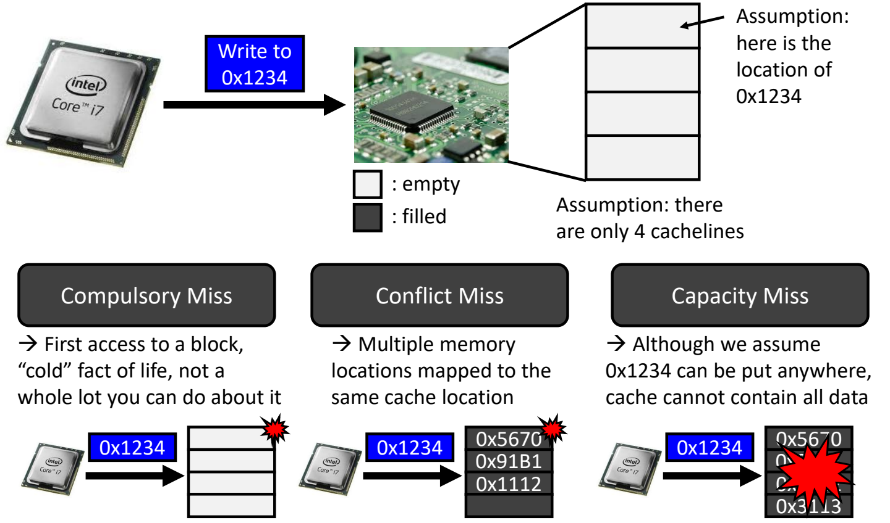
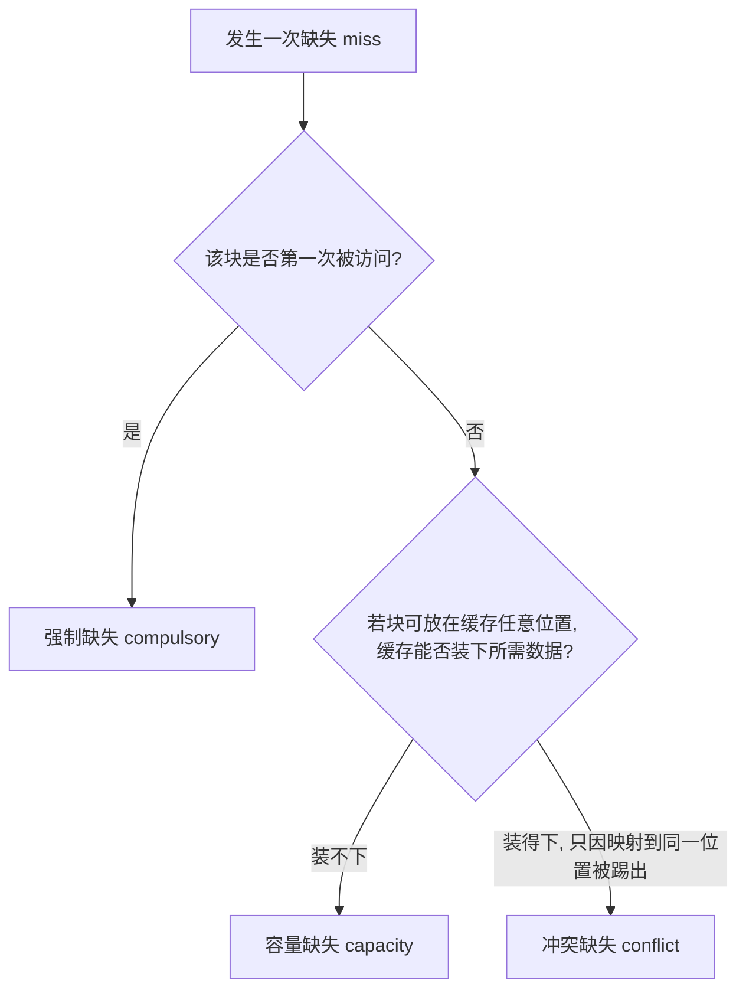
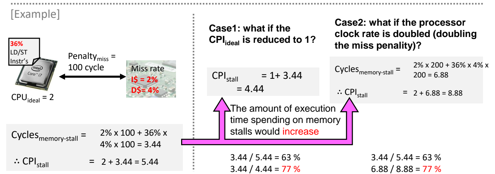

# 03 缓存性能度量

[本讲目录](../index.md) · [课程目录](../../index.md) · [上一节：02 局部性与存储层次](02-locality-and-memory-hierarchy.md) · [下一节：04 直接映射缓存](04-direct-mapped-cache.md)

> [!abstract] 本节要点
> - 命中时间 = 上层 RAM 访问时间 + 判定命中/缺失的时间；缺失代价 = 从下层取块并替换上层块的时间 + 把块送到处理器的时间；缺失率 $= 1 -$ 命中率，且命中时间 $\ll$ 缺失代价。
> - 3C 缺失：强制（冷）缺失是对块的首次访问；冲突缺失是多个地址映射到同一缓存位置而互相踢出；容量缺失是即使块可放在任意位置，缓存也装不下全部数据。
> - 把缓存纳入性能公式：$\text{CPU time} = IC \times (CPI_{ideal} + \text{Cycles}_{memory\text{-}stall}) \times T_{clk}$，括号内即 $CPI_{stall}$；读/写停顿 = 访问次数 × 缺失率 × 缺失代价，写停顿另加（可选的）写缓冲停顿。
> - 只评价缓存本身时用 $AMAT = \text{Hit time} + \text{Miss rate} \times \text{Miss penalty}$。
> - 例：$CPI_{ideal}=2$、缺失代价 100 周期、I\$ 缺失率 2%、D\$ 缺失率 4%、36% 访存指令 → 停顿 3.44、$CPI_{stall}=5.44$；把 $CPI_{ideal}$ 降到 1 或把时钟频率加倍，存储停顿占比都从 63% 升到 77%。

## 命中与缺失（Hit and Miss）

存储层次（见[局部性与存储层次](02-locality-and-memory-hierarchy.md)）把小而快的存储放在上层、大而慢的存储放在下层。要判断一个缓存设计好不好，先要能描述每次访问"在上层找到了没有、找到或找不到各要花多久"。下面的定义对任意相邻两级都成立，以"上层 = 缓存，下层 = 主存"为例。

**命中**（hit）：要访问的数据已经在上层的某个块中（例如块 X），直接由上层提供。[^s1p22]

- **命中率**（hit rate）：所有存储访问中，在上层就找到数据的比例。
- **命中时间**（hit time）：访问上层所需的时间，由两部分组成[^s1p22]：
  1. 上层 RAM 的访问时间（RAM access time），即真正把数据读出或写入上层存储阵列的时间；
  2. 判定命中还是缺失的时间（time to determine hit/miss），例如比对标签的时间。

**缺失**（miss）：上层没有所需数据，必须从下层的某个块（例如块 Y）取回。[^s1p22]

- **缺失率**（miss rate）：

$$
\text{Miss rate} = 1 - \text{Hit rate}
$$

- **缺失代价**（miss penalty）：处理一次缺失所需的额外时间，也由两部分组成[^s1p22]：
  1. 在上层替换一个块的时间——从下层把块读出（或写入），并放进上层、替换掉原有块；
  2. 把该块送达处理器的时间。

由于上层总选用快速存储、下层是慢速存储，天然有

$$
\text{Hit time} \ll \text{Miss penalty}
$$

这条不等式是后面所有分析的出发点：缺失哪怕只占很小的比例，也会因为代价大而主导平均访问时间。

> [!warning] 易错点
> 缺失代价不是"下层存储的访问时间"本身，而是"取块 + 替换上层块 + 送达处理器"的总时间；命中时间也不只是 RAM 阵列的读出时间，还要加上判定命中/缺失（查标签）的时间。

## 缺失的 3C 分类（3Cs）

知道"缺失了"还不够：不同原因的缺失要用不同手段去减少，所以要先按成因分类。**3C 分类**把缺失分为强制缺失、冲突缺失和容量缺失三种。[^s1p23]

以一个只有 4 条缓存行（cache line）的缓存为例，处理器要写地址 `0x1234`，并假设按映射规则 `0x1234` 只能放在第一条缓存行：

1. **强制缺失**（compulsory miss，也叫**冷缺失** cold miss）：对一个块的**首次访问**。块此前从未被访问过，必然只在下层（DRAM）中，缓存里不可能有它；这次访问是该块在缓存中生命周期的开始。图中缓存四行全空，`0x1234` 第一次被访问，于是缺失。它是"冷"的客观事实，几乎没有办法消除（not a whole lot you can do about it）。[^s1p23]
2. **冲突缺失**（conflict miss）——**多个存储地址映射到同一个缓存位置**。缓存并没有满（图中第四行仍空），但映射规则规定 `0x1234` 必须放进第一行，而第一行已被 `0x5670` 占用；两者互相竞争，一个块把另一个踢出去，下次再访问被踢出的块时只能从下层重新读回。[^s1p23]
3. **容量缺失**（capacity miss）——**即使假设 `0x1234` 可以放在缓存的任何位置，缓存也装不下所有数据**。图中四行全满（`0x5670`、`0x91B1`、`0x1112`、`0x3113`），程序要用的数据超过了缓存容量，某些块必然被换出，之后再访问就会缺失。[^s1p23]

图：在只有 4 行的缓存中写 0x1234，空缓存首次访问为强制缺失，目标行已被 0x5670 占用为冲突缺失，即使可放任意位置但 4 行全满为容量缺失。

判断一次缺失属于哪一类，可以按下面的顺序问：

冲突缺失由"块只能放在特定位置"引起，因此与块放置方式直接相关：直接映射时每块只有一个可放位置，冲突最多；放置越自由，冲突越少。全相联缓存中块可放在任意位置，因而不存在冲突缺失。[^s1p46] 放置方式本身见[直接映射缓存](04-direct-mapped-cache.md)与[组相联与全相联](05-set-associative-and-fully-associative.md)。

> [!info] 可视化资源
> [p14m 交互式缓存模拟器](https://p14m.com/cache/)：逐次访问观察命中、缺失与被替换的行，内置顺序访问、时间局部性循环、抖动、2 的幂步长、列遍历等预设，并可切换直接映射、2 路、4 路，便于亲手区分强制缺失与冲突缺失。

> [!warning] 易错点
> 只要是对某块的**第一次**访问，就一定是强制缺失——即使这次访问恰好因映射冲突把另一个块踢了出去，被归类的是"这次访问"的成因（首次访问），而不是它造成的后果。被踢出的那个块**下次**再被访问时的缺失，才按冲突或容量来判断。

> [!note] 补充解释
> 教材（如 Hennessy & Patterson）中常用一个可操作的判定法来区分后两类：对同一访问序列，假想一个容量相同的全相联缓存，如果它在这次访问上也缺失，就算容量缺失；如果它会命中，而实际缓存缺失，就算冲突缺失。这与上面"假设块可放在任意位置仍装不下"的定义是一致的。

## 含存储停顿的 CPU 时间（CPU Time with Memory Stalls）

命中率和缺失率只描述缓存本身；要知道缓存对程序运行时间的影响，需要把它代入处理器性能公式。

回顾 L02《02 CPI与性能铁律》中的性能公式：$\text{CPU time} = IC \times CPI \times T_{clk}$。引入缓存后，**假设命中的开销已包含在正常的 CPU 执行周期中**，就可以把 CPI 拆成两部分：不含存储停顿的理想 CPI，加上每条指令因缓存缺失额外停顿的周期数。[^s1p24]

$$
\text{CPU time} = IC \times \left(CPI_{ideal} + \text{Cycles}_{memory\text{-}stall}\right) \times T_{clk}
$$

其中：

- $IC$：指令数（Instruction Count）；
- $CPI_{ideal}$：所有访问都命中时的 CPI；
- $\text{Cycles}_{memory\text{-}stall}$：平均每条指令的存储停顿周期数；
- $T_{clk}$：时钟周期（Clock Cycle）；
- 括号内整体记为 $CPI_{stall} = CPI_{ideal} + \text{Cycles}_{memory\text{-}stall}$，即计入停顿后的实际 CPI。[^s1p24]

存储停顿周期分为读停顿和写停顿两部分（以下按"每个程序"计）：[^s1p24]

$$
\text{Read-stall cycles} = \frac{\text{Reads}}{\text{Program}} \times \text{Read miss rate} \times \text{Read miss penalty}
$$

$$
\text{Write-stall cycles} = \left(\frac{\text{Writes}}{\text{Program}} \times \text{Write miss rate} \times \text{Write miss penalty}\right) + \text{Write buffer stalls}
$$

写停顿比读停顿多一项**写缓冲停顿**（write buffer stalls），并标为可选（optional）：处理器为写操作加了写缓冲来优化，写缓冲满时也会让处理器停顿，计算时视情况把它考虑进去。写缓冲的工作方式见[写策略](07-cache-write-policies.md)。

缺失代价在这里以**处理器时钟周期数**计量。把读写停顿之和除以 $IC$，就得到上式中每条指令的 $\text{Cycles}_{memory\text{-}stall}$。实际计算时通常按缓存类型分项：每条指令都要取指，访问一次指令缓存（I\$）；访存指令（load/store）还要访问一次数据缓存（D\$）。于是

$$
\text{Cycles}_{memory\text{-}stall} = 1 \times MR_{I\$} \times P_{miss} + f_{LD/ST} \times MR_{D\$} \times P_{miss}
$$

其中 $MR_{I\$}$、$MR_{D\$}$ 分别是指令、数据缓存的缺失率，$P_{miss}$ 为缺失代价（周期），$f_{LD/ST}$ 为访存指令占全部指令的比例。下面的例子就按这种方式计算。

> [!warning] 易错点
> 读/写停顿公式按"每个程序"计，而 CPU time 公式括号里的 $\text{Cycles}_{memory\text{-}stall}$ 是"每条指令"的平均值，两者相差一个因子 $IC$。另外，指令缓存的访问次数是每条指令 1 次，数据缓存的访问次数只算访存指令的比例，不要把两者都乘以访存比例。

## 平均存储访问时间（AMAT）

用整个 CPU time 来评价缓存牵涉指令数、理想 CPI 等与缓存无关的因素，不够直接。只评价缓存设计时，用一个更简单的指标——**平均存储访问时间**（Average Memory Access Time，AMAT）：[^s1p24]

$$
AMAT = \text{Hit time} + \text{Miss rate} \times \text{Miss penalty}
$$

含义：每次访问至少付出一次命中时间（无论命中与否都要先查上层）；其中比例为缺失率的访问还要额外付出缺失代价。三个量对应三条改进方向：

- 提高命中率（即降低缺失率），$\text{Miss rate} \times \text{Miss penalty}$ 一项变小；
- 缺失率不变，但缩短命中时间，AMAT 同样下降；
- 缩短缺失代价。

因此 AMAT 既能衡量缓存设计的好坏，也指出了能做哪些性能优化；按这三个方向组织的优化框架见[降低缺失代价](08-reducing-miss-penalty.md)。

> [!example] 例：用 AMAT 比较两种设计（自拟数值）
> 设计 A：命中时间 1 周期，缺失率 5%，缺失代价 100 周期；设计 B：命中时间 2 周期，缺失率 2%，缺失代价 100 周期。
>
> 1. $AMAT_A = 1 + 0.05 \times 100 = 6$ 周期；
> 2. $AMAT_B = 2 + 0.02 \times 100 = 4$ 周期；
> 3. B 的命中时间虽然翻倍，但缺失率下降带来的收益更大，平均访问时间更短。这正是 $\text{Hit time} \ll \text{Miss penalty}$ 的体现。

## 处理器变快放大缓存影响（Impact of Cache Performance）

DRAM 的访问延迟多年来几乎不变（约 100 ns），缓存本身的访问速度也可能不变；但处理器越来越快，同样的存储延迟对整个系统的影响就越来越大。[^s1p25]

**结论**：处理器性能提高（时钟频率更高和/或 CPI 更低）时，缓存缺失的**相对**代价会增大。[^s1p25] 原因有两点：

1. 存储速度的提升赶不上处理器时钟周期的缩短。计算 $CPI_{stall}$ 时，缺失代价以处理器时钟周期计量——时钟加快，同样的纳秒级延迟折合成更多周期。
2. $CPI_{ideal}$ 降低时，停顿周期不变，于是停顿在 $CPI_{stall}$ 中的占比急剧上升。

> [!example] 例：计算存储停顿与 $CPI_{stall}$
> 已知：$CPI_{ideal} = 2$（讲义写作 "CPUideal = 2"，指理想 CPI）；缺失代价 $P_{miss} = 100$ 周期；I\$ 缺失率 2%，D\$ 缺失率 4%；访存（LD/ST）指令占 36%。求每条指令的存储停顿周期和 $CPI_{stall}$。[^s1p25]
>
> 1. **指令缓存**：每条指令都取指、访问一次 I\$，停顿 $1 \times 2\% \times 100 = 2$ 周期。
> 2. **数据缓存**：只有 36% 的指令访问 D\$，停顿 $0.36 \times 4\% \times 100 = 1.44$ 周期。
> 3. 合计：$\text{Cycles}_{memory\text{-}stall} = 2\% \times 100 + 36\% \times 4\% \times 100 = 3.44$ 周期。
> 4. $CPI_{stall} = 2 + 3.44 = 5.44$。
> 5. 存储停顿占比：$3.44 / 5.44 \approx 63\%$。

接着分别让处理器在两个方向上变快：

> [!example] 例：处理器变快后的两种情形
> **情形 1：$CPI_{ideal}$ 降为 1**（缺失代价仍为 100 周期）
>
> 1. 停顿周期不变：$\text{Cycles}_{memory\text{-}stall} = 3.44$；
> 2. $CPI_{stall} = 1 + 3.44 = 4.44$；
> 3. 停顿占比：$3.44 / 4.44 \approx 77\%$（原来 63%）。
>
> **情形 2：时钟频率加倍**（$CPI_{ideal}$ 仍为 2）
>
> 1. 存储的绝对延迟不变，以新的、减半的时钟周期计量，缺失代价变为 200 周期；
> 2. $\text{Cycles}_{memory\text{-}stall} = 2\% \times 200 + 36\% \times 4\% \times 200 = 6.88$；
> 3. $CPI_{stall} = 2 + 6.88 = 8.88$；
> 4. 停顿占比：$6.88 / 8.88 \approx 77\%$（原来 63%）。[^s1p25]

图：基础 $CPI_{ideal}=2$、缺失代价 100 周期、I$ 缺失率 2%、D$ 缺失率 4%、36% 访存指令时，$CPI_{stall}=2+3.44=5.44$；把 $CPI_{ideal}$ 降到 1 或时钟频率翻倍后，访存停顿占比都从 63% 升到 77%。

| 情形 | $CPI_{ideal}$ | 缺失代价（周期） | $\text{Cycles}_{memory\text{-}stall}$ | $CPI_{stall}$ | 停顿占比 |
| --- | --- | --- | --- | --- | --- |
| 基准 | 2 | 100 | 3.44 | 5.44 | 63% |
| 情形 1：$CPI_{ideal}$ 降为 1 | 1 | 100 | 3.44 | 4.44 | 77% |
| 情形 2：时钟加倍 | 2 | 200 | 6.88 | 8.88 | 77% |

这说明：缓存本身的性能可能完全没变，但只要处理器在任何层面变快，缓存（和存储）对整体性能的影响就会变大——"$CPI_{ideal}$ 下降，而 $CPI_{stall}$ 中停顿部分的分量急剧增加"。[^s1p25]

> [!note] 补充解释
> 情形 2 中 $CPI_{stall}$ 从 5.44 涨到 8.88 并不意味着变慢：时钟周期减半，每条指令的平均时间从 $5.44\,T_{clk}$ 变为 $8.88 \times \frac{T_{clk}}{2} = 4.44\,T_{clk}$，加速比只有 $5.44 / 4.44 \approx 1.23$，远低于时钟频率提升的 2 倍。被"吃掉"的加速正是存储停顿占比上升的结果，这也是 Amdahl 定律（见 L02《03 性能汇总与Amdahl定律》）在存储系统上的体现。

> [!question]- 自测：一个程序依次访问块 A、B、C、A（缓存为直接映射，A 与 C 映射到同一缓存行，缓存总共可容纳 4 个块，开始时为空）。这四次访问分别属于哪类缺失或命中？
> 依次为：强制缺失、强制缺失、强制缺失、冲突缺失。A、B、C 都是首次访问，属于强制缺失（C 虽然踢出了 A，但 C 本身是首次访问）。第二次访问 A 时缓存只用了 2 行、远未满，若块可放在任意位置 A 不会被换出，缺失只因 A 与 C 映射到同一行，故为冲突缺失。

> [!question]- 自测：沿用正文例子（$CPI_{ideal}=2$、I\$ 缺失率 2%、D\$ 缺失率 4%、36% 访存指令），若通过优化把缺失代价从 100 周期降到 50 周期，$CPI_{stall}$ 和停顿占比各是多少？
> $\text{Cycles}_{memory\text{-}stall} = 2\% \times 50 + 36\% \times 4\% \times 50 = 1 + 0.72 = 1.72$，$CPI_{stall} = 2 + 1.72 = 3.72$，停顿占比 $1.72 / 3.72 \approx 46\%$。停顿周期与缺失代价成正比，代价减半，停顿周期也减半。

> [!question]- 自测：某缓存命中时间 1 周期、缺失代价 40 周期。要让 AMAT 不超过 2 周期，缺失率最高可以是多少？
> 由 $1 + MR \times 40 \le 2$ 得 $MR \le 1/40 = 2.5\%$，即命中率至少 97.5%。

> [!info]- 来源
> - L06-Cache.pdf：PDF p.22–25, 46
> - L06.docx：DOCX body 195–244

[^s1p22]: L06-Cache.pdf-PDF p.22
[^s1p23]: L06-Cache.pdf-PDF p.23
[^s1p46]: L06-Cache.pdf-PDF p.46
[^s1p24]: L06-Cache.pdf-PDF p.24
[^s1p25]: L06-Cache.pdf-PDF p.25

[本讲目录](../index.md) · [课程目录](../../index.md) · [上一节：02 局部性与存储层次](02-locality-and-memory-hierarchy.md) · [下一节：04 直接映射缓存](04-direct-mapped-cache.md)
