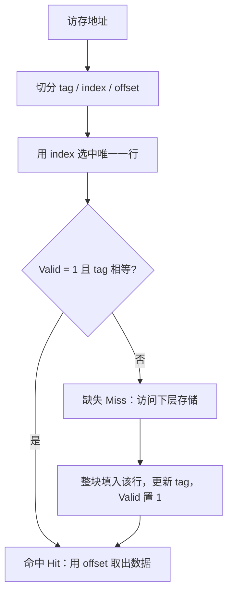
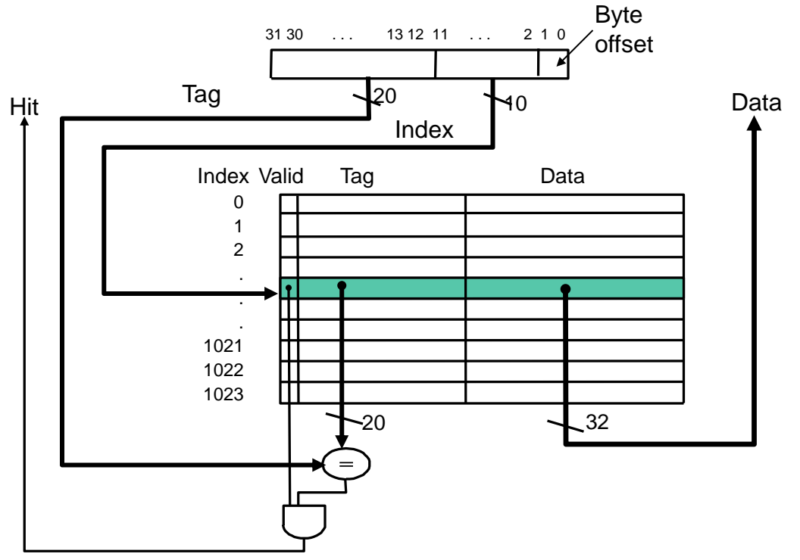
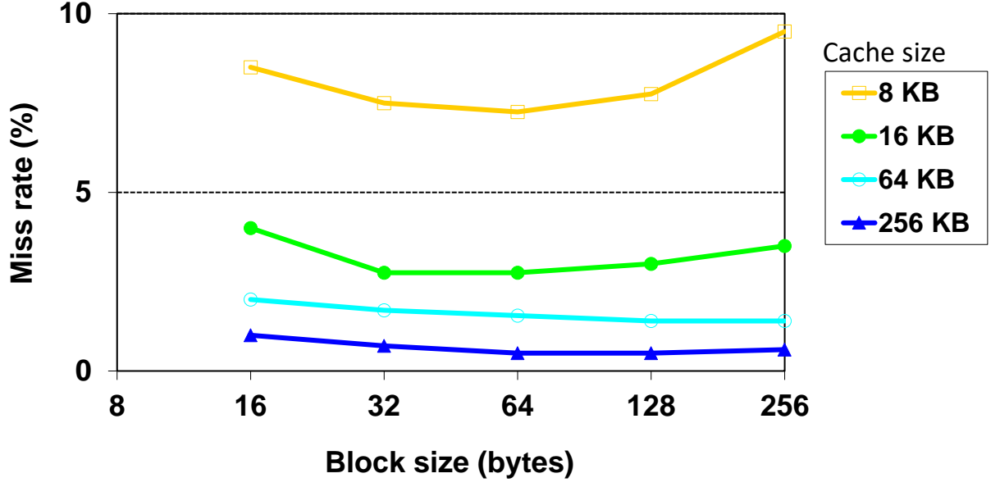

# 04 直接映射缓存

[本讲目录](../index.md) · [课程目录](../../index.md) · [上一节：03 缓存性能度量](03-cache-performance-metrics.md) · [下一节：05 组相联与全相联](05-set-associative-and-fully-associative.md)

> [!abstract] 本节要点
> - 缓存设计的第一个问题是**块放置与识别**：块放在上层的哪里？上层里怎么判断它在不在？直接映射的回答是：每个下层块只有一个位置，$\text{index} = \text{块地址} \bmod \text{缓存块数}$。
> - 地址自低到高分成 byte offset、(block offset)、index、tag 几段；命中的条件是 $\text{Valid}=1$ 且存储的 tag 等于地址的 tag。MIPS 1K 字、单字块：offset 为 $[1:0]$，index 为 $[11:2]$ 共 10 位，tag 为 $[31:12]$ 共 20 位。
> - 序列 `0 1 2 3 4 3 4 15` 在 4 块单字块缓存上 8 次访问有 6 次缺失；改用两字块（同样 4 字容量）后只有 4 次缺失，原因是多字块利用了空间局部性。4 字块、1K 字的 MIPS 缓存有 256 行，index 8 位，tag 20 位。
> - 块越大，缺失率先降后升，因为容量不变时块数变少；测得的曲线多在 64 B 附近最低。
> - 两个地址映射到同一行并交替访问时（如 `0 4 0 4 …`）会互相踢出，叫**乒乓效应**：8 次全缺失，其中 2 次是强制缺失，6 次是冲突缺失。

## 块放置与识别（Block Placement & Identification）

缓存比内存小得多，只能放内存的一部分，所以必须先回答两个问题：数据搬进缓存后放在哪，以及以后访问时怎么知道它在不在缓存里。

内存被划分成等大的**块**（block），上下层之间以块为单位复制数据。[^s1p26] 由此引出缓存设计的第一组问题：[^s1p27]

1. **块放置**：一个下层块可以放在上层（缓存）的哪个位置？
2. **块识别**：如果这个块在上层，怎样找到它？

这一组问题有多种答案，本节讲最简单的**直接映射**。同一问题的另外两种答案（组相联、全相联）见[组相联与全相联](05-set-associative-and-fully-associative.md)。块被换出时选谁、写操作怎么处理，分别见[替换策略](06-cache-replacement-policies.md)和[写策略](07-cache-write-policies.md)。

## 直接映射缓存（Direct Mapped Cache）

直接映射的思路是：给每个内存块规定一个固定的缓存位置，查找时不用搜索，直接按地址算出该去哪一行。

**直接映射缓存**（direct mapped cache）中，下层的每个数据块在缓存里恰好只有一个可能的位置。下层块远多于缓存行，所以很多下层块必须共用同一个缓存位置。[^s1p28] 位置的计算方法是

$$
\text{index} = \text{块地址} \bmod \text{缓存中的块数}
$$

缓存块数是 2 的幂时，取模就是取块地址的低若干位，硬件上不需要任何运算。

### 地址划分：tag / index / byte offset

用一个小例子说明。设：[^s1p28]

- 块大小 = 1 个字（32 bit，4 B）；
- 缓存中共有 4 个块；
- 内存大小为 64 B，所以地址有 $\log_2 64 = 6$ 位。

6 位地址从低到高切成三段：

| 字段 | 位 | 宽度 | 由什么决定 | 作用 |
|---|---|---|---|---|
| **字节偏移**（byte offset） | $[1:0]$ | 2 位 | 块内字节数 $4 = 2^2$ | 在一个字里选出具体的字节 |
| **索引**（index） | $[3:2]$ | 2 位 | 缓存块数 $4 = 2^2$ | 选出映射到的缓存行 |
| **标签**（tag） | $[5:4]$ | $6-2-2=2$ 位 | 剩下的高位 | 区分共用这一行的不同内存块 |

去掉字节偏移后的 4 位 $[5:2]$ 就是块地址（这里也是字地址）。内存共有 $64/4=16$ 个块，缓存只有 4 行，所以每行由 4 个内存块共用：index 为 `00` 的块 `0000xx`、`0100xx`、`1000xx`、`1100xx` 都只能放进第 0 行，index 为 `01` 的都放进第 1 行，依此类推。这个映射是唯一的，块不可能放到别的行。

缓存的每一行存三样东西：**有效位**（valid bit）、tag 和数据。有效位表示这一行里是不是装着有效数据；刚上电时所有行都标为无效（invalid），否则一行垃圾数据可能碰巧和某个地址的 tag 相等，被误判为命中。

这两个问题的回答是：[^s1p29]

- **Q1 数据在不在缓存里？** 把缓存行里存的 tag 和地址的高 2 位比较；相等（且该行有效）说明这个内存块就在缓存里。
- **Q2 去哪找这个块？** 用接下来的 2 个低位，也就是 index，直接选出缓存行，相当于块地址对缓存块数取模。

### 查找过程

一次访问按以下步骤进行：

1. **切分地址**：把地址拆成 tag、index、byte offset。
2. **按 index 选行**：index 直接作为行号，读出该行的 valid、tag 和数据。
3. **比较 tag**：存储的 tag 与地址 tag 送入比较器，比较结果再与 valid 相与（AND）。
4. **命中**（hit）：结果为 1，读出该行数据，用 byte offset 选出所需字节。
5. **缺失**（miss）：数据不在这一行，需要访问下层存储，把整块取回后填入这一行（fill the cache），写入新 tag 并把 valid 置 1；原来在这一行的块被覆盖。

### MIPS 直接映射缓存实例

换成真实参数：MIPS 地址 32 位，缓存容量 1K 字，每块 1 个字。[^s1p31]

- **byte offset** $[1:0]$：2 位，因为一个字有 4 B；
- **index** $[11:2]$：缓存有 $1\text{K} = 2^{10}$ 行，需要 10 位，行号 0 到 1023；
- **tag** $[31:12]$：剩下的 $32-10-2=20$ 位。

地址中的 10 位 index 选中一行；该行存的 20 位 tag 与地址的 20 位 tag 送入比较器 `=`，比较结果和 Valid 相与得到 `Hit`；同时该行 32 位数据直接作为 `Data` 输出。命中就用这个数据，缺失就去访问下层内存。

图：32 位地址分成 20 位 tag、10 位 index 与 2 位字节偏移，index 选中 1024 行中的一行，比较存储的 tag 并与 Valid 位相与得到 Hit，同时输出 32 位数据。

### 一般规律

上面两个例子可以归纳成一般的位数计算方法。设地址宽 $A$ 位，每块 $2^m$ 个字（每字 4 B），缓存共 $2^n$ 个块，则

$$
\text{byte offset} = 2,\quad \text{block offset} = m,\quad \text{index} = n,\quad \text{tag} = A - n - m - 2
$$

单字块时 $m=0$，没有 block offset 字段。按这个式子，玩具例 $A=6, n=2, m=0$ 得 tag 2 位；MIPS 例 $A=32, n=10, m=0$ 得 tag 20 位。

> [!info] 可视化资源
> [UMich EECS 370 缓存模拟器](https://vhosts.eecs.umich.edu/370simulators/cache/simulator.html)：9 位地址，可配置组数、每组块数与块大小，逐条执行 ld/st 并显示 tag、set index、block offset 的拆分与命中统计，适合复现本节的地址划分与访问序列例题。

### 单字块的访问序列

直接映射的第一个问题是缺失率高。[^s1p32] 下面的例子用上面的 4 块单字块缓存，访问序列按字地址给出（括号内是 4 位字地址，低两位是 index，高两位是 tag）：

`0(0000) 1(0001) 2(0010) 3(0011) 4(0100) 3(0011) 4(0100) 15(1111)`

缓存开始为空，所有行都无效。

| # | 字地址 | index | tag | 行内原有状态 | 结果 | 3C 类别 | 访问后该行 |
|---|---|---|---|---|---|---|---|
| 1 | 0 (`0000`) | 00 | 00 | 无效 | Miss | 强制 | `1 00 Mem[0]` |
| 2 | 1 (`0001`) | 01 | 00 | 无效 | Miss | 强制 | `1 00 Mem[1]` |
| 3 | 2 (`0010`) | 10 | 00 | 无效 | Miss | 强制 | `1 00 Mem[2]` |
| 4 | 3 (`0011`) | 11 | 00 | 无效 | Miss | 强制 | `1 00 Mem[3]` |
| 5 | 4 (`0100`) | 00 | 01 | tag 00 不匹配 | Miss | 强制 | `1 01 Mem[4]`（踢出 Mem[0]） |
| 6 | 3 (`0011`) | 11 | 00 | tag 匹配 | Hit | — | 不变 |
| 7 | 4 (`0100`) | 00 | 01 | tag 匹配 | Hit | — | 不变 |
| 8 | 15 (`1111`) | 11 | 11 | tag 00 不匹配 | Miss | 强制 | `1 11 Mem[15]`（踢出 Mem[3]） |

结果：8 次访问，6 次缺失，缺失率 $6/8 = 75\%$。[^s1p32] 缺失的三类划分（强制、容量、冲突）见[缓存性能度量](03-cache-performance-metrics.md)。

> [!warning] 易错点
> 第 5 次访问 4 和第 8 次访问 15 发生了 tag 不匹配，并且踢出了旧块，但它们都是**第一次**访问这个块。按 3C 的定义，第一次访问必然缺失，属于**强制缺失**（compulsory miss），不是容量缺失。讲稿把这两次称为 capacity miss，按定义应更正为强制缺失。分类时先问"这个块以前访问过吗"，没访问过就是强制缺失，不看它有没有踢出别的块。[^s1p32]

## 多字块（Multiword Block）

序列 `0 1 2 3` 是连续地址，但单字块每个字都要单独缺失一次。如果一次缺失就把相邻的几个字一起搬进来，后续访问就能命中。

**多字块直接映射**（multiword block direct mapped）的核心想法是用更大的块来利用**空间局部性**（spatial locality）：一行存多个连续的字，它们共用一个 tag。[^s1p33] 空间局部性本身见[局部性与存储层次](02-locality-and-memory-hierarchy.md)。

### 多字块的地址划分

块里有多个字后，地址需要多一个字段：**块内偏移**（block offset），用来选出块内的第几个字。从低到高依次是 byte offset、block offset、index、tag。

MIPS 例：每块 4 个字，缓存容量仍为 1K 字。[^s1p33]

1. 行数 $= 1\text{K} / 4 = 256 = 2^8$，行号 0 到 255；
2. byte offset $[1:0]$，2 位；
3. block offset $[3:2]$，2 位，从块内 4 个字中选 1 个；
4. index $[11:4]$，8 位，选出 256 行中的一行；
5. tag $[31:12]$，$32-8-2-2=20$ 位。

查找时，index 选中一行，20 位 tag 比较加 Valid 得到 `Hit`；这一行有 4 个 32 位字，再由 block offset 通过多路选择器选出其中一个作为 `Data` 输出。

| 配置 | 行数 | byte offset | block offset | index | tag |
|---|---|---|---|---|---|
| 玩具例：单字块，4 块，6 位地址 | 4 | $[1:0]$ | — | $[3:2]$，2 位 | $[5:4]$，2 位 |
| MIPS：单字块，1K 字 | 1024 | $[1:0]$ | — | $[11:2]$，10 位 | $[31:12]$，20 位 |
| MIPS：4 字块，1K 字 | 256 | $[1:0]$ | $[3:2]$，2 位 | $[11:4]$，8 位 | $[31:12]$，20 位 |

容量都是 1K 字时，单字块和 4 字块的 tag 都是 20 位：增加的 2 位 block offset 恰好来自 index 少掉的 2 位，tag 宽度只由总容量决定。

### 同一序列在两字块下的表现

缓存总容量仍是 4 个字，但改成每块 2 个字，因此只有 2 行（index 只有 0、1）。6 位地址划分为 tag $[5:4]$ 2 位、index $[3]$ 1 位、block offset $[2]$ 1 位、byte offset $[1:0]$ 2 位。同样的序列 `0 1 2 3 4 3 4 15`：[^s1p34]

1. **访问 0**（`0000`）：index 0 无效，Miss（强制缺失）。整块装入，该行为 `1 00 Mem[1] Mem[0]`。
2. **访问 1**（`0001`）：index 0，tag 00 匹配，Hit。字 1 已经随字 0 一起搬进来了。
3. **访问 2**（`0010`）：index 1 无效，Miss（强制缺失），装入 `1 00 Mem[3] Mem[2]`。
4. **访问 3**（`0011`）：index 1，tag 匹配，Hit。
5. **访问 4**（`0100`）：index 0，存的 tag 00 与 01 不匹配，Miss（强制缺失），装入 `1 01 Mem[5] Mem[4]`，踢出字 0、1。
6. **访问 3**：index 1，tag 00 匹配，Hit。
7. **访问 4**：index 0，tag 01 匹配，Hit。
8. **访问 15**（`1111`）：index 1，存的 tag 00 与 11 不匹配，Miss（强制缺失），装入 `1 11 Mem[15] Mem[14]`。

结果：8 次访问，4 次缺失，比单字块少 2 次。[^s1p34] 少掉的两次正是访问 1 和访问 3：它们与之前缺失的字在同一块中，被顺带搬进来了。这里 4 次缺失（0、2、4、15）全是第一次访问所在的块，都是强制缺失（讲稿称 4、15 为 capacity miss，按定义同样应更正为强制缺失）。

## 块大小的权衡

既然大块能利用空间局部性，块是不是越大越好？不是。

当块大小占到缓存容量的相当比例时，缺失率反而上升，因为同样大小的缓存里能放的块数变少了。[^s1p35] 块数少，意味着能同时驻留的不同地址区域少，原本可以共存的数据只能互相替换。

下图是早期的一组测试，缓存容量 8 KB 到 256 KB，块大小 16 B 到 256 B，纵轴为缺失率。曲线呈先降后升的"U 形"：块增大时先因空间局部性而降低，越过某一点后因块数不足而回升。容量越小回升越明显：8 KB 缓存从 64 B 处约 7% 升到 256 B 处约 9.5%（此时只剩 $8\text{KB}/256\text{B} = 32$ 块）；容量越大，曲线越平，最低点也向更大的块偏移（64 KB 在 128～256 B 基本持平）。多数曲线在 64 B 附近最低或接近最低。[^s1p35]

图：对 8 KB 到 256 KB 四种缓存容量，缺失率随块大小（16 到 256 字节）先降后升，小容量缓存（8 KB、16 KB）在块大小达到 256 字节时缺失率明显回升。

> [!tip] 课堂强调
> 多字块不是越大越好，过了某个点块越大效果越差；64 B 一般被认为是比较理想的块大小，目前市面上几乎所有 CPU 的 L1D 缓存都以 64 B 为缓存行粒度。[^s2b9]

> [!note] 补充解释
> 块变大还有另一项代价：每次缺失要从下层搬运更多数据，传输时间变长，缺失代价随之增加。所以最佳块大小要同时看缺失率和缺失代价，见[缓存性能度量](03-cache-performance-metrics.md)中的 AMAT。

## 乒乓效应（Ping-Pong Effect）

直接映射的第二个问题是：每个块只有一个位置可放，即使缓存里还有大量空行，两个映射到同一行的块也无法共存。

仍用 4 块单字块缓存，访问序列为 `0(0000) 4(0100) 0(0000) 4(0100) 0(0000) 4(0100) 0(0000) 4(0100)`。字地址 0 和 4 的 index 都是 `00`，tag 分别为 `00` 和 `01`：[^s1p36]

1. **访问 0**：第 0 行无效，Miss，装入 `1 00 Mem[0]`。
2. **访问 4**：第 0 行 tag 00 与 01 不匹配，Miss，装入 `1 01 Mem[4]`，踢出 Mem[0]。
3. **访问 0**：tag 01 与 00 不匹配，Miss，装回 Mem[0]，踢出 Mem[4]。
4. 之后每次访问都把对方踢出，第 1、2、3 行始终空着。

结果：8 次访问，8 次缺失，缺失率 100%。[^s1p36] 两个块在同一行里来回互相替换，称为**乒乓效应**（ping-pong effect）。

按 3C 分类：第 1 次访问 0 和第 1 次访问 4 是第一次访问，属于强制缺失；其余 6 次的块之前都在缓存里，只是被映射到同一行的另一块踢掉了，属于**冲突缺失**（conflict miss）。缓存总共 4 行、只用了 2 个块，容量并不缺，所以不是容量缺失。

> [!warning] 易错点
> 多字块不能解决乒乓效应。它改善的是空间局部性，而乒乓效应来自两个块映射到同一行。改善办法是让一个 index 对应多个可放的位置，即组相联，见[组相联与全相联](05-set-associative-and-fully-associative.md)；同一序列在 2 组 2 路的组相联缓存中只有前两次强制缺失。

> [!question]- 自测：MIPS 32 位地址、1K 字直接映射缓存，访问字节地址 `0x00001234`。单字块和 4 字块两种配置下，index、block offset 和 tag 各是多少？
> `0x1234` = `0001 0010 0011 0100`。
>
> - **单字块**：byte offset $[1:0]$ = 0；index $[11:2]$ = `0x1234 >> 2` 的低 10 位 = $1165 \bmod 1024 = 141$；tag $[31:12]$ = `0x1`。
> - **4 字块**：byte offset = 0；block offset $[3:2]$ = `01` = 1（块内第 1 个字）；index $[11:4]$ = `0x23` = 35；tag 仍为 `0x1`。
>
> 两种配置的 tag 相同，因为总容量相同，tag 都是地址的 $[31:12]$。

> [!question]- 自测：把 4 字容量的玩具缓存改成每块 2 字（2 行），访问 `0 4 0 4 0 4 0 4` 会有几次缺失？
> 仍然 8 次全缺失。字地址 0 在块 0，字地址 4 在块 2；块数 2 时 $0 \bmod 2 = 2 \bmod 2 = 0$，两者仍映射到第 0 行，tag 分别为 00 和 01，照样互相踢出。增大块只改善空间局部性，不改变"同一行只能放一个块"的冲突。

> [!question]- 自测：在图中的测试里，8 KB 缓存块大小从 64 B 增至 256 B 时缺失率上升，而 64 KB 缓存基本没有上升。为什么？
> 块数 = 容量 / 块大小。8 KB 缓存在 256 B 块时只有 32 块，能同时驻留的地址区域太少，大块带来的空间局部性收益抵不过块数减少引起的额外替换；64 KB 缓存即使用 256 B 块也有 256 块，块数仍然充足，所以曲线还没进入上升段。

> [!info]- 来源
> - L06-Cache.pdf：PDF p.26–29, 31–36
> - L06.docx：DOCX body 219–269

[^s1p26]: L06-Cache.pdf-PDF p.26
[^s1p27]: L06-Cache.pdf-PDF p.27
[^s1p28]: L06-Cache.pdf-PDF p.28
[^s1p29]: L06-Cache.pdf-PDF p.29
[^s1p31]: L06-Cache.pdf-PDF p.31
[^s1p32]: L06-Cache.pdf-PDF p.32
[^s1p33]: L06-Cache.pdf-PDF p.33
[^s1p34]: L06-Cache.pdf-PDF p.34
[^s1p35]: L06-Cache.pdf-PDF p.35
[^s2b9]: L06.docx-DOCX body 245-269
[^s1p36]: L06-Cache.pdf-PDF p.36

[本讲目录](../index.md) · [课程目录](../../index.md) · [上一节：03 缓存性能度量](03-cache-performance-metrics.md) · [下一节：05 组相联与全相联](05-set-associative-and-fully-associative.md)
