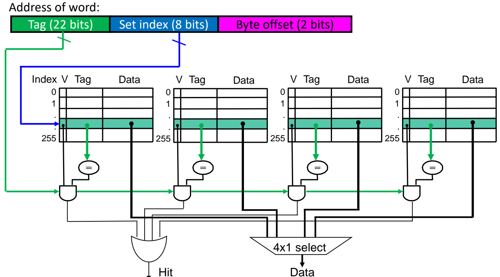
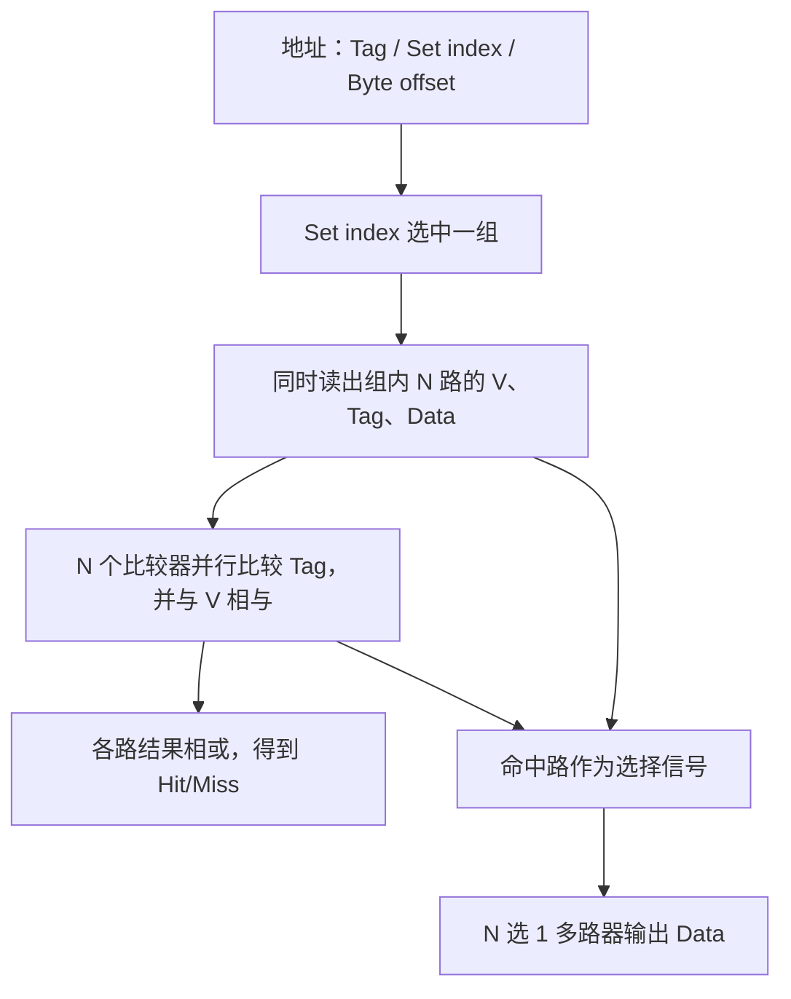
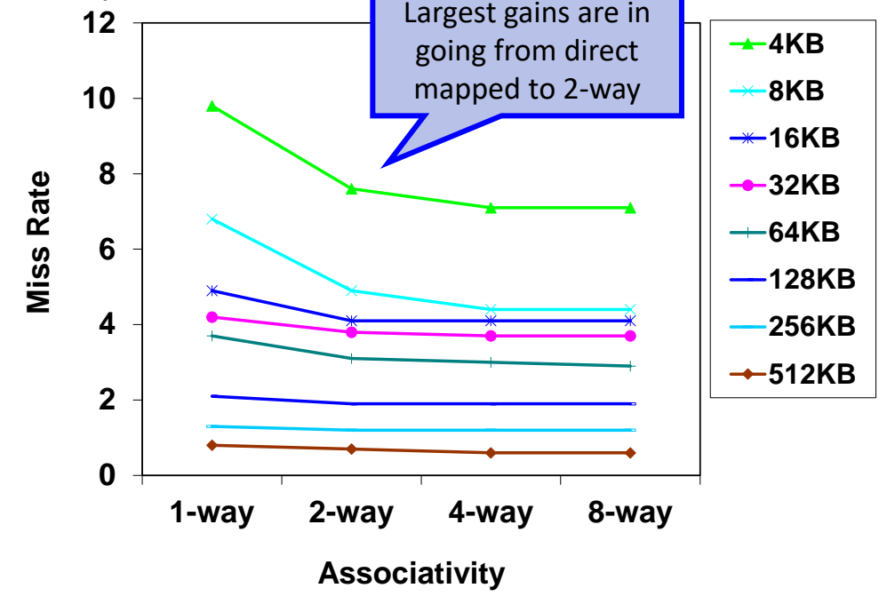
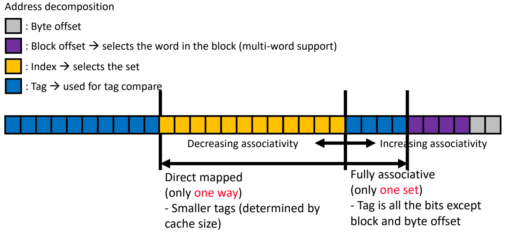

# 05 组相联与全相联

[本讲目录](../index.md) · [课程目录](../../index.md) · [上一节：04 直接映射缓存](04-direct-mapped-cache.md) · [下一节：06 替换策略](06-cache-replacement-policies.md)

> [!abstract] 本节要点
> - 组相联缓存把缓存分成若干**组**，每组有 $n$ **路**。一个块只能进入它所在的组，但可以放进该组的任意一路。index 负责选组，组内所有路并行比较 tag。
> - 6 位地址、4 块、2 组的例子：byte offset 2 位，index 1 位，tag 3 位。访问序列 `0 4 0 4 0 4 0 4` 在直接映射下 8 次全缺失，在 2 路组相联下只有 2 次强制缺失。
> - MIPS 4 路组相联例：1K 字、每块 1 字，共 $2^8=256$ 组，地址为 tag 22 位 + set index 8 位 + byte offset 2 位。代价是 $N$ 个比较器、命中判定延迟和选路多路器延迟，面积也随之增大。
> - 相联度越高缺失率越低，但下降幅度越来越小，1 路到 2 路的收益最大。容量固定时相联度每翻一倍，组数减半，index 少 1 位，tag 多 1 位。
> - 直接映射是 1 路组相联，全相联是只有 1 组的组相联，三者的比较次数分别为 $1$、相联度、块数。全相联没有冲突缺失，它的缺失只有强制缺失和容量缺失两种。

## 组相联的动机与定义（Set-Associative Cache）

在直接映射缓存里，一个块只有一个固定位置可去。几个频繁访问的块如果映射到同一行，就会互相驱逐，这就是乒乓效应：访问序列 `0 4 0 4 …` 每次都缺失（见[直接映射与乒乓效应](04-direct-mapped-cache.md)）。增大块（多字块）解决不了这个问题，因为 0 和 4 仍然落在同一行。要解决它，就得让同一个位置能同时容纳多个块。

**组相联缓存**（set-associative cache）把缓存分成若干**组**（set），每组由 $n$ 个**路**（way）构成。一个内存块按地址映射到唯一的一组，但可以放进该组的任意一路。这样的缓存称为 **$n$ 路组相联**（$n$-way set associative），$n$ 叫作**相联度**（associativity）。[^s1p37]

组相联的地址仍按 tag / index / offset 划分（划分方法见[地址划分](04-direct-mapped-cache.md)），区别在于 index 现在选的是"组"而不是"行"。设缓存共有 $B$ 个块，相联度为 $n$，则：

$$
\#\text{sets} = \frac{B}{n},\qquad
\text{index 位数} = \log_2 \frac{B}{n},\qquad
\text{tag 位数} = \text{地址位数} - \text{index 位数} - \text{offset 位数}
$$

### 最简例子：6 位地址、4 块、2 组

例子的设定如下：[^s1p37]

- 每块一个字，32 bit 即 4 B，所以 byte offset 占 $\log_2 4 = 2$ 位。
- 缓存共 4 块，分 2 组，每组 2 路，所以 index 占 $\log_2 2 = 1$ 位。
- 内存地址为 6 位，所以 tag 占 $6 - 2 - 1 = 3$ 位。

与同样 4 块的直接映射比，index 从 2 位减到 1 位：直接映射有 4 行，要 2 位区分；现在只有 2 组，1 位就够了，多出的 1 位并入 tag。

查找一个地址时要回答两个问题：[^s1p38]

1. **Q2：块在哪里找？** 用 byte offset 上方紧邻的 1 位（set index）选出一组，也就是用块号对组数取模。
2. **Q1：数据在不在缓存里？** 把选中组内各路的 tag 与地址高 3 位比较，某一路有效且 tag 相等就是命中。直接映射只比较一个位置，组相联要比较组内的**每一路**。

> [!example] 例：`0 4 0 4 0 4 0 4` 在 2 路组相联中的行为
> 下面的 0 和 4 指字地址（块号）。缓存初始为空，所有块的有效位为 0。
>
> 1. 字地址 0 的二进制是 `0000`，最低位 0 是 index，选中第 0 组，tag = `000`。第 0 组为空，**缺失**，把 Mem[0] 填入第 0 组的第 0 路（V=1，Tag=`000`）。
> 2. 字地址 4 的二进制是 `0100`，index 也是 0，tag = `010`。第 0 组第 0 路的 tag 不匹配，但第 1 路还空着，所以**缺失**后把 Mem[4] 填入第 1 路（V=1，Tag=`010`），**不驱逐** Mem[0]。
> 3. 再访问 0：第 0 组中有一路 tag 等于 `000`，**命中**。再访问 4：另一路 tag 等于 `010`，**命中**。
> 4. 之后的访问全部命中。
>
> 结果：8 次请求，2 次缺失，并且两次都是首次访问造成的强制缺失。同样的序列在每块一字的直接映射缓存中有 8 次缺失，组相联减少了 6 次。[^s1p39]

> [!tip] 课堂强调
> 理想的缓存只有强制缺失（cold miss），一旦出现冲突缺失，效果就明显变差。容量缺失来自数据集比缓存大，强制缺失来自第一次访问，这两类都不好解决；冲突缺失是可以设法消除的，组相联针对的正是这一类。3C 的定义见[3C 缺失分类](03-cache-performance-metrics.md)。[^s2b10]

## 组相联的硬件结构与代价

在组相联中，块的位置不再唯一，硬件只能把选中组里的每一路同时读出、同时比较，再从中挑出命中的那一路。

### MIPS 4 路组相联例

参数：每块 1 字，缓存容量 1K 字（4 KB），4 路组相联。[^s1p40]

1. **组数**：$1024 / 4 = 256 = 2^8$ 组，每组 4 路，每路一个块。
2. **地址划分**（32 位字节地址）：byte offset 2 位，即位 $[1:0]$；set index 8 位，即位 $[9:2]$；tag $32 - 8 - 2 = 22$ 位，即位 $[31:10]$。
3. **存储阵列**：4 个结构相同的阵列，每个阵列有 256 个表项，表项包含 V、Tag、Data。

一次查找按下面的步骤进行：

1. **选组**：8 位 set index 同时送到 4 个阵列，读出编号相同的 4 个表项。
2. **并行比较**：每一路配一个比较器（"="），把本路存的 tag 与地址的 22 位 tag 比较，再与本路有效位 V 相与，得到该路的命中信号。
3. **命中判定**：4 路的命中信号相或，得到 Hit。
4. **选数据**：4 路的命中信号作为选择控制，驱动 4 选 1 多路器（4x1 select），从 4 路读出的 Data 中选出命中那一路，作为输出 Data。

图：地址分成 22 位 tag、8 位组索引与 2 位字节偏移，组索引同时选中四路中同一组，四个比较器并行比较 tag，结果经或门得到 Hit，并控制 4x1 选择器输出命中路的数据。

### 与多字块直接映射的区别

多字块直接映射和组相联都让一个 index 对应多个字，但结构完全不同：

- **多字块**：一行里的 4 个字连续存放，**共用一个 tag**，查找时只比较一次 tag，再用 block offset 选字。
- **组相联**：组内每一路是独立的块，**各有自己的 V 和 tag**，可以存放内存中毫不相邻的块。index 一次要访问 $N$ 个阵列，比较 $N$ 次 tag，最后还要从 $N$ 份数据中选一份。[^s2b10]

### 代价

组相联相对直接映射或多字块直接映射，多出三项开销：[^s1p41]

1. **$N$ 个比较器**（$N$ 路），带来面积和延迟。
2. **命中/缺失判定延迟**：必须等 $N$ 路比较完、再相或，才能知道是否命中。
3. **多路器延迟**：数据要经过选路多路器才能输出。直接映射在 tag 比较的同时就可以把数据送出，组相联则必须等比较结果出来后才能选路。

每一项单看都不大，但缓存处在访存关键路径上，这些延迟和面积在高速缓存里相当可观。

> [!warning] 易错点
> 讲义讨论代价的那张 4 路结构图把最低 2 位标成 "Block offset (2 bits)"，而前一张同一结构图中该字段标为 "Byte offset (2 bits)"。这个例子每块只有一个字，所以这 2 位是字内的**字节偏移**，不存在用来选字的 block offset。[^s1p41]

> [!note] 补充解释
> 讲稿中提到"L1I 一般是直连，L1D 一般 4 路，8 路很少，因为延迟高"。这只能当作对延迟与相联度权衡的说明，不代表现代处理器的普遍配置。现代桌面和服务器 CPU 常见的是 32 KiB、8 路的 L1 缓存（L08 讲到的例子也是"标准的 32KB 8 路缓存"），L1I 也通常是组相联。真实处理器的具体参数要查厂商手册。

## 相联度与缺失率、地址位数

相联度增加以后缺失率会下降，但比较器和多路器的代价也随之上升。选直接映射还是组相联，取决于缺失的代价和实现的代价孰重。[^s1p42]

**规律**：相联度的优势在于，较小的相联度就能明显降低缺失率。从 Hennessy & Patterson 的数据（缓存容量 4 KB 到 512 KB，相联度 1/2/4/8 路）可以看出：

1. **单调下降**：对每种容量，缺失率都随相联度增加而下降或持平。这与块大小不同，块大小的缺失率曲线先降后升。
2. **边际收益递减**：从直接映射到 2 路的收益最大。以 4 KB 为例，缺失率约从 9.8% 降到 7.6%；从 2 路到 4 路只降到约 7.1%；从 4 路到 8 路几乎没有变化。
3. **容量越大，相联度的作用越小**：512 KB 时，各相联度的缺失率都在 1% 以下，曲线接近水平。

图：对 4KB 到 512KB 的缓存，相联度从 1-way 增加到 8-way 时缺失率下降，最大收益出现在从直接映射到 2 路组相联这一步，容量越大曲线越平。

由此可知，2 路、4 路是常见选择，最多到 8 路。再往上缺失率几乎不再下降，硬件代价却继续增加。[^s2b10]

### 相联度变化时的地址划分

**规则**：缓存容量固定时，相联度每增加一倍，每组的块数（路数）加倍，组数减半，于是 **index 少 1 位，tag 多 1 位**。[^s1p43]

把地址从低位到高位排列：

| 字段 | 作用 |
| --- | --- |
| Byte offset | 选字内的字节 |
| Block offset | 选块内的字（支持多字块） |
| Index | 选组 |
| Tag | 用于 tag 比较 |

相联度在两个极端之间连续变化：

- **直接映射**（只有一路）：index 最长，tag 最短，tag 长度由缓存容量决定。
- **全相联**（只有一组）：index 位数为 0，除 block offset 和 byte offset 以外的所有位都是 tag。

图：固定容量下，相联度每翻倍，index 少 1 位、tag 多 1 位；直接映射时 index 最长、tag 最短，全相联时只有一组，除块内偏移和字节偏移外全部是 tag。

block offset 一般不会很长，一块大约 8 个字左右。常见的划分是：低位放 offset，中间放 index，高位放 tag。这只是常用做法，不是必须的。tag 和 index 放在地址的哪些位，可以根据负载和应用来设计，例如 NVIDIA GPU 的地址映射就不采用这种简单划分。[^s2b10]

> [!example] 例：容量固定、相联度变化时的位数
> 以 MIPS 例的容量为准：1K 字、每块 1 字，共 1024 块，32 位地址，byte offset 2 位。
>
> | 相联度 | 组数 | index 位数 | tag 位数 | 每次比较数 |
> | --- | --- | --- | --- | --- |
> | 1 路（直接映射） | 1024 | 10 | 20 | 1 |
> | 2 路 | 512 | 9 | 21 | 2 |
> | 4 路 | 256 | 8 | 22 | 4 |
> | 全相联（1024 路） | 1 | 0 | 30 | 1024 |
>
> 4 路那一行就是上面 MIPS 4 路例的 22 位 tag 和 8 位 set index。每往下一行，index 少 1 位、tag 多 1 位。

## 直接映射、组相联、全相联的统一视角

把组数（即 index 位数）调到两个极端，组相联就变成另外两种结构，所以三种映射可以放在同一个框架里看。[^s1p44]

**全相联缓存**（fully associative cache）只有一组，一个块可以放在缓存的任意位置，查找时必须比较所有块的 tag。**直接映射**就是 **1 路组相联**，组数等于块数。全相联则是**全路组相联**（All-way SA），路数等于块数。组相联介于两者之间。[^s1p45]

| 类型 | 内存块映射到缓存的位置 | 查找复杂度 | 组数 | 每组块数 | 定位方法 | 比较次数 |
| --- | --- | --- | --- | --- | --- | --- |
| 直接映射（DM） | 固定的一个位置 | 索引快 | 缓存块数 | 1 | 用 index 定位 | 1 |
| 组相联（SA） | 一组位置中的任意一个 | 查找稍复杂 | 块数 / 相联度 | 相联度（通常 2 到 16） | 用 index 选组，比较组内各 tag | 相联度 |
| 全相联（FA） | 缓存中任意位置 | 需要大量硬件 | 1 | 缓存块数 | 比较所有块的 tag | 块数 |

全相联要为每个块配一个比较器，代价最高，所以实际处理器里的缓存几乎都不是全相联的，只在少数特殊场合使用。[^s2b10]

> [!info] 可视化资源
> [Wikipedia：Cache placement policies](https://en.wikipedia.org/wiki/Cache_placement_policies)：分别给出直接映射、全相联、2 路组相联的缓存结构图，并用 16 KB 主存 / 256 B 缓存的例子计算 tag、index、offset 位数，便于对照本节三种映射方式。

### 全相联与 3C 缺失

把三种映射方式放回 3C 分类（定义见[缓存性能度量](03-cache-performance-metrics.md)）来看：冲突缺失的前提是"块只能放在特定位置"，而全相联恰好取消了这个前提。[^s1p46]

**结论**：全相联缓存**没有冲突缺失**。块可以放在任意位置，只要还有空行就不会因为位置冲突而被驱逐。所以全相联中的一次缺失，要么是首次访问造成的强制缺失，要么是缓存已满造成的容量缺失。[^s2b10] 这也说明，提高相联度降低的是冲突缺失。缓存满后选哪个块驱逐属于替换策略，见[替换策略](06-cache-replacement-policies.md)。

> [!question]- 自测：32 位地址、32 KB 缓存、每块 64 B、8 路组相联，各字段多少位？若改为全相联呢？
> 块数为 $32\,\text{KB} / 64\,\text{B} = 512$。8 路组相联有 $512/8 = 64$ 组，所以 offset $\log_2 64 = 6$ 位（block offset 4 位加 byte offset 2 位），index 6 位，tag $32-6-6=20$ 位，每次比较 8 个 tag。全相联时 index 为 0 位，tag $32-6=26$ 位，每次要比较 512 个 tag。

> [!question]- 自测：6 位地址例的缓存（4 块、每块一字），字地址序列 `0 4 8 0 4 8`。分别按 2 路组相联（LRU 替换）和 4 块全相联计算缺失次数，并说明缺失类型。
> 0、4、8 的二进制最低位都是 0，在 2 路组相联中都映射到第 0 组。3 个块轮流争用 2 路，LRU 每次都恰好驱逐下一个要访问的块，所以 6 次访问**全部缺失**：前 3 次是强制缺失，后 3 次是冲突缺失（此时第 1 组还空着）。全相联时 3 个块都能放下，只有前 3 次强制缺失，后 3 次全部命中。

> [!question]- 自测：容量不变，把直接映射改成 2 路组相联，tag 存储总位数怎么变？命中时间可能怎么变？
> 组数减半，index 少 1 位，每个块的 tag 多 1 位，所以 tag 存储总共增加"块数 × 1"位。硬件上要多一个比较器，tag 比较完成后数据还要经过 2 选 1 多路器才能输出，命中判定和数据输出都会变慢。换来的是冲突缺失减少，而且按相联度–缺失率曲线，从 1 路到 2 路正是缺失率下降最多的一步。

> [!info]- 来源
> - L06-Cache.pdf：PDF p.37–46
> - L06.docx：DOCX body 245–297

[^s1p37]: L06-Cache.pdf-PDF p.37
[^s1p38]: L06-Cache.pdf-PDF p.38
[^s1p39]: L06-Cache.pdf-PDF p.39
[^s2b10]: L06.docx-DOCX body 270-297
[^s1p40]: L06-Cache.pdf-PDF p.40
[^s1p41]: L06-Cache.pdf-PDF p.41
[^s1p42]: L06-Cache.pdf-PDF p.42
[^s1p43]: L06-Cache.pdf-PDF p.43
[^s1p44]: L06-Cache.pdf-PDF p.44
[^s1p45]: L06-Cache.pdf-PDF p.45
[^s1p46]: L06-Cache.pdf-PDF p.46

[本讲目录](../index.md) · [课程目录](../../index.md) · [上一节：04 直接映射缓存](04-direct-mapped-cache.md) · [下一节：06 替换策略](06-cache-replacement-policies.md)
