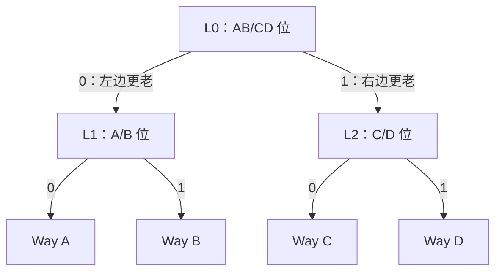
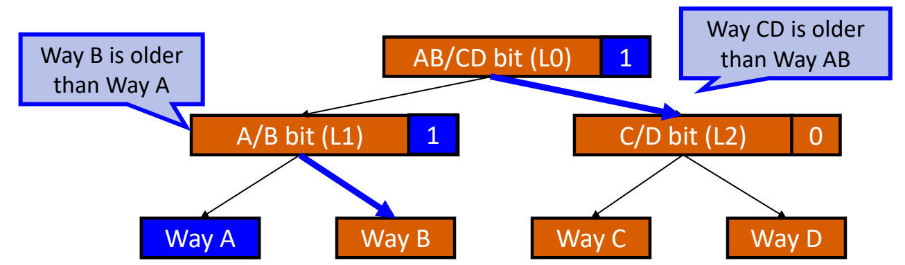
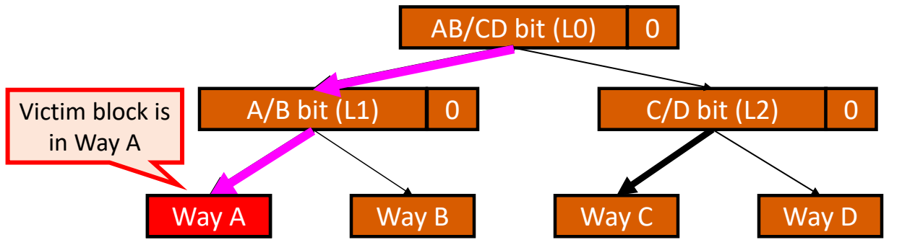
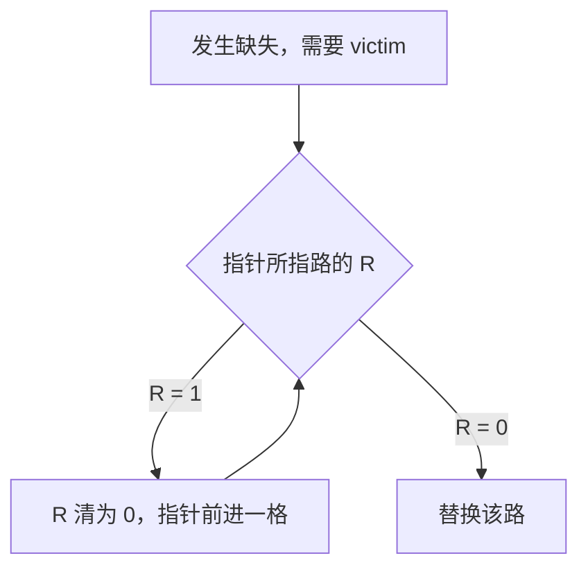
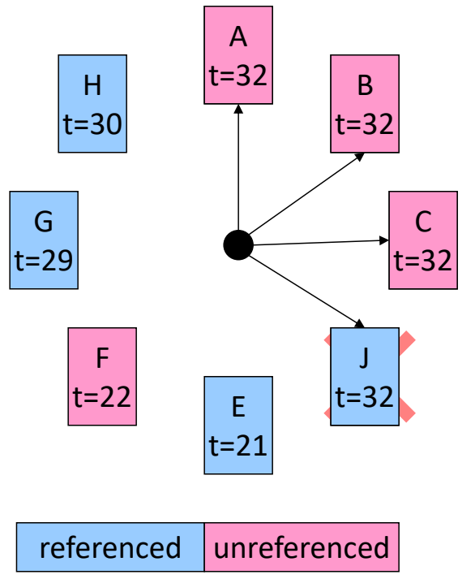

# 06 替换策略

[本讲目录](../index.md) · [课程目录](../../index.md) · [上一节：05 组相联与全相联](05-set-associative-and-fully-associative.md) · [下一节：07 写策略](07-cache-write-policies.md)

> [!abstract] 本节要点
> - 缓存满且发生缺失时，必须先逐出一行（victim）才能装入新块；直接映射只有唯一候选（static），只有组相联/全相联才需要在多路中做选择。
> - 常见策略：Random（随机选一路）、FIFO（按装入顺序淘汰最老的）、LRU（淘汰最久未被使用、即重用距离最长的行）、NRU（淘汰任一非最近使用的行，Itanium 2 的 L1/L2/L3 采用）。
> - 2 路组相联中 LRU 与 NMRU 等价，每组 1 位即可；超过 2 路时真 LRU 需要时间戳或有序表，每次访问都要更新/排序，难以在一个周期内完成。
> - 树形伪 LRU：$N$ 路用 $N-1$ 位组成二叉树，位为 0 表示左半更老、1 表示右半更老；访问时把路径上的位改为指向另一侧，替换时沿“更老”指针走到叶子。4 路依次访问 A、B、C、D 后，所有位为 0，victim 为 A。
> - 时钟算法：每路 1 位引用位 $R$，指针遇到 $R=1$ 就清零并前进，遇到 $R=0$ 就替换该路。

## 替换问题与策略分类

缓存容量有限。当缓存（或某个组）已经装满、又发生缺失时，新块要进来，就必须先把某一行逐出（evict）。这就是缓存设计的第三个问题——**块替换**（Block Replacement）：缺失时应当替换哪一块？[^s1p47]

前两个设计问题（块放在哪里、如何识别）分别见[直接映射缓存](04-direct-mapped-cache.md)与[组相联与全相联](05-set-associative-and-fully-associative.md)。替换问题是否存在，取决于放置方式：

- **静态替换**（Static）：直接映射缓存中，每个地址只能放在唯一的一行，缺失时被逐出的必然是这一行，没有选择余地。[^s1p48]
- 组相联和全相联中，一个块可以放在组内多路中的任何一路（全相联可以看作只有一个组），组满时才需要从多个候选中选出一个 **牺牲块**（victim）。下面的策略都是针对这种情况的。

**缓存替换策略**（Cache Replacement Policy）就是从候选路中选出 victim 的规则。常见的几种策略如下：[^s1p48]

1. **随机替换**（Random）：随机选一行替换，不考虑它是“热”还是“冷”。优点是实现极其简单。
2. **先进先出**（FIFO，First In First Out）：把组内各路看成一个环形队列，替换装入时间最早（最老）的一行，按队列顺序依次逐出。
3. **最近最少使用**（LRU，Least Recently Used）：替换最长时间没有被访问过的一行。
4. **最近未使用**（NRU，Not Recently Used）：替换任意一个“不是最近被使用”的行，是 LRU 的妥协版本。Itanium 2 的 L1、L2、L3 缓存都采用这种策略。

| 策略 | 适用的映射方式 | 选择依据 | 实现难度 |
| --- | --- | --- | --- |
| Static | 直接映射 | 地址唯一对应的那一行 | 无需额外状态 |
| Random | 组相联 / 全相联 | 随机 | 最简单 |
| FIFO | 组相联 / 全相联 | 装入顺序，淘汰最早装入的 | 环形队列，简单 |
| LRU | 组相联 / 全相联 | 访问顺序，淘汰最久未被访问的 | 超过 2 路时困难、昂贵 |
| NRU | 组相联 / 全相联 | 只避开最近被访问的那一行 | 简单，只需记录最近使用者 |

> [!warning] 易错点
> FIFO 和 LRU 都“淘汰最老的”，但“老”的含义不同：FIFO 看**装入**时间，命中不改变顺序；LRU 看**最后一次访问**时间，每次命中都会让该行变成最新。一行频繁命中的块，在 FIFO 下仍可能因为装入得早而被逐出，在 LRU 下则不会。

## LRU 与 NMRU

替换策略的目标是逐出“未来最不会被用到”的块。根据时间局部性（见[局部性与存储层次](02-locality-and-memory-hierarchy.md)），最久之前被用过的块，未来大概率也不太会被用到，因此 LRU 一般比 Random、FIFO 效果更好。

**LRU**（Least Recently Used，最近最少使用）每次缺失时逐出组内最久没有被访问的行。它的关键思想可以用**重用距离**（reuse distance）表述：一个块从上一次被访问到下一次被访问之间隔了多久，就是它的重用距离；LRU 逐出的是重用距离最长的块。[^s1p49] 例如依次访问 A、B、C、D 之后，A 是最长时间没有被用到的，所以 LRU 的 victim 是 A。

要实现 LRU，就得记住组内全部 $N$ 行最后一次被访问的先后顺序。[^s1p49] 这一要求的代价随路数急剧变化：

### 2 路：LRU 等价于 NMRU

**NMRU**（Not Most Recently Used，非最近使用）是指替换“不是最近一次被使用（MRU，Most Recently Used）”的那一行。2 路组相联中只有两个候选：一个是 MRU，另一个就必然是 LRU，因此“不选 MRU”与“选 LRU”完全相同。[^s1p49]

实现只需：

1. 每组设 **1 位**，指示哪一路是 LRU（另一路即 MRU）。
2. 每次访问该组时，按访问的是哪一路置位或清零这一位。

### 超过 2 路：真 LRU 困难且昂贵

$N>2$ 时，仅知道 MRU 不足以确定 LRU，必须追踪每一行何时被访问过：[^s1p49]

1. **时间戳方案**：给每行加一个时间戳。问题一是时间戳需要多少位；问题二是理想实现要求每次逐出时在全部 $N$ 个时间戳中找最小值，这需要比较器网络。
2. **有序表方案**：维护一个按访问时间排序的列表。问题是**每次访问**（不只是缺失）都要重新排序。

缓存访问需要在一个周期内完成全部操作，而“记录时间戳 → 比较/排序 → 找出最老者”无法在一次访问的时间内完成。因此对于超过 2 路的缓存，完整的 LRU 基本无法实用，工程上改用近似 LRU 的**伪 LRU**（Pseudo-LRU，PLRU）。

> [!note] 补充解释
> 精确记录 $N$ 行的访问顺序，本质上是记住 $N!$ 种排列中的一种，至少需要 $\lceil \log_2 N! \rceil$ 位状态：4 路需 5 位，8 路需 16 位，并且每次访问都要改写这些状态。这从另一个角度说明了真 LRU 随路数增长的代价。

### NRU：只避开最近使用者

**NRU**（Not Recently Used）是 LRU 的妥协：不追求找出“最久未用”的那一行，只要求不逐出“最近被用过”的行，从其余行中任选一个即可。[^s1p48] 实现时只需记录上次用了哪一行，这次就换别的行逐出，因此硬件很简单。2 路时 NRU 与 NMRU、LRU 一致；路数更多时，它只保证 victim 不是最近被访问的行，不保证是最久未用的行。

## 树形伪 LRU（Tree-based Pseudo-LRU）

真 LRU 要追踪完整访问顺序，代价太高；树形伪 LRU 用一棵二叉树只记录“哪一半更老”，用很少的位近似 LRU。

**树形伪 LRU**（Tree-based Pseudo-LRU）把组内各路作为二叉树的叶子，每个内部节点用 1 位记录其左右两棵子树中哪一半更老（older）：[^s1p50]

- 位 = 0：左边更老；
- 位 = 1：右边更老；
- 所有 PLRU 位初始化为 0。

$N$ 路组相联的二叉树有 $N-1$ 个内部节点，即每组 $N-1$ 位；树高为 $\log_2 N$，每次访问或查找 victim 只涉及根到叶子路径上的 $\log_2 N$ 个节点，所以这种实现称为 $O(\log N)$ 的实用伪 LRU。[^s1p50]

以 4 路组相联为例，四路为 Way A、B、C、D，共 3 位：

- **L0**（AB/CD 位）：根节点，记录 AB 这一半还是 CD 这一半更老；
- **L1**（A/B 位）：记录 A 还是 B 更老；
- **L2**（C/D 位）：记录 C 还是 D 更老。

两种操作：

1. **访问（命中或装入）时更新**：被访问的那一路成为最新，因此把从根到该叶子路径上的每个节点都改为**指向另一侧**（另一侧更老）。不在路径上的节点不变。[^s1p51]
2. **替换时查找 victim**：从根出发，每个节点按其位值走向“更老”的一侧（0 往左、1 往右），走到的叶子就是 victim。[^s1p55]

> [!example] 例：4 路 PLRU 依次访问 A → B → C → D
> 初始 $L0=L1=L2=0$。记三位为 $(L0, L1, L2)$。
>
> 1. **访问 A**：路径为 L0 → L1 → A。A 在 L0 的左半，所以 $L0 \leftarrow 1$（CD 比 AB 更老）；A 是 L1 的左孩子，所以 $L1 \leftarrow 1$（B 比 A 更老）。状态 $(1,1,0)$。[^s1p51]
> 2. **访问 B**：路径为 L0 → L1 → B。B 也在左半，L0 仍应指向右，保持 1；B 是 L1 的右孩子，$L1 \leftarrow 0$（A 比 B 更老）。状态 $(1,0,0)$。[^s1p52]
> 3. **访问 C**：路径为 L0 → L2 → C。C 在右半，$L0 \leftarrow 0$（AB 比 CD 更老）；C 是 L2 的左孩子，$L2 \leftarrow 1$（D 比 C 更老）。状态 $(0,0,1)$。[^s1p53]
> 4. **访问 D**：路径为 L0 → L2 → D。D 在右半，L0 保持 0；D 是 L2 的右孩子，$L2 \leftarrow 0$（C 比 D 更老）。状态 $(0,0,0)$。[^s1p54]
> 5. **找 victim**：$L0=0$ 走左到 L1，$L1=0$ 再走左，到达 Way A。victim 是 A。[^s1p55]
>
> 按真 LRU，访问顺序 A、B、C、D 之后最久未用的也是 A，两者结果一致，所以说 PLRU 近似 LRU。

图：四路组的伪 LRU 用三位二叉树记录新旧，访问 Way A 后 A/B 位置 1 表示 Way B 更旧，AB/CD 位置 1 表示 Way CD 更旧，蓝色粗箭头指向较旧的一侧。

图：三个树节点位都为 0 时，从根沿指向较旧一半的指针向下走，经 AB/CD 位和 A/B 位到达 Way A，因此 Way A 被选为替换块。

> [!info] 可视化资源
> [Wikipedia：Cache replacement policies](https://en.wikipedia.org/wiki/Cache_replacement_policies)：含 LRU 访问序列 A B C D E D F 的逐步图示和 Pseudo-LRU 二叉树指针图示，可对照理解多路 LRU 的实现难度与近似方案。

> [!warning] 易错点
> - 节点位指向的是**更老**的一侧，而不是刚被访问的一侧。访问某路时，要把路径上的位设为“背离”该路的方向。
> - 一次访问只改根到该叶子路径上的 $\log_2 N$ 个位；另一棵子树里的位保持不变。例如访问 B 时 L2 不动。
> - PLRU 只是近似：每个节点只知道“哪一半更老”，不知道半区内部的完整顺序，因此在某些访问序列下选出的 victim 与真 LRU 不同（见下方自测）。

## 时钟算法（Clock Algorithm）

树形 PLRU 的更新规则仍比较复杂；时钟算法用更简单的机制近似 LRU。该算法源自操作系统的页面替换，用在缓存中时，把“页”换成组内的“路”即可。[^s1p56]

**时钟算法**（Clock Algorithm）把所有路排成一个环形“时钟”，用一根指针（clock hand）指向下一个候选替换者，并为每一路记录 1 位**引用位** $R$：[^s1p56]

- $R=0$：未被引用（unreferenced）；
- $R=1$：被引用过（referenced），某路被访问时其 $R$ 置 1。

需要替换时，从指针当前位置开始顺时针检查：

1. 若当前路 $R=0$，替换这一路，结束。
2. 若当前路 $R=1$，把它的 $R$ 清为 0，指针前进到下一路，回到第 1 步。
3. 一直继续，直到找到 $R=0$ 的路。这可能需要绕时钟整整一圈。[^s1p56]

第 2 步“清零后跳过”的含义：这一路刚被访问过，暂时不选它；但如果指针绕回来时它还没再被访问过（$R$ 仍为 0），说明它已经是比较老的数据，就可以被替换。这样，最近被访问的路会被跳过一次，长时间未被访问的路会被选中，逻辑上与 LRU 相近，而硬件只需每路 1 位加一根指针。[^s2b12]

> [!example] 例：指针从 A 开始寻找 victim
> 环上依次有 A、B、C、D、E、F、G、H，指针指向 A。A、B、C 的 $R=1$，D 的 $R=0$。
>
> 1. 检查 A：$R=1$，清零，前进。
> 2. 检查 B：$R=1$，清零，前进。
> 3. 检查 C：$R=1$，清零，前进。
> 4. 检查 D：$R=0$，选中 D 为 victim，新块 J 装入 D 原来的位置。
>
> 结束后 A、B、C 变为 unreferenced；新装入的 J 标记为 referenced，指针停在 J 处。[^s2b12]

图：页面排成一圈，时钟指针遇到 R=1 的页面就清零并前进，遇到 R=0 的页面就替换；图中指针已扫过 A、B、C，并停在新换入的 J（t=32）处。

> [!warning] 易错点
> 指针遇到 $R=1$ 时不是直接跳过，而是**先清零再前进**。如果忘记清零，当所有路的 $R$ 都为 1 时指针会无限循环；正因为会清零，即使所有路都是 1，指针绕一圈后也一定能回到起点并在那里找到 $R=0$ 的路。

> [!question]- 自测：4 路 PLRU 初始全 0，依次访问 A、B、C、D、A，此时缺失，PLRU 和真 LRU 分别替换哪一路？
> PLRU 替换 C，真 LRU 替换 B，两者不同。前四次访问后 $(L0,L1,L2)=(0,0,0)$；再访问 A，路径 L0 → L1 → A，置 $L0=1$、$L1=1$，L2 仍为 0，状态 $(1,1,0)$。找 victim：$L0=1$ 走右到 L2，$L2=0$ 走左，得 C。真 LRU 中各路最后访问顺序为 B、C、D、A，最久未用的是 B。PLRU 的根位只知道“CD 半区比 AB 半区更老”，看不到 B 其实比 C、D 都老。

> [!question]- 自测：一个 2 路组相联缓存的某组中，最近一次访问的是第 1 路。此时该组缺失，LRU、NMRU、NRU 分别替换哪一路？每组需要几位状态？
> 三者都替换第 0 路。2 路时只有两个候选，不是 MRU 的那一路就是 LRU，所以三种策略结论相同。每组只需 1 位记录哪一路是 LRU/MRU，每次访问时置位或清零。

> [!question]- 自测：时钟环上 4 路 W、X、Y、Z 的 $R$ 全为 1，指针指向 W。发生缺失后，哪一路被替换？结束时各路的 $R$ 是多少？
> W 被替换。指针依次把 W、X、Y、Z 的 $R$ 清零并前进，绕一圈回到 W 时 $R=0$，于是替换 W。结束时 X、Y、Z 的 $R=0$；W 装入新块，被标记为 referenced（$R=1$）。这就是“可能需要绕时钟整整一圈”的情况。

> [!info]- 来源
> - L06-Cache.pdf：PDF p.47–56
> - L06.docx：DOCX body 270–353

[^s1p47]: L06-Cache.pdf-PDF p.47
[^s1p48]: L06-Cache.pdf-PDF p.48
[^s1p49]: L06-Cache.pdf-PDF p.49
[^s1p50]: L06-Cache.pdf-PDF p.50
[^s1p51]: L06-Cache.pdf-PDF p.51
[^s1p55]: L06-Cache.pdf-PDF p.55
[^s1p52]: L06-Cache.pdf-PDF p.52
[^s1p53]: L06-Cache.pdf-PDF p.53
[^s1p54]: L06-Cache.pdf-PDF p.54
[^s1p56]: L06-Cache.pdf-PDF p.56
[^s2b12]: L06.docx-DOCX body 326-353

[本讲目录](../index.md) · [课程目录](../../index.md) · [上一节：05 组相联与全相联](05-set-associative-and-fully-associative.md) · [下一节：07 写策略](07-cache-write-policies.md)
