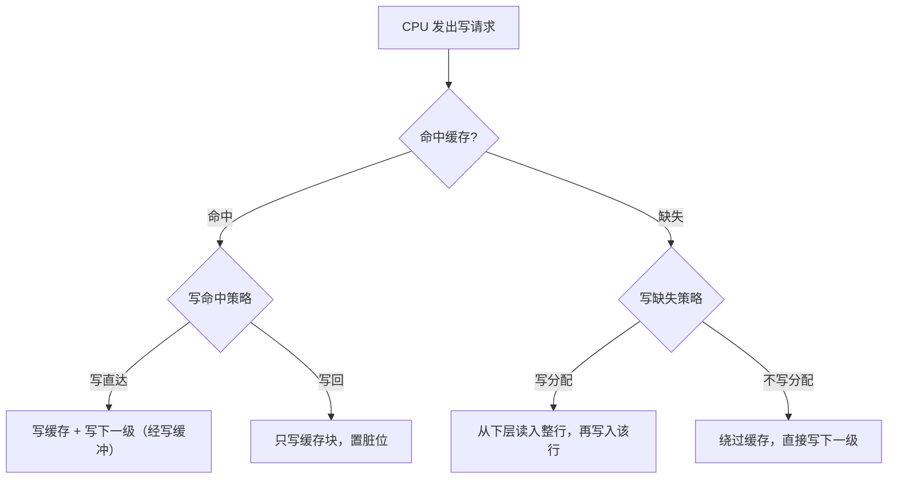
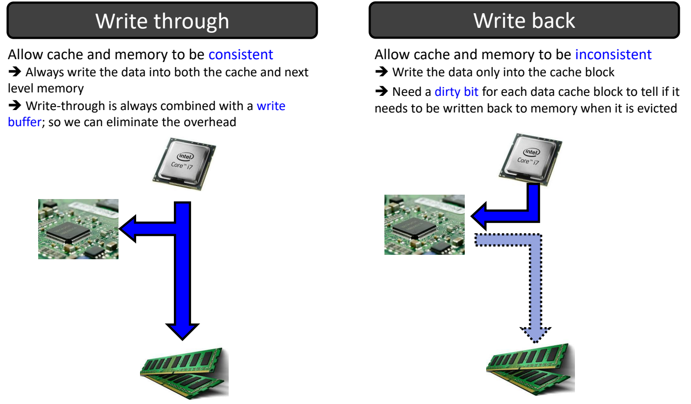
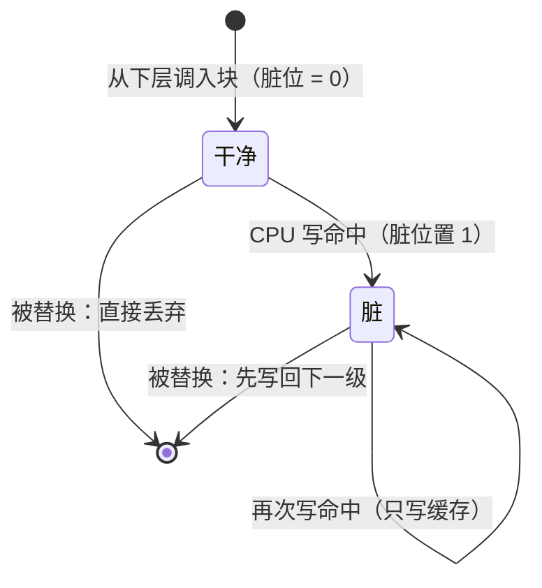
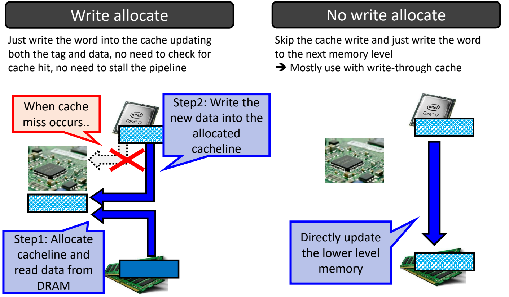

# 07 写策略

[本讲目录](../index.md) · [课程目录](../../index.md) · [上一节：06 替换策略](06-cache-replacement-policies.md) · [下一节：08 降低缺失代价](08-reducing-miss-penalty.md)

> [!abstract] 本节要点
> - 写策略要回答两个问题：**写命中**时数据写到哪里（写直达 / 写回），**写缺失**时要不要把块调入缓存（写分配 / 不写分配）。
> - 写直达同时写缓存和下一级存储，两者始终一致；下一级很慢，所以写直达总是配一个写缓冲（如 4 项 FIFO）在后台排空，但缓冲写满时 CPU 仍要停顿。
> - 写回只写缓存块，允许缓存与内存暂时不一致；每个块需要一个脏位，块被替换时脏块才写回下一级，干净块直接丢弃。写回看似简单，却让后面的缓存一致性复杂得多。
> - 写分配在写缺失时先从下层读入整行、再把新数据写进这一行，因为一次写（如 8 B）远小于一个缓存行（如 64 B），行里其余字节必须是有效数据。
> - 不写分配在写缺失时绕过缓存，直接写下一级存储，多与写直达搭配。

## 写操作带来的问题

读操作不会改变数据，缓存里的副本和内存里的原件始终相同；写操作则不同，CPU 一旦往缓存里写入新值，缓存和下一级存储（memory）里就出现了两个版本。设计者必须决定新值写到哪一级、什么时候同步，以及写的地址不在缓存里时怎么办。这就是缓存设计的第四个问题——**写策略**（write strategy），排在块放置、块识别与[替换策略](06-cache-replacement-policies.md)之后。[^s1p57]

写策略按"写的地址在不在缓存里"分成两组决策：

| 情形 | 要决定的事 | 两种做法 |
| --- | --- | --- |
| 写命中（write hit） | 新值写到哪里、何时同步到下一级 | 写直达（write through） / 写回（write back） |
| 写缺失（write miss） | 是否把目标块调入缓存 | 写分配（write allocate） / 不写分配（no write allocate） |

## 写直达与写缓冲（Write Through / Write Buffer）

最直接的保持一致的办法是每次写都把两边一起改。

**写直达**（write through）是指：写命中时，数据**同时写入缓存和下一级存储**，因此缓存与内存始终保持一致（consistent）。[^s1p58]

它的核心缺点来自速度差：缓存很快，内存很慢。虽然新值第一时间就写进了缓存，但这次写操作要等内存也写完才算完成，每次写都要付出访问内存的长延迟。

解决办法是在缓存和下一级之间加一个**写缓冲**（write buffer）。写直达总是和写缓冲配合使用，用它来消除写内存的开销。[^s1p58] 典型的写缓冲是一个 4 项的 FIFO（$\#\text{entry}=4$）。[^s1p58] 它的工作过程是：

1. **CPU 写入**：CPU 写数据时，除了写缓存，只需把这次写放进写缓冲，写缓冲立刻响应，CPU 继续执行后续指令。
2. **后台排空**：在 CPU 没有新的写操作时，写缓冲按 FIFO 顺序把条目逐个写到内存。这一步对 CPU 不可见，是后台操作，从而**掩盖**了写内存的延迟。
3. **缓冲写满**：如果连续的写操作太多，写缓冲被填满，后来的写就没有地方放，写缓冲失去作用，CPU 必须停顿等待它腾出空位——这就是写直达仍然存在的写停顿代价（penalty）。

图：写直达时处理器的写同时进入缓存和下一级存储，保持一致；写回时只写缓存块，用 dirty 位标记，等块被替换时才写回内存（虚线箭头）。

> [!warning] 易错点
> 写缓冲只是把写内存的时间"挪到后台"，并没有减少写内存的次数。写直达下每一次写最终都会到达下一级存储；写操作的平均速率超过内存能吸收的速率时，再大的写缓冲也会被写满而导致停顿。

写缓冲之外，还有一种把多次小写合并成一次大写的写合并缓冲，属于降低缺失代价的优化，见[写合并缓冲](08-reducing-miss-penalty.md)。

## 写回与脏位（Write Back / Dirty Bit）

如果不想每次写都访问慢速的内存，就只能让内存暂时保留旧值，等到不得不同步时再写。

**写回**（write back）是指：写命中时，数据**只写入缓存块**，不写下一级存储，因此允许缓存与内存暂时不一致（inconsistent）。[^s1p58]

既然内存里可能是旧值，块离开缓存时就必须判断要不要把它写回去。为此要给每个数据缓存块（和 tag、有效位一起）再加一个状态位：

**脏位**（dirty bit）：每个数据缓存块一位，记录该块自调入以来是否被 CPU 写过，用来判断它被替换（evicted）时是否需要写回内存。[^s1p58]

写回缓存中一个块的生命周期如下：

1. **调入**：块从下一级读入缓存，此时内容与内存相同，脏位清零，称为**干净**（clean）块。
2. **写命中**：CPU 写这个块时只改缓存中的数据，并把脏位置 1，块变成**脏**（dirty）块。之后对它的多次写都只发生在缓存里。
3. **替换**：该块被替换策略选中要腾出位置时检查脏位：
   - 脏块：内存里是过时的数据，必须先把整块写回内存；
   - 干净块：内存里的副本与它相同，直接丢弃即可，不产生写内存流量。

> [!tip] 课堂强调
> 写回看起来比写直达更简单（只写缓存），这是一个假象。写回让缓存与内存允许不一致，这会让后面的许多机制变得相当麻烦，最典型的就是**缓存一致性**（cache coherence），课程会在之后的章节专门讨论。[^s2b12]

> [!note] 补充解释
> 写回省流量的原因在于：同一块上的多次写在缓存中合并，最终只在替换时写一次整块；而写直达每次写都要发往下一级。反过来，写回在替换脏块时要先写回再读入新块，单次缺失的处理更长。

## 写分配与不写分配（Write Allocate / No Write Allocate）

写缺失比读缺失多一个麻烦：CPU 每次写的数据远小于一个缓存行。以 RISC-V 64 位处理器为例，一次写最多 8 B（64 bit），而一个缓存行通常是 64 B，相差 8 倍。[^s2b12] 如果直接把这 8 B 写进一个新分配的缓存行，行中其余 56 B 就没有有效数据；而缓存行要求整行内容有效，不能留空。

**写分配**（write allocate）是指：写缺失时，先在缓存中为目标块分配一行并从下一级读入整块，再把要写的数据写进这一行。[^s1p59] 步骤为：

1. **Step 1 分配并读入**：发生写缺失时，在缓存中分配一个缓存行（cacheline），从 DRAM 把这一整块（如 64 B）读进来，把行填满。
2. **Step 2 写入新数据**：再把处理器要更新的那部分（如 8 B）写进刚分配的缓存行。之后整行数据完整，这次写才算完成。

写分配的代价很明显：一次写缺失要先等一次从内存读整块的操作。于是有了另一种做法。

**不写分配**（no write allocate）是指：写缺失时跳过缓存写入，直接把数据写到下一级存储（directly update the lower level memory），缓存内容不变。[^s1p59] 它省去了"先读整块"的过程，处理简单得多。不写分配**多与写直达搭配使用**：写直达本来就要把每次写送往下一级，写缺失时只是省掉写缓存这一半。[^s1p59]

图：写缺失时，写分配先为该行分配缓存并从 DRAM 读入数据（Step1），再把新数据写入该缓存行（Step2）；非写分配跳过缓存，直接更新下一级存储，多与写直达配合。

> [!note] 补充解释
> 讲义写分配一栏的文字"just write the word into the cache updating both the tag and data, no need to check for cache hit, no need to stall the pipeline"出自 Hennessy & Patterson 教材对**每块只有一个字**的写直达缓存的描述：此时写入的字恰好覆盖整块，不需要从下层读入其余数据，直接更新 tag 和数据即可。块大于一次写的宽度时（如 64 B 行、8 B 写），必须按上面的两步先读入整行。[^s1p59]

> [!note] 补充解释
> 与"不写分配 + 写直达"相对，另一种常见搭配是写回 + 写分配：写回希望后续对同一块的写都在缓存里完成，所以写缺失时把块调入缓存才有意义。

> [!info] 可视化资源
> [Wikimedia Commons：写回 + 写分配流程图](https://commons.wikimedia.org/wiki/File:Write-back_with_write-allocation.svg)：展示写回结合写分配时读/写命中与缺失的处理路径，包括脏块写回下层、缺失时先读入整块，可对照本节的脏位与写分配。

两组策略的对比：

| 策略 | 适用情形 | 写到哪里 | 需要的额外硬件 / 状态 | 主要代价 |
| --- | --- | --- | --- | --- |
| 写直达 | 写命中 | 缓存 + 下一级 | 写缓冲（如 4 项 FIFO） | 每次写都产生下层写流量；缓冲满时停顿 |
| 写回 | 写命中 | 只写缓存 | 每块一个脏位 | 替换脏块时要写回；缓存一致性更复杂 |
| 写分配 | 写缺失 | 先读入整行，再写缓存 | — | 写缺失要等一次整块读 |
| 不写分配 | 写缺失 | 绕过缓存写下一级 | — | 之后读这块仍会缺失 |

> [!warning] 易错点
> 写直达 / 写回只回答"命中时怎么写"，写分配 / 不写分配只回答"缺失时要不要调块"，二者是两个独立的维度，一个缓存要同时选定两者。不要把"不写分配"和"写直达"当成同一回事：前者只影响缺失，后者影响每一次写命中。

> [!question]- 自测：写回 + 写分配的缓存，某行被调入后 CPU 对它写了 5 次，之后它被替换。这期间对内存产生了多少次写？若换成写直达，又是多少？
> 写回：5 次写都只改缓存并置脏位，替换时因脏位为 1 写回整块一次，共 **1 次**（整块）写内存。写直达：每次写都要写下一级，共 **5 次**写（经写缓冲在后台完成）。若该行调入后从未被写过，写回缓存替换时脏位为 0，直接丢弃，写内存 0 次。

> [!question]- 自测：64 B 缓存行、写分配策略下，CPU 对一个不在缓存中的地址执行 8 B 的 `sd` 指令，为什么不能直接把 8 B 写进新分配的行？
> 因为新行其余 56 B 没有有效数据，而整行被视为有效块，之后对这 56 B 的读会读到错误内容。所以必须先从下层读入整块 64 B（Step 1），再写入这 8 B（Step 2）。只有块大小等于一次写的宽度（每块一个字）时，才可以不读入直接写。

> [!question]- 自测：一个写直达缓存配 4 项 FIFO 写缓冲。程序连续执行一长串 store，速度远快于内存写入速度，会发生什么？改用写回能否缓解？
> 写缓冲很快被 4 个未完成的写填满，之后每个 store 都要等缓冲排出一项才能进入，CPU 停顿，写缓冲失去掩盖延迟的作用。若这些 store 多次写同一批块，写回能缓解：写只改缓存并置脏位，只在替换时整块写回一次，下层写流量大大减少。

> [!info]- 来源
> - L06-Cache.pdf：PDF p.57–59
> - L06.docx：DOCX body 326–353

[^s1p57]: L06-Cache.pdf-PDF p.57
[^s1p58]: L06-Cache.pdf-PDF p.58
[^s2b12]: L06.docx-DOCX body 326-353
[^s1p59]: L06-Cache.pdf-PDF p.59

[本讲目录](../index.md) · [课程目录](../../index.md) · [上一节：06 替换策略](06-cache-replacement-policies.md) · [下一节：08 降低缺失代价](08-reducing-miss-penalty.md)
