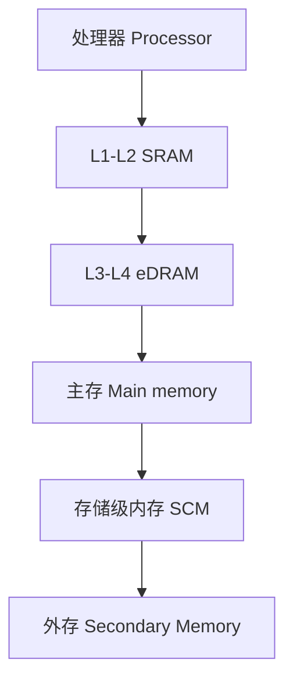
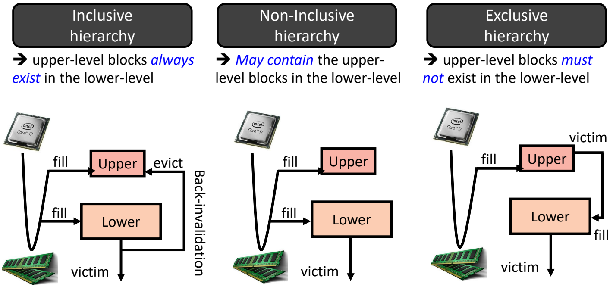
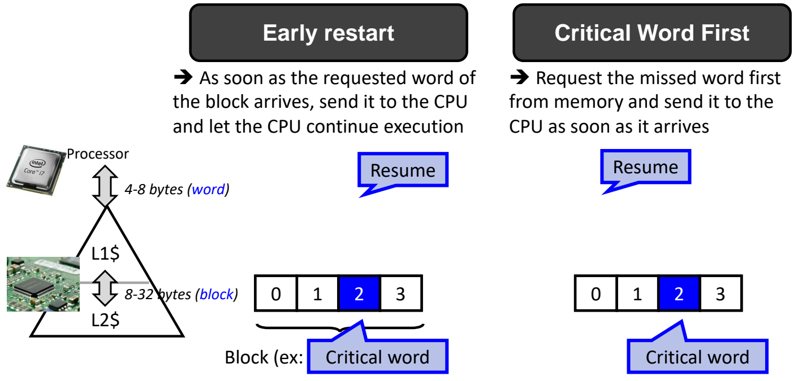
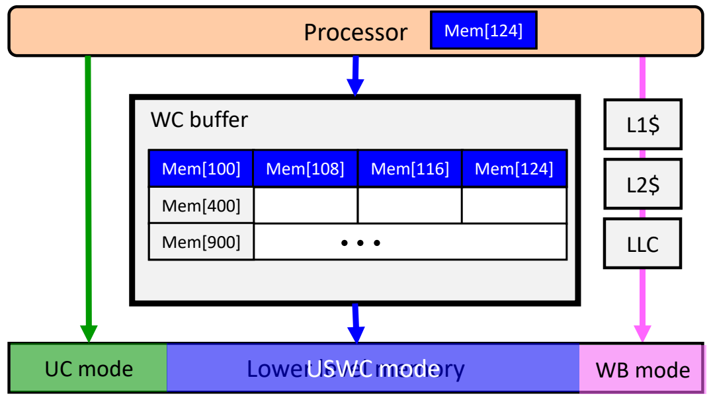
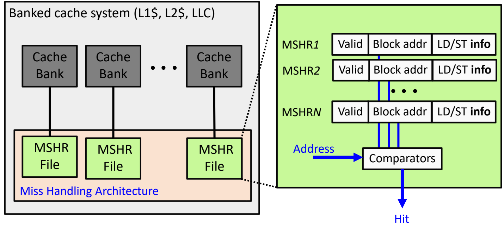
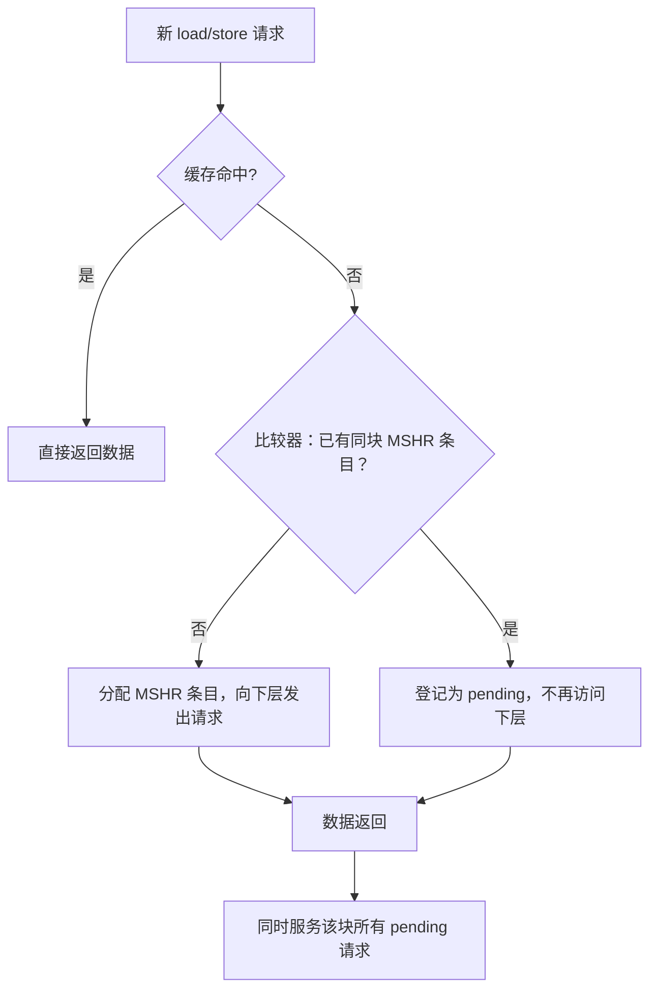

# 08 降低缺失代价

[本讲目录](../index.md) · [课程目录](../../index.md) · [上一节：07 写策略](07-cache-write-policies.md)

> [!abstract] 本节要点
> - 缓存优化都以降低 $\text{AMAT} = \text{Hit time} + \text{Miss rate} \times \text{Miss penalty}$ 为目标，分别针对缺失代价、缺失率、命中时间三项；降低缺失代价的四类技术是多级缓存、早启动与关键字优先、写合并、非阻塞缓存。
> - 多级缓存在处理器与主存之间加层（L1–L2 SRAM、L3–L4 eDRAM），在主存与外存之间还可加存储级内存（SCM）；层间内容关系分为包含（需反向无效化）、非包含非排他（NINE，当前 Intel/AMD 主流）、排他（有效容量最大，适合上下层容量相近的场合）。
> - 早启动：所需字一到就交给 CPU 继续执行；关键字优先：先向下层请求缺失的那个字，其余字随后再传。
> - x86 用 MTRR 为地址区间指定 UC/WC/WB/WT/WP 五种内存类型；写合并缓冲只服务 USWC 内存，把分散的写合并成连续块后一次写入下层。
> - 非阻塞缓存把缓存分 bank，用 MSHR（valid、块地址、LD/ST 信息）跟踪多个未完成缺失；对同一块的后续缺失只登记为 pending，数据返回后一并服务。

基本缓存回答了"放在哪、怎么找、怎么换、怎么写"，性能仍取决于平均访存时间（AMAT 的定义与计算见[缓存性能度量](03-cache-performance-metrics.md)）。缓存优化就按 AMAT 的结构来组织：[^s1p60]

$$
\text{AMAT} = \text{Hit time} + \text{Miss rate} \times \text{Miss penalty}
$$

三项各对应一类优化目标：

1. **降低缺失代价**（Miss Penalty ↓）：本节内容，包括多级缓存、关键字优先与早启动、写合并、非阻塞缓存四种技术。[^s1p61]
2. **降低缺失率**（Miss Rate ↓）与 **降低命中时间**（Hit Time ↓）：在 L08 讲。

## 多级缓存（Multi-level Caches）

一次主存访问折合上百到上千个处理器周期（见[内存墙](01-memory-wall-and-memory-technologies.md)），只靠一级缓存无法同时做到"足够快"和"足够大"。**多级缓存**（multi-level caches）的核心思想是：在 CPU 与主存之间再增加一级（或多级）存储层次来填补这一差距。[^s1p62]

- **过去**：处理器 → L1\$ → L2\$ → 主存 → 外存。
- **现在**：L1–L2 用 SRAM；其下再加 L3–L4，其中 L4 可用 **eDRAM**（embedded DRAM，嵌入式 DRAM）实现；在主存与外存之间还插入了 **存储级内存**（Storage-Class Memory，SCM）。



**eDRAM 作 L4**：SRAM 单元面积大、代价高，继续用它做更大的 L4 不划算，于是改用 eDRAM。它可以理解为尺寸更小的 DRAM，并与 CPU 芯片并排紧贴封装，因而访问比普通 DRAM 主存更快。

**存储级内存**：把存储介质改造成内存一样的使用形态，提供接近内存的性能，作为主存与外存之间的新一层。最典型的例子是 Intel 的 3D XPoint，商品名 Optane（傲腾）。

> [!tip] 课堂强调
> 带 eDRAM L4 的 CPU 大约出现在七八年前的笔记本中，现在已不再使用，原因是成本太高而性能提升不大；但这种"在 CPU 旁边贴一块 DRAM"的思路启发了苹果在 CPU 旁封装 DRAM 的设计。Optane 产品线也已停止，但作为在主存与外存之间加层的设计具有开创性。

> [!note] 补充解释
> 有了多级缓存，L1 的"缺失代价"本身就变成了"访问 L2 的平均时间"。以两级为例，把 AMAT 公式递归展开：
> $$
> \text{AMAT} = T_{\rm hit,L1} + MR_{\rm L1} \times \left( T_{\rm hit,L2} + MR_{\rm L2} \times MP_{\rm L2} \right)
> $$
> 其中 $T_{\rm hit,Li}$ 是第 $i$ 级命中时间，$MR_{\rm Li}$ 是第 $i$ 级的局部缺失率（在到达该级的访问中缺失的比例），$MP_{\rm L2}$ 是 L2 缺失后访问主存的代价。L2 把大部分 L1 缺失挡在主存之前，因此能大幅降低 L1 的有效缺失代价。

## 缓存层次的包含关系

有了多级缓存，就出现一个以前没有讨论过的问题：上层缓存中的数据，下层缓存里是否也一定有？按上层块是否同时存在于下层，层次分为三类。[^s1p63]

**包含层次**（inclusive hierarchy）：上层的块**一定**存在于下层，即上层内容是下层内容的子集。

1. **填充**：访问的数据在上下两层都不存在时，从主存取回后同时填入上层（Upper）和下层（Lower）。
2. **上层替换**：上层驱逐一个块，它在下层仍有副本，不影响包含性。
3. **下层替换**：下层驱逐一个块（victim）时，必须通知上层把同一块也作废，否则上层会持有下层没有的块。这一操作称为 **反向无效化**（back-invalidation）。

**非包含层次**（non-inclusive hierarchy）：下层**可能**包含上层的块，但不作保证，也称 **非包含非排他**（Non-Inclusive Non-Exclusive，NINE）。填充时仍同时填入上下两层，所以多数情况下表现与包含层次相同；区别在于下层驱逐一个块时**不需要**反向无效化，上层可以继续保留它。好处是省去了不必要的驱逐操作。

**排他层次**（exclusive hierarchy）：上层的块**一定不**存在于下层，一个块要么在上层、要么在下层，不会同时在两层。

1. **填充**：从主存取回的块只填入上层。
2. **上层替换**：上层的 victim 被填入下层。
3. **下层替换**：下层放不下时再把 victim 驱逐到更下一层。



图：包含式层次中上层块必在下层，下层驱逐时需反向失效上层；非包含式下层可能含上层块；互斥式上层块不在下层，上层的牺牲块填入下层。

| 层次类型 | 上层块是否在下层 | 主存数据填入 | 下层驱逐时 | 有效容量 |
| --- | --- | --- | --- | --- |
| 包含 inclusive | 一定在 | 上下两层 | 需反向无效化上层副本 | 约为下层容量 |
| 非包含 NINE | 可能在 | 上下两层 | 上层副本可保留 | 介于两者之间 |
| 排他 exclusive | 一定不在 | 只填上层 | 上层 victim 才进入下层 | 上下层容量之和 |

**有效容量**：包含与非包含层次中，同一数据可能在上下两层各存一份，实际可用容量较低；排他层次每个块只存一份，有效容量在三者中最高。这一优势的大小取决于上下层容量之比：

- L1 与 L3 的容量可能相差约 1000 倍，即使合并两者的容量，L1 也只贡献约 $0.1\%$，意义不大；
- 若上下层容量只差 1–2 倍乃至 3–4 倍，合并容量的收益就很明显。典型例子是 DRAM 与 Optane 组成两级，Optane 容量只比 DRAM 大约 4–5 倍；此时包含或非包含层次在 DRAM 中重复占用的空间太大，应采用排他层次以获得最大容量。

> [!info] 可视化资源
> [Wikipedia：Cache inclusion policy](https://en.wikipedia.org/wiki/Cache_inclusion_policy)：用 L1/L2 两级例子分别图示包含（含反向无效化）、排他（L2 作牺牲缓存）与 NINE 策略的填充与驱逐过程，并比较其优缺点。

> [!tip] 课堂强调
> 包含层次因为需要反向无效化，操作麻烦，只在早期 Intel 处理器中使用，现在的 Intel 处理器基本不用；当前大部分 Intel 和 AMD 处理器采用非包含非排他（NINE）层次。排他层次适用于上下层容量相差不大的场合，这一点需要注意。

> [!warning] 易错点
> "非包含"不等于"排他"。非包含（NINE）只是**不保证**上层块在下层，平时填充依然两层都放；排他则**保证**两层没有重复。判断方法：看主存数据回来时是否同时填两层，以及下层驱逐时是否要处理上层副本。

## 早启动与关键字优先

缓存按块传输，一块通常 8–32 字节（下层到 L1）甚至 64 字节，而处理器一次只需要一个 4–8 字节的字。若等整块装完才让 CPU 继续，CPU 就白等了块内其余字的传输时间。核心思想：**不要等整块装入再重启 CPU，CPU 只需要那一个字**。[^s1p64]

设一块有 4 个字（例如 32 B），编号 0–3，CPU 缺失的是字 2（**关键字**，critical word）：

- **早启动**（early restart）：块仍按顺序 0 → 1 → 2 → 3 传输，但所需的字一到达（这里是传完字 0、1 后到达的字 2）就立即送给 CPU，让 CPU 继续执行，剩余的字 3 在后台继续传完。
- **关键字优先**（critical word first）：更进一步，先向下层请求缺失的那个字，它一到就送给 CPU；即先传字 2，CPU 随即恢复执行，再传其余的字（3、0、1）。这样数据传输与处理器执行正好重叠。



图：块由 0 到 3 四个字组成，CPU 需要的是字 2；提前重启在字 2 按序到达时就让 CPU 继续执行，关键字优先则先从存储器取字 2 并立即送给 CPU。

> [!warning] 易错点
> 两者的区别在于**传输顺序**：早启动不改变块内传输顺序，只提前"放行" CPU；关键字优先改变顺序，让关键字第一个到。若关键字恰好是字 0，两者效果相同；关键字越靠后，关键字优先的收益越大。

## 写合并（Combining Writes）

### 背景：x86 的 MTRR 内存类型

x86 用 **MTRR**（Memory Type Range Register，内存类型范围寄存器）指定 CPU 对各段地址范围的访问如何被缓存；在 Linux 中可以用 `cat /proc/mtrr` 查看各地址段的类型。x86 共有 5 种内存类型：[^s1p65]

| 内存类型 | 含义 |
| --- | --- |
| UnCacheable（UC） | 绕过整个缓存子系统，数据直接写到内存 |
| UnCacheable Speculative Write-combining（USWC 或 WC） | 绕过缓存，但会经过写合并缓冲（WCB） |
| WriteBack（WB） | 只把数据写入缓存块（[写回](07-cache-write-policies.md)） |
| Write-Through（WT） | 总是同时写缓存和下一级存储（[写直达](07-cache-write-policies.md)） |
| Write-Protected（WP） | 讲义写作 "Supervisor-mode access only"，见下方更正 |

```bash
cat /proc/mtrr
```

> [!warning] 易错点
> 讲义把 WP 解释为"仅限特权态（supervisor mode）访问"，这一说法不准确。按 Intel SDM，WP（写保护）类型下**读**照常从缓存行读取、读缺失照常填充缓存；**写**则直接送到系统总线，并使所有处理器中对应的缓存行失效。它描述的是缓存行为，而不是特权级别。[^s1p65] 参见 [Intel® 64 and IA-32 Architectures Software Developer's Manuals](https://www.intel.com/content/www/us/en/developer/articles/technical/intel-sdm.html) 第 3A 卷"Memory Cache Control"一章。

### 写合并缓冲（Write Combining Buffer）

UC 内存的每次写都单独访问下层存储，代价很大。**写合并缓冲**（Write Combining Buffer，WCB）的核心思想是：在总线事务或缓存一致性事务这类耗时很长的操作**之前或期间**，先把多次写合并（coalescing）起来。[^s1p66]

- 只用于 **USWC**（Uncacheable Speculative Write-Combining）内存。
- 使用 USWC 类型的显式方法是非临时（non-temporal）访存指令：非临时 load `movntdqa` 和非临时 store `movntdq`（讲义误写为 `moventdq`）。[^s1p66]

工作过程（对照下图）：

1. 处理器按任意顺序写出 `Mem[100]`、`Mem[400]`、`Mem[108]`、`Mem[900]`、`Mem[116]`、`Mem[124]`，这些写先进入 WC buffer，而不是逐个访问下层。
2. WC buffer 按地址归并：`Mem[100]`、`Mem[108]`、`Mem[116]`、`Mem[124]` 属于同一段连续地址，被放进同一行；`Mem[400]`、`Mem[900]` 各占另一行。
3. 当一行的连续地址都被写满时（图中 `Mem[124]` 是最后一个到达的），这一串连续数据作为一次传输写到下层存储。



图：USWC 模式下处理器的写先进入 WC buffer，把 Mem[100]、Mem[108]、Mem[116]、Mem[124] 合并成一整行后再一次写往下层存储；UC 模式直接写，WB 模式经 L1$、L2$、LLC。

图中同时画出三条路径：UC 模式直接从处理器写到下层存储；USWC 模式经过 WC buffer；WB 模式经过 L1\$、L2\$、LLC。写合并的好处是减少对内存的频繁访问、降低写延迟，这正是它能降低缺失代价的原因。

> [!note] 补充解释
> 非临时（non-temporal）指令向硬件提示这些数据近期不会再被使用，因此不值得占用缓存；典型用途是向显存帧缓冲或大块输出缓冲区流式写入。写合并缓冲与[写缓冲](07-cache-write-policies.md)的区别在于：写缓冲只是让写在后台排队完成，写合并缓冲还会把落在同一段地址内的多次小写拼成一次大写。

## 非阻塞缓存与 MSHR

**问题**：在基本的 RISC-V 流水线中，一次缓存缺失会让流水线停顿（stall）多个周期，后续指令全部等待，直到缺失的数据返回。[^s1p67] 乱序执行（见 L05）中，load/store 指令放在一个队列（buffer）里，只要队列不满就能继续塞入新的 load/store，处理器层面可以并发处理多条访存指令；但如果缓存一次只能处理一条请求、做完才处理下一条，一个缺失就会挡住后面所有访存。底层缓存必须也能同时处理多条访存请求。

**非阻塞缓存**（non-blocking cache）是允许在一个缺失尚未完成时继续服务其他访问的缓存。其核心思想是：通过跟踪缓存缺失以及指向该缓存块的待处理 load/store，允许同时存在多个 **未完成缺失**（outstanding miss）。[^s1p68]

硬件组织：

1. **分 bank**：把缓存（L1\$、L2\$、LLC 都可以）分成多个 **缓存体**（cache bank），每个 bank 能独立服务请求。
2. **缺失处理结构**：每个 bank 配一个 MSHR File，所有 MSHR File 合称 **缺失处理结构**（Miss Handling Architecture，MHA）。
3. **MSHR 条目**：**缺失状态保持寄存器**（Miss Status Holding Register，MSHR）的每个条目 MSHR1 … MSHRN 记录三项信息：
   - `Valid`：该条目是否有效；
   - `Block addr`：缺失的块地址；
   - `LD/ST info`：等待该块的请求是 load 还是 store 及其相关信息。
4. **比较器**（Comparators）：新请求的地址与所有有效条目的 `Block addr` 并行比较，输出是否"命中"某个已有的 MSHR 条目。



图：分体缓存的每个 Cache Bank 配一个 MSHR File，每个 MSHR 记录 Valid、块地址和 LD/ST 信息，请求地址送入比较器与各 MSHR 的块地址比较并给出 Hit。

请求的处理流程：



关键在于对**同一块**的多次缺失：第一条访问该块的请求真正去访问下层；之后访问同一块的请求不再重复发出，而是在 MSHR 中记为 pending；第一条请求的数据回来后，同时服务所有 pending 的请求。

> [!tip] 课堂强调
> MSHR 的两个作用：一是记录每个未完成的缺失，使多条访存可以同时进行；二是记录哪些请求在等待同一块，后来的请求先与已有条目比较，若已有请求在访问该块就挂起，等结果回来一起服务。

> [!warning] 易错点
> 非阻塞缓存不会让单次缺失的延迟变短，它缩短的是**缺失期间处理器的停顿**：缺失与其他命中、其他缺失重叠进行，并且同一块的重复缺失只付一次下层访问的代价。

> [!question]- 自测：DRAM 128 GB 与 Optane 512 GB 组成两级存储，采用包含层次与排他层次时，可用的有效总容量分别约为多少？应选哪种？
> 包含层次中 DRAM 的内容在 Optane 里都有副本，有效容量约为 512 GB；排他层次两级不重复，有效容量为 $128 + 512 = 640$ GB，多出 25%。两层容量只差 4 倍，重复占用代价大，应选排他层次。

> [!question]- 自测：一块 4 个字，每个字从 L2 传到 L1 需 1 个时间单位，CPU 缺失的是字 3。分别采用早启动与关键字优先时，CPU 最早在第几个时间单位后恢复执行？
> 早启动仍按 0、1、2、3 顺序传，字 3 第 4 个到，CPU 在 4 个单位后恢复；关键字优先先传字 3，1 个单位后即可恢复，其余 3 个字在 CPU 执行期间继续传完。

> [!question]- 自测：非阻塞缓存中依次到来 4 条缺失请求：load A、store A+8、load B、load A+16，其中 A、A+8、A+16 在同一块，B 在另一块。需要占用几个 MSHR 条目，向下层发出几次请求？
> 2 个条目、2 次请求。load A 分配条目并发请求；store A+8 和 load A+16 经比较器发现同块已有条目，只登记为 pending；load B 地址不匹配，分配第二个条目并发请求。块 A 返回时一次服务 3 条请求。

> [!info]- 来源
> - L06-Cache.pdf：PDF p.60–68
> - L06.docx：DOCX body 326–390

[^s1p60]: L06-Cache.pdf-PDF p.60
[^s1p61]: L06-Cache.pdf-PDF p.61
[^s1p62]: L06-Cache.pdf-PDF p.62
[^s1p63]: L06-Cache.pdf-PDF p.63
[^s1p64]: L06-Cache.pdf-PDF p.64
[^s1p65]: L06-Cache.pdf-PDF p.65
[^s1p66]: L06-Cache.pdf-PDF p.66
[^s1p67]: L06-Cache.pdf-PDF p.67
[^s1p68]: L06-Cache.pdf-PDF p.68

[本讲目录](../index.md) · [课程目录](../../index.md) · [上一节：07 写策略](07-cache-write-policies.md)
