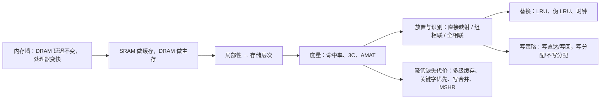

# L06 缓存

[课程目录](../index.md)

处理器的频率与并行度不断提高，而一次 DRAM 访问的延迟几十年来一直在 80–100 ns 左右，这道“内存墙”使访存成为性能瓶颈。本讲说明缓存如何借助程序的局部性弥合这一差距：先认识 SRAM、DRAM 两种存储介质和存储层次，再用命中率、3C 缺失与 AMAT 度量缓存性能，然后依次回答缓存设计的几个基本问题——块放在哪里、如何查找（直接映射、组相联、全相联），缺失时替换谁，写操作怎么处理，最后以 AMAT 为纲介绍降低缺失代价的四类技术。阅读前需要熟悉 L02 的 CPU 性能公式 $\text{CPU time} = IC \times CPI \times T_{clk}$、流水线停顿的概念以及二进制地址的位划分；降低缺失率和命中时间的优化留到 L08。

## 章节导航

- [01 内存墙与存储技术](chapters/01-memory-wall-and-memory-technologies.md)：内存墙成因与 SRAM、DRAM 单元结构及阵列组织
- [02 局部性与存储层次](chapters/02-locality-and-memory-hierarchy.md)：局部性是存储层次的第一性原理，各级速度容量粒度与管理者不同
- [03 缓存性能度量](chapters/03-cache-performance-metrics.md)：命中缺失指标、3C 分类、含停顿的 CPU 时间与 AMAT
- [04 直接映射缓存](chapters/04-direct-mapped-cache.md)：直接映射的地址划分、查找、多字块权衡与乒乓效应
- [05 组相联与全相联](chapters/05-set-associative-and-fully-associative.md)：组相联的结构代价、相联度规律与三类映射统一
- [06 替换策略](chapters/06-cache-replacement-policies.md)：缺失时选择牺牲块：LRU、伪LRU树与时钟算法
- [07 写策略](chapters/07-cache-write-policies.md)：写命中的写直达与写回，写缺失的写分配与不写分配
- [08 降低缺失代价](chapters/08-reducing-miss-penalty.md)：多级缓存、关键字优先、写合并与非阻塞缓存降低缺失代价

## 本讲小结

### 概念脉络

局部性解释了为什么小而快的上层能挡住大部分访问（[局部性与存储层次](chapters/02-locality-and-memory-hierarchy.md)）；AMAT 和 3C 把“挡得好不好”变成可计算、可归因的量（[缓存性能度量](chapters/03-cache-performance-metrics.md)）。后面每一项设计都可以对照这两把尺子来看：提高相联度针对冲突缺失，替换策略决定满组时逐出谁，写策略影响写停顿与下层流量，第 8 章的技术则直接压缩 AMAT 中的缺失代价项。

### 设计决策一览

| 设计问题 | 可选方案 | 关键取舍 | 详见 |
| --- | --- | --- | --- |
| 块放在哪、怎么找 | 直接映射 / $n$ 路组相联 / 全相联 | 相联度越高冲突缺失越少，但比较器、选路延迟与面积越大；1 路→2 路收益最大 | [直接映射缓存](chapters/04-direct-mapped-cache.md)、[组相联与全相联](chapters/05-set-associative-and-fully-associative.md) |
| 块多大 | 单字块 / 多字块（常见 64 B） | 块大利用空间局部性，过大则块数太少、缺失率回升 | [直接映射缓存](chapters/04-direct-mapped-cache.md) |
| 缺失时替换谁 | Static / Random / FIFO / LRU / NRU / 树形伪 LRU / 时钟 | 真 LRU 超过 2 路难以在一个周期内实现，伪 LRU 用 $N-1$ 位近似 | [替换策略](chapters/06-cache-replacement-policies.md) |
| 写命中怎么写 | 写直达 + 写缓冲 / 写回 + 脏位 | 写直达始终一致但写流量大；写回省流量但使缓存一致性更复杂 | [写策略](chapters/07-cache-write-policies.md) |
| 写缺失要不要调块 | 写分配 / 不写分配 | 一次写远小于缓存行，写分配须先读入整行；不写分配多配写直达 | [写策略](chapters/07-cache-write-policies.md) |
| 多级层次的内容关系 | 包含 / 非包含非排他 / 排他 | 包含需反向无效化；排他有效容量最大，适合上下层容量相近 | [降低缺失代价](chapters/08-reducing-miss-penalty.md) |

### 核心公式

| 公式 | 含义 | 详见 |
| --- | --- | --- |
| $N_{\rm DRAM} = t_{\rm DRAM} \times f_{\rm clk}$ | 固定纳秒延迟折合的周期数随频率增长 | [内存墙与存储技术](chapters/01-memory-wall-and-memory-technologies.md) |
| $\text{Miss rate} = 1 - \text{Hit rate}$ | 缺失率与命中率互补 | [缓存性能度量](chapters/03-cache-performance-metrics.md) |
| $\text{CPU time} = IC \times (CPI_{ideal} + \text{Cycles}_{memory\text{-}stall}) \times T_{clk}$ | 把存储停顿计入 CPI，括号内为 $CPI_{stall}$ | [缓存性能度量](chapters/03-cache-performance-metrics.md) |
| $\text{Cycles}_{memory\text{-}stall} = 1 \times MR_{I\$} \times P_{miss} + f_{LD/ST} \times MR_{D\$} \times P_{miss}$ | 每条指令的平均停顿周期（I\$ 每条指令一次，D\$ 只算访存指令） | [缓存性能度量](chapters/03-cache-performance-metrics.md) |
| $AMAT = \text{Hit time} + \text{Miss rate} \times \text{Miss penalty}$ | 平均存储访问时间，也是优化框架 | [缓存性能度量](chapters/03-cache-performance-metrics.md)、[降低缺失代价](chapters/08-reducing-miss-penalty.md) |
| $\text{index} = \text{块地址} \bmod \text{缓存块数}$ | 直接映射的唯一位置 | [直接映射缓存](chapters/04-direct-mapped-cache.md) |
| $\#\text{sets} = B / n$，$\text{tag} = A - \log_2 \#\text{sets} - \text{offset}$ | 容量固定时相联度翻倍，index 少 1 位、tag 多 1 位 | [组相联与全相联](chapters/05-set-associative-and-fully-associative.md) |

## 不确定事项

- section-2：寄存器容量约 1000 B、单块 SSD 512 TB、服务器 1–2 TB DRAM 等数值只出自 ASR 转写，无法对照讲义核实
- section-5：讲稿称 L1I 多为直连、L1D 多为 4 路，与现代 CPU 常见的 8 路 L1 不符，已用补充解释说明，未给出具体厂商数据
- section-6：NRU 按讲稿描述为“记录上次使用的行、换别的行逐出”，与 Itanium 2 实际使用的每行 used 位实现可能有出入
- section-7：写缓冲 FIFO（#entry = 4）只出现在讲义文本提取中，渲染图中不可见
- section-1：内存墙图中 2010+ 约 0.04 周期/指令（即每周期几十条指令）按图与讲稿照录，与单核实际 IPC 相比偏高

> [!info]- 来源
> - L06-Cache.pdf：PDF p.1–2, 6–29, 31–68
> - L06.docx：DOCX body 1–390
