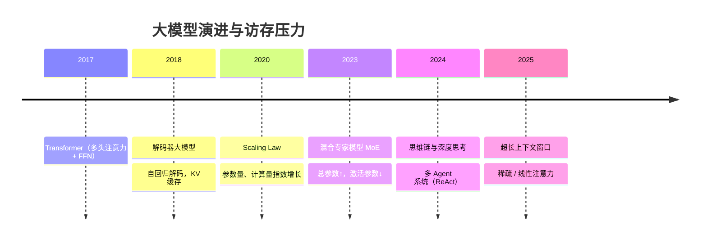
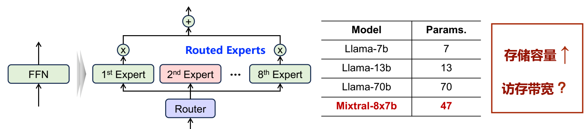
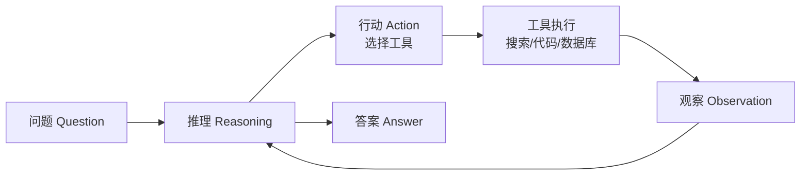
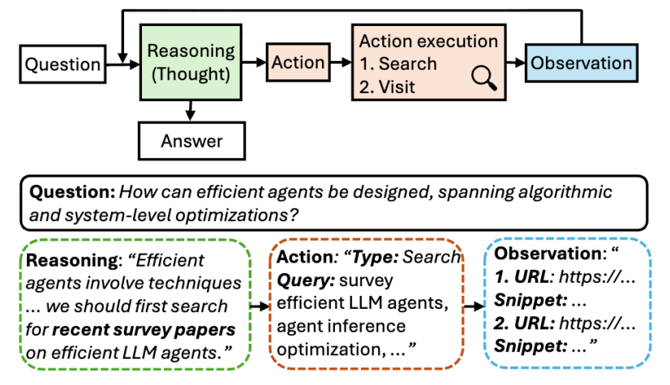

# 01 大模型演进与访存需求

[本讲目录](../index.md) · [课程目录](../../index.md) · [下一节：02 先进大模型架构剖析](02-frontier-llm-architectures.md)

> [!abstract] 本节要点
> - Transformer 由多头注意力和前馈网络（FFN）堆叠而成；注意力对每个 token 计算 $Q$、$K$、$V$，用 $QK^{\top}$ 衡量 token 间相关性，再对 $V$ 加权求和。
> - 解码器大模型自回归地逐 token 生成：新 token 的 $Q$ 要与之前所有 token 的 $K$、$V$ 计算，所以必须保存 **KV 缓存**；而且每生成一个 token，都要把全部模型参数和全部 KV 缓存从存储搬到计算单元。
> - 存储容量 $=$ KV 缓存 $+$ 模型参数量；访存带宽 $=$ 存储容量 $\times$ Tokens/s。批处理时参数被所有请求共享，KV 缓存则按请求分别存储、分别加载。
> - Scaling Law 推动参数量与计算量指数增长，但硬件算力约 $3.0\times$/2 年，DRAM 带宽只有约 $1.6\times$/2 年，模型规模与硬件存储之间的差距形成内存墙。
> - MoE 用稀疏激活解耦参数量与计算量（总参数↑、激活参数↓，存储容量↑、带宽"？"）；思维链、Agent（ReAct 循环、重复 prefill–decode）和 1M 级上下文使 KV 缓存急剧膨胀，进而推动稀疏注意力和线性注意力。

自 2022 年 ChatGPT 发布以来，大模型深刻改变了智能体、智能助手、代码与生产力工具等领域，但它的计算特性使高效部署面临巨大挑战。[^s1p3] 本讲关注的是模型训练完成之后的**推理与部署**阶段，而推理的主要难点不在"算得不够快"，而在"数据搬得不够快"。本节沿着 2017 年至 2025 年的模型演进，逐步说明每一步架构变化如何改变**存储容量**和**访存带宽**这两项需求，最终把推理瓶颈推到了内存上。

## Transformer 与多头注意力（Multi-Head Attention）

2017 年以前，文本、语音、图像分别由循环网络、卷积网络等不同结构处理。Transformer 出现后取代了卷积和循环网络，用同一种结构统一了文字、语音、视觉等多模态的表征学习，当前大模型的主干网络基本都由 Transformer 模块堆叠而成。[^s1p4]

**Transformer** 最初是编码器–解码器（encoder–decoder）结构：编码器处理全部输入，解码器逐个产生输出。每个 Transformer 模块包含两个核心部分：

1. **多头注意力（Multi-Head Attention）**：对每个输入 token 分别计算查询 $Q$（query）、键 $K$（key）和值 $V$（value）三个向量。用 $Q$ 与其他 token 的 $K$ 做点积（即 $QK^{\top}$），得到 token 之间的相关性；再按相关性对各 token 的 $V$ 加权求和，得到该 token 的输出。"多头"指把这一计算分成多组并行做，因为一个 token 与另一个 token 的关系在不同层面上可能不同，每个头可以刻画一种关系。
2. **前馈网络（Feed-Forward Network, FFN）**：也叫 MLP，对每个 token 单独做两层全连接变换。模型参数的绝大部分集中在 FFN 中，这一点是后面 MoE 的出发点。

> [!info] 可视化资源
> [Transformer Explainer：GPT-2 交互式可视化](https://poloclub.github.io/transformer-explainer/)：在浏览器中实时运行 GPT-2，可逐步查看 token 嵌入、$Q$/$K$/$V$ 的计算、带掩码的多头注意力和 MLP，并悬停查看注意力权重。

> [!note] 补充解释
> 注意力的标准写法是 $\mathrm{Attention}(Q,K,V)=\mathrm{softmax}\!\left(\frac{QK^{\top}}{\sqrt{d_k}}\right)V$，其中 $d_k$ 是 $K$ 向量的维度，除以 $\sqrt{d_k}$ 是为了让点积的数值范围稳定。课程只用到"$QK^{\top}$ 求相关性、再对 $V$ 加权"这一层含义。原始论文见 [Attention Is All You Need](https://arxiv.org/abs/1706.03762)。

## 自回归解码与 KV 缓存（KV Cache）

2018 年起出现了只保留解码器的**解码器大模型**（decoder-only），GPT 系列就属于这一类。它的生成方式决定了推理时必须反复访问大量数据。

**自回归解码**（autoregressive decoding）是指模型逐个生成输出令牌（token）：用户输入提示词后，模型产生第一个输出 token；这个 token 在下一时刻作为输入，再产生下一个 token，如此循环直到生成结束。[^s1p5]

自回归解码给推理带来两个重要后果：

1. **必须保存 KV 缓存**：生成新 token 时，注意力要计算 $QK^{\top}$，即当前 token 的 $Q$ 要与之前**所有** token 的 $K$ 求相关性，再与之前所有 token 的 $V$ 加权求和。也就是说，每个 token 的生成都依赖之前全部 token。之前 token 的 $K$、$V$ 在后续每一步都会再次用到，如果每次都重新计算就会大量重复，所以把它们存下来，这就是**KV 缓存**（KV cache）。生成的 token 越多，KV 缓存越大。
2. **每个 token 都要加载全部参数与 KV 缓存**：每生成一个输出 token，都要把全部模型参数和全部 KV 缓存从存储器加载到计算单元，每一步都要重复这次加载。[^s1p5]

> [!note] 补充解释
> 只缓存 $K$、$V$ 而不缓存 $Q$，是因为旧 token 的 $Q$ 只在生成它那一步使用过一次，后续 token 只需要用自己的新 $Q$ 去查询旧 token 的 $K$、$V$。KV 缓存的具体大小由序列长度、层数、头数和头维度决定，压缩它的各种方法见[KV 缓存的三个维度与压缩方法](04-moe-and-sparse-attention.md)。

> [!info] 可视化资源
> [Hugging Face：KV 缓存原理详解](https://huggingface.co/blog/kv-cache)：用自回归示意图、注意力矩阵对比图和 prefill/decode 流程图说明为什么要缓存每层的 $K$、$V$、每步只计算新 token，以及它以内存换计算的代价。

### 存储容量与访存带宽公式

由上面两条后果可以得到单个请求推理时的两个需求：[^s1p5]

$$
\text{存储容量} = \text{KV 缓存} + \text{模型参数量}
$$

$$
\text{访存带宽} = \text{存储容量} \times \text{Tokens/s}
$$

第一个式子说明需要存放的数据包括模型参数和 KV 缓存；第二个式子说明，每生成一个 token 都要把这些数据完整读一遍，所以每秒需要的访存量等于存储容量乘以每秒生成的 token 数。存储容量的单位是字节（如 GB），Tokens/s 是生成速度，带宽单位是 GB/s。

**批处理**（batching）时情况会变化（以下批处理公式依据讲解整理，讲义未单独列出）。实际部署中，一台机器不会每次只计算一个用户的请求，而是把多个请求组成一批（batch）一起计算。同一批里的请求共享同一份模型参数，但每个请求有自己的上下文，因此各自拥有一份 KV 缓存。记批大小为 $B$，单个请求的 KV 缓存为 $M_{\rm KV}$，模型参数量为 $M_{\rm param}$（单位均为字节）：[^s2b2]

$$
\text{存储容量} = B \times M_{\rm KV} + M_{\rm param}
$$

每做一步解码，模型参数只需加载一次，就能被批内 $B$ 个请求共用；KV 缓存则要按请求分别加载，一共 $B$ 份。设每秒解码步数为 $\text{ITERs/s}$（每步为批内每个请求各生成 1 个 token），则

$$
\text{访存带宽} = (B \times M_{\rm KV} + M_{\rm param}) \times \text{ITERs/s}
$$

所以批处理能摊薄参数的访存开销，却不能摊薄 KV 缓存的访存开销。

> [!example] 例：参数与 KV 缓存的访存量（数值为说明用的假设）
> 设模型有 70 亿参数（Llama-7b 量级），每个参数 2 字节，则 $M_{\rm param}=14$ GB；设每个请求当前的 KV 缓存 $M_{\rm KV}=1$ GB。
>
> 1. **单请求、20 tokens/s**：存储容量 $=14+1=15$ GB，访存带宽 $=15\ \text{GB}\times 20/\text{s}=300$ GB/s。
> 2. **批大小 $B=8$**：存储容量 $=8\times1+14=22$ GB。每步解码加载 22 GB，同时为 8 个请求各产生 1 个 token，平均每个 token 约 $22/8=2.75$ GB，远小于单请求时的 15 GB。
> 3. 被摊薄的只是参数这 14 GB；KV 缓存仍是每个请求 1 GB。上下文越长，$M_{\rm KV}$ 越大，批处理的收益越小。

> [!warning] 易错点
> "批处理能缓解访存瓶颈"只对模型参数成立。KV 缓存随请求数 $B$ 线性增加，也要随每一步解码分别加载；长上下文场景下 KV 缓存成为主体，批处理基本不能降低它带来的带宽压力。

## Scaling Law 与内存墙

2020 年前后，OpenAI 的研究（讲者将其归于 GPT-3 相关工作）总结出**尺寸定律**（Scaling Law）：对解码器大模型而言，模型参数量越大、训练计算量越大、训练数据量越多，模型能力就越强。也就是说，模型能力在一定程度上随参数量、训练计算量和训练数据量的增长而提高。此后业界沿着"堆数据、堆算力、扩大模型"的路线发展，到 2022 年底出现了 ChatGPT。

Scaling Law 带来的直接后果是：大模型规模呈指数级增长，计算需求和存储/访存需求也随之指数级提升，存储容量↑、访存带宽↑。[^s1p6]

问题在于硬件跟不上。讲义两张统计图（"AI and Memory Wall" 与峰值算力/带宽缩放图）给出的增长速度如下：[^s1p6]

| 指标 | 增长速度 |
| --- | --- |
| Transformer 模型规模（参数量） | 约 $410\times$ / 2 年 |
| AI 硬件存储容量（单卡显存） | 约 $2\times$ / 2 年 |
| 硬件峰值算力（HW FLOPS） | $60000\times$ / 20 年（约 $3.0\times$ / 2 年） |
| DRAM 带宽 | $100\times$ / 20 年（约 $1.6\times$ / 2 年） |
| 互连带宽（Interconnect BW） | $30\times$ / 20 年（约 $1.4\times$ / 2 年） |

从表中可以读出两层差距：

1. **模型规模 vs. 存储容量**：模型参数每两年增长约 410 倍，单卡显存每两年只翻一倍，模型越来越难以放进单卡存储。
2. **算力 vs. 带宽**：算力增长速度远快于存储容量增长、访存带宽增长和通信带宽增长。即使计算单元足够快，数据也送不过来。

这种差距就是大模型推理面临的**内存墙**（memory wall），也就是访存瓶颈。[^s2b2]内存墙的一般概念见 L06《01 内存墙与存储技术》，这里是它在大模型上的具体体现。

## 混合专家模型（Mixture of Experts, MoE）

按 Scaling Law 扩大模型时，参数量每增加一点，训练和推理的计算量也会相应增加，计算开销很快变得难以承受。混合专家模型的目的就是让参数量增加时计算量不跟着同比例增加。MoE 的概念出现得更早，但 2023–2024 年才在大模型中被大规模使用。[^s1p7]

**混合专家模型**是把 Transformer 中的一个大 FFN 拆成多个较小的"专家"（expert），每个 token 只激活其中一部分专家的模型结构。它通过不同粒度的稀疏激活机制，解耦大模型参数量和计算量的增长。[^s1p7] 这一设计借鉴了大脑分区的思路：人做某项特定任务时，并不会同时调动所有脑区。

MoE 层的计算过程：

1. **路由**：token 的表示先送入路由器（Router），由它从全部专家中选出一个子集，例如从 8 个专家中选 2 个。
2. **专家计算**：只有被选中的专家（激活专家）对该 token 做 FFN 计算，其余专家不参与。
3. **聚合**：各被选专家的输出乘以路由器给出的权重后相加，作为该层的输出。

图：左边是把单个 FFN 换成由 Router 选择的 8 个 Routed Experts，加权后求和；中间的表比较参数量（单位：十亿）：Llama-7b 为 7、Llama-13b 为 13、Llama-70b 为 70，MoE 模型 Mixtral-8x7b 为 47；右边的框提示存储容量上升，访存带宽是否随之上升还是问号。[^s1p7]

> [!note] 补充解释
> Mixtral-8x7b 的总参数是 47B 而不是 $8\times7=56$B，因为只有 FFN 被拆成 8 个专家，注意力等部分是共享的。它每个 token 激活 8 个专家中的 2 个，实际参与计算的参数约 13B，见 [Mixtral of Experts](https://arxiv.org/abs/2401.04088)。所以它存储上接近 47B 的模型，单 token 计算量却接近 13B 的模型。

近年的发展趋势是专家数量越来越多、激活占比越来越低，即稀疏度越来越高。讲者认为，国内芯片制程落后会限制单位芯片面积上的算力，这也促使国内模型更多选择更稀疏的路线。

MoE 对存储和访存需求的影响需要分开看：

- **存储容量↑**：在相同能力下，稠密模型的总参数量通常更小。MoE 实际上是**用更大的总参数量换取更少的激活参数和计算量**，所以总存储容量会增加。
- **访存带宽"？"**：生成每个 token 时不需要激活全部参数，加载的参数变少，带宽需求看起来可以降低。但讲义在这里打了问号，因为大存储容量可能迫使模型被**卸载**（offload）到更远、更慢的存储中；同时路由形成**动态计算图**，哪些专家被激活要到运行时才知道，只能按需加载专家。[^s1p7]

MoE 推理的具体挑战及应对方法见[MoE 推理挑战与专家冷热不均](04-moe-and-sparse-attention.md)；先进模型中的 Latent MoE、共享专家设计见[先进大模型架构剖析](02-frontier-llm-architectures.md)。

> [!warning] 易错点
> MoE 减少的是**每个 token 的激活参数**，不是**总参数**。判断存储容量时看总参数（Mixtral-8x7b 按 47B 计），判断单 token 计算量时看激活参数。不能因为"只激活 2 个专家"就认为显存需求也变小。

## 思维链、Agent 与超长上下文

MoE 主要改变的是"参数"这一项，而 2024 年之后的发展主要推高的是 KV 缓存。多模态、深度思考等计算范式使大模型的上下文长度指数级增长，并推动了稀疏注意力和线性注意力机制的发展。[^s1p8]

### 思维链与深度思考

思维链（Chain of Thought, CoT）是指不让模型直接输出答案，而是让它一步一步输出推理过程，甚至检验推理是否正确。通过强制模型这样输出，并在训练数据中加入大量这类分步推理样本，模型在 GSM8K 这类数学题上的复杂问题求解能力大幅提升。复杂思维链算法还会引入并行扩展，同时展开多条思路。[^s1p8]

它的代价是输出变得很长，即使问"1+1 等于几"，模型也会先分析一大段再给出答案。而每个输出 token 的 $K$、$V$ 都要记入 KV 缓存，所以需要产生、存储和访问的 KV 缓存显著增加，计算、存储和访存需求进一步提升。[^s1p8] 在当前多卡大模型服务（serving）场景中，即使模型很大，参数在存储中的占比也不高，**KV 缓存已成为存储占用的主体**。因此出现了各种稀疏化、轻量化 KV 缓存的方法。思维链的正式定义、它的扩展形式思维树及其系统优化见[思维链与思维树](05-tree-of-thought-and-near-memory-computing.md)。

### Agent 与 ReAct 工作流

**Agent**（智能体）系统让大模型通过调用工具与外界交互，不再只输出 token。Agent 系统，特别是多 Agent 系统，通过"推理–工具调用"循环可以显著提升能完成的任务复杂度。[^s1p9] 常用的工作流是 **ReAct**（Reasoning + Acting），它是一个循环：

1. **推理**（Reasoning / Thought）：模型输出一段较长的分析，判断当前该做什么决策。
2. **行动**（Action）：从提供的工具中选一个执行。常用工具包括搜索、代码执行、数据库等，也可以是命令行（CLI）、计算器等。
3. **观察**（Observation）：工具执行后返回结果，例如搜索得到的若干 URL 和摘要。
4. **再推理**：观察结果送回模型，模型根据当前状态决定下一步；若问题已解决则输出答案（Answer），否则回到第 2 步。

图：ReAct 工作流从 Question 进入 Reasoning，再到 Action、Action execution（Search/Visit）、Observation，然后回到 Reasoning 继续循环，直到输出 Answer。下方示例的问题是"如何设计高效的 Agent"：模型先推理出"应先搜索相关综述"，Action 发起一次 Search，Observation 返回若干 URL 与摘要，再进入下一轮推理。

ReAct 对推理系统有两点影响：[^s1p9]

1. **上下文变长**：工具调用（例如从网上抓取大量文字）和复杂推理都会把大量内容放进上下文。
2. **计算范式改变**：传统对话是"一次 prefill、多次 decode"，即先一次性处理输入提示，再逐 token 生成。Agent 中每轮工具返回的观察结果都要作为新输入再处理一次，计算变成重复的"prefill–decode"工作流。

> [!note] 补充解释
> **prefill**（预填充）指一次性并行处理输入提示中的所有 token，建立它们的 KV 缓存；**decode**（解码）指此后按自回归方式每步生成一个 token。prefill 可以并行，decode 每步都要完整读一遍参数和 KV 缓存，是前面带宽公式描述的阶段。

### 超长上下文与稀疏、线性注意力

到 2025 年，先进大模型都支持 **1M 以上**的上下文窗口，128K 已经显得不够大。长上下文显著增加了存储、访存和计算开销。[^s1p10]

稀疏化的直觉是：在此之前几乎所有注意力都是**稠密**的，每个 token 都要考虑之前所有的 KV 缓存。当上下文达到几百 K 甚至 1M 时，并不需要每次都看全部历史。人说话时，影响当前词最多的是邻近的词，几天前说过的话影响不大。据此出现了两类模型架构创新：[^s1p10]

- **稀疏注意力**：每个 token 只关注部分重要的历史 token 的 KV。
- **线性注意力**：讲义在"线性注意力模型"名下列举了英伟达采用的 Mamba、千问采用的 GDA、小米提出的 HySparse，以及 DeepSeek 提出的 HCA 和 CSA。

稀疏注意力的具体做法见[滑动窗口与 CSA2](02-frontier-llm-architectures.md)和[稀疏注意力与动态召回](04-moe-and-sparse-attention.md)。

这一节的演进有一条共同主线：从解码器大模型、Scaling Law、MoE，到思维链、Agent 和超长上下文窗口，新模型结构和新训练方法中相当一部分都在应对模型参数和 KV 缓存的存储与访存问题。前期的压力主要来自参数，现在主要来自 KV 缓存。

> [!question]- 自测：某服务把批大小从 1 提到 16，发现单 token 的平均访存量在短对话下大幅下降，在 200K 长上下文下几乎不变。为什么？
> 批处理只摊薄模型参数：每步解码参数只加载一次、被 16 个请求共用；KV 缓存则每个请求一份、分别加载。短对话时参数占主导，平均到每个 token 的访存量明显下降；200K 长上下文时每个请求的 KV 缓存远大于参数，$16\times M_{\rm KV}$ 占主导，平均访存量几乎不变。

> [!question]- 自测：Mixtral-8x7b 与 Llama-13b 生成每个 token 的计算量相近，二者部署所需的存储容量哪个大？访存带宽一定更小吗？
> Mixtral-8x7b 的存储容量更大：要存 47B 总参数，而 Llama-13b 只有 13B，因为 MoE 是用总参数换激活参数。带宽不一定更小：单 token 只读被激活专家的参数，看起来更少；但总参数大可能导致模型卸载到更远的存储，且专家由路由动态决定、只能按需加载，所以讲义在"访存带宽"后打了问号。

> [!question]- 自测：一个 Agent 完成任务需要 5 轮 ReAct 循环，每轮搜索返回 20K token 的网页内容。与一次性回答相比，它对推理系统的存储和访存需求有什么不同？
> 上下文累计增加约 100K token，每个 token 的 $K$、$V$ 都要进入 KV 缓存，存储容量随之增长；之后每生成一个 token 都要读一遍这份更大的 KV 缓存，访存带宽需求同步升高。同时计算从"一次 prefill、多次 decode"变成 5 轮重复的 prefill–decode，每轮都要先 prefill 新的观察结果。

> [!info]- 来源
> - L07-Guest-Lecture.pdf：PDF p.3–10
> - L07.docx：DOCX body 1–100

[^s1p3]: L07-Guest-Lecture.pdf-PDF p.3
[^s1p4]: L07-Guest-Lecture.pdf-PDF p.4
[^s1p5]: L07-Guest-Lecture.pdf-PDF p.5
[^s2b2]: L07.docx-DOCX body 38-69
[^s1p6]: L07-Guest-Lecture.pdf-PDF p.6
[^s1p7]: L07-Guest-Lecture.pdf-PDF p.7
[^s1p8]: L07-Guest-Lecture.pdf-PDF p.8
[^s1p9]: L07-Guest-Lecture.pdf-PDF p.9
[^s1p10]: L07-Guest-Lecture.pdf-PDF p.10

[本讲目录](../index.md) · [课程目录](../../index.md) · [下一节：02 先进大模型架构剖析](02-frontier-llm-architectures.md)
