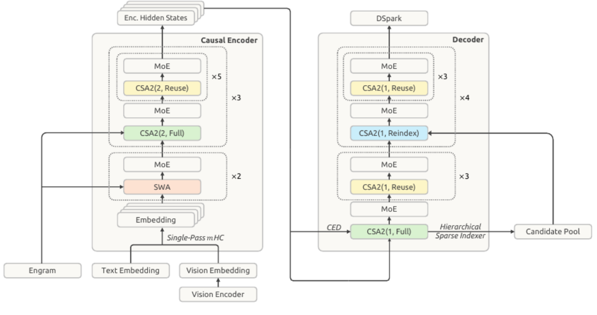
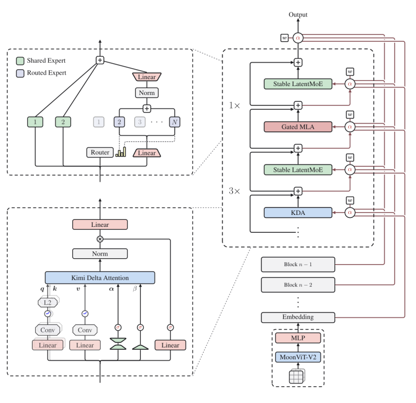
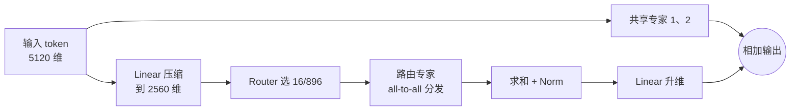

# 02 先进大模型架构剖析

[本讲目录](../index.md) · [课程目录](../../index.md) · [上一节：01 大模型演进与访存需求](01-llm-evolution-and-memory-demand.md) · [下一节：03 带宽瓶颈与并行解码](03-bandwidth-bottleneck-and-parallel-decoding.md)

> [!abstract] 本节要点
> - DeepSeek-V4.1-Flash：总参数 552B，MoE 384 选 6，CSA2 稀疏注意力 + 滑动窗口注意力（SWA），相邻层复用 KV 缓存，mHC 取代残差连接，另有 196B 参数的 Engram，原生支持 DSpark 推测解码；每生成 1 个 token 激活 16B 参数、计算约 0.032 TFLOPs、访存约 11 GB、新增 KV 缓存 890 B。
> - Kimi-K3：总参数 2.78T、激活 104.2B；896 个路由专家选 16，另加 2 个所有 token 必经的共享专家；Latent MoE 先把 token 从 5120 维压到 2560 维再分发，以降低 all-to-all 通信；69 层 KDA + 24 层门控 MLA；AttnRes 跨层融合取代残差；每 token 计算约 0.866 TFLOPs、访存约 140 GB、新增 KV 缓存 13.5 KB。
> - 滑动窗口注意力只保留最近若干（如 8K/16K）个 token 的 KV；CSA2 则从全部上下文中挑出最重要的若干 token；KV 复用让多层共用一份 KV 缓存。
> - 短上下文下每 token 计算量 $\approx 2\times$ 激活参数量：$M\times N$ 的矩阵乘向量需要 $MN$ 次乘法和约 $MN$ 次加法，共 $2MN$ FLOPs。
> - 先进模型的每一项结构设计都对应部署芯片的计算、通信或存储约束：MoE 降计算与激活参数，Latent MoE 降通信，稀疏/线性注意力与 MLA 降 KV 存储与访存；看模型维度就能大致推断它面向什么卡。

## 从基线 Transformer 到"非常复杂"的架构

基线 Transformer 的每一层只有多头注意力加 FFN 两个模块（见[Transformer 与多头注意力](01-llm-evolution-and-memory-demand.md)）。而思维链、Agent 与百万 token 上下文让 KV 缓存和模型参数的存储、访存压力持续变大，先进模型因此在几乎每个模块上都做了改动。分析这些改动时，关键问题始终是：**它省掉了哪一部分的存储、访存或通信？**

本节用两个先进模型作为解剖样本，都以讲义给出的参数为准：

| 指标（每生成 1 个 token） | DeepSeek-V4.1-Flash | Kimi-K3 |
| --- | --- | --- |
| 总参数量 | 552B（另有 Engram 196B） | 2.78T |
| 激活参数量 | 16B | 104.2B |
| 计算量 | 约 0.032 TFLOPs | 约 0.866 TFLOPs |
| 访存量 | 约 11 GB | 约 140 GB |
| 新增 KV 缓存 | 890 Byte | 13.5 KB |
| MoE 配置 | 384 选 6 | 896 选 16 + 2 个共享专家 |
| 注意力 | CSA2 稀疏注意力 + SWA | 69 层 KDA + 24 层门控 MLA |
| 残差连接的替代 | mHC | AttnRes |
| 最长上下文 | 1M token | 1M token |

两者的激活比例都很低：DeepSeek-V4.1-Flash 为 $\frac{16}{552}\approx 2.9\%$，Kimi-K3 为 $\frac{104.2}{2780}\approx 3.7\%$，即每个 token 只用到不到 $\frac{1}{25}$ 的参数，稀疏度很高。[^s2b4]

> [!info] 可视化资源
> [Sebastian Raschka：大模型架构对比](https://magazine.sebastianraschka.com/p/the-big-llm-architecture-comparison)：用大量架构图对比 DeepSeek V3（MLA、含共享专家的 256 专家 MoE）、Kimi K2、Gemma 3 的滑动窗口注意力及其 KV 缓存节省，可作为理解本节各组件的标准图示。

## DeepSeek-V4.1-Flash 架构

DeepSeek-V4.1-Flash 是 552B 参数的混合专家模型，采用稀疏注意力架构，最长上下文 1M token；生成单个 token 激活 16B 参数，计算约 0.032 TFLOPs，访存约 11 GB，生成的 KV 缓存为 890 Byte。[^s1p12] 它原生支持文本与视觉（Vision Encoder → Vision Embedding）等多模态输入，整体分为两部分：

1. **20 层 Causal Encoder**：用于 prefill 阶段，处理输入的提示词。输入端由 Engram、Text Embedding、Vision Embedding 经 Single-Pass mHC 汇入 Embedding。底部 2 组为"SWA + MoE"，其上 3 大组，每组为"CSA2(2, Full) + MoE"后接 5 次"CSA2(2, Reuse) + MoE"，共 $2 + 3\times(1+5) = 20$ 层，输出 Enc. Hidden States。
2. **20 层 Decoder**：负责逐 token 解码。首层为 CSA2(1, Full) + MoE，并通过 Hierarchical Sparse Indexer 建立 Candidate Pool；接着 3 次"CSA2(1, Reuse) + MoE"；再往上 4 大组，每组为"CSA2(1, Reindex) + MoE"后接 3 次"CSA2(1, Reuse) + MoE"，共 $1 + 3 + 4\times(1+3) = 20$ 层。顶部接 DSpark 推测解码模块。

图：左边的 Causal Encoder 由 SWA+MoE 和 CSA2(2, Full/Reuse)+MoE 堆叠而成，输入端接 Engram、文本嵌入和视觉嵌入；右边的 Decoder 由 CSA2(1, Full/Reuse/Reindex)+MoE 组成，经 Hierarchical Sparse Indexer 连到 Candidate Pool，最后输出 DSpark。黄色的 Reuse 层占了绝大多数，说明大部分层不单独生成 KV 缓存。

下面逐个说明各模块。

### 滑动窗口注意力（Sliding Window Attention, SWA）

即使上下文窗口达到 1M token，生成当前词时影响最大的通常是邻近的词，几天前说过的话影响很小；至少不必在每一层都记住全部历史。

**滑动窗口注意力**（Sliding Window Attention）是指某一层只保存并关注最近固定数量（例如 8K 或 16K）个 token 的 KV，窗口随生成向前滑动，更早的 token 不再参与该层的注意力计算。[^s2b4] 这样该层的 KV 缓存大小是常数，不随上下文长度增长。DeepSeek-V4.1-Flash 只在编码器最底部的 2 组层中使用 SWA，其余层用 CSA2 保证仍能"看见"远处的重要 token。SWA 的遗忘问题以及它与 GQA、MLA 在 KV 维度上的比较见[混合专家与稀疏注意力](04-moe-and-sparse-attention.md)。

### CSA2 稀疏注意力与跨层 KV 复用

**CSA2** 是 DeepSeek 提出的稀疏注意力结构：面对 1M 的上下文，它在全部历史 token 中挑选出最重要的若干个（例如 16K 或 8K 个）参与注意力计算，而不是对所有 token 做稠密注意力。[^s2b4] 与 SWA 按"远近"截断不同，CSA2 按"重要性"挑选，远处的关键 token 也能被选中。

图中 CSA2 有三种标注：

- **Full**：该层完整计算并存储自己的 KV 缓存。
- **Reuse**：该层直接复用前一层的 KV 缓存，不再单独存一份；但各层挑选的 token 索引可以不同，比如前一层认为第 1、2、3 个 token 最重要，这一层可能认为第 5、6、7 个最重要。
- **Reindex**：解码器中从 Candidate Pool 重新挑选索引的层。

**跨层 KV 复用**的目的就是压缩 KV 缓存：原本 20 层的模型每层都要存自己的 KV，现在让相邻层（例如第 2、3 层，第 4、5 层）只存一份 KV 缓存。[^s2b4] 结合 CSA2 的稀疏选择，每 token 新增的 KV 缓存降到 890 Byte。

> [!warning] 易错点
> Reuse 复用的是 **KV 缓存本身**，并不意味着两层关注同一批 token。讲解中也没有确定 Reuse 层是沿用上一层的索引还是重新计算索引；能确定的是它只省 KV 的存储与访存，注意力在哪些 token 上计算仍可以逐层不同。

### 6/384 MoE、mHC、Engram 与 DSpark

- **MoE 384 选 6**：每个 token 只激活 384 个专家中的 6 个，比例 $\frac{6}{384}\approx 1.6\%$，非常稀疏。MoE 的基本思想见[大模型演进与访存需求](01-llm-evolution-and-memory-demand.md)。
- **mHC 取代传统 residual 连接**：自 ResNet 以来几乎所有模型都用残差连接，但 DeepSeek-V4.1-Flash 用 mHC 替代了它（图中输入端标为 Single-Pass mHC）。[^s1p12]
- **Engram**：额外的 196B 参数模块，在图中作为与 Text/Vision Embedding 并列的输入接入编码器。讲座没有展开它的原理。
- **原生支持 DSpark 推测解码**：解码器顶部直接接 DSpark，推测解码的机制见[带宽瓶颈与并行解码](03-bandwidth-bottleneck-and-parallel-decoding.md)。

## Kimi-K3 架构

Kimi-K3 与 DeepSeek-V4.1-Flash 有许多相似之处，也是原生支持视觉的多模态模型：图片先经 MoonViT-V2 图片编码器和 MLP 再进入 Embedding。它的核心参数为：总参数 2.78T，激活参数 104.2B，1M 长上下文窗口，896 个专家选 16 个，同时有 2 个共享专家；生成单个 token 计算约 0.866 TFLOPs，访存约 140 GB，生成 KV Cache 13.5 KB。[^s1p13]

主干由若干组模块堆叠：每组是 3 次"KDA + Stable LatentMoE"后接 1 次"Gated MLA + Stable LatentMoE"，因此线性注意力层与 MLA 层之比为 3:1，对应全模型 69 层 KDA + 24 层门控 MLA。

图：右边的主干由 KDA、Stable LatentMoE、Gated MLA 交替堆叠（3× 和 1×），红线表示 AttnRes 把 Embedding 和之前各 Block 的输出经权重 $\alpha$ 融合进当前层；左上方放大了 Stable LatentMoE，绿色为共享专家 1、2，紫色为 Router 选出的路由专家；左下方放大了 Kimi Delta Attention 的 $q$/$k$/$v$/$\alpha$/$\beta$ 分支。

### 共享专家（Shared Expert）

**共享专家**（Shared Expert）是设置在 MoE 层中、所有 token 都一定会经过的专家，不经过路由器选择。[^s2b4] Kimi-K3 每层有 2 个共享专家，再由路由器从 896 个路由专家中选 16 个；最终输出是共享专家与被选中路由专家的结果相加。

### Latent MoE

普通 MoE 中，一个 token 进入路由器（Router），被选择发往若干专家，各专家算完后把结果加在一起。在大规模部署中，专家分布在不同芯片上，把 token 发往各专家、再把结果收回是一次 **all-to-all** 通信，其开销与发送的 token 向量维度成正比。

**Latent MoE** 在把 token 送入路由专家之前，先用一个线性层对 token 做压缩，例如把 5120 维压到 2560 维，再进行路由和专家计算，最后用线性层升回原维度。[^s2b4] 维度减半，all-to-all 需要传输的数据量也随之减半。Kimi-K3 使用的是 Stable LatentMoE，讲义将其作用概括为"降低 all-to-all 路由"开销。[^s1p13]

按图中左上部分的结构，一个 token 在 Stable LatentMoE 中的流程如下：

### KDA 与门控 MLA

69 层 **KDA**（Kimi Delta Attention）与 24 层**门控 MLA**（Gated MLA）组成 Kimi-K3 的稀疏注意力机制。[^s1p13] KDA 中 K 代表 Kimi，D 代表 delta，它是一种线性注意力：图中 $q$、$k$ 经 Linear、Conv、L2 归一化，$v$ 经 Linear、Conv，另有两路门控参数 $\alpha$、$\beta$，输出经 Norm 后再与一路 Linear 门控相乘。MLA 是对多头注意力的 KV 做低秩压缩的方式，具体原理见[混合专家与稀疏注意力](04-moe-and-sparse-attention.md)。两者的共同目的是降低 KV 缓存的存储和访存开销。

### AttnRes 跨层融合

Kimi 同样认为普通残差连接已经不够，但没有采用 mHC，而是提出 **AttnRes**（Attention Residual）：对各层的残差输出再做一次注意力，按权重融合 Embedding 与之前各 Block 的输出，作为当前层的输入，取代基线中的简单逐层相加。[^s2b4]

> [!question]- 自测：Kimi-K3 一个 token 经过某个 MoE 层时，实际参与计算的专家有几个？若不使用 Latent MoE，all-to-all 每发送一次 token 的数据量是使用后的几倍？
> 共 $16 + 2 = 18$ 个专家：16 个路由专家由路由器选出，2 个共享专家必经。Latent MoE 把 token 从 5120 维压到 2560 维再分发，因此不使用时每次发送的数据量是使用后的 $\frac{5120}{2560} = 2$ 倍。

## 每 token 计算量估算

拿到一个模型的参数后，需要快速判断它每生成一个 token 要做多少计算、搬多少数据，才能判断瓶颈在哪里。

**估算规则**：在上下文不太长时，每 token 的计算量（FLOPs）约等于激活参数量的 2 倍。[^s2b4]

推导如下。大模型解码的核心计算是矩阵向量乘法：权重矩阵 $W$ 为 $M\times N$，输入向量 $x$ 为 $N\times 1$，输出 $y = Wx$ 为 $M\times 1$。

1. 需要加载的参数量为 $MN$ 个。
2. 每个输出元素 $y_i = \sum_{j=1}^{N} W_{ij} x_j$ 需要 $N$ 次乘法和约 $N$ 次加法，共 $M$ 个输出，即 $MN$ 次乘法和约 $MN$ 次加法。
3. 一次乘加计为 2 个 FLOP，所以

$$
\text{FLOPs} \approx 2MN = 2 \times (\text{参数量})
$$

推广到整个模型，只统计每个 token 实际用到的参数，即激活参数量 $P_{\rm act}$：

$$
\text{FLOPs/token} \approx 2 P_{\rm act}
$$

**为什么要求短上下文**：上下文不长时，计算主要来自加载模型参数并做矩阵向量乘；上下文很长时，注意力还要与大量历史 KV 相乘，这部分计算和 KV 访存会随上下文长度增长，不能再忽略。[^s2b5]

> [!example] 例：验证 DeepSeek-V4.1-Flash 的计算量
> 已知激活参数 $P_{\rm act} = 16\text{B} = 1.6\times 10^{10}$，求每 token 计算量。
>
> 1. $\text{FLOPs/token} \approx 2 \times 1.6\times10^{10} = 3.2\times10^{10}$ FLOPs。
> 2. $1\ \text{TFLOPs} = 10^{12}$ FLOPs，因此约为 $0.032$ TFLOPs，与讲义给出的数值一致。

> [!example] 例：用每 token 访存量估算带宽需求（据课程内容整理）
> 访存带宽 $\approx$ 每 token 访存量 $\times$ 每秒生成 token 数（公式见[大模型演进与访存需求](01-llm-evolution-and-memory-demand.md)）。若要求每秒生成 50 个 token：
>
> 1. DeepSeek-V4.1-Flash：$11\ \text{GB} \times 50/\text{s} = 550\ \text{GB/s}$。
> 2. Kimi-K3：$140\ \text{GB} \times 50/\text{s} = 7000\ \text{GB/s} = 7\ \text{TB/s}$。
> 3. 每 token 的计算访存比：DeepSeek 约 $\frac{0.032\times10^{12}}{11\times10^{9}} \approx 2.9$ FLOP/Byte，Kimi 约 $\frac{0.866\times10^{12}}{140\times10^{9}} \approx 6.2$ FLOP/Byte。每搬 1 字节只做几次运算，解码阶段明显受访存带宽限制，而不是受算力限制。

> [!warning] 易错点
> 讲义数值与估算规则存在不一致：按 $2P_{\rm act}$ 估算，Kimi-K3 应约为 $2\times104.2\text{B} \approx 0.208$ TFLOPs，而讲义标注为约 0.866 TFLOPs，讲义没有给出 0.866 的计算口径（可能计入了长上下文注意力等其他开销）。[^s1p13] 用 $2P_{\rm act}$ 估算时，要注明这是短上下文条件下的结果。另外，"访存量"取决于参数的存储精度：16B 参数对应约 11 GB，说明每个参数平均不到 1 字节，不能默认 FP16 下的 2 字节/参数。

## 架构设计与部署芯片

把上面的设计放在一起看，先进模型的每一项结构改动都对应底层芯片的某种约束：[^s2b5]

| 设计 | 针对的开销 | 对应的硬件约束 |
| --- | --- | --- |
| MoE（384 选 6、896 选 16） | 每 token 的计算量与参数访存 | 算力与访存带宽 |
| Latent MoE | 专家分发的 all-to-all 通信 | 芯片间互连带宽 |
| CSA2、SWA、KDA、MLA、KV 复用 | KV 缓存的存储容量与访存 | 显存容量与访存带宽 |

因此看一个模型的各项维度，就能大致推测它是面向什么卡设计、在什么卡上训练的：维度的选择都要充分适配训练和部署所用的芯片。训练一个大模型动辄 3 到 6 个月，训练效率越高，就能跑更多实验、获得更多经验，所以模型结构也会为训练所用的硬件做优化。[^s2b5]

> [!tip] 课堂强调
> 这些创新未必都是必要的，但每一项背后都有其硬件上的原因。理解时要追问两点：它背后的硬件原因是什么，以及它能否推广到不同代的 GPU（如从 A 卡到 H 卡、B 卡及更新一代）；在国内长期面临先进 GPU 禁运的情况下，这一点尤其重要。[^s2b3]

如何沿"参数、KV 缓存、每秒 token 数"三个方向系统地降低带宽需求，见[带宽瓶颈与并行解码](03-bandwidth-bottleneck-and-parallel-decoding.md)。

> [!question]- 自测：某模型总参数 1T，激活参数 32B，用于短上下文对话。估算每 token 计算量；若参数平均按 1 字节存储，以每秒 20 个 token 生成需要多少参数访存带宽？
> 计算量 $\approx 2\times 32\times10^9 = 6.4\times10^{10}$ FLOPs $= 0.064$ TFLOPs。每 token 至少加载激活参数约 32 GB，带宽 $\approx 32\ \text{GB}\times 20/\text{s} = 640\ \text{GB/s}$（尚未计入 KV 缓存的访存）。总参数 1T 只影响存储容量，不进入每 token 的计算量。

> [!question]- 自测：DeepSeek-V4.1-Flash 每 token 新增 KV 仅 890 B，Kimi-K3 为 13.5 KB。在 1M token 上下文下，二者单个请求的 KV 缓存各约多大？哪些设计让 DeepSeek 的数值小得多？
> DeepSeek：$890\ \text{B}\times10^6 \approx 0.89$ GB；Kimi：$13.5\ \text{KB}\times10^6 \approx 13.5$ GB。DeepSeek 的 KV 小，主要来自相邻层共用一份 KV 缓存的跨层复用，以及底层使用的滑动窗口注意力；CSA2 的稀疏选择进一步减少了每步需要加载的 KV。

> [!info]- 来源
> - L07-Guest-Lecture.pdf：PDF p.12–13
> - L07.docx：DOCX body 70–166

[^s2b4]: L07.docx-DOCX body 101-135
[^s1p12]: L07-Guest-Lecture.pdf-PDF p.12
[^s1p13]: L07-Guest-Lecture.pdf-PDF p.13
[^s2b5]: L07.docx-DOCX body 136-166
[^s2b3]: L07.docx-DOCX body 70-100

[本讲目录](../index.md) · [课程目录](../../index.md) · [上一节：01 大模型演进与访存需求](01-llm-evolution-and-memory-demand.md) · [下一节：03 带宽瓶颈与并行解码](03-bandwidth-bottleneck-and-parallel-decoding.md)
