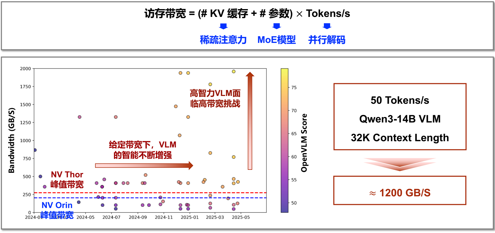
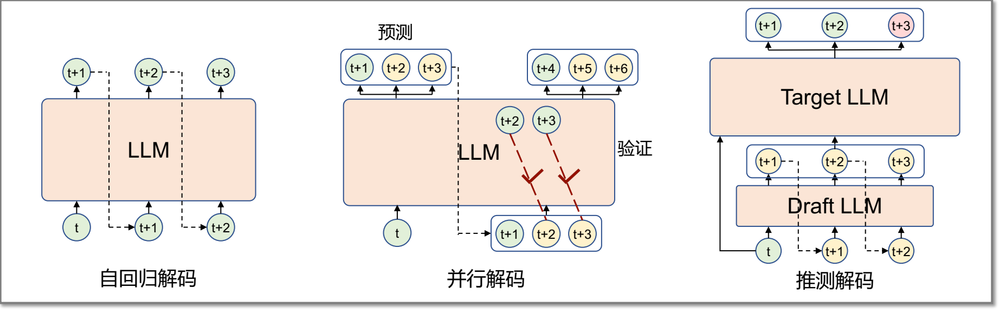
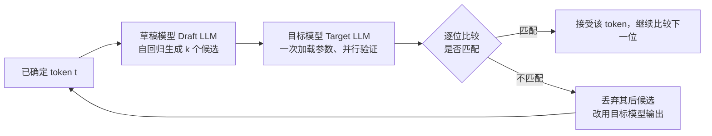
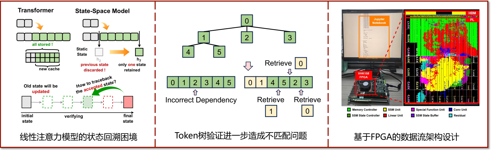

# 03 带宽瓶颈与并行解码

[本讲目录](../index.md) · [课程目录](../../index.md) · [上一节：02 先进大模型架构剖析](02-frontier-llm-architectures.md) · [下一节：04 混合专家与稀疏注意力](04-moe-and-sparse-attention.md)

> [!abstract] 本节要点
> - 访存带宽 $=$（KV 缓存量 $+$ 参数量）$\times$ Tokens/s；更精确地写成（稀疏 KV 缓存量 $+$ 激活参数量）$\times$ ITERs/s，三个因子分别对应稀疏注意力、MoE 和并行解码三条降带宽路径。
> - 端侧例：Qwen3-14B VLM、32K 上下文、50 tokens/s 约需 1200 GB/s，而 NVIDIA Thor / Orin 的峰值带宽只有约 273 / 200 GB/s，相差 5–6 倍；能力越强的 VLM 带宽需求越高。
> - 后摩尔时代芯片迭代慢（仅流片的物理时间就约 6 个月），算法每几个月就有显著变化，“算法快速迭代—芯片通用适配”的路径难以为继，必须软硬件协同。
> - 推测解码：小草稿模型自回归生成 $k$ 个候选 token，大目标模型一次并行验证并接受匹配的前缀，大模型参数加载一次就能产出多个 token；代价是被拒绝的候选浪费了计算。
> - 三个挑战：验证开销大（大批量时从访存瓶颈变成计算瓶颈）、草稿生成本身是自回归的、与 MoE 和线性注意力等新架构不匹配；SpecMamba 用 FPGA 数据流架构解决 Mamba 的状态回溯问题，较 GPU 实现 2.3 倍吞吐和 3 倍能效提升。

## 端侧推理的带宽瓶颈

要判断一个模型能否在某块芯片上“跑得动”，最直接的办法是把生成速度目标代入带宽公式，再与芯片的峰值带宽比较。带宽公式本身（每生成一个 token 都要把参数和 KV 缓存完整读一遍）见[存储容量与访存带宽公式](01-llm-evolution-and-memory-demand.md)，这里用它做定量分析。

带宽公式有两种写法：[^s1p15]

$$
\text{访存带宽} = (\#\,\text{KV 缓存} + \#\,\text{参数}) \times \text{Tokens/s}
$$

$$
\text{Memory Bandwidth} = (\#\,\text{Sparse KV Cache} + \#\,\text{Active Param}) \times \text{ITERs/s}
$$

第二个式子是把三条优化手段放进去之后的一般形式：

- $\#\,\text{Sparse KV Cache}$：每次解码迭代实际需要读取的 KV 缓存量（字节）。用了稀疏注意力后，不必读全部历史 token 的 KV。
- $\#\,\text{Active Param}$：每次迭代实际需要读取的参数量（字节）。MoE 模型只读被激活的专家。
- $\text{ITERs/s}$：每秒解码迭代次数。传统自回归解码一次迭代生成一个 token，所以 $\text{ITERs/s} = \text{Tokens/s}$；并行解码一次迭代生成多个 token，迭代次数就少于 token 数。

带宽单位为 GB/s，前两项单位为 GB，后一项单位为 1/s。

### 端侧例：Qwen3-14B VLM

考虑一个偏端侧的场景：模型为 Qwen3-14B 视觉语言模型（VLM），上下文长度 32K，目标生成速度 50 tokens/s。50 tokens/s 并不高，让模型写一道代码题都会觉得慢。但按上式计算，带宽需求约为 **1200 GB/s**（约 1.2 TB/s）。[^s1p15]

端侧设备能用的 DRAM 一般是 LPDDR（Low Power DDR），带宽有限：

| 平台 | 用途 | 峰值带宽（约） | 与 1200 GB/s 的差距 |
| --- | --- | --- | --- |
| NVIDIA Thor | 智能驾驶常用的高端 GPU（单颗约四五万元） | 273 GB/s | $1200/273 \approx 4.4$ 倍 |
| NVIDIA Orin | 智能驾驶常用 GPU | 200 GB/s | $1200/200 = 6$ 倍 |

因此需求与供给之间有 **5–6 倍**的缺口。[^s2b5]

> [!example] 例：从带宽需求反推每个 token 读多少数据
> 已知 50 tokens/s 需要约 1200 GB/s，求每生成一个 token 要读多少数据；若改用 Orin（约 200 GB/s），最多能跑多快？
>
> 1. 每 token 读取量 $= 1200\ \text{GB/s} \div 50\ \text{/s} = 24$ GB，这就是“参数 $+$ 32K 上下文 KV 缓存”的总量。
> 2. 读取量不变时，Orin 上的生成速度上限 $= 200\ \text{GB/s} \div 24\ \text{GB} \approx 8.3$ tokens/s，远低于 50 tokens/s 的目标。
> 3. 要在 Orin 上达到 50 tokens/s，必须把每 token 的读取量降到 $200/50 = 4$ GB，或让一次迭代产出多个 token。

下图横轴是 2024–2025 年各 VLM 的发布时间，纵轴是带宽需求（GB/s），颜色表示 OpenVLM Score（越亮能力越强），红、蓝虚线分别是 Thor 和 Orin 的峰值带宽。图中有两个趋势：一是在给定带宽下，VLM 的智能不断增强（同一带宽水平上点的颜色越来越亮）；二是高智力 VLM 面临高带宽挑战，能力越强的模型带宽需求越大，大量点远高于两条虚线。[^s1p15]

图：顶部公式“访存带宽 =（KV 缓存 + 参数）× Tokens/s”的三项分别对应稀疏注意力、MoE 和并行解码三条优化路径；散点图显示 2024–2025 年各 VLM 所需带宽大多高于 NV Thor 与 NV Orin 的峰值带宽虚线，而且分数越高的模型需要的带宽越大；右边举例 Qwen3-14B VLM 在 32K 上下文、50 tokens/s 下约需 1200 GB/s。

### 降低带宽的三条路径

带宽公式是三个因子的乘积，所以降低带宽需求也就有三个着力点，各自对应一类算法技术：[^s1p15]

| 公式中的因子 | 技术 | 降低带宽的方式 | 详见 |
| --- | --- | --- | --- |
| KV 缓存量 | 稀疏注意力 | 每个 token 不再读取全部历史 KV，只读取相关部分 | [稀疏注意力与动态召回](04-moe-and-sparse-attention.md) |
| 参数量 | MoE 模型 | 每个 token 只激活部分专家，只读这些专家的参数 | [粗粒度与细粒度 MoE](04-moe-and-sparse-attention.md) |
| Tokens/s（迭代次数） | 并行解码 | 一次解码迭代生成多个 token，减少模型加载次数 | 本节下文 |

并行解码的收益可以直接从公式读出：原本一次解码生成一个 token，如果一次解码能生成 10 个 token，模型需要加载的次数就变成原来的 $\frac{1}{10}$，带宽需求也降为原来的 $\frac{1}{10}$。[^s2b5]

> [!warning] 易错点
> 并行解码并不减少每次迭代读取的数据量，它减少的是迭代次数，即公式中的 $\text{ITERs/s}$。在相同 Tokens/s 目标下，每次迭代产出 $m$ 个 token，则 $\text{ITERs/s} = \text{Tokens/s} / m$。稀疏注意力和 MoE 则相反：迭代次数不变，减少的是每次迭代的读取量。

## 软硬件协同的必要性

带宽缺口可以从芯片和算法两头去补，但两头的迭代速度差得很远，单靠一方追赶另一方行不通。

**后摩尔时代**（post-Moore era）指摩尔定律已明显放缓的阶段：先进工艺节点的可获得性、成本、良率都比较差。在这一阶段，原有的“算法快速迭代—芯片通用适配”路径已无法满足 AI 发展的需求。[^s1p16] 原因在于两层的迭代周期严重不对称：

- **芯片层：迭代周期长。** 即使一切顺利，一次流片在物理上就需要约 **6 个月**（要一层一层曝光，谁都无法压缩）；回片后还要测试，测出问题就得修改设计、再流片一次，而芯片 fail 是经常会发生的事。[^s2b5]
- **算法层：快速迭代。** 算法几乎每天都有进展，每过几个月就会出现能显著影响芯片设计的新东西（前两节的 MoE、各种注意力变体都是例子）。

指望芯片“通用地”跟上快速变化的算法是不可能的，智能芯片的计算效率和安全挑战需要从算法到芯片的软硬件协同解决方案，形成闭环。[^s1p16] 协同包含两个方向的问题：

1. **芯片层**：如何设计**算法感知**的智能芯片架构，即芯片设计时要考虑上层算法的需求。
2. **算法层**：如何桥接“相对固定的”智能芯片与“快速迭代的”智能算法，即设计算法时要考虑底层芯片的能力。

第二个方向在先进模型中已能看到：MoE、Latent MoE、KDA 与 MLA 等设计都在迁就底层芯片的计算、通信与存储约束，见[架构设计与部署芯片](02-frontier-llm-architectures.md)。

## 并行解码与推测解码（Speculative Decoding）

自回归解码每生成一个 token 都要把整个大模型加载一遍，带宽需求与 Tokens/s 成正比，这是解码阶段带宽瓶颈的根源。[^s1p17] 自回归解码本身的定义见[自回归解码](01-llm-evolution-and-memory-demand.md)。

**并行解码**（parallel decoding）是指在每次解码迭代中生成多个 token，从而缓解带宽瓶颈的一类方法。它由两步组成：[^s1p17]

1. **预测**：通过并行预测，或使用小的草稿模型，生成一段候选 token 序列。
2. **验证**：用大模型验证草稿序列，确定实际可接受的 token。

三种解码方式的对比如下（对应下图）：

- **自回归解码**：LLM 输入 $t$ 时刻的 token，输出 $t+1$；再把 $t+1$ 作为输入，输出 $t+2$，依此类推，一次迭代一个 token。
- **并行解码（并行预测）**：同一个 LLM 在一次迭代中同时预测 $t+1, t+2, t+3$；下一次迭代把这些预测作为输入，一边验证 $t+2, t+3$ 是否成立，一边并行预测 $t+4, t+5, t+6$。
- **推测解码**：由一个小的 Draft LLM 自回归生成 $t+1, t+2, t+3$，再交给大的 Target LLM 一次性并行验证；图中目标模型输出的 $t+1, t+2$ 与草稿一致（被接受），$t+3$ 不一致（被拒绝）。

图：自回归解码每次只生成一个 token；并行解码一次预测 t+1 到 t+3，经验证后接受其中一部分；推测解码先由 Draft LLM 逐个生成草稿，再由 Target LLM 一次并行验证，图中 t+3 被标红表示未被接受。

### 推测解码的思想

模型家族里既有巨大的旗舰模型，也有几亿到一两百亿参数的小模型。生成每个 token 并不都需要大模型的全部能力：有的问题很简单；即使是很难的数学题，其中也有容易的步骤，比如开头先写一个“解”字，用不着大模型来生成。[^s2b5]

**推测解码**（speculative decoding）是并行解码的一种：用一个小的**草稿模型**（draft model）自回归地生成候选序列，再把整段候选并行送进大的**目标模型**（target model）验证，接受与目标模型输出一致的部分。草稿模型仍然逐 token 自回归，但它比目标模型小很多，带宽需求很低。[^s1p17]

### 验证与接受的过程

设当前已确定的 token 为 $t$，草稿模型生成了候选 $\hat{t}_{t+1}, \hat{t}_{t+2}, \hat{t}_{t+3}$（hat 表示“猜测值”）。目标模型把 $t, \hat{t}_{t+1}, \hat{t}_{t+2}, \hat{t}_{t+3}$ 一起并行输入，在每个位置各输出一个它自己认为正确的下一个 token，然后从前往后逐位比较：[^s2b6]

1. **第 1 位**：$t$ 是已确定的，所以目标模型在 $t$ 位置的输出就是正确的 $t+1$。把它与草稿的 $\hat{t}_{t+1}$ 比较。
2. **第 2 位**：若第 1 位匹配，说明 $\hat{t}_{t+1}$ 正确，那么目标模型在 $\hat{t}_{t+1}$ 位置上的输出就是正确的 $t+2$，再与 $\hat{t}_{t+2}$ 比较。
3. **继续向后**：只要前面全部匹配，后一位目标模型的输出就可信，可以继续比对。
4. **遇到第一个不匹配就停止**：此后的草稿 token 依赖了错误的前缀，全部丢弃；该位置改用目标模型自己的输出。
5. **全部匹配**时，目标模型在最后一个候选位置上的输出还额外给出了下一个正确 token。所以运气好时，一次验证就同时确定了 $t+1$ 之后的多个 token（例中可得到 $t+1, t+2, t+3$ 以及再下一个 token）。

关键在于这些位置的验证是**并行计算**：它们共享同一份模型参数，参数只需加载一次。原本每个 token 加载一次大模型，现在加载一次就能产出多个 token，带宽需求按产出的 token 数成比例下降。[^s2b6]

> [!note] 补充解释
> 按上面"逐位精确匹配"的验证方式推广到一般情况：草稿长度为 $k$，若前 $n$ 个候选被接受（$0 \le n \le k$），一次目标模型迭代就产出 $n+1$ 个 token（$n$ 个被接受的候选，加上目标模型在第一个不匹配位置给出的修正 token，或全部匹配时额外给出的下一个 token）。因此即使最差情况 $n=0$，每次迭代也至少产出 1 个 token，与自回归解码持平；并且最终输出与只用目标模型解码时的输出一致，因为每个被接受的 token 都经过了目标模型的确认。

### 代价：额外的计算

推测解码用计算换带宽。实际中草稿序列不可能每次都全对：例如预测了 8 个 token，最后可能只接受其中 2 到 3 个。验证时目标模型为 8 个位置都做了计算，却只产出约 3 个 token，即付出 8 份计算量、得到 3 份结果。[^s2b6]

这在多数情况下可以接受：大模型推理的核心瓶颈在访存，只要访存开销降下来，多花一些计算影响不大。[^s2b6] 但这个前提并不总成立，见下文的挑战一。

> [!example] 例：推测解码对带宽的影响
> 某模型自回归解码时每 token 读取 24 GB，目标 50 tokens/s。改用推测解码后，平均每次目标模型迭代产出 3 个 token，草稿模型的读取量忽略不计。求目标模型所需带宽。
>
> 1. 迭代次数 $\text{ITERs/s} = 50 / 3 \approx 16.7$ 次/s。
> 2. 带宽 $= 24\ \text{GB} \times 16.7\ \text{/s} \approx 400$ GB/s，约为原来 1200 GB/s 的 $\frac{1}{3}$。
> 3. 若每次验证 8 个候选，则目标模型每次迭代处理 8 个位置的计算，而只得到 3 个 token：计算量约为自回归解码的 $8/3 \approx 2.7$ 倍。

## 并行解码的挑战

推测解码的收益依赖两个前提：计算资源有富余、每个 token 的访存量与其他 token 能共享。这两个前提在实际部署和新型模型架构下都可能被打破，于是有三个挑战。[^s1p18]

### 挑战一：验证开销过大

草稿序列验证的计算开销会随序列长度显著上升，对混合专家模型尤其严重，使并行解码的效果受限。[^s1p18]

云端服务时这一点特别明显。假设已有 512 个请求在批处理，每个请求再预测 8 个草稿 token，那么目标模型每次前向要处理

$$
512 \times 8 = 4096\ \text{tokens}
$$

计算强度大大提高，大模型推理可能从原本的**访存瓶颈**变成**计算瓶颈**。此时“多花计算换带宽”不再划算，被拒绝的候选所浪费的计算会直接变成延迟。[^s2b6]

> [!info] 可视化资源
> [Wikipedia：Roofline 模型](https://en.wikipedia.org/wiki/Roofline_model)：以对数坐标的屋顶线图展示算力上限、带宽斜线与拐点，可用来理解逐 token 解码为何算术强度低、受访存带宽限制，以及批量验证 token 增多后为何会越过拐点变成计算受限。

### 挑战二：草稿生成本身是自回归的

草稿序列（draft sequence）仍由小模型一个一个 token 自回归生成。草稿模型虽小，这个串行过程仍可能占据可观的开销，成为延迟瓶颈。[^s1p18]

### 挑战三：与先进模型架构不匹配

现有推测解码算法与线性注意力、扩散语言模型等先进大模型不匹配，无法直接应用。[^s1p18] 两个典型例子：

**与 MoE 不匹配。** MoE 中每个 token 只激活一个专家子集，但不同 token 激活的专家未必相同。设每个 token 固定激活 8 个专家，草稿中有 4 个 token 要验证：[^s2b6]

1. **最坏情况**：4 个 token 激活的专家两两不同，验证时要加载 $4 \times 8 = 32$ 个专家。
2. **全部接受时**：自回归逐个生成这 4 个 token 本来也要加载 32 个专家，所以即使 4 个全部预测正确，访存一点也没省。
3. **部分拒绝时**：例如只接受 2 个，相当于为 2 个 token 加载了 32 个专家，平均每 token 16 个，比自回归的 8 个还多，访存需求不降反升。

也就是说，推测解码“参数加载一次、多个 token 共享”的前提，在 MoE 中被“不同 token 读不同参数”打破了。

**与线性注意力不匹配。** 线性注意力模型（如 Mamba）不支持计算回溯，下面的 SpecMamba 详细说明这一点。[^s1p18]

> [!warning] 易错点
> 推测解码“即使全部接受也可能不省访存”只在 MoE 等每个 token 读取不同参数的模型中出现。对稠密模型，所有候选共享全部参数，验证只加载一次参数，全部接受时访存节省最大。判断方法：看并行验证的多个 token 读取的数据是否重叠。

### 针对三个挑战的研究

讲者所在课题组针对三个挑战做了一系列工作，列出如下供了解：[^s1p19]

| 挑战 | 工作 | 方法 | 效果 |
| --- | --- | --- | --- |
| 一：草稿序列验证开销大 | ProPD（ICCAD'24） | 自适应草稿序列生成和剪枝 | 1.5 倍吞吐提升 |
| 一：草稿序列验证开销大 | S2-MoE（Arxiv'26） | 自推测草稿序列生成，共享 KV 缓存 | 最高 5.3 倍吞吐提升 |
| 二：草稿序列生成开销大 | SpecASR（DAC'25） | 草稿序列复用和两阶段稀疏树生成 | 3.79 倍吞吐提升 |
| 二：草稿序列生成开销大 | RecGuide（Arxiv'26） | 融合草稿生成和验证阶段 | 1.8 倍吞吐提升 |
| 三：先进大模型兼容性不足 | SpecMamba（ICCAD'25） | 解决线性注意力与推测解码的兼容性问题 | 2.3 倍吞吐提升 |
| 三：先进大模型兼容性不足 | ODB-dLLM（DAC'26） | 利用推测解码加速扩散语言模型 | 2.6 倍以上吞吐提升 |

## SpecMamba：线性 Transformer 的推测解码

Mamba 是一种线性 Transformer（状态空间模型，State-Space Model），用线性注意力代替标准注意力，曾经影响很大。它与推测解码难以配合，SpecMamba（ICCAD 2025）就是为解决这一兼容性问题而提出的框架。[^s1p20]

### 核心观察一：隐藏状态难以回溯

线性 Transformer 的**隐藏状态更新机制**阻碍了推测解码时的**状态回溯**（traceback）。[^s1p20]

- **Transformer**：每个 token 的 KV 都保存在 KV 缓存中（“all stored”），新 token 只是追加新的缓存。验证后若某些候选被拒绝，把它们对应的 KV 删掉即可回到被接受的位置。
- **状态空间模型**：只保留一个固定大小的状态。处理新 token 时旧状态被更新覆盖（如由 $h_2$ 更新到 $h_7$，“previous state discarded”，“only one state retained”）。

验证过程是从初始状态依次处理候选，一路更新状态直到最终状态。如果中途某个候选被拒绝，就需要回到“最后一个被接受 token 处”的状态，但这个中间状态已经被覆盖，无法直接取回。

### 核心观察二：树形验证进一步加剧不匹配

Mamba 的顺序处理特性与**树形推测解码**的并行验证需求不兼容。[^s1p20] 树形推测解码一次验证多个分支的候选，讲义例中的 token 树为：根 0，子节点 1、2、3，节点 1 的子节点为 4、5。

1. 若直接把树按顺序展开成 `0 1 2 3 4 5` 送进 Mamba，节点 2 会以节点 1 的状态为前驱，形成**错误依赖**（incorrect dependency），而 2 实际上只依赖 0。
2. 若按深度优先展开为 `0 1 4 5 2 3`，处理每个分支前都要**取回**（retrieve）正确的父节点状态：处理 4 前取回节点 1 的状态，处理 2 和 3 前都要取回节点 0 的状态。

Transformer 可以用注意力掩码让每个 token 只看自己的祖先，而 Mamba 的状态是顺序累积的，必须显式管理这些分支状态。

### 解决方案与效果

SpecMamba 设计了**基于 FPGA 的数据流架构**（实现平台为 VHK158 FPGA，片上布局包括 HBM、Memory Controller、SSM Unit、SSM State Controller、SSM State Buffer、Linear Unit、Conv Unit 等模块），解决 Mamba 与推测解码的兼容性问题，较 GPU 实现 **2.3 倍吞吐**和 **3 倍能效**提升。[^s1p20]

图：左栏说明 Transformer 会保存全部 KV，而状态空间模型只保留一个隐藏状态，所以验证失败后无法回溯到被接受时的状态；中栏说明 token 树按顺序展开后会产生错误的依赖关系，需要按位置取回对应状态；右栏是基于 FPGA 的数据流架构实现和片上布局。

三种配置的实测结果如下（均为实测，不是仿真）：[^s1p21]

| 配置 | 吞吐 | 功耗 |
| --- | --- | --- |
| Mamba 直接运行在 RTX 4090 GPU 上 | 138 Tokens/s | 约 300 W |
| FPGA 专用加速器 | 220 Tokens/s | 约 100 W |
| FPGA 专用加速器 $+$ 推测解码 | 313 Tokens/s | 约 100 W |

从表中可以算出：加上推测解码后吞吐由 220 提高到 313 Tokens/s，约 $1.4$ 倍（讲者口述约 1.5 倍）；相对 GPU 吞吐为 $313/138 \approx 2.3$ 倍，与讲义标称一致（讲者口述约 2.5 倍）；功耗约为 GPU 的 $\frac{1}{3}$。若按每瓦吞吐估算能效，$\frac{313/100}{138/300} \approx 6.8$，讲者口述“整体能效大概是 GPU 的 7 到 8 倍”，与讲义标称的 3 倍能效是不同口径的数字。[^s2b6]

> [!question]- 自测：某端侧芯片带宽 250 GB/s，模型每 token 需读取 20 GB（参数 $+$ KV 缓存）。自回归解码最快多少 tokens/s？若用推测解码平均每次迭代接受 3 个草稿 token（另加 1 个目标模型给出的 token），又能达到多少？
> 自回归：$250/20 = 12.5$ tokens/s。推测解码每次目标模型迭代产出 $3+1=4$ 个 token，迭代次数上限仍是 12.5 次/s（忽略草稿模型的访存），所以约 $12.5 \times 4 = 50$ tokens/s。前提是计算资源足够，没有变成计算瓶颈。

> [!question]- 自测：一个 MoE 模型每 token 激活 8 个专家。推测解码验证 4 个草稿 token，它们激活的专家完全相同，最终接受 2 个。与逐个自回归生成这 2 个 token 相比，专家加载量如何变化？换成最坏情况（4 个 token 专家互不相同）呢？
> 专家完全相同时，验证只需加载 8 个专家，一次得到 2 个被接受的 token；自回归生成这 2 个 token 要加载 $2 \times 8 = 16$ 次专家，所以省了一半。最坏情况下验证要加载 $4\times 8 = 32$ 个专家，只换来 2 个 token，平均每 token 16 个，是自回归（8 个）的 2 倍，访存反而增加。

> [!question]- 自测：为什么 Transformer 做推测解码时拒绝候选很容易，而 Mamba 很难？
> Transformer 把每个 token 的 KV 分别存在 KV 缓存中，拒绝候选只需丢弃这些 token 对应的 KV，被接受前缀的状态仍完整保留。Mamba 只维护一个不断被覆盖更新的隐藏状态，处理完候选后，最后一个被接受 token 处的中间状态已经丢失，无法回溯；树形验证时还要为每个分支取回正确的父节点状态，与其顺序处理特性冲突。

> [!info]- 来源
> - L07-Guest-Lecture.pdf：PDF p.15–21
> - L07.docx：DOCX body 136–209

[^s1p15]: L07-Guest-Lecture.pdf-PDF p.15
[^s2b5]: L07.docx-DOCX body 136-166
[^s1p16]: L07-Guest-Lecture.pdf-PDF p.16
[^s1p17]: L07-Guest-Lecture.pdf-PDF p.17
[^s2b6]: L07.docx-DOCX body 167-209
[^s1p18]: L07-Guest-Lecture.pdf-PDF p.18
[^s1p19]: L07-Guest-Lecture.pdf-PDF p.19
[^s1p20]: L07-Guest-Lecture.pdf-PDF p.20
[^s1p21]: L07-Guest-Lecture.pdf-PDF p.21

[本讲目录](../index.md) · [课程目录](../../index.md) · [上一节：02 先进大模型架构剖析](02-frontier-llm-architectures.md) · [下一节：04 混合专家与稀疏注意力](04-moe-and-sparse-attention.md)
