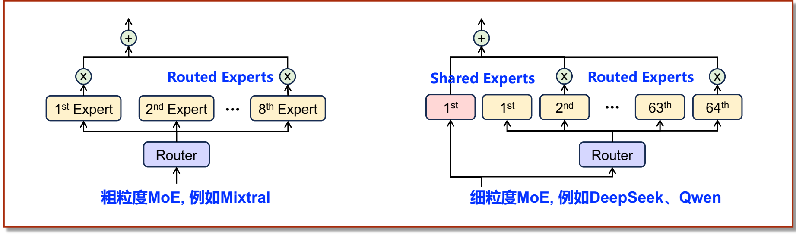
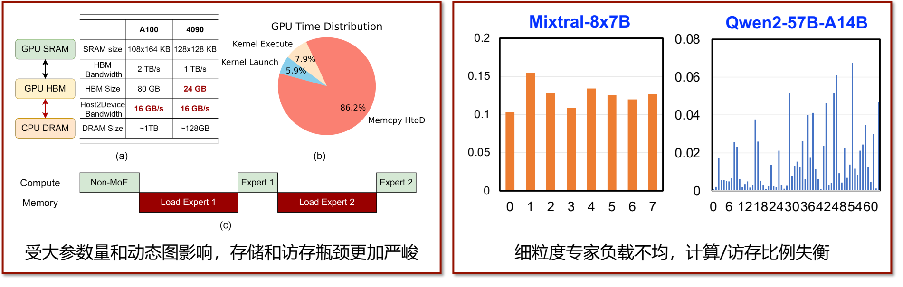
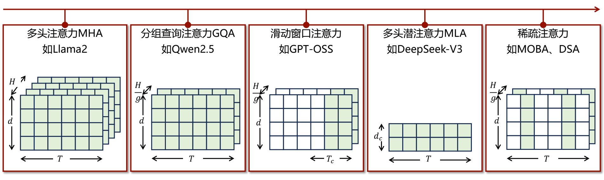

# 04 混合专家与稀疏注意力

[本讲目录](../index.md) · [课程目录](../../index.md) · [上一节：03 带宽瓶颈与并行解码](03-bandwidth-bottleneck-and-parallel-decoding.md) · [下一节：05 思维树推理与存算一体](05-tree-of-thought-and-near-memory-computing.md)

> [!abstract] 本节要点
> - 粗粒度 MoE 专家少而大（Mixtral-8x7B：8 选 2，总 47B、激活 13B）；细粒度 MoE 专家多而小（Qwen3-30B-A3B：128 选 8，总 30B、激活 3B），总参数/激活参数比例更高，激活比例下限是 $\frac{1}{N}$（$N$ 为专家数）。
> - MoE 推理挑战一：总参数放不进 HBM，只能卸载到主机 DRAM（Host2Device 仅约 16 GB/s）；专家由路由按 token 动态选择，无法提前预取，"加载专家—计算专家"被迫串行，拷贝时间可占 GPU 时间的 86.2%。
> - MoE 推理挑战二：细粒度专家激活频率冷热分化，热专家偏计算瓶颈、冷专家偏访存瓶颈，分布式执行时冷专家等热专家，硬件利用率下降。
> - MHA 的 KV 缓存访存开销 $\propto T \times d \times H$；GQA 压缩头数到 $\frac{H}{g}$，滑动窗口把 $T$ 截成常数窗口 $T_c$（会遗忘历史），MLA 把 $H \times d$ 低秩投影到 $d_c$。
> - 稀疏注意力（MoBA、DSA）保留全部 KV，但每个 token 只动态召回最相关的部分；KV 压缩的核心维度已从头数 $H$ 转向 token 维度 $T$。

## 粗粒度与细粒度 MoE

带宽公式中每生成一个 token 都要加载"模型参数 + KV 缓存"；并行解码减少的是每秒迭代次数（见[降低带宽的三条路径](03-bandwidth-bottleneck-and-parallel-decoding.md)），而混合专家模型（MoE）降低的是每次迭代需要加载的参数量：只加载真正被激活的专家。MoE 把 FFN 拆成专家、由路由器选择子集的基本思想见[MoE 基本思想](01-llm-evolution-and-memory-demand.md)。MoE 能有效减少计算量和激活参数，已成为先进大模型的必选架构。[^s1p22]

从系统角度，MoE 按专家的切分粒度分为两类：

- **粗粒度 MoE**（coarse-grained MoE）：专家数少、每个专家仍然很大，路由器（Router）从中选少数几个。典型是 Mixtral-8x7B：8 个专家中 2 个活跃，总参数 47B，活跃参数 13B。[^s1p22]
- **细粒度 MoE**（fine-grained MoE）：把专家切得更小、数量更多，每个 token 选择更多个专家；另外常带有**共享专家**（Shared Experts），每个 token 都必经。典型是 Qwen3-30B-A3B：128 个专家中 8 个活跃，总参数 30B，激活参数仅 3B；DeepSeek、Qwen 系列都属于此类。共享专家的定义见[共享专家](02-frontier-llm-architectures.md)。

粗粒度 MoE 的根本限制在于稀疏度：设共有 $N$ 个专家、每个 token 激活 $k$ 个，则路由专家部分的激活比例为 $\frac{k}{N} \ge \frac{1}{N}$。专家数少时，这个比例无论如何都降不下去，稀疏度不可能很高。[^s2b7] 细粒度 MoE 专家数更多，总参数/激活参数的比例更高，能更有效地提升训练效率。[^s1p22]

两种结构的路由流程与第 01 节相同（路由器选出 top-$k$ 个路由专家，输出乘以路由权重后相加）；区别在于细粒度结构中 token 还会同时经过共享专家（下图中粉色的 1st），不经路由器选择。

图：左边的粗粒度 MoE（如 Mixtral）由 Router 从 8 个专家中选择；右边的细粒度 MoE（如 DeepSeek、Qwen）在 64 个路由专家之外，还有一个所有 token 都会经过的共享专家。

> [!info] 可视化资源
> - [Hugging Face：混合专家（MoE）详解](https://huggingface.co/blog/moe)：给出 Switch Transformer、GShard 等 MoE 层的路由示意图，讲解 Mixtral 8x7B 总参数约 47B、top-2 路由以及负载均衡与专家容量。
> - [Wikipedia：混合专家](https://en.wikipedia.org/wiki/Mixture_of_experts)：包含取自 DeepSeek-V2 论文的 DeepSeekMoE 架构图（共享专家加路由专家），并介绍 top-$k$ 路由和负载均衡损失。

> [!example] 例：比较两种 MoE 的"总参数/激活参数"比例
> 1. Mixtral-8x7B：$\frac{47\text{B}}{13\text{B}} \approx 3.6$，每个 token 只用到约 28% 的参数。
> 2. Qwen3-30B-A3B：$\frac{30\text{B}}{3\text{B}} = 10$，每个 token 只用到约 10% 的参数。
> 3. 路由专家激活比例：前者 $\frac{2}{8} = 25\%$，后者 $\frac{8}{128} = 6.25\%$。因此细粒度 MoE 每个 token 需要加载的参数在比例上少得多——但下面会看到，"要加载的少"不等于"推理快"。

## MoE 推理挑战

MoE 在部署时面临两个挑战：总参数放不下导致的卸载与按需加载，以及细粒度专家的冷热不均。[^s1p23]

### 挑战一：参数卸载与按需加载

MoE 让每个 token 的激活参数变少，但在同等能力下，MoE 模型的**总参数量**仍比稠密模型大。总参数要全部存下，于是 GPU 最近的 HBM 放不下，模型被迫存到更远端的存储上。[^s2b7]

**挑战一**：总参数量大迫使模型卸载到远端存储，而动态计算图导致必须按需加载被激活专家的参数，延迟很高。[^s1p23]（讲义原文作"写在到远端存储"，应为"卸载到远端存储"。）

讲义给出的存储层次参数（GPU SRAM ↔ GPU HBM ↔ CPU DRAM；讲义把显存统称为 HBM，4090 实际使用的是 GDDR6X 显存）：[^s1p23]

| 指标 | A100 | 4090 |
| --- | --- | --- |
| SRAM 容量 | $108 \times 164$ KB | $128 \times 128$ KB |
| HBM 带宽 | 2 TB/s | 1 TB/s |
| HBM 容量 | 80 GB | 24 GB |
| Host2Device 带宽 | 16 GB/s | 16 GB/s |
| 主机 DRAM 容量 | ~1 TB | ~128 GB |

主机 DRAM 容量够大，但到 GPU 的链路只有 16 GB/s，比 HBM 带宽低两个数量级（A100 上 $\frac{2\ \text{TB/s}}{16\ \text{GB/s}} = 125$ 倍）。一旦参数放在主机侧，这条链路上的流量就成为系统瓶颈。讲义中的 GPU 时间分布显示：主机到设备的拷贝（Memcpy HtoD）占 86.2%，真正的核函数执行（Kernel Execute）只占 7.9%，核函数启动（Kernel Launch）占 5.9%。[^s1p23]

为什么不用预取把加载和计算重叠起来？CPU 上的常规思路是：在某块参数被需要之前就把它搬进 HBM，GPU 一边计算当前专家，一边把下一个专家搬进来，形成计算与通信的重叠。但 MoE 的专家是**每个 token 动态选择**的——在路由器算出结果之前，并不知道要用哪个专家。[^s2b7] 于是执行过程变成：

计算单元在加载期间空等，加载与计算**串行化**，而加载时间远高于计算时间。结论是：MoE 看起来需要加载的参数变少了，但带宽利用率也变低了，甚至被迫使用更远、更慢的存储，形成新的访存瓶颈。

> [!example] 例：从主机加载与从 HBM 加载的时间差
> 设某个 token 需要的专家参数中有 1 GB 不在 HBM 中（假设值，用于量级比较）。
>
> 1. 经 Host2Device 链路：$\frac{1\ \text{GB}}{16\ \text{GB/s}} = 62.5\ \text{ms}$。
> 2. 若已在 A100 的 HBM 中：$\frac{1\ \text{GB}}{2\ \text{TB/s}} = 0.5\ \text{ms}$。
> 3. 两者相差 125 倍；由于无法预取，这 62.5 ms 直接叠加到每个 token 的延迟上。

### 挑战二：专家冷热不均

**挑战二**：细粒度专家负载不均衡，使专家参数出现"冷热"之分，造成计算/访存比例变化。[^s1p23]

以各专家的激活频率（横轴为专家 ID，纵轴为激活频率）对比两类模型：粗粒度的 Mixtral-8x7B 中，8 个专家的激活频率都在约 0.10–0.155 之间，相当均匀；细粒度的 Qwen2-57B-A14B 中，64 个专家的激活频率从接近 0 到约 0.068 不等，分布极不均匀。[^s1p23]

图：左栏对比 A100 与 4090 的存储规格（4090 只有 24 GB HBM，Host2Device 只有 16 GB/s），饼图显示 86.2% 的 GPU 时间花在 Memcpy HtoD 上，时序图显示专家加载与计算是串行进行的；右栏的柱状图显示 Mixtral-8x7B 的 8 个专家负载比较均匀，而 Qwen2-57B-A14B 的 64 个专家冷热差异很大。

**冷热专家**（hot/cold experts）的不均衡带来三个问题：[^s2b7]

1. **参数利用率低**：模型可能有上 T 的参数，但经常被用到的热专家只占其中一小部分（例如 10%），其余参数仍然要存储、要训练。
2. **瓶颈类型分化**：被激活越多的专家，攒到的 token 越多、计算越多，越倾向于计算瓶颈；激活越少的专家，为少量 token 加载整份参数，越倾向于访存瓶颈。系统同时面临计算瓶颈和访存瓶颈。
3. **分布式下互相等待**：专家分布在不同设备上时，热专家计算量大、耗时长，冷专家先算完，只能等待热专家，硬件利用率随之下降。

> [!warning] 易错点
> "激活少的专家负担小"只对计算量成立。从计算/访存比看，冷专家每加载一次参数只服务很少的 token，算术强度低，反而是典型的访存受限；热专家才是计算受限。优化冷专家要减少它的参数搬运，而不是增加算力。

针对这两个挑战，讲者团队的工作（作为研究案例了解即可）：[^s1p24]

- **AdapMoE**（ICCAD'2024）：GPU 计算卸载场景，通过动态门控、预取、缓存等自适应调度，降低主机内存访问开销，延迟降低 1.35×。
- **HybriMoE**（DAC'2025）：GPU/CPU 异构计算场景，通过异构计算、动态调度做自适应计算分配，降低主机内存访问开销，延迟降低 1.3×。
- **MatMoE**（ICCAD'2026）：适用于 GPU 和 CPU 推理场景，利用 Matryoshka 专家动态量化和比特动态分配，动态降低专家加载和计算开销，延迟最高降低 3.7×。

### MatMoE：按 token 动态选择专家位宽

同一份权重可以用 8 比特、4 比特或 2 比特存储，位宽不同，存储、访存和计算开销都不同。MatMoE 的出发点有两条观察：[^s1p25]

- 专家重要性随解码过程中不同 token 动态变化，**静态**混合精度量化（预先给每个专家固定位宽）会造成精度损失。
- MoE 部署需要同时满足严格的内存约束和动态时延需求，现有多尺度量化方法缺乏适用性。

其机制：

1. **单一嵌套模型**：用 Matryoshka（套娃式）量化把专家权重按比特平面嵌套存储，高位（MSB）在前；同一份存储可以只取高几位作为低精度版本，也可以取更多位作为高精度版本。讲义示例中专家 0、1、2 的最高精度分别为 2、4、3 比特。
2. **路由分数驱动位宽**：设阈值为 $T$，某专家的路由分数 $r_1 > T$ 时以高精度参与计算，$r_2 < T$ 时只取低比特。
3. **低比特计算引擎**：为 CPU（查找表 LUT 预计算、累加）和 GPU（比特转置）分别实现低比特计算。

效果：TPOT（每输出 token 时间）加速 1.3–3.7×，准确率提升 4.0–18.3%。[^s1p25] 目的是在带宽消耗与模型准确率之间做动态平衡。

## KV 缓存的三个维度

参数问题用 MoE 处理之后，剩下的就是 KV 缓存（KV 缓存的来历见[KV 缓存](01-llm-evolution-and-memory-demand.md)）。大模型上下文长度指数级增长，使 KV 缓存的计算、访存和存储开销成为整体推理瓶颈。[^s1p27] 讲义中的内存占用对比显示：模型参数约 15 GB 保持不变，而 KV 缓存随序列长度从 0.5k 增长到 32k 时迅速膨胀，在 32k 时超过 120 GB，远超参数本身。

对基础的**多头注意力**（Multi-Head Attention, MHA），KV 缓存有三个维度：[^s2b7]

- **token 维度** $T$：序列长度，序列越长 KV 越多；
- **隐藏层维度** $d$：每个头的特征维度，越大 KV 越大；
- **注意力头数** $H$：多头注意力的头数，越多 KV 越大。

$$
\text{MHA 访存开销} \propto T \times d \times H
$$

这一比例关系出自讲义。[^s1p27] 市面上所有 KV 缓存压缩方法都可以理解为在压缩这三个维度中的某一个或两个。

## GQA、滑动窗口与 MLA

早期人们发现 KV 缓存大的主要原因是多头注意力的头数，于是先从头数下手，再逐步转向其他维度。

**分组查询注意力**（Grouped-Query Attention, GQA）：把 $H$ 个头分成若干组，组内多个头共享同一份 KV。设每 $g$ 个头共享一份，KV 只需存 $\frac{H}{g}$ 份，压缩率为 $g$。例如 8 个头、每 4 个头共享一份 KV，就只需要存 2 份来供给 8 个头。[^s2b7] 代表模型如 Qwen2.5。

**滑动窗口注意力**（定义见[滑动窗口注意力](02-frontier-llm-architectures.md)）压缩的是 token 维度：只保存最近一个窗口 $T_c$ 内的 KV，窗口随序列增长向右移动。好处是 KV 大小变成常数，不再随序列长度线性增长；代价是**遗忘历史**：窗口之外的内容彻底丢失。[^s2b8] 例如用户前一天花很多功夫"调教"聊天陪伴类模型如何回答，第二天这些内容已滑出窗口，模型又从头开始，用户会觉得模型"突然不认识我了"。代表模型如 GPT-OSS。

**多头潜注意力**（Multi-head Latent Attention, MLA）：DeepSeek-V2/V3 采用的方案。它在 token 维度不做压缩，而是把 $H \times d$ 展开后的高维向量通过**低秩投影**（low-rank projection）映射到低维空间 $d_c$ 再存储。好处是每个 token 都仍然被"记住"，只是记得没那么清晰。[^s2b8]

| 方法 | 代表模型 | 被压缩的维度 | KV 规模 | 代价 |
| --- | --- | --- | --- | --- |
| MHA | Llama2 | 无 | $T \times d \times H$ | 基线 |
| GQA | Qwen2.5 | 头数 $H$ | $T \times d \times \frac{H}{g}$ | 组内头共享 KV，表达能力下降 |
| 滑动窗口 | GPT-OSS | token 数 $T$ | $T_c \times d \times \frac{H}{g}$，与 $T$ 无关 | 窗口外历史被遗忘 |
| MLA | DeepSeek-V3 | $H \times d$ | $T \times d_c$ | 低秩近似，每个 token 记得较模糊 |
| 稀疏注意力 | MoBA、DSA | token 数 $T$（按需召回） | 存储 $T \times d \times \frac{H}{g}$，每步只加载被选中的 token | 需要判断哪些 token 相关 |

图：沿时间轴依次是 MHA、GQA、滑动窗口注意力、MLA 和稀疏注意力；看每种方法在头数 $H$ 或 $H/g$、维度 $d$ 或 $d_c$、token 数 $T$ 或 $T_c$ 这几个方向上缩小了哪一维，绿色格子表示实际保存或加载的 KV：滑动窗口只保留最右侧 $T_c$ 列，稀疏注意力则是散落在整个 $T$ 上的若干列。表中各方法的代表模型与压缩维度依据这张演进图整理。[^s1p28]

> [!example] 例：GQA 与 MLA 的压缩比
> 设 $H = 32$，$d = 128$，GQA 取 $g = 4$，MLA 取 $d_c = 512$（假设值）。每个 token、每层的 K（或 V）元素数：
>
> 1. MHA：$d \times H = 128 \times 32 = 4096$。
> 2. GQA：$d \times \frac{H}{g} = 128 \times 8 = 1024$，压缩 4 倍。
> 3. MLA：$d_c = 512$，相对 MHA 压缩 8 倍。
> 4. 三者都仍随 $T$ 线性增长；上下文从 8k 增长到 1M 时，KV 依然增长 128 倍。这正是后续方法转向 token 维度的原因。

## 稀疏注意力与动态召回

GQA、MLA 压缩的是单个 token 的 KV 大小，但无法阻止 KV 随上下文长度线性增长；滑动窗口截断了 $T$，却按时间远近一刀切地丢掉历史。稀疏注意力正是为了在 token 维度上既省开销又不遗忘。

针对长上下文，**稀疏性是注意力机制的本征属性**：只有部分历史 KV 缓存会对当前 token 的解码产生影响。核心挑战是如何利用注意力稀疏性，降低 KV 缓存的存储和加载开销。[^s1p28]

**稀疏注意力**（Sparse Attention）不再仅按时间上的远近决定保留哪些 KV，而是按其对当前 token 的重要性来选择。代表作是 MoBA（Kimi）和 DSA（DeepSeek）。当前常用的做法是：[^s2b8]

1. **全部保存**：所有历史 token 的 KV 仍然存下来；
2. **按相关性选择**：生成当前 token 时，先判断哪些历史 token 与它最相关；
3. **动态召回**：只把这部分 KV 加载进来参与注意力计算。

从 MHA 到稀疏注意力的演进可以看出，KV 缓存压缩的核心维度已经从头数 $H$ 逐步转到 token 维度 $T$，各种方法都在降低 token 维度上的存储或访存需求。[^s2b8]

> [!warning] 易错点
> "全部保存、动态召回"的稀疏注意力减少的是每步的 KV **加载量和计算量**，并不减少 KV 的**存储容量**；滑动窗口才是直接把存储截成常数。要同时降低存储，需要在召回之外再配合压缩（如下面的 MPCache）。

讲者团队在稀疏注意力方向的工作（研究案例）：[^s1p29]

- **ArkVale**（NeurIPS'2024）：动态识别并召回关键 token，并适配 Page Attention，平均速度提升 1.7×。它是较早做动态召回的工作。
- **MPCache**（NeurIPS'2025）：静态与动态结合的 KV 缓存压缩机制，实现 70% 以上的存储容量和带宽优化。
- ICML'2026 的工作探索大模型的注意力汇聚（attention sink）问题及其与 MoE 的相似性：注意力同样存在负载不均衡，类似 MoE 的专家冷热不均；据此提升了模型准确率。

> [!question]- 自测：某 MoE 模型有 64 个路由专家、每 token 激活 4 个，部署在 24 GB HBM 的 4090 上，大部分专家放在主机 DRAM。为什么即使用双缓冲预取也很难把加载时间藏起来？
> 很难藏住。要预取就得提前知道下一个要用哪个专家，而专家由路由器根据当前 token 的隐藏状态动态选出，算出路由结果之前无法确定；所以只能"路由 → 经 16 GB/s 链路加载 → 计算"串行执行。链路带宽比 HBM（1 TB/s）低约 60 倍，加载时间远大于计算时间。

> [!question]- 自测：分布式部署细粒度 MoE 时，设备 A 上的专家每批收到 200 个 token，设备 B 上的专家只收到 2 个 token。两台设备各自偏向哪种瓶颈？整体会出现什么现象？
> A 上的是热专家：加载一次参数服务 200 个 token，算术强度高，偏计算瓶颈。B 上的是冷专家：为 2 个 token 加载整份参数，偏访存瓶颈。B 很快算完，只能等 A，整体速度由热专家决定，B 的硬件处于空闲。

> [!question]- 自测：一个陪伴聊天产品需要支持数十万 token 的历史，并且不能遗忘早期对话细节。在 GQA、滑动窗口、MLA、稀疏注意力中，哪种最直接满足"不遗忘且每步加载量不随 $T$ 线性增长"？
> 稀疏注意力。滑动窗口会丢掉窗口外的历史；GQA 和 MLA 虽保留全部 token，但每步仍要加载全部 $T$ 个 token 的（压缩后）KV，加载量仍随 $T$ 线性增长；稀疏注意力保留全部 KV，每步只召回相关的少量 token，代价是存储容量仍随 $T$ 增长。

> [!info]- 来源
> - L07-Guest-Lecture.pdf：PDF p.22–25, 27–29
> - L07.docx：DOCX body 210–284

[^s1p22]: L07-Guest-Lecture.pdf-PDF p.22
[^s2b7]: L07.docx-DOCX body 210-246
[^s1p23]: L07-Guest-Lecture.pdf-PDF p.23
[^s1p24]: L07-Guest-Lecture.pdf-PDF p.24
[^s1p25]: L07-Guest-Lecture.pdf-PDF p.25
[^s1p27]: L07-Guest-Lecture.pdf-PDF p.27
[^s2b8]: L07.docx-DOCX body 247-284
[^s1p28]: L07-Guest-Lecture.pdf-PDF p.28
[^s1p29]: L07-Guest-Lecture.pdf-PDF p.29

[本讲目录](../index.md) · [课程目录](../../index.md) · [上一节：03 带宽瓶颈与并行解码](03-bandwidth-bottleneck-and-parallel-decoding.md) · [下一节：05 思维树推理与存算一体](05-tree-of-thought-and-near-memory-computing.md)
