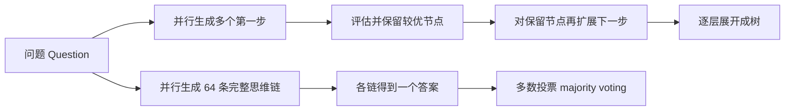
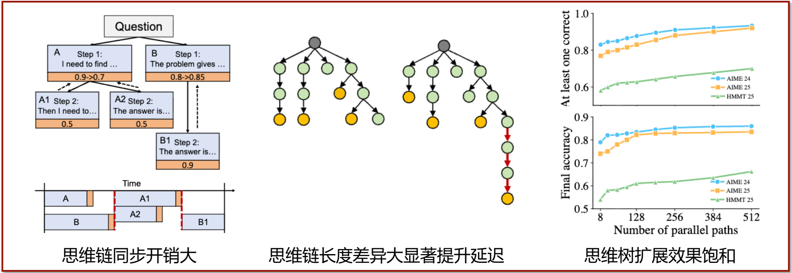
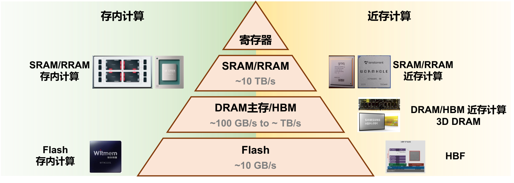
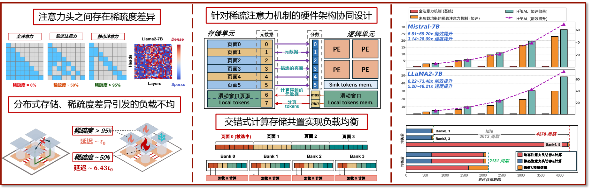

# 05 思维树推理与存算一体

[本讲目录](../index.md) · [课程目录](../../index.md) · [上一节：04 混合专家与稀疏注意力](04-moe-and-sparse-attention.md)

> [!abstract] 本节要点
> - **思维链**把推理过程逐步输出；**思维树**让模型并行生成多条思路，再逐步筛选（粗粒度）或整体投票（细粒度），以更大的探索范围换取复杂任务的准确率。
> - 思维树推理的三大系统挑战：思维链之间的**同步等待**降低硬件利用率、思维链**长度长尾**拉长整体延迟、**重复探索**使扩展思维链数量后准确率饱和；SPEX 用推测执行把延迟最多降低 4.1 倍，Hyper 平衡探索与利用把准确率提升 8% 以上。
> - 冯·诺依曼架构存算分离、易编程易扩展，但面临延迟墙与功耗墙：7 nm 下一次运算不到约 1 pJ，一次 DRAM 访问约 70–90 pJ，相差约 50–100 倍。
> - **近存计算**把计算放到存储器外围（尤其借助先进封装/集成工艺），**存内计算**让存储单元本身参与计算；AI 计算规则、控制流简单，使分布式存储和软件管理的 scratchpad 变得可行。存储层次的每一级（SRAM/RRAM 约 10 TB/s、DRAM/HBM 约 100 GB/s 到 TB/s、Flash 约 10 GB/s）都有对应方案。
> - 3D DRAM 用混合键合直接堆叠，连线数正比于面积，带宽大幅提升；但单层 800 $\text{mm}^2$ 约 20 GB、目前最多约 4 层（约 80 GB），层数增加还会升温、缩短保持时间、增加刷新、降低有效带宽。HBF（高带宽闪存）用 3D NAND 换取容量，但要处理大读写粒度、高写延迟和不灵活擦除。

## 思维链与思维树（Chain-of-Thought / Tree-of-Thought）

大模型直接给出答案时，复杂的代码、智能体或数学任务质量往往不高；让模型"边想边写"、甚至"同时想多条路"，是推理大模型提升能力的主要手段。[^s1p30]

**思维链**（Chain-of-Thought，CoT）是让大模型把思考过程逐步输出、一步一步产生解题过程，而不是直接输出结果的推理方式，代表模型是 GPT-o1。[^s1p30] 它的问题是：面对难题时模型可能走错一步、再走错一步、不断推翻自己，单条链会变得很长，延迟也很长。思维链导致输出变长、KV 缓存随之增长的影响见[思维链与 Agent 对上下文的影响](01-llm-evolution-and-memory-demand.md)。

**思维树**（Tree-of-Thought，ToT）进一步让大模型**并行思考**：同时生成多种可能的思路并加以探索，以扩大探索范围。它有两种粒度：[^s1p30]

1. **粗粒度思维树**：以"一步解题"为节点逐层扩展，过程类似蒙特卡洛树搜索（MCTS）。
   1. 第一步并行生成例如 10 个可能的第一步；
   2. 评估这些第一步中哪些更有可能（更 promising）通向正确答案，从中选出例如 5 个；
   3. 对选中的每个节点再生成多种可能的第二步，再评估、筛选；
   4. 如此逐步展开，最终形成一棵树。
2. **细粒度并行思维树**：粗粒度方案的难点在于"一步"很难定义——解一道难的数学题，切得太细或太粗都不好。于是干脆不划分步骤，直接**并行生成**例如 64 条完整思维链，各自得到一个结果后再**聚合**。最常用的聚合是**多数投票**（majority voting）：比如一道四选一的选择题，64 条思路有的答 A、有的答 B……哪个答案出现最多就选哪个。

上半支是粗粒度思维树，下半支是细粒度并行思维树。如今求解非常复杂的问题，基本都会用思维树或在其上叠加多智能体（multi-agent）的变种。[^s2b8]

> [!info] 可视化资源
> [Prompting Guide：思维树（ToT）](https://www.promptingguide.ai/techniques/tot)：展示 Yao 等人的思维树框架图，以及 24 点游戏中 BFS 搜索与思路评估的过程，可直观对比思维树与思维链在并行生成、筛选思路上的差别。

> [!warning] 易错点
> 粗粒度与细粒度的区别不在于"并行条数多少"，而在于**是否按步骤做中间评估与剪枝**：粗粒度每一步都要评估并筛选节点（因而需要在各链之间同步）；细粒度各链独立跑到底，只在最后做一次聚合。

## 思维树推理的系统挑战与优化

并行生成多条思维链看起来是天然的并行任务，但各条链在步数、长度和内容上的差异会直接转化为硬件空闲和延迟。[^s1p31]

1. **挑战一：同步开销**。粗粒度思维树需要在不同思维链之间进行**同步**：同一步（例如 step 2）在不同思路下的长度不一样，有的很长、有的很短，评估筛选又必须等这一步全部完成，于是短的要等长的，造成计算等待和空闲，显著降低硬件利用率。
2. **挑战二：长度长尾**。思维树中不同思维链的总长度差异显著，存在**长尾效应**（long tail）：整体结果要等最长的那条链完成，短链也得等长链，思维树的整体推理延迟显著提升。
3. **挑战三：重复探索**。并行生成例如 64 种解时，可能有 32 种非常相似、只有细微改动。并行"宽度"虽大，实际探索的空间却不够——理想情况是 64 条链探索 64 个尽量不同的方向。结果是探索广度不足，继续扩展思维树数量，准确率趋于**饱和**。

图：左栏的思维树与时间线显示，各分支要在每一步同步：节点 A、B 是两种第一步，A 很快结束，却要在红色虚线（同步点）处等待更长的 B 才能进入下一步，A1、A2 与 B1 之间同理；中栏两棵树显示，多数分支较短，个别特别长的思维链（红色箭头）决定了整体延迟；右栏曲线显示，并行路径从 8 增加到 512 时，AIME 24、AIME 25、HMMT 25 上的"至少一条正确"率和最终准确率都只缓慢上升并趋于饱和。

针对这些挑战，讲者团队的两项工作：[^s1p32]

| 工作 | 针对对象 | 方法 | 效果 |
| --- | --- | --- | --- |
| SPEX（OSDI 2026） | 粗粒度思维树调度（挑战一、二） | 在不同思维链之间和单条思维链内部做**推测执行**（speculative exploration），不再串行地一次只生成一个节点 | 延迟最高降低 4.1 倍 |
| Hyper（ICML 2026） | 细粒度思维树生成（挑战三） | 平衡不同思维链之间的**探索**（exploration）与**利用**（exploitation） | 准确率提升 8% 以上 |

SPEX 的思路与推测解码一脉相承（推测解码见[推测解码](03-bandwidth-bottleneck-and-parallel-decoding.md)）：原方法每次串行生成一个节点（一个步骤），SPEX 则推测地同时生成多个 step；最终得到的结果与原方法完全一样，不牺牲准确率或模型能力，只是更快。[^s2b9]

> [!question]- 自测：粗粒度思维树中 4 条思路的第 2 步分别需要生成 100、120、150、600 个 token，必须全部完成才能评估筛选。若每条链占用相同的计算资源，这一步的平均硬件利用率约为多少？哪个挑战在起作用？
> 约 40%。这一步耗时由最长的 600 个 token 决定，总有效工作为 $100+120+150+600=970$，可用容量为 $4\times600=2400$，利用率 $970/2400\approx 40\%$。这是挑战一（同步等待），若放大到整条链的总长度差异就是挑战二（长尾）。

## 冯·诺依曼瓶颈与存算一体（Processing-in/near-Memory）

前面所有关于带宽的计算和优化，根源都在于存储与计算是分离的。除了"芯片感知"的模型与调度优化，另一条路是做"大模型感知"的芯片架构设计，直接缩短存储与计算之间的距离。[^s1p34]

**冯·诺依曼架构**（von Neumann architecture）是**存算分离**的架构：计算在处理器上进行，数据存放在存储器中。现在的 CPU、GPU 基本都采用它。

- **优势**：编程模型简单，容易扩展，不必处理各种一致性（coherence）问题。
- **劣势**：面临**存储墙**（memory wall），它有两种表现：
  1. **延迟墙**：访问越远端的存储，延迟越大；
  2. **功耗墙**：在 7 nm 工艺节点，一次运算的能耗不到约 1 pJ，而一次 DRAM 访存约 70–90 pJ，相差约 50–100 倍。[^s2b9]

存储层次"离处理器越近带宽越高、越远容量越大"的规律见 L06 的存储层次内容。

> [!info] 可视化资源
> [Wikipedia：冯·诺依曼结构](https://en.wikipedia.org/wiki/Von_Neumann_architecture)：给出冯·诺依曼结构框图，并在"冯·诺依曼瓶颈"一节说明 CPU 与存储共享总线、数据搬运吞吐跟不上处理器速度，以及缓存、scratchpad 等缓解手段。

**存算一体**是缩短存储与计算距离的新型计算方式，分为两大类：[^s1p34][^s1p35]

- **近存计算**（Near-Memory Computing / Processing）：将计算移至存储器外围电路附近，特别是利用**先进集成工艺**（如先进封装），兼顾计算效率与准确率。形态上是高度分布式的：每块存储旁边都有自己的计算单元。
- **存内计算**（In-Memory Computing）：将计算移至存储器附近或内部，存储单元本身也是计算单元，"数据存在哪就在哪算"，利用高内部带宽降低数据搬运的功耗与延迟。它是更极端的方案。

### 为什么 AI 让分布式存算可行

近存计算的分布式结构带来一个老难题：同一份数据可能存在多块存储中，任何一个核修改它都要通知其他所有核，维护一致性非常困难。对于通用计算，这使近存架构长期难以推广。

AI 计算则不同：

1. **计算极其规则**：一颗 800 $\text{mm}^2$ 的芯片，乃至上万颗这样的芯片，绝大部分时间只在做矩阵乘法，可以把计算规则地切分到各个单元上；
2. **通信也是规则的**：核与核之间是大家一起进行的集体通信，不会出现"某个数据被某个核改了、要逐一通知其他核"的不规则情况；
3. **控制流极其简单**：在控制数据流图（CDFG，control data flow graph）中，控制部分极少，绝大部分是数据流。

因此神经网络加速器甚至可以把片上存储设计成**暂存器**（scratchpad memory）[^s2b9]：完全由软件管理，不要任何硬件来管理，即不需要 LRU 这类缓存替换策略。在通用场景下用软件管理缓存过于麻烦，在 AI 场景下却很简单——这正是各种激进架构在 AI 场景变得可能的原因。

> [!warning] 易错点
> 近存计算与存内计算的界线：近存计算的计算单元仍在存储阵列**之外**（外围电路、同一封装或堆叠的逻辑层），数据只需短距离搬运；存内计算让**存储单元本身**完成运算，数据不离开存储阵列。

### 存储层次上的存算方案

数据本来就分布在各个存储层级，每一级只要存有数据，就可能有就地计算的需求，因此几乎每一层都有对应的近存或存内方案。[^s1p35]

| 存储层级 | 典型带宽 | 存内计算 | 近存计算 |
| --- | --- | --- | --- |
| 寄存器 | — | — | — |
| SRAM/RRAM | 约 10 TB/s | SRAM/RRAM 存内计算 | SRAM/RRAM 近存计算 |
| DRAM 主存/HBM | 约 100 GB/s 到约 TB/s | — | DRAM/HBM 近存计算、3D DRAM |
| Flash | 约 10 GB/s | Flash 存内计算 | HBF |

图：金字塔从上到下依次是寄存器、SRAM/RRAM（约 10 TB/s）、DRAM/HBM（约 100 GB/s 到 TB/s）和 Flash（约 10 GB/s），从上到下容量越来越大、从下到上带宽越来越高；左侧列出各层的存内计算方案，右侧列出各层的近存计算方案（含 3D DRAM 和 HBF）。

从 SRAM 近存走向 DRAM 近存的好处是**存储密度更高**：SRAM 单元需要 6 到 8 个晶体管，DRAM 密度高得多，单位面积能放更多存储，更适合大模型。[^s2b9]

### 例：冷专家在 DRAM 旁就地计算

MoE 模型总参数量大，HBM 往往放不下，许多参数只能放在 host DRAM，而 host DRAM 到计算单元的访问带宽很低（专家冷热不均的背景见[专家冷热不均](04-moe-and-sparse-attention.md)）。[^s2b10]

> [!example] 例：为什么冷专家适合近存计算
> 冷专家每次只分到很少的 token，其计算接近矩阵向量乘：$M\times N$ 的权重只产生约 $2MN$ 次运算（每 token 计算量估算见[每 token 计算量估算](02-frontier-llm-architectures.md)），每个权重几乎只用一次。
>
> 1. **传统方式**：把冷专家参数从 host DRAM 一路搬到寄存器再计算，搬运 $MN$ 个参数只换来 $2MN$ 次运算，完全受带宽限制；按上面的能耗比，每个参数一次 DRAM 访问约 70–90 pJ，而用它做的两次运算总共不到约 2 pJ，能耗几乎全花在搬运上。
> 2. **近存方式**：在 DRAM 旁边直接完成矩阵向量乘，只把长度为 $M$ 的结果向量发回。参数原本存在哪就在哪算，避免大量参数在层级之间移动，从而缓解访存瓶颈。

### 存内计算的研究示例

讲者团队在存内计算方向的工作（讲座只列出结论）：[^s1p36]

- **UniCAIM**（DAC 2025）：利用新型铁电存储器，实现原位的动态/静态稀疏注意力计算，计算能效提高 8 倍；
- **NASiC**（DAC 2026）：利用 3D NAND 存内计算实现高效 MoE 推理，能效最高提升 70 倍；
- **NICE**（ISEDA 2026）：面向 3D NAND 存内计算的纠错算法，降低存内计算误差，准确率提升 30% 以上。

## 3D DRAM 与混合键合（Hybrid Bonding）

带宽取决于存储与计算芯片之间能连多少根线、每个周期能送多少数据。封装方式决定了连线数量的上限。[^s2b10]

以 NPU 与 DRAM 的连接为例，三种封装方式：

1. **PCB 走线**：最朴素的方式，两颗芯片通过 PCB 连接，只能沿芯片边缘连出很少几根线，带宽很低。
2. **HBM**：芯片之间的连线不再只走边缘，而是可以从 NPU 底部引出、经中介层连到存储，连线数不再被芯片的一条边所限，多出的线让每个周期能发送更多数据，带宽更大。
3. **3D DRAM（直接堆叠）**：把 DRAM 与逻辑芯片（NPU）通过**混合键合**（hybrid bonding）直接上下堆叠，连线根数**正比于面积**，可以显著提升带宽。

早年 AMD 已经把 SRAM 缓存堆叠到逻辑芯片上；近两年流行的是堆叠 DRAM，因为 SRAM 容量远小于 DRAM。堆叠之后形成分布式存储：每个 DRAM bank 下方有自己的逻辑单元，各 bank 负责自己那部分数据的"加载 & 计算"。

### 3D DRAM 的挑战

1. **容量有限**：一颗 800 $\text{mm}^2$ 的 DRAM 芯片一层约 20 GB；要支撑 100B 参数的模型（按每参数 1 字节计约 100 GB）需要叠 5 层。
2. **成本与良率**：DRAM 本身很贵，3D 封装还会进一步降低良率，能否叠到 5 层本身就是问题。
3. **散热与刷新**：层数越多芯片越厚，计算产生的热量向上传导，叠得越多 DRAM 越热。DRAM 电容中电荷的**保持时间**（retention time）随温度升高而缩短，需要更频繁地刷新；刷新期间无法访问 DRAM，于是有效带宽下降。DRAM 读出具有破坏性、本身就需要刷新，见 L08 的 DRAM 内容。

因此即使很先进的 3D DRAM，800 $\text{mm}^2$ 的芯片目前最多做到约 4 层，即约 80 GB，对当前的大模型并不够用。

> [!warning] 易错点
> 3D DRAM 的带宽优势来自"连线数正比于面积"，而不是 DRAM 单元本身更快；它不能同时解决容量问题，层数受成本、良率和散热—刷新的约束。

### 3D DRAM 近存计算的调度：HD-MoE 与 H2EAL

3D DRAM 把计算切成许多块分布在各个 bank 上，带来片上集体通信、MoE 调度、稀疏注意力调度等新问题。讲者团队的两项工作：

**HD-MoE**（ICCAD 2025）：基于混合键合的 DRAM 近存计算能显著提升访存带宽，但面临分布式存储和计算的挑战；现有的**专家并行**（EP）负载不均衡，**张量并行**（TP）通信开销高。HD-MoE 通过混合并行与动态调度，实现 1.4–1.8 倍加速。[^s1p37]

**H2EAL**（ICCAD 2025）的思路：[^s1p38]

1. **核心观察一**：堆叠 DRAM 容量有限、面临存储瓶颈，可用稀疏注意力压缩 KV 缓存的存储（稀疏注意力见[稀疏注意力与动态召回](04-moe-and-sparse-attention.md)）。
2. **核心观察二**：不同注意力头的稀疏度差异很大——全注意力头稀疏度为 0%，动态注意力头约 50%，静态注意力头高于 95%（Llama2-7B 各层各头的稀疏度热力图上 dense 与 sparse 交错分布）。叠加分布式存储后，负责稀疏度 >95% 头的 bank 延迟约为 $t_0$，负责稀疏度约 50% 头的 bank 延迟约为 $6.43\,t_0$，造成严重负载不均。
3. **方法**：混合静态—动态稀疏注意力与硬件协同设计。存储单元按页面存放 KV 并附带元数据，逻辑单元根据元数据计算分数、挑选页面交给 PE 计算，另设 sink tokens 与滑动窗口 local tokens 的专用存储；再用**交错式计算存储共置**把页面交错分布到各 bank，每个 bank 都"加载 & 计算"，实现负载均衡。
4. **效果**：均衡前 Bank4、5 需要 4278 个周期，其余 bank 早早完成后空闲约 3613 个周期；均衡后整体只需 2131 个周期。整体最高约 48 倍加速、73 倍能效提升（LLaMA2-7B 上 5.20–48.21 倍加速、6.22–73.48 倍能效；Mistral-7B 上 3.14–28.09 倍加速、5.81–69.20 倍能效）。

图：左栏显示不同注意力头的稀疏度差异很大（0%、约 50%、超过 95%），分布式存储后各处延迟不同（约 $t_0$ 与约 $6.43\,t_0$）；中栏是存储单元按页面元数据挑选页面交给 PE 计算，并把页面交错放到各 Bank 上来均衡负载；右栏显示在 Mistral-7B 和 LLaMA2-7B 上的加速比与能效提升，以及均衡前后延迟从 4278 周期降到 2131 周期。

> [!question]- 自测：一颗 800 $\text{mm}^2$ 的 3D DRAM 每层约 20 GB。要把一个 60B 参数、按 FP16 存储的模型全部放进去，需要几层？以当前技术能否实现？
> 需要 6 层，目前做不到。60B 参数 × 2 字节 = 120 GB，$120/20=6$ 层；而受成本、良率和散热—刷新限制，目前最多约 4 层（约 80 GB），只能放下约 2/3 的权重，这还没算 KV 缓存。

## 高带宽闪存（High Bandwidth Flash）

3D DRAM 容量不够，于是转向存储密度高得多的 Flash：商用 Flash 是三维堆叠的 3D NAND，已有两百多层，存储密度极高。[^s2b10]

**高带宽闪存**（High Bandwidth Flash, HBF）是面向 AI 应用调整设计的 Flash：牺牲一部分容量，换取更高的带宽和更低的访问延迟，从而兼具高容量和高带宽，有潜力成为 LLM 推理的主要存储介质。[^s1p39]

HBF 仍保留 Flash 的固有特点：**大读写粒度、高写入延迟、不灵活的擦除**，难以应对 KV 缓存频繁、细粒度的读写。讲者团队的 **HBFlex** 框架针对 KV 缓存的读、写、回收做硬件—调度协同设计，实现 1.58–3.30 倍加速。[^s1p39] 它针对的两个问题与对策：

1. **读**：对话完成、新对话激活会使 KV 缓存在 HBF 的各个 plane 之间分布不均，增加读取 KV 的轮次。对策是均匀的 KV 数据布局：每个对话的 KV 存放在一个 plane 组中，并复制公共前缀的 KV。
2. **写**：GPU 频繁读取 HBF，而写 KV 缓存的高延迟会干扰调度。对策是把生成的 KV 缓存放在 HBF 底部逻辑芯片（base die）的 SRAM 中，并在 prefill 计算时完成写入。

> [!question]- 自测：同样是为大模型推理提供"高带宽、大容量"，3D DRAM 和 HBF 分别卡在哪里？HBFlex 为什么要专门处理 KV 缓存而不是模型权重？
> 3D DRAM 带宽高但卡在容量（约 20 GB/层、最多约 4 层）和散热—刷新；HBF 容量大，但卡在大粒度读写、高写延迟和不灵活擦除。权重只读、粒度大，天然适合 Flash；KV 缓存在解码过程中逐 token 频繁、细粒度地写入和回收，恰好撞上 Flash 的弱点，所以需要专门的布局和写入缓冲设计。

这些专用架构的代价是底层硬件越来越难编程。讲者的看法是，AI 辅助编程有望缓解专用架构"难编程"的问题，这也是业界愿意接受这类架构的原因之一。[^s2b10]

> [!info]- 来源
> - L07-Guest-Lecture.pdf：PDF p.30–32, 34–39
> - L07.docx：DOCX body 247–363

[^s1p30]: L07-Guest-Lecture.pdf-PDF p.30
[^s2b8]: L07.docx-DOCX body 247-284
[^s1p31]: L07-Guest-Lecture.pdf-PDF p.31
[^s1p32]: L07-Guest-Lecture.pdf-PDF p.32
[^s2b9]: L07.docx-DOCX body 285-322
[^s1p34]: L07-Guest-Lecture.pdf-PDF p.34
[^s1p35]: L07-Guest-Lecture.pdf-PDF p.35
[^s2b10]: L07.docx-DOCX body 323-363
[^s1p36]: L07-Guest-Lecture.pdf-PDF p.36
[^s1p37]: L07-Guest-Lecture.pdf-PDF p.37
[^s1p38]: L07-Guest-Lecture.pdf-PDF p.38
[^s1p39]: L07-Guest-Lecture.pdf-PDF p.39

[本讲目录](../index.md) · [课程目录](../../index.md) · [上一节：04 混合专家与稀疏注意力](04-moe-and-sparse-attention.md)
