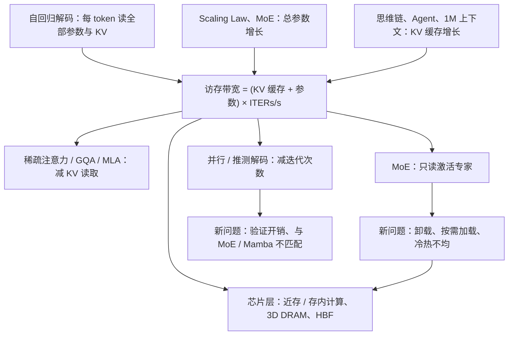

# L07 突破内存瓶颈的大模型推理

[课程目录](../index.md)

大模型推理每生成一个 token 都要把全部模型参数和 KV 缓存从存储器读一遍，因此真正的瓶颈往往是访存带宽而不是算力。本讲先沿模型演进（Transformer、解码器大模型、Scaling Law、MoE、思维链与 Agent）推导出“存储容量 = KV 缓存 + 参数”“访存带宽 = 存储容量 × Tokens/s”，再解剖 DeepSeek-V4.1-Flash 与 Kimi-K3 两个先进架构；随后用带宽公式定位瓶颈，依次讲解并行（推测）解码、MoE 推理和稀疏注意力三条算法路径，最后转到思维树推理的系统优化，以及近存/存内计算、3D DRAM、HBF 等体系结构方案。阅读前需要了解矩阵乘法与 Transformer 的基本结构，以及 L06 的存储层次与内存墙；3D DRAM 部分会用到 L08 的 DRAM 刷新知识。

## 章节导航

- [01 大模型演进与访存需求](chapters/01-llm-evolution-and-memory-demand.md)：推导容量与带宽公式，看演进如何推向内存墙
- [02 先进大模型架构剖析](chapters/02-frontier-llm-architectures.md)：两款先进架构，计算量 $\approx 2P_{\rm act}$
- [03 带宽瓶颈与并行解码](chapters/03-bandwidth-bottleneck-and-parallel-decoding.md)：端侧带宽缺口、三条降带宽路径与推测解码
- [04 混合专家与稀疏注意力](chapters/04-moe-and-sparse-attention.md)：MoE 卸载与冷热不均，KV 缓存三维压缩
- [05 思维树推理与存算一体](chapters/05-tree-of-thought-and-near-memory-computing.md)：思维树挑战，近存/存内计算、3D DRAM 与 HBF

## 本讲小结

### 概念地图

整讲围绕一条公式展开：带宽需求是“每次迭代读取的数据量 × 每秒迭代次数”。模型演进不断推高公式中的各项，算法与体系结构则分别从不同方向把它压下来。

### 选择优化手段

| 瓶颈来源 | 算法侧手段 | 主要代价或限制 | 体系结构侧手段 |
| --- | --- | --- | --- |
| 参数量大（总参数放不进 HBM） | MoE 只读激活专家；MatMoE 等动态位宽 | 总参数更大、需卸载；专家动态选择无法预取；冷热不均 | 冷专家在 DRAM 旁近存计算；3D DRAM（HD-MoE） |
| KV 缓存大（长上下文、长输出） | GQA、MLA 压缩单 token KV；滑动窗口截断 $T$；稀疏注意力动态召回 | 滑动窗口遗忘历史；稀疏注意力不减存储 | 3D DRAM 上的稀疏注意力（H2EAL）；HBF 存放 KV（HBFlex） |
| 迭代次数多（每 token 一次全量加载） | 并行 / 推测解码 | 额外计算，大批量时转为计算瓶颈；与 MoE、线性注意力不匹配 | 专用加速器（SpecMamba on FPGA） |
| 多条思维链并行（思维树） | SPEX 推测执行、Hyper 平衡探索与利用 | 同步等待、长尾、重复探索 | — |

讲者对全讲的总结是：摩尔定律放缓后，“算法快速迭代—芯片通用适配”的解耦路径已不能满足 AI 发展的需求，需要两层协同：算法层做芯片感知的智能算法，通过算法优化降低大模型的计算开销；芯片层做异构智能芯片架构，通过专用架构设计提升有效算力供给（讲义第 41 页）。

### 核心公式

| 公式 | 含义 | 所在章节 |
| --- | --- | --- |
| $\text{存储容量} = \text{KV 缓存} + \text{模型参数量}$ | 单请求推理需要存放的数据 | 01 |
| $\text{访存带宽} = \text{存储容量} \times \text{Tokens/s}$ | 每生成一个 token 都要把上述数据读一遍 | 01 |
| $\text{存储容量} = B \times M_{\rm KV} + M_{\rm param}$ | 批处理：参数共享，KV 按请求各一份 | 01 |
| $\text{FLOPs/token} \approx 2 P_{\rm act}$ | 短上下文下，每 token 计算量约为激活参数量的 2 倍 | 02 |
| $\text{带宽} = (\#\,\text{Sparse KV} + \#\,\text{Active Param}) \times \text{ITERs/s}$ | 三条降带宽路径分别作用于三个因子 | 03 |
| $\text{MHA 访存开销} \propto T \times d \times H$ | KV 缓存的三个维度：token 数、头维度、头数 | 04 |

## 不确定事项

- Kimi-K3's 0.866 TFLOPs/token on the slide disagrees with the 2×active-params estimate (≈0.208 TFLOPs); the slide gives no basis for its figure
- Whether DeepSeek-V4.1-Flash's CSA2 Reuse layers also reuse the token index is unresolved (the speaker was unsure)
- The batching formula is reconstructed from a damaged ASR transcript, not printed on a slide
- SpecMamba energy efficiency: the slide says 3×, the demo numbers give ≈6.8× throughput per watt, and the speaker said 7–8×; the three figures use different bases
- 3D DRAM '≈20 GB per layer' is inferred from ASR ('20层'); the claim that a 100B model needs 5 layers assumes 1 byte per parameter
- The HBFlex write path (base-die SRAM, write during prefill) is taken from a short slide phrase; the details are uncertain
- The s1p27 bar chart values (parameters ≈15 GB, KV >120 GB at 32k) are approximate readings of the chart; the 1 GB and d_c=512 numbers in the examples are labeled assumptions
- The mHC, Engram and KDA internals were not explained in the lecture and are described only at the level the slides show

> [!info]- 来源
> - L07-Guest-Lecture.pdf：PDF p.3–10, 12–13, 15–25, 27–32, 34–39
> - L07.docx：DOCX body 1–363
