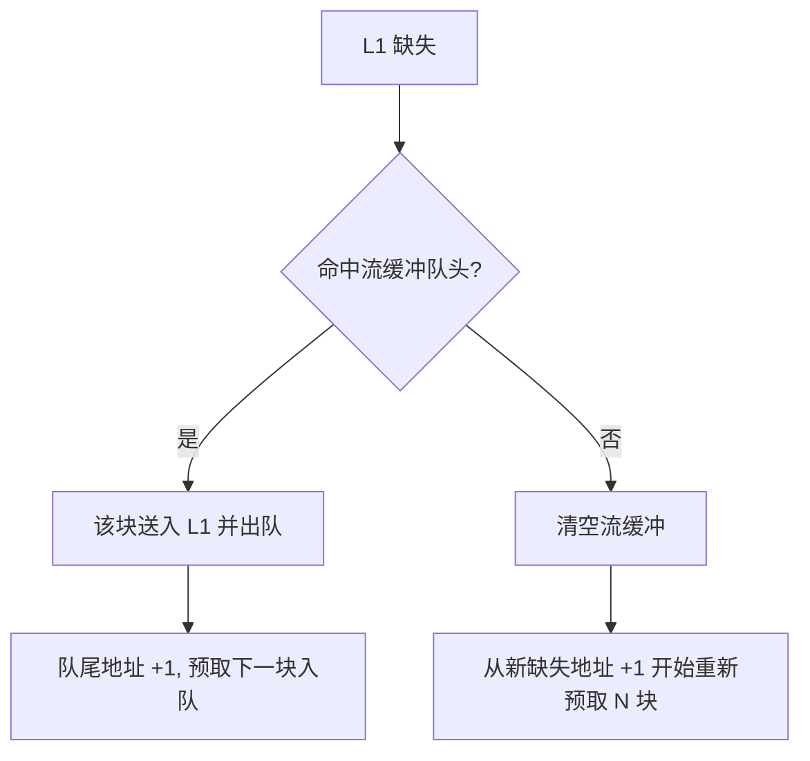
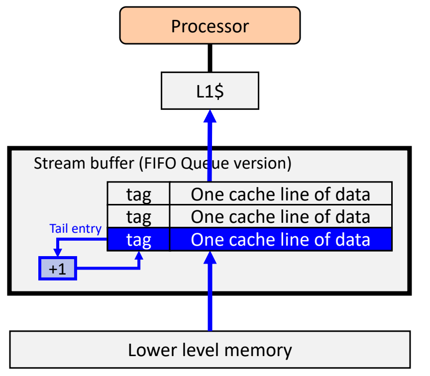
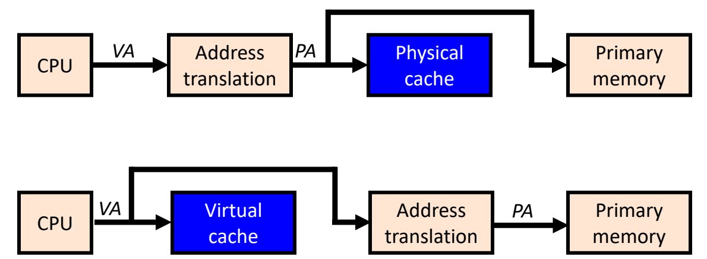
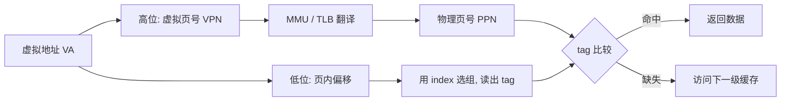
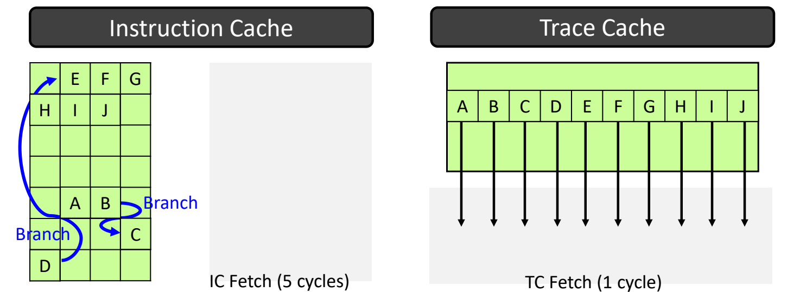

# 01 降低缺失率与命中时间

[本讲目录](../index.md) · [课程目录](../../index.md) · [下一节：02 DRAM 单元与破坏性读](02-dram-cell-and-destructive-read.md)

> [!abstract] 本节要点
> - 按 $\text{AMAT} = \text{Hit time} + \text{Miss rate} \times \text{Miss penalty}$ 拆开看：硬件预取和编译器优化降低缺失率，虚拟索引缓存和踪迹缓存降低命中时间。
> - 硬件预取靠监视访存模式来猜下一步要访问的数据，越靠近核越容易识别模式。LLC 分 bank 又做了哈希，很难做预取。流缓冲把顺序预取的后续块放在一个 FIFO 里，不直接放进 L1：命中就补取下一块，缺失就清空，从新地址重新开始。
> - 编译器有三种手段：合并数组提升空间局部性，循环融合提升时间局部性，循环交换让访问顺序和存储顺序一致，从而提升空间局部性。
> - VIVT 最快，但有同名问题（靠清空缓存或加 PID/ASID 解决）和别名（同义）问题。PIPT 最稳但最慢，PIVT 几乎不用。主流 L1 用 VIPT，前提是 index 位数加块内偏移位数不超过页内偏移位数：4 KiB 页时，缓存容量不超过 $4\,\text{KiB} \times$ 相联度。
> - 踪迹缓存把多个不连续的基本块按执行顺序打包进一行，取指从 5 个周期降到 1 个。优化总结表里，"+"表示改善某项指标，"−"表示恶化，硬件复杂度从 0 到 3 分级。

## 从 AMAT 看缓存优化的三个方向

平均访存时间由三项决定：

$$
\text{AMAT} = \text{Hit time} + \text{Miss rate} \times \text{Miss penalty}
$$

其中 Hit time 是命中时间，Miss rate 是缺失率，Miss penalty 是缺失代价。降低缺失代价的方法在 L06 缓存一讲中已经讲过。本节补完另外两个方向[^s2p1][^s2p5]：

- **降低缺失率**：硬件预取，编译器优化。
- **降低命中时间**：在缓存索引阶段避开地址翻译（虚拟索引缓存），以及踪迹缓存。

## 硬件预取（Hardware Prefetching）

如果等到缺失发生才去下一级取数据，缺失代价就躲不开。数据如果能在访问前就取回来，原本会缺失的访问就变成了命中。软件里也有同样的思路，比如 AI 推理时预取 KV、让它和 GPU 计算重叠。硬件预取的区别在于复杂度很受限，所以策略要比软件方案简单得多。[^s3b1]

**硬件预取**（hardware prefetching）的核心是由硬件监视访存序列，识别出其中的模式，并提前把预计要访问的块取到缓存附近。[^s2p2]

**预取器放在哪里**：真实 CPU 里有多个预取器，规律如下：

1. **越靠近核越容易做**：L1、L2 看到的访存流还没有被打乱，模式容易识别。
2. **LLC 很难做**：L3（LLC）容量大，又被多个核共享。为了负载均衡，LLC 被分成多个独立工作的 bank，请求按地址哈希分到不同的 bank 上。这样每个 bank 看到的访问序列已经被打散，很难找出原来的访问模式。[^s2p2][^s3b1]

各级缓存里常见的预取器：

| 位置 | 预取器 | 工作方式 |
| --- | --- | --- |
| L1D | 按 PC 的步长预测器（PC-localized stride predictor） | 以访存指令的 PC 为索引，记录这条指令每次访问之间的地址步长。步长稳定后，按"当前地址 + 步长"提前取下一个数据 |
| L1D | 块内短步长预测器（short-stride predictor within block） | 发现同一块内的访问步长很小（顺序访问或隔一个访问），就直接预取下一块 |
| L1I | 预测未来 PC | 根据控制流预测接下来要执行的指令地址，提前取指 |
| L2 | 流缓冲（stream buffer） | 顺序预取后续若干块，放进一个独立缓冲（见下一节） |
| L2 | 相邻行预取（adjacent-line prefetch） | 访问某一行时，顺带取出相邻的缓存行 |

按 PC 的步长预测器和分支预测器的组织方式很像：两者都以 PC 为索引记录每条指令的历史行为，只是这里记的是访存步长，不是跳转方向。L1I 预测未来 PC，靠的就是前面讲过的分支预测机制。[^s3b1]

> [!info] 可视化资源
> [Wikipedia：缓存预取](https://en.wikipedia.org/wiki/Cache_prefetching)：页面附有 Jouppi 1990 年提出的典型流缓冲结构示意图，并分类说明顺序预取与规则/不规则步长预取，可配合理解流缓冲 FIFO 与按 PC 步长预测器。

## 流缓冲（Stream Buffer）

最简单的访存模式是依次访问连续的块。按这种模式提前取后续块的做法，叫**顺序预取**（sequential prefetching）。直接把预取的块塞进 L1 可能会挤掉有用的数据，所以流缓冲在 L1 和下一级存储之间单独加了一个缓冲来存放它们。

**流缓冲**（stream buffer）是位于 L1\$ 和下一级存储之间的一个 FIFO 队列，每个表项存一个 tag 和一整条缓存行的数据，缓冲里始终保持后续 $N$ 块可用（keeps next-$N$ available）。[^s2p3]

工作过程：

1. **启动**：访问某个地址缺失后，流缓冲从下一块开始，依次预取后续 $N$ 块，放进 FIFO，不放进 L1。
2. **命中流缓冲**：之后 L1 缺失、而所需块正好在流缓冲队头时，把这块交给 L1 并移出队列。同时把队尾表项的地址 +1，再预取下一块补到队尾，所以缓冲里总有后续 $N$ 块。
3. **未命中流缓冲**：访问的块不在流缓冲里，说明顺序流断了。这时清空整个缓冲，以新的缺失地址为基准，从它的 +1 块开始重新预取。[^s3b1]



流缓冲的设计这么简单，是因为硬件里很难实现复杂的预取策略，只能用"+1、命中就续、缺失就清"这种逻辑来覆盖最常见的顺序访问。[^s3b1]



图：流缓冲区以 FIFO 队列形式位于 L1$ 与下层存储之间，每项保存 tag 与一整个缓存行，队尾地址经 +1 生成下一块地址实现顺序预取，队头数据可直接送往 L1$。

> [!example] 例：流缓冲对访问序列的反应
> 设 $N=3$，块号依次访问 10, 11, 12, 13, 40, 41（假设这些块都不在 L1 中）。
>
> 1. 访问 10 缺失，流缓冲清空后预取 11, 12, 13。
> 2. 访问 11、12、13 时依次命中队头，每次出队一块，并在队尾补上 14、15、16。
> 3. 访问 40 不在流缓冲里，清空缓冲，改为预取 41, 42, 43。
> 4. 访问 41 命中流缓冲。所以只有 10 和 40 两次访问需要等下一级存储。

## 编译器缓存优化（Cache-friendly Compiler）

硬件只能被动猜测访问模式，编译器却能看到整个程序。**编译器缓存优化**的关键思路是：修改数据结构布局或循环结构，让程序以对缓存更友好的方式访问数据，在不增加硬件的前提下降低缺失率。[^s2p4]


图：上下两行对比 Merging Array、Loop Fusion、Loop Interchange 优化前后的代码，注意合并数组与交换循环改善空间局部性，融合循环使第二条语句全部命中、改善时间局部性。

### 合并数组（Merging Arrays）

key 和对应的 value 通常一起访问。存成两个独立数组时，`key[i]` 和 `val[i]` 位于两个相距很远的块，一次访问要碰两个块。把两个数组合并成一个复合元素数组后，同一个 `i` 的 key 和 val 落在同一块里：

```c
/* 优化前：两个顺序数组 */
int val[SIZE];
int key[SIZE];

/* 优化后：复合元素数组 */
struct merge {
    int val;
    int key;
} merged[SIZE];
```

**效果**：提升空间局部性（spatial locality）。[^s2p4]

### 循环融合（Loop Fusion）

两个独立循环如果循环范围相同、访问的变量有重叠，就可以合并成一个循环：

```c
/* 优化前 */
for (i = 0; i < 10K; i++)
    a[i] = 1/a[i];
for (i = 0; i < 10K; i++)
    sum = sum + a[i];

/* 优化后 */
for (i = 0; i < 10K; i++) {
    a[i] = 1/a[i];
    sum = sum + a[i];
}
```

优化前，第二个循环要从头再扫一遍 `a`。如果数组大于缓存，前面的块早已被替换，`a[i]` 会再缺失一次。融合后，第一行刚访问过 `a[i]`，第二行再访问它时全部命中（hit all）。**效果**：提升时间局部性（temporal locality）。[^s2p4]

### 循环交换（Loop Interchange）

```c
/* 优化前：内层循环变 i */
for (j = 0; j < N-1; j++)
    for (i = 0; i < N-1; i++)
        x[i][j] = 2*x[i][j];

/* 优化后：内层循环变 j */
for (i = 0; i < N-1; i++)
    for (j = 0; j < N-1; j++)
        x[i][j] = 2*x[i][j];
```

交换嵌套顺序，让访问按数据在内存中的存储顺序进行。优化后内层按 `j` 顺序访问，不再按大步长跨行。**效果**：提升空间局部性。[^s2p4]

> [!info] 可视化资源
> [Wikipedia：循环交换](https://en.wikipedia.org/wiki/Loop_interchange)：给出交换嵌套循环前后的代码示例和行优先/列优先存储示意图，直观说明为何按存储顺序访问能减少缓存缺失。

> [!note] 补充解释
> C 语言的二维数组按行主序（row-major）存储，`x[i][j]` 和 `x[i][j+1]` 相邻，`x[i][j]` 和 `x[i+1][j]` 相隔一整行（$N$ 个元素）。所以内层变 `i` 时每次访问跨一行，几乎每次都落在不同的块上。内层变 `j` 时，一个块里的多个元素会被连续用完。

> [!warning] 易错点
> 三种手段改善的局部性类型不同：合并数组和循环交换改善**空间**局部性（让相邻访问落在同一块），循环融合改善**时间**局部性（让同一数据在被替换前被重复使用）。判断方法是看优化后"再次命中"的是同一个数据，还是同一块里的相邻数据。

## 虚拟索引缓存（Virtually Indexed Cache）

程序发出的是虚拟地址（VA），缓存通常按物理地址（PA）组织。所以每次访存都要先经过 MMU/TLB 把 VA 翻译成 PA，才能查缓存。即使数据就在缓存里，地址翻译也在关键路径上，直接拉长了命中时间。地址翻译、TLB、页表的细节属于操作系统课程，这里只用它"把虚拟页号换成物理页号、页内偏移不变"这一性质。[^s3b2]

**虚拟缓存**（virtual cache）的想法是直接用虚拟地址索引缓存（以及比较 tag），只在缺失、要访问主存时才做地址翻译，从而把翻译移出命中路径。[^s2p6]



图：上方物理缓存需先把 VA 经地址转换得到 PA 再访问缓存，下方虚拟缓存直接用 VA 访问，仅在缺失时才经地址转换得到 PA 访问主存。

这张图对比了两种结构。物理缓存放在地址翻译之后（CPU → 地址翻译 → 物理缓存 → 主存）。虚拟缓存放在地址翻译之前（CPU → 虚拟缓存 → 地址翻译 → 主存）。

### 两个挑战

**同名问题**（homonym）：不同进程用相同的虚拟地址访问各自不同的物理数据。上下文切换后，缓存里留下的是上一个进程的数据，新进程用同一个 VA 会读到别人的数据。[^s3b3]

- 最直接的办法是每次进程切换时清空（purge）缓存。但进程每几十毫秒就切换一次，清空本身要花时间，脏数据还要写回内存，代价很大。[^s3b2]
- 更好的办法是在 tag 上附加**进程标识**（PID tags），现代处理器用的是**地址空间标识符**（ASID）。这样虚拟 tag 对每个进程唯一，缓存就能同时存放多个进程的数据。[^s2p6][^s3b3]

**别名问题**（aliasing）：两个不同的虚拟地址映射到同一个物理地址，这样的地址称为**同义词**（synonym），典型例子是进程间共享的数据。它们可能被放进不同的缓存行，一个进程通过自己的 VA 写入后，另一个进程用另一个 VA 读到的仍是旧值。只加 PID 解决不了这个问题。可选的方案有反别名硬件（anti-aliasing hardware，比如探测其他组、反向查找表）、页着色（page coloring，一种软件方案），以及只用页内偏移做索引。[^s2p6][^s3b3]

### 四种索引/标记组合

缓存访问分两步：先用 index 找到组，再比较 tag。两步分别可以用 VA 或 PA，于是有四种组合[^s3b3]：

| 组合 | 索引 | 标记 | 速度 | 问题 | 使用情况 |
| --- | --- | --- | --- | --- | --- |
| PIPT（物理索引物理标记） | PA | PA | 最慢：翻译延迟全部叠加到每次访问上 | 无同名、别名问题，最稳健 | 不适合要求和核同速的 L1 |
| VIVT（虚拟索引虚拟标记） | VA | VA | 理论上最快：命中不需要 PA | 同名问题和别名问题 | 问题太棘手，基本不用 |
| PIVT（物理索引虚拟标记） | PA | VA | 慢：要先翻译才能索引 | 同时带有 VIVT 的不一致问题 | 最差，几乎从不使用 |
| VIPT（虚拟索引物理标记） | VA 的页内偏移部分 | PA | 翻译和找组并行 | 满足位数约束时无别名问题 | 主流 L1 的做法 |

### VIPT 的机制与约束

VIPT 好在地址翻译和组查找可以**并行**进行：

1. **高位送 MMU**：VA 中代表虚拟页号（VPN）的高位送到 MMU，由 TLB 加速翻译成物理页号（PPN）。
2. **低位送缓存**：VA 的低位（页内偏移）同时送到缓存，用来选出对应的组，读出组内所有 tag。
3. **比较 tag**：PPN 得到后，与这一组所有 tag（物理 tag）比较。命中就把数据送回寄存器或执行单元，缺失就转到下一级缓存。[^s3b3]



这样做成立的根本原因是：地址翻译只改变虚拟页号，**页内偏移在翻译前后完全相同**。比如页大小为 4 KB 时，最低 12 位是页内偏移，翻译不改变这 12 位。[^s3b3]

并行有两个限制：

1. **翻译要比组查找快**：地址翻译花的时间必须短于在缓存中找到对应组的时间，否则多出的翻译周期会加到 tag 比较之前。
2. **索引位不能越出页内偏移**：

$$
b_{\text{index}} + b_{\text{offset}} \le b_{\text{page}}
$$

其中 $b_{\text{index}}$ 是组索引位数，$b_{\text{offset}}$ 是块内（行内）偏移位数，$b_{\text{page}}$ 是页内偏移位数（4 KiB 页时为 12）。一旦越界，索引就会用到虚拟页号的某些位，而这些位翻译后可能改变，于是又落回同义词的别名问题，缓存一致性协议也会复杂得多。[^s3b3]

由约束可以直接推出容量上限。缓存容量 $= 2^{b_{\text{index}}} \times 2^{b_{\text{offset}}} \times$ 相联度 $\le 2^{b_{\text{page}}} \times$ 相联度，即

$$
\text{Cache size} \le \text{Page size} \times \text{Associativity}
$$

> [!example] 例：32 KiB 8 路 L1 为什么没有别名问题
> 设块大小 64 B，页大小 4 KiB（$b_{\text{page}}=12$）。
>
> 1. 组数 $= \frac{32\,\text{KiB}}{8 \times 64\,\text{B}} = 64$，所以 $b_{\text{index}} = 6$。
> 2. 块内偏移 $b_{\text{offset}} = \log_2 64 = 6$。
> 3. $6 + 6 = 12 \le 12$，满足约束，索引位全部在页内偏移里，VIPT 可以无别名地并行查找。
> 4. 若改成 64 KiB 8 路：组数 128，$7 + 6 = 13 > 12$，越界。要保持不越界，只能把相联度提高到 16 路、增大页，或者加硬件处理别名。

这个约束就是 L1 缓存容量大多停在 32–64 KB 的原因。想继续增大容量，要么改变页大小，要么提高相联度，要么增加组数并处理别名问题，每种做法都有代价。AMD 一些较老的微架构曾让 VIPT 的 L1 指令缓存越过页偏移边界，因此必须用额外硬件处理别名；较新的 AMD 处理器和 Intel 一样，采用没有别名问题的标准 32 KB 8 路设计。[^s3b3]

> [!warning] 易错点
> 同名和别名方向相反，不要混淆。**同名**是同一个 VA 对应不同的 PA（不同进程），靠清空缓存或加 PID/ASID 解决。**别名（同义）**是不同的 VA 对应同一个 PA（共享数据），加 PID 解决不了，要靠反别名硬件、页着色，或者把索引限制在页内偏移内（VIPT 约束）。

## 踪迹缓存（Trace Cache）

普通指令缓存按地址存放指令。程序一旦有分支，实际执行的指令序列就分散在多条不连续的缓存行里，每遇到一次跳转就要再取一行，取指带宽被分支切碎。

**踪迹缓存**（trace cache）通过把多个不连续的基本块（basic block）打包进一条连续的踪迹缓存行，来加速指令缓存。[^s2p7]



图：左侧普通指令缓存中基本块 A–J 因分支分散在多行，取指需 5 个周期；右侧踪迹缓存把 A–J 按执行顺序放进同一行，1 个周期即可取出。

图中指令按执行顺序是 A → J：

1. **普通指令缓存**：A、B 在同一行。B 之后分支跳到 C，C 之后再跳到 D，D 之后分支跳到 E、F、G 所在行，接着是 H、I、J 那一行。每段要单独取一次：(A B)、(C)、(D)、(E F G)、(H I J)，共 **5 个周期**。
2. **踪迹缓存**：A B C D E F G H I J 按执行顺序存在同一条踪迹行里，**1 个周期**就能取出。[^s2p7][^s3b3]

**实例**：Pentium 4（NetBurst）的踪迹缓存存的不是原始指令，而是已经**译码并拆分**（decoded and cracked）好的微操作（uops），每隔一个周期返回 6 个 uops。这样命中时连译码都省掉了。[^s2p7]

> [!note] 补充解释
> 通过 profile 或静态分析得到的跳转信息，可以说明"为什么能知道该把哪些块拼在一起"。但实际硬件里的踪迹缓存（如 Pentium 4）是在运行时，由硬件沿着动态执行（含分支预测）的路径把取到的指令拼成 trace，不依赖事先 profile。

## 缓存优化总结表

把 L06 和本节的各种优化放在一起比较。"+"表示改善该项指标，"−"表示恶化该项指标，空白表示基本无影响。硬件复杂度从 0（最简单）到 3（最复杂）。[^s2p8][^s3b3]

| 技术 | 缺失率 | 缺失代价 | 命中时间 | 硬件复杂度 |
| --- | --- | --- | --- | --- |
| 增大块（Larger Block Size） | + | − |  | 0 |
| 提高相联度（Higher Associativity） | + |  | − | 1 |
| 受害者缓存（Victim Caches） | + |  |  | 2 |
| 伪相联（Pseudo-associative） | + |  |  | 2 |
| 硬件预取（Hardware Prefetching） | + |  |  | 2 |
| 编译器控制的预取（Compiler-controlled Prefetch） | + |  |  | 3 |
| 编译器技术（Compiler Techniques） | + |  |  | 0 |
| 读缺失优先（Giving Read Misses Priority） |  | + |  | 1 |
| 子块放置（Subblock Placement） |  | + |  | 1 |
| 提前重启 / 关键字优先（Early Restart / Critical Word First） |  | + |  | 2 |
| 非阻塞缓存（Nonblocking Caches） |  | + |  | 3 |
| 二级缓存（Second-Level Caches） |  | + |  | 2 |
| 小而简单的缓存（Small and Simple Caches） | − |  | + | 0 |
| 避免地址翻译（Avoiding Address Trans.） |  |  | + | 2 |
| 流水化写（Pipelining Writes） |  |  | + | 1 |

以第一行为例：增大块（最佳块大小在前面的课上讨论过，约 64 B）利用空间局部性降低缺失率，记"+"。但一次缺失要搬多个字，缺失代价变大，记"−"。它几乎不需要改硬件，只要调整 index、tag 的划分，所以复杂度为 0。[^s3b3][^s3b4]

> [!question]- 自测：页大小 4 KiB，块大小 64 B，L1D 设计为 48 KiB、12 路组相联，能否用无别名的 VIPT？若改为 64 KiB、4 路呢？
> 48 KiB 12 路可以：组数 $= \frac{48\,\text{KiB}}{12 \times 64\,\text{B}} = 64$，$b_{\text{index}}=6$，$6+6=12 \le 12$。64 KiB 4 路不行：组数 $=256$，$8+6=14>12$，有 2 位索引来自虚拟页号，会产生同义词别名问题（容量上限 $4\,\text{KiB} \times 4 = 16\,\text{KiB}$）。

> [!question]- 自测：下面的代码对 `b` 的访问应使用哪种编译器优化？改善的是哪种局部性？
> ```c
> for (j = 0; j < N; j++)
>     for (i = 0; i < N; i++)
>         b[i][j] += 1;
> ```
> 用循环交换，把 `i` 放到外层、`j` 放到内层。C 按行主序存储，内层变 `j` 才是顺序访问，同一块里的相邻元素被连续用到，改善的是空间局部性。

> [!question]- 自测：两个进程共享一页物理内存，并分别映射到不同的虚拟地址。在 VIVT 缓存里只给 tag 加上 PID，能否保证两个进程看到一致的数据？
> 不能。这是别名（同义词）问题，不是同名问题：两个 VA 可能落在不同的缓存行里，PID 只能区分同一 VA 属于哪个进程，无法让对同一 PA 的两份副本保持一致。要靠反别名硬件、页着色，或改用满足位数约束的 VIPT。

> [!info]- 来源
> - L08-DRAM.pdf：PDF p.1–8
> - L08.docx：DOCX body 1–100

[^s2p1]: L08-DRAM.pdf-PDF p.1
[^s2p5]: L08-DRAM.pdf-PDF p.5
[^s3b1]: L08.docx-DOCX body 1-24
[^s2p2]: L08-DRAM.pdf-PDF p.2
[^s2p3]: L08-DRAM.pdf-PDF p.3
[^s2p4]: L08-DRAM.pdf-PDF p.4
[^s3b2]: L08.docx-DOCX body 25-55
[^s2p6]: L08-DRAM.pdf-PDF p.6
[^s3b3]: L08.docx-DOCX body 56-80
[^s2p7]: L08-DRAM.pdf-PDF p.7
[^s2p8]: L08-DRAM.pdf-PDF p.8
[^s3b4]: L08.docx-DOCX body 81-100

[本讲目录](../index.md) · [课程目录](../../index.md) · [下一节：02 DRAM 单元与破坏性读](02-dram-cell-and-destructive-read.md)
