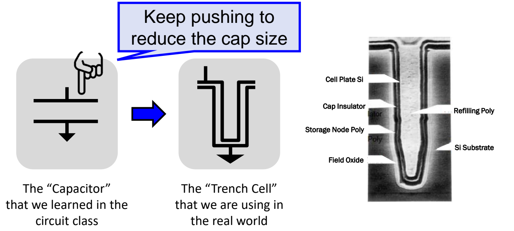
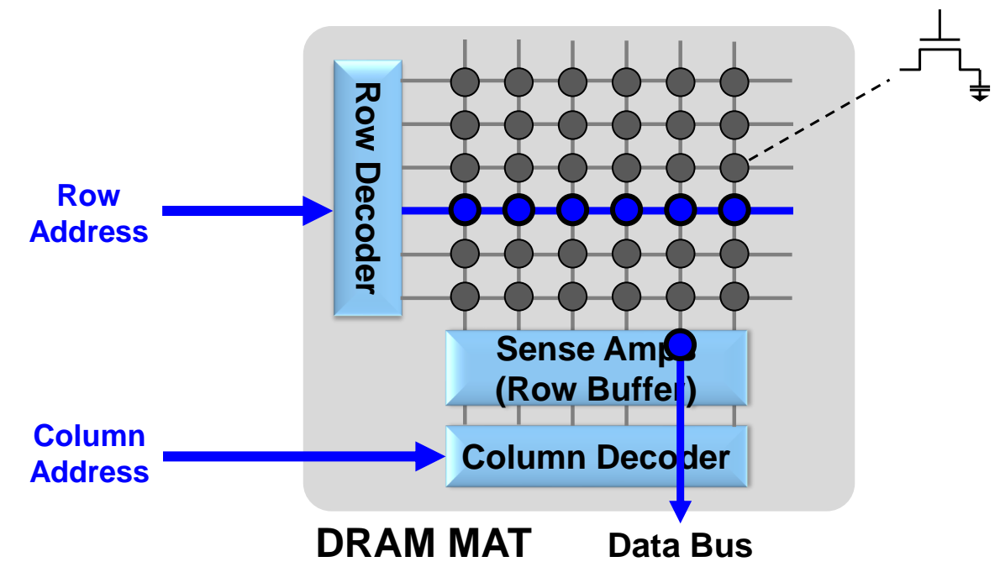
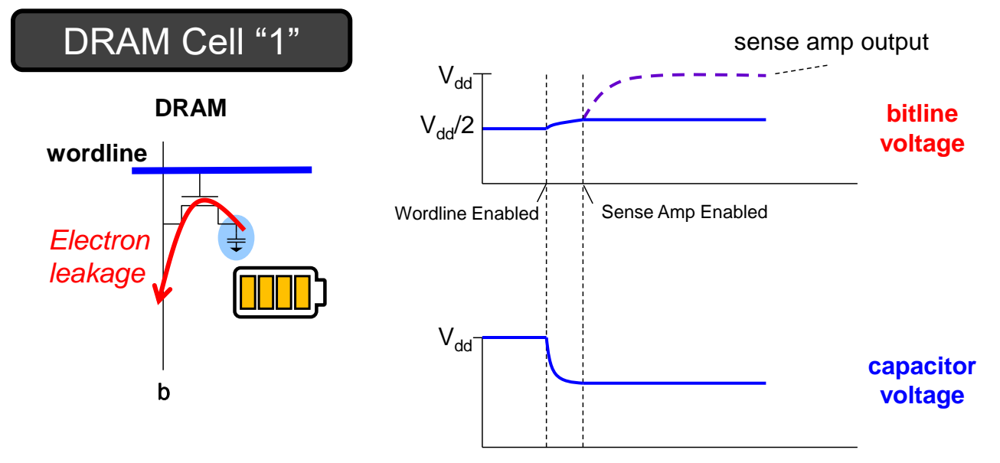
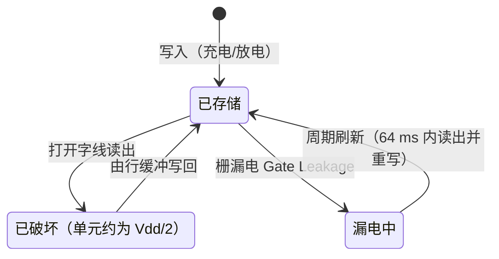

# 02 DRAM 单元与破坏性读

[本讲目录](../index.md) · [课程目录](../../index.md) · [上一节：01 降低缺失率与命中时间](01-reducing-miss-rate-and-hit-time.md) · [下一节：03 DRAM 组织层次](03-dram-organization-hierarchy.md)

> [!abstract] 本节要点
> - DRAM 单元是 1T1C：一个晶体管作开关、一个电容存电荷；写 1 给电容充电，写 0 让电容放电；每个单元只连一条字线和一条位线，比 6 管 SRAM 简单、便宜，但更慢。
> - 电容 $C$ 随极板面积增大、介电常数增大、极板距离减小而增大；工艺下只有面积可调，所以 DRAM 用三维**沟槽电容**在很小的横截面上获得很大的极板面积。
> - **MAT** 是 DRAM 单元阵列：行地址经行译码器打开一整条字线，整行数据进入灵敏放大器（即**行缓冲**），再由列地址经列译码器选出所需数据送上数据总线。
> - **破坏性读**：位线预充到 $V_{dd}/2$，且位线寄生电容大于单元电容；读时位线电压只小幅升/降，单元电压却大幅变化，灵敏放大器把小摆幅放大到 $V_{dd}$ 或 0；读完后单元接近 $V_{dd}/2$，数据只“安全地”留在行缓冲里，必须写回。
> - **栅漏电**让未被访问的单元也会丢数据，因此所有行必须周期性读出并重写（典型周期 64 ms），这就是 Dynamic 的由来；把行读入行缓冲慢、读行缓冲快，所以要争取**行缓冲命中**。

## DRAM 在存储层次中的位置

存储层次利用程序的局部性，让用户既能用到最便宜技术所能提供的容量，又能获得最快技术所提供的速度。[^s2p10] 层次呈金字塔形：越靠近处理器，容量越小、访问粒度越小；越远离处理器，容量越大、粒度越大。

各层之间的传输粒度：

- 处理器 ↔ L1\$：4–8 bytes（一个字 word）；
- L1\$ ↔ L2\$：8–32 bytes（一个块 block）；
- L2\$ ↔ 主存：1 到 4 个块；
- 主存 ↔ 二级存储：1,024+ bytes（磁盘扇区 = 页）。

本讲关注的是**主存**（main memory）这一层。目前主存的介质只有 DRAM 一种：它比 SRAM 便宜，但内部逻辑复杂，速度比 SRAM 慢得多。[^s2p12] 分析 DRAM 时自底向上：先看单个单元，再看单元如何组成阵列（本节），然后看阵列如何组成 Bank、Chip、Rank、Channel（见[DRAM 组织层次](03-dram-organization-hierarchy.md)）。

## DRAM 单元（1T1C Cell）

SRAM 每个单元要 6 个晶体管、两条位线；若主存也这样做，单位面积能放的比特太少、成本太高。DRAM 用最少的器件存 1 bit，换取密度和价格。

**DRAM**（Dynamic Random Access Memory，动态随机存取存储器）的单元由 **1T1C**（1 Transistor 1 Capacitor，一个晶体管加一个电容）构成：[^s2p12]

- **字线**（wordline）接在晶体管栅极上，用来**选中单元**：字线有效时开关导通，电容与位线相连；字线无效时开关断开，电容被隔离。
- **位线**（bitline，记作 $b$）用来**读写单元**：所有读写都经过这条线进行。
- **数据存放在电容里**：电容中的电荷量代表存储的比特。

写操作的过程：

1. **写 1**：打开字线，通过位线向电容充电，使电容处于高电压（电量最高），表示数字 1。
2. **写 0**：打开字线，让电容中的电荷经位线放掉，电容中没有电荷，表示数字 0。

与 SRAM 相比，DRAM 单元只需 1 个晶体管（SRAM 需要 6 个），每个单元只连 1 条字线、1 条位线（SRAM 有两条位线），器件和连线都更简单，这正是它便宜、密度高的原因。L06 已对 SRAM 与 DRAM 单元做过基本比较，此处不再展开。

## 沟槽电容（Trench Cell）

想在同样大小的芯片上放更多 DRAM 单元，就要把每个单元做小；但电路课里那种两块平行极板的电容“尺寸太大”，缩小它又会减少能存的电荷。[^s2p13] 问题因此变成：如何在单元占地变小的同时，保持电容量不变。

平行板电容的电容量由三个因素决定：

$$
C \propto \frac{\varepsilon A}{d}
$$

其中 $C$ 是电容量，$\varepsilon$ 是两极板间介质的介电常数，$A$ 是极板面积，$d$ 是两极板间的距离。逐个分析可调的“旋钮”：

1. **介电常数 $\varepsilon$**：半导体工艺使用固定的 CMOS 材料体系，不允许随意更换极板间的介质，$\varepsilon$ 无法改变。
2. **极板距离 $d$**：受工艺限制，同样不能随意减小。
3. **电压**：提高电压可以多存电荷，但电压升高会增加功耗，而现在的趋势是电压越低越好。
4. **面积 $A$**：唯一可以改变的因素。

于是矛盾变成“截面要小、面积要大”。解决办法是把电容做成三维结构：把平板电容向下“按”进硅衬底，弯折成一个深沟槽。这种实际使用的电容称为**沟槽电容**（Trench Cell）。[^s2p14] 从芯片表面看它的横截面积很小，但沟槽侧壁和底部展开后的实际极板面积很大。

沟槽电容的剖面由内到外包括：填充多晶硅（Refilling Poly）、单元极板硅（Cell Plate Si）、电容绝缘层（Cap Insulator）、存储节点多晶硅（Storage Node Poly）、场氧化层（Field Oxide），整体嵌在硅衬底（Si Substrate）中。幻灯片中的口号是 “Keep pushing to reduce the cap size”：沿着这条路一直压缩电容的占地面积。[^s2p14]

图：从电路课中的平板电容符号到实际使用的沟槽电容（Trench Cell），右侧剖面照片标出 Cell Plate Si、Cap Insulator、Storage Node Poly 等层，体现为缩小面积而向下挖槽的结构；中间是弯折成 U 形的沟槽电容示意。

> [!info] 可视化资源
> [Wikimedia Commons：DRAM 单元图集](https://commons.wikimedia.org/wiki/Category:DRAM_cell)：收录平面、堆叠（stack）与沟槽（trench）电容 DRAM 单元剖面图及 1T1C、3T 单元示意图，可对比理解三维沟槽电容如何在小截面上获得大面积。

如今大部分 DRAM 都采用这类三维电容设计，靠单元工艺本身进一步提升容量已经非常困难；另一条提容量的路是堆叠，见[容量扩展与内存模组](05-capacity-scaling-and-memory-modules.md)。

## DRAM 阵列 MAT 与行缓冲（Row Buffer）

单个单元只存 1 bit，需要把大量单元组织起来，并用尽量少的地址线和数据线访问它们。

**MAT** 是由大量 DRAM 单元排成的二维阵列，是 DRAM 内部组织的最小单元。[^s2p16] 因为 DRAM 单元可以分**行**（Row）和**列**（Column）两步访问，所以可以把同一列上的多个单元连接到同一条位线上。[^s2p16] MAT 的组成部分：

- 阵列：每个交叉点是一个 DRAM 单元；
- **行译码器**（Row Decoder）：驱动各条横向的字线，即单元晶体管栅极接的线；
- **灵敏放大器**（Sense Amps），也就是**行缓冲**（Row Buffer）：接在各条纵向位线的末端；
- **列译码器**（Column Decoder）：从行缓冲中选出所需的数据送上数据总线（Data Bus）。

一次读访问分两步：

1. **行访问**：输入行地址（Row Address），行译码器选中一条字线；这条字线上**所有**单元的数据都经各自的位线读入灵敏放大器，即整行进入行缓冲。
2. **列访问**：输入列地址（Column Address），列译码器根据列地址从行缓冲中选出某一个（或某一组）数据，读到数据总线上。

图：行地址经 Row Decoder 选中一整行（蓝色）送入 Sense Amps 即行缓冲，再由列地址经 Column Decoder 选出一位送到 Data Bus，体现两步（行、列）访问。

> [!warning] 易错点
> DRAM 与 SRAM 的阵列访问方式不同。SRAM 阵列选中一条字线后，可以直接由列选择读出所需单元；DRAM 必须先把**整条字线上所有单元**读进行缓冲，再由列地址从行缓冲中选数据。为什么 DRAM 必须多这一层行缓冲，原因就是下面的破坏性读。

> [!info] 可视化资源
> [Wikipedia：DRAM](https://en.wikipedia.org/wiki/Dynamic_random-access_memory)：含 1T1C 单元剖面图、$4 \times 4$ 阵列读出与写入示意图，并逐步解释行打开后灵敏放大器锁存整行及破坏性读后的回写，补充 MAT 读写过程。

多个 MAT 如何组成 Bank、以及为什么不直接做一个大阵列，见[DRAM 组织层次](03-dram-organization-hierarchy.md)。

## 破坏性读（Destructive Read）

读 DRAM 单元时，电容里只有极少的电荷，这些电荷要先分给位线，才能被检测出来；代价是单元本身的内容在读的过程中被“用掉”。

**破坏性读**指 DRAM 单元的内容在读出后即被擦除：无论原来存的是 0 还是 1，读完后单元中的电压都接近 $\frac{1}{2}V_{dd}$。[^s2p17]

理解它的关键是：位线看起来只是一根导线，本质上也是一个小电容；而且因为位线很长、连着很多单元，它的**寄生电容比单元电容还大**。这一点有些反直觉，但确实如此。

### 读 1 的过程

1. **预充**：读之前把位线电压设为 $V_{dd}/2$，即 0 与 $V_{dd}$ 的中间值；单元电容处于 $V_{dd}$。
2. **打开字线**（Wordline Enabled）：电容与位线连通。因为位线电压低于电容电压，电容向位线充电（电子从位线流向单元，图中标为 Electron leakage）。
3. **电荷分享**：位线电容大，所以位线电压只**小幅上升**；单元电容小，所以电容电压**大幅下降**，直到两者电压相等、不再有充放电。
4. **灵敏放大**（Sense Amp Enabled）：灵敏放大器检测到位线比 $V_{dd}/2$ 略高，把这个微小变化放大到 $V_{dd}$，于是识别出单元存的是 1。
5. **结果**：单元电容的电压已降到接近 $V_{dd}/2$。

图：存 1 的单元在字线打开后电荷分享，位线从 $V_{dd}/2$ 略升、电容电压从 $V_{dd}$ 降到中间值，灵敏放大器使能后输出被放大到 $V_{dd}$，说明读出会破坏单元内容。

### 读 0 的过程

1. **预充**：位线为 $V_{dd}/2$，单元电容为 0。
2. **打开字线**：位线电压高于电容，位线向电容充电（讲义标为 Electron injection）。[^s2p18]
3. **电荷分享**：位线电压**小幅下降**，电容电压**大幅上升**，直到两者平衡。
4. **灵敏放大**：灵敏放大器把位线比 $V_{dd}/2$ 略低的变化放大到 0 V，识别出单元存的是 0。
5. **结果**：单元电容的电压已升到接近 $V_{dd}/2$。[^s2p19]

> [!note] 补充解释
> 用电荷守恒可以定量看出“位线小动、单元大动”。设单元电容为 $C_s$、位线电容为 $C_b$，单元电压为 $V_s$（读 1 时为 $V_{dd}$，读 0 时为 0），位线预充为 $V_{dd}/2$。字线打开后两者达到共同电压 $V$：
> $$
> V = \frac{C_s V_s + C_b \cdot \frac{V_{dd}}{2}}{C_s + C_b}, \qquad \Delta V_{\rm bitline} = V - \frac{V_{dd}}{2} = \pm\frac{V_{dd}}{2}\cdot\frac{C_s}{C_s + C_b}
> $$
> 当 $C_b > C_s$ 时，$|\Delta V_{\rm bitline}| < V_{dd}/4$，位线只有小摆幅，必须靠灵敏放大器放大；而单元电压从 $V_{dd}$ 或 0 一路被拉到与位线相同的 $V$（接近 $V_{dd}/2$），原有信息随之消失。

破坏性读带来两个后果：

1. **无法分辨原值**：读完后单元无论原来是 0 还是 1 都接近 $V_{dd}/2$，单看单元已分不清原来存的是什么。
2. **不能再读一次**：再次读时，单元和预充后的位线电压几乎相同，上面依赖的充放电过程不再发生，读不出任何信号。所以一次读出只允许读一次，想再读必须先把数据重新写回单元。

这就是 DRAM 需要行缓冲的根本原因：整行数据读出后，单元里的内容已经没了，必须先把这些数据存放在行缓冲里，之后再写回单元。

> [!warning] 易错点
> 不要以为位线电容比单元电容小、读时位线电压会被拉到 $V_{dd}$ 或 0。实际是位线电容**更大**：位线只产生很小的电压变化，摆到 $V_{dd}$ 或 0 的是**灵敏放大器的输出**，而被大幅改变的是**单元电容**的电压。

## 栅漏电与刷新（Gate Leakage & Refresh）

即使从不去读，单元电容也存不住电荷：开关关上后，电容并不是理想的断路。

**栅漏电**（Gate Leakage）指 DRAM 单元即使没有被访问，也会逐渐向周围泄漏电荷、丢失内容。[^s2p20] 超过一定时间后，单元里无论原来存的是 0 还是 1，最终都会变成 0。正因为内容会随时间自行流失，这种存储器才叫“**动态**”（dynamic）RAM。为此，**所有 DRAM 行都必须周期性地读出并重新写入**，典型周期为 **64 ms**。[^s2p20]

**刷新**（Refresh）是同时解决破坏性读和栅漏电的机制，核心是利用行缓冲：[^s2p21]

1. **读出时保存**：一次读之后，单元里的内容已经没了，但数据仍“安全地”保存在行缓冲中。
2. **写回**：在不再需要这些数据时，把行缓冲中的数据写回该行的单元。
3. **先写回再读下一次**：在进行下一次读之前，必须保证写回已经完成。
4. **周期性刷新**：对每一行按上述“读入行缓冲 → 写回”的方式处理，并在 64 ms 内覆盖所有行，补上漏掉的电荷。

一行中的每个单元对应一个灵敏放大器，所有灵敏放大器合起来就是行缓冲；数据先从单元读入行缓冲，再从行缓冲写回单元。

这些写回与刷新的约束都会体现在 DRAM 的命令和时序参数中，例如写回在感测完成后进行、必须在下一次访问前完成，见[DRAM 接口与时序](04-dram-interface-and-timing.md)。

## 行缓冲命中（Row-Buffer Hit）

把数据从单元读入行缓冲、以及从行缓冲写回单元都比较慢；但如果数据已经在行缓冲里，直接从行缓冲读就很快。[^s2p21]

**行缓冲命中**（row-buffer hit）指要访问的数据所在的行已经在行缓冲中，只需做列访问即可读出；优化方向是**尽量从同一个行缓冲中连续读出多段数据**，摊薄读入整行的代价。[^s2p21] 由此产生了许多优化手段：内存控制器优先调度命中行缓冲的请求、开页/闭页策略、以及把连续地址映射到同一行的地址映射方式，分别见[内存控制器与行缓冲管理](06-memory-controller-and-row-buffer-management.md)和[地址映射与多通道](07-address-mapping-and-multiple-channels.md)。

> [!example] 例：同一行与不同行的访问
> 某 MAT 依次收到三个读请求：(行 5, 列 2)、(行 5, 列 9)、(行 8, 列 2)。
>
> 1. 第一个请求：行 5 不在行缓冲中，需先打开行 5 的字线，把整行读入行缓冲（慢），再按列 2 选出数据。
> 2. 第二个请求：行 5 已在行缓冲中，属于行缓冲命中，只需按列 9 从行缓冲中选数据（快）。
> 3. 第三个请求：要访问行 8，行缓冲中是行 5。行 5 的单元在读出时已被破坏，必须先把行缓冲中的数据写回行 5，再把行 8 读入行缓冲，最后选出列 2——这是最慢的情况。
>
> 因此，把对同一行的访问集中在一起，能显著减少慢速的“读入行缓冲 / 写回”操作。

> [!question]- 自测：某单元存 1，刚被读出一次且尚未写回。此时若直接对它再执行一次“预充位线到 $V_{dd}/2$ → 打开字线 → 灵敏放大”，会读到什么？
> 读不出可靠的值。第一次读后单元电压已接近 $V_{dd}/2$，与预充后的位线几乎相等，打开字线时几乎没有电荷流动，位线没有可供灵敏放大器放大的偏移。所以必须先从行缓冲把 1 写回单元，才能再次读它。

> [!question]- 自测：如果工程师把位线做得很短，使位线电容远小于单元电容，读 1 时位线和单元电压会怎样变化？这与实际 DRAM 有何不同？
> 由电荷分享，共同电压会接近单元原电压：位线会被大幅拉向 $V_{dd}$，单元电压只略微下降。实际 DRAM 恰好相反——位线很长、电容大于单元电容，位线只小幅上升、单元电压大幅下降到接近 $V_{dd}/2$，所以既需要灵敏放大器放大小摆幅，又会产生破坏性读。

> [!question]- 自测：一块 DRAM 长时间没有任何读写访问，它的数据还安全吗？需要做什么？
> 不安全。栅漏电会让未被访问的单元逐渐漏掉电荷，最终 0 和 1 都变成 0。必须周期性（典型 64 ms 内覆盖所有行）把每一行读入行缓冲再写回，即刷新；“动态”RAM 之名正来源于此。

> [!info]- 来源
> - L08-DRAM.pdf：PDF p.10, 12–14, 16–21
> - L08.docx：DOCX body 81–125

[^s2p10]: L08-DRAM.pdf-PDF p.10
[^s2p12]: L08-DRAM.pdf-PDF p.12
[^s2p13]: L08-DRAM.pdf-PDF p.13
[^s2p14]: L08-DRAM.pdf-PDF p.14
[^s2p16]: L08-DRAM.pdf-PDF p.16
[^s2p17]: L08-DRAM.pdf-PDF p.17
[^s2p18]: L08-DRAM.pdf-PDF p.18
[^s2p19]: L08-DRAM.pdf-PDF p.19
[^s2p20]: L08-DRAM.pdf-PDF p.20
[^s2p21]: L08-DRAM.pdf-PDF p.21

[本讲目录](../index.md) · [课程目录](../../index.md) · [上一节：01 降低缺失率与命中时间](01-reducing-miss-rate-and-hit-time.md) · [下一节：03 DRAM 组织层次](03-dram-organization-hierarchy.md)
