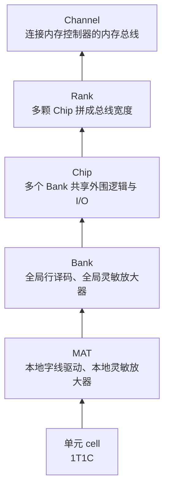
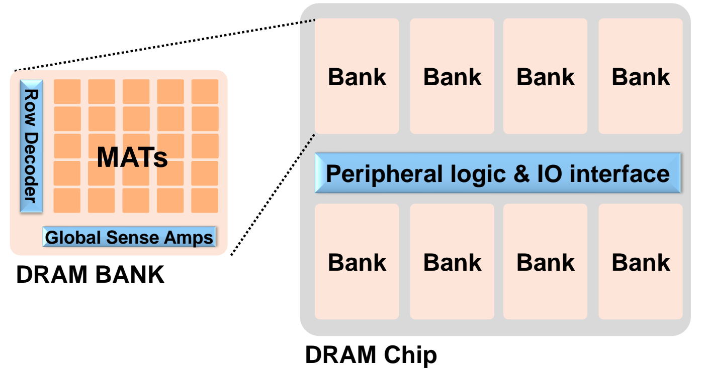
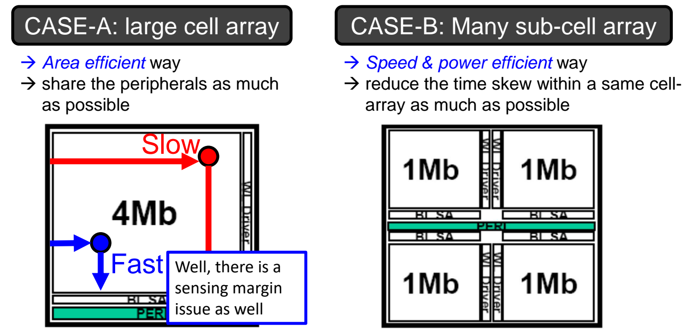
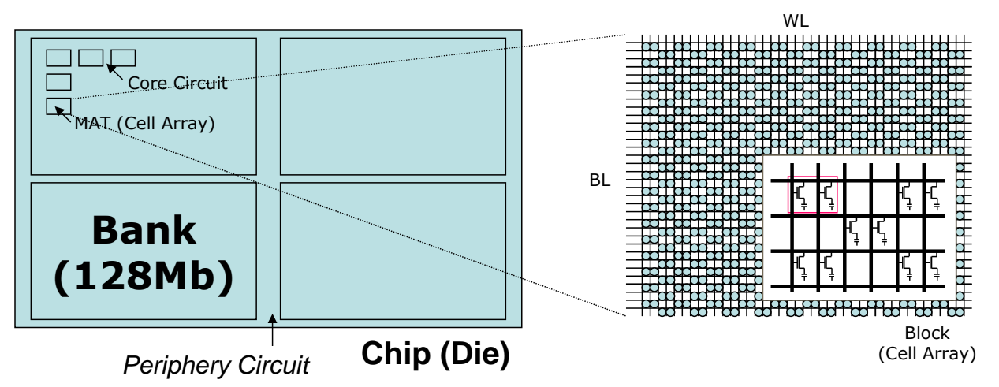
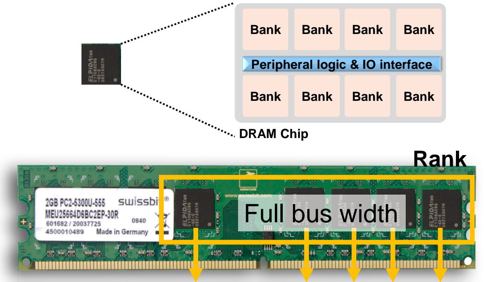

# 03 DRAM 组织层次

[本讲目录](../index.md) · [课程目录](../../index.md) · [上一节：02 DRAM 单元与破坏性读](02-dram-cell-and-destructive-read.md) · [下一节：04 DRAM 接口与时序](04-dram-interface-and-timing.md)

> [!abstract] 本节要点
> - DRAM 子系统自底向上分层：单元（cell）→ MAT → Bank → Chip → Rank → Channel；每一层由多个下一层单元组成。
> - Bank 由多个 MAT 加上全局行译码器和全局灵敏放大器组成，是**能独立服务一个访存请求**的基本操作单元。一颗 Chip 常含 8 个 Bank，它们共享外围逻辑与 I/O 接口，因此往外送数据时只能串行。
> - 之所以切成许多小阵列：大阵列里远端单元的字线、位线又长又慢（RC 大），时间偏斜大、感测裕量小，整个阵列只能按最慢的单元定时序。小阵列快、省功耗，代价是面积利用率低。
> - 芯片容量可逐级分解：$512\,\text{Mb} = 4 \times 128\,\text{Mb} = 4 \times (26 \times 30\ \text{MAT}) \times 176\,\text{kb} = 4 \times (26 \times 30\ \text{MAT}) \times 352\ \text{WL} \times 500\ \text{BL}$。
> - Rank 内的多颗 Chip **同步协作**服务同一个请求，Chip 数由系统总线宽度决定（如 8 颗 $\times 8$ 芯片拼成 64 位，第 9 颗存 ECC）；Bank 之间则**彼此独立**。Channel 是内存模组与内存控制器之间的内存总线，一个 Channel 可以挂多个 Rank。

## 分层总览

一颗 DRAM 芯片的容量是数十亿个 1T1C 单元。如果把它们排成一个整体阵列，延迟、功耗和可靠性都不可接受（原因见下文"分层组织的原因"）。所以 DRAM 从单元开始逐级组织成越来越大的单元，每一级都有自己的角色：

单元与 MAT 的内部结构（字线、位线、行缓冲与灵敏放大器、破坏性读）见[DRAM 单元与破坏性读](02-dram-cell-and-destructive-read.md)。本节从 MAT 往上讲。

## Bank 与 Chip

单个 MAT 很小，只实现了一个基本的读写框架，容量不够。所以要把许多 MAT 组合成更大的、能独立对外工作的单元。

**存储体（Bank）**由多个 MAT 组成，是 DRAM 中可以独立服务访存请求的基本操作单元（operating basic unit）。[^s2p22] 它的结构分两级：

1. **全局一级**：一个 Bank 有全局行译码器（Row Decoder）、全局字线（global wordline）、全局位线（global bitline）和全局灵敏放大器（Global Sense Amps）。全局行译码器负责选中某个 MAT 中的某一行。
2. **本地一级**：每个 MAT 内部还有自己的字线驱动器（WL Drivers）、本地灵敏放大器（Local Sense Amps，即行缓冲 Row Buffer）和列译码器（Column Decoder）。数据先在 MAT 内被本地灵敏放大器读出，再经全局位线送到全局灵敏放大器。

Bank 内部再分 MAT 的设计长期不为外界所知：2012 年三星的一篇论文公开了其内部设计确实是"一个 Bank 由许多 MAT 组成"，此前人们普遍以为一个 Bank 就是一个大阵列。[^s3b5] 这引出了"为什么要这样一层套一层"的问题，见下文"分层组织的原因"。

**芯片（Chip）**由多个 Bank 集成而成，常见为 8 个 Bank。这些 Bank 共享一套外围逻辑与 I/O 接口（Peripheral logic & IO interface）。[^s2p23] 两点性质要同时记住：

- **Bank 之间独立工作**：每个 Bank 都可以独立服务一个请求，因此 Chip 内部存在 Bank 级的并行性。
- **I/O 接口共享，必须串行化**：数据要送出芯片时，各 Bank 必须争用同一个 I/O 接口。一个 Bank 在传数据时，其他 Bank 只能等。所以需要调度，避免多个 Bank 同时争用 I/O，并尽量利用 Bank 之间的并行。这是 DRAM 硬件优化的重要方向，具体见[内存控制器与行缓冲管理](06-memory-controller-and-row-buffer-management.md)中的 Bank 级并行。

图：一个 DRAM Chip 包含上下两排共 8 个 Bank 和中间的 Peripheral logic & IO interface，放大的单个 Bank 由多个 MAT、Row Decoder 与 Global Sense Amps 组成。

> [!warning] 易错点
> "Bank 独立"指的是阵列操作（激活、读出、预充电）可以各自进行，不是说各 Bank 有各自的对外数据通路。数据输出口只有一套，多个 Bank 的数据仍要排队送出。

## 分层组织的原因

既然 MAT、Bank 看起来是"套娃"，为什么不把整个 Bank 直接做成一个大阵列？两种方案的对比如下。[^s2p24]

**方案 A：一个大单元阵列（large cell array，如 4 Mb）**，是面积高效（area efficient）的方案：外围电路（行译码、字线驱动、灵敏放大器）尽可能共享，芯片面积主要用来放存储单元。但它有两个问题：

1. **远端单元慢，时间偏斜大**。
   - **字线**：要打开某一行，字线必须被驱动到足够高的电压才能导通该行的晶体管。离行译码器（字线驱动器）近的单元（图中蓝色 Fast 点）电压上升快；远端单元（红色 Slow 点）要等整条长字线及其上所有晶体管栅极都充上电，所以慢。
   - **位线**：读写本质上是给位线充放电。位线越长，寄生电容越大，充放电越慢。远端单元连的是很长的位线。
   - **后果**：同一阵列内不同单元的访问时间差别很大，即**时间偏斜**（time skew）。为了让所有单元都能正确读出，电路只能按最慢单元的时间来定时序。无论单元快慢，最终都迁就慢的。
2. **感测裕量问题（sensing margin issue）**：判断读出 0 还是 1，靠的是位线上电压变化的幅度。近端单元的电压变化大，容易检测；远端单元的电压变化小，灵敏放大器可能判错，可靠性下降。

**方案 B：许多小单元阵列（many sub-cell array，如 4 个 1 Mb）**，是速度与功耗高效（speed & power efficient）的方案：每个小阵列都有自己的字线驱动器（WL Driver）、位线灵敏放大器（BLSA）和外围电路（PERI），尽量减小同一阵列内的时间偏斜。字线和位线都变短，访问更快、充放电功耗更低，各单元的速度差别不大。代价是**面积利用率低**：芯片上要留出大量空间放本地行译码器、本地列译码器和本地灵敏放大器，这些都不存数据。

图：CASE-A 用一个 4Mb 大阵列共享外围电路、面积高效但远近单元延迟差大（Slow/Fast），CASE-B 拆成四个 1Mb 子阵列各配 WL Driver 与 BLSA，速度与功耗更优。

| 方案 | 优势 | 问题 |
| --- | --- | --- |
| A：一个大阵列 | 面积高效，外围电路最大限度共享 | 远端单元 RC 大、时间偏斜大，必须按最慢单元定时序；感测裕量小 |
| B：许多小阵列 | 速度和功耗高效，阵列内时间偏斜小 | 本地外围电路多，面积利用率低 |

实际 DRAM 选择方案 B，并一级级叠加：为了性能，阵列要做小；为了容量，就把许多小阵列层层组织起来。MAT、Bank、Chip 以及后面的 Rank、Channel 都源于这一取舍。

eDRAM（embedded DRAM）沿同一方向走得更远：存储材料与普通 DRAM 相同，但阵列做得更小，以面积换速度，过去曾被用作 CPU 的 L3 或 L4 缓存。[^s3b6]

## 芯片容量分解

芯片标称的容量对应一套具体的层次结构。以 512 Mb DRAM 芯片为例：[^s2p25]

$$
\begin{aligned}
512\,\text{Mb} &= 4\ \text{Banks} \times 128\,\text{Mb} \\
&= 4\ \text{Banks} \times (26 \times 30\ \text{MATs}) \times 176\,\text{kb} \\
&= 4\ \text{Banks} \times (26 \times 30\ \text{MATs}) \times 352\ \text{WL} \times 500\ \text{BL}
\end{aligned}
$$

各项含义如下：

1. **Chip（Die）**：一颗芯片含 4 个 Bank，Bank 之间是外围电路（Periphery Circuit），每个 Bank 128 Mb。
2. **Bank**：每个 Bank 内排着 $26 \times 30 = 780$ 个 MAT，MAT 周围是核心电路（Core Circuit，即本地译码、驱动和灵敏放大器）。
3. **MAT**：每个 MAT 是一个单元阵列（Cell Array），有 352 条字线（WL）和 500 条位线（BL）。每个字线与位线的交叉点是一个单元，所以一个 MAT 有 $352 \times 500 = 176{,}000$ 位，约 176 kb。

图：以 512Mb 芯片为例，芯片分为 4 个 128Mb Bank 与外围电路，Bank 内有许多 MAT，MAT 放大后是 WL 与 BL 交叉的单元阵列，对应 $4 \times (26 \times 30) \times 352\,\text{WL} \times 500\,\text{BL}$ 的分解。

> [!warning] 易错点
> 这串等式是近似分解，逐项相乘对不上精确值。$780 \times 176\,\text{kb} = 137{,}280\,\text{kb}$，而 $128\,\text{Mb} = 2^{17}\,\text{kb} = 131{,}072\,\text{kb}$；176 kb 本身也是按十进制把 176,000 位记作 176 kb。看这类例子时要关注层次关系和数量级，不要拿它校验精确容量。

> [!example] 例：一个 Bank 一共有多少条字线
> 已知上例中每个 Bank 为 $26 \times 30$ 个 MAT，每个 MAT 有 352 条本地字线，求一个 Bank 内的本地字线总数和单元总数。
>
> 1. MAT 数：$26 \times 30 = 780$。
> 2. 本地字线总数：$780 \times 352 = 274{,}560$ 条。
> 3. 单元总数：$780 \times 352 \times 500 = 137{,}280{,}000$ 位，约 $1.3 \times 10^8$ 位，与 128 Mb 同一量级。

## Rank 与 ECC 芯片

一颗 DRAM 芯片的数据引脚很窄（如 8 位），而 CPU 的内存总线通常是 64 位。要填满总线，就需要多颗芯片一起工作。

**列（Rank）**由多颗 Chip 组成，Chip 的数量由系统内存的总线宽度决定（slide 原文为 burst width）。Rank 内的所有 Chip 合起来构成完整的总线宽度（Full bus width）。[^s2p26] Rank 是看得见的实体：一根内存条上通常有一组 8 或 9 颗芯片构成一个 Rank。每个 Rank 的芯片数一般是 2 的幂（8 颗最常见，也有 4 颗或 16 颗），有时会多出 1 颗。

图：单颗 DRAM 芯片内含 8 个 Bank，内存条上的一组芯片共同构成 Rank，并行拼出 Full bus width 的数据宽度。

**Rank 内 Chip 同步协作，Bank 之间彼此独立**。两者数量上可能都是 8，但工作机制完全不同：

| 层级 | 8 个单元如何分工 | 来了一个请求时 |
| --- | --- | --- |
| Chip 内的 8 个 Bank | 彼此独立，各自服务不同请求 | 由其中一个 Bank 服务；8 个请求可由 8 个 Bank 分别服务 |
| Rank 内的 8 颗 Chip | 锁步（lockstep）协作，共同服务同一请求 | 8 颗 Chip 同时动作，每颗贡献一部分数据位 |

> [!example] 例：8 颗 $\times 8$ 芯片如何拼成 64 位
> 一个 Rank 由 8 颗 $\times 8$ 芯片组成（每颗芯片有 8 根数据线 DQ），内存总线宽 64 位。
>
> 1. 每颗芯片的 8 根 DQ 接到内存条金手指上各自的 8 个触点。
> 2. 一次传输（beat）中，8 颗芯片同时各送出 8 位：$8 \times 8 = 64$ 位，正好填满总线。
> 3. 若突发长度为 8，一次突发共传 $64\,\text{bit} \times 8 = 512\,\text{bit} = 64\,\text{B}$，恰为一个常见缓存行大小。

> [!warning] 易错点
> 课上口述为"每个 chip 服务 8 个数据"，准确说法是：每颗 $\times 8$ 芯片在**每次传输**中驱动 8 个数据位，8 颗合起来是 64 位总线宽度，而不是"每颗芯片存 8 字节"。[^s3b7]

**ECC 芯片**：Rank 有时会多出第 9 颗芯片，专门存放**纠错码（Error-Correcting Code, ECC）**。DRAM 很容易出错：电容为了增大面积做成沟槽之类的复杂形状，又会漏电、读出时还会被破坏。多存一份冗余校验信息，就能发现某个数据出错并纠正回来。所以带 ECC 的 Rank 是 8 颗数据芯片加 1 颗 ECC 芯片，共 9 颗，总线宽度为 $64 + 8 = 72$ 位。

> [!note] 补充解释
> 72 位总线中额外的 8 位由第 9 颗 $\times 8$ 芯片提供。服务器常用的 SECDED（单错纠正、双错检测）码正是对 64 位数据配 8 位校验。

## Channel

Rank 之上还要解决"内存模组怎么连到内存控制器"的问题。

**通道（Channel）**严格说指 DRAM 模组（DIMM）与内存控制器之间相连的内存总线（memory bus）。[^s2p27] 每个 Channel 是一条独立的总线，连到 CPU 中的内存控制器；两个 Channel（Channel 0、Channel 1）就是两条总线。

一个 Channel 通常不止连一个 Rank：

- 桌面机：一个 Channel 一般连 2 个 Rank；
- 服务器：一个 Channel 可连 4 到 8 个甚至 16 个 Rank。服务器能挂这么多 Rank 依赖带缓冲的模组，见[容量扩展与内存模组](05-capacity-scaling-and-memory-modules.md)。

主板上的内存插槽用颜色标示通道归属：**同色插槽属于不同的 Channel**。只有两根内存条时，应插在两个同色插槽里，让两条内存分属两个 Channel、组成双通道。如果两根都插在同一个 Channel 上，另一个 Channel 的带宽就浪费了。多通道如何提升带宽、地址如何在通道间分布，见[地址映射与多通道](07-address-mapping-and-multiple-channels.md)。

> [!warning] 易错点
> 课上口述时把颜色规则说反过一次。以课件为准：要用双通道，就把内存条插在**同色**插槽（同色 = 不同通道）。不同主板的配色习惯可能不同，装机时以主板说明书为准。

> [!question]- 自测：某 Chip 有 8 个 Bank，同时来了两个分别落在 Bank 2 和 Bank 5 的读请求。两者能完全并行吗？
> 不能完全并行。两个 Bank 的阵列操作（激活、感测）可以重叠进行，因为 Bank 彼此独立；但它们共享芯片的同一套外围逻辑与 I/O 接口，数据输出时必须串行，一个 Bank 在送数据时另一个只能等。

> [!question]- 自测：同样容量的 DRAM，为什么做成 4 个 1 Mb 小阵列比一个 4 Mb 大阵列快？代价是什么？
> 大阵列中远端单元的字线、位线很长，RC 大，时间偏斜大，整个阵列只能按最慢的单元定时序，而且远端单元的感测裕量小。切成小阵列后线变短，最慢单元也变快，偏斜和功耗都降低。代价是每个小阵列都要配本地字线驱动器、灵敏放大器等外围电路，面积利用率下降。

> [!question]- 自测：一个带 ECC 的 Rank 由 $\times 8$ 芯片组成，共有几颗芯片？读 64 B 数据时，各芯片如何参与？
> 9 颗：8 颗数据芯片加 1 颗 ECC 芯片，总线宽 72 位。读请求到来时 9 颗芯片锁步工作：每次传输各送 8 位，8 颗数据芯片拼成 64 位数据，ECC 芯片送 8 位校验；突发长度为 8 时共传 8 次，得到 64 B 数据。这与 Bank 不同，Rank 内的芯片不能各自服务不同请求。

> [!info]- 来源
> - L08-DRAM.pdf：PDF p.22–27
> - L08.docx：DOCX body 101–205

[^s2p22]: L08-DRAM.pdf-PDF p.22
[^s3b5]: L08.docx-DOCX body 101-125
[^s2p23]: L08-DRAM.pdf-PDF p.23
[^s2p24]: L08-DRAM.pdf-PDF p.24
[^s3b6]: L08.docx-DOCX body 126-182
[^s2p25]: L08-DRAM.pdf-PDF p.25
[^s2p26]: L08-DRAM.pdf-PDF p.26
[^s3b7]: L08.docx-DOCX body 183-205
[^s2p27]: L08-DRAM.pdf-PDF p.27

[本讲目录](../index.md) · [课程目录](../../index.md) · [上一节：02 DRAM 单元与破坏性读](02-dram-cell-and-destructive-read.md) · [下一节：04 DRAM 接口与时序](04-dram-interface-and-timing.md)
