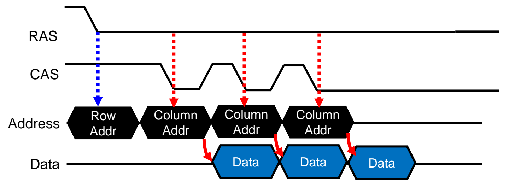
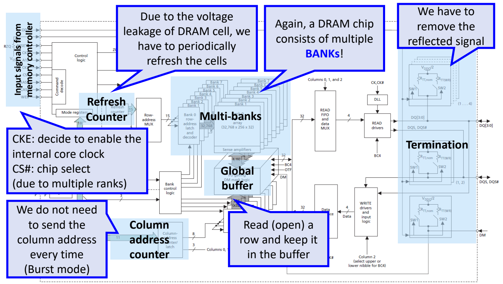
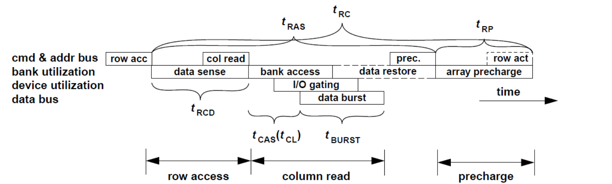

# 04 DRAM 接口与时序

[本讲目录](../index.md) · [课程目录](../../index.md) · [上一节：03 DRAM 组织层次](03-dram-organization-hierarchy.md) · [下一节：05 容量扩展与内存模组](05-capacity-scaling-and-memory-modules.md)

> [!abstract] 本节要点
> - 异步 DRAM 没有时钟，靠 RAS/CAS 选通信号的下降沿告诉芯片何时锁存行/列地址；之后依次出现三种改进：快速页模式复用已打开的行，EDO 让下一个列地址与当前数据输出重叠，Burst EDO 只送首个列地址，由片内计数器自动 +1。
> - SDRAM 引入系统时钟，命令、地址、数据都在时钟上升沿动作；DDR 在上升沿和下降沿都传数据，同样的时钟频率下数据总线吞吐翻倍。
> - 一个 DDR3 芯片内部包含：多个各有行/列译码器的 Bank、CS#（多 Rank 时选片）、CKE（使能内部时钟）、只产生行/Bank 地址的刷新计数器、支持突发的列地址计数器、全局缓冲与 I/O gating、读写 FIFO（并串转换）以及 Termination。
> - 读一次分三步 ACT → RD → PRE；$t_{RCD}$ 是行激活到数据进入灵敏放大器的时间，$t_{RAS}$ 是激活到数据恢复回单元的最短时间，$t_{CAS}$（$t_{CL}$）是列读命令到数据上总线的时间，$t_{CCD}$ 是相邻列命令最小间隔，$t_{BURST}$ 是一次突发占用数据总线的时间。
> - $t_{RP}$ 只是把位线恢复到 $V_{dd}/2$ 的时间；$t_{RC}=t_{RAS}+t_{RP}$ 是同一 Bank 访问不同行的最小间隔，也是这些参数里唯一的等式。所有时序参数都是控制器与芯片在开机时协商好的约定值，DRAM 不会回报“完成”。

## 异步 DRAM 与选通信号（Asynchronous DRAM）

要读写一个 DRAM 单元，控制器必须先后告诉芯片两件事：**行地址**，由行译码器选中 MAT 中的一行并读入灵敏放大器（行缓冲）；**列地址**，由列译码器从行缓冲里选出目标数据送上数据总线。[^s2p29] MAT、行缓冲与破坏性读的电路原理见[DRAM 单元与破坏性读](02-dram-cell-and-destructive-read.md)；行/列地址复用同一组地址引脚的做法见 L06《01 内存墙与存储技术》。于是问题变成——**什么时候**送地址、什么时候取数据？[^s2p28]

一次完整的访问在芯片内部经历四个阶段：

1. 传入行地址和列地址；
2. 把数据从单元读到灵敏放大器；
3. 把数据送上总线传输；
4. 把数据写回单元，再做预充电（precharge），为下一次访问做准备。

**异步 DRAM**（Asynchronous DRAM）是最早的接口形式：接口协议里**没有时钟信号**用来同步，而是用一组**选通信号**（strobe）来告诉芯片“现在可以锁存了”。[^s2p30]

- **RAS**（Row Address Strobe，行地址选通）：芯片在 RAS 的**下降沿**锁存地址线上的行地址；
- **CAS**（Column Address Strobe，列地址选通）：芯片在 CAS 的**下降沿**锁存列地址，随后把数据放到数据线上。

一次读的时序是：地址线上放行地址 → RAS 下降（锁存行）→ 地址线上换成列地址 → CAS 下降（锁存列）→ 数据出现在数据线上。读下一个数据时，整个过程从头再来。

**局限**：每输出一个数据都要重新发送行地址和列地址，即使两次访问落在同一行。[^s2p30]

## 快速页模式、EDO 与 Burst EDO

这三种改进都利用了访存的局部性，各自去掉异步接口中一处多余的等待或传输。

### 快速页模式（Fast Page Mode, FPM）

**动机**：观察实际访存模式会发现，相邻几次访问的行地址通常不变——数据要么连续读，要么相距不远。[^s2p31]

**机制**：只发一次行地址并保持 RAS 为低（这一行保持打开），之后每次只需拉低 CAS、送一个新的列地址，就读出同一行中的另一个数据。为此芯片要把已送入的行地址锁存住，后续访问复用这一行，不再重复发送行地址。

**局限**：每次“锁存列地址”和“输出数据”仍是**串行**的——必须等上一个数据输出完，才能送下一个列地址。[^s2p31]

### 扩展数据输出（Extended Data Out, EDO）

**动机**：既然列地址锁存与数据输出串行，就让它们像流水线一样重叠。

**机制**：在**灵敏放大器与数据线之间加一个缓冲**（buffer）。数据进入这个缓冲后在数据线上保持有效，CAS 可以提前抬起并为下一个列地址再次拉低；于是“锁存第 $k+1$ 个列地址”与“输出第 $k$ 个数据”同时进行，节省时间。[^s2p32] 这个缓冲在真实芯片框图中也能找到，就是下文的全局缓冲 / I/O gating。

图：RAS 下降锁存行地址后，CAS 多次下降依次锁存列地址，每个列地址对应的数据在下一个列地址期间输出，体现列地址捕获与数据输出的重叠。

### 突发 EDO（Burst EDO, BEDO）

**动机**：空间局部性很强时，一次常常连续访问多个数据（例如一次取 64 B），列地址通常就是依次 **+1**，没有必要一个个重复发送。[^s2p33]

**机制**：控制器只发**第一个列地址**，芯片内部用一个**列地址计数器**每次把列地址加 1，用它驱动列译码器选出下一个数据，随后连续输出一串数据。

**好处**：表面上只是少发了几个列地址，真正的收益在于**地址总线被空出来了**。一个芯片有多个 Bank，每个 Bank 工作都需要接收自己的行、列地址；当前 Bank 突发输出期间，空闲的地址总线可以用来给其他 Bank 发行地址和列地址，提高 Bank 间的并行度。Bank 的概念见[DRAM 组织层次](03-dram-organization-hierarchy.md)，Bank 级并行的调度见[内存控制器与行缓冲管理](06-memory-controller-and-row-buffer-management.md)。

> [!warning] 易错点
> 三种改进各自省掉的东西不同。FPM 省掉**重复的行地址**；EDO 不减少要发送的地址，而是让列地址锁存与数据输出**在时间上重叠**；Burst EDO 省掉**后续的列地址**，并空出地址总线给其他 Bank 用。判断时问自己：这次改进是少发了某种地址，还是让两件事同时做？

## 同步 DRAM 与双倍数据率（SDRAM / DDR）

### 同步 DRAM（Synchronous DRAM, SDRAM）

**动机**：速度越来越高以后，异步方式在一定程度上**无法保证时序正确**——芯片内所有模块必须按同一个步调做事，仅靠几根选通信号的边沿已经跟不上。[^s2p34]

**同步 DRAM**（SDRAM）引入**系统时钟** CK 来管理存储器时序，所有动作都在**时钟上升沿**进行：

- 在上升沿采样命令（如 READ，判断是读还是写）以及行地址、列地址，不再使用 RAS/CAS 的边沿锁存；
- 数据传输也按时钟上升沿进行。

这样芯片内部各模块都由同一个时钟同步驱动，内部可以做得更快。

### 双倍数据率（Double Data Rate, DDR）

**动机**：时钟周期在相当程度上决定了 DRAM 的性能，而 SDRAM 只用了时钟的上升沿。[^s2p35]

**DDR**（Double Data Rate）在时钟的**上升沿和下降沿都传送数据**，一个时钟周期传两次数据，于是在同样的时钟频率下**内存总线吞吐直接翻倍**。[^s2p35] 设总线时钟频率为 $f$，则 SDRAM 每秒传输 $f$ 次，DDR 每秒传输 $2f$ 次。GPU 使用的 GDDR 更进一步，可以在一个时钟周期内传四组数据（借助差分信号）。[^s3b8]

DRAM 用的时钟来自**内存控制器**：控制器在 CPU 内，DRAM 在 CPU 外。时钟频率足够高时，片外长导线上的时钟和数据很容易出错，因此现代 DRAM 还加入了额外设计，减小外部时钟对内部时序的影响。各代 DDR 的数据率、预取以及时钟偏斜与 DQS 见[高速接口与信号完整性](08-high-speed-interface-and-signal-integrity.md)。

DDR 型号后缀（如 DDR4-1600）表示的是数据率（MT/s）而非时钟频率，见[高速接口与信号完整性](08-high-speed-interface-and-signal-integrity.md)。

## DRAM 内部功能框图（Functional Block Diagram）

厂商的 DRAM 规格书（datasheet，例如 Micron 的 DDR3/DDR4 规格书，约 200 页）会给出芯片的特性、$t_{RCD}$ / $t_{RP}$ / $t_{CL}$ 等关键时序数值、容量与 Bank 数、引脚定义（哪些是数据、哪些是片选）等。理解了下面这张框图，就能读懂规格书的核心部分。[^s2p36]

图：Micron DDR3L 内部框图上标注了来自控制器的输入信号、Refresh Counter、多 Bank 阵列、全局缓冲、列地址计数器（突发模式）与 Termination，注意 CKE 与 CS# 的作用说明。

按信号从左（控制器一侧）到右（数据引脚一侧）的顺序：

1. **来自内存控制器的输入信号**：命令、地址、控制信号进入控制逻辑（command decode）。其中两个控制信号：
   - **CS#**（Chip Select，片选）：一个通道上可以挂多个 Rank，每次只访问其中一个，控制器用 CS# 选出这次工作的 Rank；[^s2p37]
   - **CKE**（Clock Enable，时钟使能）：决定是否使能芯片的**内部核心时钟**；不使能时芯片内部不工作。[^s2p37]
2. **刷新计数器**（Refresh Counter）：DRAM 单元会漏电，必须定期刷新。计数器每隔一段时间给出一个地址，把对应**整行**读出再写回。它**只连到行地址和 Bank 地址**，不连列地址，因为刷新以整行为单位，不需要列地址。[^s2p37] 刷新的原因与周期见[DRAM 单元与破坏性读](02-dram-cell-and-destructive-read.md)。
3. **多 Bank**（Multi-banks）：中间重复的 8 个 Bank，每个都有自己的行地址锁存与译码器、灵敏放大器和列译码器，因此能**各自独立工作**；除了这 8 份重复的部分，其余电路都由所有 Bank **共享**。输入地址会拆出 Bank ID，由 Bank 控制逻辑决定哪个 Bank 参与这次 I/O。
4. **列地址计数器**（Column address counter）：默认工作在**突发模式**，列地址不必每次都发送，计数器连续 +1 即可，这就是 Burst EDO 思想的延续。[^s2p37]
5. **全局缓冲 / I/O gating**（Global buffer）：位于灵敏放大器与数据通路之间，“打开”的行保存在灵敏放大器中，I/O gating 再把选中的数据取出。它让“从灵敏放大器读数据”和“向外传数据”能同时进行，这正是 EDO 所需的那层缓冲。
6. **读/写 FIFO 与数据复用**（READ FIFO and data MUX）：位于 Bank 与 I/O 之间，负责**并行 ↔ 串行转换**，并匹配芯片内核频率与总线频率之间的差异。细节见[高速接口与信号完整性](08-high-speed-interface-and-signal-integrity.md)中的 DDR 预取与并串转换。
7. **端接**（Termination）：位于数据引脚一侧，用来**消除反射信号**，对信号质量影响很大，原理见[高速接口与信号完整性](08-high-speed-interface-and-signal-integrity.md)。[^s2p37]

> [!info] 可视化资源
> [Wikipedia：SDRAM](https://en.wikipedia.org/wiki/Synchronous_dynamic_random-access_memory)：提供 SDR SDRAM 命令真值表（CS/RAS/CAS/WE/BA/A10 对应激活、读写、预充电、刷新等）并说明 CKE 作用与 tRCD/tRP/CL 时序，帮助读懂 DDR3 框图中的控制信号。

> [!info] 依据讲义整理
> 讲义附录把一次访问中命令与数据在通用 SDRAM 芯片内的流动分成四段：[^s2p101]
>
> 1. **命令传输与译码**（command transport and decode）：CS#、WE#、CAS#、RAS# 等控制信号进入控制逻辑译码；地址经地址寄存器送往行地址复用器、行地址锁存与译码器、Bank 控制逻辑和列译码器；
> 2. **Bank 内数据移动**（in bank data movement）：数据在 DRAM 阵列与灵敏放大器阵列之间移动；
> 3. **芯片内数据移动**（in device data movement）：数据在灵敏放大器与 I/O gating / 读数据锁存 / 写驱动器之间移动；
> 4. **系统数据传输**（system data transport）：数据经数据输出 / 输入寄存器与数据 I/O 引脚在芯片与外部总线之间传输。
>
> 该流程图中刷新计数器同样只接到行地址复用器，列地址计数器接到列译码器，与上面 DDR3 框图一致。下文时序图中的 bank utilization、device utilization、data bus 三行，分别对应第 2、3、4 段占用的资源。

## DRAM 命令与时序约定

控制器访问 DRAM 时发出一系列**命令**，最基本的是**行激活**（row activation，ACT，打开某一行）、**列读/列写**（column read / write，RD / WR，从打开的行中选列）和**预充电**（precharge，PRE，关闭该行）。

DRAM 接口的设计前提是**尽量减少内存控制器与芯片之间的通信**。因此芯片执行完一条命令后**不会回报“我完成了”**；双方事先约定好每条命令需要等待多久，控制器只要等够这段时间，就认为命令已经完成，可以发下一条。这些等待时间就是**时序参数**（timing parameters），例如 $t_{RCD}$、$t_{RAS}$。

这些参数不是物理常数，而是一份**协商出来的约定**：

1. **开机训练**：开机时 CPU（内存控制器）与 DRAM 要先同步、确定 $t_{RCD}$、$t_{RAS}$ 等参数的取值；多数参数是**下限约束**，控制器发命令的间隔必须**不小于**它。
2. **超频调参**：高端玩家会把默认参数（如 $t_{RCD}$、$t_{CL}$、$t_{RAS}$）调小；开机时先测试，能正常通信就用，失败就重启回退，所以开机会变慢。
3. **服务器开机慢**：服务器插的内存条多，控制器要逐条与之确认参数，开机可能超过一分钟。

> [!tip] 课堂强调
> 学 DRAM 时序最重要的一点是理解它**为什么存在**：时序参数是控制器与内存之间为了**省掉通信**而做的折中，只要等够约定时间就保证命令完成。可调的是 $t_{CL}$、$t_{CCD}$、$t_{RCD}$、$t_{RAS}$ 这类参数；$t_{BURST}$ 由传输数据量和总线时钟决定，是固定的。

下面按读操作的三步 ACT → RD → PRE 逐一介绍参数。时序图分四行资源：命令/地址总线（cmd & addr bus）、Bank 占用（bank utilization）、芯片外围电路占用（device utilization）和数据总线（data bus）。

### 第一步：行激活（ACT）

- **$t_{RCD}$**（Row-to-Column command Delay，行到列命令延迟）：从行激活命令发出，到该行数据从 DRAM 单元阵列**移动到灵敏放大器**所需的时间，也就是时序图中 data sense 阶段。[^s2p38] 过了 $t_{RCD}$ 才能发列读命令。它决定发出 ACT 后数据多久能到行缓冲，是影响 DRAM 性能最核心的参数之一，也是规格书首页明确列出的参数。
- **$t_{RAS}$**（Row Access Strobe latency，行访问选通延迟）：从行激活命令发出，到这一行数据**放电读出并恢复回 DRAM 单元**（data restored to DRAM cells）所需的时间。[^s2p38] 它是一个**最小值**：同一 Bank 激活后至少等 $t_{RAS}$ 才能预充电。

### 第二步：列读（RD）

行已经在灵敏放大器里之后，控制器发列读命令（同时带上列地址），数据从行缓冲经 I/O gating 送上数据总线，开始一次数据突发（data burst）。

- **$t_{CAS}$**（Column Access Strobe latency，列访问选通延迟），也称 **$t_{CL}$**：从发出列读命令，到 DRAM 把请求的数据**放到数据总线上**的时间。[^s2p39]
- **$t_{CCD}$**（Column-to-Column Delay，列到列延迟）：连续发多个列命令时，两条列命令之间的**最小间隔**，保证它们不冲突。[^s2p39] 物理上它对应 **I/O gating** 的时间，要求 $t_{CCD}$ 不小于 I/O gating 时间。讲义表格补充：$t_{CCD}$ 由芯片内部突发（预取）长度决定，DDR SDRAM 为 2 拍（1 个时钟周期），DDR2 SDRAM 为 4 拍（2 个时钟周期）。[^s2p42]
- **$t_{BURST}$**（数据突发时长）：一条列读命令的数据突发**占用数据总线的时间**。[^s2p39] 典型突发为 4 或 8 拍；DDR SDRAM 中 4 拍数据占 2 个完整时钟周期。[^s2p42] 传输的数据量和总线时钟确定后，$t_{BURST}$ 就是固定的。

讲义（引自 Bruce Jacob《Memory Systems: Cache, DRAM, Disk》）还定义了两类资源占用：**Bank 占用**指数据在灵敏放大器与 I/O gating 之间移动的时间；**I/O gating** 是数据预取的时间。[^s2p39] 列读的四个环节是：① 地址与命令经命令总线进入芯片译码；② Bank 内 data read；③ I/O gating；④ data burst 上数据总线。

### 第三步：预充电（PRE）

- **$t_{RP}$**（Row Precharge，行预充电）：一个 DRAM 阵列完成预充电、能够接受下一次行访问所需的时间。[^s2p40] 读完一行后位线电压已经改变，下一次读之前必须对位线充电或放电，使其回到 $V_{dd}/2$。$t_{RP}$ **只包含**把位线拉回 $V_{dd}/2$ 的时间，**不包含**把数据写回单元的时间。
- 数据写回单元在哪里发生？物理上，数据一被读入行缓冲（灵敏放大器），写回单元的过程就**立刻自动开始**；写操作把数据写进行缓冲后，也会立刻更新到单元。所以恢复数据算在 $t_{RAS}$ 里，不在 $t_{RP}$ 里。
- **$t_{RC}$**（Row Cycle，行周期）：同一 Bank 内**访问不同行**的时间间隔，即从激活一行到预充电完成、可以激活另一行的整个周期：[^s2p40]

$$
t_{RC} = t_{RAS} + t_{RP}
$$

它是 DRAM 把数据**读入灵敏放大器、恢复回单元、再把位线预充电**以迎接下一次行访问所需的**最短**时间。访问了 Bank 中的行 A 之后要访问同一 Bank 的行 B，必须等满 $t_{RC}$ 才能发出行 B 的激活命令。在这些参数中，$t_{RC}$ 是**唯一的等式**，其余都是不等式（下限约束）。

**源错误更正**：课堂口述把 $t_{RC}$ 说成"最长时间"，按讲义定义（Minimum amount of time）它是同一 Bank 换行所需的**最短**时间。[^s2p40][^s3b11]

> [!warning] 易错点
> - $t_{RP}$ 不含“数据写回单元”：写回发生在感知之后、包含在 $t_{RAS}$ 内；$t_{RP}$ 只负责把位线恢复到 $V_{dd}/2$。
> - $t_{RC}$ 是同一 Bank 换行的**最小**间隔，不是上限；不同 Bank 的行激活不受 $t_{RC}$ 约束（但受 $t_{FAW}$ 等约束，见下文）。
> - $t_{CAS}$ 从列读**命令**算到数据**开始**上总线，不包含数据突发本身的 $t_{BURST}$。

### 完整读周期与命令重叠

把三步串起来就是一次完整的读周期：

1. **row acc**：发 ACT，等 $t_{RCD}$（data sense）；
2. **col read**：发 RD，等 $t_{CAS}$（$t_{CL}$），然后数据突发占用总线 $t_{BURST}$；
3. **prec.**：从 ACT 起至少等满 $t_{RAS}$（期间完成 data restore）才发 PRE，再等 $t_{RP}$（array precharge）；
4. 之后才能对同一 Bank 发下一条 **row act**（图中虚线框，属于下一次访问）。

图：一次读周期按命令总线、Bank、器件与数据总线分行展示，行访问到列读为 $t_{RCD}$，列读到数据为 $t_{CAS}$，数据突发为 $t_{BURST}$，$t_{RAS}$ 与 $t_{RP}$ 之和构成 $t_{RC}$（图取自 Bruce Jacob《Memory Systems》）。

这张图有两处重叠值得注意：

- **命令与周期重叠**：下一条行激活命令可以在 $t_{RC}$ 末尾就发出，与本周期的最后一段重叠。
- **资源之间重叠**：bank access、I/O gating、data burst 三行并不是前一个完全结束后一个才开始，而是部分重叠同时进行，这样效率最高。

DRAM 对时序要求非常严格，只有时序卡得紧，才能把利用率提上来。

> [!example] 例：同一 Bank 连续访问两个不同行（据课程内容整理）
> 设某 DRAM 以时钟周期为单位：$t_{RCD}=11$，$t_{CL}=11$，$t_{RAS}=28$，$t_{RP}=11$，$t_{BURST}=4$（数值为假设）。控制器在第 0 周期对 Bank 0 的行 A 发 ACT，读一次后要读同一 Bank 的行 B。
>
> 1. 最早在第 $t_{RCD}=11$ 周期发 RD；数据在第 $11+t_{CL}=22$ 周期开始上总线，到第 $22+t_{BURST}=26$ 周期突发结束。
> 2. PRE 最早只能在第 $t_{RAS}=28$ 周期发出（虽然数据第 26 周期就传完了，行数据的恢复还没完成）。
> 3. 预充电在第 $28+t_{RP}=39$ 周期完成，正好等于 $t_{RC}=t_{RAS}+t_{RP}=39$。
> 4. 行 B 的 ACT 最早在第 39 周期发出，它的数据最早在第 $39+11+11=61$ 周期开始上总线。
>
> 如果行 B 在另一个 Bank，就不必等 Bank 0 的 $t_{RC}$，这正是多 Bank 并行的意义。

## 其他时序约束（Many Parameters）

上面只覆盖了一次读的基本流程，真实时序还有许多约束。讲义列出的参数表（Jacob《Memory Systems》Table 11.1）如下：[^s2p42]

| 参数 | 含义 |
| --- | --- |
| $t_{AL}$ | Added Latency，DDRx SDRAM 为 posted CAS 命令附加的列访问延迟 |
| $t_{BURST}$ | 数据突发占用数据总线的时长，典型为 4 或 8 拍；DDR 中 4 拍占 2 个时钟周期 |
| $t_{CAS}$ | 列访问命令到 DRAM 开始返回数据的间隔，又称 $t_{CL}$ |
| $t_{CCD}$ | 列命令的最小间隔，由内部突发（预取）长度决定；DDR 为 2 拍（1 周期），DDR2 为 4 拍（2 周期） |
| $t_{CMD}$ | 命令从控制器传到 DRAM 时占用命令总线的时长 |
| $t_{CWD}$ | 列写命令发出到控制器把数据放上数据总线的间隔 |
| $t_{FAW}$ | 四 Bank 激活窗口：任一滚动时间窗内最多激活 4 个 Bank，限制多于 4 Bank 的 DDR2/DDR3 的峰值电流 |
| $t_{OST}$ | ODT 在 Rank 之间切换的时间 |
| $t_{RAS}$ | 行访问命令到数据恢复回阵列的间隔；Bank 激活后至少 $t_{RAS}$ 才能预充电 |
| $t_{RC}$ | 同一 Bank 访问不同行的间隔，$t_{RC}=t_{RAS}+t_{RP}$ |
| $t_{RCD}$ | 行访问到数据在灵敏放大器就绪的间隔 |
| $t_{RFC}$ | 刷新命令到激活命令之间的刷新周期时间 |
| $t_{RP}$ | 阵列预充电以迎接另一次行访问所需的时间 |
| $t_{RRD}$ | 同一芯片两次行激活命令的最小间隔，限制峰值电流 |
| $t_{RTP}$ | 读命令到预充电命令的间隔 |
| $t_{RTRS}$ | Rank 间切换时间，用于 DDR/DDR2（DDR SDRAM 中为 1 个周期） |
| $t_{WR}$ | 写恢复时间：写数据突发结束到预充电命令的最小间隔，让灵敏放大器把数据写回单元 |
| $t_{WTR}$ | 写到读延迟：写数据突发结束到列读命令的最小间隔，让 I/O gating 在读命令前完成对灵敏放大器的改写 |

其中三个约束值得说明其来由：

- **$t_{FAW}$**：大容量 DRAM 要有更多 Bank（如 16 个）。如果 16 个 Bank 同时做 I/O，瞬时电流需求太高，难以保证电压稳定。做法是把 Bank 分组（例如 4 个 Bank 一组，即 bank group），不同组错开工作；$t_{FAW}$ 保证激活之间有间隔，不能同时开始。
- **$t_{WTR}$**：先写后读时，读命令要额外等待的时间。
- **$t_{WR}$**（write recovery）：写入的数据还要写回 DRAM 单元，预充电必须与这个写回过程错开，因此写之后要等 $t_{WR}$ 才能预充电。

> [!question]- 自测：某 DRAM 的 $t_{RAS}=32$ ns，$t_{RP}=14$ ns，$t_{RCD}=14$ ns。控制器在 $t=0$ 激活 Bank 2 的第 100 行，之后要读同一 Bank 的第 200 行，第 200 行的激活命令最早何时发出？如果第 200 行在 Bank 3 呢？
> 同一 Bank：最早在 $t=t_{RC}=t_{RAS}+t_{RP}=46$ ns，因为必须先等满 $t_{RAS}$ 才能预充电，再等 $t_{RP}$ 让位线回到 $V_{dd}/2$；$t_{RCD}$ 不影响这个答案。换到 Bank 3 时不受 Bank 2 的 $t_{RC}$ 约束，只需满足 $t_{RRD}$、$t_{FAW}$ 等跨 Bank 激活约束，可以早得多。

> [!question]- 自测：一个 Burst EDO 芯片和一个快速页模式芯片都从同一已打开的行连续读 8 个数据。两者在地址线上各要发送几个地址？Burst EDO 多出来的好处体现在哪里？
> 快速页模式：1 个行地址 + 8 个列地址；Burst EDO：1 个行地址 + 1 个列地址，其余由片内列地址计数器 +1 产生。好处不只是少发 7 个地址，更在于突发期间地址总线空闲，可以给其他 Bank 发行/列地址，让多个 Bank 并行工作。

> [!question]- 自测：同学说“$t_{RP}$ 很长是因为预充电要把行缓冲里的数据写回电容”，并且“刷新计数器要像普通访问一样给出行、列地址”。分别指出错误。
> 两句都不对。数据写回单元在读入灵敏放大器后立即自动进行，计入 $t_{RAS}$，$t_{RP}$ 只是把位线恢复到 $V_{dd}/2$ 的时间。刷新以整行为单位，刷新计数器只产生行地址和 Bank 地址，不需要列地址。

> [!info]- 来源
> - L08-DRAM.pdf：PDF p.28–42, 101
> - L08.docx：DOCX body 183–313

[^s2p29]: L08-DRAM.pdf-PDF p.29
[^s2p28]: L08-DRAM.pdf-PDF p.28
[^s2p30]: L08-DRAM.pdf-PDF p.30
[^s2p31]: L08-DRAM.pdf-PDF p.31
[^s2p32]: L08-DRAM.pdf-PDF p.32
[^s2p33]: L08-DRAM.pdf-PDF p.33
[^s2p34]: L08-DRAM.pdf-PDF p.34
[^s2p35]: L08-DRAM.pdf-PDF p.35
[^s3b8]: L08.docx-DOCX body 206-228
[^s2p36]: L08-DRAM.pdf-PDF p.36
[^s2p37]: L08-DRAM.pdf-PDF p.37
[^s2p101]: L08-DRAM.pdf-PDF p.101
[^s2p38]: L08-DRAM.pdf-PDF p.38
[^s2p39]: L08-DRAM.pdf-PDF p.39
[^s2p42]: L08-DRAM.pdf-PDF p.42
[^s2p40]: L08-DRAM.pdf-PDF p.40
[^s3b11]: L08.docx-DOCX body 288-313

[本讲目录](../index.md) · [课程目录](../../index.md) · [上一节：03 DRAM 组织层次](03-dram-organization-hierarchy.md) · [下一节：05 容量扩展与内存模组](05-capacity-scaling-and-memory-modules.md)
