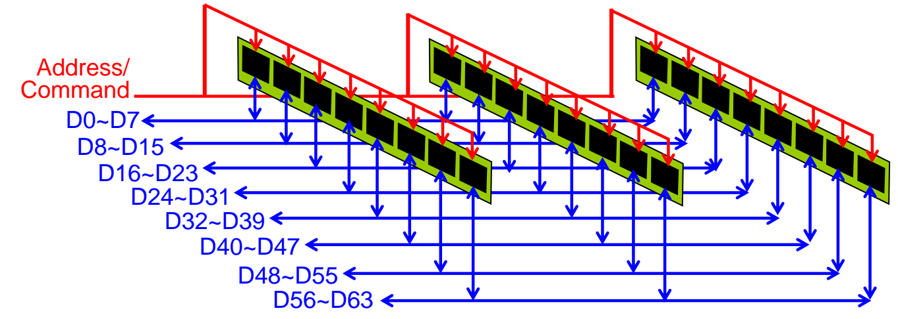
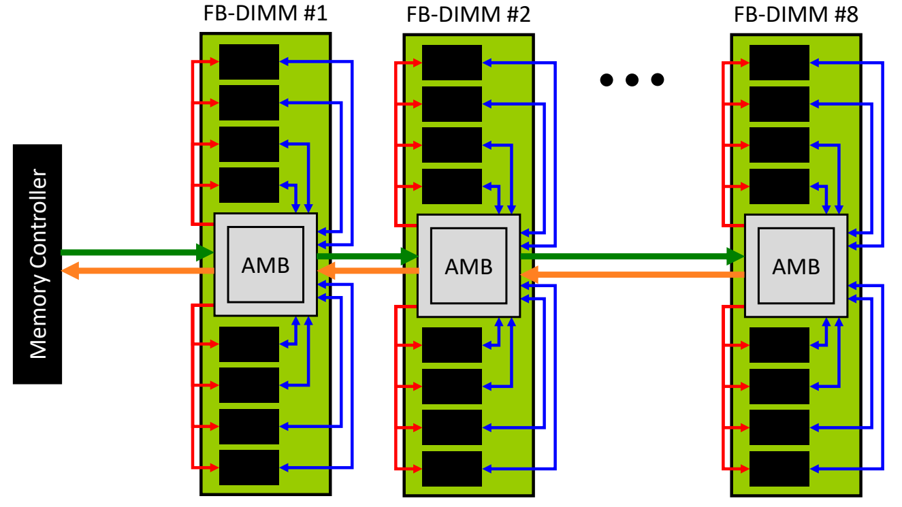
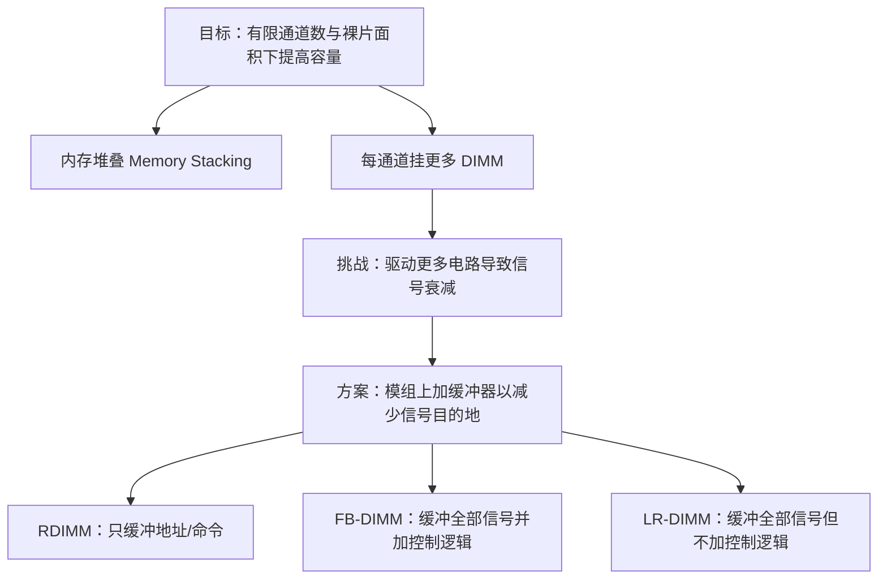

# 05 容量扩展与内存模组

[本讲目录](../index.md) · [课程目录](../../index.md) · [上一节：04 DRAM 接口与时序](04-dram-interface-and-timing.md) · [下一节：06 内存控制器与行缓冲管理](06-memory-controller-and-row-buffer-management.md)

> [!abstract] 本节要点
> - 在通道数和芯片面积都有限的条件下提高内存容量有三条宏观途径：内存堆叠、一个通道挂多条 DIMM、在模组上加缓冲（RDIMM 及其后继）。
> - 堆叠（裸片叠裸片或 PCB 叠 PCB）提高单位面积容量，代价是良率随层数下降，以及散热困难、热胀冷缩导致接触不良。
> - 多 DIMM 共享一个通道时，每根数据线只连每条 DIMM 上的一颗芯片（3 条 DIMM 时负载为 3 颗），而地址/命令线要连所有芯片（$3\times 8=24$ 颗）。
> - 负载越多、距离越不一致，信号衰减和波形畸变越严重；解决思路是在模组上放缓冲器，减少每根信号线的“目的地”数量。
> - RDIMM 只缓冲地址/命令；FB-DIMM 用 AMB 缓冲全部信号并加控制逻辑，可串接 8 条，但 AMB 发热、需散热片、成本高；LR-DIMM 用多颗缓冲芯片分散负载，不加额外控制逻辑。

## 提高容量的三条途径

DRAM 容量的提升，最基本的办法是把每个单元做小（单元结构见[DRAM 单元与破坏性读](02-dram-cell-and-destructive-read.md)）。但单元微缩之外，系统还受到两个宏观限制：芯片面积不能随意变大，处理器能提供的内存通道数也有限。在这两个限制下，提高内存容量（Increase the memory capacity）有三种更宏观的方法：[^s2p43]

1. **内存堆叠**（Memory Stacking）：在同样的面积上叠更多芯片或电路板。
2. **单通道多 DIMM**（Multiple DIMMs per Channel）：让多条内存条共享同一个通道。
3. **寄存式 DIMM**（Registered DIMM）及其后续的缓冲型模组：解决多 DIMM 带来的信号负载问题。

这三种方法并不是彼此独立的：第 2 种是最常用的扩容手段，而第 3 种正是为了让第 2 种在挂更多 DIMM 时还能可靠工作。Channel、Rank、DIMM 等层次的定义见[DRAM 组织层次](03-dram-organization-hierarchy.md)。

## 内存堆叠（Memory Stacking）

如果平面面积固定，就往第三个维度要容量。

**内存堆叠**是把裸片叠在裸片上（die on die）或把 PCB 叠在 PCB 上（PCB on PCB），从而提高单位面积上的存储密度。[^s2p44]

讲义给出的两个实例：裸片堆叠的例子是在厚 1.4 mm 的多芯片封装（MCP）里叠 20 层裸片（Elpida Memory）；PCB 堆叠的例子是把主板（primary board）和副板（secondary board）两块内存 PCB 叠在一起。

> [!info] 可视化资源
> [Wikipedia：高带宽内存 HBM](https://en.wikipedia.org/wiki/High_Bandwidth_Memory)：含 HBM 显卡剖面示意图（堆叠 DRAM 裸片、TSV 硅通孔、中介层）和 HBM 封装实物照片，直观展示裸片堆叠扩容的结构。

### 裸片堆叠：良率与散热

以 HBM 为代表的裸片堆叠，每层芯片上有大量用于通信的金属接触点，堆叠时必须让所有层的接触点**同时对齐**才能连通，任何一处没对齐整颗堆叠就报废。因此：

1. **良率随层数下降**：每多叠一层，就多一次“全部接触点同时对齐”的要求，成功概率连乘下去。课堂上的示意数字是：叠 4 层时，每片上一千多个接触点同时对齐的概率约为 80%，再往上叠良率会更低。[^s3b11]
2. **散热与热胀冷缩**：芯片叠在一起后热量难以散出，尤其是中间几层；中间热、两侧冷，热胀冷缩不均会让层间接触点接触不良，器件随之失效。[^s3b12]

> [!note] 补充解释
> 若每层堆叠成功的概率为 $p$，且各层相互独立，则 $n$ 层全部成功的概率是 $p^n$。例如 $p=0.95$ 时，$n=4$ 约为 $0.81$，$n=8$ 约为 $0.66$。这就是“层数越多良率越低”的数学含义。课堂上的 4 层、80% 是示意，不是 HBM 规格；实际 HBM 产品可堆叠 8～12 层裸片。

更激进的工艺是**混合键合**（Hybrid Bonding）：不再用占面积较大的金属凸点，而是直接把裸片与裸片结合在一起，从而大幅增加层间连接数。课堂举例：HBM 一层约有 1024 个接触点，每个接触点就是一条数据通道；混合键合宣称可以再多 8 倍，达到 8192 个。[^s3b11] 但它同样受上述两个问题制约，良率可能远低于 HBM 的堆叠。

### PCB 堆叠：廉价但受厚度限制

比裸片堆叠便宜得多的做法是在电路板层面堆叠：

- 把两块 PCB 叠在一起，共享同一组金手指、插在同一个通道上；
- 在一块 PCB 的正反两面都贴芯片。

它的限制是物理尺寸：叠得越多越厚，最终插不进服务器的插槽。因此常见的是两块 PCB 合在一起，再多就不现实了。[^s3b12]

> [!warning] 易错点
> 堆叠提高的是**单位面积的容量**，并不解决通道上的电气问题。PCB 堆叠后，两块板仍挂在同一个通道上，等于给通道增加了更多芯片负载，下面讲的信号负载问题同样存在。

## 单通道多 DIMM 与信号负载

处理器引出的内存引脚数存在设计上限，因为**引脚数就是成本**（# pins = cost），通道数也就无法随意增加。[^s2p45] 在通道数有限的情况下，想往系统里放更多内存模组，最直接的回答是——**让多条 DIMM 共享一个通道**。

**单通道多 DIMM**（Multiple DIMMs per Channel）是把通道的 64 根数据线 D0～D63 以及地址/命令线同时连到该通道上的每一条 DIMM。每条 DIMM 上有 8 颗芯片，每颗芯片负责 8 根数据线（D0～D7、D8～D15……D56～D63），8 颗合起来构成 64 位数据通路。[^s2p45]

### 数据线与地址/命令线的负载差异

共享看似简单，但两类信号线的负担差别很大。设一个通道上插 3 条 DIMM，每条 8 颗芯片：[^s2p46]

| 信号线 | 每根线需要连接的芯片 | 负载数 |
| --- | --- | --- |
| 数据线（如 D0～D7） | 每条 DIMM 上负责这 8 位的那一颗芯片 | $3$ 颗 |
| 地址/命令线（Address/Command） | 所有 DIMM 上的所有芯片 | $3\times 8=24$ 颗 |

原因在于：数据线按位划分，D0～D7 只属于每条 DIMM 的第一颗芯片；而地址和命令必须同时送到每一颗芯片，因为同一 Rank 的芯片锁步工作、都要收到同样的命令和地址。于是一根地址/命令线的负担是一根数据线的 8 倍。

图：同一通道上三条 DIMM 各 8 颗芯片，每组数据线（如 D0~D7）只连 3 颗芯片，而红色地址/命令线要驱动全部 $3 \times 8 = 24$ 颗芯片。

一般地，若通道上有 $N_{\rm DIMM}$ 条 DIMM、每条 DIMM 有 $N_{\rm chip}$ 颗芯片，则

$$
L_{\rm data} = N_{\rm DIMM}, \qquad L_{\rm addr/cmd} = N_{\rm DIMM} \times N_{\rm chip}
$$

其中 $L$ 表示一根信号线需要驱动的芯片数（负载数）。

### 信号波形衰减（Signal Waveform Attenuation）

负载数多为什么是问题？这是一个电气问题。[^s2p47]

1. **电容负载**：PCB 上每条 DIMM（以及其上的每颗芯片）都有自己的电容，每多挂一个负载，信号就被多削弱一些。
2. **距离不一致**：多条 DIMM 离内存控制器的距离各不相同，信号到达各处的时间和形状也不同。

控制器发出的本是一个干净的方波；到达 DIMM0 时已经衰减变形，到达更远的 DIMM1 时更差。挂的 DIMM 越多，越远处的波形越差；而地址/命令信号还要在每条 DIMM 上再分给每颗芯片，衰减就更严重，最终影响信号可靠性。[^s3b12]

信号反射、端接和拓扑等更细的信号完整性问题见[高速接口与信号完整性](08-high-speed-interface-and-signal-integrity.md)。

## 寄存式 DIMM（RDIMM）

既然地址/命令线的问题是“目的地太多”，那就减少它的目的地。

**寄存式 DIMM**（Registered DIMM，RDIMM）在每条 DIMM 上放一个小缓冲器（寄存器），控制器的地址/命令信号只送到这个缓冲器，由它**记录**信号后再**重新分发**给本条 DIMM 上的多颗芯片。[^s2p48]

工作过程：

1. 控制器发出地址/命令，通道上的地址/命令线只连接每条 DIMM 的缓冲器；
2. 缓冲器接收并整形（重新驱动）信号；
3. 缓冲器把整形后的信号转发给本条 DIMM 上的每一颗芯片。

这样，3 条 DIMM 的通道上，一根地址/命令线的负载从 24 颗芯片降为 3 个缓冲器，与数据线的负载数相同，信号因此更稳定。[^s3b13] 数据线则仍然直接连到芯片，不经过缓冲。

> [!tip] 课堂强调
> 服务器内存至少是 RDIMM，而台式机用的是传统（无缓冲）DIMM，两者**不能混用**。购买服务器内存时一定要先确认它是普通 DIMM 还是 RDIMM，否则可能插不上。[^s3b12]

## 全缓冲 DIMM（FB-DIMM）与 AMB

RDIMM 只缓冲地址/命令线。课堂上举的示意是：普通 DIMM 一个通道大约只能挂 2 条，RDIMM 可以挂到 4 条；若想挂到 8 条，数据线本身的负载也会成为问题。[^s3b13]

**全缓冲 DIMM**（Fully Buffered DIMM，FB-DIMM）的思路是把数据线信号也缓冲起来：每条 FB-DIMM 上有一颗**高级内存缓冲器**（Advanced Memory Buffer，AMB），它不仅缓冲地址/命令，也缓冲数据，并带有额外的控制逻辑来控制这些信号。[^s2p49]

图：内存控制器只与第一条 FB-DIMM 的 AMB 相连，各 FB-DIMM 的 AMB 串成链逐级转发命令与数据，AMB 再分别驱动本条 DIMM 上的芯片。

每条 FB-DIMM 上芯片的地址/命令线和数据线都只连到本条的 AMB。数据线的衰减也被 AMB 隔离，所以一个通道可以串接 8 条内存（FB-DIMM #1 到 #8）。[^s3b13]

> [!note] 补充解释
> 图中绿色和橙色箭头代表两个方向的链路：控制器经 AMB 逐级向下传命令和写数据，读数据再逐级传回控制器。FB-DIMM 中控制器与 AMB、AMB 与 AMB 之间是点对点的串行链路，每个 AMB 只驱动一个下游，因此单根线的负载不随 DIMM 数量增加。

### FB-DIMM 的问题：发热

AMB 把一条 DIMM 的全部信号和数据都集中到一颗芯片上暂存和处理，于是它成了发热大户。内存频率越高，AMB 温度越高。加装散热片（heatsink）可以降温，但成本随之上升。[^s2p50]

## 低负载 DIMM（LR-DIMM）

FB-DIMM 的问题在于“一颗集中的、带控制逻辑的缓冲芯片”。**低负载 DIMM**（Load Reduced DIMM，LR-DIMM）的思路是：不加 AMB 那样的额外控制逻辑，而是放**多颗缓冲芯片**来分担负载，尽量降低每根信号线的负载（minimize loading）。[^s2p51]

具体做法是把原来的单颗集中缓冲拆成许多小缓冲芯片，放在靠近金手指的位置，每颗只处理一部分信号。这样既分散了发热，又因为缓冲点离金手指近而进一步减小了信号衰减。[^s3b13] 需要在一个通道上挂很多内存条（例如 8 条、16 条）的服务器，通常使用 RDIMM 或 LR-DIMM。

## 三种缓冲型模组的对比

> [!info] 依据讲义整理
> 讲义附录对“技术趋势 1：提高容量”做了如下复习。[^s2p102]
>
> - **目标**：在有限的环境（通道数有限、裸片面积不变）下提高内存密度。
> - **朴素做法**：在同一裸片上加更多芯片 / 每个通道挂更多 DIMM。
> - **挑战**：信号要经过、驱动更多电路，因而被衰减。
> - **解决办法**：在模组里加入缓冲器，减少信号的目的地数量。

| 模组 | 缓冲哪些信号 | 是否有额外控制逻辑 | 主要特点 |
| --- | --- | --- | --- |
| RDIMM | 仅地址/命令 | 否 | 地址/命令线负载降为每条 DIMM 一个寄存器；数据线不变 |
| FB-DIMM | 全部信号（含数据） | 是（AMB） | 可串接 8 条；AMB 随频率升高而发热，需散热片，成本高 |
| LR-DIMM | 全部信号 | 否 | 用多颗缓冲芯片分散负载，靠近金手指，减小衰减和集中发热 |

> [!warning] 易错点
> RDIMM 与 LR-DIMM 的区别不在“有没有缓冲”，而在**缓冲的范围**：RDIMM 只缓冲地址/命令，LR-DIMM 连数据也缓冲。FB-DIMM 与 LR-DIMM 都缓冲全部信号，区别在于 FB-DIMM 的 AMB 带额外控制逻辑、集中在一颗芯片上，而 LR-DIMM 不加控制逻辑、分散成多颗缓冲芯片。

> [!question]- 自测：一个通道插 4 条带 ECC 的普通 DIMM，每条 9 颗 $\times 8$ 芯片。一根地址线和一根数据线各要驱动多少颗芯片？换成 RDIMM 后呢？
> 普通 DIMM：数据线只连每条 DIMM 上对应的那一颗芯片，负载 $4$ 颗；地址线连所有芯片，负载 $4\times 9=36$ 颗。换成 RDIMM 后，地址线只连每条 DIMM 的寄存器，负载降为 $4$ 个；数据线不经缓冲，仍为 $4$ 颗。

> [!question]- 自测：某厂商想用裸片堆叠把每颗内存的层数从 4 层加到 8 层，同时保持原来的接触点工艺。会遇到哪两类主要风险？
> 一是良率：每层都要求上千个接触点同时对齐，成功概率随层数连乘下降，8 层的良率明显低于 4 层；二是散热：中间层热量散不出去，热胀冷缩不均会造成层间接触点接触不良而失效。

> [!question]- 自测：FB-DIMM 已经能在一个通道上串接 8 条内存，为什么还要发展 LR-DIMM？
> 因为 FB-DIMM 把全部信号集中到一颗带控制逻辑的 AMB 上，频率越高 AMB 越热，需要散热片，成本上升。LR-DIMM 同样缓冲全部信号，但不加额外控制逻辑，并把缓冲拆成多颗小芯片分散负载，避免了集中发热。

> [!info]- 来源
> - L08-DRAM.pdf：PDF p.43–51, 102
> - L08.docx：DOCX body 288–376

[^s2p43]: L08-DRAM.pdf-PDF p.43
[^s2p44]: L08-DRAM.pdf-PDF p.44
[^s3b11]: L08.docx-DOCX body 288-313
[^s3b12]: L08.docx-DOCX body 314-354
[^s2p45]: L08-DRAM.pdf-PDF p.45
[^s2p46]: L08-DRAM.pdf-PDF p.46
[^s2p47]: L08-DRAM.pdf-PDF p.47
[^s2p48]: L08-DRAM.pdf-PDF p.48
[^s3b13]: L08.docx-DOCX body 355-376
[^s2p49]: L08-DRAM.pdf-PDF p.49
[^s2p50]: L08-DRAM.pdf-PDF p.50
[^s2p51]: L08-DRAM.pdf-PDF p.51
[^s2p102]: L08-DRAM.pdf-PDF p.102

[本讲目录](../index.md) · [课程目录](../../index.md) · [上一节：04 DRAM 接口与时序](04-dram-interface-and-timing.md) · [下一节：06 内存控制器与行缓冲管理](06-memory-controller-and-row-buffer-management.md)
