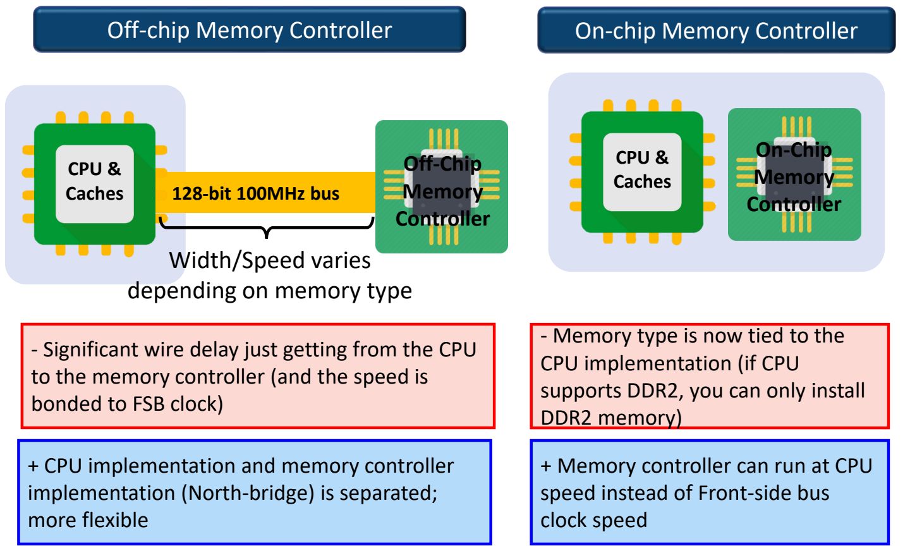
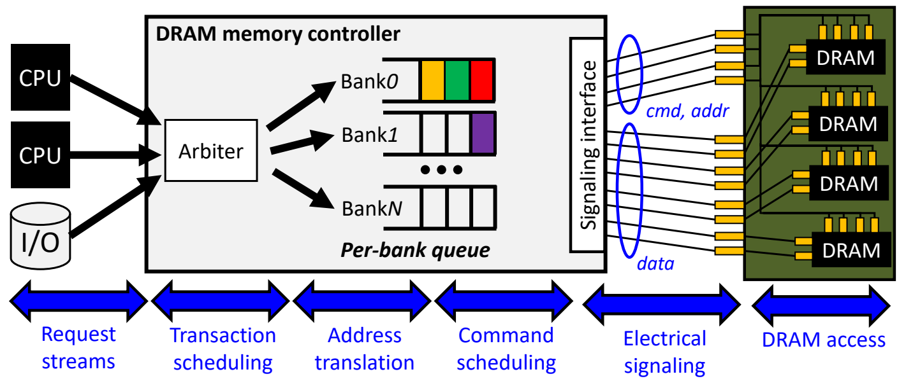
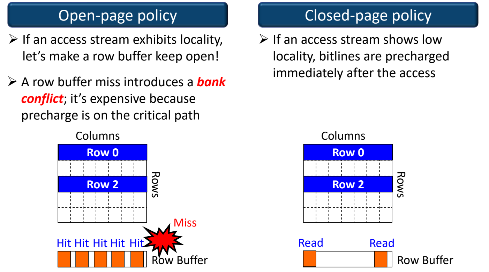
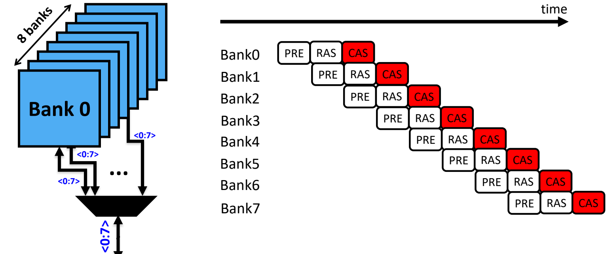

# 06 内存控制器与行缓冲管理

[本讲目录](../index.md) · [课程目录](../../index.md) · [上一节：05 容量扩展与内存模组](05-capacity-scaling-and-memory-modules.md) · [下一节：07 地址映射与多通道](07-address-mapping-and-multiple-channels.md)

> [!abstract] 本节要点
> - 第二个技术趋势“提速度”不靠单纯拉高频率，而是**利用内存组织结构做资源感知的调度**：提高行缓冲命中率、挖掘 Rank/Bank 级并行。
> - 片外控制器（北桥）经 FSB（例：128 位、100 MHz）与 CPU 相连，线延迟大、速度受 FSB 时钟限制，但 CPU 与控制器分开设计更灵活；片上控制器以 CPU 速度运行，但内存类型被 CPU 绑定（CPU 支持 DDR2 就只能插 DDR2）。
> - 内存控制器是被动的从设备，服务 CPU 与 I/O（DMA 引擎）的请求，内部流水为：请求流 → 仲裁 → 地址翻译为 {Bank, Row, Col, …} → 按 Bank/Rank 排队 → 命令调度 → 电气信号接口 → DRAM 访问，全程遵守时序约束。
> - DRAM 访问三步：Activate → Read/Write → Precharge。开页策略让行一直打开，命中只需列访问，但行缓冲缺失（bank conflict）时预充电落在关键路径上；闭页策略访问后立即预充电，适合低局部性、随机访问。
> - Bank 级并行：所有 Bank 共享数据引脚、同一时刻只能传一份数据，但可以在一个 Bank 传数据时给其他 Bank 发 PRE/RAS/CAS，以流水线方式填满数据总线。

## 内存控制器的位置：片外与片内

DRAM 本身不会“自己工作”，每一次激活、读写、预充电、刷新都要由外部按严格时序发出命令。第二个技术趋势的思路是：与其费力把频率再往上调，不如**利用内存的组织结构**（Rank、Bank、行缓冲）做资源感知的调度来提速，而承担这件事的部件就是内存控制器。[^s2p52]

**内存控制器**（Memory Controller, MC）是管理 DRAM 全部操作的部件。[^s2p53] 按它放在哪里，分为两种系统结构：

- **片外内存控制器**（Off-chip Memory Controller）：控制器位于**北桥**（North Bridge）芯片中，与 CPU 分离；CPU 经**前端总线**（Front-Side Bus, FSB）连到北桥，北桥再连南桥和内存。
- **片上内存控制器**（On-chip Memory Controller）：控制器集成在 CPU 芯片内部，CPU 直接与内存通信，系统中只剩南桥负责其他外设。

图：左侧片外控制器经 128-bit 100MHz 总线与 CPU 相连，有线延迟但实现灵活；右侧控制器集成进 CPU，可按 CPU 频率运行但内存类型受 CPU 限制。

两者的取舍如下：[^s2p54]

| 维度 | 片外控制器（北桥） | 片上控制器 |
| --- | --- | --- |
| CPU→控制器路径 | 经 FSB，例如 128 位、100 MHz 总线；宽度/速度随内存类型变化 | 芯片内部互连 |
| 速度 | 线延迟显著，控制器速度被 FSB 时钟束缚（缺点） | 控制器以 CPU 速度运行，而非 FSB 时钟速度（优点） |
| 设计灵活性 | CPU 实现与控制器（北桥）实现相互分离，更灵活（优点） | 内存类型与 CPU 实现绑定：CPU 支持 DDR2 就只能装 DDR2（缺点） |

核心区别在带宽来源：片外方案受限于 FSB 这条外部总线，以 $128\,\text{bit} \times 100\,\text{MHz}$ 这样的带宽，相对今天 CPU 与内存的性能已经很慢；片上方案直接用芯片级的内部带宽，因此速度快。代价是每一代 CPU 的设计决定了它能用什么内存。

> [!tip] 课堂强调
> 现在的 CPU 基本都把内存控制器集成在内部，买 CPU 就等于一起买了控制器；它带来的“内存类型不灵活”是用户必须接受的代价。

## 内存控制器的职责流水

CPU 发出的只是一个“逻辑内存地址 + 读/写”请求，而 DRAM 需要的是一串按时序排列、指向具体 Bank/行/列的命令；同时还有多个请求者同时争抢。内存控制器负责把前者变成后者，并在其中尽量提高吞吐。

首先要明确它服务的对象和角色：

- 请求流不仅来自各个 CPU 核，也来自**I/O 外设**。外设一般不是 CPU 替它搬数据，而是由网卡、SSD 等设备内部的**DMA 引擎**（Direct Memory Access）负责在 DRAM 与设备内存之间搬运数据。
- 内存控制器是**被动的从设备**（slave）：它从不主动发起访存，只是收到 CPU 或外设 I/O 的请求后去服务；“搬什么数据”由 CPU 或外设决定。

控制器内部按以下流水处理每个请求：[^s2p60]

1. **接收请求流**（Request streams）：把来自 CPU 和 I/O 的请求（携带逻辑内存地址）传往主存方向。[^s2p55]
2. **事务调度 / 仲裁**（Transaction scheduling）：到达的请求先缓冲，再经**仲裁器**（Arbiter）裁决。多个请求者同时争抢时，仲裁器按优先级决定谁先被服务。[^s2p56]
3. **地址翻译**（Address translation）：把地址拆解成 {BankID, RowAddr, ColAddr, …}，即决定这个地址落在哪个 Rank、哪个 Bank、哪一行哪一列。这里的“翻译”不是改写物理地址的值（不同于虚实地址转换），而是**决定地址到 DRAM 资源的映射**。[^s2p57] 具体的映射方式见[地址映射](07-address-mapping-and-multiple-channels.md)。
4. **按 Bank/Rank 排队**：翻译后的事务进入**每 Bank 队列**（per-bank queue）；命令队列也可以按**每 Rank**（per-rank）组织。因为同一 Channel 上的不同 Rank、Rank 内的不同 Bank 都能独立工作，为它们分别建队列，就能各自独立地发起请求。[^s2p57]
5. **命令调度**（Command scheduling）：在各队列内调整请求顺序。主要原则是尽量把能命中同一行缓冲的请求放在一起，以提高行缓冲命中率。[^s2p58]
6. **电气信号**（Electrical signaling）：经**信号接口**（Signaling interface）把命令和地址（cmd, addr）以及数据（data）通过物理导线送到内存模组上的 DRAM 芯片。[^s2p59]
7. **DRAM 访问**（DRAM access）：DRAM 按收到的命令执行并返回数据。整个过程中控制器必须**遵守时序约束**来服务请求。[^s2p60]

图：CPU 与 I/O 的请求经 Arbiter 进入各 Bank 的队列，再通过信号接口向 DRAM 发出 cmd/addr 与 data，底部依次标出请求流、事务调度、地址转换、命令调度、电气信号与 DRAM 访问各阶段。

控制器要遵守的具体时序参数（$t_{RCD}$、$t_{RP}$、$t_{RAS}$ 等）及“时序是控制器与 DRAM 之间的约定”这一点，见[DRAM 时序参数](04-dram-interface-and-timing.md)。

> [!warning] 易错点
> - 内存控制器不只服务 CPU：DMA 引擎发起的 I/O 访问也经过它，并参与仲裁。
> - “地址翻译”在这里指把地址映射到 Bank/Rank/Row/Col，不是 TLB 那种虚拟地址到物理地址的转换。

## 等长布线：为什么主板走线弯弯曲曲

DRAM 接口同时并行传送很多位的数据和命令信号。若各条导线长短不一，信号到达各芯片的时间就不同，接收端就必须额外同步，甚至直接采样出错。

主板 PCB 上的信号走线（trace）看起来绕得很复杂，原因是要**保证所有信号线的时序一致**：设计时把所有导线做成**相同长度**，让信号同时到达不同芯片，从而能同时处理这些数据信号，减少额外的同步开销。[^s2p61] 时钟偏斜等更深入的信号完整性问题见[时钟偏斜与 DQS](08-high-speed-interface-and-signal-integrity.md)。

## 调度的两大抓手

有了排队，控制器就可以“挑着发”。内存控制器缓冲内存请求，并尝试调度它们以获得更高吞吐；关键思想是**感知 DRAM 资源与组织结构的调度**（DRAM resource / organization-aware scheduling）。[^s2p62] 可以利用的资源有两类：

- **并行性**：同一 Channel 上不同 Rank 之间可以并行；每个 Bank 都有自己的字线驱动器（WL Drivers）、列译码器和本地灵敏放大器（即行缓冲），也能并行，这就是 **Bank 级并行**（Bank-level Parallelism）。
- **行缓冲局部性**：连续请求尽量访问同一个已打开的行缓冲，即**行缓冲感知的调度**（Row-buffer aware scheduling）。

下面两小节分别讲行缓冲管理策略和 Bank 级并行；把多条调度规则组织起来的“内存调度三原则”见[内存调度三原则](07-address-mapping-and-multiple-channels.md)。

## 行缓冲管理：开页与闭页策略

### DRAM 访问三步回顾

一个 **DRAM 行**（DRAM row）也称为 **DRAM 页**（DRAM page），每个地址是一个 $\langle$row, column$\rangle$ 对。一次 DRAM 访问分三步：[^s2p63]

1. **Activate（激活）**：按行地址（例：Row 2）打开该行，把整行数据放入行缓冲。
2. **Read/Write（列读写）**：按列地址（例：Column 0），经列多路选择器（column mux）读写行缓冲中的某一列。
3. **Precharge（预充电）**：关闭该行，把 Bank 准备好以迎接下一次访问。

行缓冲、灵敏放大器与行缓冲命中的物理原理见[行缓冲与灵敏放大器](02-dram-cell-and-destructive-read.md)。这三步留下一个选择：第 2 步做完后，什么时候做第 3 步？这就是**行缓冲管理**（Row Buffer Management）要回答的问题。

### 开页策略（Open-page policy）

**开页策略**：访问完成后**不立即预充电**，让行缓冲保持打开，赌后续请求还会访问这一行。[^s2p64]

- **适用条件**：访问流具有局部性。
- **收益**：后续访问同一行时是**行缓冲命中**（row buffer hit），只需做列访问，省去激活和预充电。
- **代价**：直到发现要访问的数据不在当前打开的行中，才关闭它。这次**行缓冲缺失**（row buffer miss）引入一次 **Bank 冲突**（bank conflict），此时要先预充电关闭旧行，再激活新行，最后列访问。代价高的原因是**预充电落在关键路径上**。[^s2p64]

下图左侧：Row 2 被打开后连续 5 次 Hit，随后访问 Row 0 时 Miss，引发 bank conflict。

### 闭页策略（Closed-page policy）

**闭页策略**：每次访问之后**立即对位线预充电**，不管未来可能出现的行缓冲命中。[^s2p64]

- **适用条件**：访问流局部性低。
- **收益**：下一个请求到来时 Bank 已经预充电完毕，即便它访问的是另一行，也不必在关键路径上再做预充电。
- **代价**：放弃了行缓冲命中的机会，即使下一个请求恰好访问同一行，也要重新激活。

下图右侧：每次 Read 之后行缓冲立即关闭。

图：开页策略让行缓冲保持打开，连续访问同一行得到多次 Hit，换行时出现 Miss；关页策略在每次访问后立即预充电，行缓冲只保留单次 Read。

| 维度 | 开页策略 | 闭页策略 |
| --- | --- | --- |
| 访问后是否预充电 | 否，保持行打开 | 是，立即预充电 |
| 下次访问同一行 | 命中：只需列访问 | 需重新激活 + 列访问 |
| 下次访问不同行 | Bank 冲突：预充电 + 激活 + 列访问 | 激活 + 列访问 |
| 适合的访问模式 | 局部性高 | 局部性低、纯随机、重用距离很远 |

> [!tip] 课堂强调
> 开页与闭页应对的是不同的访问模式：局部性很高时开页效果好；如果访问纯随机、重用距离特别远，闭页更合适，因为它省去了缺失时额外的预充电延迟。

### 用时序参数量化两种策略

> [!note] 补充解释
> 下面用[DRAM 时序参数](04-dram-interface-and-timing.md)中的 $t_{RP}$（预充电时间）、$t_{RCD}$（激活到列命令的延迟）、$t_{CAS}$（列命令到数据输出的延迟）估算一次访问在关键路径上的延迟，只计这三项，忽略数据突发传输和排队。

| 情形 | 开页策略 | 闭页策略 |
| --- | --- | --- |
| 访问刚才打开的那一行 | $t_{CAS}$（命中） | $t_{RCD}+t_{CAS}$ |
| 访问另一行 | $t_{RP}+t_{RCD}+t_{CAS}$（Bank 冲突） | $t_{RCD}+t_{CAS}$ |

闭页策略也要做预充电，只是放在上一次访问之后、下一次请求到来之前，因此不在下一次访问的关键路径上。

> [!example] 例：命中率多高时开页更划算（据课程内容整理）
> 设 $t_{RP}=t_{RCD}=t_{CAS}=15\ {\rm ns}$（假设值），访问同一行的概率为 $h$。
>
> 1. 开页平均延迟：$h\cdot t_{CAS}+(1-h)(t_{RP}+t_{RCD}+t_{CAS}) = 15h+45(1-h)=45-30h\ {\rm ns}$。
> 2. 闭页延迟恒为 $t_{RCD}+t_{CAS}=30\ {\rm ns}$。
> 3. 令 $45-30h<30$，得 $h>0.5$。
>
> 因此在这组参数下，行缓冲命中率超过 50% 时开页策略的平均延迟更低；访问越随机（$h$ 越小），闭页越占优。

## Bank 级并行（Bank-level Parallelism）

一个芯片内有多个 Bank（例：8 个），每个 Bank 能独立完成预充电、激活和列访问；但把数据从 Bank 搬到芯片外的总线上这一步是串行的。Bank 内部结构见[Bank](03-dram-organization-hierarchy.md)。

每个 Bank 有自己的 <0:7> 数据通路，经一个多路选择器汇到芯片唯一的 <0:7> 数据引脚上。[^s2p65] 由此得到 **Bank 级并行**的规则：[^s2p66]

- 所有 Bank **共享同一组引脚**，同一时刻只能进行一次数据传输；
- 但可以**在一个 Bank 传输数据时，向其他 Bank 发送预充电、行激活、列地址命令**。

于是 Bank 可以把内存请求**流水化**（pipelining）：

1. Bank0 依次做 PRE、RAS；
2. Bank0 做 RAS 时，Bank1 开始 PRE；
3. Bank0 进入 CAS（占用数据总线）时，Bank1 做 RAS，Bank2 开始 PRE；
4. 依此类推，每个时间片里总有一个 Bank 在 CAS 阶段使用数据总线，其余 Bank 在准备。

图：8 个 Bank 共享同一组数据引脚，时间轴上各 Bank 的 PRE、RAS、CAS 错开一拍依次执行，使命令与数据传输重叠形成流水；各 Bank 的 CAS 阶段首尾相接、互不重叠，对应“共享引脚一次只能传一份数据”的约束。

这种并行与“多个部件同时各干各的”不同：它的目的在于用流水线把**数据总线的时间**填满，把各 Bank 的预充电、激活延迟隐藏在其他 Bank 的数据传输背后。

> [!example] 例：流水化前后的数据总线利用率（据课程内容整理）
> 设 PRE、RAS、CAS 各占 1 个时间片，只有 CAS 片使用数据总线，要服务 8 个分别落在 Bank0–Bank7 的请求（各访问一个未打开的行）。
>
> 1. 串行（一个做完再做下一个）：共 $8\times 3=24$ 片，总线只在 8 片中有数据，利用率 $8/24\approx 33\%$。
> 2. 按上图流水：第一个 CAS 出现在第 3 片，之后每片一个 CAS，共 $2+8=10$ 片，利用率 $8/10=80\%$；请求越多，越接近 100%。
> 3. 若 8 个请求都落在**同一个** Bank 的不同行，就无法流水，只能回到串行。这也是地址映射要把连续请求分散到不同 Bank 的动机。

> [!warning] 易错点
> Bank 级并行不等于多份数据同时从引脚输出。Bank 之间并行的是“准备工作”（PRE/RAS），数据传输在共享引脚上仍是一个接一个。

> [!question]- 自测：某服务器负载是大量随机的指针追踪访问，几乎不会连续访问同一行。控制器应选开页还是闭页？为什么？
> 选闭页。局部性低时开页几乎每次都是 Bank 冲突，预充电落在关键路径上，延迟为 $t_{RP}+t_{RCD}+t_{CAS}$；闭页在访问后立即预充电，下次访问只需 $t_{RCD}+t_{CAS}$。

> [!question]- 自测：某老式平台的 FSB 为 128 位、100 MHz，每周期传一次。它的 CPU 到控制器峰值带宽是多少？把控制器移入 CPU 后，主要解决了什么问题、又引入了什么限制？
> 峰值带宽 $128\ {\rm bit}\times 100\ {\rm MHz}=12.8\ {\rm Gbit/s}=1.6\ {\rm GB/s}$。片上控制器免去了 FSB 的线延迟，并以 CPU 速度运行；代价是内存类型被 CPU 绑定（例如只支持 DDR2 的 CPU 只能装 DDR2）。

> [!question]- 自测：一个芯片有 8 个 Bank。控制器队列里有 4 个请求：A、B 访问 Bank0 的 Row 5，C 访问 Bank0 的 Row 9，D 访问 Bank3。若采用开页策略且 Bank0 当前打开 Row 5，怎样排序较好？
> 先发 A、B（都命中 Bank0 已打开的 Row 5，只需列访问），同时可向 Bank3 为 D 发 PRE/RAS，利用 Bank 级并行与 A、B 的数据传输重叠；C 与 Row 5 冲突，放到 A、B 之后再对 Bank0 预充电、激活 Row 9。这样同时利用了行缓冲命中和 Bank 级并行。

> [!info]- 来源
> - L08-DRAM.pdf：PDF p.52–66
> - L08.docx：DOCX body 355–400

[^s2p52]: L08-DRAM.pdf-PDF p.52
[^s2p53]: L08-DRAM.pdf-PDF p.53
[^s2p54]: L08-DRAM.pdf-PDF p.54
[^s2p60]: L08-DRAM.pdf-PDF p.60
[^s2p55]: L08-DRAM.pdf-PDF p.55
[^s2p56]: L08-DRAM.pdf-PDF p.56
[^s2p57]: L08-DRAM.pdf-PDF p.57
[^s2p58]: L08-DRAM.pdf-PDF p.58
[^s2p59]: L08-DRAM.pdf-PDF p.59
[^s2p61]: L08-DRAM.pdf-PDF p.61
[^s2p62]: L08-DRAM.pdf-PDF p.62
[^s2p63]: L08-DRAM.pdf-PDF p.63
[^s2p64]: L08-DRAM.pdf-PDF p.64
[^s2p65]: L08-DRAM.pdf-PDF p.65
[^s2p66]: L08-DRAM.pdf-PDF p.66

[本讲目录](../index.md) · [课程目录](../../index.md) · [上一节：05 容量扩展与内存模组](05-capacity-scaling-and-memory-modules.md) · [下一节：07 地址映射与多通道](07-address-mapping-and-multiple-channels.md)
