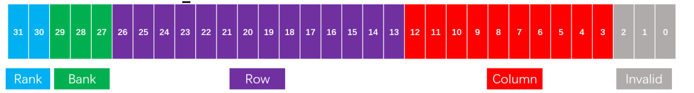
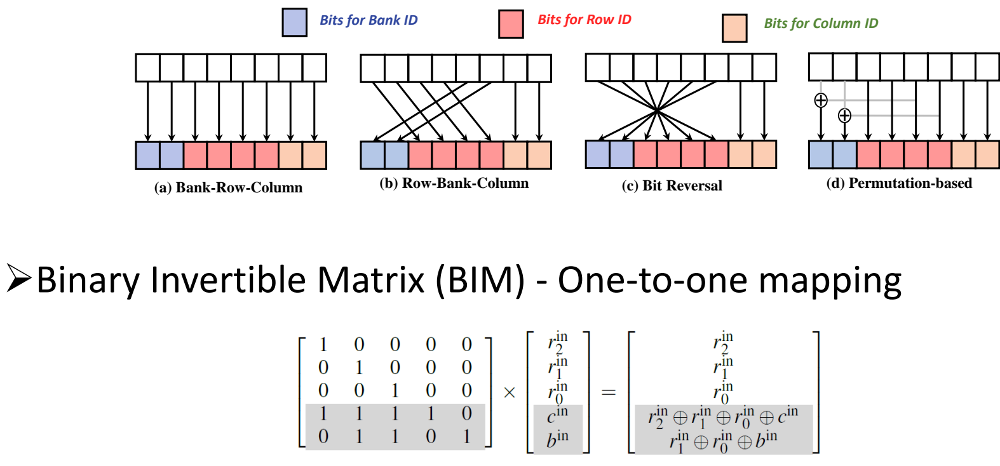
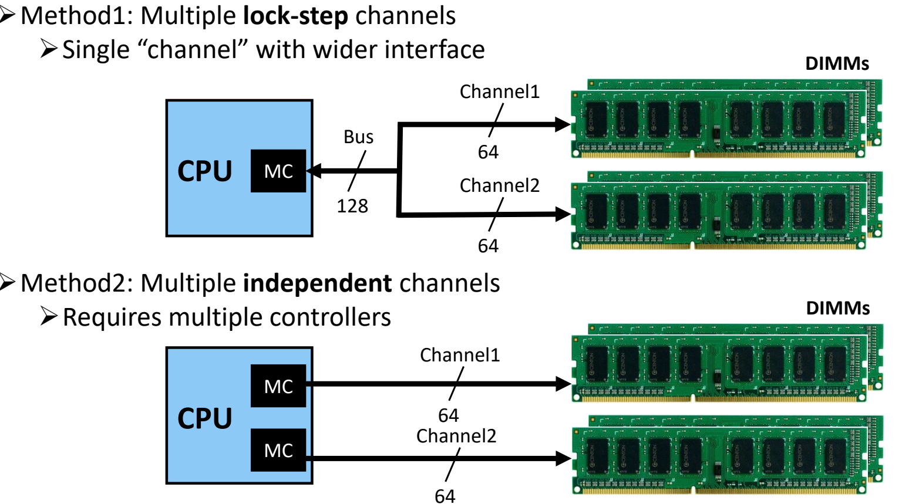
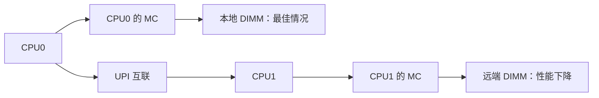
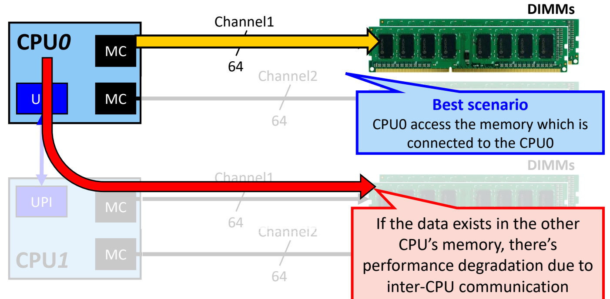

# 07 地址映射与多通道

[本讲目录](../index.md) · [课程目录](../../index.md) · [上一节：06 内存控制器与行缓冲管理](06-memory-controller-and-row-buffer-management.md) · [下一节：08 高速接口与信号完整性](08-high-speed-interface-and-signal-integrity.md)

> [!abstract] 本节要点
> - 内存控制器必须把 CPU 发来的物理地址拆成 Rank ID、Bank ID、Row ID、Column ID；哪些位给谁由设计者决定，而这个划分会显著影响性能。RaBaRoCo 表示从高位到低位依次是 Rank、Bank、Row、Column。
> - 理论最优映射可以建模为访问图 $G_s$ 上的最小 C 有界 R 割（minimum C-bounded R-cut），但它是 NP 难问题，而且要求预先知道整个访问序列，所以实际不用。
> - 常用映射（Bank-Row-Column、Row-Bank-Column、位反转、基于置换的 XOR）都可以统一写成二进制可逆矩阵（BIM）：只要矩阵可逆，映射就是一一对应的。
> - 基于熵的映射先计算每个地址位的香农熵，把低熵位用作 Row ID 以保留局部性，把高熵位用作 Bank ID 以增加并行性。
> - 调度三原则：优先服务行缓冲命中的请求（带宽）、优先服务延迟敏感的应用（系统吞吐）、保证没有应用饥饿（公平）。多通道有两种做法：锁步通道（一个控制器，合成 128 位接口）和独立通道（每个通道一个控制器）。多 CPU 各自连接本地内存，彼此经 UPI 互联，这就构成 NUMA，访问远端内存时性能会下降。

## 地址映射（Address Mapping）

CPU 发给内存的是一个 32 位或 64 位的线性物理地址，但 DRAM 的访问位置是按层次给出的：先选 Rank，再选 Bank，打开某一行（Row），最后选列（Column）。这些层次的含义见[DRAM 组织层次](03-dram-organization-hierarchy.md)。因此内存控制器需要一套规则，把线性地址翻译成这几个坐标。

**地址映射**（address mapping）是指从物理地址中解码出 DRAM 位置（Rank ID、Bank ID、Row ID、Column ID）的规则，也就是规定物理地址的哪几位是哪个 ID。[^s2p67] 位的划分由设计者决定，不同的划分会让同一串访问落到不同的 Bank 和行上。行缓冲是否命中、Bank 之间能否并行，都取决于这个划分，所以它对最终性能影响很大。

讲义给出了一个 32 位地址的划分例子：[^s2p67]

| 地址位 | 位数 | 用途 | 可寻址数量 |
|---|---|---|---|
| 31–30 | 2 | Rank ID | $2^2 = 4$ 个 Rank |
| 29–27 | 3 | Bank ID | $2^3 = 8$ 个 Bank |
| 26–13 | 14 | Row ID | $2^{14} = 16384$ 行 |
| 12–3 | 10 | Column ID | $2^{10} = 1024$ 列 |
| 2–0 | 3 | Invalid（不参与 DRAM 寻址） | — |



图：32 位物理地址自高到低划分为 Rank（31–30）、Bank（29–27）、Row（26–13）、Column（12–3）与无效位（2–0），即 RaBaRoCo 映射。

> [!note] 补充解释
> 最低 3 位标为 Invalid，原因是一个 Rank 的数据总线宽 64 位，每次传输 $64/8 = 8$ 字节。地址的低 $\log_2 8 = 3$ 位只用来选择这 8 字节中的哪一个字节，DRAM 不需要用它们寻址。

**RaBaRoCo** 是上面这种划分的缩写，表示从地址高位到低位依次分配给 **Ra**nk、**Ba**nk、**Ro**w、**Co**lumn。这是最经典的划分方式。也可以采用其他顺序，例如 CoRoBaRa 之类的排列；缩写中字母的顺序始终对应从高位到低位的顺序。

> [!example] 例：按 RaBaRoCo 解码地址 `0xA3C41238`
> 1. 先写成二进制：`10 100 01111000100000 1001000111 000`，各段依次对应位 31–30、29–27、26–13、12–3、2–0。
> 2. Rank ID $= 10_2 = 2$，Bank ID $= 100_2 = 4$。
> 3. Row ID $= 01111000100000_2 = 7712$，Column ID $= 1001000111_2 = 583$，最低 3 位为 0，表示 8 字节中的第 0 字节。
> 4. 下一个 8 字节 `0xA3C41240` 只让 Column 加 1，变为 584。它与上一次访问同 Bank、同行，所以是行缓冲命中。
> 5. 地址 `0xA3C43238` 等于原地址加 $2^{13}$，只让 Row 加 1，变为 7713，Bank 仍是 4。它落在同一 Bank 的另一行，会引发行冲突，需要先预充电再激活新行。

上例说明，一种映射一旦固定，就决定了哪些访问模式会命中行缓冲、哪些会互相冲突。行缓冲命中的概念见[DRAM 单元与破坏性读](02-dram-cell-and-destructive-read.md)，开页/闭页策略和 Bank 级并行见[内存控制器与行缓冲管理](06-memory-controller-and-row-buffer-management.md)。

## 最优地址映射与访问图

既然映射影响性能，一个自然的问题是：能不能从数学上找到最优映射？做法是把访问序列转成一张图，再把映射问题变成图划分问题。[^s2p68]

**访问图**（access graph）的构造方法如下。设 $s = (s_1, \dots, s_T)$ 是一个非空的内存地址序列，输出多重图 $G_s = (V, E)$：

```text
1: V := {s_1}, E := ∅
2: for i = 2, ..., T do
3:     V := V ∪ {s_i}
4:     add a new edge e_i to E_s with endpoints s_{i-1} and s_i
5: end for
6: return G_s = (V, E)
```

也就是说，每个出现过的地址是一个顶点；每对相邻的两次访问 $s_{i-1}, s_i$ 连一条边。同一对地址如果多次相邻出现，就会连出多条边，所以 $G_s$ 是多重图。共有 $T-1$ 条边。

符号含义：$V$ 是应用的地址空间，$S$（即 $s$）是访问序列。一次分配（allocation）把地址空间划分为
$$
V = V_1 \cup V_2 \cup \dots \cup V_R,\qquad |V_i| \le C
$$
即最多分成 $R$ 组，每组最多容纳 $C$ 个地址。[^s2p68] 如果两组之间有边，就说明某两次相邻访问落在了不同组里。最优映射要让组间的边数最少，这个问题叫做 **最小 C 有界 R 割**（minimum C-bounded R-cut），它是 **NP 难**（NP-hard）问题。[^s2p68]

> [!note] 补充解释
> 可以把每组 $V_i$ 理解为“放进同一行的数据”，$C$ 就是一行的容量。这样，一条组内边表示相邻两次访问落在同一行，可以命中行缓冲；一条割边表示访问跨行，需要换行。所以“割边最少”就等价于“换行次数最少”。

> [!example] 例：讲义中的访问序列（据课程内容整理）
> 序列为 $(0; 1; 2; 3; 4; 5; 6; 7; 0; 4; 1; 5; 2; 6; 3; 7)$，其中 $T=16$，所以有 15 条边：前半段是 $0\!-\!1, 1\!-\!2, \dots, 6\!-\!7$，共 7 条；之后是 $7\!-\!0, 0\!-\!4, 4\!-\!1, 1\!-\!5, 5\!-\!2, 2\!-\!6, 6\!-\!3, 3\!-\!7$，共 8 条。取 $C=4, R=2$：
>
> 1. 按地址连续划分 $\{0,1,2,3\}, \{4,5,6,7\}$：只有 $0\!-\!1, 1\!-\!2, 2\!-\!3$ 和 $4\!-\!5, 5\!-\!6, 6\!-\!7$ 这 6 条在组内，割边为 $15-6=9$ 条。
> 2. 换成 $\{0,1,4,5\}, \{2,3,6,7\}$：割边只剩 $1\!-\!2, 3\!-\!4, 5\!-\!6, 7\!-\!0, 5\!-\!2$，共 5 条。穷举所有划分可知这是最小值。
>
> 可见，最优分组和地址顺序并不一致，它取决于整个访问序列。

这种方法在实际中不用，原因有两个：

1. **需要预知整个访问序列**：这相当于预测未来的访问，做不到。
2. **求最优解是 NP 难问题**：即使知道序列，也很难求出最优解。

所以它只是理论上的最优，不是重点。实际系统使用的是下面这些固定的、可以用矩阵描述的映射。

## BIM 地址映射（Binary Invertible Matrix）

实际使用的映射方式各不相同，看上去像是凭经验调出来的。但它们其实有统一的数学形式：都可以看作在地址位上做线性变换（模 2 运算）。

**BIM 地址映射**把“物理地址位 → Bank/Row/Column 位”的映射写成一个**二进制可逆矩阵**（binary invertible matrix, BIM）与地址位向量的乘积，运算在模 2 下进行，乘法是与、加法是异或 $\oplus$。只要矩阵可逆，映射就是**一一对应**（one-to-one）的：每个物理地址对应唯一的 DRAM 位置，不同地址不会冲突到同一个存储单元。[^s2p69]

讲义列出的四种常见映射都是 BIM 的特例：[^s2p69]

1. **(a) Bank-Row-Column**：地址位从高到低直接依次分给 Bank、Row、Column，矩阵是单位阵。普通 CPU 一般采用这种映射。
2. **(b) Row-Bank-Column**：把原地址中的若干位交叉连线，使高位成为 Row，中间几位成为 Bank，矩阵是置换阵。
3. **(c) Bit Reversal（位反转）**：把高位段的位顺序整体反转后，再分给 Bank 和 Row。
4. **(d) Permutation-based（基于置换）**：用若干个地址位做异或（XOR），结果作为某一位输出，典型用法是让 Bank 位与 Row 位异或。NVIDIA GPU 采用的就是这种做法，把几个位异或合在一起。这样做与 GPU 的访存模式匹配，能显著提高行缓冲命中率和内存利用率。



图：上方对比 Bank-Row-Column、Row-Bank-Column、位反转与基于置换（异或）四种映射，下方用二进制可逆矩阵把 Bank 位与列位改写为与行位的异或，保证一一映射。

讲义中基于置换的映射可以写成矩阵形式。设输入为三个 Row 位 $r_2^{\rm in}, r_1^{\rm in}, r_0^{\rm in}$、一个 Column 位 $c^{\rm in}$ 和一个 Bank 位 $b^{\rm in}$：[^s2p69]

$$
\begin{bmatrix}
1&0&0&0&0\\
0&1&0&0&0\\
0&0&1&0&0\\
1&1&1&1&0\\
0&1&1&0&1
\end{bmatrix}
\times
\begin{bmatrix}
r_2^{\rm in}\\ r_1^{\rm in}\\ r_0^{\rm in}\\ c^{\rm in}\\ b^{\rm in}
\end{bmatrix}
=
\begin{bmatrix}
r_2^{\rm in}\\ r_1^{\rm in}\\ r_0^{\rm in}\\ r_2^{\rm in}\oplus r_1^{\rm in}\oplus r_0^{\rm in}\oplus c^{\rm in}\\ r_1^{\rm in}\oplus r_0^{\rm in}\oplus b^{\rm in}
\end{bmatrix}
$$

前三行是单位行，三个 Row 位保持不变。第四行把三个 Row 位与 Column 位异或，第五行把 $r_1, r_0$ 与 Bank 位异或。

> [!info] 可视化资源
> [MEMSYS 2025 论文：基于 XOR 的 DRAM 地址映射数学模型](https://www.memsys.io/wp-content/uploads/ninja-forms/5/a_mathematical_model_for_xor_based_application_specific_dram_address_mapping_schemes.pdf)：论文以 GF(2) 上的二进制矩阵（BIM）统一描述线性、位置换与基于 XOR 置换的地址映射并以最小化行缺失为目标，是理解 BIM 映射框架的原始文献与图示来源。

> [!example] 例：验证可逆性并体会 XOR 的作用（据课程内容整理）
> 1. **可逆性**：这个矩阵是下三角阵，且对角线全为 1，所以在模 2 下可逆。逆变换也可以直接写出：$c^{\rm in} = y_4 \oplus r_2 \oplus r_1 \oplus r_0$，$b^{\rm in} = y_5 \oplus r_1 \oplus r_0$，其中 $y_4, y_5$ 是输出的第 4、5 位。因此不同地址一定映射到不同位置。
> 2. **代入数值**：取 $(r_2, r_1, r_0, c, b) = (1,0,1,1,0)$，输出为 $(1, 0, 1, 1\oplus0\oplus1\oplus1, 0\oplus1\oplus0) = (1,0,1,1,1)$。
> 3. **避免 Bank 冲突**：两个地址的 Bank 位都是 $b=0$，但 Row 不同，例如 $(r_1, r_0)=(0,0)$ 和 $(0,1)$。直接映射时它们同 Bank 不同行，会发生行冲突。经过 XOR 后，输出的 Bank 位分别为 $0$ 和 $1$，两次访问被分到不同 Bank，可以并行服务。

> [!warning] 易错点
> 不是任意一种“位重排加异或”都合法。如果矩阵不可逆，就会有两个不同的物理地址映射到同一个 DRAM 位置，数据会互相覆盖。判断一种映射是否可行，就看它对应的二进制矩阵是否可逆，同时还要看它是否适合实际负载。

## 基于熵的地址映射（Entropy-based Address Mapping）

BIM 回答了“哪些映射是合法的”，但没有回答“针对某个负载该选哪一种”。基于熵的映射用信息论给出一个选择依据：先测量每个地址位在实际访问流中的随机程度，再据此决定它的用途。[^s2p70]

**香农熵**（Shannon's entropy）函数为
$$
H(p_1, p_2, \dots, p_v) = -\sum_{i=1}^{v} p_i \log_v p_i
$$
其中 $v$ 是可能取值的个数，$p_i$ 是取第 $i$ 个值的概率。对数以 $v$ 为底，所以 $H \in [0, 1]$。[^s2p70] 对单个地址位有 $v=2$，$p_1, p_2$ 分别是该位在访问流中取 0 和取 1 的频率。

方法如下：

1. **统计**：分析应用的访存模式，对每一个地址位计算熵 $H$。
2. **低熵位作 Row ID，保局部性**：熵低说明这一位很少变化。把它们用作 Row ID，连续的访问大多落在同一行，行缓冲容易命中。
3. **高熵位作 Bank ID，增并行**：熵高说明这一位变化频繁、接近随机。把它们用作 Bank ID，相邻请求会分散到不同 Bank，可以并行服务。
4. 熵介于两者之间的位用作 Column ID。[^s2p70]

讲义的示意图中，横轴是地址位，纵轴是熵。低熵区划给 Row，中间爬升的一段划给 Column，高熵区划给 Bank。

> [!example] 例：两个地址位的熵
> 某位在访问流中始终为 0，即 $p_1=1, p_2=0$，则 $H = -(1\cdot\log_2 1) = 0$（约定 $0\log 0 = 0$），适合作 Row ID。另一位取 0 和 1 各占一半，则 $H = -2\times\frac{1}{2}\log_2\frac{1}{2} = 1$，适合作 Bank ID。

这种方法本质上是一种数学建模：用一个固定的理论（熵）来指导位的划分。它的效果依赖于对具体应用访存模式的分析。

## 内存调度三原则

地址映射决定了请求落在哪里。之后，内存控制器还要决定先服务哪个请求。多年的研究给出了三条基本原则，每条对应一个不同的优化目标：[^s2p73]

| 原则 | 目标 | 出处 | 理由 |
|---|---|---|---|
| 1. 优先服务行缓冲命中（row-buffer-hit）的请求 | 最大化内存带宽 | Rixner+, ISCA'00 | 命中请求不需要预充电和激活，可以立即读写，单位时间完成的访问更多 |
| 2. 优先服务延迟敏感（latency-sensitive）的应用 | 最大化系统吞吐 | Kim+, HPCA'10 | 许多 CPU 程序的访存是串行依赖的，一个请求不返回，后续工作就卡住；先服务它们能让整个系统前进得更快 |
| 3. 保证没有应用被饿死（starved） | 最小化不公平（unfairness） | Mutlu+, MICRO'07 | 多个应用同时发出请求时，要让每个应用都得到服务，不能只照顾某些应用 |

第 1 条从内存利用率出发，第 2 条从应用自身的串行特性出发，第 3 条从多应用并发出发。三者可能冲突：如果一味优先服务行命中，访问局部性好的应用会一直占用 Bank，其他应用就可能饥饿。所以第 3 条是必须保证的底线。

> [!warning] 易错点
> “优先服务行缓冲命中”提高的是带宽，不等于提高系统吞吐或公平性。第 2、3 条正是为了弥补只看行命中带来的问题而提出的。

## 多通道与 NUMA

通道（Channel）的定义见[DRAM 组织层次](03-dram-organization-hierarchy.md)。在一个通道上，所有 DIMM 收到相同的命令，由其中一个 Rank 应答，数据经同一条 64 位总线返回。[^s2p74] 同一通道上的多个 Rank 可以各自工作，但数据传输都依赖这一条通道，所以单通道的带宽会成为瓶颈。增加通道数是提高内存速度的另一种方法。

**多通道**（multiple channels）的做法是让控制器连接多条相互独立的 64 位通道。台式机一般是 2 个通道（双通道），Intel 服务器可以有 6 或 8 个通道。通道越多，能插的内存条也越多。主板上要让双通道生效，必须把 DIMM 插在**同色**插槽里，因为同色插槽分属 Channel A 和 Channel B。[^s2p75]

### 锁步通道与独立通道

多通道有两种组织方式：[^s2p76]

| 方式 | 控制器数量 | 接口 | 一次访问如何完成 | 代价 |
|---|---|---|---|---|
| 方法 1：锁步通道（lock-step） | 1 个 MC | 两条 64 位通道合成一个 128 位宽的“单通道” | 一个请求拆成两半，分别由两条通道上的 DIMM 服务，两边同步传输数据 | 只是加宽了一个接口，并发请求数没有增加 |
| 方法 2：独立通道（independent） | 每条通道 1 个 MC | 各自 64 位 | 每条通道独立接收、服务不同的请求 | 需要多个控制器，硬件更复杂 |



图：方法一由一个 MC 通过 128 位总线同时驱动两个 64 位通道（锁步），方法二由两个 MC 各自驱动一个 64 位通道，可独立访问。

现代系统最常见的是独立通道，一个控制器对应一个通道。

### 多 CPU：从锁步到 NUMA

当系统中有多个 CPU 时，两种方式的差别更明显：

1. **多 CPU + 锁步（旧式）**：多个 CPU 共享一个片外内存控制器和 128 位总线。好处是每个 CPU 访问内存的延迟相同。缺点有两个：外置 MC 会拉长延迟，而且多个 CPU 要竞争同一份内存带宽。[^s2p77]
2. **多 CPU + 独立通道（现代）**：每个 CPU 内置自己的 MC 和通道，内存容量和带宽都随 CPU 数量增长。代价是每个 MC 只属于一个 CPU。CPU0 要访问挂在 CPU1 上的内存时，必须经过 CPU 之间的互联 **UPI**（UltraPath Interconnect），请求先到 CPU1，再由 CPU1 的 MC 访问。[^s2p78]

**NUMA**（Non-uniform Memory Access，非一致内存访问）指的是这种情况：同一个 CPU 访问不同物理内存，延迟和带宽不一样。访问本地内存最快，访问其他 CPU 的内存要额外经过互联。[^s2p78]



- **最佳情况**：CPU0 访问直接连在 CPU0 上的内存。[^s2p79]
- **远端访问**：如果数据在另一个 CPU 的内存里，CPU 之间的通信会导致性能下降。[^s2p79]



图：CPU0 经自身 MC 访问本地 DIMM 是最佳情况（黄色箭头），若数据在 CPU1 的内存中则需经 UPI 跨 CPU 访问（红色箭头），带来性能下降。

性能下降的根源在于互联带宽远低于本地内存通道带宽。课上举的数字是：AMD 早期的 CPU 间互联只有约 6 GB/s，而一个 DDR5 通道约有 50 GB/s。Intel 的 UPI 带宽较高，可以达到几十到上百 GB/s。因此，做系统优化时的原则是：把数据放在处理它的那个 CPU 的本地内存上。NUMA 问题不只出现在 DRAM 上，CPU 访问外设时也会遇到。例如数据在 CPU0 的内存里，却要发往挂在另一个 CPU 上的网卡或 SSD，同样要跨越互联。

> [!example] 例：一个通道的峰值带宽（据课程内容整理）
> 一条通道宽 64 位，每次传输 $64/8 = 8$ 字节。以 DDR5-6400 为例，数据率是 6400 MT/s，单通道峰值带宽为
> $$
> 8\ \text{B} \times 6400 \times 10^6\ \text{/s} = 51.2\ \text{GB/s}
> $$
> 这与课上“一个 DDR5 通道约 50 GB/s”一致。双独立通道的总峰值约为 102.4 GB/s。如果走一条约 6 GB/s 的互联去访问远端内存，可用带宽不到本地单通道的八分之一。

> [!warning] 易错点
> NUMA 指内存访问的延迟和带宽因位置而异，不是指内存容量分配不均。另有一个名字只差一个字的概念：NUCA（Non-Uniform Cache Access），说的是容量很大的缓存内部也有远近快慢之分。它和 NUMA 是两回事。

> [!question]- 自测：某系统按 RaBaRoCo 划分 32 位地址（Rank 31–30、Bank 29–27、Row 26–13、Column 12–3）。程序以 $2^{13}$ 字节为步长连续访问，会出现什么情况？如果改用 Row-Bank-Column，并把 Bank 放在 15–13 位，又会怎样？
> 在 RaBaRoCo 下，每一步都只让 Row 加 1，所有访问落在同一个 Bank 的不同行，每次都是行冲突，完全无法利用 Bank 级并行。改用 Row-Bank-Column 后，步长 $2^{13}$ 每次让 Bank 位加 1，连续 8 次访问轮流落在 8 个 Bank 上，可以流水并行。这正说明映射方式直接决定性能。

> [!question]- 自测：二进制矩阵的第 4 行改成 $[1\ 1\ 1\ 0\ 0]$，即 Column 位输出为 $r_2\oplus r_1\oplus r_0$，其余不变。这个映射还可用吗？
> 不可用。此时第 4 列全为 0，输入 $c^{\rm in}$ 对任何输出都没有影响，矩阵不可逆。$c^{\rm in}=0$ 和 $c^{\rm in}=1$ 的两个地址会映射到同一个 DRAM 位置，违反一一对应。

> [!question]- 自测：双路服务器上，一个线程在 CPU0 上运行，但它的数据都被分配在 CPU1 的 DIMM 上。它的访存路径是什么？性能为什么会下降？
> 请求要从 CPU0 经 UPI 到 CPU1，再由 CPU1 的 MC 访问 DIMM，数据沿原路返回。这是 NUMA 的远端访问：多了一段互联延迟，而且互联带宽通常远低于本地通道带宽（课上举例约 6 GB/s 对 50 GB/s）。应该把线程和数据放在同一个 CPU 节点上。

> [!info]- 来源
> - L08-DRAM.pdf：PDF p.67–79
> - L08.docx：DOCX body 401–445

[^s2p67]: L08-DRAM.pdf-PDF p.67
[^s2p68]: L08-DRAM.pdf-PDF p.68
[^s2p69]: L08-DRAM.pdf-PDF p.69
[^s2p70]: L08-DRAM.pdf-PDF p.70
[^s2p73]: L08-DRAM.pdf-PDF p.73
[^s2p74]: L08-DRAM.pdf-PDF p.74
[^s2p75]: L08-DRAM.pdf-PDF p.75
[^s2p76]: L08-DRAM.pdf-PDF p.76
[^s2p77]: L08-DRAM.pdf-PDF p.77
[^s2p78]: L08-DRAM.pdf-PDF p.78
[^s2p79]: L08-DRAM.pdf-PDF p.79

[本讲目录](../index.md) · [课程目录](../../index.md) · [上一节：06 内存控制器与行缓冲管理](06-memory-controller-and-row-buffer-management.md) · [下一节：08 高速接口与信号完整性](08-high-speed-interface-and-signal-integrity.md)
