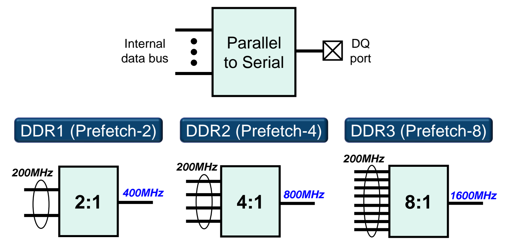
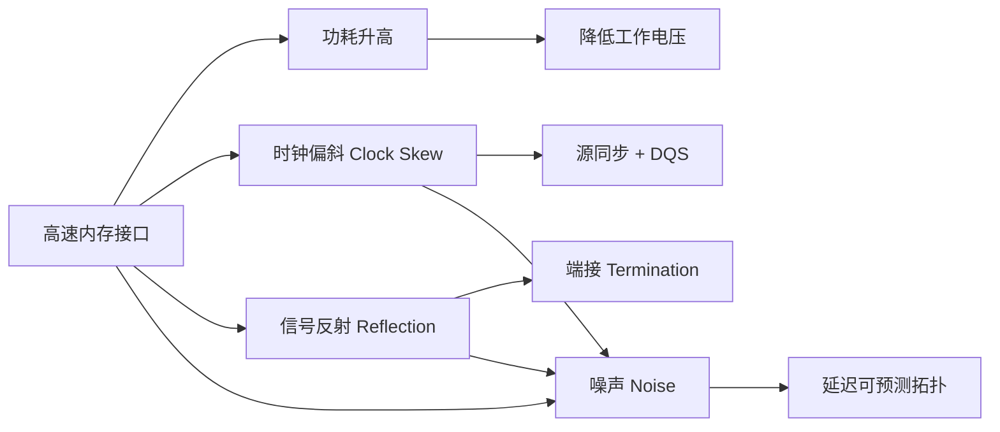
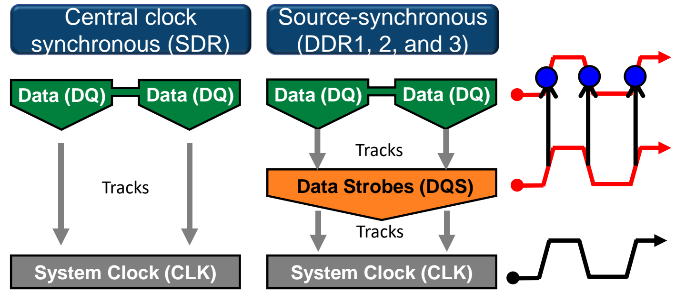
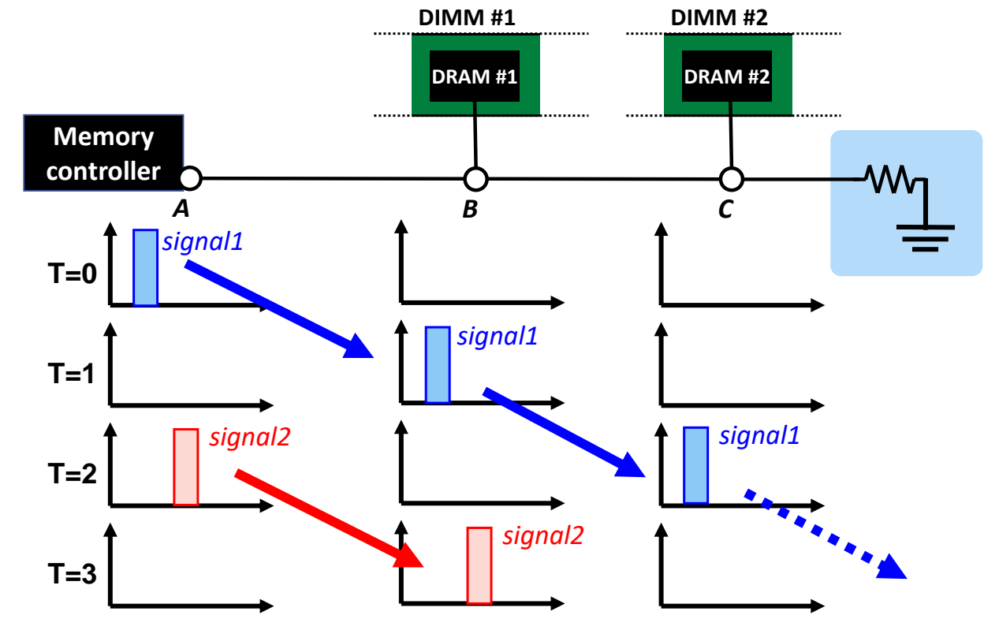
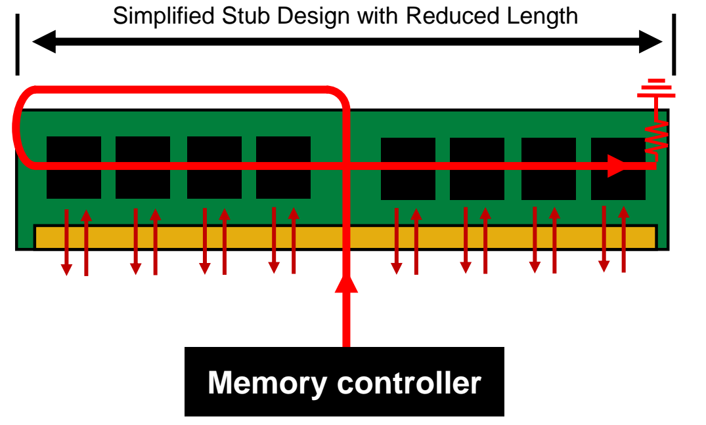

# 08 高速接口与信号完整性

[本讲目录](../index.md) · [课程目录](../../index.md) · [上一节：07 地址映射与多通道](07-address-mapping-and-multiple-channels.md)

> [!abstract] 本节要点
> - DDR1→DDR4 的数据率从 200 MT/s 级提升到 1600 MT/s 以上（DDR5 约 6400 MT/s），但存储单元阵列的内核频率受电容充放电速度限制，只能停留在约 100–200 MHz。
> - 解决办法是**预取**（并转串）：内部宽总线一次并行取出 $2^n$ 份数据，经并串转换后在外部 DQ 口以 $2^n$ 倍速率串行输出；DDR1/2/3 分别为 2:1、4:1、8:1，200 MHz 内核对应 400/800/1600 MT/s。
> - 高速接口有四个挑战：功耗、时钟偏斜、信号反射、噪声；对策依次是降电压、源同步（DQS）、端接、延迟可预测的拓扑。
> - 功耗 $P \propto V^2 f$：数据率上升时靠降低工作电压（SDR 约 3.3 V → DDR4 约 1.2 V）抵消；电压不同使各代 DIMM 的引脚数和防呆缺口位置都不同，不能混插。
> - DDR2 用对称 T 形拓扑，各芯片延迟相近但路径长、偏斜大；DDR3 用 Fly-by 拓扑，路径短而简单，各芯片延迟不同但可预测、可校正，末端再加端接。

## 数据率需求与内核频率瓶颈

SDR 只在时钟上升沿传数据，DDR 在上升沿和下降沿都传，数据率因此翻倍（双沿传输的机制见[DRAM 接口与时序](04-dram-interface-and-timing.md)）。问题是：双沿只能带来一次性的 2 倍，处理器从单核走向双核、四核，对内存带宽的需求仍在持续增长，还要靠什么继续提高数据率？

**DDR 代际数据率**：DDR 每一代都在提速，型号后缀就是数据率，单位是 MT/s（每秒百万次传输）。JEDEC 规范中的演进为：DDR1-200/266/333/400 → DDR2-400/533/667/800 → DDR3-800/1066/1333/1600 → DDR4-1600……，对应带宽（GB/s）随之逐级上升，与多核处理器的普及同步。[^s2p82]

> [!warning] 易错点
> “DDR4-1600”中的 1600 是数据率 1600 MT/s，不是 1600 MHz 时钟。因为双沿传输，它的 I/O 时钟只有 800 MHz。课上口头说“近似等效为 1600 兆赫兹”，指的是“每秒传 1600 兆次”。DDR5 约 6400 MT/s 同理。[^s2p88]

要看清瓶颈，先把主存拆成两部分：**存储单元阵列**（memory cell array）和 **I/O 缓冲**（I/O buffer）。[^s2p83]

1. 存储单元阵列按**内部时钟**工作，每个周期经内部总线向 I/O 缓冲送出 $n$ 位数据；
2. I/O 缓冲按**外部时钟**工作，每个周期向内存控制器送出 $n$ 位数据。

早期两者频率相同。例如内部总线工作频率 133 MHz、外部时钟 133 MHz，每根数据线的传输速率就是 133 Mbps。[^s2p84] 想提高外部数据率，最直接的办法是同时提高内核频率，但这条路走不通。

**内核频率限制**：内核频率受 DRAM 单元电容的物理特性限制。电容充放电的快慢由电路本身决定，基本固定，随工艺缩小甚至变得更差，所以内部总线频率无法跟着外部接口一起提高。[^s2p85] 由此产生核心矛盾：内部频率基本不变，外部频率不断提高，两者必须用某种结构匹配起来。

## 预取与并串转换（Prefetch）

内核慢、接口快，那就让内核每个周期多取一些数据，再由接口分几次快速送出。

**预取**（prefetch）在 DDR 中指**并转串**（parallel to serial）：内核频率保持在较低的 100–200 MHz，内部数据总线一次并行取出多份数据，经并串转换电路从同一个 DQ 端口按更高频率串行输出，从而只提高外部数据率。[^s2p86]

以 200 MHz 内核为例：

| 代际 | 预取深度 | 并串比 | 内核频率 | 外部数据率 |
| --- | --- | --- | --- | --- |
| DDR1 | Prefetch-2 | 2:1 | 200 MHz | 400 MT/s |
| DDR2 | Prefetch-4 | 4:1 | 200 MHz | 800 MT/s |
| DDR3 | Prefetch-8 | 8:1 | 200 MHz | 1600 MT/s |

一般关系是：

$$
R_{\rm ext} = k \times f_{\rm core}
$$

其中 $f_{\rm core}$ 是内核（内部总线）频率，单位 MHz；$k$ 是预取深度（并串比 $k:1$）；$R_{\rm ext}$ 是每根 DQ 线的外部数据率，单位 MT/s。以 DDR1 为例：内部用两路同时送出两份数据，外部以两倍速率逐个传出，频率就匹配上了。DDR2 内部仍是 200 MHz，外部 800 MT/s，比例 4:1；DDR3 内部 8 路并行，外部数据率提高到 8 倍。

图：内部数据总线经 Parallel to Serial 送到 DQ 端口，核心频率保持 200MHz，DDR1/2/3 分别用 2:1、4:1、8:1 并串比得到 400、800、1600 MT/s 的外部数据率。

讲义把输出侧的 400、800、1600 标作 MHz，它们实为每根 DQ 线的数据率，单位应为 MT/s。[^s2p86]

> [!info] 可视化资源
> [Wikipedia：DDR SDRAM](https://en.wikipedia.org/wiki/DDR_SDRAM)：“DDR 各代对比”表列出各代内核频率、预取位数（2n/4n/8n/16n）、传输率、电压与 DIMM 引脚数，并附桌面 DIMM 模组对比图，正好对应预取并转串与降压演进。

> [!note] 补充解释
> 按 JEDEC 实际规格，DDR 系列的 I/O 时钟是数据率的一半（双沿各传一次）：DDR-400 的 I/O 时钟 200 MHz，DDR2-800 为 400 MHz，DDR3-1600 为 800 MHz。所以预取深度 $k$ 等于“I/O 时钟相对内核的倍频”乘以双沿带来的 2。

### 2n 预取结构（2n-prefetch Architecture）

**2n 预取结构**：内部数据总线宽度是外部数据总线的 $2^n$ 倍；接口每个时钟周期采集两次数据，时钟上升沿取总线的低半部分，下降沿取高半部分。[^s2p87]

> [!warning] 易错点
> 幻灯片原文写作“external data bus width is greater than that of the internal data bus by $2^n$ times”，方向写反了。按同页 DDR3 结构图和上一页的并转串原理，应当是**内部**总线比**外部**宽 $2^n$ 倍：内部 8 组 $n$ 位，外部只有 1 组 $n$ 位。[^s2p87]

以 DDR3 为例，数据通路是：

1. **并行读出**：DRAM 单元阵列（DRAM CELL）一次送出 8 组 $n$ 位数据；
2. **寄存**：每组进入一个数据寄存器（Data Register），暂存这批并行数据；
3. **选择输出**：8 个寄存器接到多路选择器（MUX）的 D0–D7 输入，MUX 在 Read DQS 的节拍下依次选出一组，输出 $n$ 位数据；
4. **驱动**：输出驱动器把 $n$ 位数据送上外部 DQ 线，串行速率是内部速率的 8 倍。

这套并串逻辑就位于 Bank 和接口端接之间，对应 DRAM 内部框图中读写 FIFO 那一段（框图本身见[DRAM 接口与时序](04-dram-interface-and-timing.md)）。MUX 的节拍信号就是后面讲的数据选通 DQS。

> [!tip] 课堂强调
> DDR 里的“prefetch”只是“并转串”，与缓存的硬件预取（提前把将来要用的数据取进缓存）是两回事，只是工程师沿用了同一个名字。缓存预取见[降低缺失率与命中时间](01-reducing-miss-rate-and-hit-time.md)。

> [!example] 例：用预取深度反推内核频率
> DDR3-1333 的外部数据率是 1333 MT/s，预取深度 $k=8$，内核频率是多少？
>
> 1. 由 $R_{\rm ext} = k \times f_{\rm core}$ 得 $f_{\rm core} = R_{\rm ext}/k$；
> 2. $f_{\rm core} = 1333/8 \approx 167$ MHz，落在 100–200 MHz 区间内，说明内核频率不必提高，提速完全来自更深的预取。

## 高速接口的四个挑战

预取解决了“内核跟不上”，但外部接口本身越来越快，最新的 DDR5（约 2020 年发布）已达约 6400 MT/s。[^s2p88] 高速接口面临四个挑战：

1. **功耗高**（High Power Consumption）
2. **时钟偏斜**（Clock Skew）
3. **信号反射**（Signal Reflection）
4. **噪声信号**（Noise Signal）

噪声由时钟偏斜和信号反射共同造成，所以图中这两项也指向噪声。

## 功耗与降压

**DRAM 功耗与降压**：DRAM 功耗同时取决于电源电压和工作时钟频率：[^s2p89]

$$
P \propto V^2 \times f
$$

其中 $P$ 是功耗，$V$ 是工作电压，$f$ 是工作频率。电压不变时，功耗随频率线性增长，数据率越高功耗越大。功耗对电压是平方关系，所以降压最有效，DDR 的设计目标之一就是通过降低工作电压实现低功耗。[^s2p90]

| 代际 | 工作电压（约） | 最大数据率（约） |
| --- | --- | --- |
| SDR | 3.3 V | 200 MT/s |
| DDR | 2.5 V | 400 MT/s |
| DDR2 | 1.8 V | 800 MT/s |
| DDR3 | 1.35–1.5 V | 1600 MT/s |
| DDR4 | 1.2 V | 3200 MT/s |

数据率几乎每代翻倍，电压则逐代下降，从而压住功耗的增长。[^s2p90]

> [!note] 补充解释
> s2p90 柱状图中 DDR3 一栏约为 1.35 V。JEDEC 标准 DDR3 是 1.5 V，低压版 DDR3L 是 1.35 V，所以表中写作区间。DDR5 进一步降到 1.1 V。课上口头说“现在只有零点几伏”不准确，应以图中数值为准。[^s2p90]

**模组设计差异**：工作电压逐代降低、数据率逐代提高，如果把某一代内存插进另一代的系统，可能因电压不匹配损坏器件。因此每代 DIMM 的设计都不同：[^s2p91]

- DDR1：184-pin DIMM
- DDR2：240-pin DIMM
- DDR3：240-pin DIMM
- DDR4：288-pin DIMM（讲义写作 284-pin，属笔误；DDR4 台式机 DIMM 为 288 针）[^s2p91]

DDR2 和 DDR3 引脚数相同，靠金手指上**防呆缺口**的位置不同来区分，缺口逐代向左移，保证插错时根本插不进去。

> [!info] 可视化资源
> [Wikipedia：DIMM](https://en.wikipedia.org/wiki/DIMM)：有 SDR 与 DDR 模组、DDR 与 DDR2 防呆缺口位置对比图，并列出各代 168/184/240/288 针引脚数，直观说明电压不同导致缺口与引脚各异。

## 时钟偏斜与数据选通（Clock Skew & DQS）

数据率越高，留给每一位的采样窗口越窄，信号边沿上一点时间偏差就可能让接收端读错数据。

**时钟偏斜**（clock skew）是信号边沿的时间偏移。数据率升高后，DQ（数据线）上的信号不稳定，就会出现偏斜。[^s2p92] 理想时钟是标准方波；偏斜后波形边沿变缓、扭曲，接收端要等信号越过某个电压阈值才判定为上升沿，判定时刻因此后移。后移太多，采样点就落到错误的位置。传输距离越长，延迟和偏斜越大。

SDR 采用**中心时钟同步**（central clock synchronous）：系统时钟 CLK 由内存控制器产生，经较长走线送到 DRAM，DQ 的收发都以这个时钟为准。这个时钟本身就有偏斜，不稳定也不可靠，DRAM 内部的时序逻辑会受影响。

**源同步**（source-synchronous）是 DDR1、DDR2、DDR3 的解决方案：发送端在发数据的同时发出**数据选通**（data strobe，DQS）信号，与数据走同样的路径；接收端按 DQS 的边沿采样数据，不再依赖外部中心时钟。[^s2p93] 由于 DQS 与 DQ 一起传播、经历相近的延迟，两者的相对时序得以保持。

图：SDR 中数据直接跟随系统时钟，DDR1–3 中数据跟随与其同源发送的数据选通信号 DQS，DQS 再跟随系统时钟，右侧波形示意在 DQS 边沿采样数据。

> [!tip] 课堂强调
> 选通信号在 DRAM 历史上出现过两次：异步 DRAM 用 RAS/CAS 选通地址，SDRAM 引入时钟后选通信号消失；到了 DDR，为了对抗高速下的时钟偏斜，又以 DQS 的形式回来，专门辅助接收端读数据。

## 信号反射与端接（Reflection & Termination）

总线上的信号传到末端并不会自然消失，处理不好，它会反弹回来叠加到后续信号上。

**信号反射**（signal reflection）：信号从最后一个 DIMM 处反射回来，干扰后续信号。[^s2p94] 设内存控制器在 A 点，DIMM #1 接在 B 点，DIMM #2 接在 C 点（总线末端）：

1. $T=0$：控制器在 A 发出 signal1；
2. $T=1$：signal1 到达 B（DIMM #1）；
3. $T=2$：signal1 到达 C（DIMM #2）；与此同时控制器在 A 发出 signal2；
4. $T=3$：signal1 在 C 端被反射回 B，正好与刚到 B 的 signal2 交汇叠加，DIMM #1 收到的已不是想要的 signal2。

**端接**（termination）：在总线末端加端接电阻（幻灯片写作 terminator/register，指电阻 resistor），把到达末端的信号吸收掉，消除反射。[^s2p95] 加了端接后，signal1 经 B、C 后被吸收，$T=3$ 时 B 点只有 signal2，不再受干扰。

图：内存控制器发出的 signal1 随 T=0 到 T=2 依次经过 A、B、C 点，末端接终端电阻到地，使信号在 C 之后被吸收而不反射干扰随后的 signal2。

**端接的实际形态**：端接遍布内存子系统：[^s2p96]

- **主板端接**（motherboard termination）：主板上靠近内存插槽一排排的电阻；
- **模组端接**（module termination）：DIMM / DRAM 芯片内部专门的端接电路，即 DRAM 内部框图中的 ODT（On-Die Termination）模块。信号进入某个 DIMM 后要在那里被消掉，在整条总线上流动时也要被消掉，所以芯片内、模组内、总线末端都需要端接。

DRAM 模组中的端接可以选择性开启或关闭。用示波器对比，关闭端接时波形杂乱，开启后信号明显清晰。

> [!warning] 易错点
> 反射干扰的不是“同一个信号自己”，而是**后续**信号：signal1 的反射波在时间上与 signal2 重叠，破坏的是 signal2。所以信号间隔越短（数据率越高），反射越容易和下一个信号撞上。

## 噪声与延迟可预测拓扑（Noise & Topology）

**噪声信号**（noise signal）：时钟偏斜和信号反射共同产生噪声。即使是 DDR1，噪声也已很明显，更快的 DDR2、DDR3、DDR4 更严重。[^s2p97] 噪声无法完全消除，所以除了减少信号错误，**预测**信号误差同样关键：如果能预测每个芯片的信号何时到达、何时最稳定，就能选在受影响最小的时刻采样。

**信号噪声与拓扑**：内存控制器到模组上各芯片的布线拓扑决定了延迟能否预测。课程比较了两种方案。

**对称 T 形拓扑**（symmetrical T-branch topology，DDR2）：控制器的信号线进入模组中央后逐级对称二分叉（扇形分支），每个分支末端恰好连到一颗芯片。各 DRAM 芯片的信号到达时间相近，可以用同一个时刻采样；但分支逐级展开，信号路径很长，长路径本身又造成时序偏斜。[^s2p98]

**Fly-by 拓扑**（fly-by topology，DDR3）：控制器的信号线从模组一端起，沿一条线依次经过各芯片，到末端接端接电阻。它不保证各芯片延迟相同，但路径简化、缩短（Simplified Stub Design with Reduced Length），每颗芯片的延迟更可预测，容易校正：控制器预先得知相邻芯片之间的延迟差，把它计入各自的采样时刻即可。[^s2p99] 路径简单之后，偏斜和噪声也更小。

图：DDR3 的地址/命令线从内存控制器进入模组后依次串过各颗芯片，末端接终端电阻，缩短并简化分支走线，使各芯片的信号延迟可预测。

| 拓扑 | 代际 | 各芯片延迟 | 路径 | 处理偏斜的方式 |
| --- | --- | --- | --- | --- |
| 对称 T 形 | DDR2 | 近似相同 | 长，逐级分叉 | 统一时刻采样，但长路径带来偏斜 |
| Fly-by | DDR3 | 各不相同但可预测 | 短，单条直线 + 末端端接 | 按预测的延迟逐芯片校正采样时刻 |

> [!warning] 易错点
> Fly-by 的优点不是“延迟相等”，恰恰相反，它放弃了等延迟，换来的是**可预测**。判断方法：看设计追求的是“对齐”（T 形）还是“可校正”（Fly-by）。

> [!question]- 自测：某 DDR 器件内核频率 166 MHz、预取深度 8，外部数据率是多少？若要在内核频率不变时数据率再翻倍，应怎么做？
> 外部数据率 $R_{\rm ext} = 8 \times 166 \approx 1333$ MT/s（即 DDR3-1333）。内核频率受电容充放电限制无法提高，要翻倍只能把预取深度加倍到 16，让内部总线一次并行取出 16 份数据，再以 16:1 并串转换输出。

> [!question]- 自测：数据率从 DDR2-800 提到 DDR3-1600，若电压从 1.8 V 降到 1.5 V，按 $P \propto V^2 f$ 估算功耗变为原来的多少倍？
> $\frac{P_2}{P_1} = \left(\frac{1.5}{1.8}\right)^2 \times \frac{1600}{800} \approx 0.694 \times 2 \approx 1.39$。频率翻倍本应使功耗翻倍，降压把增幅压到约 1.39 倍，这说明降压是 DDR 控制功耗的主要手段。

> [!question]- 自测：一条两 DIMM 的总线上，控制器连续发出两个信号后，近端 DIMM 收到的第二个信号波形畸变，而在总线末端加上电阻后问题消失。原因是什么？
> 是信号反射：第一个信号到达总线末端后被反弹回来，正好与刚到近端 DIMM 的第二个信号叠加。末端端接电阻吸收了到达末端的信号，反射消失，第二个信号就完整了。

> [!info]- 来源
> - L08-DRAM.pdf：PDF p.80–99
> - L08.docx：DOCX body 427–491

[^s2p82]: L08-DRAM.pdf-PDF p.82
[^s2p88]: L08-DRAM.pdf-PDF p.88
[^s2p83]: L08-DRAM.pdf-PDF p.83
[^s2p84]: L08-DRAM.pdf-PDF p.84
[^s2p85]: L08-DRAM.pdf-PDF p.85
[^s2p86]: L08-DRAM.pdf-PDF p.86
[^s2p87]: L08-DRAM.pdf-PDF p.87
[^s2p89]: L08-DRAM.pdf-PDF p.89
[^s2p90]: L08-DRAM.pdf-PDF p.90
[^s2p91]: L08-DRAM.pdf-PDF p.91
[^s2p92]: L08-DRAM.pdf-PDF p.92
[^s2p93]: L08-DRAM.pdf-PDF p.93
[^s2p94]: L08-DRAM.pdf-PDF p.94
[^s2p95]: L08-DRAM.pdf-PDF p.95
[^s2p96]: L08-DRAM.pdf-PDF p.96
[^s2p97]: L08-DRAM.pdf-PDF p.97
[^s2p98]: L08-DRAM.pdf-PDF p.98
[^s2p99]: L08-DRAM.pdf-PDF p.99

[本讲目录](../index.md) · [课程目录](../../index.md) · [上一节：07 地址映射与多通道](07-address-mapping-and-multiple-channels.md)
