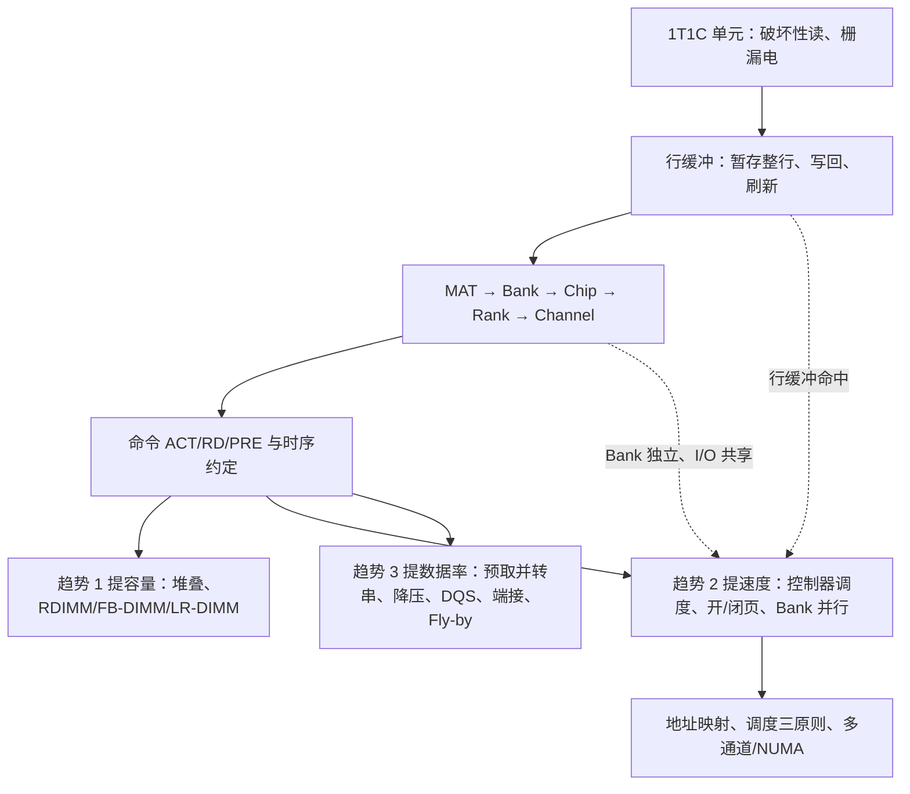

# L08 DRAM

[课程目录](../index.md)

本讲解决两个问题：如何进一步降低缓存的缺失率与命中时间，以及作为主存唯一介质的 DRAM 如何存储、组织和访问数据。先补完缓存优化（硬件预取、编译器优化、VIPT、踪迹缓存），再自底向上讲 DRAM：单元与破坏性读 → MAT/Bank/Chip/Rank/Channel 组织 → 接口演进与时序参数；最后沿三条技术趋势展开：提容量（堆叠与缓冲型模组）、提速度（内存控制器、行缓冲管理、地址映射、多通道）、提数据率（预取与信号完整性）。阅读前应掌握 L06 的 AMAT、多级缓存、虚拟内存的基本概念，以及 SRAM/DRAM 单元的初步比较。

## 章节导航

- [01 降低缺失率与命中时间](chapters/01-reducing-miss-rate-and-hit-time.md)：预取、编译器优化、VIPT 与踪迹缓存
- [02 DRAM 单元与破坏性读](chapters/02-dram-cell-and-destructive-read.md)：1T1C 单元、沟槽电容、破坏性读与刷新
- [03 DRAM 组织层次](chapters/03-dram-organization-hierarchy.md)：MAT 到 Channel 的分层及分层原因
- [04 DRAM 接口与时序](chapters/04-dram-interface-and-timing.md)：接口从异步到 DDR 的演进与读时序参数
- [05 容量扩展与内存模组](chapters/05-capacity-scaling-and-memory-modules.md)：堆叠、多 DIMM 负载与三种缓冲模组
- [06 内存控制器与行缓冲管理](chapters/06-memory-controller-and-row-buffer-management.md)：控制器职责、开/闭页与 Bank 级并行
- [07 地址映射与多通道](chapters/07-address-mapping-and-multiple-channels.md)：地址映射、调度三原则与多通道 NUMA
- [08 高速接口与信号完整性](chapters/08-high-speed-interface-and-signal-integrity.md)：预取并转串与高速接口四大挑战

## 本讲小结

### 概念地图

一条主线贯穿全讲：破坏性读迫使 DRAM 必须整行读入行缓冲，于是"行缓冲命中快、换行慢"成为性能的核心，时序参数（$t_{RCD}$、$t_{RAS}$、$t_{RP}$）量化了换行代价，控制器的开页/闭页策略、调度原则和地址映射都在设法提高命中率或把换行代价藏到其他 Bank 的数据传输背后。

### 判断表

| 场景 | 选择 | 依据 |
| --- | --- | --- |
| 访问局部性高 | 开页策略 | 命中只需 $t_{CAS}$ |
| 访问随机、重用距离远 | 闭页策略 | 预充电移出关键路径 |
| 连续请求落在同一 Bank 不同行 | 改地址映射（XOR / 高熵位作 Bank） | 分散到不同 Bank 以流水并行 |
| 一个通道要挂很多 DIMM | RDIMM / LR-DIMM | 缓冲减少信号目的地 |
| 内核频率无法提高但要更高数据率 | 加深预取（并转串） | $R_{\rm ext} = k \times f_{\rm core}$ |
| L1 想用无别名 VIPT | 容量 $\le$ 页大小 $\times$ 相联度 | 索引位不越出页内偏移 |

### 核心公式

| 公式 | 含义 |
| --- | --- |
| $\text{AMAT} = \text{Hit time} + \text{Miss rate} \times \text{Miss penalty}$ | 缓存优化的三个方向 |
| $b_{\text{index}} + b_{\text{offset}} \le b_{\text{page}}$ | VIPT 无别名条件 |
| $C \propto \varepsilon A / d$ | 电容只能靠增大面积 $A$（沟槽电容） |
| $t_{RC} = t_{RAS} + t_{RP}$ | 同一 Bank 换行的最小间隔，唯一等式 |
| $R_{\rm ext} = k \times f_{\rm core}$ | 预取深度 $k$ 决定外部数据率 |
| $P \propto V^2 f$ | 降压是控制 DRAM 功耗的主要手段 |

## 不确定事项

- s2p8 优化总结表按页面图像核对一致；Way prediction 在 s2p5 列出但未讲授，未写入
- section-1 中 AMD 旧架构 VIPT L1I 越过页偏移的说法来自课上播放的视频，具体架构名（ASR 为 z mic）无法确认，正文未写名称
- section-5 课堂示意数字（HBM 4 层良率 80%、混合键合 1024→8192 接触点、普通 DIMM 每通道 2 条/RDIMM 4 条）已标为课堂举例，非规格
- section-6/7 的开闭页量化表、命中率阈值例题、XOR 避冲突例、DDR5-6400 带宽计算均为据课程内容整理的补充，时序数值为假设值

> [!info]- 来源
> - L08-DRAM.pdf：PDF p.1–8, 10, 12–14, 16–99, 101–102
> - L08.docx：DOCX body 1–491
