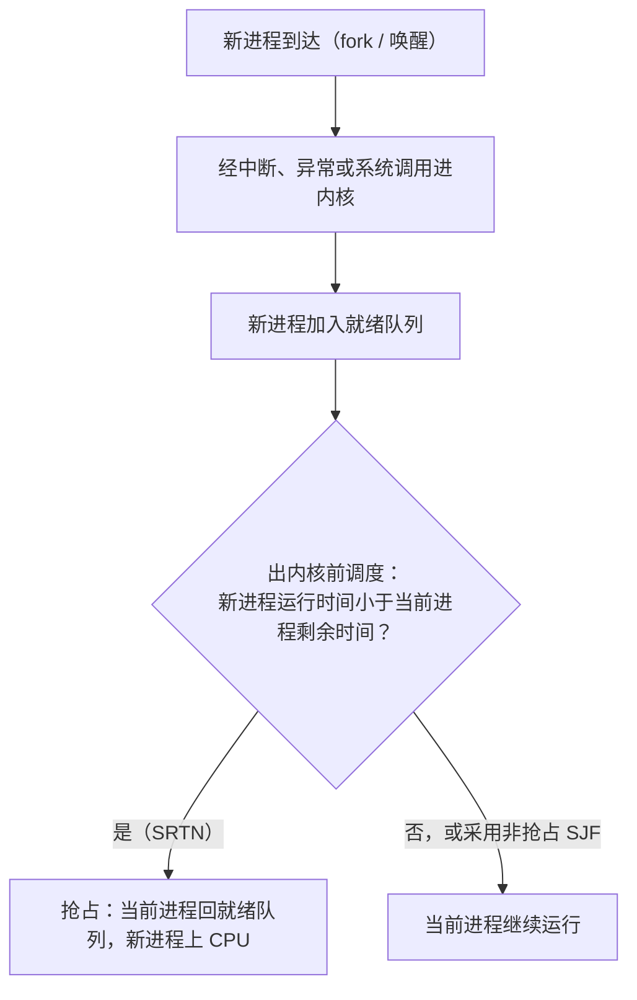
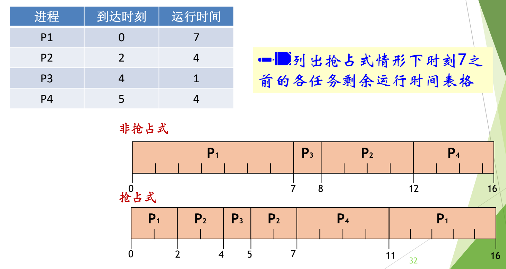

# 01 批处理系统的调度算法

[本讲目录](../index.md) · [课程目录](../../index.md) · [下一节：02 时间片轮转与虚拟轮转](02-round-robin-and-virtual-round-robin.md)

> [!abstract] 本节要点
> - 调度算法总体偏好 I/O 密集型进程：它用一会儿 CPU 就去访问设备，CPU 与设备能同时忙起来。
> - 批处理系统看重吞吐量、周转时间 $T_{\rm turnaround}=T_{\rm completion}-T_{\rm arrival}$、CPU 利用率，以及公平。
> - FCFS 非抢占、简单公平，但长进程后的短进程等待很久：P1=24、P2=P3=3 时平均周转 27 s，改为 P2、P3、P1 后降到 13 s。
> - SJF（非抢占）与 SRTN（抢占）优先运行短作业；所有进程同时可运行时 SJF 的平均周转时间最短，代价是不公平、长作业可能饥饿、需要预知运行时间。
> - HRRN 选响应比 $R=1+\frac{W}{S}$ 最大者，是 FCFS 与 SJF 的折中，能避免饥饿，但每次调度都要为每个进程计算 $R$，开销大。

## 调度算法的出发点

调度算法回答“下一个上 CPU 的是谁”；何时调度、如何切换已在 L06「03 调度时机」「04 进程切换与上下文切换」讲过：进程经中断、异常或系统调用进内核，出内核前统一调度，抢占只需在这一点比较优先级（例如 `fork` 出新进程、读盘完成唤醒等待进程），不需要额外机制。[^s3b1]

按行为可以把进程分成两类：**I/O 密集型**（I/O-bound）进程频繁地打印、读写，每次只用一点 CPU；**CPU 密集型**（CPU-bound）进程需要大量计算。调度算法通常偏好前者：它用一会儿 CPU 就去访问各种设备，把 CPU 让给别人，CPU 与设备能同时忙起来。[^s3b2]

> [!tip] 课堂强调
> 偏好 I/O 密集型进程——“不能老占着 CPU，最好出去溜达到各个部件”——是调度算法最重要的思路，后面的 RR、虚拟轮转、多级反馈队列都在不同程度上体现它。[^s3b2]

调度算法要按应用场景来选。**批处理系统**常用的算法有 FCFS、SJF、SRTN 和 HRRN，追求的指标是吞吐量、周转时间、CPU 利用率，此外还有公平与平衡。[^s1p27] 交互式系统的算法见 [时间片轮转与虚拟轮转](02-round-robin-and-virtual-round-robin.md)。

吞吐量、周转时间等指标的定义见 L06「05 调度目标与衡量指标」；下面的例子按 $T_{\rm turnaround} = T_{\rm completion} - T_{\rm arrival}$ 计算周转时间，平均周转时间取算术平均。[^s1p29]

## 先来先服务（FCFS）

最朴素的想法是“谁先来谁先用”。**先来先服务**（First Come First Serve, FCFS）按进程就绪的先后顺序使用 CPU，**没有抢占**：进程一旦上 CPU，就运行到结束或因自身原因（如 I/O）阻塞。[^s1p28]

- **优点**：公平、简单。
- **缺点一**：长进程之后的短进程要等很长时间，交互体验差（周转时间、响应时间长）。
- **缺点二**：I/O 资源和 CPU 资源的利用率都较低。进程只要占着 CPU 就不会被抢占，系统格局无法改变，CPU 密集型进程运行时 I/O 设备只能空等。[^s3b2]

> [!example] 例：同一队列，不同顺序
> 三个进程按 P1、P2、P3 的顺序就绪，同时到达（$T_{\rm arrival}=0$），P1 需要 24 s，P2、P3 各需 3 s。[^s1p29]
>
> 1. **FCFS 顺序 P1→P2→P3**：P1 在 24 s 完成，P2 在 27 s，P3 在 30 s。
>    吞吐量 $= 3\ \text{jobs}/30\ \text{s} = 0.1\ \text{jobs/s}$；周转时间 24、27、30；平均周转时间 $\frac{24+27+30}{3}=27$ s。
> 2. **改为 P2→P3→P1**：完成时刻 P2=3、P3=6、P1=30。吞吐量仍是 0.1 jobs/s，平均周转时间 $\frac{3+6+30}{3}=13$ s。[^s1p30]
>
> 总时间没变、吞吐量没变，但平均周转时间从 27 s 降到 13 s。同一个队列换一种调度顺序，就能改善某些指标；“短的先跑”正是下一个算法的思路。

## 短作业优先（SJF）与最短剩余时间优先（SRTN）

FCFS 的问题在于短作业被长作业挡在后面。既然先跑短的能降低平均周转时间，就让短作业先跑。

> [!info] 可视化资源
> - [OSTEP 第 7 章 调度：介绍（PDF）](https://pages.cs.wisc.edu/~remzi/OSTEP/cpu-sched.pdf)：看图 7.1–7.5：FIFO 被长作业拖累、SJF 与迟到作业、STCF 抢占的时间线对比。

**短作业优先**（Shortest Job First, SJF）让完成时间最短的进程优先执行，是**非抢占式**的：选中运行时间最短的进程后，一直运行到它结束或被 I/O 阻塞。**最短剩余时间优先**（Shortest Remaining Time Next, SRTN）是 SJF 的**抢占版本**：当一个新就绪进程的完成时间比当前运行进程的剩余时间更短时，抢占当前进程，改为运行新就绪进程。两者的共同思路是先完成短作业，从而改善短作业的周转时间。[^s1p31]

SRTN 的抢占完全靠调度机制完成：新进程到达，无论是新创建的还是从别处来的，都一定伴随一次中断/异常进内核；出内核前格局变了，调度程序重新比较所有就绪进程的剩余时间。[^s3b2]

> [!example] 例：SJF 与 SRTN 的甘特图
> 四个进程的到达时刻与运行时间如下。[^s1p32]
>
> | 进程 | 到达时刻 | 运行时间 |
> | --- | --- | --- |
> | P1 | 0 | 7 |
> | P2 | 2 | 4 |
> | P3 | 4 | 1 |
> | P4 | 5 | 4 |
>
> **非抢占式 SJF**：时刻 0 只有 P1，P1 上 CPU 并运行到 7。时刻 7 就绪的有 P2(4)、P3(1)、P4(4)，选最短的 P3（7–8），再选 P2（8–12；与 P4 同为 4，按先到者），最后 P4（12–16）。
> 顺序 P1(0–7)、P3(7–8)、P2(8–12)、P4(12–16)。
>
> **抢占式 SRTN**：
> 1. 时刻 0：只有 P1，运行。
> 2. 时刻 2：P2 到达，P1 剩 5，P2 需 4，$4<5$，P2 抢占。
> 3. 时刻 4：P3 到达，P2 剩 2，P3 需 1，P3 再次抢占。
> 4. 时刻 5：P3 完成，P4 到达；就绪的有 P1(5)、P2(2)、P4(4)，选 P2。
> 5. 时刻 7：P2 完成；P1(5)、P4(4)，选 P4（7–11），最后 P1（11–16）。
>
> 顺序 P1(0–2)、P2(2–4)、P3(4–5)、P2(5–7)、P4(7–11)、P1(11–16)。
>
> 平均周转时间：非抢占 $\frac{7+10+4+11}{4}=8$；抢占 $\frac{16+5+1+6}{4}=7$。

图：P1–P4 的到达时刻与运行时间表，下方对比非抢占式 SJF（P1、P3、P2、P4，完成于 7/8/12/16）与抢占式 SRTN（P1、P2、P3、P2、P4、P1，切换点 2/4/5/7/11/16）的甘特图，注意 P2、P3 到达时如何抢占 P1。

### 抢占式情形下各时刻的剩余时间

> [!info] 拓展内容
> 这张表是课件留下的练习，留作课后自行核对。

课件要求列出抢占式情形下时刻 7 之前每个时刻的就绪作业及其剩余运行时间，以及该时刻选择运行的作业。由上例数据逐时刻推算如下（括号内为剩余运行时间）：[^s1p33]

| 时刻 | 就绪作业及剩余时间 | 选择运行 |
| --- | --- | --- |
| 0 | (P1, 7) | P1 |
| 1 | (P1, 6) | P1 |
| 2 | (P1, 5), (P2, 4) | P2 |
| 3 | (P1, 5), (P2, 3) | P2 |
| 4 | (P1, 5), (P2, 2), (P3, 1) | P3 |
| 5 | (P1, 5), (P2, 2), (P4, 4) | P2 |
| 6 | (P1, 5), (P2, 1), (P4, 4) | P2 |
| 7 | (P1, 5), (P4, 4) | P4 |

只有到达事件（时刻 2、4、5）和完成事件（时刻 5、7）会改变选择，其余时刻只是剩余时间减 1。这也说明调度决策只需要在事件发生时做。

### SJF 的最优性

**结论**：在所有进程同时可运行的前提下，SJF 得到最短的平均周转时间。[^s1p34] 这里的前提指一个固定的就绪队列，所有进程都在时刻 0 就绪，不会陆续到来。[^s3b2]

> [!tip] 课堂强调
> 这是操作系统的经典证明题，以往的习题里一定会有。[^s3b2]

证明思路是交换论证：先按某个顺序排好 $J_1, J_2, \dots, J_n$，任意交换其中两个作业后重新计算平均周转时间，说明“短的在前”的顺序无法再被改进。[^s3b3]

> [!note] 补充解释
> 下面把交换论证写完整。设各作业运行时间为 $t_1, \dots, t_n$，到达时刻都是 0，第 $k$ 个作业的周转时间就是完成时刻 $C_k=\sum_{i=1}^{k} t_i$，于是
> $$
> \sum_{k=1}^{n} C_k = \sum_{k=1}^{n} (n-k+1)\, t_k ,
> $$
> 排在第 $k$ 位的作业时长被计入 $n-k+1$ 次，越靠前权重越大。若某顺序中相邻两作业满足 $t_j > t_{j+1}$，记 $S$ 为前 $j-1$ 个作业的时间和：交换前 $C_j + C_{j+1} = 2S + 2t_j + t_{j+1}$，交换后为 $2S + 2t_{j+1} + t_j$，其余作业的完成时刻不变，总周转时间变化 $t_{j+1}-t_j<0$。
>
> 因此只要存在“长在前、短在后”的相邻对，交换后平均周转时间就严格减小；反复交换，最终得到从短到长的 SJF 顺序，它的平均周转时间最小。

### SJF 的代价

- **不公平，会导致饥饿**：如果源源不断地有短作业到来，它们就像“加塞儿”一样排到长作业前面，长作业可能一直得不到处理器时间。这种现象称为**饥饿**（starvation）。判断一个调度算法时，要考虑它会不会产生饥饿。[^s1p34]
- **需要预测未来**：系统事先并不知道作业要运行多久，只能由用户提供估计值。用户可能虚报，比如声称运行 5 分钟、实际运行 1 小时，以便被优先调度。系统会记录实际运行过程，按实际用量记账、多收费用，所以虚报并不划算。对每天固定运行的程序，运行时间可以预估：例如全球连锁餐饮企业每天定时汇总各门店销售数据，每次的计算时间大致相同。[^s3b3]

> [!warning] 易错点
> “SJF 平均周转时间最短”有前提：所有进程同时可运行。进程陆续到达时，非抢占 SJF 不一定最优（上例中 SRTN 的平均周转时间为 7，比非抢占 SJF 的 8 更短）。另外，SJF 优化的是平均值，不是每个作业的周转时间：长作业反而被推得更晚。

## 最高响应比优先（HRRN）

SJF 只看作业长短，FCFS 只看先来后到，各有极端。选车、选房都不会只看一个指标，调度也一样。**最高响应比优先**（Highest Response Ratio Next, HRRN）是第一个综合多个因素的调度算法。[^s3b3]

HRRN 为每个进程计算**响应比**（response ratio）$R$，每次选 $R$ 最高的进程：[^s1p35]
$$
R = \frac{\text{作业周转时间}}{\text{作业处理时间}}
  = \frac{S + W}{S}
  = 1 + \frac{W}{S}
$$
其中 $W$ 是作业到目前为止的等待时间，$S$ 是作业处理时间（需要的 CPU 时间）。两者单位相同，$R$ 无量纲，且 $R \ge 1$。

- **短作业**：$S$ 小，相同等待时间下 $R$ 更大，更容易被调度，类似 SJF，能降低平均周转时间。
- **长作业**：$S$ 大，但 $W$ 随等待持续增长；等得足够久后，它的 $R$ 会超过后来的短作业，得到执行机会，因此**不会饥饿**。这一项体现了 FCFS 的思想。[^s1p36]

> [!example] 例：长作业等到了机会
> 某长作业 $S=20$，已等待 $W=30$；一个刚到的短作业 $S=2$，已等待 $W=2$。
>
> 1. 长作业 $R = 1 + \frac{30}{20} = 2.5$。
> 2. 短作业 $R = 1 + \frac{2}{2} = 2$。
> 3. $2.5 > 2$，长作业先运行。在 SJF 下长作业会再次被这个短作业插队。
>
> 用上面 SJF 例的四进程数据做非抢占 HRRN：时刻 7 时 P2、P3、P4 的响应比分别为 $1+\frac{5}{4}=2.25$、$1+\frac{3}{1}=4$、$1+\frac{2}{4}=1.5$，选 P3；时刻 8 时 P2 为 $1+\frac{6}{4}=2.5$，P4 为 $1+\frac{3}{4}=1.75$，选 P2，最后 P4。这组数据中 HRRN 的结果恰好与 SJF 相同。

**代价**：每次调度都要为每个就绪进程重新计算响应比，开销大。若做成抢占式 HRRN，还需要频繁计算各进程的响应比并重新排序，资源开销更大。[^s1p36] 因此 HRRN 没有在实际系统中延续下来。它说明的是：调度需要在多个指标之间**折中权衡**（tradeoff），而不是追求单一指标。[^s3b3]

> [!question]- 自测：三个作业同时到达，运行时间分别为 6、2、4。FCFS（按 6、2、4 的顺序）与 SJF 的平均周转时间各是多少？
> FCFS：完成时刻 6、8、12，平均 $\frac{26}{3}\approx 8.67$。SJF 顺序 2、4、6：完成时刻 2、6、12，平均 $\frac{20}{3}\approx 6.67$。三者同时到达，满足 SJF 最优的前提。

> [!question]- 自测：CPU 正忙时到达一个运行时间为 100 的长作业，此后每隔 3 个时间单位到达一个运行时间为 3 的短作业。采用非抢占 SJF，长作业会怎样？换成非抢占 HRRN 呢？
> SJF 下每次 CPU 空出来时，就绪队列里总有一个运行时间为 3 的短作业，它比 100 短，长作业永远选不上，发生饥饿。HRRN 下长作业的响应比 $1+\frac{W}{100}$ 随等待时间 $W$ 不断增大，而刚到的短作业响应比接近 1，长作业最迟在 $W$ 足够大时一定会被选中，不会饥饿。

> [!question]- 自测：为什么说 SRTN 的“抢占”不需要额外的硬件或机制？
> 新进程变为就绪（`fork` 创建或 I/O 完成被唤醒）必然经过一次中断、异常或系统调用进入内核；出内核前本来就有统一的调度点，SRTN 只需在这里比较剩余时间并决定是否换人。

> [!info]- 来源
> - slides04.pdf：PDF p.26–36
> - L07.docx：DOCX body 1–73

[^s3b1]: L07.docx-DOCX body 1-24
[^s3b2]: L07.docx-DOCX body 25-51
[^s1p27]: slides04.pdf-PDF p.27
[^s1p29]: slides04.pdf-PDF p.29
[^s1p28]: slides04.pdf-PDF p.28
[^s1p30]: slides04.pdf-PDF p.30
[^s1p31]: slides04.pdf-PDF p.31
[^s1p32]: slides04.pdf-PDF p.32
[^s1p33]: slides04.pdf-PDF p.33
[^s1p34]: slides04.pdf-PDF p.34
[^s3b3]: L07.docx-DOCX body 52-73
[^s1p35]: slides04.pdf-PDF p.35
[^s1p36]: slides04.pdf-PDF p.36

[本讲目录](../index.md) · [课程目录](../../index.md) · [下一节：02 时间片轮转与虚拟轮转](02-round-robin-and-virtual-round-robin.md)
