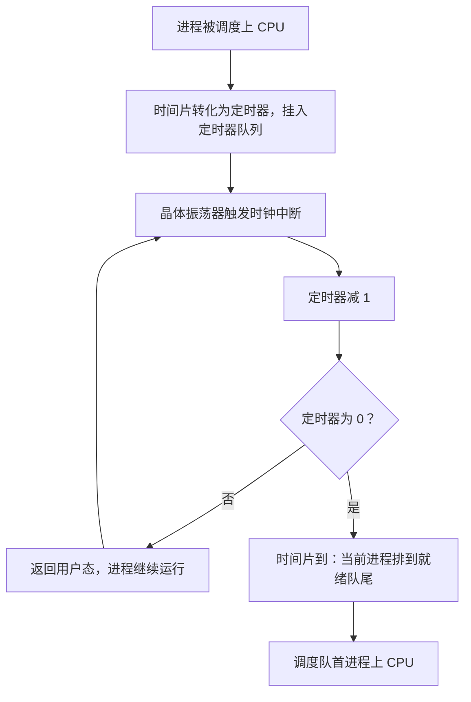
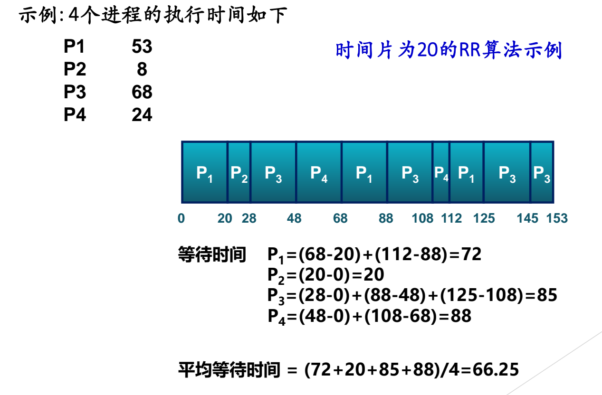
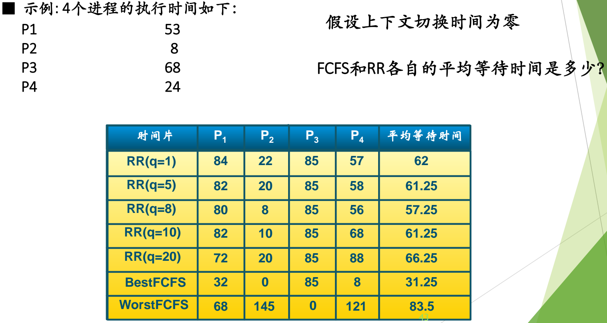
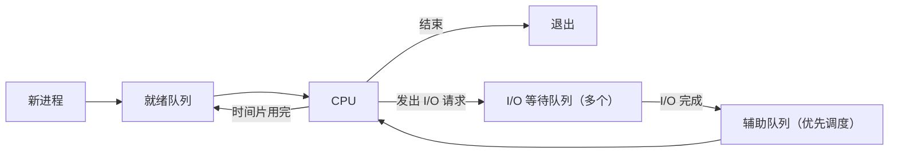
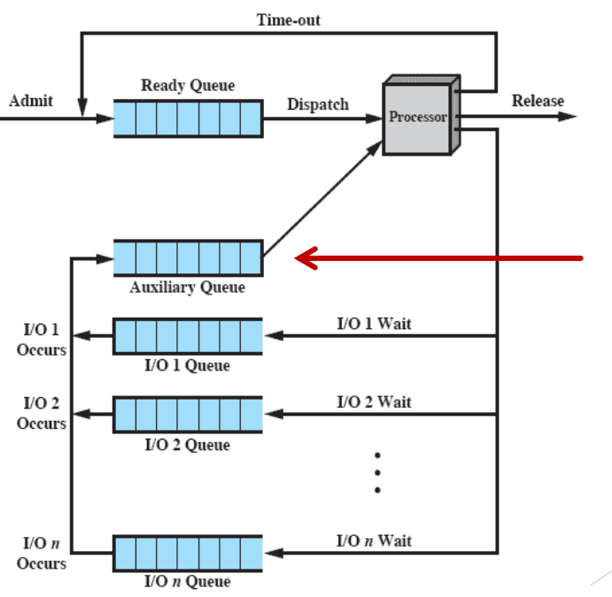

# 02 时间片轮转与虚拟轮转

[本讲目录](../index.md) · [课程目录](../../index.md) · [上一节：01 批处理系统的调度算法](01-batch-scheduling-algorithms.md) · [下一节：03 混合负载场景分析](03-mixed-workload-scenario-analysis.md)

> [!abstract] 本节要点
> - 交互式系统看重响应时间、公平与均衡，常用 RR、最高优先级、多级（反馈）队列；最短进程优先（SPN）与 SJF 思想相同。
> - 时间片由定时器实现：进程上 CPU 时时间片转化为定时器挂入定时器队列，每次时钟中断减 1，减到 0 即“到点”，进程排到就绪队尾。
> - 时间片太长（大于典型交互时间）退化为 FCFS；太短则切换的直接与间接开销（TLB、Cache）浪费 CPU；经验上时间片 10 ms、切换 0.1 ms 时开销约 1%。
> - RR 对长短混合的进程有利，对大小相同的进程不利：A、B 各 100 ms、$q=1$ ms 时完成于 199/200 ms，FCFS 为 100/200 ms。
> - 虚拟轮转让 I/O 完成的进程进入优先调度的辅助队列，而不是重新排到就绪队尾，以照顾 I/O 密集型进程。

## 交互式系统的调度算法

交互式系统中有用户在等待结果，首要指标是**响应时间**，另外还要兼顾公平、平衡与均衡性。常用算法包括：[^s1p37]

- 时间片轮转（Round Robin, RR），本节内容；
- 最高优先级调度（Highest Priority First, HPF），以及与之相关的抢占和优先级反转，见 [优先级调度与优先级反转](04-priority-scheduling-and-priority-inversion.md)；
- 多级队列（Multiple queues）与多级反馈队列（Multiple feedback queue），见 [多级队列与多级反馈队列](05-multilevel-queue-and-multilevel-feedback-queue.md)；
- 最短进程优先（Shortest Process Next, SPN）。

SPN 与 SJF 的思想完全相同，只是批处理系统中称“作业”、交互式系统中称“进程”，不再重复讲解，见 [批处理系统的调度算法](01-batch-scheduling-algorithms.md)。每种算法都可能有抢占与非抢占两个版本，是否抢占本身也是一个考量维度。[^s3b3]

## 时间片轮转（RR）

FCFS 让一个进程一直占着 CPU，短进程只能干等。RR 的思路是**周期性地切换任务**：给每个进程分配一个**时间片**（time slice / quantum），时钟中断到来、时间片用完时轮换到下一个进程。目标是改善短任务的平均响应时间：短进程轮一圈或两圈就能完成。[^s1p38]

> [!info] 可视化资源
> - [OSTEP 第 7 章 7.6–7.7 节 响应时间与轮转（PDF）](https://pages.cs.wisc.edu/~remzi/OSTEP/cpu-sched.pdf)：对照图 7.6 与图 7.7：同一组作业下 SJF 与 RR 的响应时间差异，以及时间片长短的摊销讨论。

**时间片轮转**（Round Robin, RR）调度：就绪进程排成一个队列，队首进程上 CPU 运行一个时间片。若在时间片内结束或阻塞，就让出 CPU；若时间片用完仍未结束，就排到就绪队尾，由下一个进程运行。[^s3b4]

### 时间片“到点”是怎么实现的

“时间片到”依靠时钟中断实现：[^s3b3]

1. 进程被调度上 CPU 时，系统把它的时间片转化为一个**定时器**，挂到系统的定时器队列里（系统中同时有许多定时器）。
2. 计算机有晶体振荡器，像石英表一样稳定地产生节拍，定时定点触发**时钟中断**。
3. 每次时钟中断，定时器的值减 1（定时器做减法）。
4. 定时器减到 0，表示时间片到点。此时正处在内核中，出内核前调度程序把当前进程放到就绪队尾，选下一个进程，完成轮转。

> [!example] 例：时间片 $q=20$ 的 RR
> 四个进程同时就绪，执行时间 P1=53、P2=8、P3=68、P4=24，按 P1、P2、P3、P4 的顺序排队，不计切换时间。[^s1p39]
>
> 执行序列（区间为时刻）：
> P1(0–20) → P2(20–28) → P3(28–48) → P4(48–68) → P1(68–88) → P3(88–108) → P4(108–112) → P1(112–125) → P3(125–145) → P3(145–153)
>
> P2 只需 8，一个时间片没用完就结束；P4 在第二轮用 4 就结束；P1 在 125 结束；最后只剩 P3，连续运行两个时间片到 153。
>
> 等待时间 = 各段开始时刻减去上一段结束时刻，再求和：
> - P1 $=(68-20)+(112-88)=72$
> - P2 $=20-0=20$
> - P3 $=(28-0)+(88-48)+(125-108)=85$
> - P4 $=(48-0)+(108-68)=88$
>
> 平均等待时间 $=\frac{72+20+85+88}{4}=66.25$。

图：P1=53、P2=8、P3=68、P4=24 在 $q=20$ 下的 RR 甘特图及各进程等待时间计算，平均等待时间 $(72+20+85+88)/4=66.25$。

### 时间片大小的选择

时间片的取值决定 RR 的表现，判断标准是**典型交互时间**，即一次交互需要的 CPU 时间 $s$。[^s1p40]

- **$q$ 太长（大于典型交互时间）**：大多数交互在一个时间片内就能完成，轮转形同虚设，RR **退化为 FCFS**，排在后面的短进程响应时间被拉长。
- **$q$ 太短（小于典型交互时间）**：一次交互要被切成好几段。进程运行 $q$ 后被切换，其他进程各运行一个时间片，再回来运行剩下的 $s-q$，响应时间为 $s$ 加上其间其他进程的运行时间和切换时间。频繁的进程切换浪费 CPU 时间。

切换不只有**直接开销**（保存与恢复上下文、执行调度程序的时间），还有**间接开销**：切换后 TLB、Cache 中原进程的内容失效，新进程开始运行时命中率下降。[^s3b4]

> [!tip] 课堂强调
> 上下文切换除了直接开销，一定要记住还有间接开销（TLB、Cache），所以时间片不宜太小，必须取折中点。[^s3b4]

切换次数随时间片减小而增加。一个运行时间为 10 的进程：[^s1p41]

| 进程运行时间 | 时间片 | 上下文切换次数 |
| --- | --- | --- |
| 10 | 12 | 0 |
| 10 | 6 | 1 |
| 10 | 1 | 9 |

经验估算：时间片 10 ms、一次进程切换 0.1 ms 时，切换的 CPU 开销约为 $\frac{0.1}{10}=1\%$，比较合适。[^s1p41] 实际设计系统时，一般先参考 Linux、Windows 等系统的取值，再针对应用场景测试、调整。[^s3b4]

### RR 的优缺点

- **优点**：公平，大家排队轮流；有利于交互式计算，短进程响应快。
- **缺点**：进程切换带来较高开销。[^s1p41] 没有哪个调度算法没有缺点。

RR 对长短不一的进程组合有利，但**对大小相同的进程不利**。设 A、B 两个进程运行时间都是 100 ms，同时就绪，时间片 1 ms，上下文切换不耗时：[^s1p42]

- **RR**：ABABAB……交替运行。A 的最后 1 ms 在第 199 个时间片，B 在第 200 个，因此 A 在 199 ms、B 在 200 ms 完成，平均完成时间 $\frac{199+200}{2}=199.5$ ms。
- **FCFS**：A 先运行到 100 ms 完成，B 接着运行到 200 ms 完成，平均完成时间 $\frac{100+200}{2}=150$ ms。

两者都在 200 ms 时全部完成，但 RR 让 A 白白推迟了 99 ms，平均完成时间更差。即使不计切换开销也是如此，计入切换后差距更大。

> [!note] 补充解释
> 讲授录音中 FCFS 的结果被说成“一共 300 毫秒”。300 ms 只是两者完成时刻之和 $100+200$（RR 下为 $199+200=399$），不是完成时间：FCFS 下 A 在 100 ms、B 在 200 ms 完成，平均 150 ms，结论“FCFS 优于 RR”不变。[^s3b4]

### FCFS 与 RR 的平均等待时间对比

> [!info] 拓展内容
> 这组对比数据课上留作课后自行查看。

仍用 P1=53、P2=8、P3=68、P4=24 四个进程，假设上下文切换时间为零，比较不同时间片的 RR 与最好、最坏顺序的 FCFS。各进程等待时间如下：[^s1p43]

| 算法 | P1 | P2 | P3 | P4 | 平均等待时间 |
| --- | --- | --- | --- | --- | --- |
| RR($q=1$) | 84 | 22 | 85 | 57 | 62 |
| RR($q=5$) | 82 | 20 | 85 | 58 | 61.25 |
| RR($q=8$) | 80 | 8 | 85 | 56 | 57.25 |
| RR($q=10$) | 82 | 10 | 85 | 68 | 61.25 |
| RR($q=20$) | 72 | 20 | 85 | 88 | 66.25 |
| Best FCFS | 32 | 0 | 85 | 8 | 31.25 |
| Worst FCFS | 68 | 145 | 0 | 121 | 83.5 |

- **Best FCFS** 就是按短到长的顺序 P2(8)、P4(24)、P1(53)、P3(68) 运行，即 SJF 顺序：等待时间 0、8、32、85，平均 31.25，是所有方案中最好的。
- **Worst FCFS** 按长到短的顺序 P3、P1、P4、P2：等待时间 0、68、121、145，平均 83.5。
- 各种 $q$ 的 RR 都在两者之间，且平均等待时间不随 $q$ 单调变化（$q=8$ 时最好，恰好让 P2 一个时间片跑完）。RR 不是为了最小化平均等待时间而设计的，它保证的是每个进程都能较快得到 CPU。
- P3 是最长的进程，无论 $q$ 取多少，它的最后一段都要等其他三个全部结束，所以 RR 下等待时间总是 85。

图：同一组进程（53/8/68/24，上下文切换时间为零）在 RR(q=1,5,8,10,20)、最好与最坏 FCFS 下各进程等待时间与平均等待时间，对比 BestFCFS 的 31.25 与各 RR 结果。

## 虚拟轮转（Virtual RR）

在普通 RR 的队列模型中，被调度的进程有三种去向：运行结束离开；时间片用完回到就绪队尾；时间片没用完就因 I/O 等事件进入相应的等待队列（不同原因进入不同的等待队列）。等待的事件发生后，进程重新进入就绪队列，排到**队尾**。[^s3b4]（五状态模型与队列见 L04「04 扩展状态与实际系统」和 L05「01 进程表与队列模型」。）

问题在第三种去向：I/O 密集型进程往往时间片没用完就主动去做 I/O，把 CPU 让给别人，I/O 完成后却要重新排到队尾，相当于主动让出 CPU 反而吃亏。CPU 密集型进程则每次都能用满时间片。这与“偏好 I/O 密集型进程”的方向相反。

**虚拟轮转**（Virtual Round Robin, VRR）修改了队列模型：等待队列中的进程在事件发生后不直接回到就绪队列，而是进入一个专门增设的**辅助队列**（auxiliary queue）。调度程序挑选下一个进程时优先从辅助队列中选，或至少按某种比例从辅助队列和就绪队列中选（例如这边选一个、那边选两个）。这样主动让出 CPU 的进程能更快地回到 CPU，CPU 和各种设备都保持忙碌。该方法出自 1991 年的一篇论文（课件标注 Halder, S. etc., 1991）。[^s3b4]

图：虚拟轮转的队列结构——I/O 完成的进程进入 Auxiliary Queue（红色箭头所指），调度时优先于 Ready Queue 被 Dispatch 到 Processor，时间片用完则经 Time-out 回到就绪队列。

**留待思考**：对计算密集型进程如何分配时间片？[^s1p44] 在上面的模型里，CPU 密集型进程总是用完时间片，经 Time-out 回到就绪队列按普通 RR 轮转，辅助队列只接收因 I/O 让出 CPU 的进程。虚拟轮转与 [多级反馈队列](05-multilevel-queue-and-multilevel-feedback-queue.md) 一样，用队列结构表达对 I/O 型进程的偏好。

> [!note] 补充解释
> 按 Stallings《Operating Systems: Internals and Design Principles》中的描述，从辅助队列被调度的进程只能运行“基本时间片减去它上次从就绪队列被选中后已用掉的时间”，不会拿到完整的新时间片。这样 I/O 型进程得到的是优先权而不是额外的 CPU 时间，对 CPU 型进程也较公平。这一细节课件未给出。

> [!question]- 自测：用 $q=8$ 重新调度 P1=53、P2=8、P3=68、P4=24（同时就绪、按序排队），P2 的等待时间为什么只有 8？
> 第一轮 P1 先运行 0–8，P2 在时刻 8 开始，一个时间片恰好运行完它的 8，在 16 结束，只等了 P1 的 8。这与表中 RR($q=8$) 的 P2=8 一致。

> [!question]- 自测：某系统时间片 5 ms，一次切换 0.5 ms，切换开销约占多少？如果交互请求一般需要 3 ms CPU，把时间片调大到 50 ms 会怎样？
> 开销约 $\frac{0.5}{5}=10\%$，偏高。调到 50 ms 后开销降到约 1%，但 50 ms 远大于典型交互时间 3 ms，几乎所有交互都在一个时间片内完成，RR 退化为 FCFS；遇到长的 CPU 密集型进程时，排在它后面的交互进程最多要多等 50 ms。应在两者之间折中。

> [!question]- 自测：在普通 RR 中，一个每次运行 2 ms 就去读盘的进程与几个 CPU 密集型进程竞争，它会遇到什么问题？虚拟轮转如何改善？
> 它每次读盘回来都要重新排到就绪队尾，等所有 CPU 密集型进程各跑完一个完整时间片才能再上 CPU，于是磁盘空闲、它的响应变慢。虚拟轮转让它 I/O 完成后进入辅助队列并被优先调度，能尽快再次发出 I/O 请求。

> [!info]- 来源
> - slides04.pdf：PDF p.37–44
> - L07.docx：DOCX body 52–124

[^s1p37]: slides04.pdf-PDF p.37
[^s3b3]: L07.docx-DOCX body 52-73
[^s1p38]: slides04.pdf-PDF p.38
[^s3b4]: L07.docx-DOCX body 74-96
[^s1p39]: slides04.pdf-PDF p.39
[^s1p40]: slides04.pdf-PDF p.40
[^s1p41]: slides04.pdf-PDF p.41
[^s1p42]: slides04.pdf-PDF p.42
[^s1p43]: slides04.pdf-PDF p.43
[^s1p44]: slides04.pdf-PDF p.44

[本讲目录](../index.md) · [课程目录](../../index.md) · [上一节：01 批处理系统的调度算法](01-batch-scheduling-algorithms.md) · [下一节：03 混合负载场景分析](03-mixed-workload-scenario-analysis.md)
