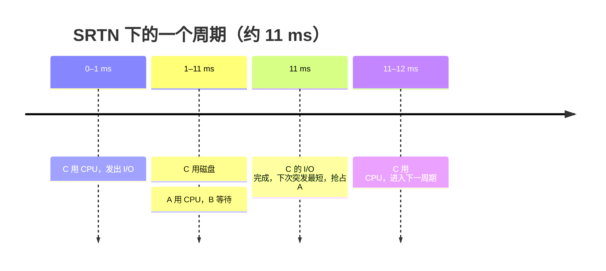

# 03 混合负载场景分析

[本讲目录](../index.md) · [课程目录](../../index.md) · [上一节：02 时间片轮转与虚拟轮转](02-round-robin-and-virtual-round-robin.md) · [下一节：04 优先级调度与优先级反转](04-priority-scheduling-and-priority-inversion.md)

> [!abstract] 本节要点
> - 场景：A、B 各需 1000 ms 纯计算；C 循环“用 CPU 1 ms、用 I/O 10 ms”。C 单独运行时磁盘利用率约 $\frac{10}{11}\approx 91\%$。目标是同时让处理器和磁盘忙。
> - I/O 型进程也必须先在 CPU 上运行才能发出 I/O 请求，所以 C 能否及时拿到 1 ms 的 CPU 决定了磁盘利用率。
> - FCFS：A 或 B 在 C 之前时，C 最多被挡约 2000 ms；RR(100 ms) 每 200 ms 只有约 10 ms 磁盘操作，磁盘大多空闲。
> - RR(1 ms)：磁盘利用率接近 90%，对 A、B 几乎无影响，但进程切换次数极多。
> - SRTN：C 每次 I/O 结束都因下次 CPU 突发最短而立即运行，序列为 CA-CA…，磁盘利用率高，但 B 长期得不到运行。

## 场景设定

前面每个算法都是单独看的。实际系统中 CPU 型与 I/O 型进程往往混在一起，用一个具体场景比较各算法的综合效果。[^s1p45]

> [!info] 可视化资源
> - [OSTEP 第 7 章 7.8 节 结合 I/O（PDF）](https://pages.cs.wisc.edu/~remzi/OSTEP/cpu-sched.pdf)：看图 7.8 与图 7.9：把 I/O 型作业的每段 CPU 突发当作独立作业调度，CPU 与磁盘才能重叠工作。

- **进程 A**：需要 1000 ms 的计算。
- **进程 B**：需要 1000 ms 的计算。
- **进程 C**（伪代码）：

```c
while (1) {
    use_cpu(1);   /* 使用处理器 1 ms */
    use_io(10);   /* 使用 I/O（磁盘）10 ms */
}
```

单独运行时，A 或 B 都能使用处理器的 100%，C 能使用磁盘约 91%（每 11 ms 中有 10 ms 在用磁盘，$\frac{10}{11}\approx 91\%$）。A、B 是 CPU 型，C 是 I/O 型。问题是三者一起运行会怎样，目标是**同时保持处理器和磁盘忙**。[^s1p45]

关键在于：I/O 型进程也要占用一点 CPU。所有 I/O 请求（读盘、写盘、打印、网卡发送）都必须由进程在 CPU 上运行时发出，CPU 再把请求交给 DMA 或设备控制器去完成。所以 C 每轮都需要先拿到 1 ms 的 CPU，否则磁盘就闲着。[^s3b5]

> [!tip] 课堂强调
> 一定要理解 CPU 是分发任务的：进程要做 I/O，必须先在 CPU 上运行并提出 I/O 请求，CPU 再把请求交给 DMA 或控制器。[^s3b5]

## 四种调度方式的比较

### 先来先服务

FCFS 不抢占。只要 A 或 B 排在 C 之前，C 就要等它们运行完才能拿到第一个 1 ms，最多被挡约 2000 ms（A、B 都在 C 之前时），这期间磁盘完全空闲。[^s1p46] C 排在最前也没多大用：C 运行 1 ms 发出 I/O 后，A 上 CPU 一跑就是 1000 ms，C 的 I/O 10 ms 后就完成了，却要一直等到 A 结束。

### 时间片轮转，时间片 100 ms

序列为 `CA---------B---------CA---------B---------...`。[^s1p46]

谁先运行已不重要。假设 C 先运行 1 ms 后去做 I/O，接着 A 运行 100 ms、B 运行 100 ms。C 的 I/O 在 10 ms 后早已完成，却要在就绪队列里等 A、B 各用完一个时间片。结果是：A、B 运行时磁盘大多空闲，**每 200 ms 中大约只有 10 ms 在做磁盘操作**，磁盘利用率约 $\frac{10}{201}\approx 5\%$。[^s3b5]

### 时间片轮转，时间片 1 ms

序列为 `CABABABABABCABABABABABC...`。[^s1p47]

1. C 运行 1 ms，发出 I/O 请求后阻塞。
2. C 做 I/O 的 10 ms 里，A、B 交替各运行 1 ms，共 10 个时间片。
3. C 的 I/O 完成后很快又排到 CPU，立即发出下一次 I/O。

C 被频繁调度，每次 I/O 完成后能立刻发起下一次 I/O，**磁盘接近 90% 的时间都在工作**（理想情况下每 11 ms 有 10 ms 在用磁盘）。A、B 只是每 11 ms 让出 1 ms，性能几乎没有影响。[^s1p47]

问题是进程切换非常多（每 1 ms 一次），切换的开销会吃掉相当一部分 CPU 时间。[^s3b5]

### 最短剩余时间优先

序列为 `CA-------CA-------------CA--------- ...`。[^s1p48]

1. C 运行 1 ms 后去做 I/O。就绪的 A、B 剩余时间相同，假设选 A。
2. 10 ms 后 C 的 I/O 结束，C 重新就绪。它的下次处理器突发只有 1 ms，是所有就绪进程中最短的，于是**立即抢占 A**。
3. C 运行 1 ms 后又去做 I/O，A 继续运行……循环往复。

处理器始终在忙，磁盘利用率也和 C 单独运行时差不多（约 91%），对资源利用而言很理想。但调度序列一直是 C、A、C、A，**B 始终上不了 CPU**。[^s3b5] 按 SRTN 的规则，A 运行后剩余时间比 B 短，B 要等到 A 全部完成（约 1000 ms 计算加上穿插的 C）才能运行。这就是 SRTN 不公平的一面。



## 综合对比

| 调度方式 | 典型序列 | 磁盘利用率（估算） | CPU 利用率 | 主要问题 |
| --- | --- | --- | --- | --- |
| FCFS（A、B 在 C 前） | A…B…C… | 前约 2000 ms 为 0 | 100% | C 被挡约 2000 ms |
| RR，$q=100$ ms | CA…B…CA…B… | 约 $\frac{10}{201}\approx 5\%$ | 100% | 磁盘大多空闲 |
| RR，$q=1$ ms | CABABABABABC… | 接近 90% | 接近 100%，但部分用于切换 | 切换次数极多 |
| SRTN | CA-CA-… | 约 91% | 100% | B 长期得不到运行 |

（磁盘与 CPU 利用率按理想条件估算，忽略切换时间，课件只给出 RR(100 ms) 的“每 200 ms 约 10 ms”和 RR(1 ms) 的“接近 90%”。）[^s1p46]

这个场景再次说明，没有完美的调度算法：让 I/O 型进程及时拿到 CPU 才能保持磁盘忙，但小时间片带来切换开销，按剩余时间抢占又造成不公平。偏好 I/O 型进程、同时避免饥饿与过多切换，正是 [虚拟轮转](02-round-robin-and-virtual-round-robin.md) 和 [多级反馈队列](05-multilevel-queue-and-multilevel-feedback-queue.md) 要解决的问题。

> [!question]- 自测：在本场景中采用 RR，时间片取 10 ms，磁盘利用率大约是多少？
> 一个周期内 C 运行 1 ms，A、B 各运行 10 ms，周期约 21 ms；C 的 10 ms I/O 恰在 A 的时间片结束时完成，此时 B 已排在它前面，C 要等 B 的 10 ms 结束才能再上 CPU。磁盘每 21 ms 约忙 10 ms，利用率约 $\frac{10}{21}\approx 48\%$，介于 $q=100$ ms 和 $q=1$ ms 之间。

> [!question]- 自测：如果把 C 改为“用 CPU 1 ms、用 I/O 10 ms”只循环 5 次就结束，SRTN 下 B 还会饥饿吗？
> 不会长期饥饿，但仍要等 A。C 的 5 轮只占约 55 ms，之后只剩 A、B；A 已运行过，剩余时间短于 B，SRTN 继续让 A 运行到结束，B 在 A 完成后才运行。B 被推迟，但最终能运行。

> [!info]- 来源
> - slides04.pdf：PDF p.45–48
> - L07.docx：DOCX body 97–124

[^s1p45]: slides04.pdf-PDF p.45
[^s3b5]: L07.docx-DOCX body 97-124
[^s1p46]: slides04.pdf-PDF p.46
[^s1p47]: slides04.pdf-PDF p.47
[^s1p48]: slides04.pdf-PDF p.48

[本讲目录](../index.md) · [课程目录](../../index.md) · [上一节：02 时间片轮转与虚拟轮转](02-round-robin-and-virtual-round-robin.md) · [下一节：04 优先级调度与优先级反转](04-priority-scheduling-and-priority-inversion.md)
