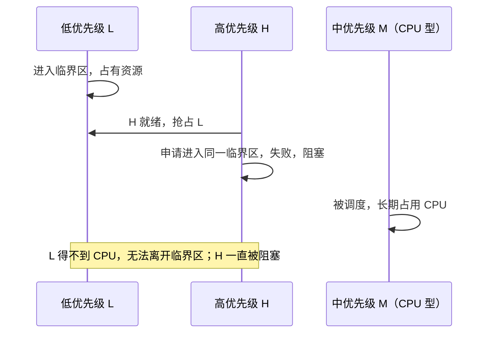

# 04 优先级调度与优先级反转

[本讲目录](../index.md) · [课程目录](../../index.md) · [上一节：03 混合负载场景分析](03-mixed-workload-scenario-analysis.md) · [下一节：05 多级队列与多级反馈队列](05-multilevel-queue-and-multilevel-feedback-queue.md)

> [!abstract] 本节要点
> - 最高优先级调度：每次选就绪进程中优先级最高的运行。一般原则是系统进程高于用户进程、前台高于后台、偏好 I/O 型进程。
> - 优先级可以静态也可以动态。动态时 PCB 中可同时有“基本优先级”和“调整后优先级”两个字段；就绪队列可以按优先级插队，也可以每个优先级一个队列。
> - 算法实现简单，但不公平，低优先级进程可能饥饿。
> - 优先级反转发生在基于优先级的抢占式调度下：低优先级进程 L 持有高优先级进程 H 需要的资源，CPU 型的中优先级进程 M 一直运行，L 放不掉资源，H 也就无法运行。
> - 三种解决方案：优先级天花板协议和优先级继承都是临时提升 L 的优先级；第三种是在临界区内禁止中断，让 L 不被打断。

## 最高优先级调度（Highest Priority First）

FCFS 只看到达顺序，SJF 只看运行时间，都不能直接表达“这个进程比那个更要紧”。**最高优先级调度算法**给每个进程一个**优先级**（priority）指标，每次调度都从就绪进程中选优先级最高的投入运行。[^s1p49]

**优先级与优先数**：有的系统用整数**优先数**表示优先级。优先数大的优先级高还是优先数小的优先级高，由具体系统规定，换算一下即可。

### 优先级如何确定

各系统设定优先级时一般遵循三条原则：[^s1p49]

1. **系统进程高于用户进程**：系统进程的优先级一般设得很高，用户进程在它之下。[Windows 线程调度](07-windows-thread-scheduling.md)中，16–31 级实时优先级全部给系统线程，就体现了这一点。
2. **前台进程高于后台进程**：前台进程直接影响用户体验，后台进程的优先级较低。
3. **偏好 I/O 型进程**：I/O 型进程在 CPU 上停留很短就去做 I/O，优先让它运行，可以使 CPU 和外设同时保持忙碌。

### 静态优先级与动态优先级

- **静态优先级**：进程创建时确定，运行期间不变。
- **动态优先级**：运行期间可以调整。这时一个实际系统的 PCB 里可能有两个字段，一个记录**基本优先级**，一个记录**调整后的优先级**（当前优先级）。[^s3b5]

### 就绪队列的组织

高优先级进程就绪时排在哪里，有两种做法：

1. **单队列插队**：只有一个就绪队列，按优先级有序，新就绪的进程按自己的优先级插到合适位置，调度时取队首。
2. **多队列**：每个优先级（或优先级段）一个就绪队列，进程进入与自己优先级匹配的队列，调度时从最高优先级的非空队列中取。

这两种组织方式在 L06「06 调度算法设计要点」中已经出现过。后面的 Windows 线程调度用的是第二种；多级反馈队列虽然也有多个队列，但进程一律先进第一级再按行为降级。

### 优缺点

最高优先级调度思路清楚、实现简单，但**不公平**：只要不断有高优先级进程到达，低优先级进程就一直轮不到，产生**饥饿**（starvation）。饥饿的定义见 [批处理系统的调度算法](01-batch-scheduling-algorithms.md)。[^s1p49]

> [!warning] 易错点
> “优先级高的一定先运行”只在**抢占式**调度下随时成立。非抢占式的最高优先级调度只在当前进程主动让出 CPU 时才重新选择，高优先级进程就绪后仍要等当前进程让出。下面的优先级反转问题也以抢占式为前提。

## 优先级反转（Priority Inversion）

按优先级调度的本意是“高的先跑”。但当进程之间共享资源时，高优先级进程可能被一个低优先级进程拖住，这与优先级调度的初衷相反。

**优先级反转**（又称优先级反置、翻转、倒挂）指：一个低优先级进程持有一个高优先级进程所需要的资源，使得高优先级进程只能等待低优先级进程运行。[^s1p50] 它的前提是**基于优先级的抢占式调度**：只要有更高优先级的进程就绪，就抢占当前进程。[^s3b6]

### 典型场景

设 H 是高优先级进程，L 是低优先级进程，M 是中优先级进程，并且 M 是 CPU 型的。H 和 L 都要执行同一段**临界区**代码，也就是操作同一共享资源的代码段（临界区的概念在“计算机系统导论”课程中学过）。过程如下：[^s1p50]

1. **L 进入临界区**：L 正在运行，进入临界区，占有了共享资源。
2. **L 被抢占**：L 还没执行完临界区就有更高优先级的进程就绪。由于是抢占式调度，L 被换下 CPU，但仍然“停在”临界区里，资源没有释放。
3. **H 被阻塞**：H 上 CPU 后也要进入同一临界区，因为资源被 L 占着而失败，只能阻塞，等待 L 让出临界区。
4. **M 长期运行**：H 阻塞后，就绪进程中优先级最高的是 M。M 是 CPU 型的，会一直占用 CPU。
5. **结果**：L 的优先级比 M 低，得不到 CPU，无法走完临界区；L 不释放资源，H 就无法继续。于是 H 实际上被优先级比自己低的 M 无限期推迟。

第 5 步的含义是：H 等待的时间不再只是 L 走完临界区那一小段，而是被一个与该资源无关的中优先级进程决定，可能无限长。

> [!warning] 易错点
> 优先级反转的关键不是“H 等了 L 一会儿”。H 短暂等待 L 走完临界区是使用互斥资源必然要付出的代价。真正的问题出在 M：M 与资源无关，却因为优先级高于 L 而间接阻挡了 H。没有 M 这样的中优先级进程插进来，L 很快就会释放资源。

### 影响

- **系统错误**：在实时系统中，高优先级任务错过时限会被当作故障。出现优先级反转时系统必须干预，不能任其发展。[^s3b6]
- **性能下降**：高优先级进程停滞不前，系统整体性能下降。[^s1p52]

### 案例：火星探路者（Mars Pathfinder）

火星探路者探测器上运行的是实时操作系统 **VxWorks**，采用基于优先级的抢占式调度，正好符合上述场景。探测器上的三类任务是：[^s1p51]

> [!info] 可视化资源
> - [What really happened on Mars?（Mike Jones 记录，康奈尔 CS614 课程页）](https://www.cs.cornell.edu/courses/cs614/1999sp/papers/pathfinder.html)：一手讲述：低优先级气象任务持锁、中优先级通信任务抢占、看门狗复位，以及远程打开优先级继承修复的过程。

| 优先级 | 任务 | 特点 |
| --- | --- | --- |
| 高 | 数据传输（data transfer） | 需要使用共享的总线 |
| 中 | 通信（communications） | 耗费大量 CPU 时间，不使用该总线 |
| 低 | 气象测量（meteorology） | 也使用该总线 |

低优先级的测量任务占着总线时被抢占，高优先级的数据传输任务申请总线而阻塞，中优先级的通信任务长时间占用 CPU。地面人员发现探测器上的系统频繁重启。原因是：系统本来提供优先级继承的选项，但这个开关被工程师关掉了。系统检测到高优先级任务长时间无法完成，判定为异常，于是重新启动。[^s3b6]

> [!note] 补充解释
> 这件事发生在 1997 年。共享资源是保护信息总线的互斥量，看门狗定时器发现总线调度任务没有按时完成，就触发了系统复位。工程师在地面复现问题后，通过远程上传修改，为该互斥量打开了优先级继承，问题随之解决。详细经过见上方可视化资源中的 What really happened on Mars?。

## 优先级反转的解决方案

反转之所以会持续，是因为 L 拿不到 CPU、走不完临界区。所以三种方案都围绕同一个目标：让 L 尽快走完临界区、释放资源。[^s1p52]

> [!info] 可视化资源
> - [维基百科：Priority inversion](https://en.wikipedia.org/wiki/Priority_inversion)：看示意图与 Solutions 一节：禁止中断、优先级天花板、优先级继承各自的做法与适用场合。

### 优先级天花板协议（Priority Ceiling Protocol）

**优先级天花板协议**又称设置优先级上限。它的名字听起来复杂，核心做法很简单：把进入临界区的低优先级进程 L 的优先级调到“天花板”，也就是最高。这样 L 比其他进程都高，能马上上 CPU、走完临界区；出了临界区后，再把它的优先级调回原值。[^s3b6]

> [!note] 补充解释
> 更精确的定义是：给每个共享资源规定一个**优先级上限**（ceiling），等于所有可能使用该资源的进程中最高的优先级。进程占有该资源期间，它的优先级被提升到这个上限，释放资源后恢复。这样 L 在临界区内不会被 M 这类优先级低于上限的进程抢占。

### 优先级继承（Priority Inheritance）

**优先级继承**：当 H 因为 L 持有的资源而被阻塞时，H 把自己的优先级“借”给 L，L 临时以与 H 相同的优先级运行。此时 M 的优先级低于 L，抢不走 CPU，L 走完临界区、释放资源后恢复原优先级，H 随即获得资源并运行。[^s3b6]

天花板协议和优先级继承思路相同，都是**临时改变 L 的优先级**。区别在于提升的时机和幅度：

| 方案 | 何时提升 L | 提升到多高 | 何时恢复 |
| --- | --- | --- | --- |
| 优先级天花板协议 | L 进入临界区（占有资源）时，不等出现阻塞 | 最高（资源的优先级上限） | L 出临界区 |
| 优先级继承 | H 因 L 持有的资源被阻塞时，即真正发生反转时 | 与被阻塞的 H 相同 | L 释放资源 |

### 使用中断禁止

第三种思路不改优先级，而是让 L 在临界区内**不可被打断**。L 之所以在临界区中途被换下，是因为有中断（例如时钟中断，或者唤醒 H 的 I/O 中断）把系统带进内核，出内核前的调度发现了更高优先级的就绪进程。如果 L 在进入临界区时关中断、离开时再开中断，那么 L 在临界区内不会被抢占，一定能把临界区执行完；出了临界区后，谁都可以抢占它，这时 H 再进入临界区就不会受阻。[^s3b6]

> [!note] 补充解释
> 关中断只在单处理器上能保证“不被打断”，而且关中断是特权操作，只能在内核态短时间使用。临界区一长，系统对外部事件的响应就会变慢。多处理器上关掉本 CPU 的中断，并不能阻止其他 CPU 上的进程访问同一资源。

> [!example] 例：用优先级继承消除反转
> 单处理器，H、M、L 的优先级依次降低，H 和 L 共用一把锁。时刻 0 L 运行并加锁；时刻 1 H 就绪；时刻 2 M 就绪。L 的临界区还剩 3 个时间单位，H 拿到锁后还需运行 1 个单位，M 需要运行 100 个单位。比较有无优先级继承时 H 何时完成（忽略切换开销）。
>
> 1. 时刻 1：H 抢占 L，申请锁失败，阻塞。
> 2. **无优先级继承**：就绪进程只有 L，L 继续运行。时刻 2 M 就绪，M 优先级高于 L，抢占 L，一直运行到时刻 102。随后 L 运行剩下的 1 个单位，到 103 释放锁，H 被唤醒，运行到 104 完成。
> 3. **有优先级继承**：时刻 1 H 阻塞，L 继承 H 的优先级。时刻 2 M 就绪，但 M 低于 L 当前的优先级，不能抢占。L 在时刻 3 释放锁并恢复低优先级，H 运行到时刻 4 完成，之后 M 才开始运行。
> 4. 因此有继承时 H 在时刻 4 完成，没有继承时要到时刻 104。

> [!question]- 自测：同样是 H 和 L 共用一个临界区，但系统里没有中优先级进程 M。这时还会发生持续的优先级反转吗？
> 不会持续。H 阻塞后，就绪进程里只有 L（或者优先级更低的进程），L 很快能上 CPU 走完临界区，H 只等待这一小段时间。反转持续不退的根源是 M 这类与资源无关、优先级又介于两者之间的进程长期占用 CPU。

> [!question]- 自测：某进程在用户态执行一个很长的临界区，有人建议用“关中断”避免优先级反转。这个方案有什么问题？
> 关中断是特权操作，用户态进程不能执行。即使在内核中，长时间关中断也会使时钟中断和 I/O 中断得不到响应，损害系统的响应性；在多处理器上还不能阻止其他 CPU 进入临界区。这时更适合用优先级继承或天花板协议。

> [!info]- 来源
> - slides04.pdf：PDF p.49–52
> - L07.docx：DOCX body 97–154

[^s1p49]: slides04.pdf-PDF p.49
[^s3b5]: L07.docx-DOCX body 97-124
[^s1p50]: slides04.pdf-PDF p.50
[^s3b6]: L07.docx-DOCX body 125-154
[^s1p52]: slides04.pdf-PDF p.52
[^s1p51]: slides04.pdf-PDF p.51

[本讲目录](../index.md) · [课程目录](../../index.md) · [上一节：03 混合负载场景分析](03-mixed-workload-scenario-analysis.md) · [下一节：05 多级队列与多级反馈队列](05-multilevel-queue-and-multilevel-feedback-queue.md)
