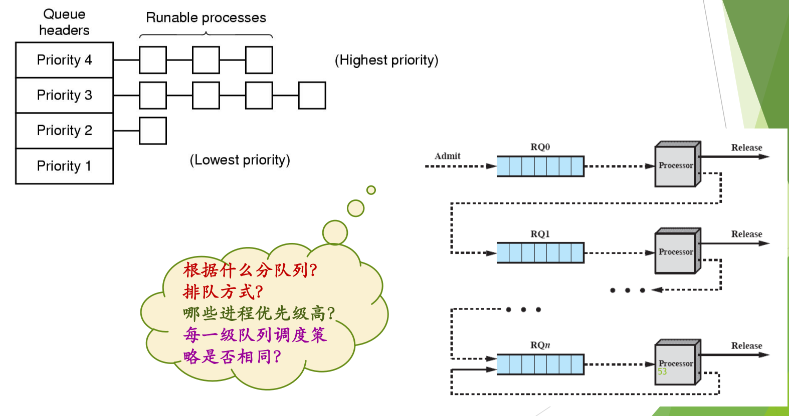
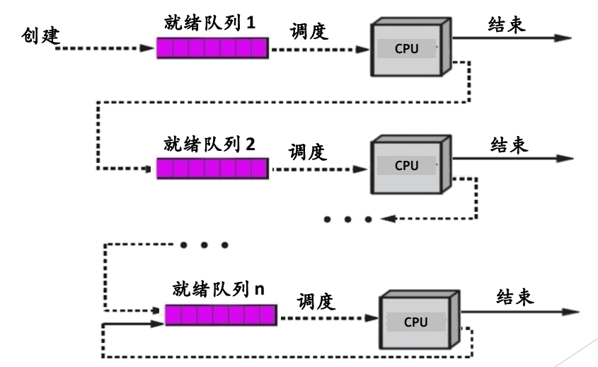
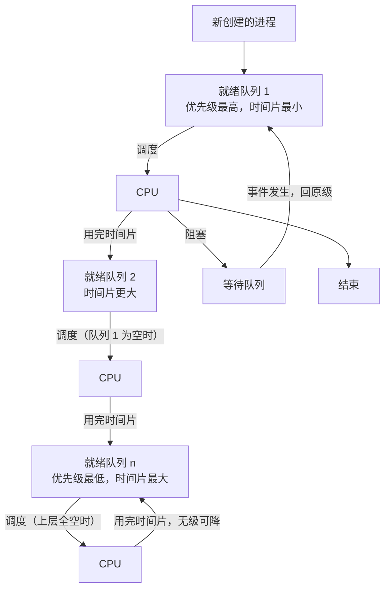

# 05 多级队列与多级反馈队列

[本讲目录](../index.md) · [课程目录](../../index.md) · [上一节：04 优先级调度与优先级反转](04-priority-scheduling-and-priority-inversion.md) · [下一节：06 算法比较与机制策略分离](06-other-algorithms-comparison-and-mechanism-policy.md)

> [!abstract] 本节要点
> - 多级队列把就绪进程分到多个队列，设计时要回答四个问题：按什么分队列、怎么排队、哪些队列优先级高、各级调度策略是否相同。
> - 多级反馈队列（MLFQ）由 Corbato 于 1962 年为 CTSS 提出，是综合考虑多种指标、折中权衡的调度算法，也是本课重点。
> - 固定的机制：多个就绪队列；第一级优先级最高、时间片最小，级别越低时间片越大；上级队列空了才调度下级；新进程进第一级；用完时间片降一级。
> - 可调的策略：阻塞后回到原级时排在队首还是队尾；再次上 CPU 时时间片用剩余的、给新的还是给奖励；被抢占的进程从公平角度应回原级队首，不宜升级。
> - MLFQ 偏好 I/O 型进程；CPU 型进程会逐渐沉到底层，可能饥饿，实际系统要另加补偿策略。

## 多级队列（Multilevel Queue）

单一就绪队列只能用一种排序标准。实际系统里既有系统进程也有用户进程，既有交互式也有批处理，把它们放进同一个队列、用同一种规则排，很难兼顾。**多级队列调度算法**把就绪进程分到多个队列中分别管理。这里的“级”不一定指优先级，不过实际系统最常见的做法是按优先级分。[^s3b6]

设计一个多级队列调度算法，需要回答四个问题：[^s1p53]

1. **根据什么分队列？** 例如按优先级、按进程类型（系统/交互/批处理）。
2. **排队方式？** 进程如何进入各个队列、如何在队列之间移动。
3. **哪些进程优先级高？** 队列之间按什么顺序调度。
4. **每一级队列的调度策略是否相同？** 例如上层用时间片轮转、下层用 FCFS，还是统一用一种。

对第 2 个问题，有两种典型的排队方式：[^s3b6]

- **按优先级直接进入对应队列**：每个队列对应一个优先级，进程就绪时进入与自己优先级匹配的队列。Windows 采用这种方式（见 [Windows 线程调度](07-windows-thread-scheduling.md)）。
- **先进第一级，再逐级下降**：各队列同样有高低之分，但进程一律先进入第一级，之后根据运行情况逐级降级。BSD 采用这种方式，下面的多级反馈队列就是它。

这两种方式的区别在于，第一种的队列位置由事先给定的优先级决定，第二种由进程运行时的行为“反馈”决定。

图：左为按优先级组织的多级就绪队列（Priority 4 最高到 Priority 1 最低），右为 RQ0 到 RQn 的反馈队列结构，进程从 RQ0 进入、未完成则降入下一级；气泡列出设计多级队列要回答的问题。

## 多级反馈队列（Multilevel Feedback Queue）

前面的算法各自只盯一个指标：FCFS 看到达顺序，SJF 看运行时间，RR 看公平和响应，最高优先级看优先级，因此各有明显缺陷。**多级反馈队列调度算法**（Multilevel Feedback Queues）的名字有两层含义：“多级”指它有多个就绪队列；“反馈”指进程在哪一级，由它过去的运行行为决定。它同时兼顾多种指标，是一个**综合调度算法**，核心是**折中权衡**（tradeoff）。[^s1p54]

> [!info] 可视化资源
> - [OSTEP 第 8 章 多级反馈队列（PDF）](https://pages.cs.wisc.edu/~remzi/OSTEP/cpu-sched-mlfq.pdf)：看图 8.1–8.6：交互式作业插入、防止钻空子的时间配额记账，以及低优先级队列用更长时间片。

- 1962 年由 **Corbato** 提出，用于 **CTSS**（Compatible Time-Sharing System，兼容分时系统）。[^s1p54]
- 课件记载 UNIX 的分支 BSD（加州大学伯克利分校开发和发布）在 5.3 版中采用了它。[^s1p54]

> [!note] 补充解释
> BSD 的正式版本序列是 4.2BSD、4.3BSD、4.4BSD，没有官方的“5.3BSD”。常见资料描述的是 4.3BSD 的调度器采用了多级反馈队列的思想（按 CPU 使用情况动态降低优先级）。课件中的“5.3 版”可能是版本号笔误。

> [!tip] 课堂强调
> 多级反馈队列是本课的重点，“非常希望大家学会”。它也是机制与策略分离的典型例子：机制定好之后，策略仍可以调整。[^s3b7]

机制与策略分离原则本身见 [算法比较与机制策略分离](06-other-algorithms-comparison-and-mechanism-policy.md)。下面按“机制”和“策略”两部分展开。

### 固定的机制

所谓**机制**，是固定下来的流程。多级反馈队列的机制如下：[^s1p55]

1. **多个就绪队列**：设置多个就绪队列，不管设几级，第一级队列的优先级最高，往下依次降低。
2. **时间片随级别增大**：不同队列中的进程分配长度不同的时间片。第一级时间片最小，队列优先级越低，时间片越大。
3. **按级别调度**：只有第一级队列为空时，才调度第二级队列的进程，以此类推。
4. **新进程进第一级**：新创建的进程就绪后进入第一级队列，以最高优先级尽快得到运行。
5. **用完时间片降一级**：进程用完了时间片而放弃 CPU，就进入下一级就绪队列。降到最底层后无级可降，就在最底层队列中轮转。
6. **阻塞后回原级**：进程因阻塞而放弃 CPU 时，进入相应的等待队列；等待的事件发生后，回到原来那一级就绪队列。

图：多级反馈队列模型——新进程“创建”后进入就绪队列 1，经“调度”上 CPU，未“结束”则沿虚线降入下一级，直至就绪队列 n 在本级循环。

图中的队列模型可以这样读：新创建的进程进入就绪队列 1；每一级队列被调度上 CPU 后，进程要么运行结束，要么用完时间片转入下一级队列，最后一级的进程用完时间片后仍回到本级。

这里只画了第一级的阻塞路径，其余各级相同：在哪一级阻塞，事件发生后就回到哪一级。

**“优先级低、时间片大”是一种平衡**：低级队列的进程被调度的机会少，但一旦上了 CPU，就能连续运行较长时间，用老话说就是“打一巴掌给个枣”。对 CPU 型进程来说，时间片大还意味着切换次数少、开销小。[^s3b7]

**“阻塞后回原级”体现了对 I/O 型进程的偏好**：I/O 型进程往往用不完时间片就去做 I/O（例如调用 `read` 这类阻塞系统调用，等磁盘中断到来才重新就绪），所以它不会降级，一直留在较高的队列里；CPU 型进程总是用完时间片，会被逐级降到底层。进程在哪一级，就是根据它的行为“反馈”出来的。[^s3b7]

> [!warning] 易错点
> 课件说“各级队列按照时间片轮转方式进行调度”，这个说法不够准确：在普通的时间片轮转中，用完时间片的进程回到**同一队列**队尾；在多级反馈队列中，用完时间片的进程**降到下一级**。只有最底层队列无级可降，才真正是在本级轮转。[^s3b7]

### 可调的策略

机制中标了问号的几处就是留给策略的选择点：机制固定后，不同系统可以在这些点上做不同选择。[^s1p55]

**讨论 1：阻塞的进程回到原级时，排在队首还是队尾？**（非抢占的情形）

- **回队首**：进程是因为自身 I/O 主动让出 CPU 的，回来时优先运行，更偏好 I/O 型进程。
- **回队尾**：进程只是没用完时间片就去做 I/O，回来时已经不用降级，比用完时间片要降级的进程已经得到了优惠，排在队尾也说得过去。
- **插到队列中间**：一般不选，因为很难说清该按什么原则插、插在哪里合适。

两种主要选择都有道理，取决于系统想多大程度地偏好 I/O 型进程。[^s3b7]

**讨论 2：再次被调度上 CPU 时，时间片怎么处理？**

进程上次没用完时间片就阻塞了，回到队列后再次被调度上 CPU，可以有三种处理：[^s3b7]

1. 接着用上次**剩余的时间片**；
2. 给一个**新的完整时间片**；
3. 在时间片上给予某种**奖励**（例如比本级的标准时间片更长）。

**讨论 3：若允许抢占，被抢占的进程回到哪里？**

允许抢占时，有更高优先级的进程就绪（例如上级队列来了新进程），可以抢占 CPU。默认规则是：被抢占的进程回到原来一级就绪队列的**末尾**，但这一点同样标了“（或者？）”，留作策略选择。[^s1p56]

- **不能降级**：被抢占是外部原因，进程并没有用完时间片，降级显然不对。
- **回原级队首更合适**：进程刚上 CPU 不久就被抢下来，再排到队尾就不太公平。从公平角度看，回到原级队首更合适，[Windows 线程调度](07-windows-thread-scheduling.md)中 Windows 就是这样做的。
- **升到第一级不合适**：这样会过度偏好这个进程，除非能给出充分的理由。[^s3b7]

### 优缺点

- **优点**：综合了多种思想。新进程和短进程在第一级就能完成，接近短作业优先；I/O 型进程停留在高级队列，响应快；CPU 型进程在低级队列获得大时间片，切换开销小。而且不需要事先知道进程的运行时间，靠运行行为反馈自动分级。
- **缺点**：会产生**饥饿**。CPU 型进程逐渐沉到最底层，越往下被调度的机会越少；只要上层队列不断有新进程创建，底层进程就可能长期得不到 CPU。实际系统（Windows、Linux）都另有策略补偿这些饥饿进程，例如在 Windows 中由平衡集管理器提升长期得不到调度的线程，见 [Windows 线程调度](07-windows-thread-scheduling.md)。[^s3b7]

> [!example] 例：进程在三级队列中的轨迹
> 三级反馈队列，第 1、2、3 级时间片分别为 1 ms、2 ms、4 ms，非抢占式，不考虑其他进程的干扰。CPU 型进程 A 需要 CPU 共 9 ms；I/O 型进程 B 每次只用 0.5 ms CPU 就发起 I/O。
>
> 1. A 新创建进入第 1 级，运行 1 ms 用完时间片，降到第 2 级，剩余 8 ms。
> 2. A 在第 2 级运行 2 ms 用完时间片，降到第 3 级，剩余 6 ms。
> 3. A 在第 3 级运行 4 ms，剩余 2 ms。最底层无级可降，回到第 3 级排队。
> 4. A 再次在第 3 级被调度，运行 2 ms 后结束。
> 5. B 每次只用 0.5 ms 就阻塞，从来用不完 1 ms 的时间片，I/O 完成后回到原级，所以始终在第 1 级，每次就绪都会优先于 A 得到调度。

> [!question]- 自测：某多级反馈队列允许抢占，被抢占的进程规定“升到第一级队首”。这条策略有什么问题？
> 被抢占本身并不说明进程是 I/O 型。这条规则会让本应在低级队列的 CPU 型进程只因被抢占一次就回到最高级，对它偏好过度，挤占真正需要快速响应的新进程和 I/O 型进程，这违背了按运行行为分级的初衷。按公平原则，回到原级队首就足够了。

> [!question]- 自测：系统中持续有大量短小的交互式进程被创建，同时有一个长时间运行的科学计算进程。在多级反馈队列下，计算进程会怎样？该如何改进？
> 计算进程很快就降到最底层。只要上层队列一直不空，它就几乎得不到 CPU，发生饥饿。改进方法是增加补偿策略，例如定期把长时间没被调度的进程提升到较高队列，或者给它更大的时间配额；Windows 的平衡集管理器就是这样做的。

> [!question]- 自测：多级反馈队列为什么不需要像 SJF 那样预先知道进程的运行时间，却仍能让短进程先完成？
> 所有新进程都先进入优先级最高、时间片最短的第一级。短进程在第一级或前几级的小时间片内就运行完了；长进程因为反复用完时间片而逐级下降。运行时间的长短是通过“用没用完时间片”这个反馈自动暴露出来的，不需要用户事先估计。

> [!info]- 来源
> - slides04.pdf：PDF p.53–56
> - L07.docx：DOCX body 125–178

[^s3b6]: L07.docx-DOCX body 125-154
[^s1p53]: slides04.pdf-PDF p.53
[^s1p54]: slides04.pdf-PDF p.54
[^s3b7]: L07.docx-DOCX body 155-178
[^s1p55]: slides04.pdf-PDF p.55
[^s1p56]: slides04.pdf-PDF p.56

[本讲目录](../index.md) · [课程目录](../../index.md) · [上一节：04 优先级调度与优先级反转](04-priority-scheduling-and-priority-inversion.md) · [下一节：06 算法比较与机制策略分离](06-other-algorithms-comparison-and-mechanism-policy.md)
