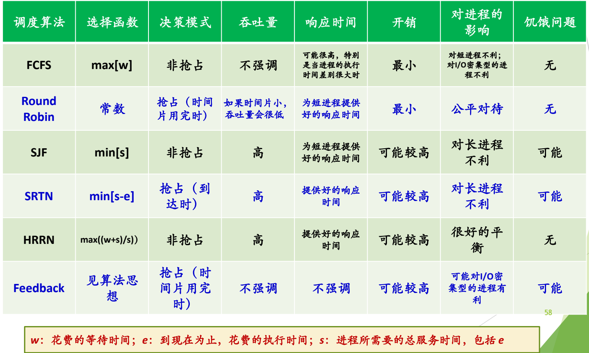
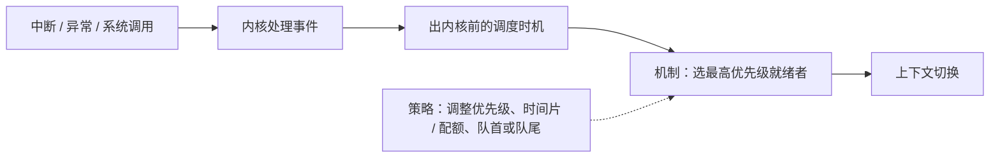
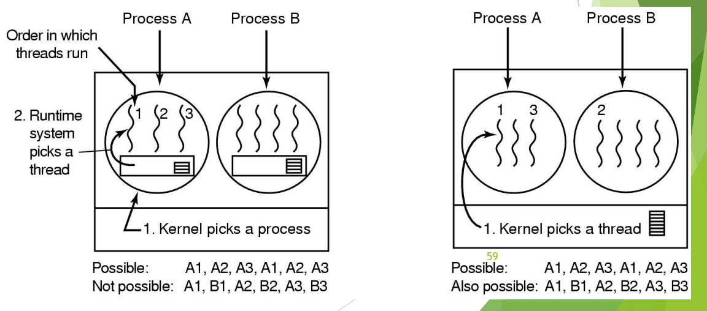

# 06 算法比较与机制策略分离

[本讲目录](../index.md) · [课程目录](../../index.md) · [上一节：05 多级队列与多级反馈队列](05-multilevel-queue-and-multilevel-feedback-queue.md) · [下一节：07 Windows 线程调度](07-windows-thread-scheduling.md)

> [!abstract] 本节要点
> - 交互式系统还有公平共享调度、保证调度和彩票调度；彩票调度按持票比例概率地分配 CPU，票可转让，公平共享的思想后来体现在 Linux 的完全公平调度 CFS 中。
> - 比较各算法要同时看选择函数、决策模式、吞吐量、响应时间、开销、对各类进程的影响和饥饿；用 $w,e,s$ 表示，SJF 选 $\min[s]$，SRTN 选 $\min[s-e]$，HRRN 选 $\max\frac{w+s}{s}$。
> - 机制与策略分离：内核固定“在调度时机按优先级选人、做上下文切换”的机制，用优先级调整、时间片/配额调整等策略适配不同负载。
> - 用户级线程由内核按进程调度，一个进程的时间片内只能轮流运行其自身线程（A1,B1,A2,B2 不可能）；内核级线程由内核按线程调度，两种顺序都可能。
> - 典型系统：UNIX 动态优先数、5.3BSD 多级反馈队列、Windows 基于优先级的抢占式多任务、Linux 抢占式、Solaris 综合调度。

## 交互式系统的其他调度算法

前面几种算法都只关心“选哪个进程”，没有直接回答“每个进程或用户最终应得到多少 CPU”。以下三种算法从“份额”角度设计调度，它们是交互式系统中采用的其他算法，可以按原理、优缺点、策略和适用场景自行总结。[^s1p57]

> [!info] 可视化资源
> - [OSTEP 第 9 章 比例份额调度（PDF）](https://pages.cs.wisc.edu/~remzi/OSTEP/cpu-sched-lottery.pdf)：看图 9.1 彩票调度决策代码、图 9.2 公平性实验，以及 9.7 节 CFS 的引入。

- **彩票调度**（Lottery scheduling）：创建进程时发给它若干张彩票，每次调度时随机抽一张，持有中奖彩票的进程上 CPU。这是一种概率调度：持票越多，被调度的机会越大。彩票还可以转让——想让某个进程尽快运行，就把别的进程的彩票都交给它。[^s3b8]
- **公平共享调度**（Fair-share scheduling）：这一思想后来发展为 Linux 选用的**完全公平调度**（CFS），将在 L08「06 CFS 完全公平调度」中详细讲解。[^s3b8]
- **保证调度**（Guaranteed scheduling）：课件只列出名称。

> [!note] 补充解释
> 按经典教材（Tanenbaum《现代操作系统》）的定义：**保证调度**向用户做出明确的性能承诺，例如系统中有 $n$ 个进程时，每个进程应得到 $\frac{1}{n}$ 的 CPU 时间。系统记录每个进程实际得到的 CPU 时间，并计算“实际所得 / 应得”的比值，每次选比值最小的进程运行，直到它超过其他进程。**公平共享调度**把“公平”的单位从进程换成用户（或用户组）：若用户 1 有 9 个进程、用户 2 只有 1 个进程，按进程轮转用户 1 会得到 90% 的 CPU；公平共享则先在用户之间平分 CPU，再在每个用户内部分配。

> [!example] 例：彩票调度的份额
> 进程 A 持 30 张票，B 持 15 张，C 持 5 张，共 50 张。
>
> 1. 每次抽签 A 中签的概率为 $\frac{30}{50}=60\%$，B 为 $30\%$，C 为 $10\%$。
> 2. 运行足够多次后，三者获得的 CPU 份额趋近 $6:3:1$。
> 3. 若 B 把自己的 15 张票全部转让给 A（例如 B 等待 A 的服务结果），A 的概率升为 $\frac{45}{50}=90\%$，B 在持票为零期间不会被调度。

## 调度算法的比较

这张比较表的每一列正是前面逐个讨论算法时考虑的因素：有没有饥饿、对哪类进程（I/O 型、CPU 型、长进程、短进程）有利、开销高低、响应时间与吞吐量。[^s3b8] 表中符号：$w$ 为已花费的等待时间，$e$ 为到目前为止已花费的执行时间，$s$ 为进程所需的总服务时间（包括 $e$）。[^s1p58]

| 调度算法 | 选择函数 | 决策模式 | 吞吐量 | 响应时间 | 开销 | 对进程的影响 | 饥饿 |
|---|---|---|---|---|---|---|---|
| FCFS | $\max[w]$ | 非抢占 | 不强调 | 可能很高，特别是进程执行时间差别很大时 | 最小 | 对短进程不利；对 I/O 密集型进程不利 | 无 |
| RR | 常数 | 抢占（时间片用完时） | 时间片小时吞吐量会很低 | 为短进程提供好的响应时间 | 最小 | 公平对待 | 无 |
| SJF | $\min[s]$ | 非抢占 | 高 | 为短进程提供好的响应时间 | 可能较高 | 对长进程不利 | 可能 |
| SRTN | $\min[s-e]$ | 抢占（新进程到达时） | 高 | 提供好的响应时间 | 可能较高 | 对长进程不利 | 可能 |
| HRRN | $\max\left(\frac{w+s}{s}\right)$ | 非抢占 | 高 | 提供好的响应时间 | 可能较高 | 很好的平衡 | 无 |
| Feedback（多级反馈） | 见算法思想 | 抢占（时间片用完时） | 不强调 | 不强调 | 可能较高 | 可能对 I/O 密集型进程有利 | 可能 |



图：FCFS、Round Robin、SJF、SRTN、HRRN、Feedback 在选择函数、决策模式、吞吐量、响应时间、开销、对进程的影响和饥饿问题上的对比，其中 $w$ 为等待时间、$e$ 为已执行时间、$s$ 为总服务时间。

读表时把选择函数和前面各节联系起来：

1. **FCFS** 选 $w$ 最大者，即最早到达者；见[批处理系统的调度算法](01-batch-scheduling-algorithms.md)。
2. **SJF / SRTN** 分别选总服务时间 $s$ 最小、剩余时间 $s-e$ 最小者，都需要预知 $s$，长进程可能饥饿。
3. **HRRN** 的 $\frac{w+s}{s}=1+\frac{w}{s}$ 就是响应比：$s$ 小则偏向短作业，$w$ 增大则长作业的响应比也会上升，所以无饥饿。
4. **RR** 选择函数为“常数”，即不比较进程属性，只按队列轮流；见[时间片轮转与虚拟轮转](02-round-robin-and-virtual-round-robin.md)。
5. **Feedback** 按所在级别和时间片使用情况决定；见[多级队列与多级反馈队列](05-multilevel-queue-and-multilevel-feedback-queue.md)。

> [!warning] 易错点
> 表中 RR 的“开销：最小”指**调度决策本身**的开销——选下一个进程不需要计算任何指标；它并不否认 RR 时间片过小时上下文切换开销很大（那一点体现在“吞吐量会很低”这一格）。同理，SJF、SRTN、HRRN、Feedback 的“可能较高”来自需要估计运行时间、反复计算响应比或维护多级队列。

## 机制与策略分离

调度框架需要长期稳定，而不同应用场景对“偏好谁”的要求各不相同；如果把两者写死在一起，每换一种场景就得改内核调度代码。**机制与策略分离**（separation of mechanism and policy）是一条历史悠久的原则（a long-established principle）：机制回答“怎么做”，策略回答“做什么、偏向谁”。[^s1p59]

在调度中，这条原则的具体分工是：

1. **机制（固定）**：进程通过中断、异常或系统调用进入内核；处理完事件、返回用户态前是统一的调度时机；在该时机从就绪队列中选出优先级最高者，必要时做上下文切换。基于优先级的抢占正是这样一套机制。
2. **策略（可调）**：为了得到更好的结果，在不改机制的前提下调整参数，例如调整优先级（优先级继承、优先级提升）、调整时间片或时间配额的大小、决定进程回到队首还是队尾。[^s3b8]

调度时机本身的理由见 L06「03 调度时机」，该原则在中断处理中的体现见 L03「08 低层步骤与机制策略」。本讲的多级反馈队列（机制固定、队首/队尾与时间片处理可调）和下一节的 Windows 线程调度（“机制已确定”，只讨论三种场景下的策略）都是这一原则的实例。



### 上下文切换的代码：xv6 的 swtch

> [!info] 依据讲义整理
> 本小节对应课件 p14，课上只提到“上下文切换要看代码，代码很短，用汇编写”，未逐行讲解。

上下文切换是调度机制中最底层、最固定的一步。xv6（RISC-V 版）在 `kernel/swtch.S` 中实现，函数原型为 `void swtch(struct context *old, struct context *new);`：把当前寄存器保存到 `old`，再从 `new` 装入。按调用约定，寄存器 `a0` 存放第一个参数（指向 old 进程上下文的指针），`a1` 存放第二个参数（指向 new 进程上下文的指针）。[^s1p14]

```asm
# Context switch
#
#   void swtch(struct context *old, struct context *new);
#
# Save current registers in old. Load from new.

.globl swtch
swtch:
        sd ra, 0(a0)
        sd sp, 8(a0)
        sd s0, 16(a0)
        sd s1, 24(a0)
        sd s2, 32(a0)
        sd s3, 40(a0)
        sd s4, 48(a0)
        sd s5, 56(a0)
        sd s6, 64(a0)
        sd s7, 72(a0)
        sd s8, 80(a0)
        sd s9, 88(a0)
        sd s10, 96(a0)
        sd s11, 104(a0)

        ld ra, 0(a1)
        ld sp, 8(a1)
        ld s0, 16(a1)
        ld s1, 24(a1)
        ld s2, 32(a1)
        ld s3, 40(a1)
        ld s4, 48(a1)
        ld s5, 56(a1)
        ld s6, 64(a1)
        ld s7, 72(a1)
        ld s8, 80(a1)
        ld s9, 88(a1)
        ld s10, 96(a1)
        ld s11, 104(a1)

        ret
```

执行过程分三步：

1. **保存旧上下文**：`sd`（store doubleword）把 14 个 64 位寄存器依次写入 `old` 指向的 `struct context`，每个占 8 字节，偏移 0 到 104。
2. **装入新上下文**：`ld`（load doubleword）按相同偏移从 `new` 读回这 14 个寄存器。
3. **返回**：`ret` 跳转到 `ra` 中的地址。由于 `ra` 和 `sp` 已经换成新进程保存的值，`ret` 回到的是**新进程**当初调用 `swtch` 的地方，并使用新进程的内核栈——切换就此完成。

> [!note] 补充解释
> `ra` 是返回地址寄存器，`sp` 是栈指针，`s0`–`s11` 是 RISC-V 调用约定中的**被调用者保存寄存器**（callee-saved）。`swtch` 是被 C 代码当作普通函数调用的，调用者保存寄存器（如 `t0`–`t6`、`a0`–`a7`）按约定已由调用方编译器负责保存在栈上，因此 `swtch` 只需保存 ra、sp 和 s0–s11。程序计数器不必单独保存：`ra` 已经记录了“回来后从哪里继续”。

## 线程调度

调度算法本身并不区分进程与线程：都是“排一个队，选一个上 CPU”。在既支持进程又支持线程、且线程是 CPU 调度单位的系统中，前面所有算法都直接适用；区别在于线程由谁调度。[^s3b8]

- **用户级线程**（user-level threads）：内核只看得见进程。① 内核先选中一个进程；② 该进程内的运行时系统（runtime system）再选它的某个线程。在进程 A 的时间片内只能轮流运行 A 的线程，所以 A1, A2, A3, A1, A2, A3 是可能的，A1, B1, A2, B2, A3, B3 不可能。
- **内核级线程**（kernel-level threads）：内核直接以线程为单位选择，不必管线程属于哪个进程，因此 A1, A2, A3, A1, A2, A3 和 A1, B1, A2, B2, A3, B3 都可能。[^s1p59]



图：左为用户级线程——内核先选进程、运行时系统再选线程，只可能出现 A1, A2, A3 这类序列；右为内核级线程——内核直接选线程，A1, B1, A2, B2, A3, B3 也可能出现。

图中左半部分是用户级线程（Kernel picks a process，再由 Runtime system picks a thread），右半部分是内核级线程（Kernel picks a thread）。线程模型本身见 L05「06 线程的实现模型」。

## 典型系统的调度算法

各系统的命名反映了它组合了哪些要素：[^s1p60]

- **UNIX**：动态优先数法。
- **5.3BSD**：多级反馈队列法（[多级队列与多级反馈队列](05-multilevel-queue-and-multilevel-feedback-queue.md)）。
- **Windows**：基于优先级的抢占式多任务调度，见[Windows 线程调度](07-windows-thread-scheduling.md)。
- **Linux**：抢占式调度，见 L08「04 Linux 2.4 与 O(1) 调度器」至「06 CFS 完全公平调度」。
- **Solaris**：综合调度算法。

> [!question]- 自测：某系统采用用户级线程，进程 A 有线程 A1、A2，进程 B 有线程 B1、B2。观察到的 CPU 执行序列为 A1, B1, A2, B2，这可能吗？若改为内核级线程呢？
> 用户级线程下不可能（课件图中的 Not possible 情形）：内核只按进程分配 CPU，进程 A 占有 CPU 期间，只由 A 的运行时系统在 A 的线程之间切换，内核看不见也不会去挑 B1，因此不会出现按线程交替的序列。内核级线程下可能：内核直接以线程为单位挑选，可以在 A、B 的线程之间任意交替。

> [!question]- 自测：比较表中哪些算法可能产生饥饿？HRRN 和 SJF 都偏向短作业，为什么 HRRN 没有饥饿？
> SJF、SRTN 和多级反馈队列可能产生饥饿。HRRN 的选择函数是 $1+\frac{w}{s}$：长作业的 $s$ 大，但等待时间 $w$ 持续增大，响应比会无限上升，最终一定超过新来的短作业而被选中；SJF 只看 $s$，源源不断的短作业可以一直排在长作业前面。

> [!question]- 自测：“优先级抢占”和“优先级继承”，哪个是机制、哪个是策略？为什么这样划分有用？
> 优先级抢占是机制：在调度时机总是让最高优先级就绪者上 CPU，这部分代码固定。优先级继承是策略：在出现优先级反转时临时修改某个进程的优先级，抢占机制本身一行不改就能得到不同的调度结果。这样划分后，适配新场景只需调整策略参数，不必改动调度框架。

> [!info]- 来源
> - slides04.pdf：PDF p.14, 57–60
> - L07.docx：DOCX body 179–207

[^s1p57]: slides04.pdf-PDF p.57
[^s3b8]: L07.docx-DOCX body 179-207
[^s1p58]: slides04.pdf-PDF p.58
[^s1p59]: slides04.pdf-PDF p.59
[^s1p14]: slides04.pdf-PDF p.14
[^s1p60]: slides04.pdf-PDF p.60

[本讲目录](../index.md) · [课程目录](../../index.md) · [上一节：05 多级队列与多级反馈队列](05-multilevel-queue-and-multilevel-feedback-queue.md) · [下一节：07 Windows 线程调度](07-windows-thread-scheduling.md)
