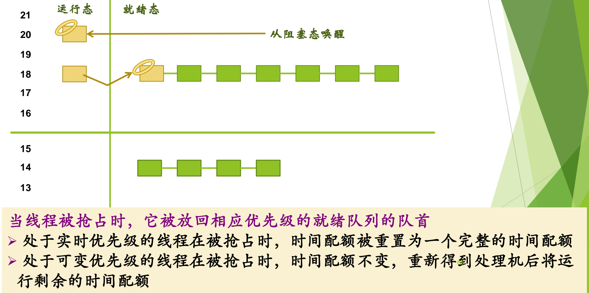
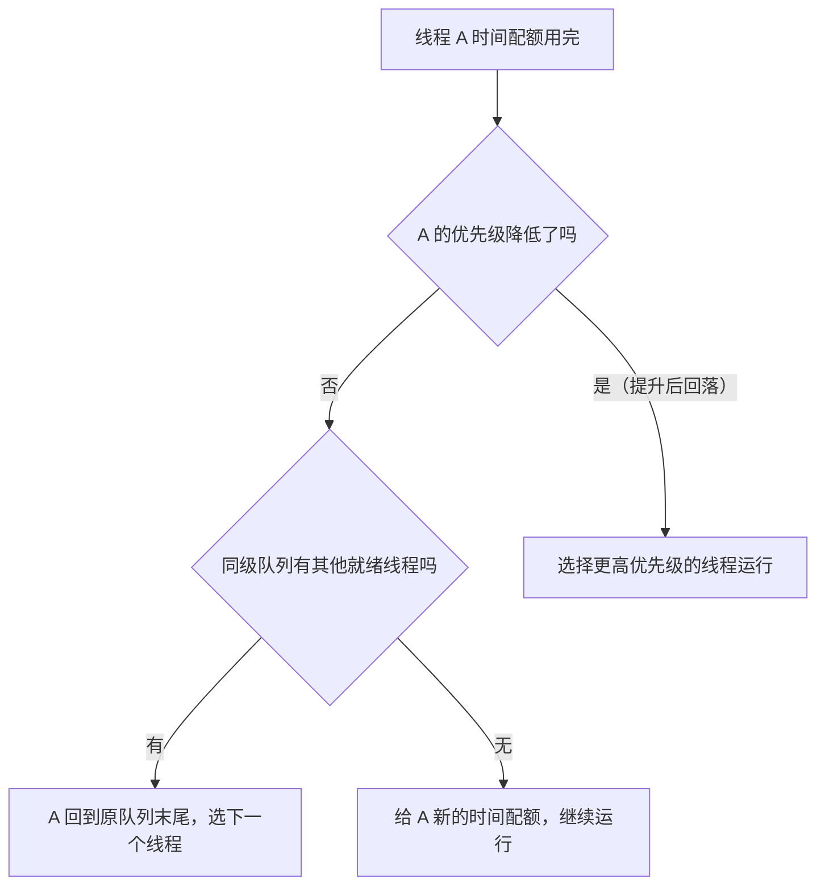
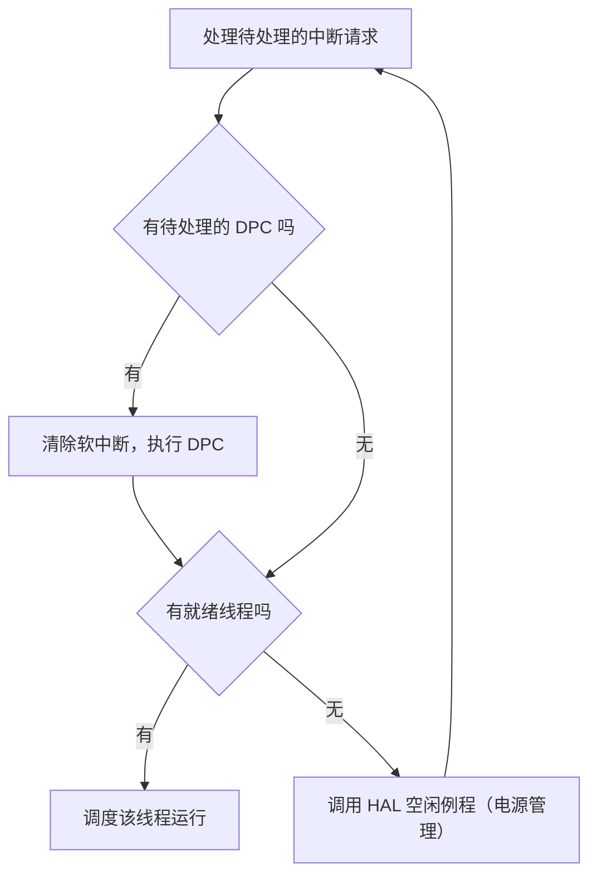

# 07 Windows 线程调度

[本讲目录](../index.md) · [课程目录](../../index.md) · [上一节：06 算法比较与机制策略分离](06-other-algorithms-comparison-and-mechanism-policy.md)

> [!abstract] 本节要点
> - Windows 以线程为调度单位，采用基于动态优先级的抢占式调度并结合时间配额；按优先级进入 32 个就绪队列，总选最高优先级就绪线程，同一优先级内按时间片轮转，用完配额并不必然降级。
> - 优先级 0 为零页线程（系统线程），1–15 为可变优先级（用户线程，有基本优先级与当前优先级），16–31 为实时优先级（系统线程，优先级不变）。
> - 时间配额是配额单位的整数而非时间长度；增加配额可以在不提高优先级的前提下多给某线程 CPU 时间。
> - 被抢占线程回到原优先级队首：实时优先级线程重置完整配额，可变优先级线程只运行剩余配额；配额用完时优先级未降则回队尾（同级无人则再给新配额），优先级已降（提升后的回落）则让更高优先级线程运行。
> - 优先级提升只针对 1–15：I/O 完成按驱动指定幅度提升且配额减 1；平衡集管理器每秒扫描，就绪超过 300 个时钟中断间隔的线程提到 15 并给 4 倍配额，用完立即回到基本优先级。

## 调度单位、原则与调度时机

前几节分别回答了“优先级固定还是可变”“是否抢占”“按优先级分队列还是都从第一级进入”“时间片怎么处理”等问题，Windows 把这些答案组合成一个实际系统。[^s3b8]

**Windows 线程调度**的基本规则：[^s1p62]

1. **调度单位是线程**：Windows 同时支持进程和线程，线程是上 CPU 的单位。
2. **基于动态优先级的抢占式调度，结合时间配额调整**：优先级可变；时间片改称**时间配额**（quantum）。
3. **多个就绪队列**：就绪线程按优先级进入相应队列——即“不同优先级进不同队列”的排队方式，而不是像 BSD 那样新进程都进第一级再降级。
4. **总是选择优先级最高的就绪线程**：高优先级队列空了才轮到下一级。
5. **同一优先级内按时间片轮转**：不存在“用完时间片就降一级”的规则，但这不等于优先级绝不下降（见后文配额用完的第二种情况）。
6. **多处理机系统中允许多个线程并行运行**。

引发线程调度的条件中，以下四条就是通用的调度时机（见 L06「03 调度时机」）：线程正常终止或因错误终止；新线程创建或等待线程变为就绪；线程从运行态进入阻塞态；线程从运行态变为就绪态。Windows 另外增加了两条：[^s1p62]

- **线程的优先级改变了**：在基于优先级的抢占式调度中，优先级一变，就绪队列的“格局”就变了，可能出现比当前运行者更高优先级的线程，必须重新调度。
- **线程改变了它的亲和（Affinity）处理机集合**：线程从一个处理器迁移到另一个时，原处理器上缓存等积累的“态势”会丢失，需要重新建立，所以系统希望线程留在它的亲和处理机上；亲和集合改变（例如增加了一个可用处理器）意味着选择变了，需要重新调度。[^s3b8]

## 线程优先级与调度器数据结构

**Windows 线程优先级**共 32 级，分三类：[^s1p63]

| 优先级 | 类别 | 使用者 | 能否改变 |
|---|---|---|---|
| 16–31 | 实时优先级 | 系统线程 | 不改变 |
| 1–15 | 可变优先级 | 用户线程（如游戏、文字处理） | 可在一定范围内升高或降低 |
| 0 | — | 零页线程（系统线程） | — |


图：Windows 的 32 级线程优先级——16–31 为实时优先级（不改变），1–15 为可变优先级（有基本优先级与当前优先级），0 为用于清零空闲物理页面的零页线程。

这一划分体现了“系统线程优先级高于用户线程”的一般原则。实时优先级线程的优先级由操作系统按重要性分配好，不再调整。可变优先级线程有两个类似 PCB 字段的属性：**基本优先级**（base priority，创建时确定）和**当前优先级**（current priority，可以被临时提升，调度依据的是它）。[^s3b9]

**零页线程**（zero page thread）的工作是把系统中的空闲物理页面清零，它运行在优先级 0，只有在没有别的线程可运行时才轮得到它。[^s1p63]

> [!note] 补充解释
> 讲授录音把优先级 0 的线程称作 idle 线程、说它“没事就刷内存”，混淆了两个线程。**零页线程**负责把空闲物理页清零（页面交给新进程前先清零，避免泄露上一个使用者的数据）；**空闲线程**（idle thread）是每个处理机在无事可做时运行的循环，见本节最后的“空闲线程”。课件把两者的优先级都写作 0；微软文档则把零页线程称为唯一优先级为 0 的线程，空闲线程不在就绪队列中参与竞争。笔记以课件为准区分二者。

**调度器数据结构**：进程对象中有缺省基本优先级、缺省处理机偏好和缺省时间配额，线程对象从中继承并拥有自己的基本优先级、当前优先级、处理机偏好和时间配额。此外，Windows 维护两张 32 位位图：[^s1p65]

- **就绪位图**：每一位对应一个调度优先级，指示该优先级的就绪队列中是否有线程等待运行。调度器用它直接找到“有线程的最高优先级队列”，不必逐个检查 32 个队列。
- **空闲位图**：每一位对应一个处理机，指示该处理机是否处于空闲状态。

> [!info] 可视化资源
> - [Microsoft Learn：Scheduling Priorities](https://learn.microsoft.com/en-us/windows/win32/procthread/scheduling-priorities)：看文末表格：进程优先级类与线程优先级级别如何组合成 1–15、16–31 的基本优先级；0 级只属于零页线程。

## 时间配额

时间片若只是一段时间长度，就只能用来“到点切换”；Windows 把它改为可加可减的数值，使它同时成为调整偏好的手段。**时间配额**不是一个时间长度值，而是一个称为**配额单位**（quantum unit）的整数。线程对象 KTHREAD 中有 `Quantum`（当前剩余配额）和 `QuantumReset`（重置时的完整配额）两个字段，内核源码中有如下定义：[^s1p64]

```c
#define CLOCK_QUANTUM_DECREMENT 3
#define WAIT_QUANTUM_DECREMENT 1
```

> [!note] 补充解释
> 据 *Windows Internals*：每次时钟中断，运行线程的配额减 `CLOCK_QUANTUM_DECREMENT`（3 个单位）；线程结束一次等待时减 `WAIT_QUANTUM_DECREMENT`（1 个单位）。客户端版本默认配额约为 6 个单位，即 2 个时钟中断间隔。用比时钟滴答更细的整数计量，是为了让“等待一次”这种不足一个时钟周期的消耗也能被计入。这是 Windows 2000/XP 时期的记账方式，Vista 起改为按 CPU 周期精确记账，但配额单位的概念保留。

一个线程用完时间配额时，如果没有其他相同优先级的线程，Windows 将重新给它分配一个新的时间配额并继续运行。[^s1p64]

> [!example] 例：前台游戏与后台电子表格
> 用户先启动一个运行时间很长的电子表格计算程序，再切换到一个需要复杂图形计算和显示的游戏（CPU 型）。两者都是用户线程。
>
> 1. **若提高游戏的优先级**：游戏总在更高优先级队列中就绪，后台电子表格几乎得不到 CPU。
> 2. **若增加游戏的时间配额**：两者优先级相同、仍在同一队列轮转，电子表格照常推进，只是游戏每轮得到的 CPU 时间多一些。
>
> 因此 Windows 通过调整时间配额来调整对不同线程的偏好，而不改优先级。[^s1p64] 多级反馈队列中“优先级低但时间片大”也是同样的平衡思想。

## 三种调度场景

调度机制已经确定（按优先级排队、选最高优先级），接下来讨论的是三种场景下的策略：主动切换、抢占、时间配额用完——与多级反馈队列中讨论过的场景相同。[^s1p66]

### 主动切换

运行线程因 I/O 或等待事件转入阻塞态，主动让出 CPU。调度器选当前最高优先级的非空队列中的线程。例如优先级 20 的线程阻塞，19 级队列为空，就从 18 级队列选一个线程上 CPU。[^s1p67]

### 抢占

优先级 18 的线程正在运行，先前阻塞的 20 级线程被唤醒回到就绪队列，立即抢占 18 级线程。被抢占的线程**放回相应优先级就绪队列的队首**；再次上 CPU 时配额的处理按类别不同：[^s1p68]

- **实时优先级线程**：时间配额被重置为一个完整的时间配额。这些是为用户线程服务的重要系统线程，越快把服务做完越好，所以不计较配额。
- **可变优先级线程**：时间配额不变，重新得到处理机后只运行剩余的时间配额。它已经回到队首，待遇已算优厚，不再额外补偿。[^s3b9]



图：优先级 20 的线程从阻塞态唤醒后抢占正在运行的优先级 18 线程，被抢占线程放回优先级 18 就绪队列的队首；下方说明实时优先级重置完整配额、可变优先级保留剩余配额。

### 时间配额用完

设线程 A 的时间配额用完，分两种情况：[^s1p69]

1. **A 的优先级没有降低**：若同级队列中有其他就绪线程，选下一个线程执行，A 回到原就绪队列末尾；若同级没有其他就绪线程，系统给 A 分配一个新的时间配额，让它继续运行。
2. **A 的优先级降低了**：Windows 将选择一个更高优先级的线程。优先级之所以会降，是因为 A 此前被临时**提升**过——用完提升期间的配额后要回落到较低队列，这时原来比它低、现在比它高的线程就该运行了。[^s3b9]



## 优先级提升与饥饿处理

任何调度策略都不是完美的，不会让所有应用都受益：它可能对某类线程有倾向性，可能因潜在的不公平造成饥饿，也需要改善吞吐量、响应时间等整体特征。Windows 的解决方案有两个：**提升线程的优先级**，以及**给线程分配一个很大的时间配额**。[^s1p70]

> [!info] 可视化资源
> - [Microsoft Learn：Priority Boosts](https://learn.microsoft.com/en-us/windows/win32/procthread/priority-boosts)：确认只有基本优先级 0–15 的线程会被提升，前台、窗口输入、等待完成三类提升，以及每用完一个时间片降一级直至基本优先级。

**优先级提升**（priority boost）只针对可变优先级范围（1–15）内的线程，实时优先级线程不受影响。以下 5 种情况 Windows 会提升线程的当前优先级：[^s1p71]

1. I/O 操作完成；
2. 信号量或事件等待结束；
3. 前台进程中的线程完成一个等待操作；
4. 由于窗口活动而唤醒窗口线程；
5. 线程处于就绪态超过一定时间还没有运行——“饥饿”现象。

### I/O 操作完成后的提升

线程去做 I/O，说明它没用完配额就主动让出了 CPU，回来时应当对它友好一点。规则如下：[^s1p72]

1. 完成 I/O 后，Windows 临时提升等待该操作的线程的优先级，使它更快上 CPU 处理数据。
2. 实际提升值由设备驱动程序决定，建议值在 `Wdm.h` 或 `Ntddk.h` 中；驱动在完成 I/O 请求时通过内核函数 `IoCompleteRequest` 指定提升幅度。
3. 提升幅度与 I/O 请求的响应时间要求一致：响应时间要求越高，提升幅度越大；提升后不超过 15。
4. 为避免不公平，唤醒等待线程时把它的时间配额减 1。

第 4 条是“给一点优惠、也要让别人觉得不太不公平”的平衡：优先级升了以尽快运行，但配额减少一点。[^s3b9]

> [!note] 补充解释
> `Ntddk.h`/`Wdm.h` 中的建议值例如：`IO_DISK_INCREMENT` 为 1，`IO_NETWORK_INCREMENT` 为 2，`IO_KEYBOARD_INCREMENT` 为 6，`IO_SOUND_INCREMENT` 为 8——交互性越强的设备提升越多。调用方式见微软文档 [IoCompleteRequest](https://learn.microsoft.com/en-us/windows-hardware/drivers/ddi/wdm/nf-wdm-iocompleterequest)，其第二个参数 `PriorityBoost` 即提升幅度。

### 等待事件和信号量后的提升

> [!info] 依据讲义整理
> 本小节对应课件 p73，课上只讲了 I/O 完成和饥饿两个例子，未讲这一种。

阻塞于事件或信号量的线程得到的处理器时间比 CPU 型线程少，这种提升用来减小两者之间的不平衡。`SetEvent`、`PulseEvent`、`ReleaseSemaphore` 等函数调用可导致事件对象或信号量对象的等待结束。规则如下：[^s1p73]

1. 线程完成对事件或信号量的等待后，优先级提升 1 级；提升以**基本优先级**为基准，提升后不超过 15。
2. 等待结束时时间配额减 1，线程在提升后的优先级上执行完剩余的时间配额。
3. 随后优先级降低 1 级，运行一个新的时间配额；如此逐级下降，直到降回基本优先级。

第 3 步正是“配额用完且优先级降低了”的来源：每次回落都可能让出 CPU 给更高优先级线程。

### 饥饿线程的提升

可变优先级的低优先级线程可能长期被高优先级线程压着，Windows 用一个专门的系统线程来补偿：[^s1p74]

1. **扫描**：系统线程**平衡集管理器**（balance set manager）每秒醒来一次，扫描就绪队列，找出排队超过 300 个时钟中断间隔仍未被调度的线程。
2. **提升**：把这些线程的优先级提升到 15（可变范围的最高级），并分配一个长度为正常值 4 倍的时间配额。高优先级让它很快被调度，大配额让它运行足够长，以弥补此前饥饿的损失。[^s3b10]
3. **回落**：被提升线程用完这次配额后，优先级立即衰减到它原来的基本优先级——这又是“配额用完、优先级降低”的情形。

> [!warning] 易错点
> 饥饿线程被提到 15 而不是 31：优先级提升只在可变优先级范围 1–15 内进行，用户线程永远不会进入实时优先级区间。另外，I/O 完成是“提升优先级 + 配额减 1”，饥饿处理是“提到 15 + 4 倍配额”，两者对配额的处理方向相反。

## 空闲线程

> [!info] 依据讲义整理
> 本小节对应课件 p75–76，课上未讲解。

处理机总得有东西可执行。如果一个处理机上没有可运行的线程，Windows 会调度该处理机对应的**空闲线程**（idle thread）。由于多处理机系统中可能有两个处理机同时空闲，系统为**每个处理机**都配了一个空闲线程。Windows 给空闲线程指定的优先级为 0，它只在没有其他线程要运行时才运行；它的功能就是在一个循环中检测是否有要进行的工作。[^s1p75]

每轮循环依次做：[^s1p76]

1. 处理所有待处理的中断请求；
2. 检查是否有待处理的 DPC（延迟过程调用）请求，若有则清除相应软中断并执行 DPC；
3. 检查是否有就绪线程可进入运行状态，若有则调度该线程运行；
4. 调用硬件抽象层（HAL）的处理机空闲例程，执行相应的电源管理功能。



> [!question]- 自测：一个基本优先级为 8 的用户线程正在运行，剩余 2 个配额单位时被一个优先级 24 的线程抢占。它会被放到哪里？再次上 CPU 时能运行多少配额？如果被抢占的是一个优先级 20 的线程呢？
> 用户线程（可变优先级）放回自身当前优先级就绪队列的队首，再次上 CPU 时配额不变，只运行剩余的 2 个单位。优先级 20 的线程属于实时优先级，同样放回 20 级队首，但配额被重置为一个完整的时间配额。

> [!question]- 自测：基本优先级为 4 的线程在就绪队列中排了很久。平衡集管理器发现它后会怎样处理？它运行完这次配额后又会怎样？
> 若它已就绪超过 300 个时钟中断间隔，平衡集管理器（每秒扫描一次）把它的当前优先级提到 15，并给它正常值 4 倍的时间配额。用完这次配额后，它的优先级立即衰减回基本优先级 4，属于“配额用完且优先级降低”，调度器转而选更高优先级的线程。

> [!question]- 自测：一个基本优先级为 14 的线程等待信号量结束，它的优先级如何变化？若基本优先级为 15 呢？
> 等待结束时以基本优先级为基准提升 1 级到 15，配额减 1，在 15 级执行完剩余配额；随后降 1 级回到 14，运行一个新的配额，此后保持基本优先级。基本优先级为 15 时提升后仍不能超过 15，优先级不变，只有配额减 1。

> [!info]- 来源
> - slides04.pdf：PDF p.61–76
> - L07.docx：DOCX body 179–245

[^s3b8]: L07.docx-DOCX body 179-207
[^s1p62]: slides04.pdf-PDF p.62
[^s1p63]: slides04.pdf-PDF p.63
[^s3b9]: L07.docx-DOCX body 208-232
[^s1p65]: slides04.pdf-PDF p.65
[^s1p64]: slides04.pdf-PDF p.64
[^s1p66]: slides04.pdf-PDF p.66
[^s1p67]: slides04.pdf-PDF p.67
[^s1p68]: slides04.pdf-PDF p.68
[^s1p69]: slides04.pdf-PDF p.69
[^s1p70]: slides04.pdf-PDF p.70
[^s1p71]: slides04.pdf-PDF p.71
[^s1p72]: slides04.pdf-PDF p.72
[^s1p73]: slides04.pdf-PDF p.73
[^s1p74]: slides04.pdf-PDF p.74
[^s3b10]: L07.docx-DOCX body 233-245
[^s1p75]: slides04.pdf-PDF p.75
[^s1p76]: slides04.pdf-PDF p.76

[本讲目录](../index.md) · [课程目录](../../index.md) · [上一节：06 算法比较与机制策略分离](06-other-algorithms-comparison-and-mechanism-policy.md)
