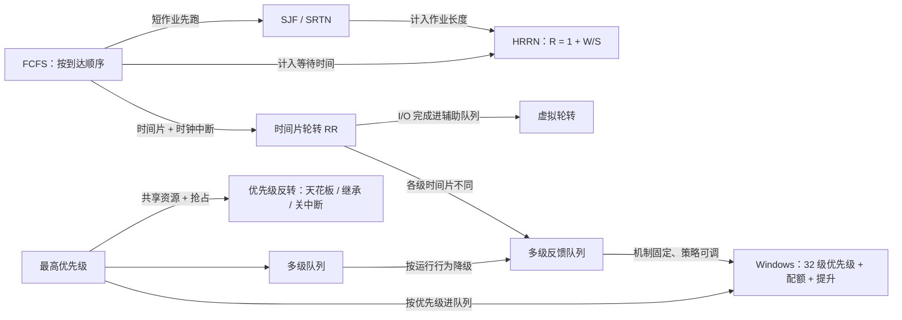

# L07 处理器调度算法

[课程目录](../index.md)

调度机制已经决定了何时选人、如何切换，本讲回答“选谁”：单处理器上各种调度算法如何在公平、饥饿、响应时间、周转时间、开销和对 I/O 型进程的偏好之间折中。路线是先讲批处理系统的 FCFS、SJF/SRTN 与 HRRN，再讲交互式系统的时间片轮转与虚拟轮转，用一个 CPU 型与 I/O 型混合负载比较各算法，随后讲优先级调度与优先级反转、多级队列与多级反馈队列，以算法比较表和机制与策略分离收束，最后以 Windows 线程调度作为综合实例。需要先掌握 L06「03 调度时机」「05 调度目标与衡量指标」，以及 L04、L05 中的进程状态与队列模型。

## 章节导航

- [01 批处理系统的调度算法](chapters/01-batch-scheduling-algorithms.md)：FCFS、SJF/SRTN 与 HRRN：$R=1+\frac{W}{S}$ 的折中
- [02 时间片轮转与虚拟轮转](chapters/02-round-robin-and-virtual-round-robin.md)：RR 由时钟中断驱动，时间片在 FCFS 与切换开销间权衡
- [03 混合负载场景分析](chapters/03-mixed-workload-scenario-analysis.md)：A、B（CPU 型）与 C（I/O 型）共存时比较各算法的利用率
- [04 优先级调度与优先级反转](chapters/04-priority-scheduling-and-priority-inversion.md)：按优先级选进程；反转成因与天花板、继承、关中断
- [05 多级队列与多级反馈队列](chapters/05-multilevel-queue-and-multilevel-feedback-queue.md)：多级队列的设计问题；多级反馈队列的固定机制与可调策略
- [06 算法比较与机制策略分离](chapters/06-other-algorithms-comparison-and-mechanism-policy.md)：彩票等调度、算法比较表、机制策略分离与线程调度
- [07 Windows 线程调度](chapters/07-windows-thread-scheduling.md)：Windows 32 级优先级、时间配额与优先级提升

## 本讲小结

各章的算法不是并列的清单，而是一条逐步“加因素”的演进线：从只看一个指标的 FCFS、SJF，到综合等待与长度的 HRRN；从时间片轮转到偏好 I/O 型进程的虚拟轮转；从静态的优先级到按运行行为反馈分级的多级反馈队列；最后由 Windows 把优先级、抢占、时间配额和优先级提升组合成实际系统。

选算法时先问四个问题：要优化的是周转时间还是响应时间；是否允许抢占；能否预知运行时间；能否容忍饥饿。混合负载的分析说明，能同时让 CPU 和磁盘忙起来的算法都要尽快把 CPU 交给 I/O 型进程，代价则是切换开销或对 CPU 型进程的不公平，所以实际系统都靠可调的策略（优先级提升、配额调整）去补偿。

### 核心公式

| 公式 | 含义 |
| --- | --- |
| $T_{\rm turnaround} = T_{\rm completion} - T_{\rm arrival}$ | 周转时间；所有作业同时到达时等于完成时刻 |
| $R = \frac{W + S}{S} = 1 + \frac{W}{S}$ | HRRN 响应比，$W$ 为已等待时间，$S$ 为处理时间 |
| $\min[s]$、$\min[s-e]$、$\max[w]$ | SJF、SRTN、FCFS 的选择函数，$s$ 为总服务时间，$e$ 为已执行时间，$w$ 为已等待时间 |
| $\frac{t_{\rm switch}}{q}$ | RR 切换开销占比，例如 $\frac{0.1\ \text{ms}}{10\ \text{ms}} = 1\%$ |

## 不确定事项

- L06 的章节划分未在本运行中核对：就绪队列两种组织方式归入 L06「06 调度算法设计要点」系根据 s3b1 回顾内容推断。
- 课件 p33 只有题干表，抢占式各时刻剩余时间表为据 p32 数据推算，未与课件答案页核对（答案页不在文本单元中）。
- Windows 的零页线程/空闲线程优先级在课件（都为 0）与微软文档（只有零页线程为 0）之间存在差异，笔记以课件为准并注明。
- 课件“5.3BSD”保留原文并以补充说明指出可能为 4.3BSD 笔误，未找到课程方的确认。

> [!info]- 来源
> - slides04.pdf：PDF p.14, 26–76
> - L07.docx：DOCX body 1–245
