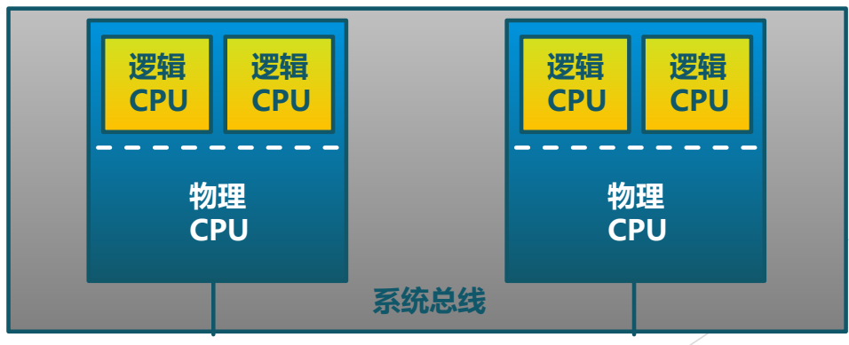
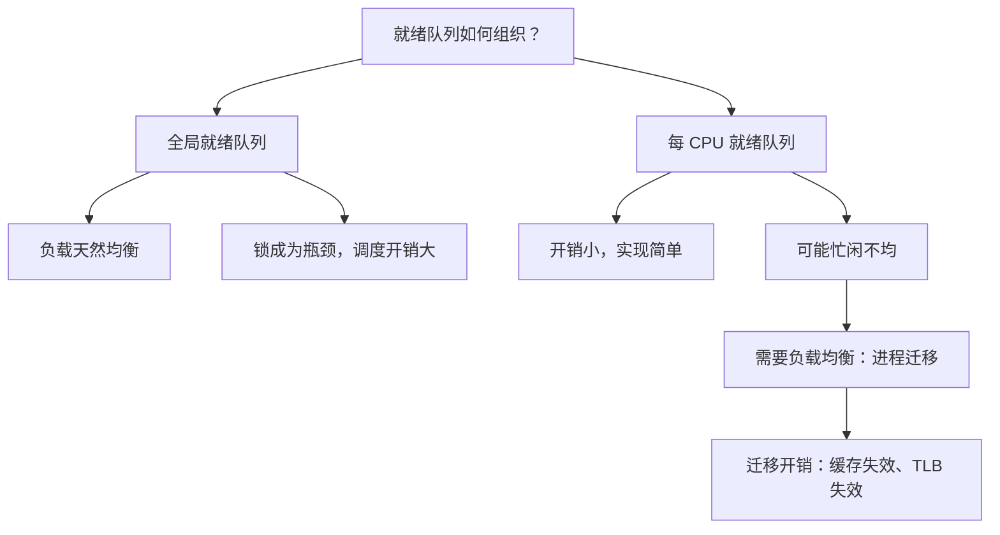

# 01 多处理器调度的基本问题

[本讲目录](../index.md) · [课程目录](../../index.md) · [下一节：02 多核缓存问题与负载均衡](02-multicore-cache-and-load-balancing.md)

> [!abstract] 本节要点
> - 多处理器调度在单处理器调度之上多了一维：既要决定**选哪个进程**，还要决定**在哪个 CPU 上执行**。
> - SMP 中所有处理器通过同一条总线访问内存，访问哪块内存代价都一样；NUMA 由多个节点组成，访问其他节点的内存更远，调度时必须考虑这一点。本课以 SMP 为基础。
> - SMP 上每个处理器运行自己的调度程序，算法与单处理器基本相同，但访问共享资源（如共享就绪队列）需要同步（加锁）。
> - 全局（公共）就绪队列天然负载均衡，但锁成为瓶颈、调度开销大；每 CPU 一个就绪队列开销小，但各 CPU 可能忙闲不均，需要负载均衡。
> - 进程跨 CPU 迁移会造成高速缓存失效和 TLB 失效，所以基本原则是尽量让进程总在同一个 CPU 上执行。

## 从单处理器到多处理器

单处理器调度（L06、L07）的重点是多级反馈队列和 Windows 调度。它们的共同经验是综合考虑多种因素：公平性，响应时间、吞吐量等指标，是否会导致饥饿，是否允许抢占，并且在算法上偏向 I/O 密集型进程（见 L07「05 多级队列与多级反馈队列」「07 Windows 线程调度」）。当系统中有多个处理器时，这些考虑依然成立，但又多出了与硬件结构有关的新问题。

> [!info] 可视化资源
> - [OSTEP 第 10 章 多处理器调度（PDF）](https://pages.cs.wisc.edu/~remzi/OSTEP/cpu-sched-multi.pdf)：看 10.3–10.5 节：单队列（SQMS）的锁与亲和性问题，多队列（MQMS）的负载不均与迁移。

调度算法的设计要和硬件架构相匹配。多处理器常见两种架构：

- **对称多处理器（SMP, Symmetric Multiprocessing）**：所有处理器（CPU、核）都挂在一条系统总线上，通过它访问同一块内存。任何处理器访问任何一块内存的代价相同，不存在“远近”之分。[^s3b1]
- **非一致内存访问（NUMA, Non-Uniform Memory Access）**：由多个节点组合而成，每个节点有自己的处理器和本地内存。处理器访问本节点的内存近、快，访问其他节点的内存远、慢。因此调度时要考虑进程和它所用内存是否在同一节点上。

SMP 更常见，本课以 SMP 为基础讨论。NUMA 只需了解它的特性。

## SMP 调度的特征

**多处理机系统**由多个处理器组成。SMP 下的调度有三个特征：[^s1p78]

1. **每个处理器运行自己的调度程序**：调度程序不是集中在某一个 CPU 上运行，而是每个处理器各自执行调度程序，为自己选择下一个进程。
2. **处理器间可负载共享**：工作可以在处理器之间分担，空闲的处理器可以运行别处的进程。
3. **调度程序对共享资源的访问需要同步**：多个处理器上的调度程序可能同时访问同一份数据（例如共享的就绪队列）。和 ICS 中学过的同步互斥一样，这时必须用锁等机制保护，否则会出现竞争。

图：两个物理 CPU 各含两个逻辑 CPU，共同挂在系统总线上；注意每个逻辑 CPU 都可运行自己的调度程序。

图中每个物理 CPU 包含两个逻辑 CPU（例如超线程），所有物理 CPU 通过同一条系统总线相连。对操作系统而言，每个逻辑 CPU 都是一个可被调度的处理器。

就算法本身而言，SMP 上每个处理器的调度算法与单处理器没有大的区别。唯一的“加法”是：**多处理器调度不仅要决定选择哪一个进程执行，还要决定它在哪一个 CPU 上执行**。[^s1p79] 这个“选 CPU”的问题有多复杂，取决于就绪队列怎么组织。

## 全局队列与每 CPU 队列

就绪进程的排队方式有两种基本选择，它们决定了“选哪个 CPU”问题是否存在、以及代价落在哪里。

**全局就绪队列**（公共就绪队列）：所有处理器共享一个就绪队列，哪个 CPU 空闲就从队列里取进程运行。

- 好处是天然的负载均衡：只要有就绪进程，就不会有 CPU 闲着。
- 坏处是锁成为瓶颈：一个处理器从队列中选进程前要先加锁，其他处理器只能等它选完再选。CPU 越多，争抢这把锁越厉害。[^s3b1]
- 进程每次可能被不同的 CPU 取走，迁移开销频繁出现。

**每 CPU 就绪队列**：每个处理器维护自己的就绪队列，调度程序只从本地队列选进程。

- 好处是简单、开销小：各 CPU 互不干扰，不需要争抢全局锁，也不存在“选哪个 CPU”的问题。
- 坏处是忙闲不均：进程排进了这个 CPU 的队就不在另一个队里。可能出现某个 CPU 的就绪进程特别多、而别的 CPU 空闲的情况，于是需要**负载均衡**（load balancing）。

## 进程迁移的开销

负载均衡的做法是**进程迁移**：一个进程原来在某个 CPU 上运行，当别的 CPU 空闲时，把它移到那个 CPU 上去运行。迁移不是免费的。[^s1p79]

- **高速缓存失效**：进程在 CPU1 上运行时，它的数据和指令已经装入 CPU1 的缓存。被调度到 CPU2 后，CPU2 的缓存里没有这些内容，开始阶段会大量缺失。
- **TLB 失效**：CPU1 的 TLB 中缓存了该进程的地址转换项，换到 CPU2 后要重新建立。

如果每个进程可以被调度到所有 CPU 上，进程上次在 CPU1、这次在 CPU2 运行，就会增加高速缓存失效和 TLB 失效；如果每个进程尽量调度到指定的 CPU 上，这些失效就会减少。所以基本思路是：**尽可能使进程总是在同一个 CPU 上执行**，同时兼顾负载均衡。这两个目标相互冲突，[多核缓存问题与负载均衡](02-multicore-cache-and-load-balancing.md)一章专门讨论这个矛盾及其解法。

## 静态分配与动态分配

把上面的讨论落到 SMP 的进程分配方式上，有两种基本方案：[^s1p80]

| 维度 | 静态进程分配 | 动态进程分配 |
| --- | --- | --- |
| 分配方式 | 进程从开始到结束都固定在一个处理机上执行 | 进程在执行中可分配到任意空闲处理机执行 |
| 队列组织 | 每个处理机有自己的就绪队列 | 所有处理机共享一个公共就绪队列 |
| 调度开销 | 小（无全局锁、无迁移） | 大（需加锁，且有迁移带来的失效开销） |
| 负载情况 | 各处理机可能忙闲不均 | 各处理机负载均衡 |

**静态进程分配**（static assignment）完全不考虑负载均衡，因此开销小，代价是“忙的忙、闲的闲”。**动态进程分配**（dynamic assignment）哪个处理机空闲进程就去哪个，负载均衡，但要承担锁的开销以及高速缓存失效、TLB 失效的开销。[^s3b1]

> [!warning] 易错点
> “动态分配负载均衡”不等于“动态分配性能更好”。动态分配的均衡是用锁竞争和频繁迁移（缓存、TLB 失效）换来的；当进程很多、CPU 很多时，全局队列的锁可能反而拖慢整体。openEuler 等实际系统采用每 CPU 队列加上有节制的迁移（见 [多核缓存问题与负载均衡](02-multicore-cache-and-load-balancing.md)）。

> [!question]- 自测：一台 32 核服务器采用单一全局就绪队列，管理员发现 CPU 利用率不高、但就绪进程很多。最可能的原因是什么？
> 最可能是全局就绪队列的锁成为瓶颈。每个 CPU 选进程前都要先拿到这把锁，32 个核争抢同一把锁，大量时间花在等锁上。负载虽然“均衡”，CPU 却没在干活。

> [!question]- 自测：进程 P 上次在 CPU1 上运行，现在 CPU1 忙、CPU2 空闲。把 P 调度到 CPU2 上一定比在 CPU1 上排队等待更好吗？
> 不一定。迁移到 CPU2 能马上运行，但要付出高速缓存失效和 TLB 失效的代价。如果 P 在 CPU1 上很快就能再次运行，而且它依赖大量已缓存的数据，留在 CPU1 可能更划算。是否迁移要权衡等待时间和迁移开销。

> [!info]- 来源
> - slides04.pdf：PDF p.77–80
> - L08.docx：DOCX body 1–28

[^s3b1]: L08.docx-DOCX body 1-28
[^s1p78]: slides04.pdf-PDF p.78
[^s1p79]: slides04.pdf-PDF p.79
[^s1p80]: slides04.pdf-PDF p.80

[本讲目录](../index.md) · [课程目录](../../index.md) · [下一节：02 多核缓存问题与负载均衡](02-multicore-cache-and-load-balancing.md)
